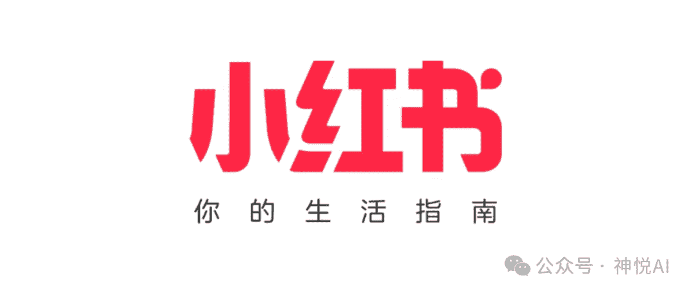
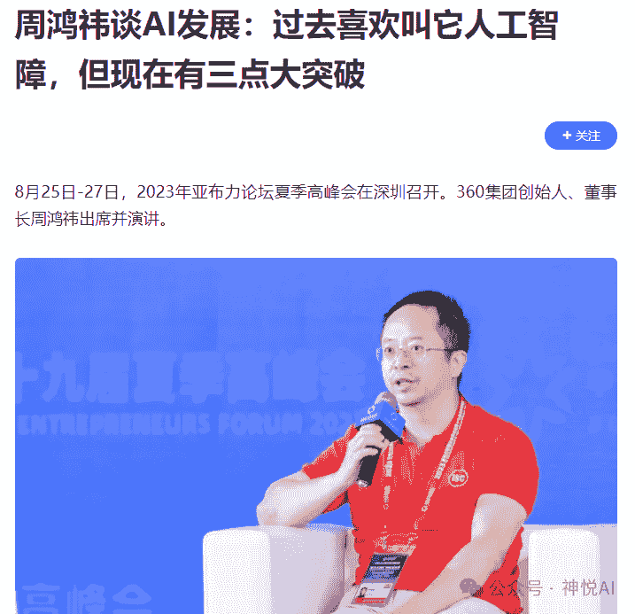
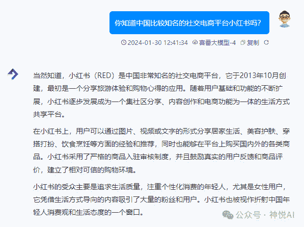

# NO.06👉【AI小红书笔记】3分钟上手，AI写小红书笔记，用GPT批量生成小红书爆款笔记（附工具相关）

> 来源：[https://my.feishu.cn/docx/U32pdu4jSoOmKGxAEhVcncPenOh](https://my.feishu.cn/docx/U32pdu4jSoOmKGxAEhVcncPenOh)

**在小红书上**

**有人借助GPT等AI工具**

**快速批量生产内容**

**收入百万**



利用人工智能技术

尤其是GPT

可以极大地提高小红书内容创作的效率和质量

360的创始人红衣大炮

也是一直在呼吁大家关注AI

他还调侃说

自己之前确实做了20年的智障产品

**但这一次是真智能了**

👇👇👇



本文将详细介绍如何**通过GPT工具**

**快速生成**小红书风格的**爆款笔记**

这一过程不仅节省时间

而且能够批量生产出高质量的内容

对于品牌营销和新媒体运营来说

是一个工作流上

前所未有的突破

---

首先我们需要确保

**GPT对小红书平台有足够的了解**

通过询问GPT是否熟悉小红书

prompt如下

```
你知道中国比较知名的社交电商平台小红书吗？
```



这一步我们可以确认它

**是否能够理解****平台的特性和用户偏好**

一旦确认GPT对小红书有所了解

我们就可以开始**定义具体的角色和任务**

这里给大家分享一个

**迭代了很多次的通用提示词**

👇直接复制粘贴就能用了👇

---

你是小红书爆款写作专家，请你用以下步骤来进行创作，首先产出5个标题（含适当的emoji表情）；

其次产出1个正文（每一个段落含有适当的emoji表情，文末有合适的tag标签）；

一、在小红书标题方面，你会以下技能：

采用二极管标题法进行创作

你善于使用标题吸引人的特点

你使用爆款关键词，写标题时，从这个列表中随机选1-2个

你了解小红书平台的标题特性

你懂得创作的规则

二、在小红书正文方面，你会以下技能：

写作风格

写作开篇方法

文本结构

互动引导方法

一些小技巧

爆炸词

第一人称创作

从你生成的稿子中，抽取3-6个seo关键词，生成标签并放在文章最后

文章的每句话都尽量口语化、简短

在每段话的开头使用表情符号，在每段话的结尾使用表情符号，在每段话的中间插入表情符号

三、结合我给你输入的信息，以及你掌握的标题和正文的技巧，产出内容。请按照如下格式输出内容，只需要格式描述的部分，如果产生其他内容则不输出：

一. 标题

[标题1到标题5]

[换行]

二. 正文

[正文]

标签：[标签]

你的第一个任务是，创作一篇主题为“老公一回家就打游戏，我要不要离婚”的小红书笔记。

---

上面**提示词部****分的红字内容

可以替****换成自己需要输出的主题

👇生**成效果如下👇

而且一次生成效果不好

可以直接让他持续写

GPT永远不会累

👇再来一篇👇

通过这种方式

GPT可以在几秒钟内

快速生成一篇完整的小红书笔记

最后我们只需要

筛选自己需要的内容

复制+粘贴

略作修改爆文就完成了

这个过程不仅高效

而且能够保持内容的**一致性和吸引力**

使得批量生产优质内容成为可能

---

通过以上的这种方式

我们可以轻松地利用GPT工具

（GPT4大模型对这段提示词响应效果最好）

快速生成**大量小红书优质笔记**

极大地**提高了**内容**创作的效率**

当然如果你对写作风格有指定要求

**也可以修改提示词**

---

哦对了

如果你还没有GPT4工具

直接到我公众号后台发送

**AI工具**

就可以获取了


**神悦AI**

这是一个喜欢AI的沙雕作者，更新频率就像薛定谔的猫一样。

**公众号**

**都看到这里了**


**能帮忙点个赞，点个在看吗？**

> 感觉有用的话**点个免费的赞吧**，有疑问欢迎在评论区交流！

> 我是热爱生活的小黑子，热爱当下生活，永远忠于自己。