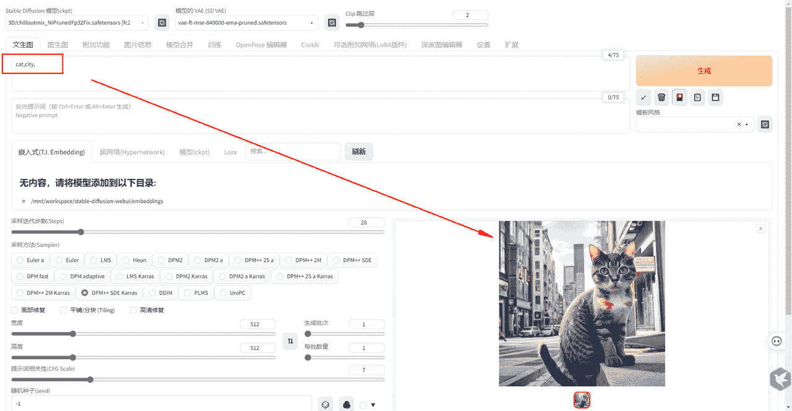
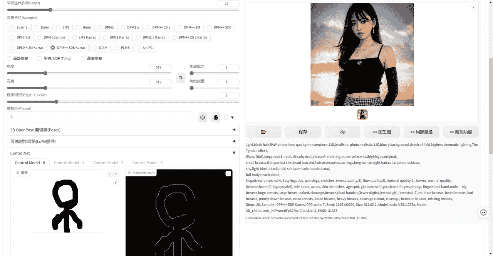
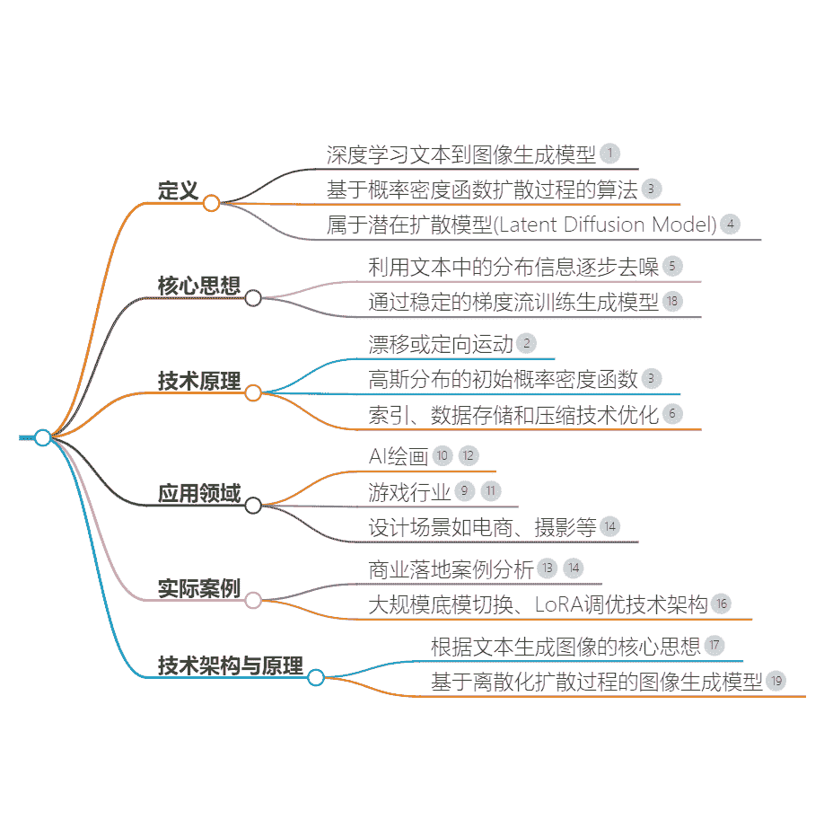

# SD教程NO.01👉什么是Stable Diffusion

> 来源：[https://my.feishu.cn/docx/DLbDdyf4qoprjqxuUYlclIXxnuc](https://my.feishu.cn/docx/DLbDdyf4qoprjqxuUYlclIXxnuc)

### 软件简介

Stable Diffusion简称SD是一款Ai图片生成工具。

**“输入几句话，生成精美图片。”**——我认为不论SD还是其他ai绘画工具，都属于是一种**“抽卡游戏”**，每次生成的图片都是**抽卡，****不可控**。我们给他更多的提示词和各种插件，只是为了缩小抽卡范围。

如图，输入cat（猫）,city（城市），点击生成，等待3秒，就会出来一只小猫咪😸

✨每次点击生成，出来的图片都不一样。

### 使用须知

Ai图片生成工具的使用者是关键。

👉我希望每个学习者，不要拿这类工具做一些违法的事情。

Ai图片生成工具，它使创作**更便捷**，给想象力**更多可能**。

**💑人****机结合，**探索新领域，是未**来艺术发展新方向。**

**生成的图**片**涵盖**各种**风格**和**主题**，从自然风光到肖像，从卡通到写实等等非常广泛。

现在已经有很多艺术家，用它来**获取创意**或**直接创作**。

### 内容概览

😍当我们熟练运用后你就可以做这样的图片：

我理解的Ai图片生成工具就像PS一样，它并不是为了取代人类艺术创作者，而是成为人类艺术创作者的好帮手；

而且它拆掉了艺术创作的门槛，让普通人参与进来，将心中所想“画”出来。

甚至小时候我们最喜欢在书本、草稿纸上的那些简单涂鸦，它能帮你转化成图像。（controlnet插件）

如果有不清楚的可以评论区留言，我能解答的都会及时回复，小伙伴们也可以回答，让我们共建良好的学习环境。

> 我是神悦，热爱当下生活，永远忠于自己。

> 感觉有用的话**点个免费的赞吧**，有疑问欢迎在评论区交流！

### **完整介绍**

Stable Diffusion是一种深度学习模型，主要用于文本到图像生成的任务。它在2022年发布，能够根据文本的描述生成详细的图像。Stable Diffusion的核心思想是利用文本中包含的分布信息来指导去噪，从而生成一张与文本描述相匹配的图像[[1]][[5]]。该模型采用了潜在扩散模型（Latent Diffusion Model），通过概率密度函数扩散过程将高斯分布的初始概率密度函数作为输入，经过一系列时间后得到一个相对稳定的图像[[3]][[4]]。此外，Stable Diffusion还具有一定的稳定性和可控性，能够将文本信息自动转换成高质量、高分辨率的图像[[12]]。

Stable Diffusion的技术原理涉及到从嘈杂或无意义的图像开始，通过一系列的扩散步骤，逐步增加图像的分辨率，最终得到一个全新的图像[[2]][[19]]。这种模型的应用不仅限于图像生成，还可以应用于多种任务，如内补绘制、外补绘制等[[1]]。Stable Diffusion API作为一个功能强大的工具，已经逐渐应用于游戏行业中，为游戏开发者提供了丰富的想象空间[[9]][[11]]。

总的来说，Stable Diffusion是一个高效、可控的文本到图像生成模型，其核心原理是通过扩散过程将噪声图像转化为目标图像，并在此基础上进一步提高生成图像的质量和多样性。

**相关事件**

---

**相关组织**

---

**相关人物**

1. Stable Diffusion简介 - 知乎专栏 [2023-04-09]

[2. 深入浅出讲解Stable Diffus](https://zhuanlan.zhihu.com/p/627133524)ion原理，新手也能看明白 - 知乎专栏

[3. Stable Diffusion：从](https://developer.baidu.com/article/details/1821273)基本概念到应用案例 - 百度开发者中心 [2024-02-17]

4. Stable Diffusion原理详解 - 阿里云开发者社区 [2023-05-17]

5. 十分钟读懂Stable Diffusion运行原理 - 博客园 [2023-05-13]

[6. Stable Diffusion：从](https://developer.baidu.com/article/details/1820784)基本概念到应用案例 - 百度开发者中心 [2024-02-16]

[7. Stable Diffusi](https://zhuanlan.zhihu.com/p/584562722)on的入门介绍和使用教程 - 知乎专栏 [2022-11-17]

[8. 超高质量图解Stable Diffusion ，看](https://www.ithome.com/0/668/981.htm)完彻底搞懂「图像生成」原理- IT之家 [2023-01-20]

[9. Stable Diffusion API 如](https://zhuanlan.zhihu.com/p/655628685)何应用到游戏行业？3个案例帮你快速了解！

[1](https://www.nolibox.com/creator_articles/principle_of_stablediffusion.html)0. stable diffusion 原理是什么？stable diffusion 原理介绍- AI绘画每日一帖 [2023-01-09]

[11. Stable Diffusion API 如何](https://juejin.cn/post/7277382175866847284)应用到游戏行业？3个案例帮你快速了解！ [2023-09-11]

[12. Stable Diffusion是](https://pixso.cn/designskills/what-is-stable-diffusion/)什么？小白必看入门教程！ - Pixso

[13. 案例解析！3个实战应用场景帮你深](https://www.5bei.cn/case-analysis-application-scenarios-stable-diffusion.html)度掌握Stable Diffusion [2023-11-19]

14. Stable Diffusion综合案例_聚梦小课堂的博客

15. Stable Diffusion原理解读 - 知乎专栏

[16. AIGC 商业化道路探索- Stable](https://developer.aliyun.com/article/1352214) Diffusion 商业化应用（上） [2023-10-17]

[17. Stable Diffusi](http://shiyanjun.cn/archives/2212.html)on 模型技术架构与原理 - 简单之美 [2023-07-31]

[18. Stable Diffusion](https://blog.csdn.net/i042416/article/details/132965175) 的工作原理介绍原创 - CSDN博客 [2023-09-18]

[19. 深入理解图像生成Diffusion技术与Stable ](https://developer.baidu.com/article/details/2703153)Diffusion原理-百度开发者中心 [2024-01-07]