# Stable Diffusion完美平替工具

> 来源：[https://my.feishu.cn/docx/Rvp1dv00MoFOG9xZyR4c9WgBn3g](https://my.feishu.cn/docx/Rvp1dv00MoFOG9xZyR4c9WgBn3g)

原文：[AI做Q版人物：免费！3秒1张图，画师原地失业……Stab](https://mp.weixin.qq.com/s?__biz=Mzg5NTg4NzM4OA==&mid=2247484536&idx=1&sn=75c68535718b677a36639361382c04a4&chksm=c008350bf77fbc1dc91cb75ca6951bf89881aaed2a3e0f1f365c0928fca6fb8e509363376a20&token=1845478988&lang=zh_CN#rd)le Diffusion也可以卸载了……

只需要1张图片，就将任何人物，复刻成一个独一无二的Q版手办形象……

而且是**免费、不限量**生成的，平均**每张图制作时间只需要1秒**……

不论是真人，还是游戏人物，又或者各种漫画角色……

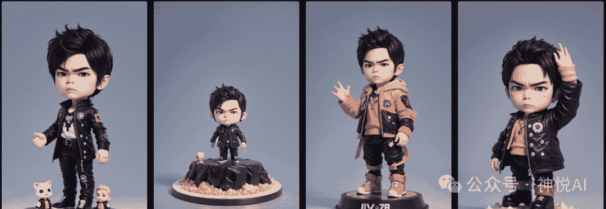

而且这个角色的造型，由你自己决定，比如猫娘版的JAY

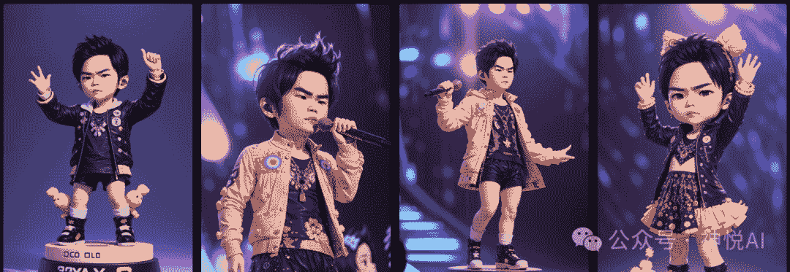

用AI每个人都可以成为自己故事的主角，将梦想变为现实的力量……

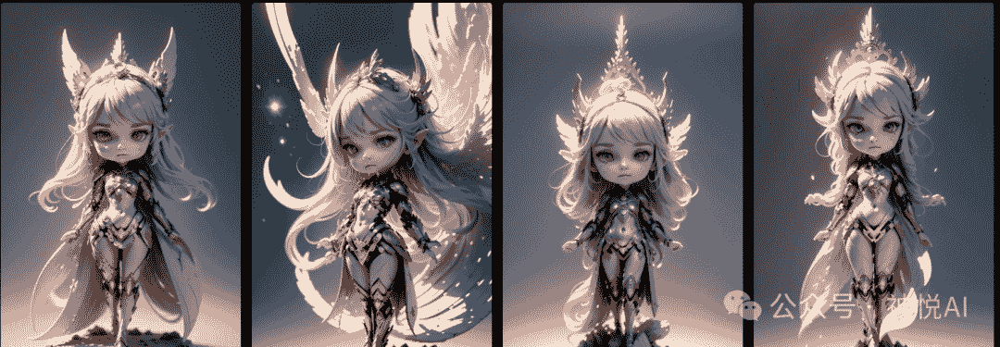

---

往下看，只需要花5分钟，就可以掌握这个工具的使用技巧。

**（成象原理和Stable Di**ffusion相同，但这次不用学习，不用部署，直接在网页端完成制图）

---

步骤如下👇

**1、自行**完成注册、登录步骤，然后点击模型管理

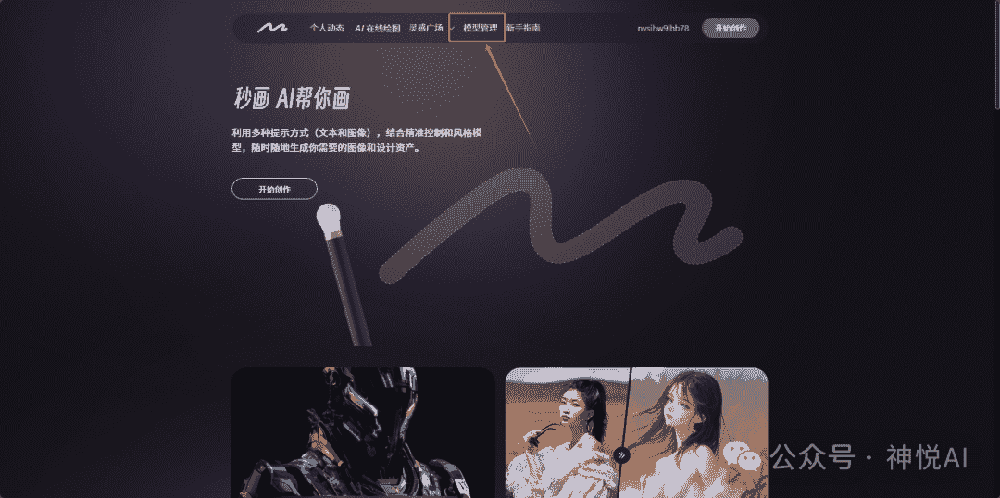

（工具地址**关注👸号**后发送“**秒画**”获取）

**2、创建**模型：依次点击新建模型→训练模型

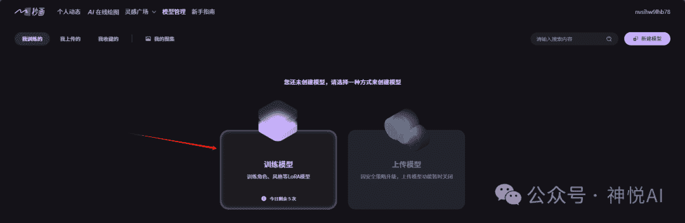

3、上传1个你想做的图片，然后**点击下一步**（我只丢了1张图，百度lol的萨勒芬妮）

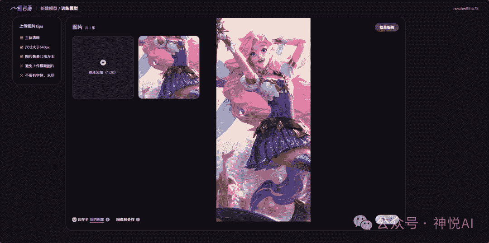

4、设置参数：把主体改成**人物**，然后直接**开始训练**

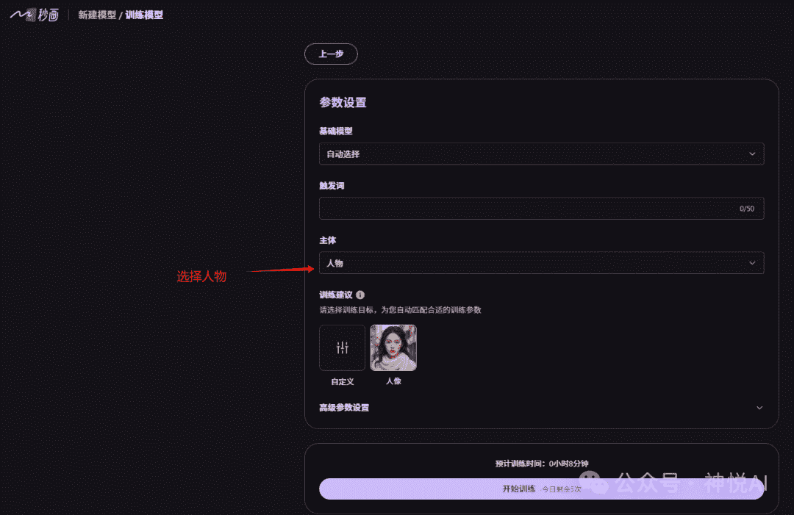

5、AI绘画：返回首页，点击开始创作

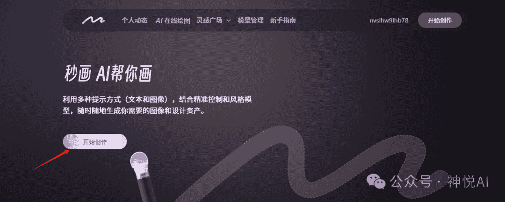

6、参数设置：选择图中的blindbox手办模型，然后选择训练好的lora

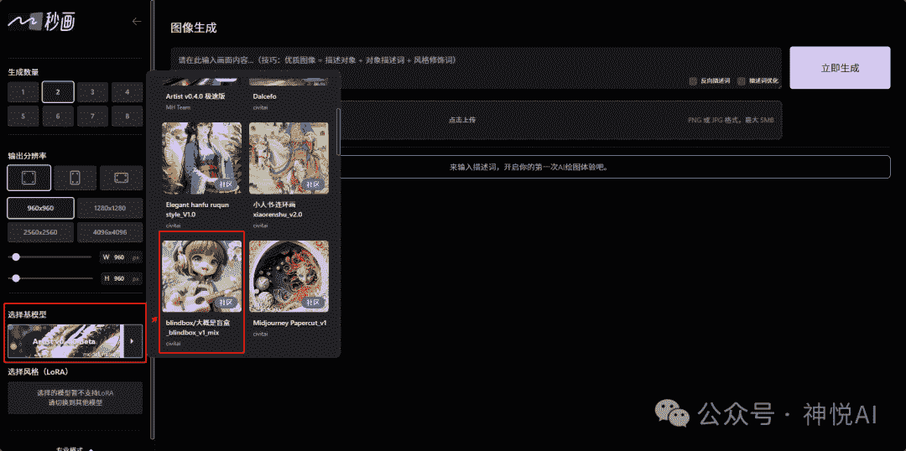

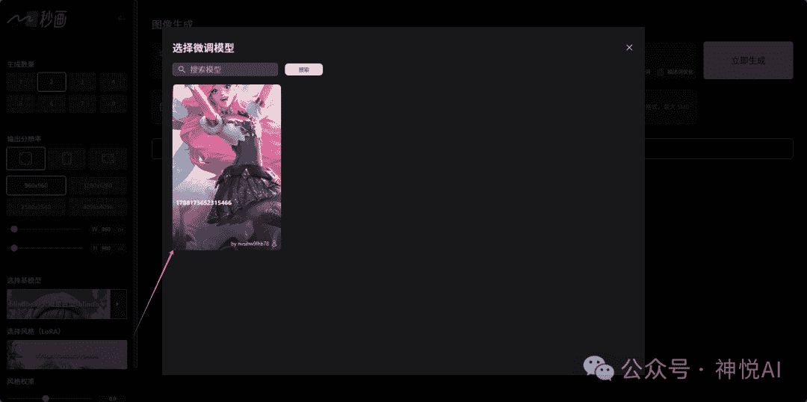

然后把权重调到0.5-0.6，随便写一段提示词，完成。

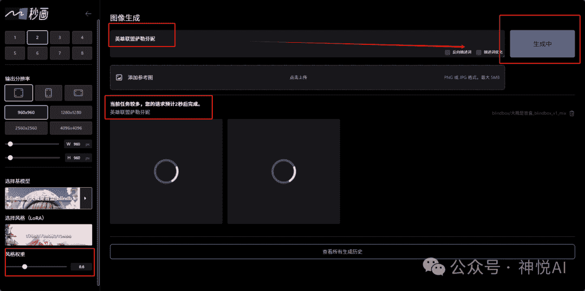

7、完成。基本上1秒1张图，跟SD本地部署4090速度差不多了。

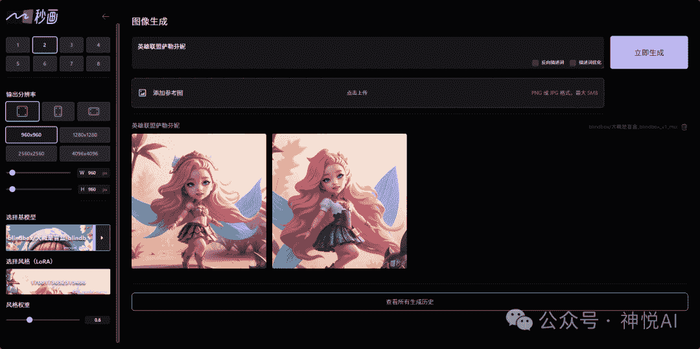

不亏是商汤，C站的全给整过来了……

以上步骤我写成表格了，可以截图保存下，然后按这个步骤来

步骤表格如下：（工具地址**关注👸号**后发送“**秒画**”获取）

神悦AI

这是一个喜欢AI的沙雕作者，更新频率就像薛定谔的猫一样。

👸号

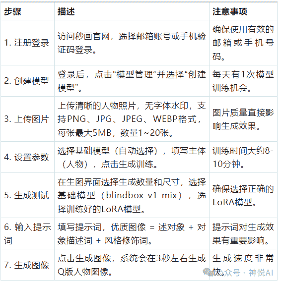

也可以随手截一张这样的图片，然后成象效果如下

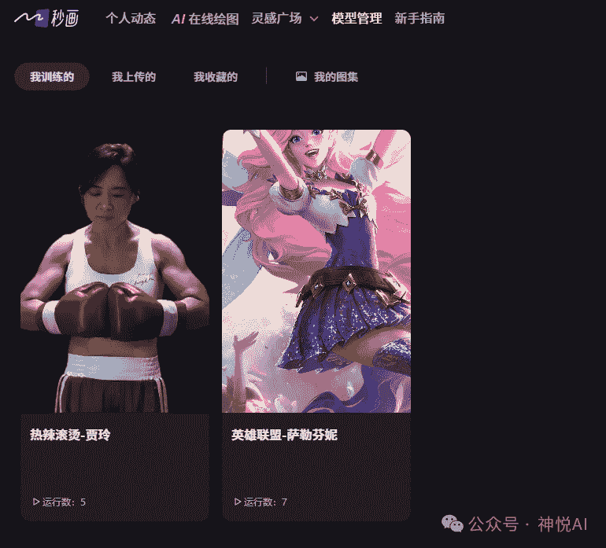

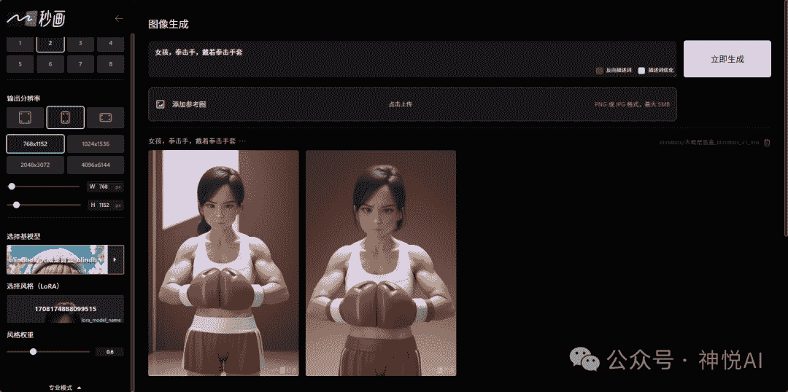

小tip：训练的时候，上传图片越多，出图效果越好。

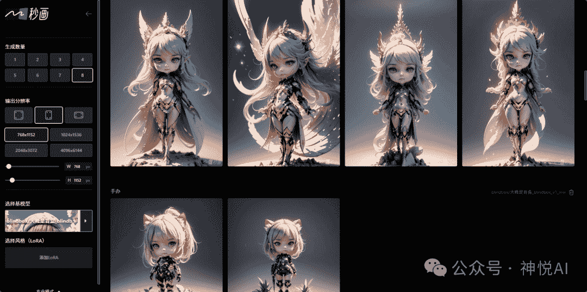

更多AI绘画技巧，后台私信**AI教程**获取

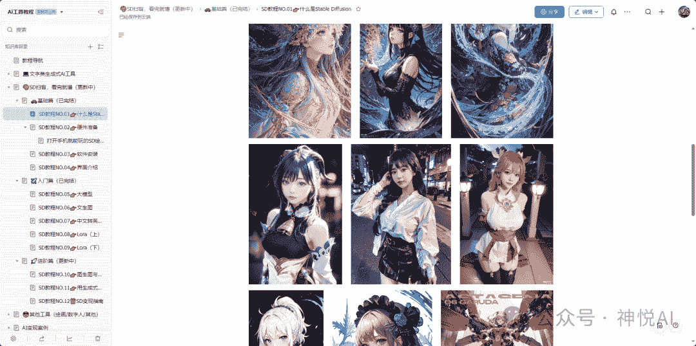

神悦AI

这是一个喜欢AI的沙雕作者，更新频率就像薛定谔的猫一样。

👸号