# SD教程NO.05👉大模型

> 来源：[https://my.feishu.cn/docx/SfgAdN8r7om6qSxdmYOcb3gcn8f](https://my.feishu.cn/docx/SfgAdN8r7om6qSxdmYOcb3gcn8f)

SD是**开源的**，类似安卓，功能**非常强大**✨但是需要搭配大模型、lora、vae、controlnet插件等来实现

目前各种ai绘画工具看**实用性**，SD是全方位**吊打所有人**（😸SD是开源软件不可能给我打钱，所以我不接受反驳）

**如果本身你**是设计岗位，更应该好好学习SD，这是你的生产力工具

### 大模型在界面的位置

👉首选我们看下大模型，在web ui界面上是怎么选择的：

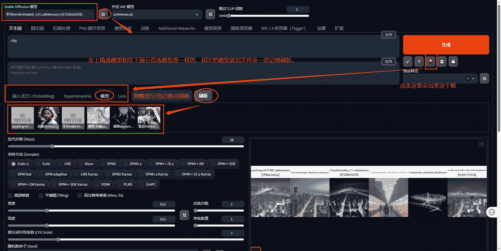

### 不同模型出图对比

SD同样的tag用**不同模型**做出来的图片**画风差别非常大**，我这边放几个对比图

**tag：city**

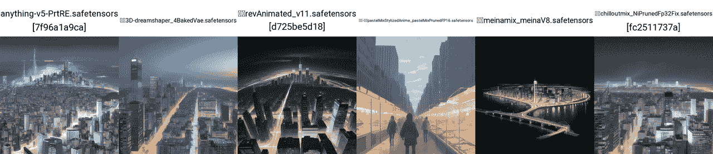

**tag：1girl**

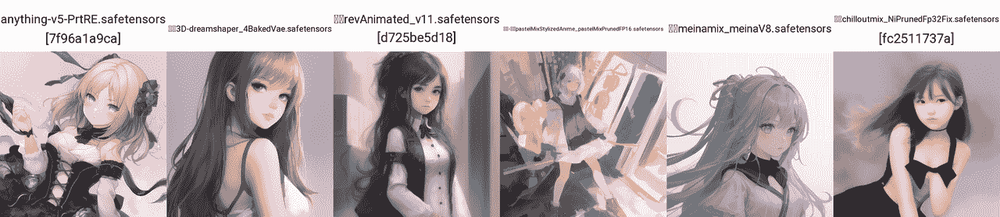

**然后我放一个我比较完整的****tag****，看不同模型下的表现**

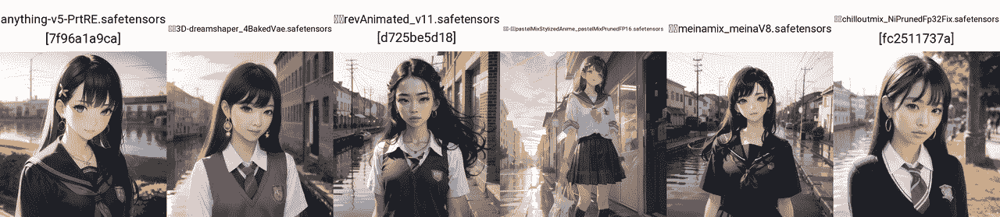

### 如何正确复制参数

这里告诉大家一个小技巧，平时C站看到好的tag和参数想自己试一下，复制粘贴到正面tag然后如图示

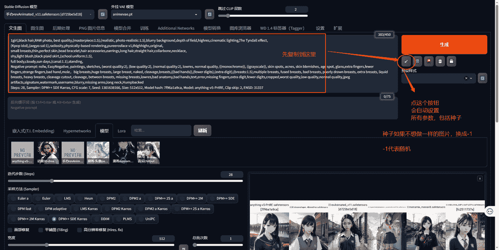

记得种子换成随机

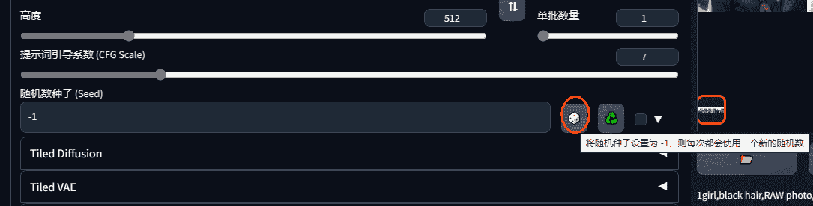

### 描述词分享

刚刚我用的tag，大家可以试一下：

1girl,black hair,RAW photo, best quality,(masterpiece:1.5),(realistic, photo-realistic:1.5),blurry background,depth of field,highres,cinematic lighting,The Tyndall effect,

(Kpop idol),(aegyo sal:1),radiosity,physically-based rendering,pureerosface v1,thighhighs,original,

small breasts,thin,perfect skin,bead bracelet,hair accessories,earrings,long hair,straight hair,collarbone,necklace,

shy,light blush,black plaid skirt,(school uniform:1.5),

full body,cloudy,sun days,(canal:1.1),standing,

Negative prompt: nsfw, EasyNegative, paintings, sketches, (worst quality:2), (low quality:2), (normal quality:2), lowres, normal quality, ((monochrome)), ((grayscale)), skin spots, acnes, skin blemishes, age spot, glans,extra fingers,fewer fingers,strange fingers,bad hand,mole，big breasts,huge breasts, large breast, naked, cleavage,breasts,((bad hands)),(fewer digits),(extra digit),(breasts:1.5),multiple breasts, fused breasts, bad breasts, poorly drawn breasts, extra breasts, liquid breasts, heavy breasts, cleavage cutout, cleavage, between breasts, missing breasts,lowres,bad anatomy,bad hands,text,error,missing fingers,extra digit,fewer digits,cropped,worst quality,low quality,normal quality,jpeg artifacts,signature,watermark,username,blurry,missing arms,long neck,Humpbacked

Steps: 28, Sampler: DPM++ SDE Karras, CFG scale: 7, Seed: 1301638166, Size: 512x512, Model hash: 7f96a1a9ca, Model: anything-v5-PrtRE, Clip skip: 2, ENSD: 31337

### SD必备网站

接下来分享一个大模型和lora相关的下载网站，俗称**C站**，**需要魔法**才能访问：

**❌确认****身边没人****再访**问❌因为这里有大量的nsfw内容，nsfw是**我负面tag**第一词，如果上班访问你会社死🙄

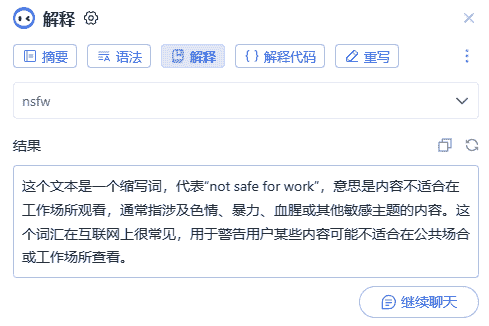

网站收好：https://civitai.com

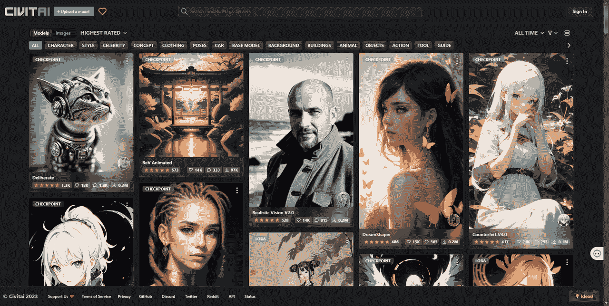

C站需要魔法才能访问，下载速度还可以的。如果你流量不够或者不方便打开，我把上面测试的大模型分享给大家

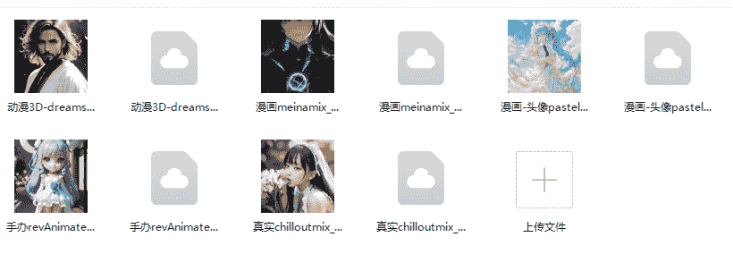

### 大模型下载

🎁链接：https://pan.baidu.com/s/1hGuTy8DQu2HG_5ZEoH69mA?pwd=xhz1

提取码：xhz1

😸模型我自己为了方便，前面加了中文注释，原版是没中文的

下载后放到这个位置，**缩略图和大模型文件都放进去**，**才能看到预览图**，以后模型多了方便自己找

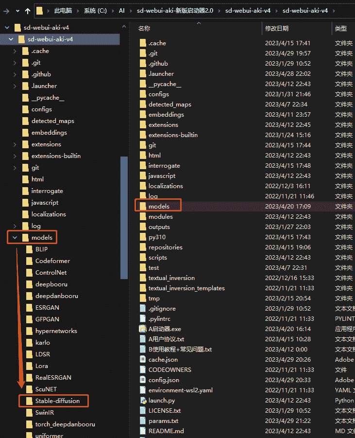

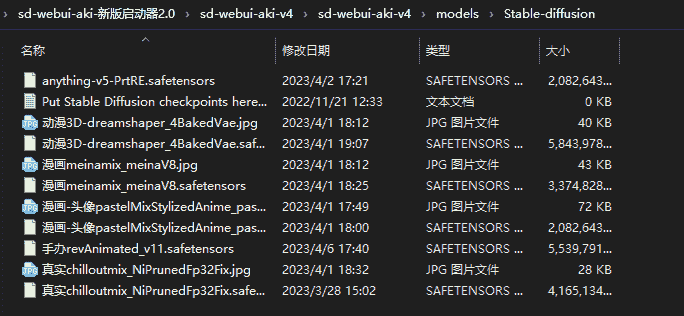

没错，这是开头这张图，模型放进去之后，一定要点刷新！

😸补充：前面说SD是开源的类似安卓系统，那么MJ（midjourney）是封闭的类似苹果系统，给到tag就直接玩，但自由度低，而且结果不可控（4月底有新插件，但不理想）MJ和SD各有所长，创意类的图片MJ强太多了

🤷‍♂️MJ如果可控性更好了，我会考虑开坑，就目前版本来说❌开坑意义不大。

[最强Ai绘画工具Vega.Ai教程（制作中）](https://yw55ojhusnq.feishu.cn/wiki/P58pw4353irg4mkko1bcU4A6ndb)觉SD学的吃力、硬件实在太差的话，可以用这个工具👉

想冲MJ的话选10刀1个月能玩200张图差不多够了；

深度学习，就冲30刀的不限图片数量。

中国区MJ[中国区Mindjourney](https://yw55ojhusnq.feishu.cn/wiki/YGJbwdk5HiHepok9MlUceB18n35)

Slack上如何使用[把Midjourney添加到Slack白嫖！](https://yw55ojhusnq.feishu.cn/wiki/QwCNwyzH8iS2ItkobWFcZxt0nuf)

> 我是热爱生活的小黑子，热爱当下生活，永远忠于自己。