# SD教程NO.09👉Lora（下）

> 来源：[https://my.feishu.cn/docx/EnQJduEMvogvGcxDBfVcvwrrnnh](https://my.feishu.cn/docx/EnQJduEMvogvGcxDBfVcvwrrnnh)

上一期介绍了lora的基础运用，这一期看完后大家将学会：

1.lora及触发词权重对比（及XYZ工具的应用）；

2.lora融合应用；

2.本地炼丹；

## 准备工作

首先我们下载lora文件blindbox_V1Mix

下载地址：

链接：https://pan.baidu.com/s/1n_liE_cgsLCFh2SGoCkAeA?pwd=axhz

提取码：axhz

## 1.lora及触发词权重对比

盲盒lora作为一款独特画风的lora，展现了惊人的兼容性素质。目前我用下来最稳定的大模型是V11；

首先我们对一下，在v11大模型下，触发词权重和lora权重对结果的影响，权重测试我用了0.4-1.6；

这是出图结果：

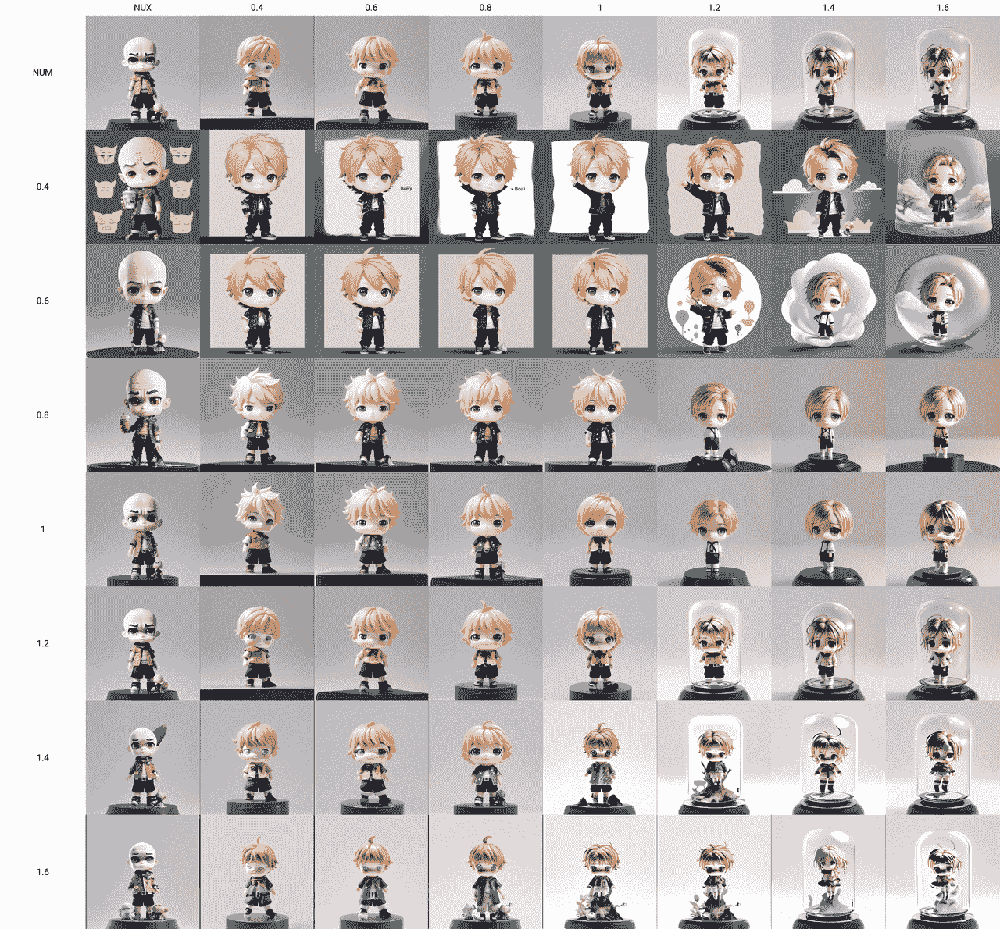

X轴的NUX，是触发词chibi的权重

Y轴的NUM，是lora的权重

可见lora和触发词并不是越高越好，不同权重下出来的结果差别非常大。

完整参数如下👇我没有放负面词：

1boy,(chibi:**NUX**), <lora**:bl**indbox_V1Mix:NUM>

Steps: 20, Sampler: DPM++ SDE Karras, CFG scale: 7, Seed: 2303891798, Size: 512x512, Model hash: d725be5d18, Model: revAnimated_v11, Clip skip: 2, ENSD: 31337

看到这里，顺便把XYZ轴的应用学了，入口在这里👇

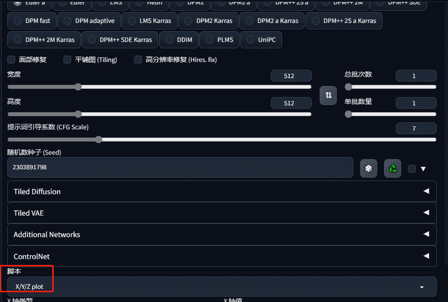

lora、关键词触发如下图，看完就懂了。**比如我****刚才t**ag是1boy,(chibi:NUX), <lora:blindbox_V1Mix:NUM>

那么这里的xy轴，就是把我们tag里面的字母XXX，代入下面的测试数字 0.4 0.6 0.8去生成对应结果

大模型、迭代步数、迭代器啥的都能对比，都是用xyz轴的方式；

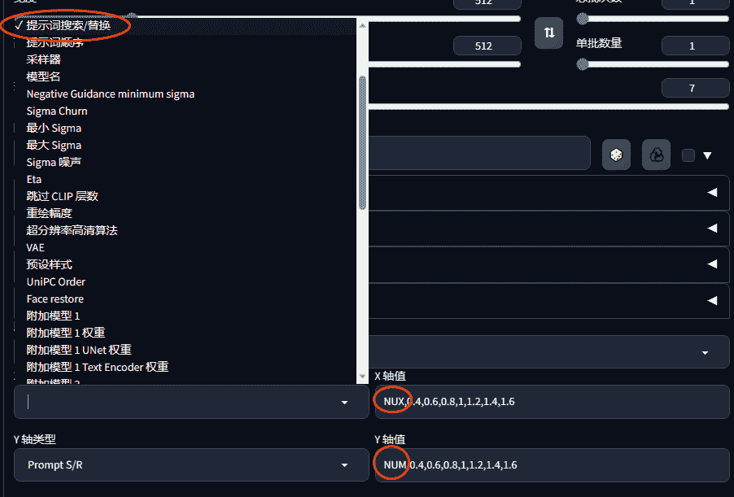

然后选定自己比较满意的一款，这里我选择了:chibi1.6倍权重，lora0.6倍权重；然后我们来尝试lora融合使用

## 2.lora融合应用

✨这次拿原神温迪的lora做一下演示，文件是ventiGenshinImpact_v10放在上边的网盘文件夹；

首先完整tag放进去，

1boy,(chibi:1.6), highly detailed background,garden, venti (genshin impact),

(masterpiece),(best quality),(ultra-detailed),(full body:1.2),

(beautiful detailed face), (beautiful detailed eyes),bangs,

(green beret:1.5),black hair,blue hair,gradient hair,(holding little lyre:1.5),

bow,braid,cape,eyebrows visible through hair,

flower,frills,gem,green eyes,green headwear,hair flower,hair ornament,

hat,leaf,long sleeves,looking at viewer,male focus,multicolored hair,

open mouth,pantyhose,ribbon,shorts,smile,solo,twin braids,

vision (genshin impact),white flower,white legwear,

<lora:blindbox_V1Mix:0.6>，<lora:ventiGenshinImpact_v10:NUM>，

然后**只设置****x轴****lora****权重**，看下效果

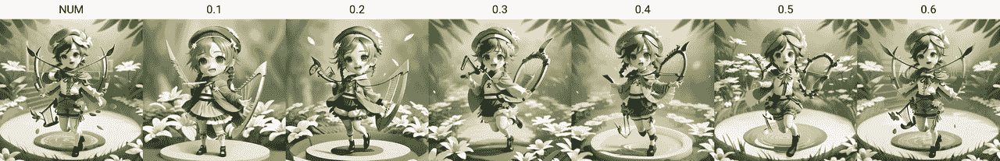

就能看到0.3-0.4左右比较稳定🤷‍♀️太高或太低就有点恐怖了；

**继续****测试👉提**示**词chi**bi1.6权重不变，来对比测试两个lora给不同权重的生图结果；

方法跟刚刚xy轴一样，整体流程如图示：

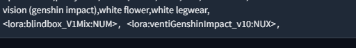

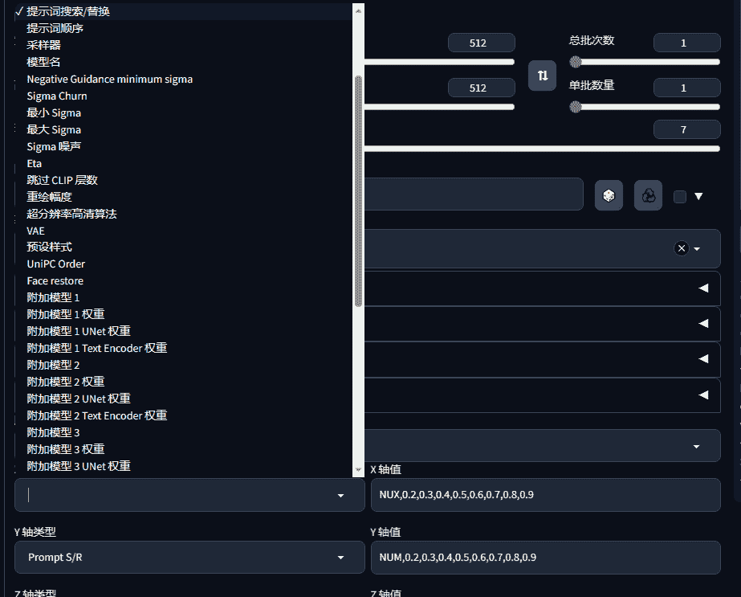

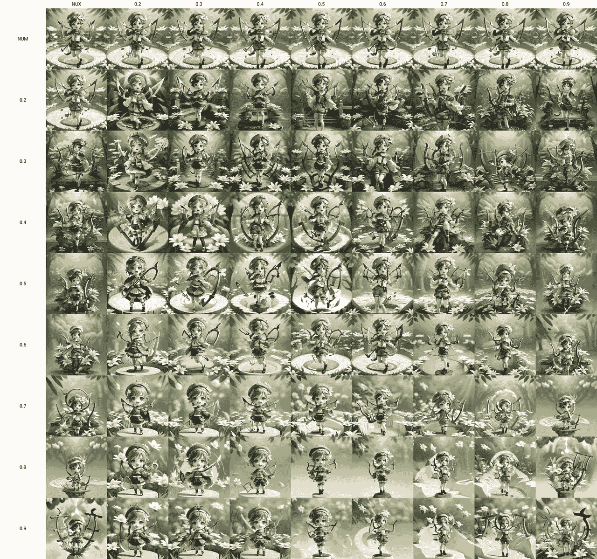

（原图太大了传不上来，大家看个大概意思既可以了）

🎨最后对比结果，选自己需要的参数然后固定！

记得换成随机，然后换表情、姿势、场景等tag等等……开始抽卡吧！

**原神温迪完整参数如下👇**

1boy,(chibi:1.6), highly detailed background,garden, venti (genshin impact),

(masterpiece),(best quality),(ultra-detailed),(full body:1.2),

(beautiful detailed face), (beautiful detailed eyes),bangs,

(green beret:1.5),black hair,blue hair,gradient hair,(holding little lyre:1.5),

bow,braid,cape,eyebrows visible through hair,

flower,frills,gem,green eyes,green headwear,hair flower,hair ornament,

hat,leaf,long sleeves,looking at viewer,male focus,multicolored hair,

open mouth,pantyhose,ribbon,shorts,smile,solo,twin braids,

vision (genshin impact),white flower,white legwear,

<lora:blindbox_V1Mix:NUM>，<lora:ventiGenshinImpact_v10:NUX>，

Steps: 20, Sampler: DPM++ SDE Karras, CFG scale: 7, Seed: 3627673706, Size: 512x512, Model hash: d725be5d18, Model: revAnimated_v11, ENSD: 31337

---

**这里补充一个💥小tip：**

**chilloutmix**大模型下跑出来的各种漂亮小姐姐就是用多lora融合会出比较好的效果，大家可以多尝试一下，像我之前出过的一套图，用了10个lora文件，lora权重总和＞1也能稳定出图，权重别超过2就可以，不然容易崩；

下图我用的是32精度的chilloutmix；大模型下载地址我再发一遍

🎁链接：https://pan.baidu.com/s/1hGuTy8DQu2HG_5ZEoH69mA?pwd=xhz1

提取码：xhz1

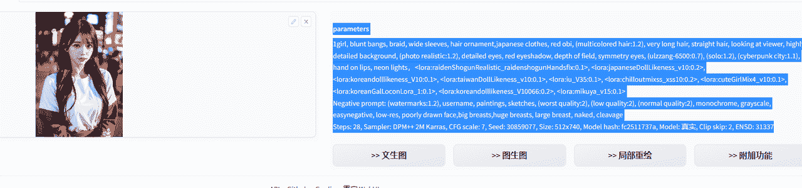

感兴趣的可以自己去C站https://civitai.com找各种模型体验一下，这里我就不发了😂

---

## 3.本地炼丹

就在刚才（2023年5月12日）有UP给到一键炼丹的解决方案了，想无门槛直接尝试的可以试试

（本人还没测试过）：一键炼丹它来啦！我不允许还有人不知道这个！_哔哩哔哩_bilibili

以下是我自己测试过的炼丹流程，确保能顺利出丹👇（10系的卡不能炼丹bug也放了解决方法）

1、首先下载夸克网盘的资源

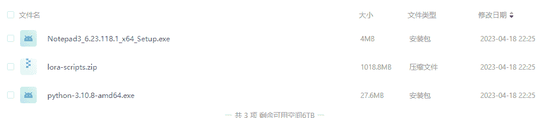

地址奉上：https://pan.quark.cn/s/609d10d0101f

2、解压压缩包（不能解压的话，去搜一下解压软件就好了）

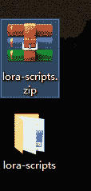

3、安装Notepad

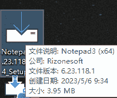

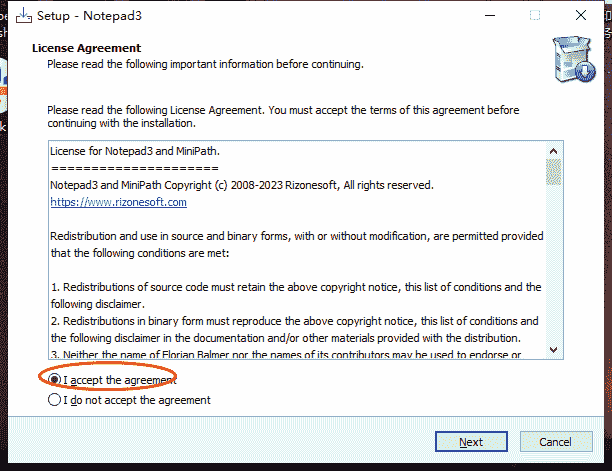

安装过程全部都默认，next直接到底

4、安装python，要注意底下的框一定要打勾

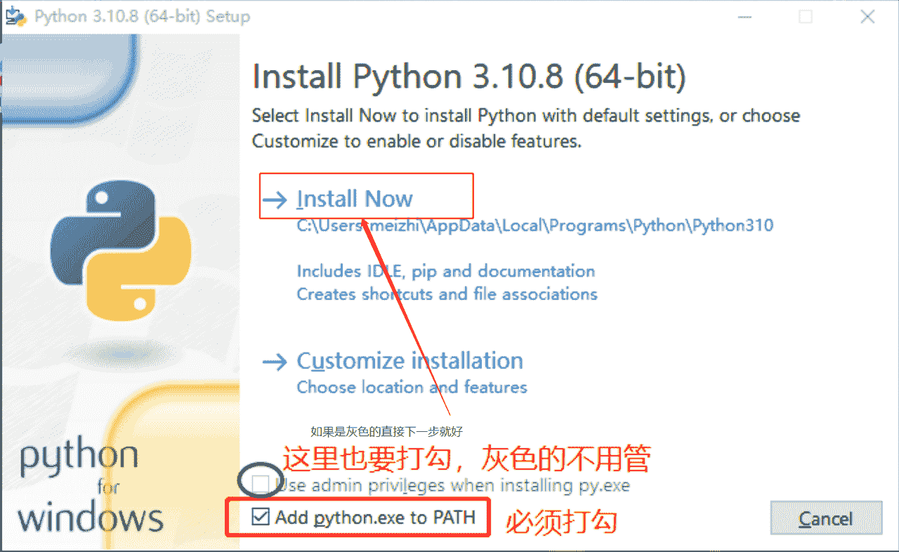

安装完python后打开 powershell（管理员模式），把下面这串复制进去

Set-ExecutionPolicy -ExecutionPolicy RemoteSigned

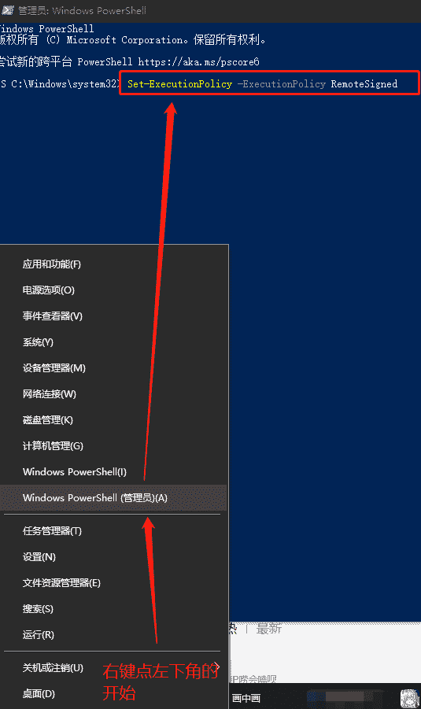

然后输入y，回车，关掉就好了

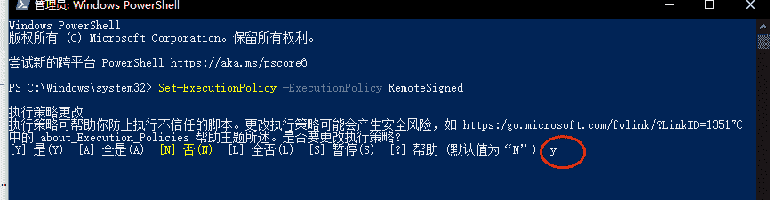

5、然后是环境安装，右键install-cn文件，用powershell运行，输入Y回车

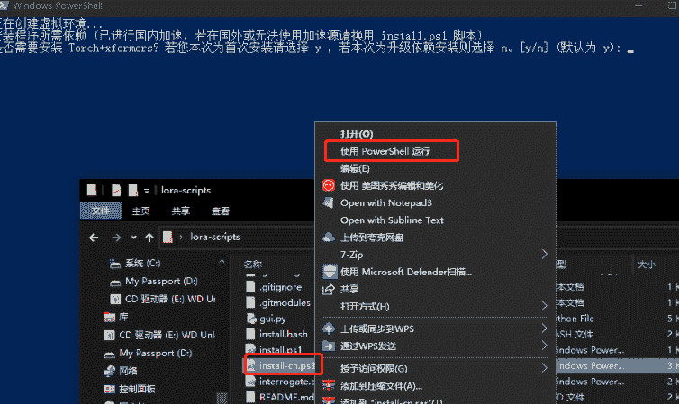

然后等他下载完毕

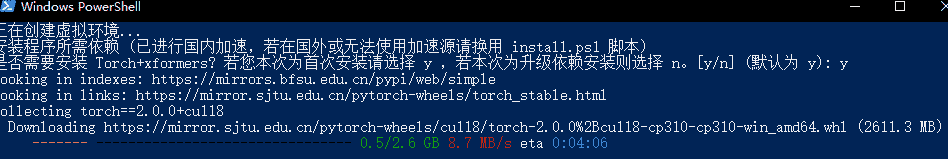

然后就完事了

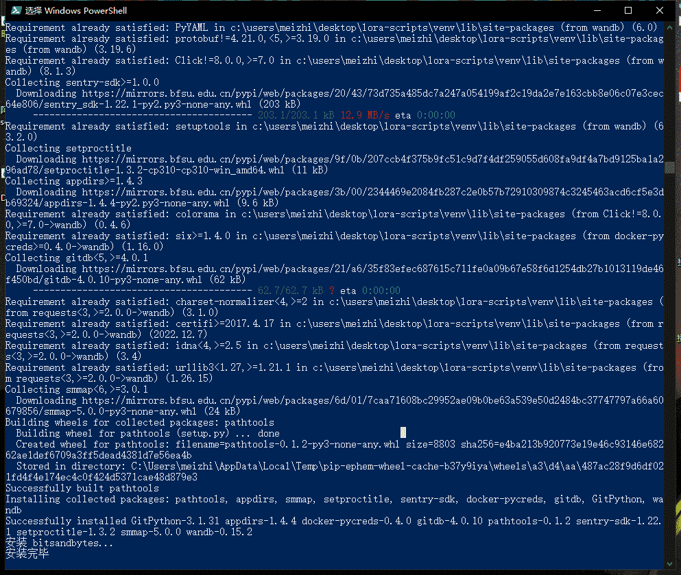

6、桌面弄俩文件夹，一个放你要训练的图，另一个是空文件夹

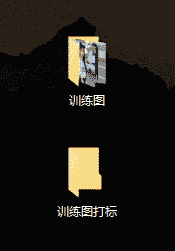

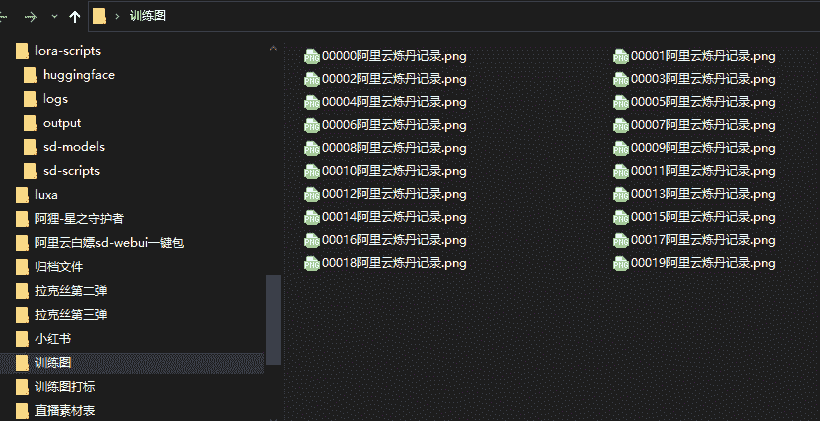

再打开SD，进入webui界面，然后如图示配置

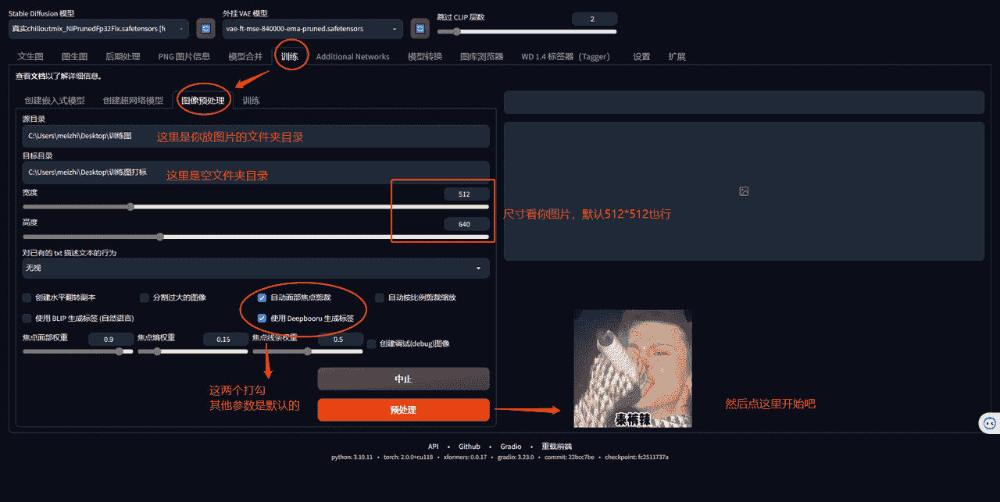

完成后，你会得到这些

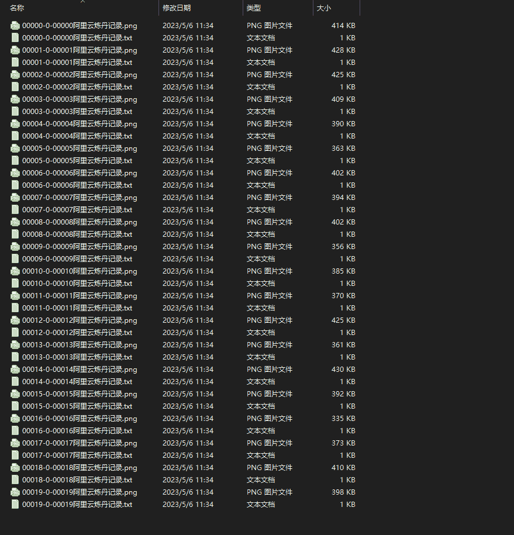

7、然后打开刚刚解压的文件文件夹，新建文件夹，把你生成的这些文件放到6_xiaoyu，我的步骤如下：

①新建文件夹xiaoheizi

②打开xiaoheizi文件夹，新建一个叫xiaoyu的文件夹

③打开xiaoyu文件夹，新建一个6_xiaoyu的文件夹，6_是前缀，必须用这个开头，因为这关系到后面的lora训练

👉意思就是小黑子文件夹下，小雨的lora，你们名字自己取就行不用复制我的……

6_是个lora训练必备的参数，咱们不用去理解，照做就好，这玩意理解的话，太费时间了

咱们今天**先学会吃鱼****，**后面在想着怎么钓鱼

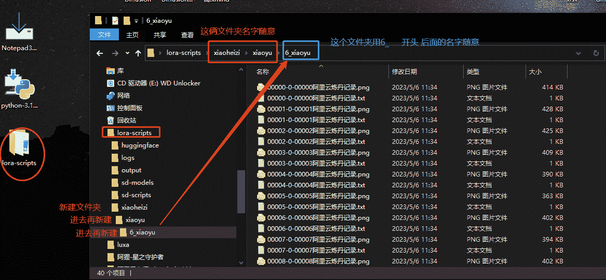

8、把你要的大模型复制到这里，然后给大模型换个名字，比如xiaoheizi

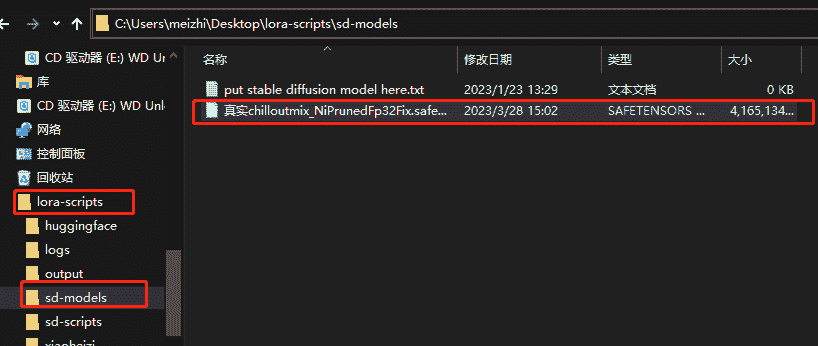

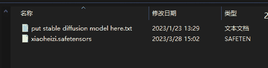

9、打开刚刚安装的文本编辑器

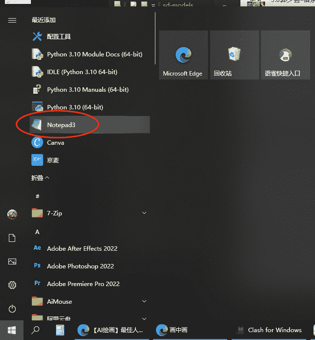

10、把这个文件（train.ps1）拖进去

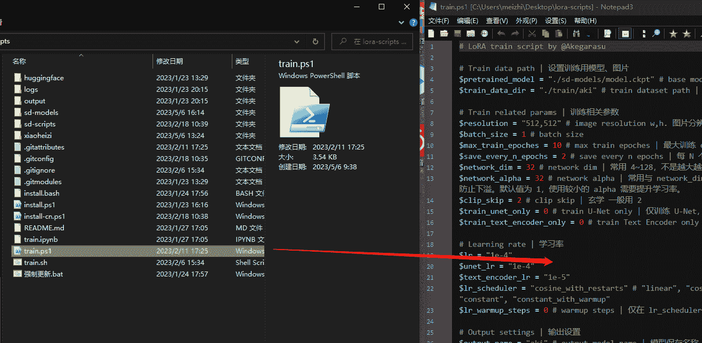

11、底模路径把刚才，**第8步**放进去的大模型名字复制到红字这

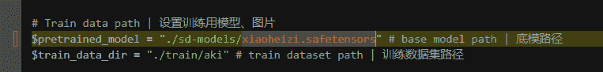

12、训练数据集路径，就是刚刚**第7步的 ****① ② 文件夹**的名称，复制进去，注意别把斜杠弄没了

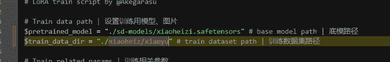

**注意名字别打错了！比如我这里xiaohei**zi末尾少了个i结果运行的时候给我报错了

13、这里都不用改，我因为图片尺寸是512*640所以换了下，写个名字，记得点保存，然后关掉

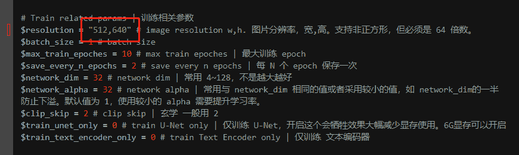

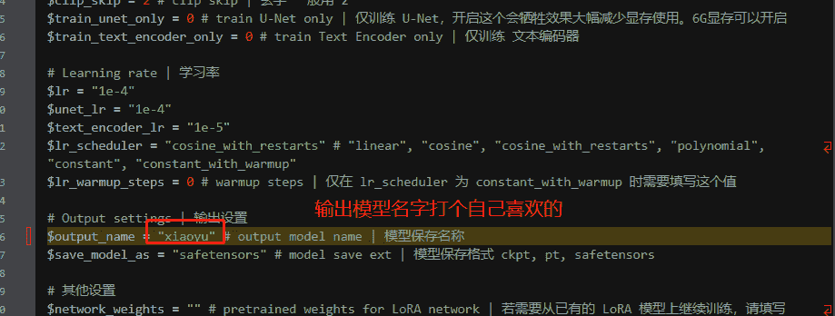

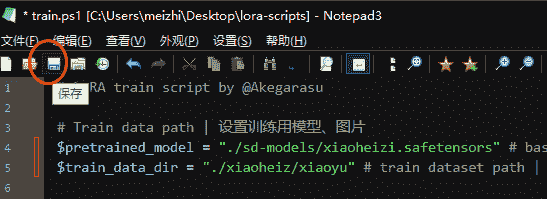

14、然后，右键点刚才的文件，如图示运行

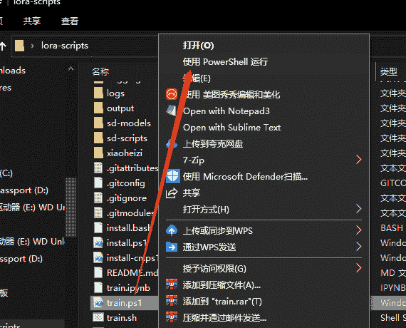

😸就开始炼丹了

15、然后报错了，报错原因是这是因为旧的显卡，例如10系列不支持unit8类型，刚好我的是1070……

Error caught was: No module named 'triton'和下面是一个类型报错

**如果你是10开头的****显卡**，返回去打开train.ps1找到并删除这段字符

优化器设置

$optimizer_type = "AdamW8bit" # Optimizer type | 优化器类型 默认为 AdamW8bit，可选：AdamW AdamW8bit Lion SGDNesterov SGDNesterov8bit DAdaptation AdaFactor

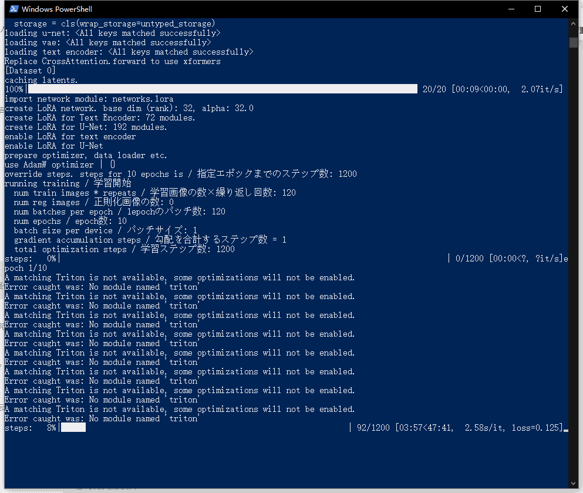

end😂终于解决了然后等程序跑完，你将得到ora文件，目录在这里

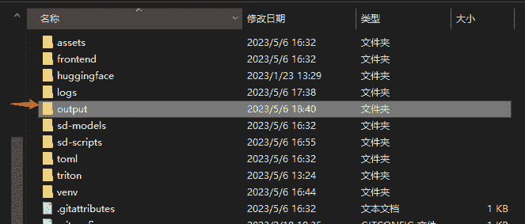

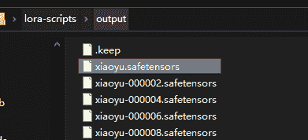

然后把文件放到sd的lora目录下就能用啦

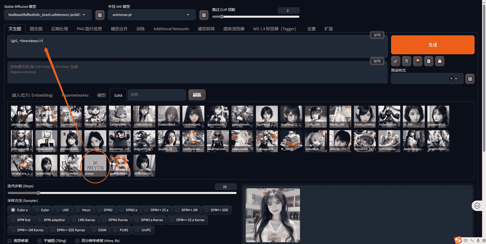

🚀预祝大家炼丹顺利！！本期SD入门课程到这里先完结了！

看到这里你已经可以轻松玩转SD了，更多商业化落地方向的需求，可以自行定向学习哦😸

> 我是热爱生活的小黑子，热爱当下生活，永远忠于自己。