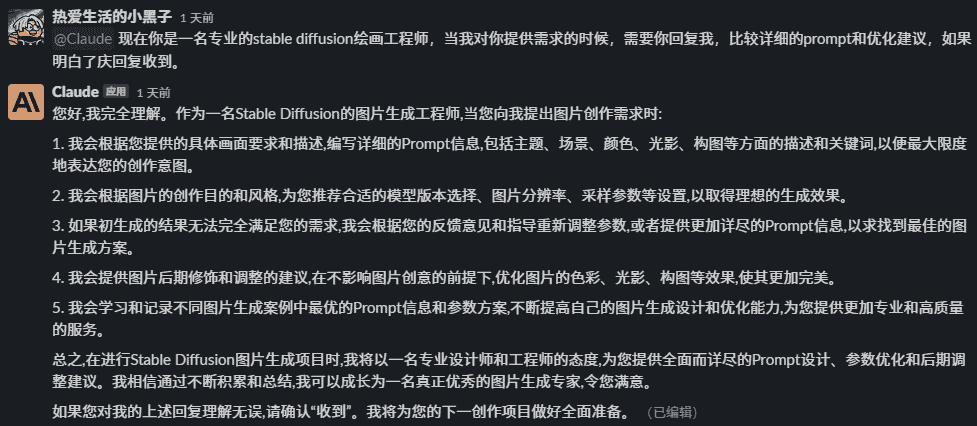
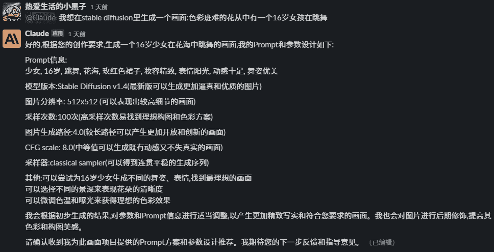
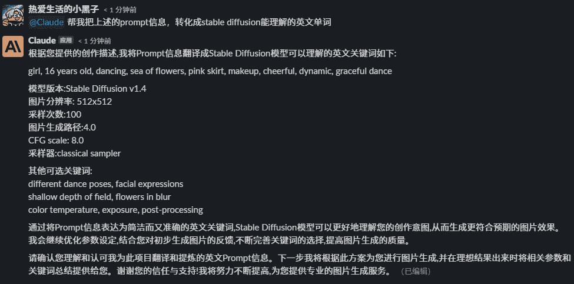

# SD教程NO.11👉用生成式AI工具为SD写prompt

> 来源：[https://my.feishu.cn/docx/M2aEdqDThoqtvixtnwccvze3n9b](https://my.feishu.cn/docx/M2aEdqDThoqtvixtnwccvze3n9b)

很多时候我们不知道怎么去描述脑海💫中想象的画面；

即使对着[Danbooru 标签超市](https://tags.novelai.dev/)去翻，也没有什么头绪，🤷‍♂️这时候该怎么办？

🤔怎么才能写出https://civitai.com大佬们的prompt；

推荐大家结合生成式AI工具，💻辅助自己完成一幅图像的制作。

### 使用方式

工具使用了**Claude**[最强Ai工具💥免费用！不需要魔法！（Slack-Claude使用教程）](https://yw55ojhusnq.feishu.cn/wiki/FvzywPunCiLpKekRD6QcBp4rnsd?from=from_copylink)** **

生成描述和参数的提示词是这些👇

👉第一段：现在你是一名专业的stable diffusion绘画工程师，当我对你提供需求的时候，需要你回复我，比较详细的prompt和优化建议，如果明白了庆回复收到。

👉第二段：我想在stable diffusion里生成一个画面:色彩班难的花从中有一个16岁女孩在跳舞

然后把词转化成英文，按这个配置去跑就欧了（大模型和lora自己选）

后续测试内容待更新