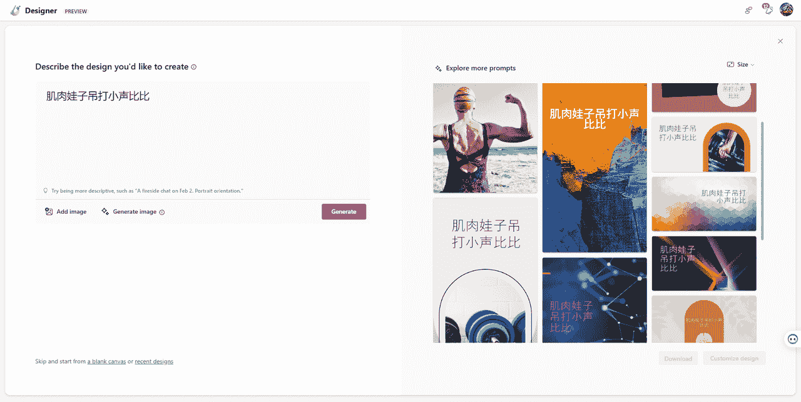
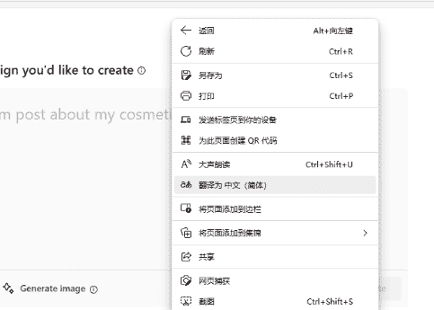
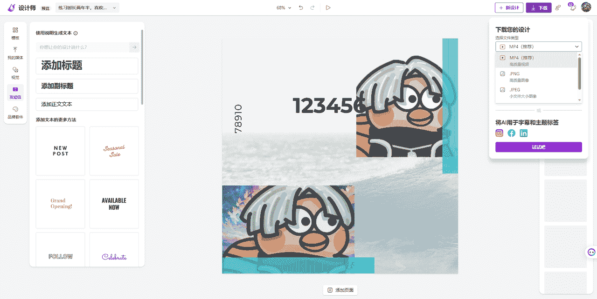
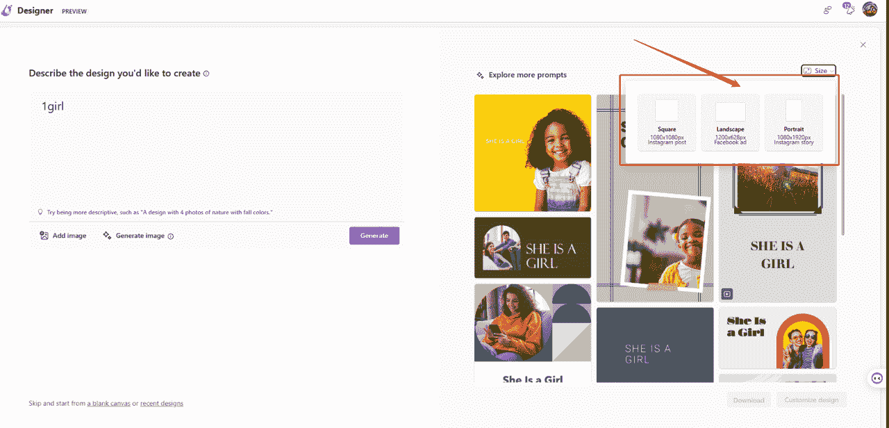

# PPT插图/海报制作神器🚀

> 来源：[https://my.feishu.cn/docx/RzBud4Q6SoD4RVxTiMQcpciVnUf](https://my.feishu.cn/docx/RzBud4Q6SoD4RVxTiMQcpciVnUf)

先上个链接：https://designer.microsoft.com/    (MicrosoftDesigner微软设计师)

不用魔法直接开搞！先翻译一下页面，然后就能搞了！

一般的PPT配图，能够无脑生成了。

可以不加任何图片素材直接生成，效果如下：

文字成图

中文也行，但是效果拉胯

最好大家把需要的内容翻译一下再跑图😂

也可以制定素材上传来生成🤞

翻译页面

任意内容生成，可上传素材

最终产出有图片也有视频/动图，选定后，在右下角进行二次编辑，图片、文字等都可以修改，还可以免费下载💖

这玩意还是有点问题的，中文输入老是乱码，建议下载后咱们用别的编辑工具。

如果需要GIF图，咱们用🐧影音这类工具一键转化就OK了🤞

看个人的使用需求，大家选合适的海报尺寸就OK了！

生成结果不满意可以添加更多的描述词👀当然最好的方法是自己先准备素材，这样结构最稳定。

如果你需要AI绘画工具可以看这两篇教程：

如果你想一键生成背景用这个：[一键制作模特图、产品图](https://yw55ojhusnq.feishu.cn/wiki/HDGywx9J6iAOjikf2a8cZEvlnYd)

无门槛AI绘画教程：[最强Ai绘画工具Vega.Ai教程（制作中）](https://yw55ojhusnq.feishu.cn/wiki/P58pw4353irg4mkko1bcU4A6ndb?from=from_copylink)

[🎨SD扫盲，看完就懂（已完结）](https://yw55ojhusnq.feishu.cn/wiki/EwcLw7dxuiOToGkF1QYctBRSnde?from=from_copylink)table Diffusion：

> 感觉有用的话**点个免费的赞吧**，有疑问欢迎在评论区交流！

> 我是热爱生活的小黑子，热爱当下生活，永远忠于自己。