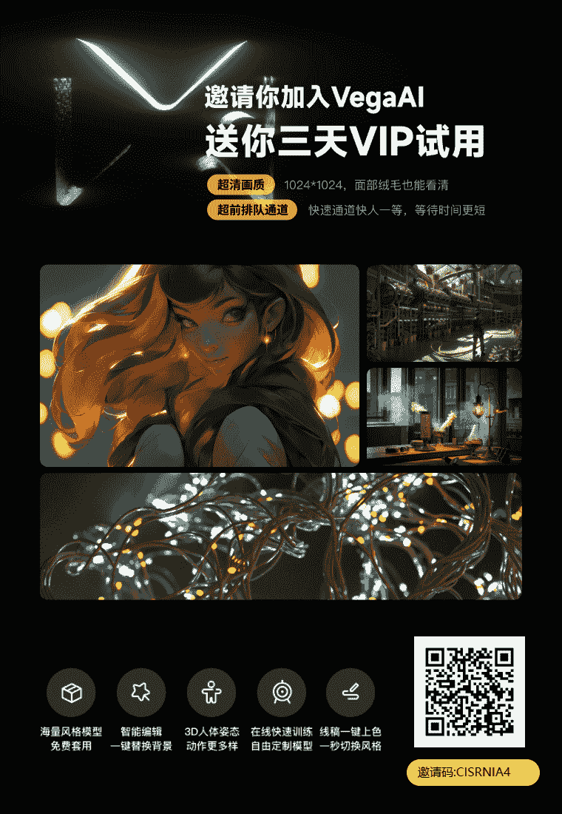

# 🎨Ai绘画工具Vega.Ai教程（制作中）

> 来源：[https://my.feishu.cn/docx/JVTadwUbGoa9OWxQqZ3cjSpjnjg](https://my.feishu.cn/docx/JVTadwUbGoa9OWxQqZ3cjSpjnjg)

> **电脑网页端链接：****https://applet.r****ightbrai**nai.cn/phone

> 手机端地址相同。

> **软件介绍：**

> **1.门槛极低**：任何手机电脑都能用

> **2.完全免费**：到目前为止不收取任何费用；

> **3.可控性强**：底膜是SD，文生图、图生图、controlnet等功能齐全；

> **4.学习门槛低**：界面简单，而且每个功能上都有说明；

> **5.不要魔法访问**：国内团队开发的网页端；

> **6.不要英文prompt**：中文、英文都能生成图片，制作界面还会给到一些参考词，点击就能出图；

> **7.出图效果好：**不同的场景使用不同模型，总能找到适合自己的画风，出图后还能高清放大补充细节；

# 🎯  愿景

> 所有人能都看懂的教程，让大家轻松学习，找到自己的热爱

# ⭐️  作者是谁

> 我是热爱生活的小黑子，热爱当下生活，永远忠于自己

# 💡  知识空间帮助

> **哪里不会点哪里，学习交流、问题****咨询****请加**

> 🐧号（🛰️同号）：488137

> 地址：https://applet.rightbrainai.cn/phone

# 🎨教程目录

