# NO.01文生图与工作区（入门必看）

> 来源：[https://my.feishu.cn/docx/DSCtdE00Xomo7Axol6TcOVhHnzf](https://my.feishu.cn/docx/DSCtdE00Xomo7Axol6TcOVhHnzf)

[🎁Vega变现指南（🛰️表情包）](https://yw55ojhusnq.feishu.cn/wiki/CKhTw6GF5iXyVlkobH7csUYTnze?from=from_copylink)习完这篇，你就可以自己做🛰️表情包了：

完整的vega教程🎨： [最强Ai绘画工具Vega.Ai教程（制作中）](https://yw55ojhusnq.feishu.cn/wiki/P58pw4353irg4mkko1bcU4A6ndb)

地址：[Vega AI 创作平台](https://applet.rightbrainai.cn/phone)

---

### 文生图主界面

文生图就是字面意思：描述你想要的图片内容，输入文字（😍支持中英文混合）生成你想要的图片。

👉注册完账号我们直接登录，然后我们看下文生图界面（左侧菜单栏不同版本排序略有区别）就可以尝试出图了

输入框上会有提示文案✌

+   1.点击提示文案，自动填充，生成图片

+   2.自行输入，生成图片（没思绪的话可以参考提示文案，也可以点提示文案左边的圈圈刷新）

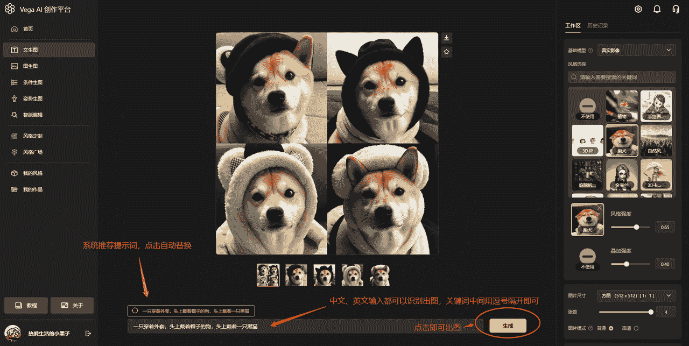

👉文字生图描述越详细，生成的图片越接近你想要的内容（数量太多，比如超出100个词，系统也会无法识别）

如果你想要ai放飞自我，不用放太多关键词去限制他！😊

因为关键词支持中文，我就不多介绍啦！✔

[Vega词库](https://yw55ojhusnq.feishu.cn/wiki/PGCgwAmDtijhpGksyPScIgprnVh?from=from_copylink)于更多生成词的更多内容😸大家可以看下我的词库：

大家玩几次就能明白了🤞我就先介绍工作区了

### 工作区简介（适用所有vega中的模式）

#### 1.基础模型

首先我们来看基础模型

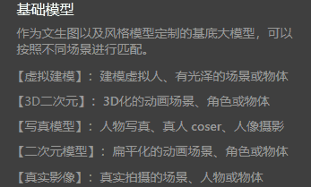

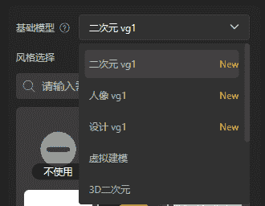

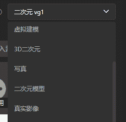

因为更新太快，官方对刚出的基础模型解释也没放🤣

我这里不用过多的文字来描述了，直接用一组图片来对比每个模型的特点，让大家一目了然👍

咱们关键词是：一只穿着白色外套的柴犬

**二次元vg1**

适合做卡通图、动画图

**人像vg1**

接近于真实拍摄、与写真风格相近

**设计vg1**

适合做设计稿

**虚拟建模**

建模虚拟人、有光泽的场景和物体

**3D二次元**

偏3D的动画人物、游戏道具、游戏人物

**写真**

亚洲人、真人写真、coser、少年感、少女感

**二次元模型**

偏平面的二次元人物、动画场景

**真实影像**

宠物、电影人物、工业设计、包装设计

像上面的示例，设计vg1跟柴犬的契合度很低😑

我们换一个关键词：一个卧室装修设计，有植物

就能看出来差距非常大👇

**二次元vg1**

**人像vg1**

**设计vg1**

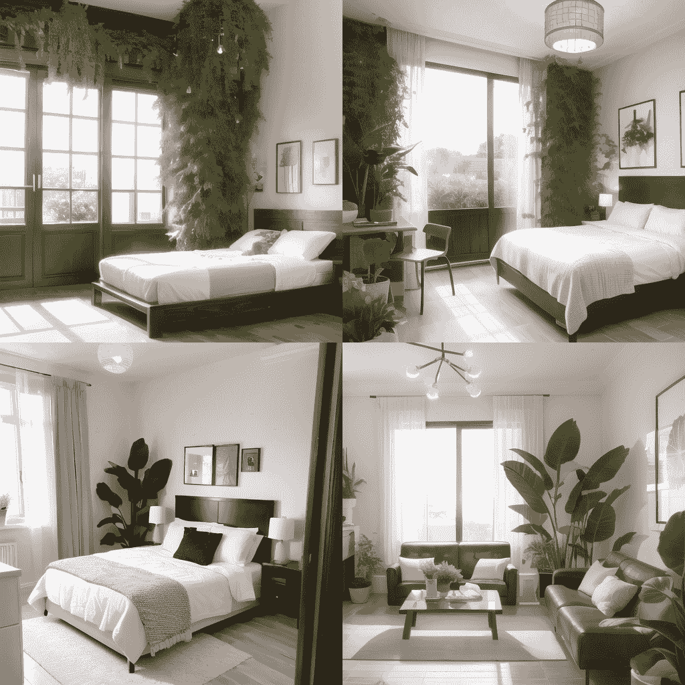

**虚拟建模**

所以选对模型很重要，大家做图片之前一定要确认一遍自己选择的模型！

再放几个选对模型的案例给大家作参考👇

#### 2.风格选择

可以在风格广场找自己感兴趣的收藏，收藏后，就会出现在工作区

风格也有另一个称呼是lora（称呼来源于stable diffusion）

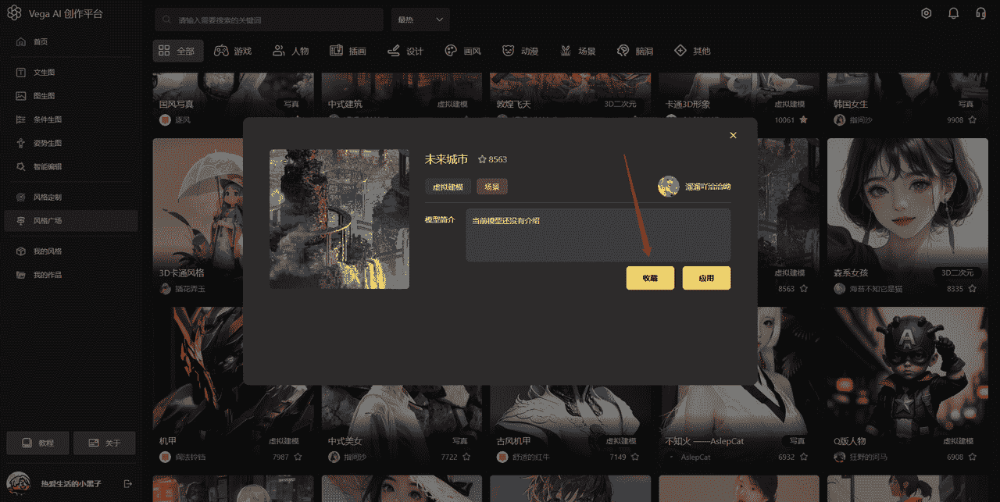

风格广场收藏

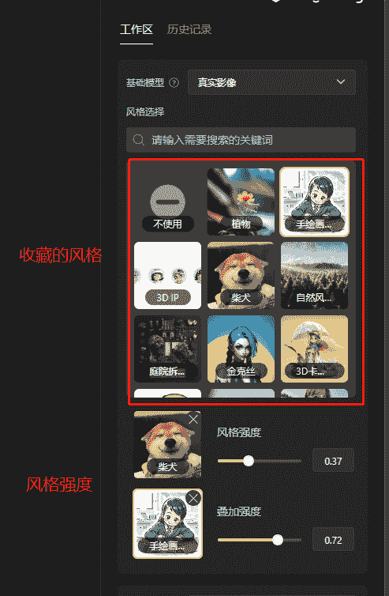

工作区配置

+   **我的风格：**来源于①风格广场中收藏②自己训练的的风格

+   **风格强度：**强度越大（与训练数据越相似），强度越小（生成图片的操控性越大）

+   **叠加强度：**强度的定义同上，该功能一般用于多风格融合，生成全新的风格

#### 3.图片尺寸

图片尺寸就是不同比例，选自己需要的比例即可

下面的选择，个人建议用 **普通模式 + 默认4张**

高清模式出图速度太慢。而且一次最多只能出2张图

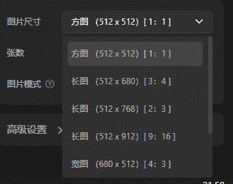

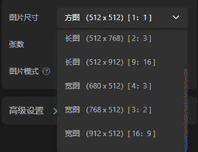

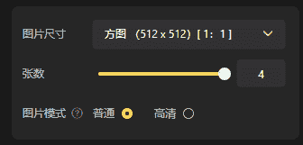

正常情况下我们用Ai做图，会经历这2步：1.写描述词2.做图

这两步会一直循环，👉因为ai出图其实有点类似于抽卡，不断尝试才能出满意的图；

所以我们需要**速度快**，**数量多**才能快速找到满意的图👍

而且**普通模式**找到满意的图片后，还可以选择**提升细节**or**放大图片**，不耽误质量的提升😍如图示👇

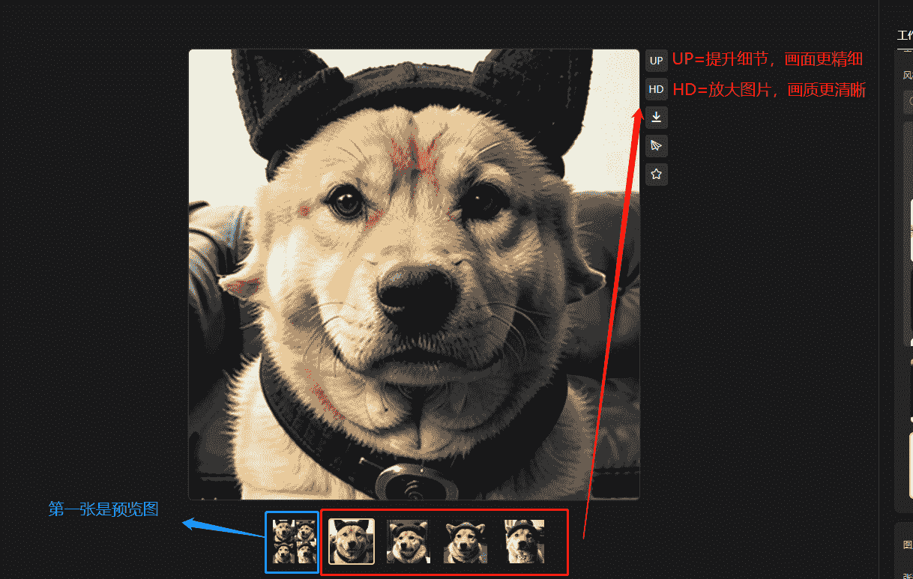

#### 4.高级设置

**步数：**步数越高，图片越精细，花费时间越长，用默认的20就可以了

**文本强度**：强度越大，与描述词关联性越大，强度越小Ai放飞自我，用默认的7就可以了

👇我这里补充一张的图片给大家看的直观一些，20以后差距不大（选默认20是因为速度快很多）

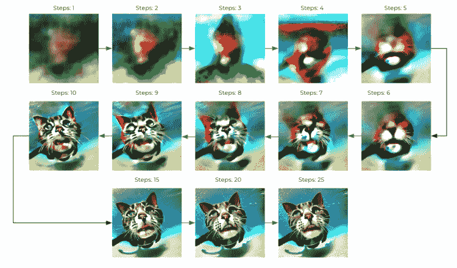

不同的迭代步数细节程度完全不同

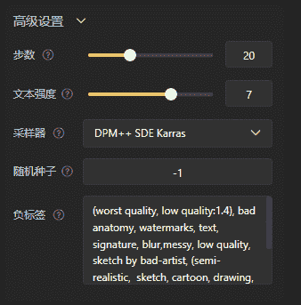

界面图片

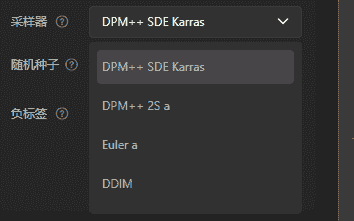

采样器

采样器：我们来看一组图片对比，关键词：一个穿着长裙的女人

DDIM

耗时50秒

Euler a

耗时50秒

DPM++2S a

耗时56秒

有个图触发了限制没显示

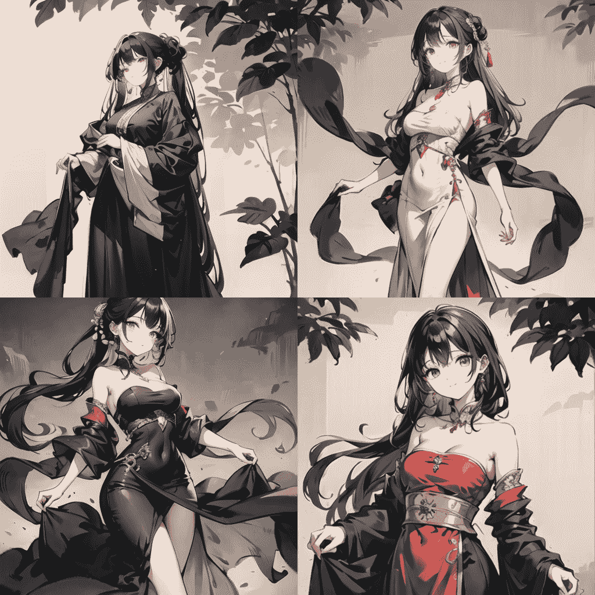

DPM++SDE Karras

耗时56秒

速度：DDIM与Euler a略快，但整体速度只相差12%；

质量：但是图片精度与画面细节，还是DPM系列的高一些，建议大家用默认的DPM++SDE Karras

然后是种子和负面词：

种子：正常情况下，跑图会有1个固定种子编号，别人输入跟你相同的编号，就能生成高度相似场景的图片。但是vega的出图种子在什么地方我目前还不知道。

负标签：不想要的内容写进去就好，比如多余的手指；大家根据实际需求去写就OK，这里就不多产阐述了。

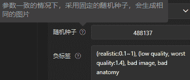

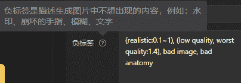

关于种子，我拿stable diffusion的种子编号在vega跑了图，无法固定姿势，种子只能等vega官方教程了！

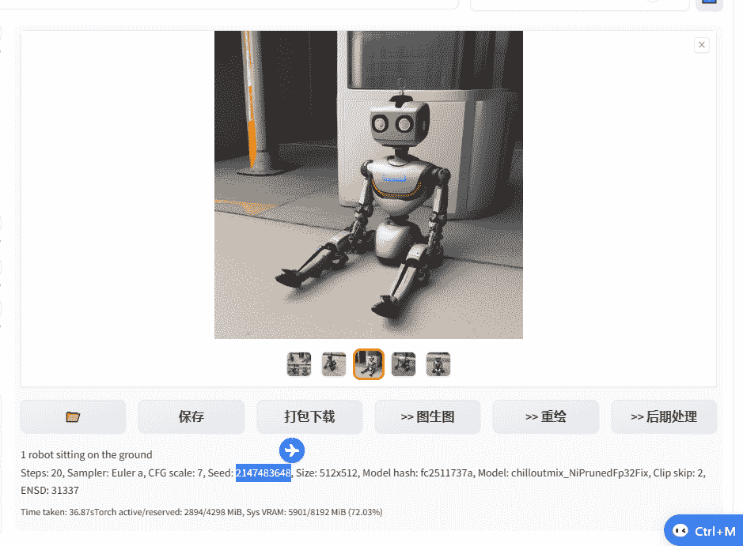

SD的种子

vega无法固定SD的种子姿势

工作区的内容是通用的，这些是基础，大家一定要学习理解。

2023年6月3日09:07:36更新：

**今天官方更新了超清模式**，大家文生图人物的时候千万不要直接开这个超清模式，容易画面崩坏，像这样👇把人直接做成了肥牛卷

普通模式

高清模式

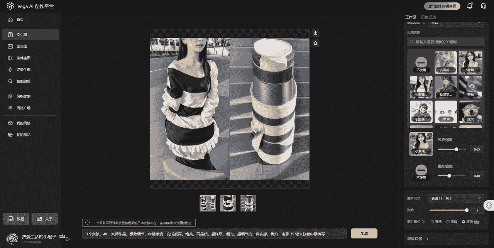

超清模式直接崩坏了

然后分辨率的区别如下😀（我选的长图9:16生成）：

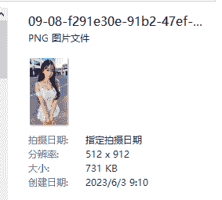

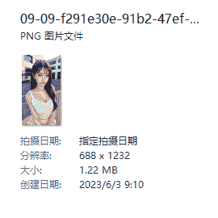

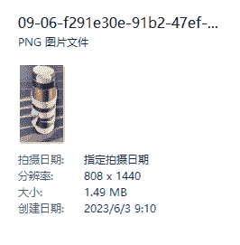

[Vega词库](https://yw55ojhusnq.feishu.cn/wiki/PGCgwAmDtijhpGksyPScIgprnVh?from=from_copylink)于更多生成词，这边给到大家一个词库参考：

下一篇内容是：[NO.02图生图（让你指鹿为马）](https://yw55ojhusnq.feishu.cn/wiki/JRYQw8RZ7iA5rekTxt2ci7ppn7f?from=from_copylink)

全部目录：

[NO.01文生图与工作区（入门必看）](https://yw55ojhusnq.feishu.cn/wiki/WPDjweuYOitfWEkOH92caboLnDX)

[NO.02图生图（让你指鹿为马）](https://yw55ojhusnq.feishu.cn/wiki/JRYQw8RZ7iA5rekTxt2ci7ppn7f)

[NO.03条件生图（设计师必备）](https://yw55ojhusnq.feishu.cn/wiki/A94owT154iIAI2khIiZcJdHxnPe)

[NO.04姿势生图（DIY人像）](https://yw55ojhusnq.feishu.cn/wiki/AYMewcTtqiSo9dkV1YicwTs5nNh)

[NO.05智能编辑（无中生有）](https://yw55ojhusnq.feishu.cn/wiki/IqbHwsjXHiejXPkHnGtcuvuHnAe)

[NO.06风格定制（炼丹）](https://yw55ojhusnq.feishu.cn/wiki/GI49wGek6i53fvkysryc1Zb1ndf)

完整教程🎨： [最强Ai绘画工具Vega.Ai教程（制作中）](https://yw55ojhusnq.feishu.cn/wiki/P58pw4353irg4mkko1bcU4A6ndb)

手机端体验：[Vega AI 创作平台](https://rightbrain.art/phone/other/login?inviteCode=CISRNIA4)

网页端体验[：Vega AI 创作平](https://rightbrain.art?inviteCode=CISRNIA4)台

> 感觉有用的话**点个免费的赞吧**，有疑问欢迎在评论区交流！

> 我是热爱生活的小黑子，热爱当下生活，永远忠于自己。