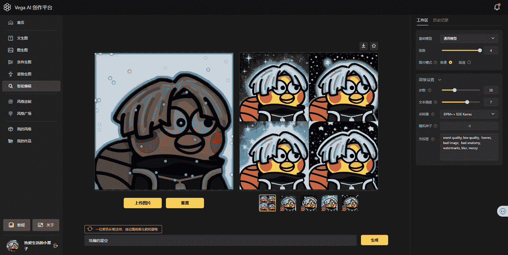
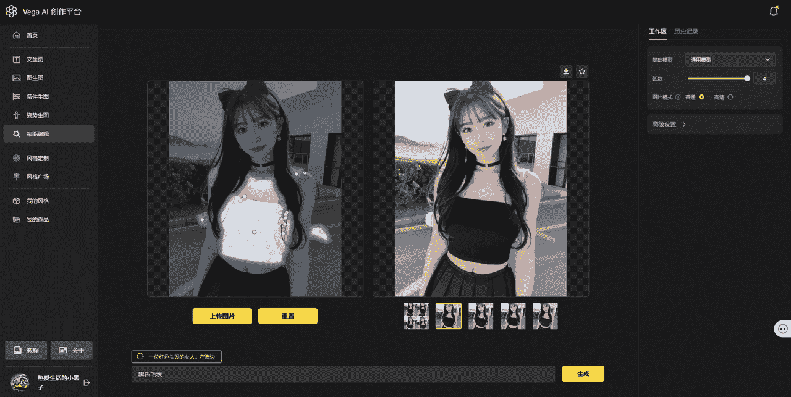
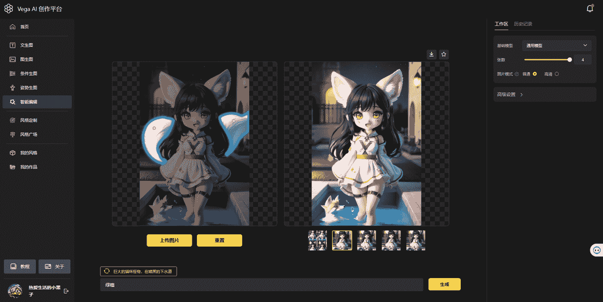
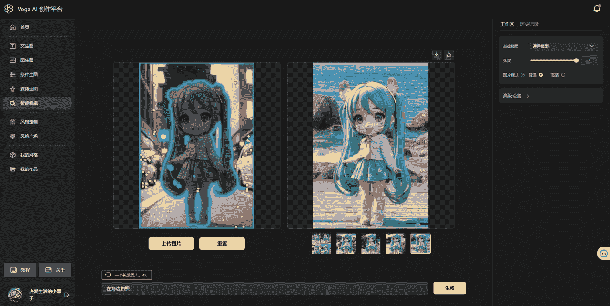
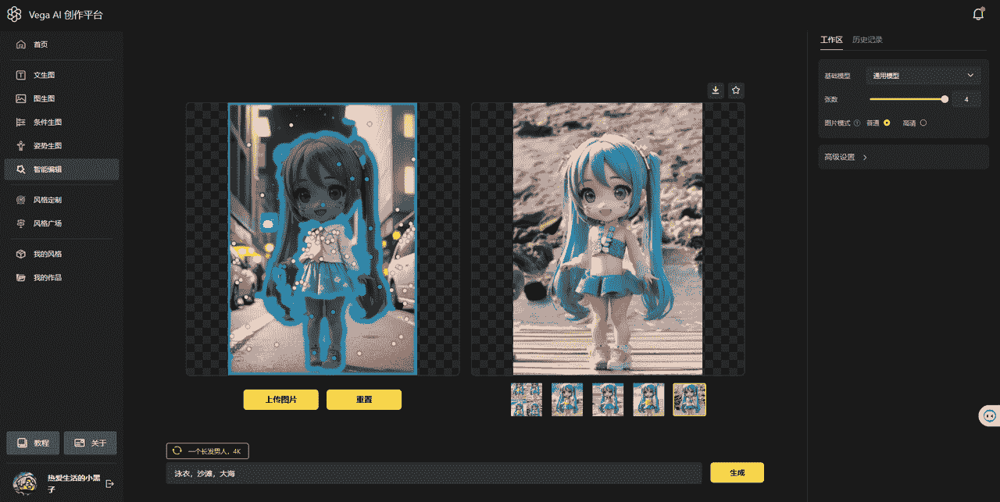
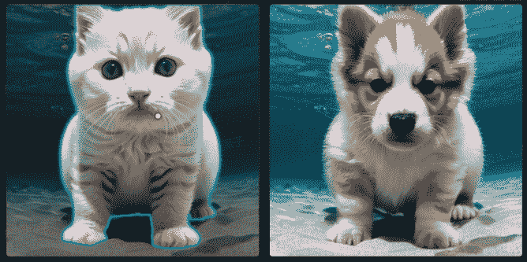
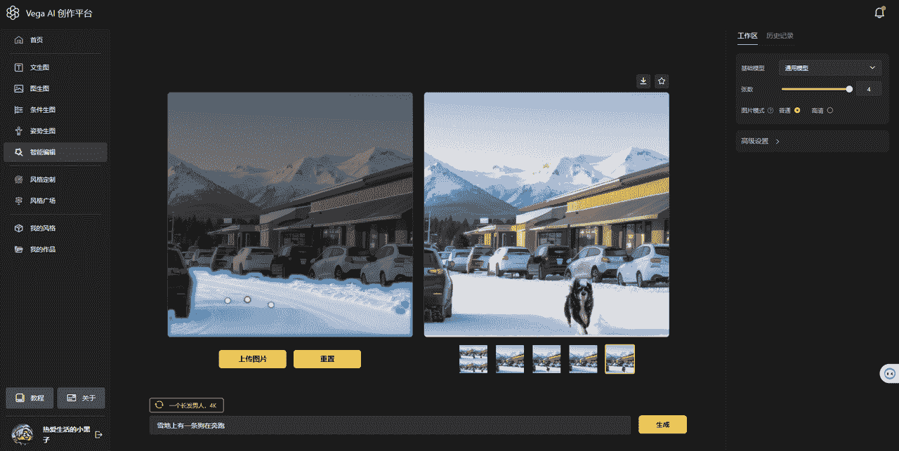

# NO.05智能编辑（无中生有）

> 来源：[https://my.feishu.cn/docx/N5RrdzqMJoAhxdxWUhncwF2mnSf](https://my.feishu.cn/docx/N5RrdzqMJoAhxdxWUhncwF2mnSf)

智能编辑使用步骤如下：

1.上传图片；

2.鼠标操作选取区域：

+   需**重绘**的区域，鼠标**左键**点击（**粉色圆点**）

+   需**保留**的区域，鼠标**右键**点击（**蓝色圆点**）

大家可以根据实际情况点击左右键进行区域的圈选。

3.文案描述。填写的是选中区域想要出现的画面。

智能编辑这个界面很简单，效果还是很顶的！😍

先看一下大概效果👇点击分区+简单的提示词就OK

同样的，我们除去换背景，可以选定图片内的部分区域做很多修改。

上衣更换颜色、材质

消除尾巴+场景智能补全！

现在只有通用模型，二次元图片效果不太好

不同区域编辑，只用生成词也能自动完成

更换物种（来源官方教程）

无中生有

下一篇教程是：[NO.06风格定制（炼丹）](https://yw55ojhusnq.feishu.cn/wiki/GI49wGek6i53fvkysryc1Zb1ndf)

完整教程🎨： [最强Ai绘画工具Vega.Ai教程（制作中）](https://yw55ojhusnq.feishu.cn/wiki/P58pw4353irg4mkko1bcU4A6ndb)

手机端体验：[Vega AI 创作平台](https://rightbrain.art/phone/other/login?inviteCode=CISRNIA4)

网页端体验[：Vega AI 创作平](https://rightbrain.art?inviteCode=CISRNIA4)台

> 感觉有用的话**点个免费的赞吧**，有疑问欢迎在评论区交流！

> 我是热爱生活的小黑子，热爱当下生活，永远忠于自己。