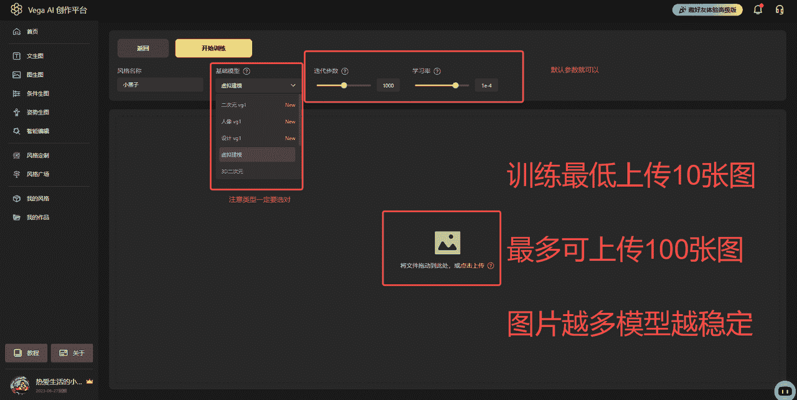
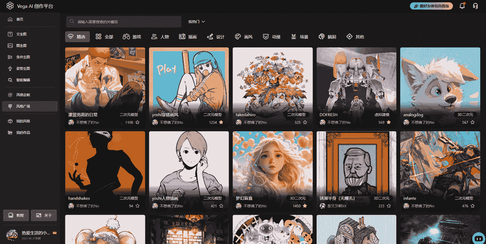
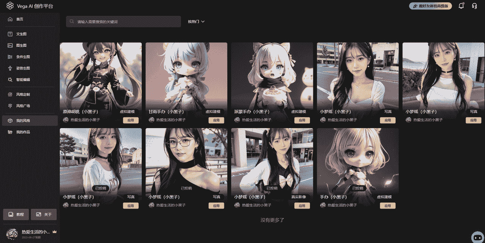
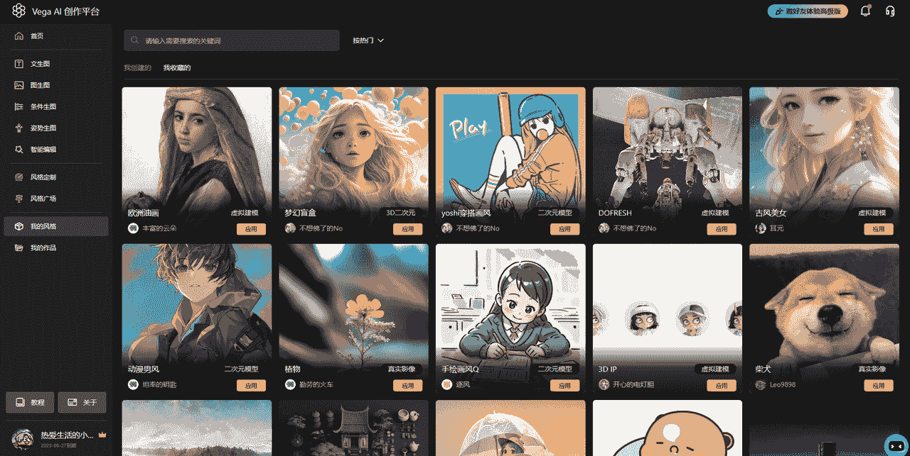
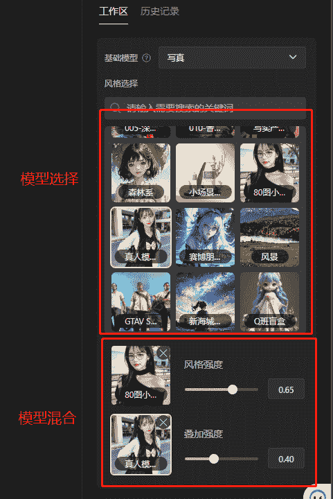
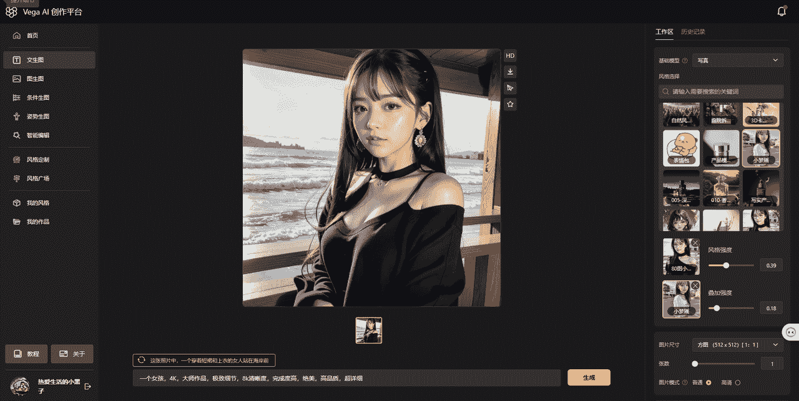

# NO.06风格定制（炼丹）

> 来源：[https://my.feishu.cn/docx/Zk6PdiZYVoJp6TxFEwpcJ7s4nTd](https://my.feishu.cn/docx/Zk6PdiZYVoJp6TxFEwpcJ7s4nTd)

[🎁Vega变现指南（自媒体）](https://yw55ojhusnq.feishu.cn/wiki/ZVEdwCx4ViIFZFkGO4acJF7xnZf?from=from_copylink)习完这篇你就可以尝试变现了，变现教程见

风格定制其实就是模型模型；炼制模型、训练lora、炼丹等说法其实是一样的；

为什么叫他**炼丹**，来源是这样的：

+   小说里炼丹原理，就是把**各种属性相生的药材**放到**炼丹炉**然后**出丹药✔**，最终结果谁也不知道；

+   vega的风格定制，就是把**风格非常接近的图片**放到**AI****训练**然后**出模型✔**，最终结果同样是谁也不知道；

相同点我标色了，大家看了就懂啦😸

像风格广场的素材，就是用户训练的模型，💖然后分享出来的。（小说里的炼丹大会hhh）

训练界面介绍

风格广场都是大家自己炼的模型

自己训练的模型

收藏的模型

炼丹速度还是比较快的，基本15-20分钟就完成了，👏比sd本地炼丹快多了！

目前测试下来，图片越多，模型越稳定，上限是80图；👍

基础数据调整没有太大区别，👉大家用默认的参数就可以了；

收藏&自己训练的模型，在工作区都能看到，也可以两个模型混合使用，最终效果还需要大家自己测试一下！

风格界面

混合多个模型最终生成效果

关于模型的使用，现在场景比较少，😑后续有好的案例我再来补充分享；也会对广场的模型做一些跑图评测

我自己练的一般起名会加小黑子，大家直接搜就行。上面这个人物模型也上传了👆

完整教程🎨： [最强Ai绘画工具Vega.Ai教程（制作中）](https://yw55ojhusnq.feishu.cn/wiki/P58pw4353irg4mkko1bcU4A6ndb)

手机端体验：[Vega AI 创作平台](https://rightbrain.art/phone/other/login?inviteCode=CISRNIA4)

网页端体验[：Vega AI 创作平](https://rightbrain.art?inviteCode=CISRNIA4)台

> 感觉有用的话**点个免费的赞吧**，有疑问欢迎在评论区交流！

> 我是热爱生活的小黑子，热爱当下生活，永远忠于自己。