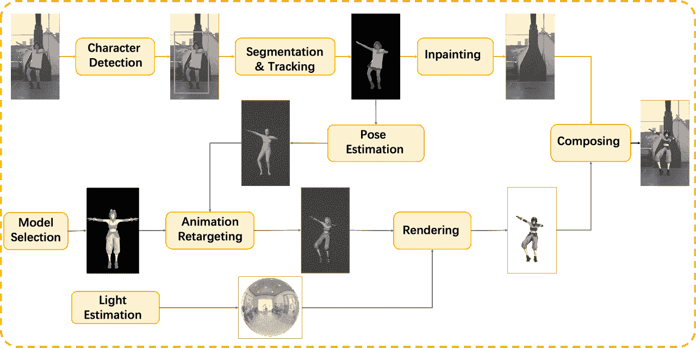
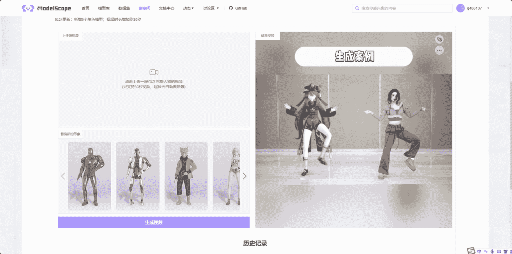

# 一分钟上手，一键将视频转换成3D动漫人物，免费，附工具及使用方法。

> 来源：[https://my.feishu.cn/docx/N2FLdVvLboELbUxy8r9cXkkQnHf](https://my.feishu.cn/docx/N2FLdVvLboELbUxy8r9cXkkQnHf)

阿里又整活了，新推出了一款创新的人工智能产品——Animate 3D Motion

这是一款专注于AI驱动的角色动画技术。

**项目地址：**[https://aigc3d.g](https://aigc3d.github.io/motionshop)ithub.io/motionshop/

效果如下👇

Motionshop技术的核心在于其能够将现有视频中的人物形象转换为三维虚拟形象。

这项技术分为两个主要环节：

1.包含一个视频处理系统，专门负责从背景视频中提取和处理图像；

2.利用一个姿态估计与渲染系统来生成相应的头像动画。

为了提高效率，这两个环节被设计为可以并行运行，并且结合了先进的光线追踪渲染技术TIDE。

这样的设计使得整个动画制作过程能够在短短几分钟内高效完成。

## **使用方式：**

**目前，该AI角色动画**项目已经可以在ModelScope平台上免费试用。

**地址：**[h](https://modelscope.cn/studios/Damo_XR_Lab/motionshop/summary)ttps://modelscope.cn/studios/Damo_XR_Lab/motionshop/summary

使用流程如下：

1.  上传：用户首先需要上传一段视频，视频中应包含一个完整的人物形象，且确保人物在整个视频中清晰可见。系统会自动截取视频的前30秒进行处理。

1.  处理：系统会自动从视频中识别并选择主要人物进行替换，目前尚不支持手动选择。

1.  审核：用户随后可以选择一个虚拟角色模型来替换视频中的人物，点击生成后，大约需要等待10分钟的审核时间以获取结果。

（小tip：视频目前是人工审核的，所以半夜提交的，得等第二天。

