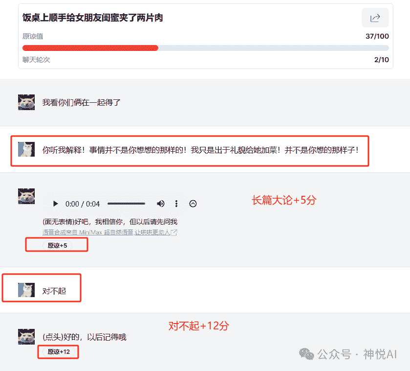

# 68万人在线哄女友，我一打开就破防了。我把他玩成了怼人模拟器。

> 来源：[https://my.feishu.cn/docx/RQUKdaILPowi2sxLyckc71L3nWb](https://my.feishu.cn/docx/RQUKdaILPowi2sxLyckc71L3nWb)

在这个数字化时代，人工智能（AI）正以前所未有的速度融入我们的生活，从简单的语音助手到复杂的数据分析，AI的身影无处不在。

然而，当AI遇上情感，尤其是爱情，会擦出怎样的火花呢？

最近，一款名为“哄哄模拟器”的游戏在网络上引发了热议，它不仅让单身人士找到了新的娱乐方式，更意外地成为了提升人际交往技巧的实践场。

**因为文章****放不了链接，**可以后台私信我“AI女友”获取地址。

点开就能玩，无需注册，无需登录，免费体验，无广告。

---

“哄哄模拟器”是一款创新的AI对话游戏，它将恋爱中的小摩擦转化为一场场文字的较量。玩家在这里扮演着恋人的角色，面对AI伴侣的“愤怒”，需要用智慧和情感去化解。

这款游戏的诞生，源自开发者**@超级王登科**的一次真实争吵，他将女友的愤怒想象成机器人头上的进度条，以此来调整自己的回应。这一创意不仅让游戏充满了趣味性，也让人们在轻松的氛围中学习如何更好地处理情感问题。

**版本更新很快，****已**经上语音功能了（声音还怪好听的）

---

在“哄哄模拟器”中，玩家的每一句话都可能成为情感的转折点。好感度的升降，就像是情感的晴雨表，反映了沟通的效果。

我在尝试中发现，有时候。

一句简单的“对不起”，比长篇大论更能打动人心。

这种直接而真诚的表达，让玩家们意识到，在现实生活中，情感沟通的关键在于真诚和理解。

---

“哄哄模拟器”不仅仅是一款游戏，它更像是一个社交实验室。在这里，玩家们学会了如何避开沟通的陷阱，如何用恰当的话语去安抚对方。

这些互动不仅提供了娱乐，更是一种社交技能的锻炼。

**通过与AI的对话，玩家们学会了在现**实生活中如何更好地倾听、理解和回应他人。

👇比如以下场景是在职场和同事互动👇

---

虽然“哄哄模拟器”为人们提供了一个模拟恋爱的平台，但我们必须认识到，游戏中的成功并不能直接转化为现实生活。真正的人际关系建立在相互尊重和真诚交流的基础上，而非简单的技巧堆砌。

**游戏中的AI伴侣可以无限次地原谅，**但现实生活中的人心却需要我们用心去呵护。

---

在“哄哄模拟器”中，玩家们体验到了情感沟通的艺术。

他们学会了如何在对方生气时保持冷静，如何在争执中寻找和解的契机。

这些经验，虽然源自虚拟世界，却有着现实世界中的情感智慧。

**（就好比下方跟老板对话的场景）**

玩家们在这里学会了，无论是在虚拟还是现实世界，情感的桥梁都需要用理解、尊重和爱来搭建。

---

“哄哄模拟器”让我们看到了AI在情感领域的潜力。它不仅仅是一个娱乐工具，更是一个情感教育的平台。通过与AI的互动，人们开始思考如何将科技与人性相结合，如何在数字化时代保持情感的真实和温暖。这场AI与人类情感的对话，正在悄然改变我们对爱情和人际关系的认知。

**希望大家不**要跟我学习，把他变成了一款“怼人模拟器”。

**因为文章放****不了链接，**可以后台私信我 AI女友 获取地址。

**更多AI相****关技巧关**注👸号，私信  AI教程  获取（免费）

神悦AI

这是一个喜欢AI的年更作者，更新频率就像薛定谔的猫一样。

👸号

**已经看到这里了**

**帮忙点个赞**

**点个在看吧，感谢**

