# MJ使用教程（Slack版 已失效）

> 来源：[https://my.feishu.cn/docx/HrtmdZQgCoYlBUx1TsJcD4ThnUf](https://my.feishu.cn/docx/HrtmdZQgCoYlBUx1TsJcD4ThnUf)

# [微信上能用的MJ及教程](https://yw55ojhusnq.feishu.cn/wiki/WZbSwbbSOijAeTke1Qtcjiagn4e)J使用教程（Slack版 已失效），建议读这个最新的版本：

之前我写过一篇教程：[免魔法的Slack👉可以白嫖MJ绘画了😻](https://yw55ojhusnq.feishu.cn/wiki/QwCNwyzH8iS2ItkobWFcZxt0nuf?from=from_copylink) 说了下怎么安装

这次补充一下怎么在Slack中使用mj的教程，看完这篇你就能复刻很多炫酷的大师作品了！

首先用第一个指令

### 激活MJ

```
/info
```

输入之后出来是这样一个画面，就代表你激活成功了。加载成功画面（原版与翻译版）

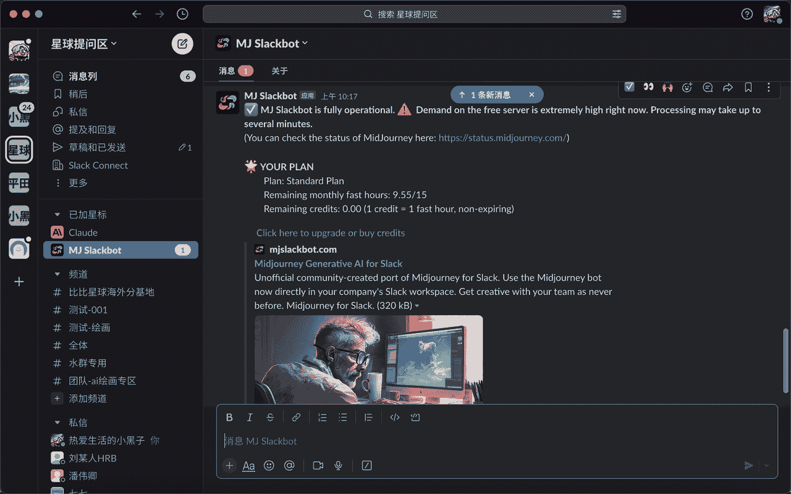

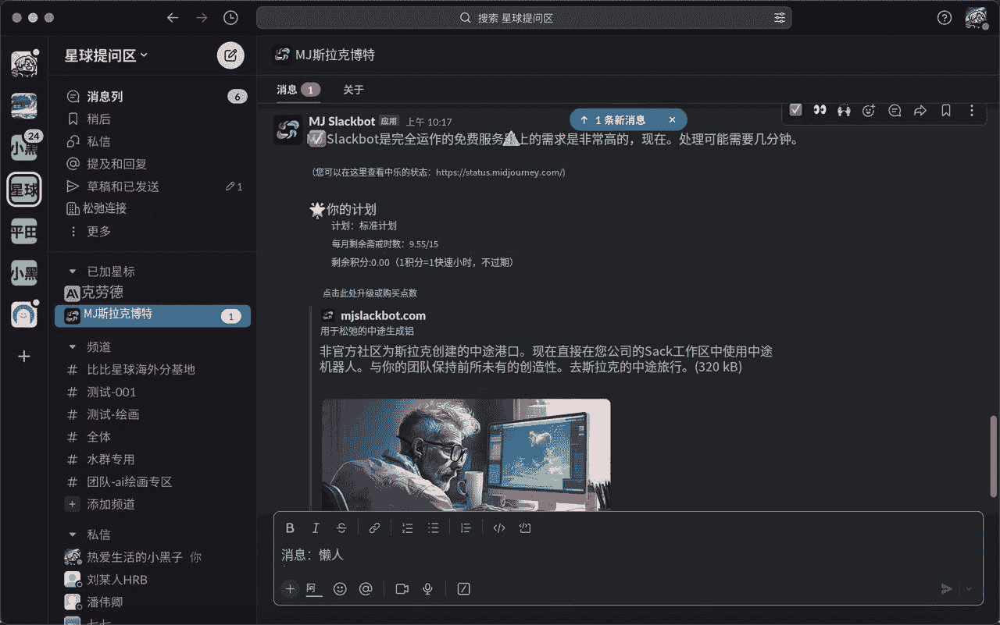

然后再说下其他指令，再slack输入

```
/help
```

就会出来这个界面，是指令的简介（原图和翻译版图片）

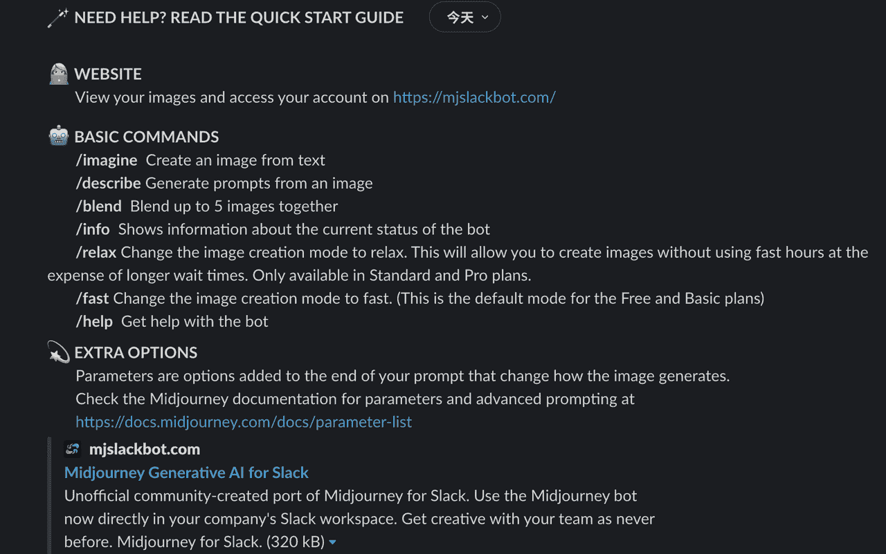

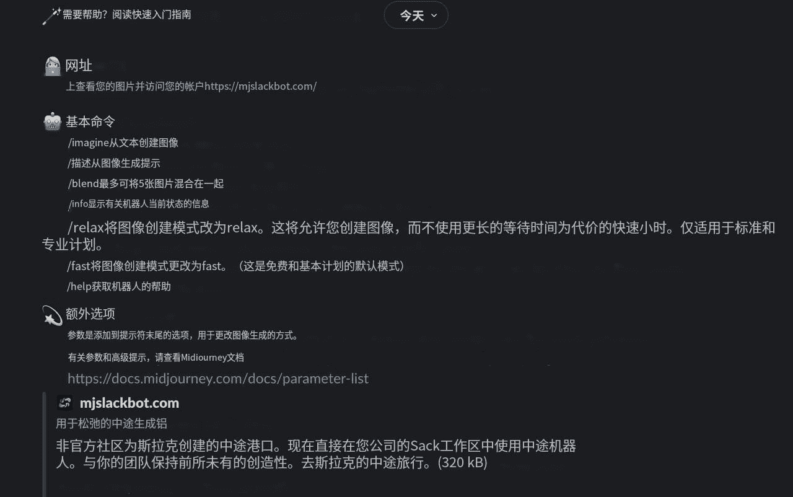

### 1、文字生图：就是上面说的 ，英文生图

/imagine 生成图片指令是

```
/imagine 
```

生成图片**不需要@机器人**，跟Claude稍微不太一样，公共区域也不需要召唤他。

❌错误示范：


1、不需要@机器人

2、不支持画一张图指令，正确的是/imagine

[       3、不支持中文生图，开个翻译就好Bing Micr](https://www.bing.com/translator?ref=TThis&text=&from=en&to=zh-Hans)osoft Translator - Translate from English to Chinese Simplified

如果你的图不出来基本就3个可能：

1、有违禁词，别搞涩涩和政治的东西，哪天被查水表了你的聊天记录都是证据；

2、跑图人太多排队（大家都是私聊在跑图的，公共频道好像只有我在用）；

3、服务器爆了；

[NO.05👉自动生成Ai绘画提示词！](https://yw55ojhusnq.feishu.cn/wiki/GwoQwCCiGivdstkidvZc3lwunFd)知道怎么写提示词，可以让claude帮你！！教程见

生成图片后会跟下图一样有几个选项，🔄这标志点击就能重新生成一组图。

U1/U2/U3/U4：点击放大对应编号的图片，编号排序我写在图片上了；

V1/V2/V3/V4：根据对应编号的图片风格，再次生成类似风格、高度相似的图片；

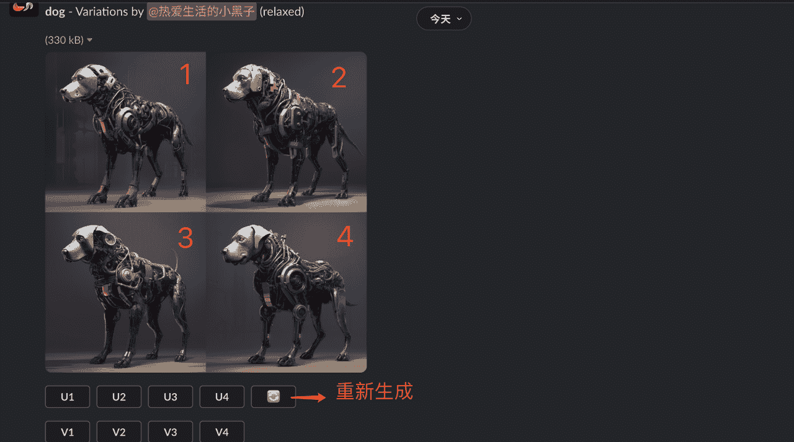

### 2、让MJ描述画面，直接给你prompt，你只需要复制粘贴就能复刻

/describe

首先搞一张图片地址

然后输入指令/describe 再把图片地址复制在后面发送

你就会收到这样的一段描述

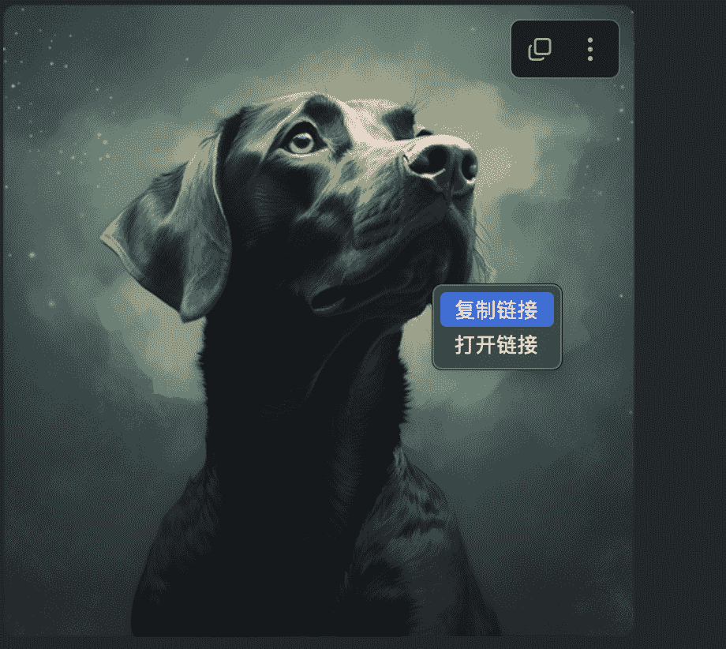

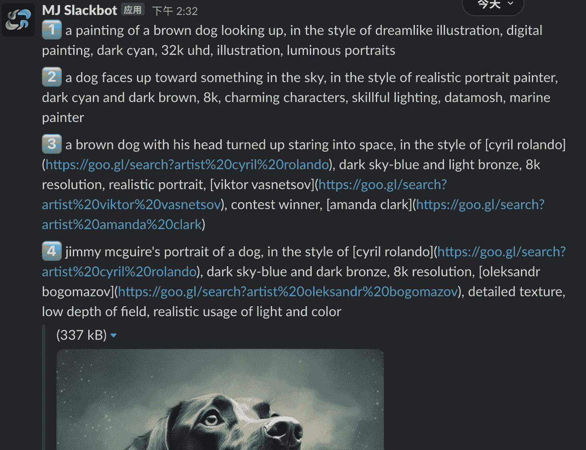

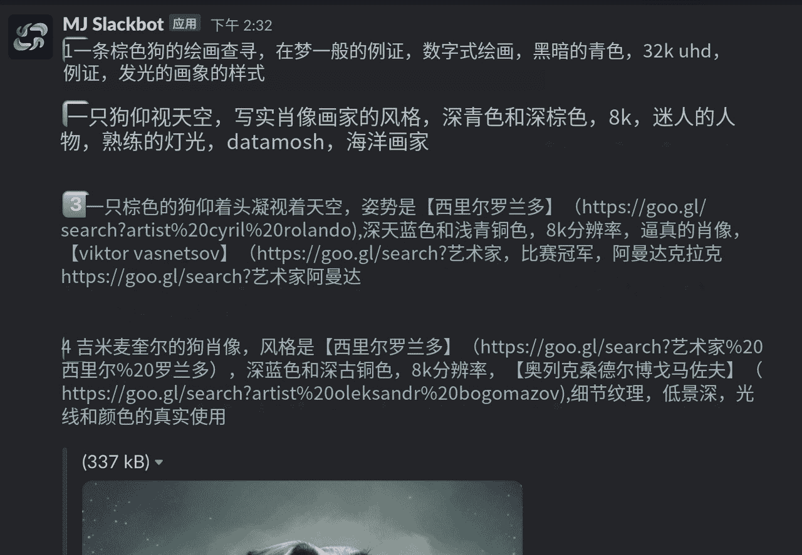

然后复制粘贴就OK了，下次看到让你惊艳的作品，知道怎么获取生成描述词了吗？

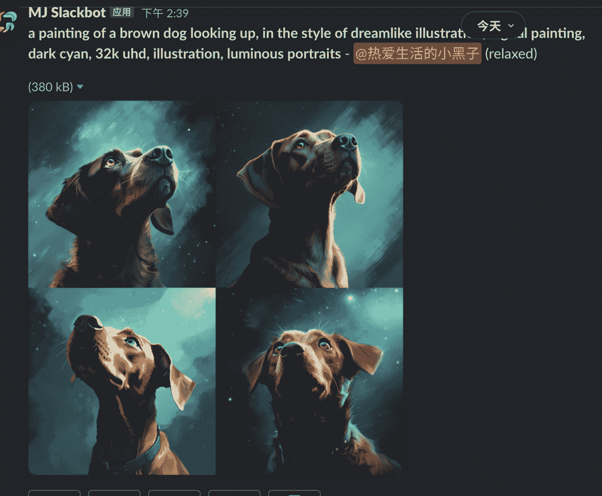

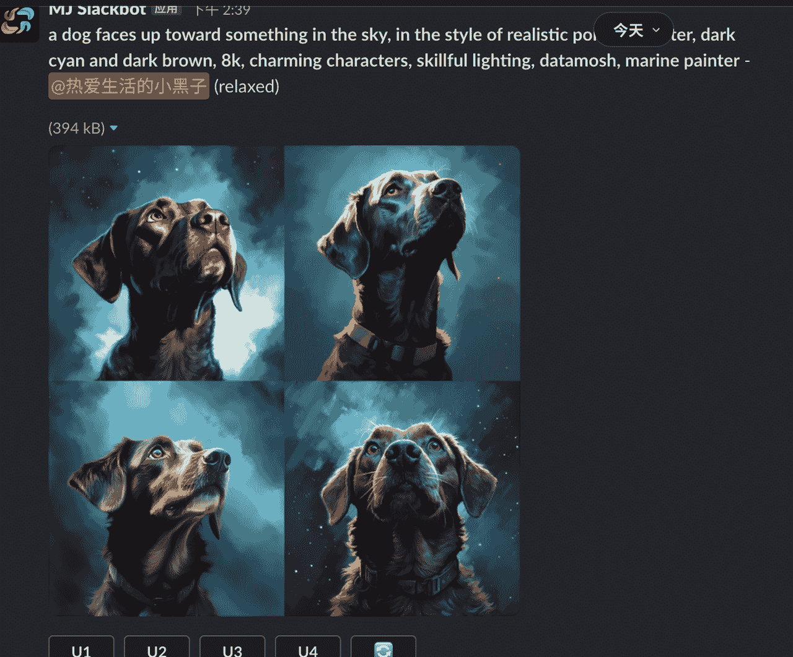

📢注意：直接在slack发送图片获取的图片地址，无法被mj识别

应该是魔法的原因，然后我测试了飞书、百度网盘之类的也无法实现，最终解决方案是

把图片上传到这里（不需魔法）：Postimages — 免费图片托管 / 图片上传  再复制地址使用

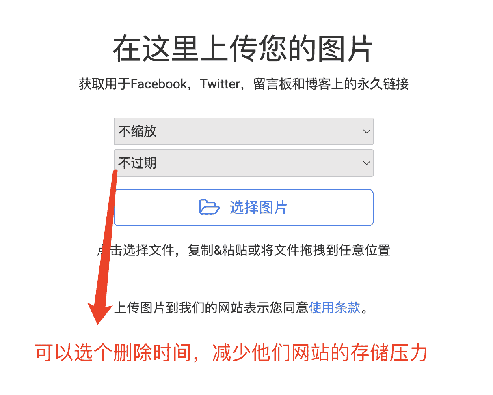

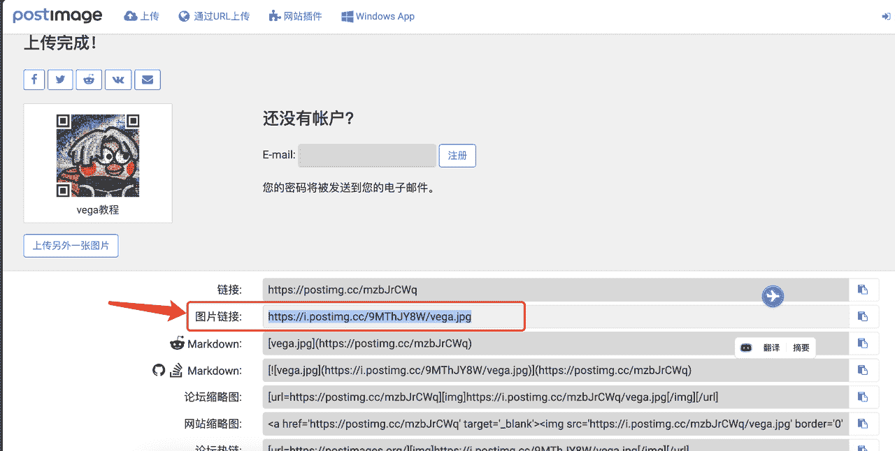

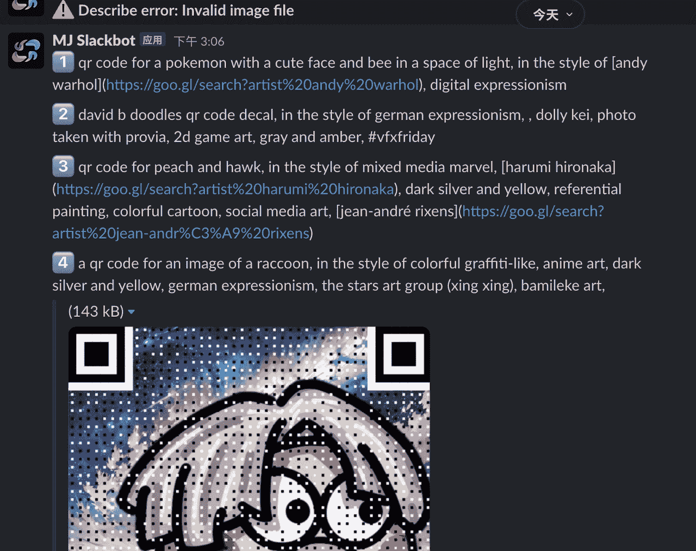

### 3、图像混合：最多支持5张图片混合

/blend

原理很简单，但是slack好像有啥bug，测试了很长时间都没开始混合，可能服务器问题，下次能用了我再补充下。

### 4、信息查询：加载mj机器人并显示目前账户信息

/info

就是字面意思，查询剩余图片额度，快速时长。

### 5、轻松模式，买30刀版本用这个模式无限出图，大概1分钟能出1组图片

/relax

字面意思不详细说了

### 6、快速模式，字面意思，这个模式下出图只需几秒钟

/fast

参考：标准版送15小时快速模式，如果用1分钟=1组图计算，15小时=900分钟=900组图快速出

> 感觉有用的话**点个免费的赞吧**，有疑问欢迎在评论区交流！

> 我是热爱生活的小黑子，热爱当下生活，永远忠于自己。

# 你来晚了，下面这些内容已失效。这家软件公司噶了。