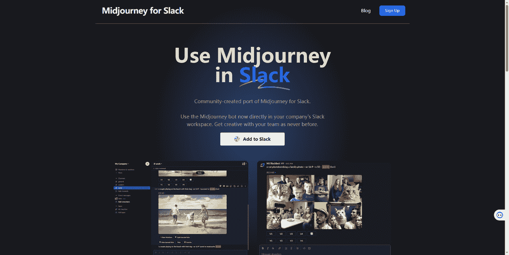
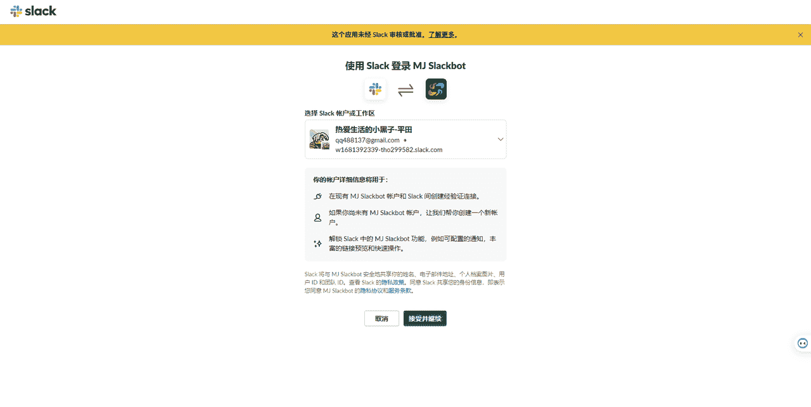
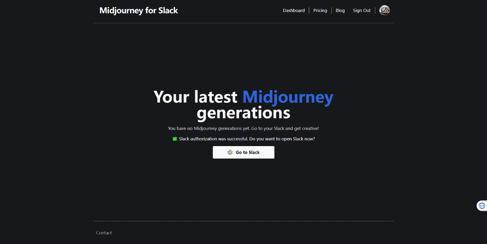
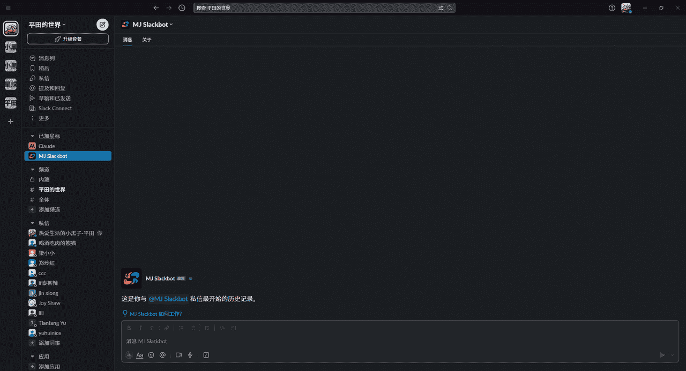
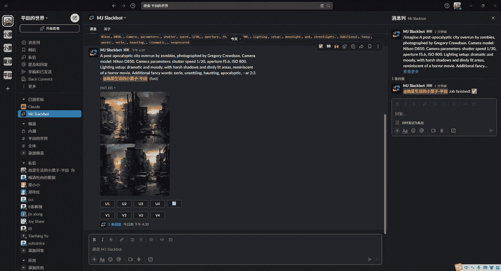
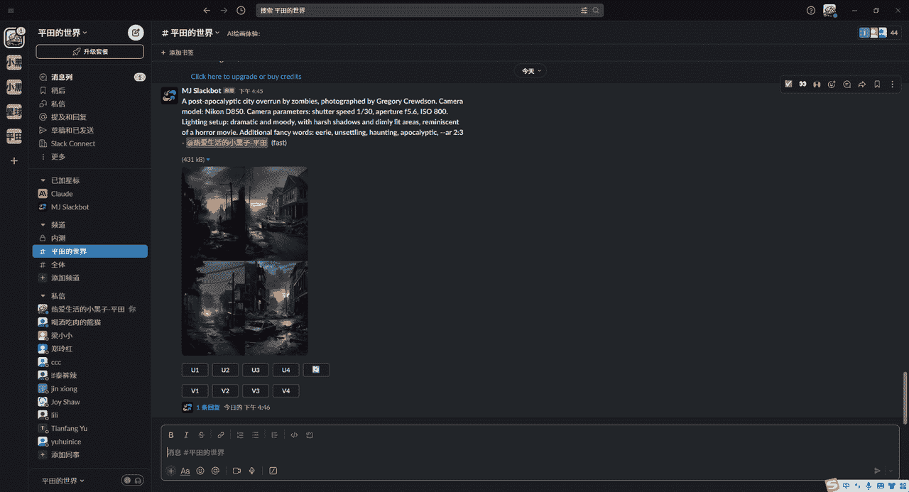
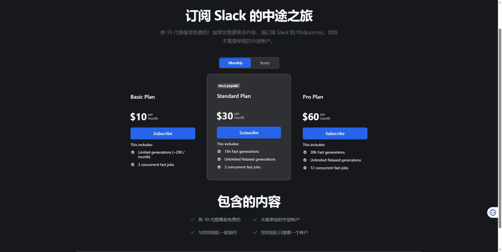
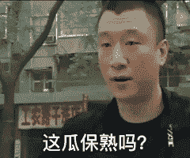

# 免魔法玩MJ绘画😻

> 来源：[https://my.feishu.cn/docx/GepadQeU8ohwJjxLPcOc723kn0e](https://my.feishu.cn/docx/GepadQeU8ohwJjxLPcOc723kn0e)

> 首先推荐一个AI工具，免梯子直接用GPT[和](https://ai.qixinba.com/me/;)MJ，多的不介绍了，登录就明白了：https://ai.qixinba.com/auth?type=register&invite=NTE

# 你来晚了，下面这些内容已失效。这家软件公司噶了。

兄弟萌，midjourney能再Slack添加了，赶紧来白嫖！

👉Slack跟discord可不一样，它使用的时候不需要魔法❌

**不知****道Slack是啥的话，直**接看文末链接🎁看完教程你还能收获一个免费Ai文字工具Claude🚀

🎨midjourney添加地址：https://www.mjslackbot.com/

我的频道测试了✔添加成功

实测可出图✔免费生成10张图片

私聊出图

公共频道出图

**公共聊天可以**出图，添加到公共频道后，在频道发送指令/info

然后，生成图片的指令是：**/imagine **（私聊跟公共聊天都是这个指令）愉快的玩起来吧！

**Slack 的MJ使用方式与 Discord 上的 Midj**ourney 相同，用同样的命令和参数。

10张免费额度用完后的收费方式跟Discord相同🥺

**只要你买了标准版。你频道里所有人都能用他！！！意味**着你不用拼车，不用冒着被封号的风险！！！

**dddd，赶紧冲吧！**

👉想知道什么是S**lack请**看：🎁

👉Slack版MJ的基**础教程：** [Midjourney使用教程（Slack版本）](https://yw55ojhusnq.feishu.cn/wiki/QLYwwXdDRilMHrkc08VcxSwCnzc?from=from_copylink)

👉直接让**A****I帮****写提示词教**程🎁：

> 我是热爱生活的小黑子，热爱当下生活，永远忠于自己。

# 建议读这个最新的版本：[微信上能用的MJ及教程](https://yw55ojhusnq.feishu.cn/wiki/WZbSwbbSOijAeTke1Qtcjiagn4e)