# NO.01 AI绘画全类型变现

> 来源：[https://my.feishu.cn/docx/QBlFdfqmtoJo5MxfxGzcJ8gqnLd](https://my.feishu.cn/docx/QBlFdfqmtoJo5MxfxGzcJ8gqnLd)

首先推荐一个AI工具，免🪜直接用G[P](https://ai.qixinba.com/me/;)T和MJ，多的不介绍了，登录就明白了：https://ai.qixinba.com/auth?type=register&invite=NTE

我个人理解的赚钱的本质，就是为他人创造价值。

如果想要变现，就得知道自己能创造什么价值，现在我们有全套的AI工具，创造了任何价值其实都能变现，就像我之前发布的两个AI绘画类变现教程，本身也是创造价值后才能成功变现：

[🎁Vega变现指南（自制🛰️表情包！）](https://yw55ojhusnq.feishu.cn/wiki/CKhTw6GF5iXyVlkobH7csUYTnze?from=from_copylink)

[🎁Vega变现指南（月入好几个W的自媒体！）](https://yw55ojhusnq.feishu.cn/wiki/ZVEdwCx4ViIFZFkGO4acJF7xnZf?from=from_copylink)

这次我再延伸一下，把市面上的AI绘画变现案例全部整合到一起，大家自己选个力所能及的赛道跑起来！

### 变现类型A-收徒与私域

#### 类型一：插画+一句话语录（难度等级🌟🌟）

什么火模仿什么，可以做壁纸，头像或朋友圈图文素材，文案可以模仿📕热门账号或者🧣等其他平台的文案，然后通过图片贩卖变现（打包XX张这种），当然很多账号这一步，只是为了私域和收徒变现，打包卖图的收入太少了：

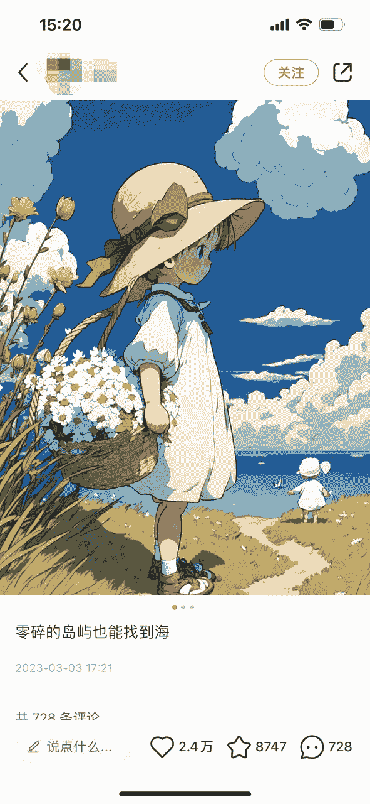

#### 类型二：教学号（难度等级🌟或者🌟🌟🌟🌟🌟）

难度等级🌟的教学号：

仅需发布图片+关键词即可，可以复制 MidJourney 画廊热门关键词出图，发布图片+关键词

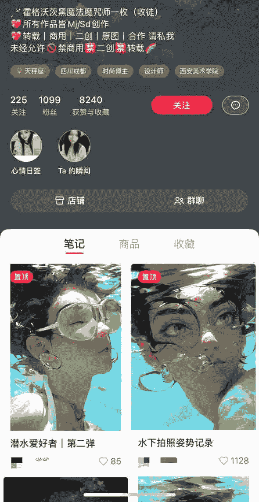

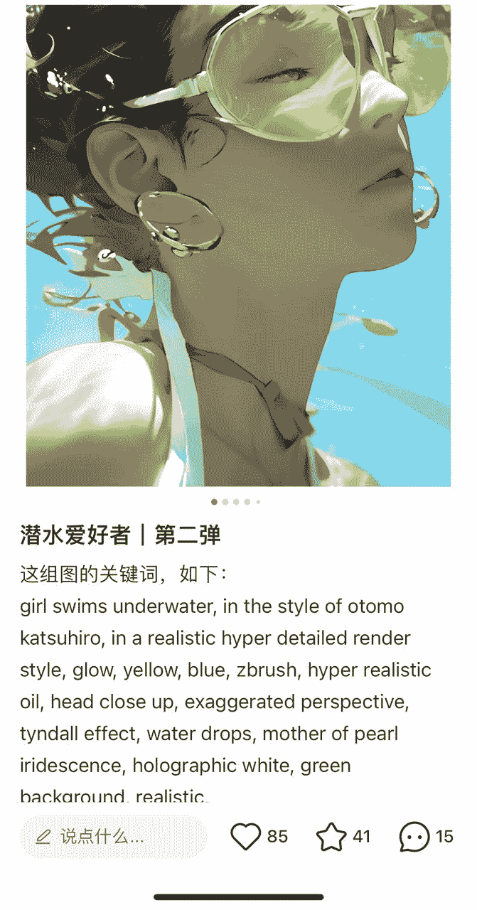

难度等级🌟🌟🌟🌟🌟的教学号，以课程/社群教学变现：

以 Midjiurney 为例，需要对关键词的组成熟悉并理解，不断学习，充实自己的知识库，有一定的表达对能力，可以将所学知识输出，形成体系课程，教授别人。

可以在📕上分享制作过程、最新的版本功能及各个工具组合应用方法等等来打造账号，输出知识，这是一个需要沉淀的过程，不会那么快速变现。

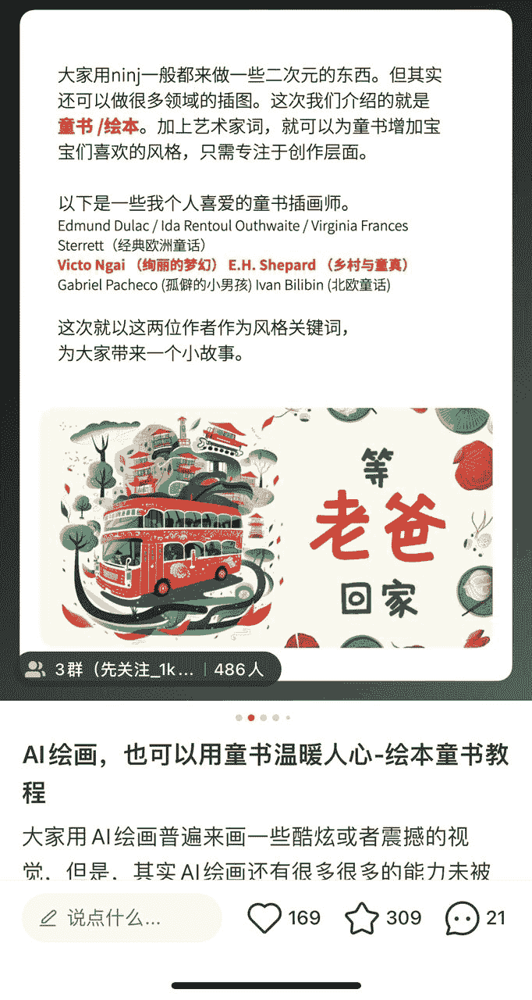

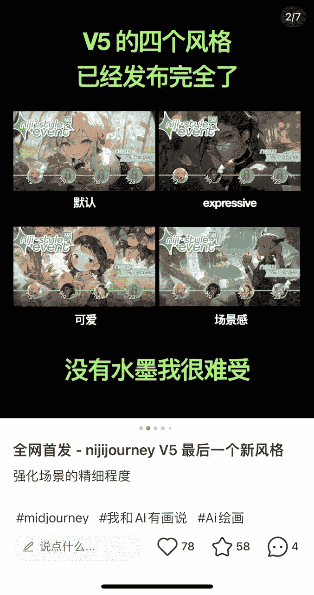

### 变现类型B-原图销售

原图变现的方法主要有以下 3 种。

#### 方式一：引导分析粉丝小程序取图赚佣金 难度等级🌟

发布图文，粉丝喜欢，可以设置免费取图的钩子：

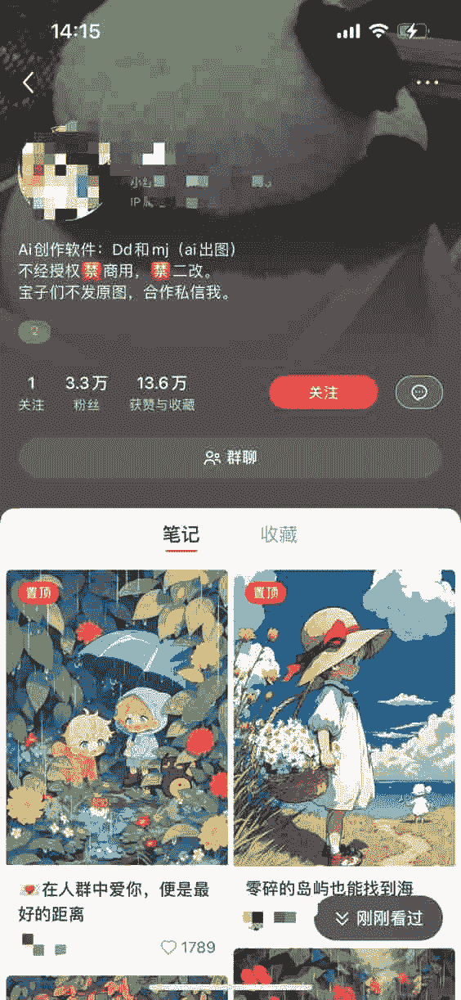

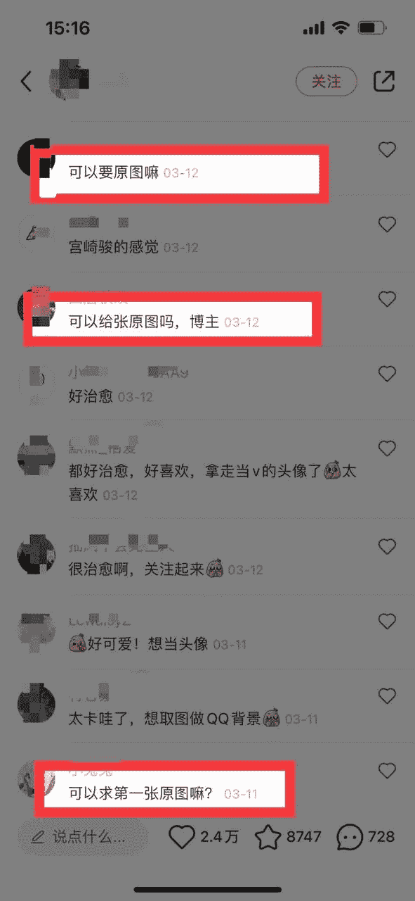

**

📕群聊，引导粉丝进群后**，可以在群聊公告里写出取图方式，粉丝直接去搜索取图小程序，通过粉丝取图看广告，我们赚取点击费。如：

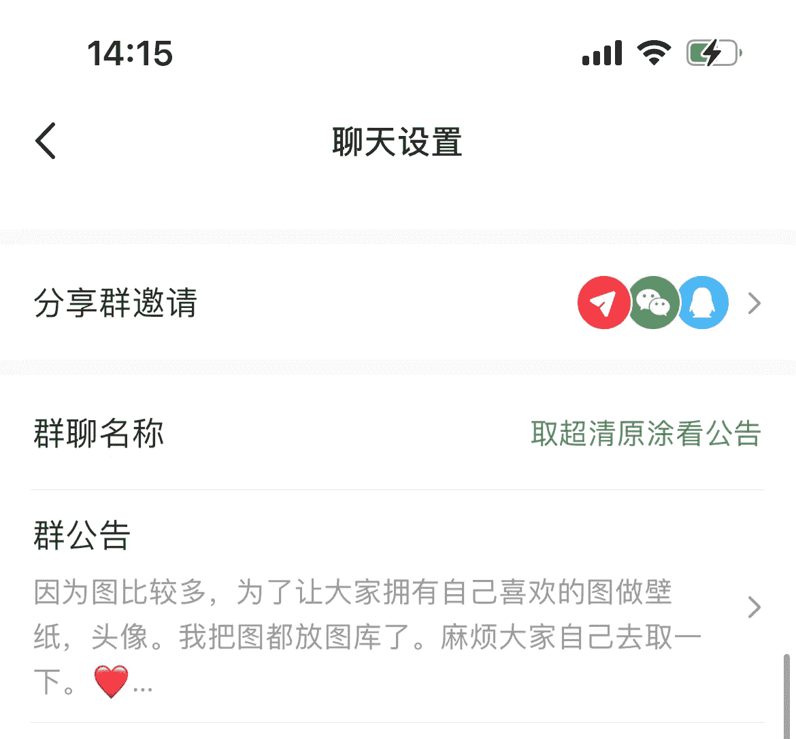

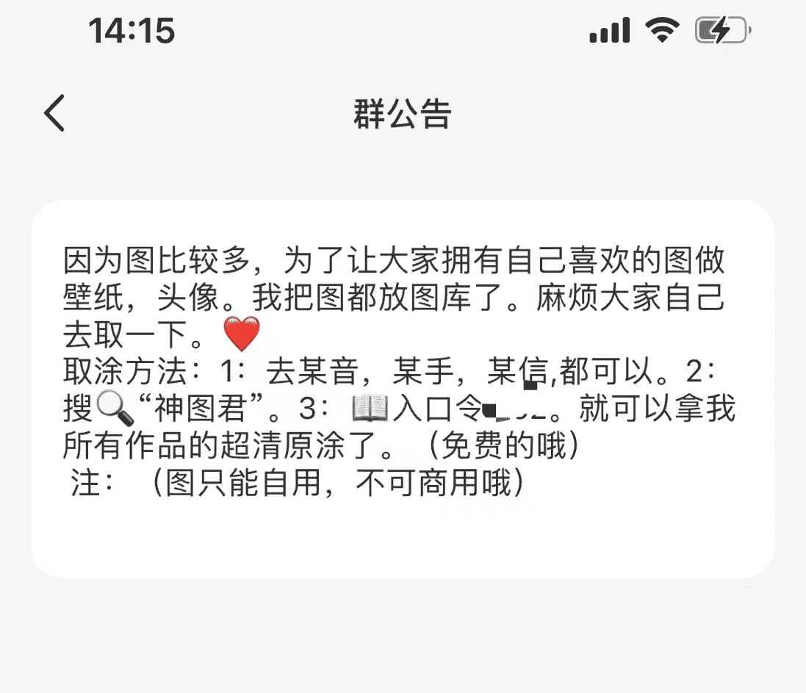

#### **方式二：建立📕群聊，****群公告**改为自己的👸号 难度等级🌟🌟🌟

以👸号为媒介，👸号取图，涨粉速度快，且安全，不存在频繁被加风险，引流到👸号上，用户通过👸号获取图片。

那么到👸号取图，会有以下 3 种变现路径：

+   **小程序取图收益：**与方式一类似，在👸号上直接跳转到神图君等取图小程序，通过取图看广告，赚取点击费

> 这里要注意的是，某些取图小程序，比如神图君，要满 20，才能提现，变现不是即时的。当然，如果你神图君里的图片比较多，不排除用户会多点几个，让你收益多多。

+   **网盘拉新：**在👸号上回复设置好的引导词，如“取图 1”，会自动回复你设置好的网盘链接，用户点击网盘链接，下载 APP，转存获取图片，赚取拉新费用。

> 这里需要注意的一个点是：有可能你的用户已经有你要拉新的网盘，那么他就不属于一个新用户了，你可能就获取不了这部分收益，所以这个方式，是有几率赚不到钱的。

+   **私域+网盘拉新：**那么针对第 2 种，你可能赚不到钱的方式，我的建议是，回复关键词，跳转出你的🛰️二维码，让用户扫描二维码直接加你好友，把人导到私域里，再给他发网盘链接，

> 这样的话，假设网盘拉新失败，你还会有一个私域转化粉丝，这个粉丝单价是 0，也是很香的，后续如果喜欢你的图片，可能会找你定制头像，或者找你学习，亦或是你有自有业务，可以通过其他业务变现，这是隐藏价值。

当然，这里有 4 点需要说明：

一是，有一部分人白嫖过后，会删除你的好友，对于这样的，咱们无视就好，要相信，下一个会更香；

二是，你需要做好你的朋友圈，日常发图，发文，运营好你的朋友圈，不然用户不了解你，吸引不了用户下单；

三是，建立群聊，会有人进入打广告，需要及时对广告进行撤回；

四是，不论哪种方式引流操作，都会有违规风险，大家做好心理准备。

#### 方式三：📕店铺变现 ** 难度等级🌟🌟🌟🌟🌟**

开通📕店铺，将 AI 作品或者 AI 课程上架，进行变现：

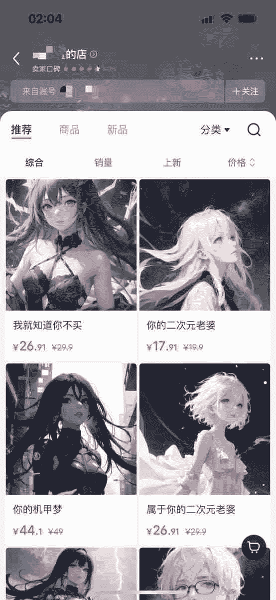

### 变现类型C-定制 ** 难度等级🌟🌟🌟**

AI 绘画可以通过以下方式进行定制变现：

**① 设计定制化插画**：可以根据客户需求进行定制化设计，提供更多的选择和服务。

**② 授权许可**：可以通过授权许可的方式，将其应用于商业领域，如广告、包装设计等。

**③ 出售设计方案**：可以生成多样的插画设计方案（关键词），可以将其进行打包出售，提供更多的选择和服务。

**④ 开发插画设计软件**：可以通过开发插画设计软件，为用户提供更多的选择和服务。

具体可以根据客户需求定制相关，如：文创周边包括各种形式的衍生品，书籍插图、文具图案、服装图案、装饰画、海报设计、绘本制作、贴纸、雨伞图案、笔记本封皮内页插画设计等等。

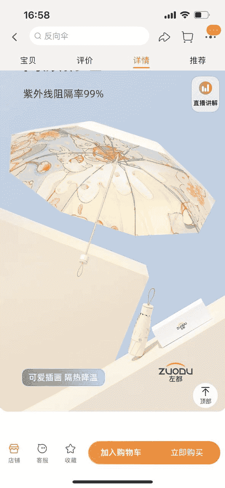

### 变现类型D-电商版块

如果你本就在电商领域，你可以直接将 AI+电商领域的玩法学以致用；

> 补充说明下，电商现在不是蓝海市场，已经杀疯了，现在的电商就是红海，互相卷！纯小白不推荐哈！

如果你非电商领域玩家，那么以下几种方式也可以变现。

#### 方式一：出售教程 ** 难度等级🌟**

整理 Stable Diffusion 模特图/产品图的制作方法，制作课程，进行出售：

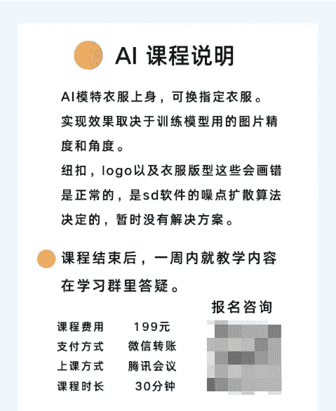

#### 方式二：对接商家资**源，为商家提供 AI **模特服务   难度等级🌟🌟🌟

在📕、淘宝、闲鱼店铺，通过给商家发送私信，寻找合适的商家店铺，进行商家合作。

通过为商家提供不同的 AI 模特服务，按照实际出图张数进行收取费用。

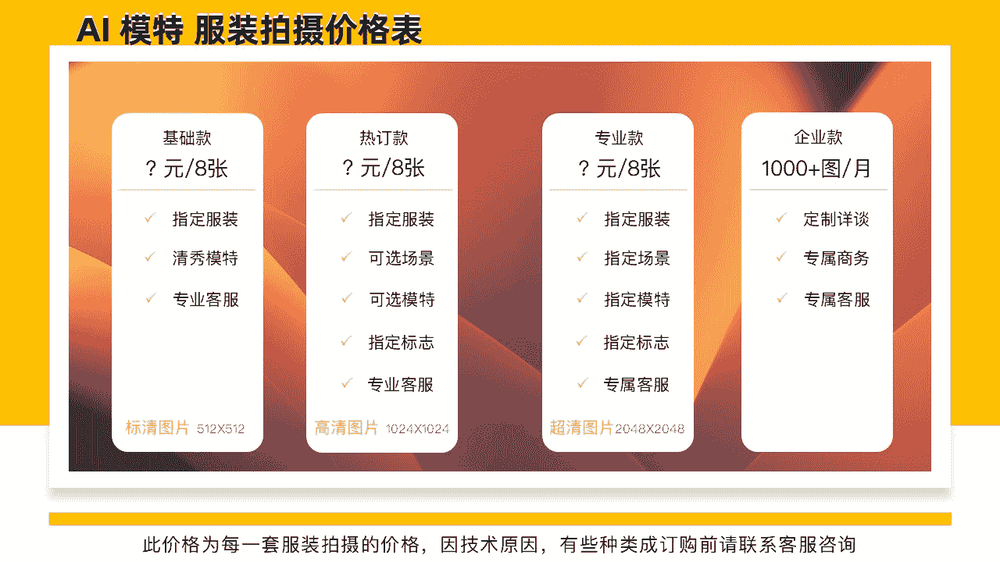

#### 方式三：成为 AI 模特商业链上面的任意一环  ** 难度等级🌟🌟🌟🌟**

所有生意都会有多个环节，供应链，流量，产品交付，在每个环节上都有着可以进行提供个人价值的变现机会。

#### 方式四：资源组合，形成团队赚钱   难度等级🌟🌟🌟🌟🌟🌟

AI 模特绘图单个个人进行产出，效率和收益都很低，难以接下大单，比如商家一次要 500 张图，要求一周内出图。这种情况下，必须团队作战，比如有 10 个人，1 个负责推市场，1 人负责商家沟通和交付，剩下 8 人，负责出图，那么每人一周的工作量就是 60 张+，这就是可以做到的。

#### 方式五：直接成为商家  ** 难度等级🌟🌟🌟🌟🌟🌟🌟🌟🌟🌟🌟🌟🌟🌟🌟🌟🌟🌟🌟🌟🌟🌟🌟**

现在正好有 AI 可以帮我们搞定图片，我们开店的成本进一步降低，图片也不再是能够阻挡我们的门槛。

然后你需要搞定货源、资质、售前**售后**、规则、营销、运维等……这些AI目前帮不了所以我写的是N个🌟

如果有兴趣，你可以亲自尝试一下，当个副业，搞点小钱还是可以的。

---

##### 如果想直接成为商家的话，**我再做一些补充：**

###### **电商的核心命脉**

####### **1、学习广告法**

中华人民共和国广告法：[h](https://gkml.samr.gov.cn/nsjg/fgs/202211/t20221102_351281.html)ttps://gkml.samr.gov.cn/nsjg/fgs/202211/t20221102_351281.html

广告法文案风险自查：https://www.check51.com/

####### 2、学习平台规则：学习内容见各平台后台

###### **货源网站**

######## 一、综合渠道

①拼多多、淘特、淘宝

优点：渠道售后省心

缺点：注意二道贩子，需要有鉴别能力

②1688、拼多多批发网、义乌购

优点：适合新人，质量可靠支持一件代发

缺点：售后跟不上、都是批发商家不怎么搭理散件、需要一定售后处理能力

######## 二、服装渠道

17网、四季星座、网商园、衣联网、搜款网

特点：江浙、广东货源，款式丰富

######## 三、鞋包渠道

开山网、中国鞋网、爱搜鞋、包牛牛、购途网

特点：一手货源支持一件代发，

######## 四、五金电子渠道

中国制造网、慧聪网、网商网、世界工厂网、华强电子网

特点：老牌b2b网站，价格有优势，品质有保障

######## 五、母婴玩具渠道

挚爱母婴、玩具巴巴、生意网、乐贝贝童装批发、织里童装

特点：产业带商家，价格有优势

######## 六、其他渠道

食品-食品代理网

家纺-91家纺网

美妆-个秀名妆

成人-性商网

支持一件代发模式，0成本代销

---

### 变现类型E-IP相关   ** 难度等级🌟🌟🌟🌟🌟**

目前，IP 定制的变现方法还不是很明确，大部分账号会发布自己创作的 IP 作品，一边积累流量，一边探索变现：

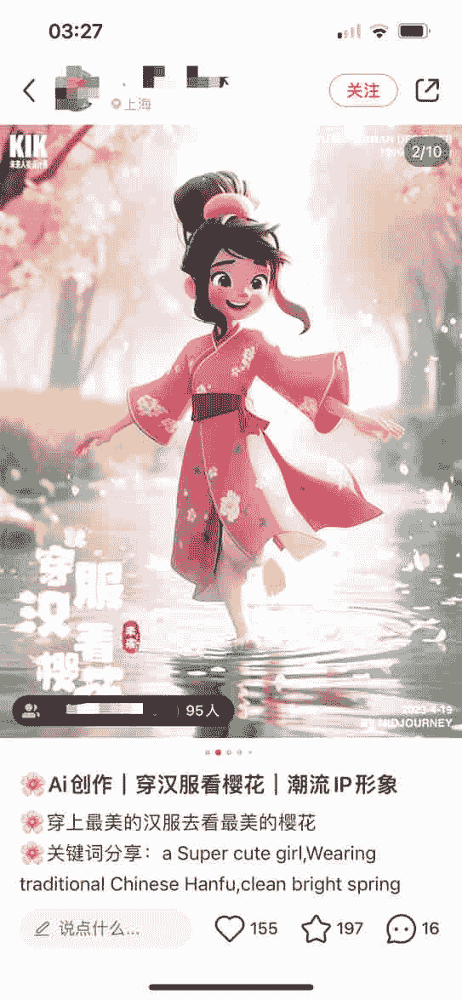

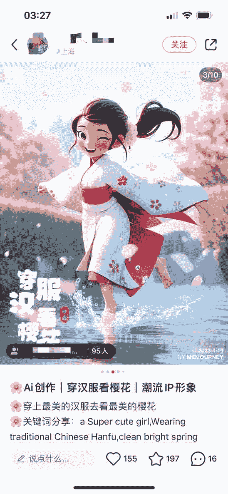

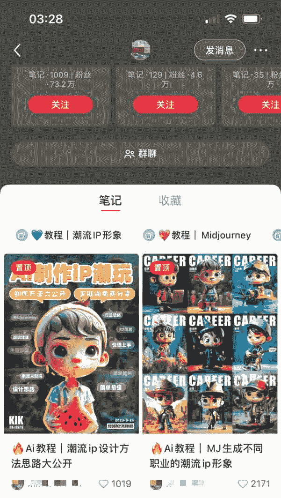

部分账号可能会接到一些定制商单，或者授权变现，但是都未成体系，感兴趣的小伙伴可以尝试做个先驱者。

### 变现类型F-LOGO设计   ** 难度等级🌟🌟🌟🌟🌟**

在讲变现之前，先来和大家说一下 Logo 的性质：

> 识别性、特异性、内涵性、法律意识、整体形象规划（结构性）、色彩性

logo 的种类和性质决定了它的制作是有一定门槛的，AI 绘画工具只是起到辅助作用。如果商用，需要进行二次创作，如修改 AI 出图后图片上的字体，添加场景使用等等，还需一定的语言功底，描述出设计理念。

发布📕图文，如果是发纯 logo 的话，建议“赋予图片意义，给出使用场景”，比如，将 logo 用于门店上、周边文创的包装袋上、日历上、店铺小程序等等，更直观的展示，促进甲方老板下单定制，如：

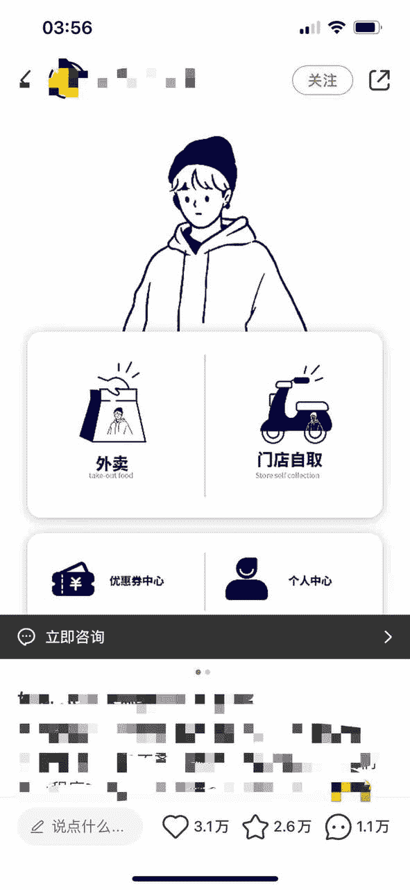

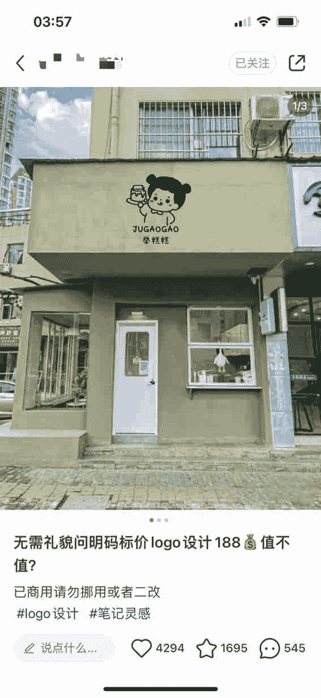

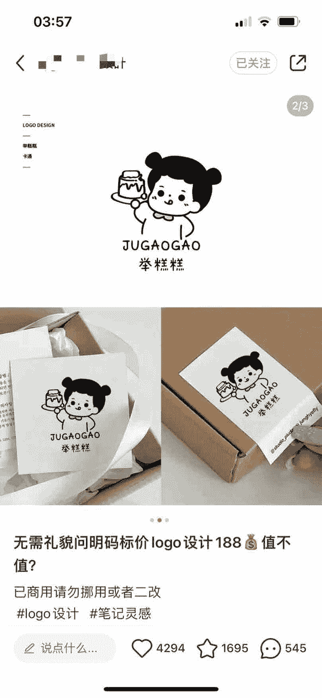

可做的定制包括但不限定于：设计企业 LOGO 及周边产品，比如店铺的 LOGO，书籍封面图，店铺纪念徽章，书签等

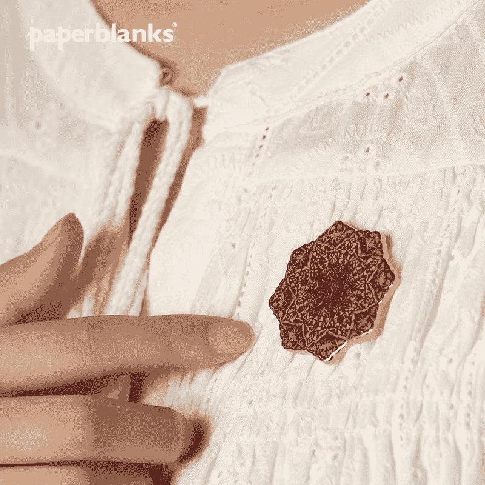

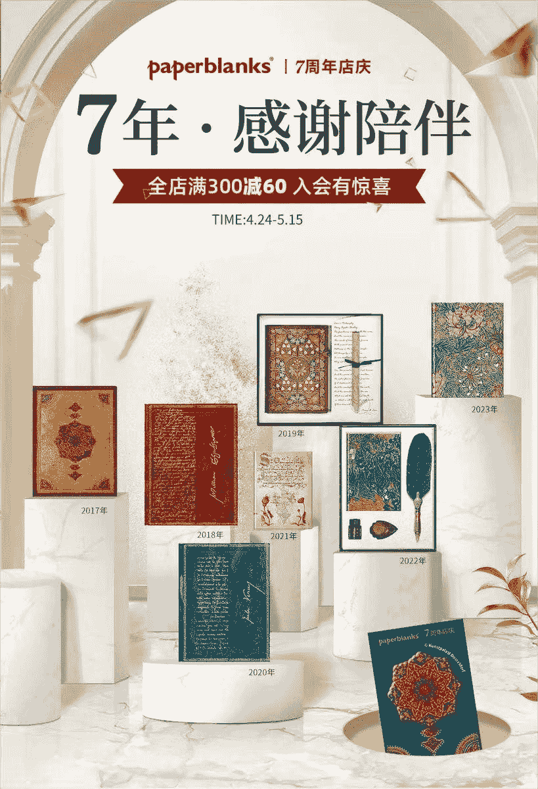

### 变现类型G-头像定制

这个大家太熟悉了吧，梓泉都给我发过这样的素材：

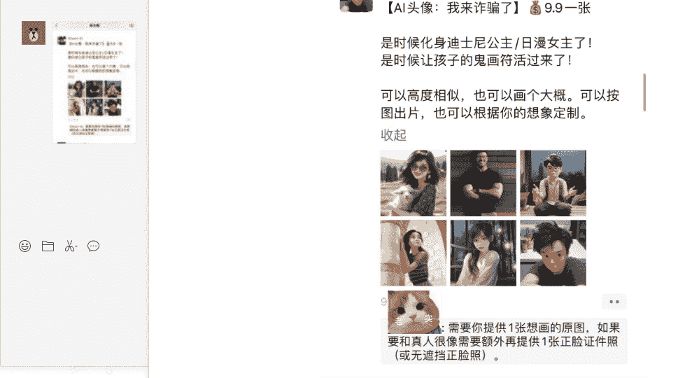

头像壁纸的变现方式相对来说比较多，简单来说就是利用公域或私域流量成交：

私域：比如用快团团工具等工具发布团购，团购内容可以是收费制图，也可以是收费教学，发在群聊和朋友圈即可，有自己的私域流量的更好，吸引顾客下单成交；

公域：比如在📕上发布图片笔记或者制作成对比视频笔记（原图+换脸后的图），发布笔记。笔记火了，会有粉丝私聊你做定制，单价 30-99 元 3 张都是可以的。也可以一鱼多次，多平台发布，或者收费教学；

注意事项：受限于 AI 绘画的出图方式等，制作头像和壁纸不支持改稿，可以在约稿时提前和对方约定一口价；

#### 案例一：头像壁纸   ** 难度等级🌟🌟**

比如该案例，在📕上广受关注与喜欢，其定制的价格方案，大概是 129-189/张，笔记单图售卖 19.9 元。

起号成功后，半个月变现了五位数：

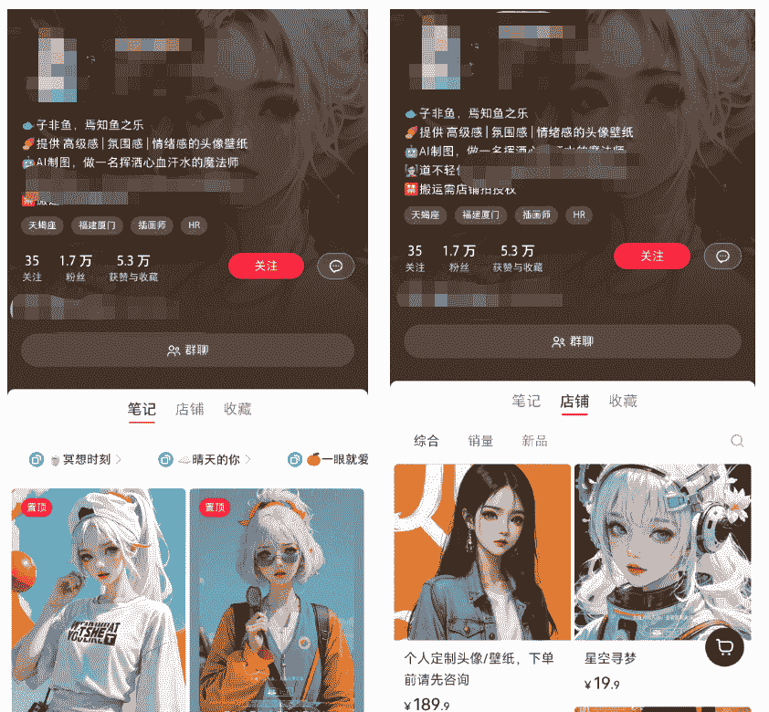

#### 案例二：知识付费   ** 难度等级🌟🌟**

该账号起号 3 天，粉丝接近 2 万粉，并制作付费交付课程，付费会员几百个，客单价 299-599 之间。

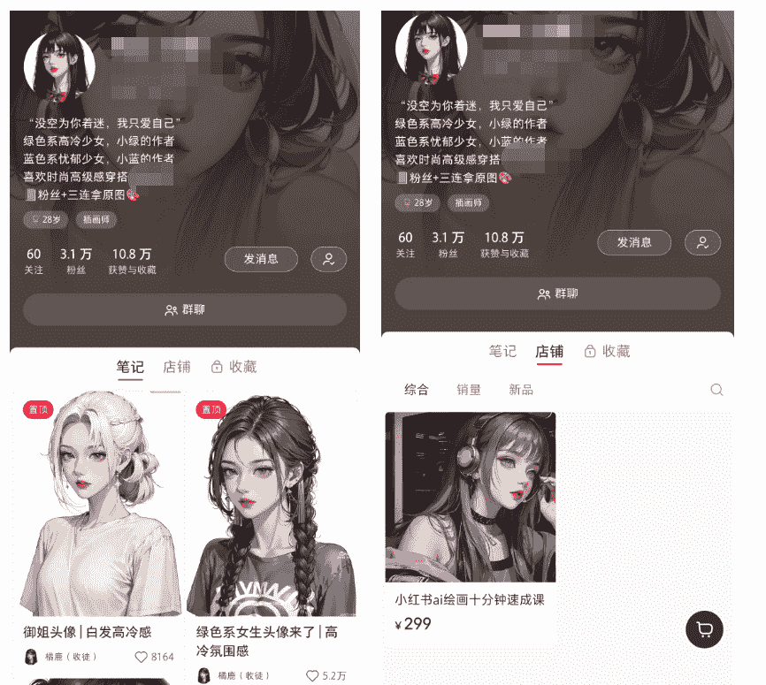

#### 案例三：儿童照片   ** 难度等级🌟🌟**

目前宝妈宝爸群体还是愿意对这种儿童迪士尼风格的照片付费的，毕竟新鲜玩意，客单价合适的情况下，人家直接就付款了。

一个宝妈，平时就爱给自己的宝贝拍照，了解到 AI 绘画后，自己用 MJ 试了下效果很好，自己很满意，就琢磨着能不能通过这个赚点钱呢，补贴家用。

很快，她就用快团团发布 AI 绘画团购，在朋友圈和群发了个拼团，没想到两天时间，一千多人拼团，关键还没啥成本（就花费自己的人力成本）：

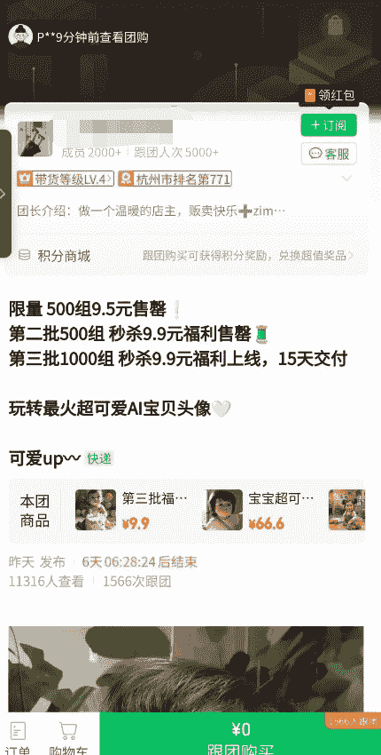

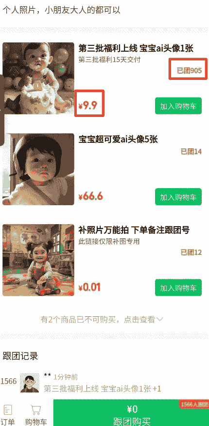

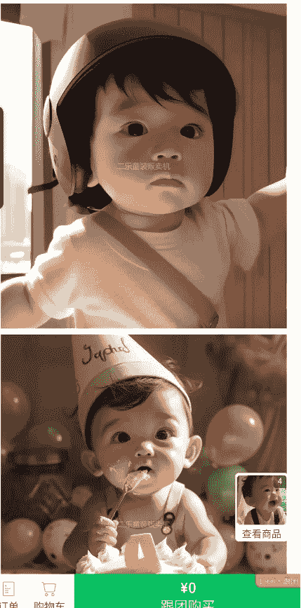

而这些，只需要套用关键词+垫图，就能直接出这种风格的照片。我们可以算一下她的收入：9.9 元*1500 人=14850 元，这直接就 5 位数。

对于[🎨最强Ai绘画工具Vega.Ai教程（制作中）](https://yw55ojhusnq.feishu.cn/wiki/P58pw4353irg4mkko1bcU4A6ndb)过 99%的人来说，使用 MidJourney 来创作自己的肖像照是不可行的。除非你是个大明星，这意味着在网上有几千上万张你的相片。但是现在，你可以借助 VEGA.AI （教程见  ）， 来帮助客户实现这个想法。

### **变现类型H-美甲设计（门店**导流）    难度等级🌟🌟🌟🌟

我们结合一个案例来看，AI +美甲如何完成变现？

号主 AI 魔法绘境，之前依靠垂直 AI 绘画美甲，涨粉 3W，赞藏 16 万。

点开爆款笔记可以看到，需求、尝试和问价的人不少，说明这是一个有市场、有需求、可转化的方向。这个账号证明 AI 绘画与美甲的结合是一个有潜力的方向，值得探索。

AI 绘画与美甲都是目前较热门的领域，且契合📕年轻女性用户的兴趣爱好，所以选择这两个方向进行内容打造，容易吸引流量与互动。提供图片作为美甲设计灵感，这满足了很多用户美甲新意和个性化的需求。

可以结合美甲店，由线上转化为线下流量；也可以作为一个热门话题，吸引足够多的人群，进行其他方向开发：

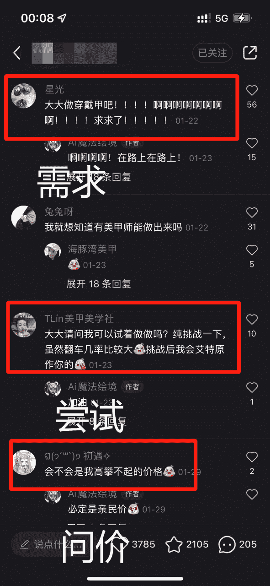

### 其他展望

#### 未来婚纱摄影   ** 难度等级🌟🌟🌟🌟**

> **其实不用未来，现在就可以带着作品去自**己周边影楼谈一下定制一些超现实的婚纱照。

> 当然如果你是社恐的话，可以拉个社牛一起。事成之后给社牛朋友一些提成😎

传统的婚纱照拍摄需要花费 2-3 天时间，因为要花费很多时间准备场景和化妆，而且还要找到最佳的拍摄地点。这样的拍摄方式比较累，因为需要很多人协作，还要忍受长时间的拍摄和重复的拍摄动作。

未来的婚纱摄影将会发生巨大的改变。新技术可以让婚纱摄影更加轻松和简单，只需要在室内拍摄一些照片。这样，新婚夫妇可以放松自己，享受拍摄的过程，而不必担心天气和环境的影响。

在拍摄后，将照片训练成 lora 模型，可以在 Stable Diffusion 中生成不同场景的婚纱照。这是一种基于人工智能技术的创新方式，可以根据新婚夫妇的喜好和需求，生成多种不同的风格和场景的婚纱照。

这种技术可以帮助照片更加真实自然地呈现出来，同时也可以增强照片的艺术性和美感。这样的生成过程比传统的后期制作要快得多，同时也减少了成本和时间的浪费。

总的来说，未来的婚纱摄影将变得更加简单和方便，同时也可以根据新婚夫妇的需要和喜好，生成多样化的婚纱照。这是一种基于人工智能和先进技术的创新方式，可以为新人们带来更好的体验和更美好的回忆。

#### 其他案例

还有一些吴东子之前发过的，我这里再放一下，大家找起来也方便一些

一、《AI异常值案例库第2期，5个灵感案例，新型流量获客法和产品形态》：https://t.zsxq.com/0fbHPTm53

1.证件照新型P图法

2.MJ批量定制手机壳

3.画师新型流量获客法

4.AI技术视觉化变现

5.小孩涂鸦定制

二、《AI头像壁纸号项目，3种热门关键词+私人定制法，从零到一全流程拆解！》：https://t.zsxq.com/0fY5Tfd1m

1.头像壁纸号项目从0-1的拆解，包含流量，产品，变现的全流程讲解

2.热门头像的关键词拆解

3.私人定制的头像制作方法

三、《AI变现异常值案例库，5种方向10个案例，副业项目灵感启发》https://t.zsxq.com/0fsXAyjVO

1.宝宝起名号

2.AI热点资讯号

3.头像壁纸号

4.小说推文号

5.流量收益号

### 结语

随着人工智能技术的日新月异，AI 绘画前景光明。

这些技术将在以下方面崭露头角：

+   首先，AI 绘画能量将越来越惊人。随着深度学习不断优化与改进，AI算法将精准模仿人脑创造力与审美，产生更富创造力与艺术感的作品。

+   其次，AI 绘画技术将愈渐普及。随着AI技术日益普及与应用场景多元，越来越多人将借助AI绘画进行创作与设计，不断推动此技术的进步。

+   第三，AI绘画将与其他技术交融。例如，AI绘画可以与虚拟现实与增强现实结合，制造出栩栩如生的场景与效果;也可以与图像处理与视频编辑交汇，提升工作效率与效果等。

+   最后，AI 绘画仍需面对挑战。如何在艺术创作与商业需求间寻求平衡、如何保护知识产权与隐私、如何解决AI算法的伦理与安全问题等，这些都是AI绘画仍需不断探索的课题。

总的来说，AI绘画在技术、应用场景和社会影响等方面仍在蓬勃进步，为我们的生活与工作带来更多惊喜与便利。

没错，这段结语是让**claude生成的**哈哈哈，后面我慢慢补充内容型自媒体创业的案例。

> 我是热爱生活的小黑子，热爱当下生活，永远忠于自己。

> 感觉有用的话**点个免费的赞吧**，有疑问欢迎在评论区交流！