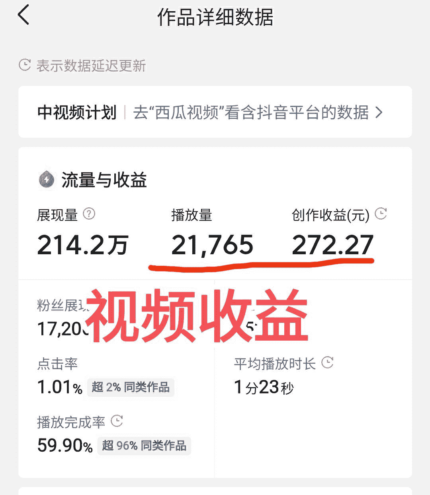
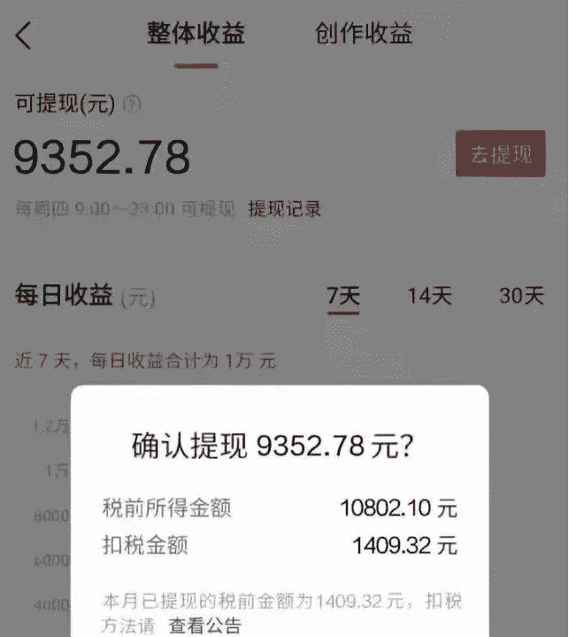
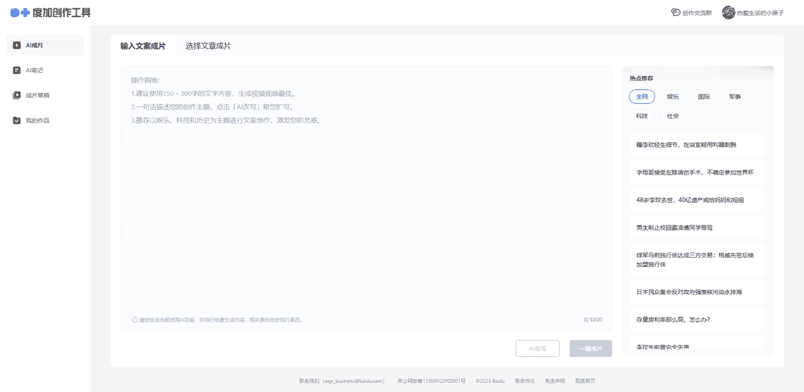
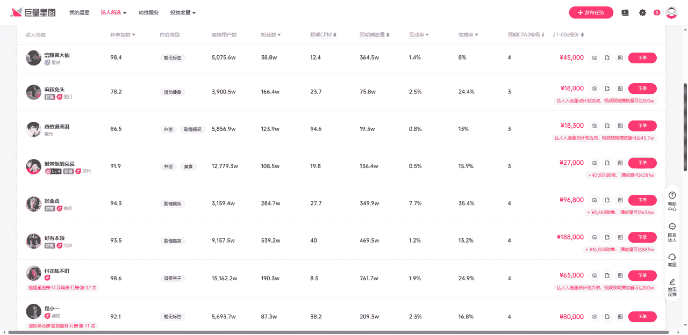
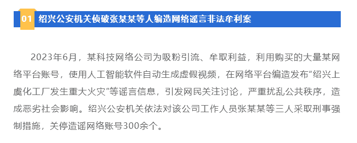
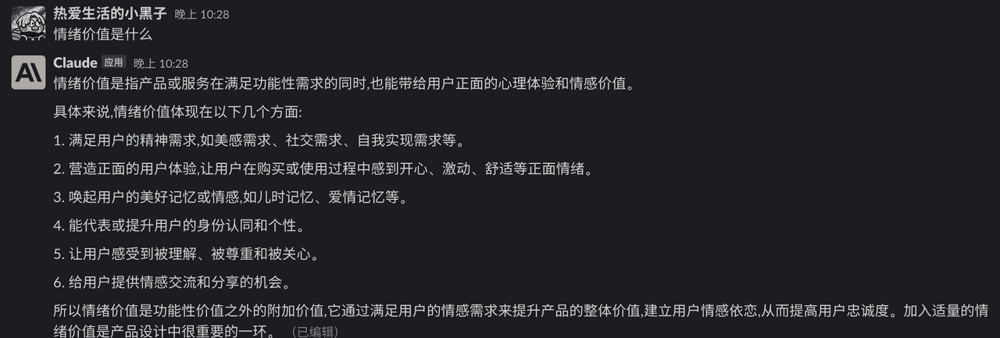
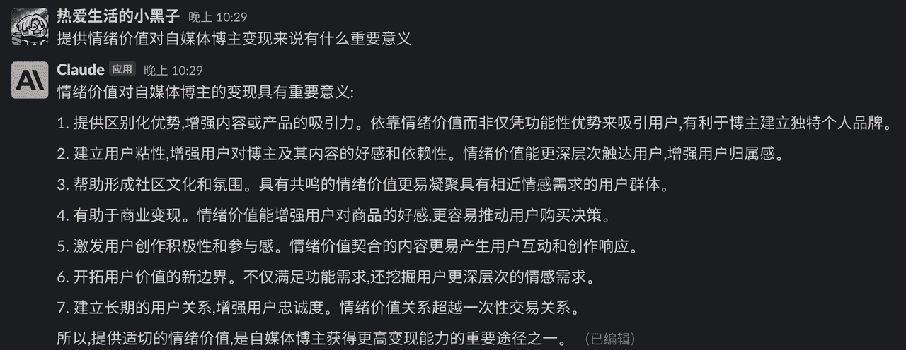

# NO.03 内容型自媒体

> 来源：[https://my.feishu.cn/docx/UfnTd3WH9oPxBUxyfAxcai48n2d](https://my.feishu.cn/docx/UfnTd3WH9oPxBUxyfAxcai48n2d)

首先推荐一个AI工具，免🪜直接用GPT[和](https://ai.qixinba.com/me/;)MJ，多的不介绍了，登录就明白了：https://ai.qixinba.com/auth?type=register&invite=NTE

之前讲了AI绘画，也说了直播；这次说以下，生成式AI能起到作用的**内容型自媒体变现**；

> 如果你想看完后想**一年挣他几百上千个W**，**那赶紧关了这个****页面吧，**有这么好的事我为啥不去自己挣，还要费心费神写出来让别人分一杯羹，这篇文章适合的是普通人做自媒体副业变现

> 以下全文内容是我个人的看法，**我**不是什么自媒体专家也没有自媒体大号，我只是用我多年的学习和工作的经验，站在个人的角度去剖析，仅供大家参考！我只是抛砖引玉起个头，如果觉得内容太差，不看就好。

### 道：关于变现的思考

深度的人工智能内容咱就不说了，直接从传统自媒体入手分析吧

现说一个坑：在AI爆火之前，已经有很多自媒体**空有粉丝但没法变现**，就是一开始做账号的时候，没想好变现模式导致的。

所以我认为自媒体变现是：**以终为始 👉 先**想好到变现这个结果的关键路径，然后再去做

已知生产内容并不能直接变现（播放类收益暂不考虑），所以做自媒体有两步：

（1）持续生产出能够带来流量的内容

（2）用持续带来的流量**变现**

做自媒体和做成自媒体，完全是两种路径。

做自媒体：很多人会想“起什么名字”，“几点发内容”，“一天多少条”，“我这个赛道还有机会吗”……

做成自媒体：先找到做成这件事情的关键路径 1，2，3....然后不断复盘优化……

关键路径就是上面提到的**以终为始 **

AI生产内容非常强，但是自己不熟悉的话，只会批量生产电子垃圾，这种内容没价值，也拿不到流量，所以没法变现。

变现的底层是什么，就是提供价值，我们一定要用利他的心态去做事；其流程就是找到用户，提供价**值，**创造收益。就算在1000 年前，你卖个酒也是要找到那批本身就会喝酒的人；因为商业的背后是人性，人性的背后是心理，心理的背后是引导；用你的内容引导平台（追热点）、用户（点击、互动），用内容抓取你想要的人，然后你来提供价值（商品价值、情绪价值），带来成交。

如果用**AI****做自媒体这块，该怎么创造价值。****聊到价值**，我第一反应我还是想到了情绪价值。

### 法：变现方式

前面说了**以终为始 **，那我们先盘这个终，我整理了一下现在自媒体账号的变现方式：

#### 1、播放变现   推荐指数：**🌟**

这是一个最基本的变现方式，把视频或图文发布到一个平台，平台根据你的播放量给你所获得的收益。

目前收益比较低，**10万播放大概**就几块钱，大家不要被市面上这种图片误导了，他们都是卖课的

百度甚至自己开发了一个AIGC生产平台https://aigc.baidu.com/make

只当副业做，一个月搞个几十块买奶茶是没问题的，想达到这样的高收益非常困难。

说白了就是**又累又不赚钱还污染互联网环境**，具体内容我不放了，你们自己感兴趣的去研究下。

#### 2、商业广告 推荐指数：**🌟🌟**

商业广告最常见的就是美妆博主接美妆广告，美食博主接食品广告……

这种变现方式需要账号足够的垂直才能恰上饭，想走这条路，账号人设和内容定位得提前规划。

商业广告收入一般不低，我们之前投抖音美妆博主，10万粉左右的一条就得2-3K，50万-100万粉数据比较好的博主收费基本在20万/条。

这里我给了2颗🌟的推荐，是因为前期的账号运营起号难度大，而且现在广告并不好接。

#### 3、卖课变现 推荐指数：**🌟🌟**

这里说的卖课变现指的是自己开发课程；当做副业，就算已经自己开发好一门课程了，售后和日常运维还会消耗很多精力！所以开发课程和销售👀只有团队才能干的好这事！

简单课程因为缺少背书等原因，定价没法太高，难以盈利，综合起来推荐指数不高。

#### 4、带货变现 推荐指数：🌟🌟🌟🌟🌟🌟🌟🌟🌟🌟

**宇宙的尽头是带货**，推荐拉满，没有之一。门槛低，**💰上**限高，覆盖广：

图片、文字、视频、直播都可以带货，而且货的形式没限制，不管是实物🎁、服务💝、虚拟产品🖥️都能带！

带货最大的魅力就是：👉只**要内容匹配产品，就能产生销量。**

甚至也不需要起号过程，**不管你卖什么，只要你能找到合适的受众，合**适的平台，合适的方式，😲就能成功带货。比如说：

+   你是一个美妆达人，你可以在抖音、📕上推荐各种💄化妆品、护肤品、美容仪器等等。

+   你是一个旅游爱好者，你可以在📕上分享各种🏕️旅行攻略、景点介绍、特色美食等等。

+   你是一个文艺青年，你可以在🧣上发表各种📖书评、影评、音乐推荐等等。

例子太多我就不一一列举了，以前做自媒体，除了自己擅长，再创作的时候还需要一定的文案功底；

现在，只要找到**自己擅长或者感兴趣**的领域（完全不懂领域的你无法判定AI生成内容的真实性），就能够结合AI工具，生产各种风格的内容来表达自己的看法和感受；就像以前我们文案不行，推荐产品只会说卧槽、牛逼、666，有了AI后文案能力MAX。

### 术：适合AI的赛道

情感号

书单号

焦虑

故事号

养生号

标题党

以上这些账号类型，大家自己搜索一下，网上做好教程一大堆。

**AI****工具**的结合能提高你的**文案能力**以及**生产效率**，不管是主页还是副业。

记住广撒网：

**有几个账号就起几个账号**

**有几个平台就发几个平台**

赛马赛一下，流量推荐算法真的是玄学，一样的内容不同号发出来效果区别很大。

注意：还有一种百家号AI热点【注意不要凭空捏造新闻，不然会违法】

### 器：工具选择

[💻文字类生成式Ai工具](https://yw55ojhusnq.feishu.cn/wiki/Ddynwk16ni6qp6ko61PcfNP0nve)字类生成：claude、GPT4等……可见我之前教程：

图片类生成：[别再拼车了！Midjourney也免费了，国内直接用不需要魔法！领取AI绘画工具立省$30/月！](https://yw55ojhusnq.feishu.cn/wiki/F0DywwsB9iYx46k2MJfcMCDvn3p)

[AI数字人](https://yw55ojhusnq.feishu.cn/wiki/OH8dwMqEdiNu6fk0Z4bcHyXYn2f?from=from_copylink)频类除了剪映一键制作，其他可选的就是数字人了，免费的数字人：

收费的数字人市面上有很多，比如百度的曦灵等我就不多介绍了。

### 总结

太多人在出发之后会忘记了自己的初衷，人生和自媒体没有什么区别，一定要有库表！

如果你明确你的目的是变现，那么所谓的涨粉和流量无非是你变现的附属品，并不重要！

👉明确你的目标并且坚定执行，理解这句话已经淘汰了很多人了。

做自媒体你说考验的是技巧，可能更多考验的是人性，不要基于你知道什么去做自媒体，基于你想要什么去做。

最后，用AI做个补充

> 我是热爱生活的小黑子，热爱当下生活，永远忠于自己。