# NO.04 👸号起号测试

> 来源：[https://my.feishu.cn/docx/JgTzdig8JoO1THxagFCcNVMRnlb](https://my.feishu.cn/docx/JgTzdig8JoO1THxagFCcNVMRnlb)

首先推荐一个AI工具，免🪜直接用GPT[和](https://ai.qixinba.com/me/;)MJ，多的不介绍了，登录就明白了：https://ai.qixinba.com/auth?type=register&invite=NTE

# 前言

2023年9月29日21:57:23开始测试，我自己的测试号暂未跑通模型，gigi已经跑通了，星球也发了帖子，大家自己看下最近更新就能看到；

# **流程简介**

1.注册👸号：https://mp.weixin.qq.com/

2.选择账号类型：订阅号（账号类型说明文档：https://kf.qq.com/faq/170815aUZjeQ170815mU7bI7.html

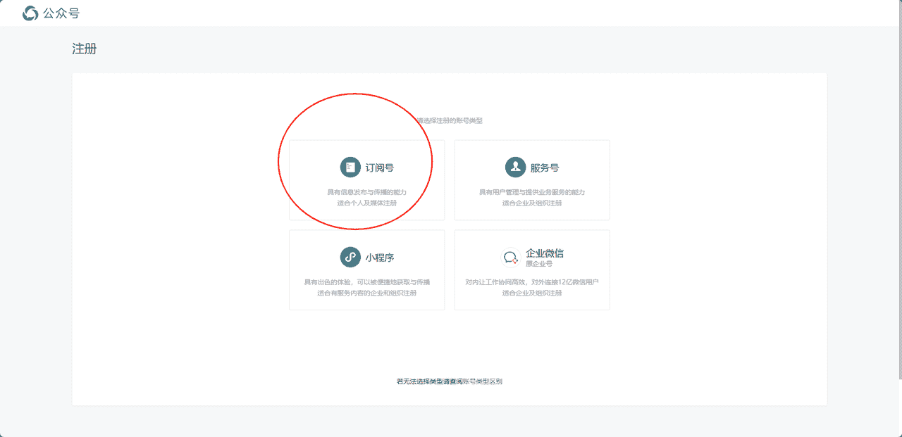

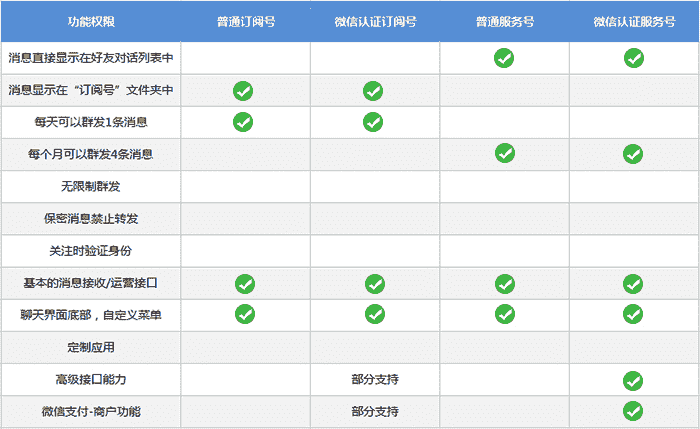

3.填写信息：如图示，一步步按要求填写，注册成功即可

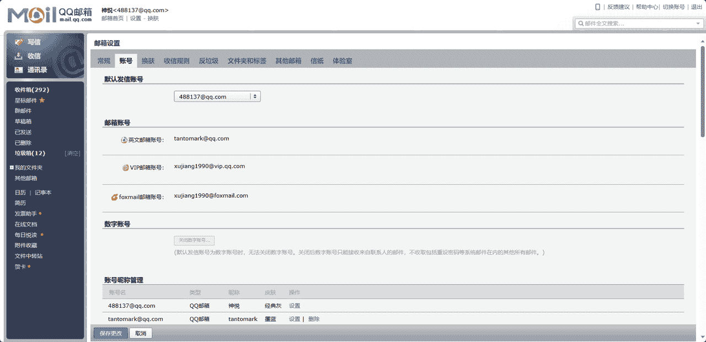

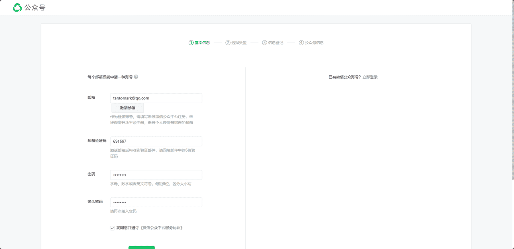

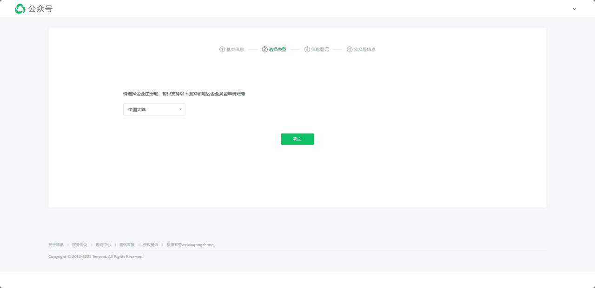

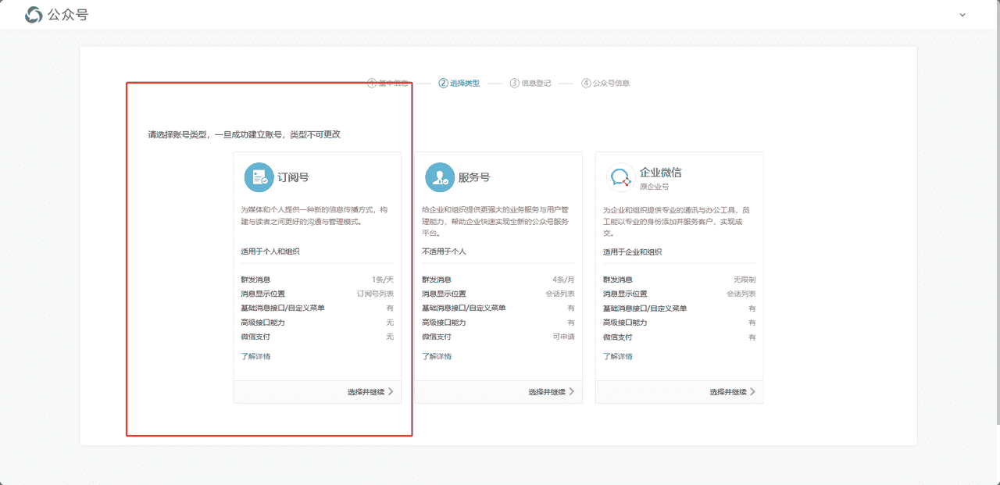

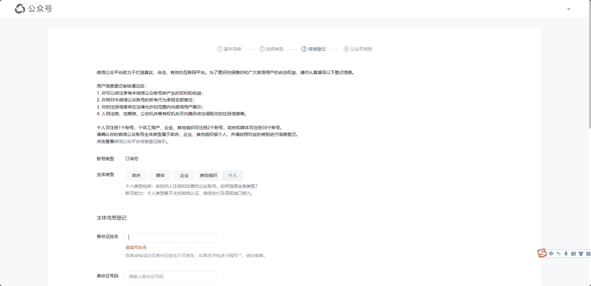

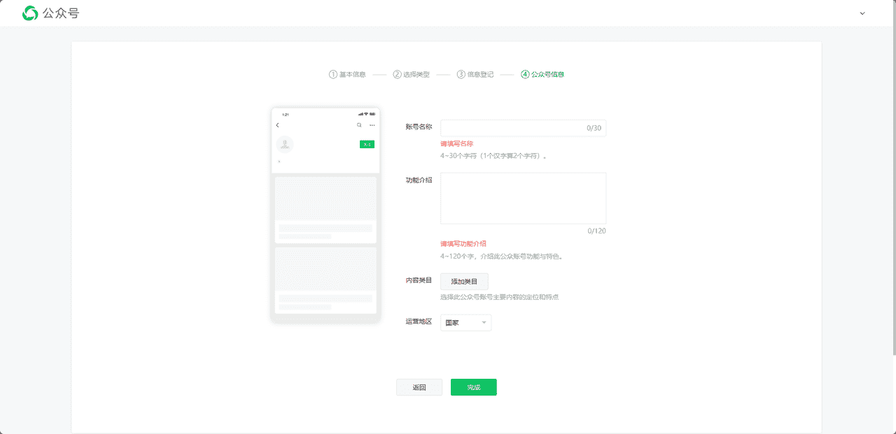

4.写文章：对应入口进去选择图文发布（想发啥就选啥），写教程图省事儿，我这篇内容就找讯飞简单给我搓了搓。不过这种用脚输出的玩法，估计拿不到流量……大家自行优化prompt和内容！然后多配点图！

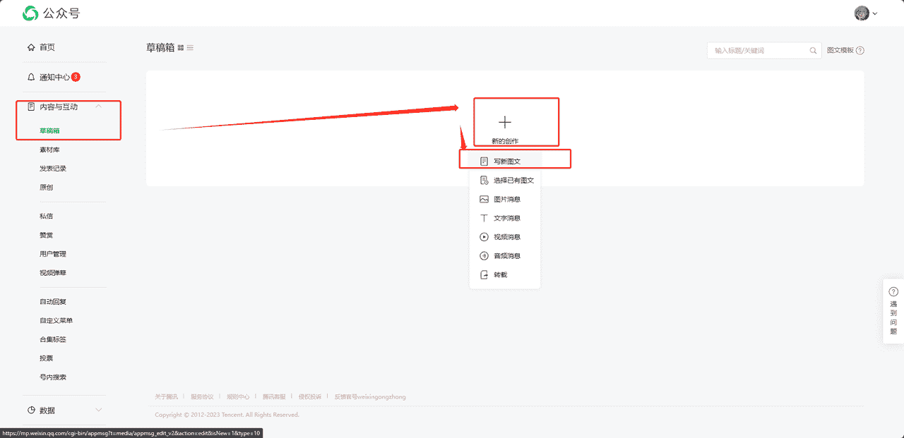

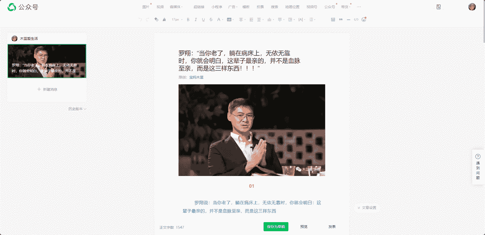

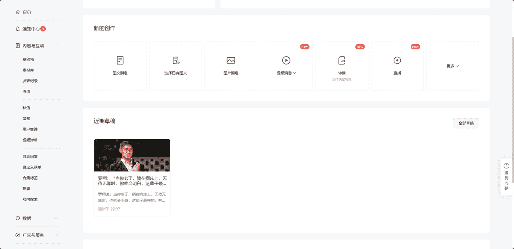

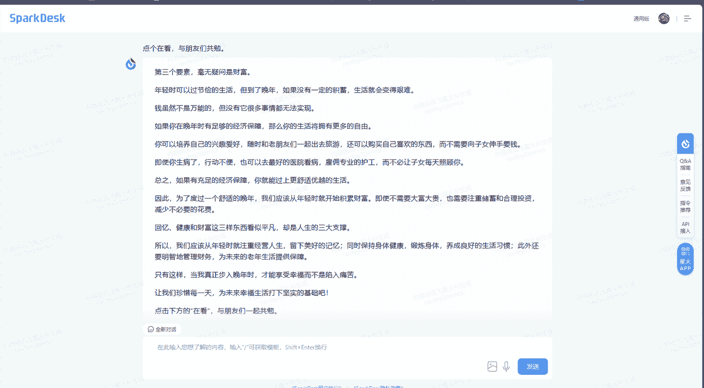

5.发布：这个不用讲了，点发布就行了

# 👸号红利❤

以前我们写👸号，只有粉丝能看到，而且订阅号每天只能发一条推送。直到这次更新👇

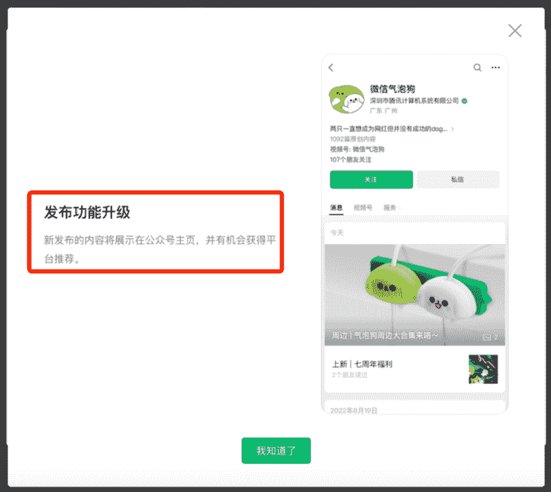

更新后：

1、👸号每天发文不限数量（参考今日头条）

2、👸号发文，能拿到公域流量（参考今日头条）

> **以上两点结合****AI**工具，意味着无限流量。（🛰️日活8亿+）

**👸号有**流量主功能，推文读的人多，还有收益分成（配图用的gigi，我自己的测试号还没拿到权限）

**如果是带货**文章，还能直接挂商品链接按CPS结算（一般佣金在20%-40%，40%+的佣金，只有超头才能拿到）

-举例：带货充电宝，价格100元，佣金是30%，每卖出100个，你能拿3000元分成。

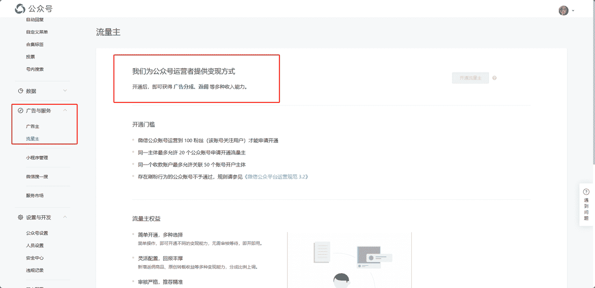

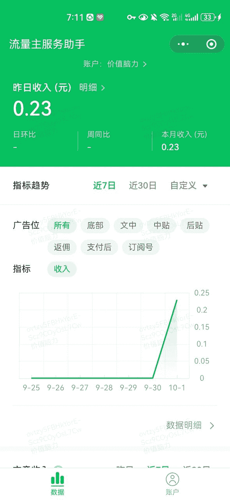

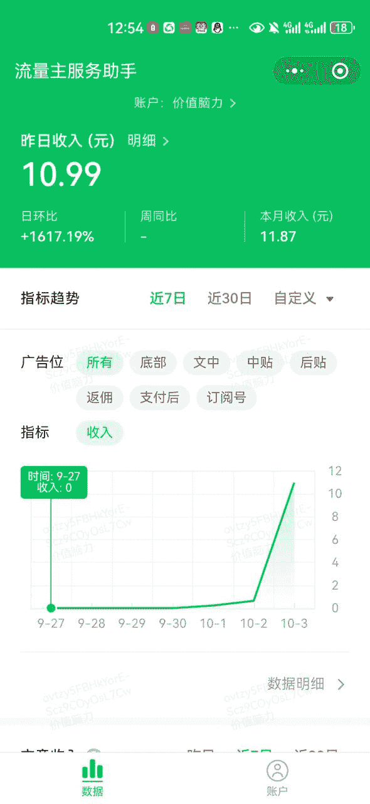

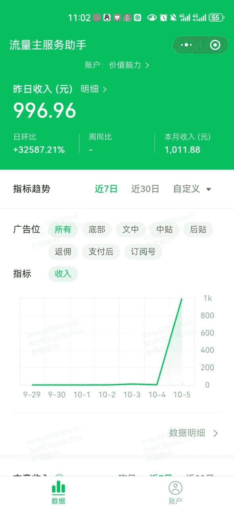

所以在这边你选一个赛道深耕就行了，关于选什么赛道。也不要自作主张！

你想做的不一定拿得到流量，你看不上的一些文章，篇篇10万+

具体可以看下我之前的文章还有比比这篇推文拓一下思路《我在阿里达摩院的分享（干货预警）》：https://mp.weixin.qq.com/s/FCY90pV3KpC3J4Ke3pIq8A

> 用内容与创意拆掉AI的门槛，向世人传递AI的知识与美好！大家好，我是神悦！