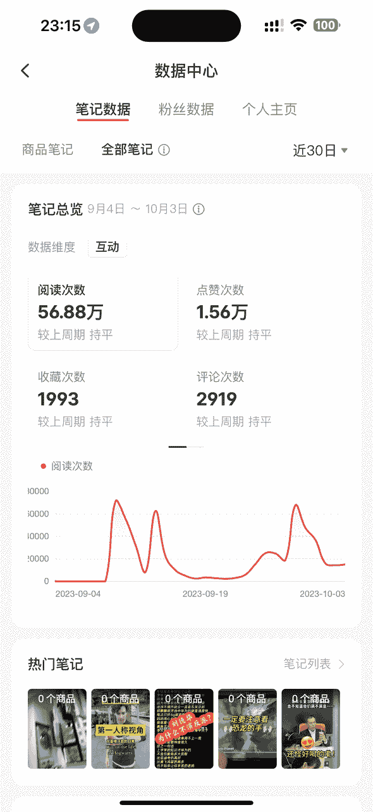
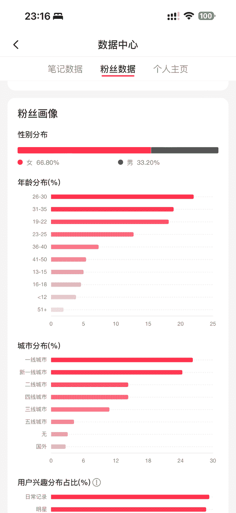
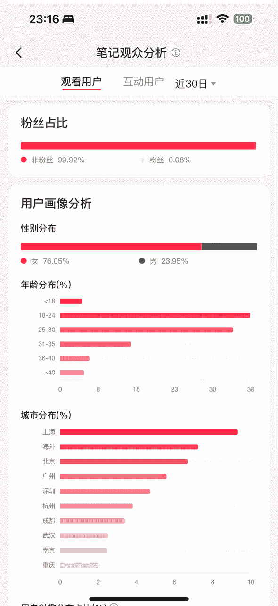
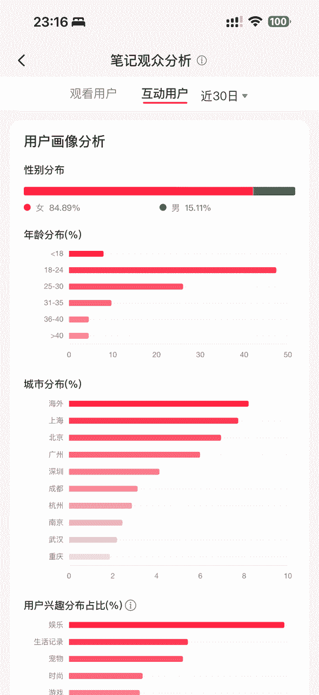
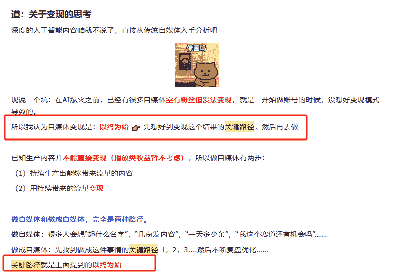
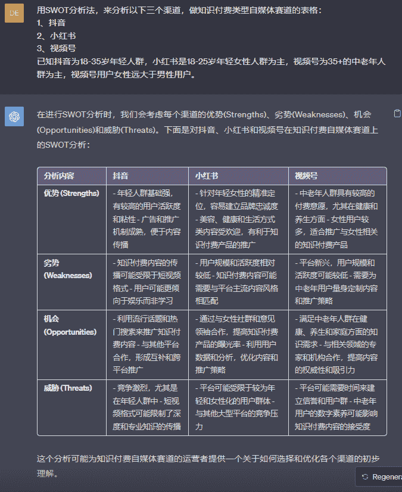
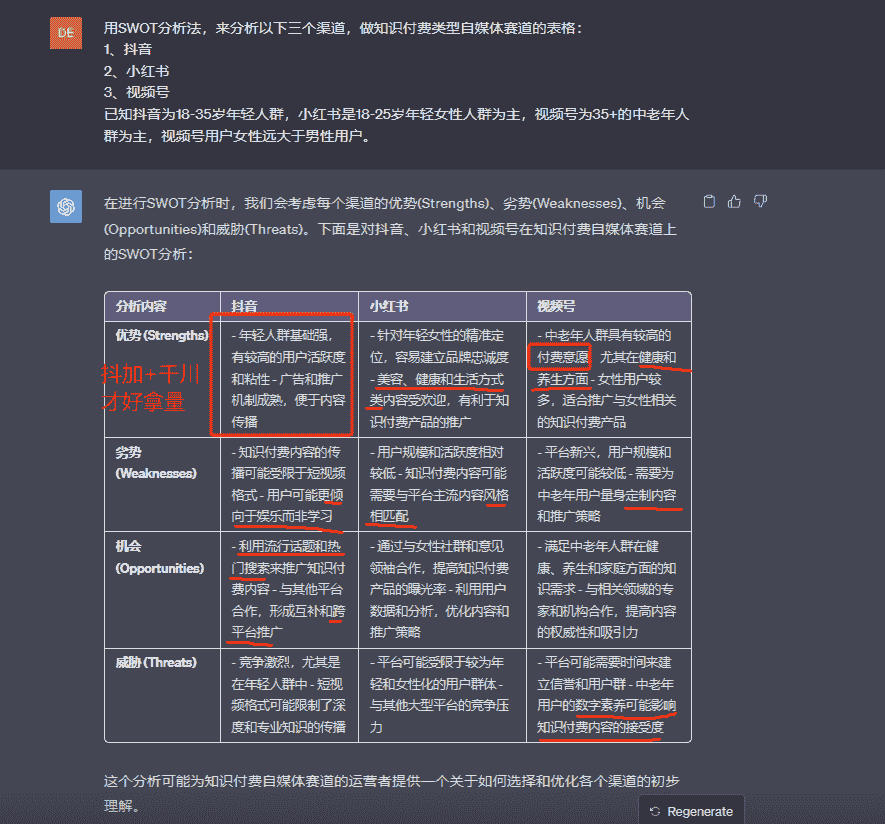

# NO.06 知识付费变现起号测试

> 来源：[https://my.feishu.cn/docx/SsXhdja86oEpxwxsHiKcrFuxnTd](https://my.feishu.cn/docx/SsXhdja86oEpxwxsHiKcrFuxnTd)

首先推荐一个AI工具，免梯子直接用GPT[和](https://ai.qixinba.com/me/;)MJ，多的不介绍了，登录就明白了：https://ai.qixinba.com/auth?type=register&invite=NTE

目前主流自媒体渠道：小红书、抖音、视频号

小红书主要人群是18-25岁年轻女性用户（实际起步年龄我预估在13左右，但是平台只会显示18+），我通过用不同内容不断测试，得出大概人群标签为以下：

抖音主要人群是18-35岁年轻人群，男女比例均衡

视频号主要人群是35-80岁中老年人群，女性＞男性

这俩渠道我暂时还没起号，没法给大家看后台了

按我上一篇文章提到的**以终为始**[NO.03 内容型自媒体](https://yw55ojhusnq.feishu.cn/wiki/Q8sLwNCXWi43ivkaUhYcvXz1npe?from=from_copylink)来倒推一下这几个渠道的变现（出处：

这里其实不必不多说了，直接上科技，让GPT4做个SWOT分析。

GPT[NO.04 公众号起号测试](https://yw55ojhusnq.feishu.cn/wiki/JIhswQC3dilFRTkeuUdcwxuknhj)分析没有任何毛病，抖音短视频内卷严重，要么极具个人风格做IP，要么追热点，要么投广告，铺量碰概率基本没机会了（公众号在现在👉2023年10月4日23:29:56还在红利期，如果还没下场的赶紧看  ）抖音现在能活下来的只有追热点和付费打法，不适合素人。

**小红书现在做视频是红利期**，图文太卷了，不推荐！Q4到明年小红书的红利在直播，还在观望的赶紧入局起号！

视频号正在风口，平台在今年8月份完善了人群标签功能，现在付费玩家已经稳定roi在3以上了，IP人设类人名币玩家微信豆roi已经跑到10了，adq也能打到2，这就是在捡钱！