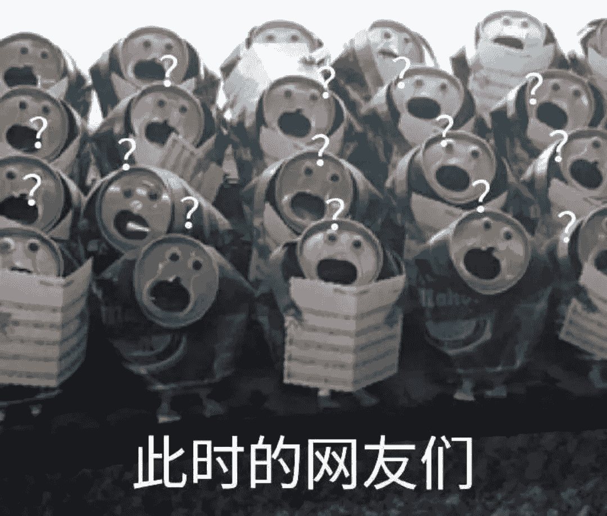

# AI自媒体

> 来源：[https://my.feishu.cn/docx/Tr4idPBR5oTo39xdvxHcB9pknPf](https://my.feishu.cn/docx/Tr4idPBR5oTo39xdvxHcB9pknPf)

# 做自媒体，该辞职吗？

❌**千万不要辞职！！！**

因为做自媒体是一个长期的过程

🤷‍♂️需要的是耐心和坚持

初期很难立刻变现

**很难💥指的是一分钱收入都没有**

长期没有收入

🥺人的心理压力和生活压力都会很大

真的想做自媒体

👉建议先当副业来做

学习整理自媒体相关的知识

有更深的了解

且有了稳定的副业💰收入后

再考虑是否要辞职

（持续稳定的流量+收益，才是稳定的收入，偶尔的爆款并不算）

**而不是因为工作不顺心**

**就想辞职全部做自媒体**

**如果你工作都没做好**

**就辞职allin自媒体**

**就真的能做好吗？😓**

先用这个工具定位一下自己能做什么赛道的自媒体IP：

https://www.coze.cn/s/iPWCs6eN/