# 盘点 10 款热门 AI 视频生成工具，值得收藏！

> 来源：[https://docs.feishu.cn/docx/ZwVGdv2dSoVNeWxnie0cOQiRnIf](https://docs.feishu.cn/docx/ZwVGdv2dSoVNeWxnie0cOQiRnIf)

最近 AI 生成视频的圈子热火朝天的，各种工具层出不穷，今天 Chris 精心整理了 10 款最近比较热门的 AI 视频生成工具，大家可以体验看看。

> 有需要加入 AI 工具交流群，可以文末扫码加我微信。

欢迎大家评论区补充，以下排名不分顺序。

## **1.AKOOL**

> 🔗 工具地址：https://akool.com/

> 💻 支持平台：网页端、安卓和 iOS APP

> 🌍 网络环境：不需要魔法

AKOOL 是一款专注于视频营销领域的 AI 视频创作平台，服务于内容创作者、小微企业、教育工作者等，提供包括实时数字人、实时翻译、实时换脸、实时生成视频、图片生成视频、AI 视频编辑器等强大功能，让用户轻松制作出高质量视频内容。

更详细可以查看：[突然发现一款实时换脸、翻译的 AI](https://mp.weixin.qq.com/s?__biz=MzA5MjU0NzQ3Ng==&mid=2651427825&idx=1&sn=bae9719a39f14a67762dfb846c8e29de&scene=21#wechat_redirect) 视频生成神器，支持快速生成 4K 视频

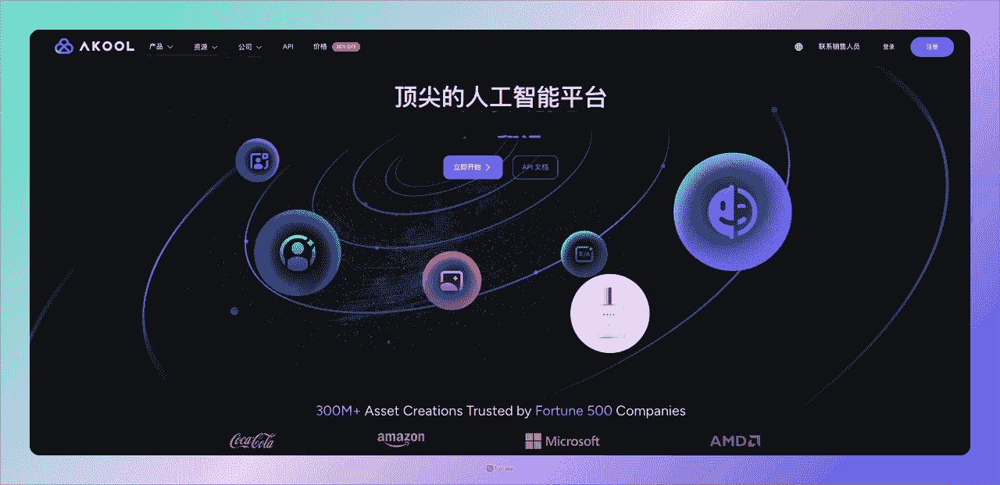

核心功能：

+   **实时 AI 换脸**：实时精准将人脸替换为预设头像，同步面部表情、动作和情绪。

+   **实时 AI 翻译**：实时翻译超过 140 种语言的语音，并同步匹配翻译音频与说话者口型、音色。

+   **实时视频生成**：支持文本驱动的实时视频创作，无需预先编写脚本。

+   **数字人形象生成**：基于文本创建逼真虚拟形象，可用于企业培训、直播等。

+   **图像生成视频**：快速简单地使用 AI 将图像转换为高质量的 4K 视频，并免费生成音频。

**比如在跨国视频会议中，使用“实**时 AI 翻译”功能，观众可以选择自己熟悉的语言直接观看内容，更直观，大大提升会议效率。

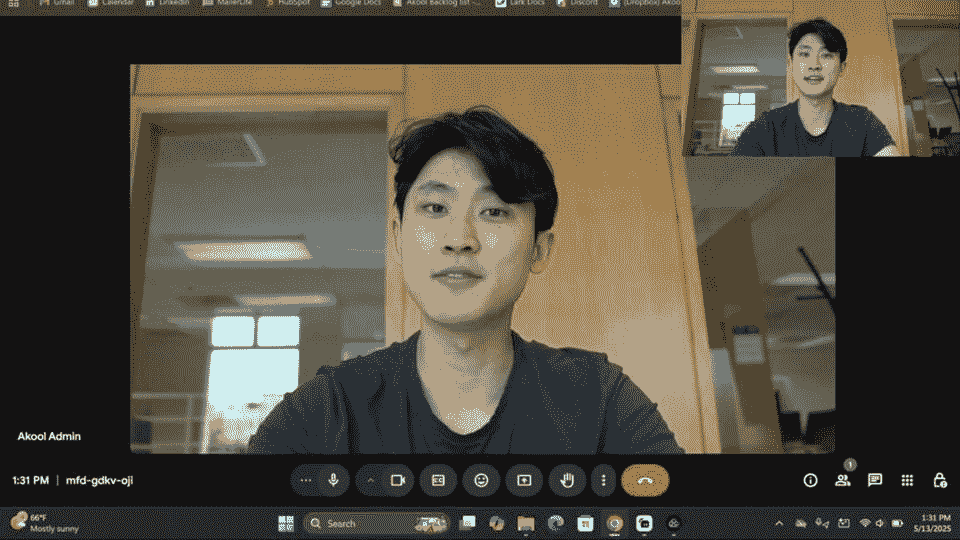

[0b2evqb54aad3yakidbw7zufhlgd32wahxqa.f10002.mp4](https://internal-api-drive-stream.feishu.cn/space/api/box/stream/download/all/OPA3bgIQ0oxDIPx6gajcLQLcnbf)

下面 Chris 将一张包含冰块的照片，生成一个最近很流行的“万物皆可切”的视频，将冰块切成两半：

[wechat.mp4](https://internal-api-drive-stream.feishu.cn/space/api/box/stream/download/all/KDGybH4rZokeEAx1BP4ciNMXnCb)

AKOOL 还**预设一些常用动画效果**：

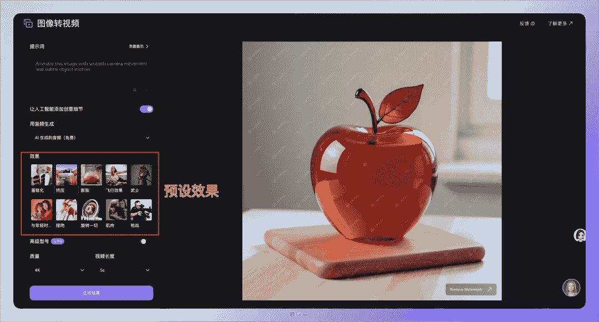

**比如** Chris 上传一张苹果照片，选择“挤压”效果，生成了下面挤压苹果的动画：

[Image2Video_squish_89244231312.mp4](https://internal-api-drive-stream.feishu.cn/space/api/box/stream/download/all/Nyhkb2wgPoqpKmxIjVTcwIsKnIb)

当然这个功能也很适合在产品展示、电商宣传、社交短片或制作视频课件等场景。

## **2.可灵**

> 🔗 工具地址：https://kling.kuaishou.com/

> 💻 支持平台：网页端、安卓和 iOS APP

> 🌍 网络环境：不需要魔法

**可灵 AI 是快手推出的多端 **AI 创作平台，支持文生图、图生图及文生/图生视频，可扩展时长、提升画质、自定义首尾帧，并提供镜头控制等编辑功能。“灵动画布”允许多达 5 人实时协作，共享素材、一键导出，将碎片创意快速整合为完整作品。

核心功能：

+   **文生视频**：输入任意文本描述，生成对应视频，画面、动作与节奏自动匹配，实现“一句话成片”。

+   **图生视频**：上传已有图片作为参考，生成新的视频，支持自定义首尾帧。

+   **视频延长（续写）**：将生成的视频进行续写，延长视频时长，最多可至约 3 分钟。

+   **高清画质升级**：内置“高表现”模式，通过超分与降噪算法将生成视频提升至高清，细节更锐利，色彩更饱满。

## **3.海螺 AI**

> 🔗 工具地址：https://hailuoai.com/

> 💻 支持平台：网页版

> 🌍 网络环境：不需要魔法

**海螺 AI 是 Min**iMax 推出**的全链路** AI 创作平台，支持文生、图生、图生+文生混合等多种生成视频模式，可一键延长时长、提升分辨率、锁定首尾帧，并提供运镜、节奏、风格化等多维控制。

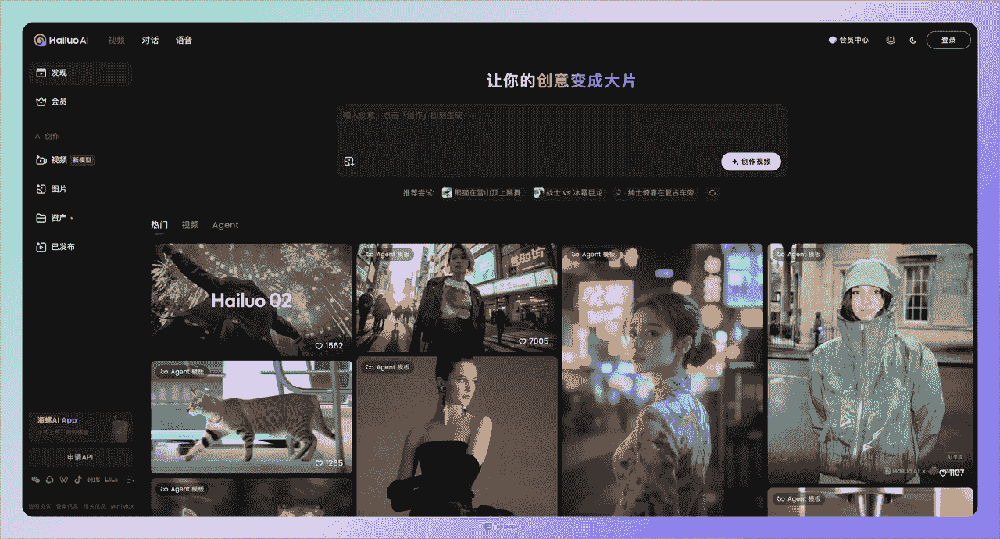

核心功能：

+   **文生视频**：输入任意中文或英文提示词，即可生成专业视频，实现“一句话变电影”。

+   **图生视频**：上传多张参考图，可指定角色、场景或道具为视觉锚点，支持自定义首帧与尾帧。

+   **视频延长**：对已生成视频一键续写，最长可串联至约 3 分钟，智能补全动作过渡、场景衔接与背景音乐。

+   **多风格多场景支持**：覆盖科幻、古风、写实、童话等多种风格，适配不同创作需求，都能轻松实现。

+   **视频 Agent 半自定义**：输入需求，Agent 生成工作流程，可在中间环节介入编辑，精准微调每个步骤，Agent 会自行组装成带背景音乐的成品视频 。

+   **多分辨率选择**：提供 1080p、768p、512p 多种清晰度选择，满足高分辨率创作需求。

## **4.即梦 AI**

> 🔗 工具地址：h[**ttps://jimeng.jianyi**](https://jimeng.jianying.com/ai-tool/home)ng.com/ai-tool/home

> 💻 支持平台：网页版

> 🌍 网络环境：不需要魔法

**即梦**** Dreamina** 是一款由剪**映推出的 A**I 创作平台，集成了多种 AI 创作功能，用户可以通过文字生成图片和视频，还可以通过图片生成视频等功能，极大地提升了用户的创作体验和效率。

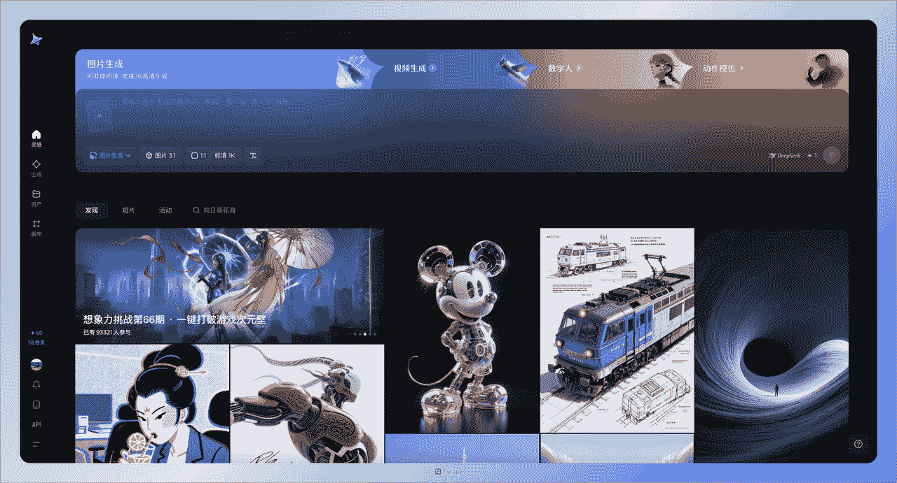

即梦 Dreamina 的核心功能包括：

+   **文字生成图片**：支持选择参考图、设置模型、精细度、图片尺寸和比例等；

+   **文字或图片生成视频****：支持设置运镜控制、运**动速度、生成时长、视频比例等，还有支持添加首帧和尾帧图片；

+   **智能画布**：通过提示词自由的绘制图片，并支持实时生成图片；

+   **活动和探索**：即梦提供了丰富的官方活动和使用示例，让大家可以更好的使用即梦进行创作。

官方提供了一些不错的文档，大家可以了解下：

+   即梦创作者使用指南（对外版）：[**h**](https://bytedance.larkoffice.com/docx/NjsYdFEdUoXyCRxJoqtcnYa1nlb)ttps://bytedance.larkoffice.com/docx/NjsYdFEdUoXyCRxJoqtcnYa1nlb

+   教你如何写好 prompt：[**h**](https://bytedance.larkoffice.com/wiki/XhpgwjagbinbpJkKSDEcYKGon5b)ttps://bytedance.larkoffice.com/wiki/XhpgwjagbinbpJkKSDEcYKGon5b

## **5.Vidu AI**

> 🔗 工具地址：https://www.vidu.cn/

> 💻 支持平台：网页版

> 🌍 网络环境：不需要魔法

**Vid**u** 是由生**数**科技与清**华大学联合发布的中国首个长时长、高一致性、高动态性 AI 视频生成大模型。能一键生成长达 32 秒、分辨率高达 1080P 的高清视频，支持多镜头视角切换、时空连贯性以及丰富的超现实内容创作。同时，Vidu 深入理解中国元素，可生成具有中国文化特色的画面。

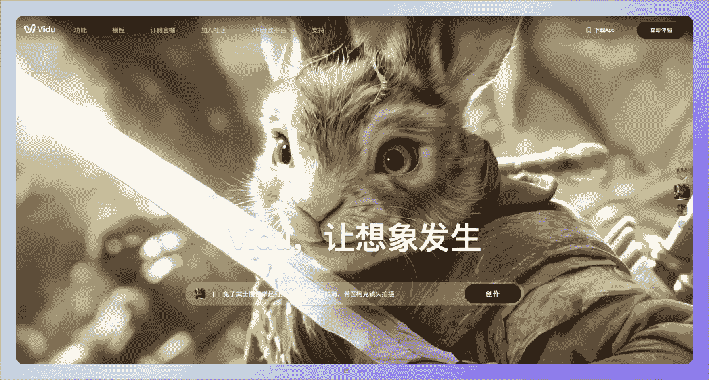

核心功能：

+   文本、图片转视频。

+   **参考视频生成**：用户可上传参考视频或图片，Vidu 能根据其风格、主体特征生成一致性的视频，保障风格统一。

+   **多主体一致性**：支持在视频中保持多个主体的一致性，适用于复杂场景的创作。

+   **高质量视频输出**：可生成长达 16 秒、分辨率高达 1080P 的高清视频。

+   **动态场景捕捉与物理模拟**：能够生成复杂的动态场景，模拟真实世界的光影效果和物体物理行为。

+   **理解中国元素**：能理解并生成具有中国特色的元素，如熊猫、龙等，丰富文化表达。

## **6.拍我 AI**

> 🔗 工具地址：https://pai.video/

> 💻 支持平台：网页版

> 🌍 网络环境：不需要魔法

**拍我 A**I（PixVerse） 是一款爱诗科技开发的 AI 视频生成工具，内置强大的生成式 AI 模型、支持灵活的多模态输入支持、高效的视频转换以及富有艺术创造力的输出。

> 往期推荐《PixVerse：免费且强大的 AI 视频生成工具》

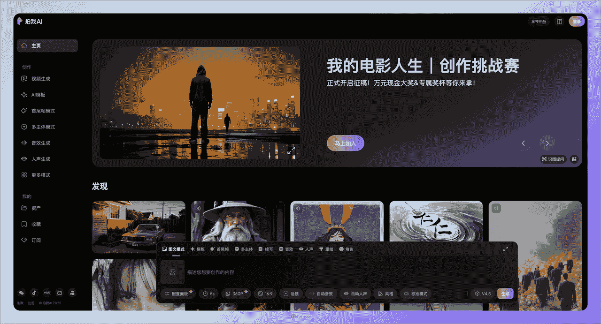

PixVerse 的核心功能包括：

+   **多模态输入支持**：支持包括图像、文本和音频等输入；

+   **角色一致性换背景**：支持在更换场景的情况下保持人物的一致性；

+   **实时预览与调整**：在编辑过程中，用户可以实时预览效果，并随时调整参数以达到最佳效果；

+   Magic Brush 运动笔刷功能：允许用户通过涂抹区域和绘制轨迹来精确控制视频元素的运动。

## **7.Runway**

> 🔗 工具地址：https://runwayml.com/

> 💻 支持平台：网页版

> 🌍 网络环境：不需要魔法

Runway 是一款基于 AI 的视频创作平台，它提供先进的 AI 视频生成、绿幕抠除、动态捕捉、视频编辑等功能，支持用户将文本描述或静态图像转化为高质量、动态视频内容。

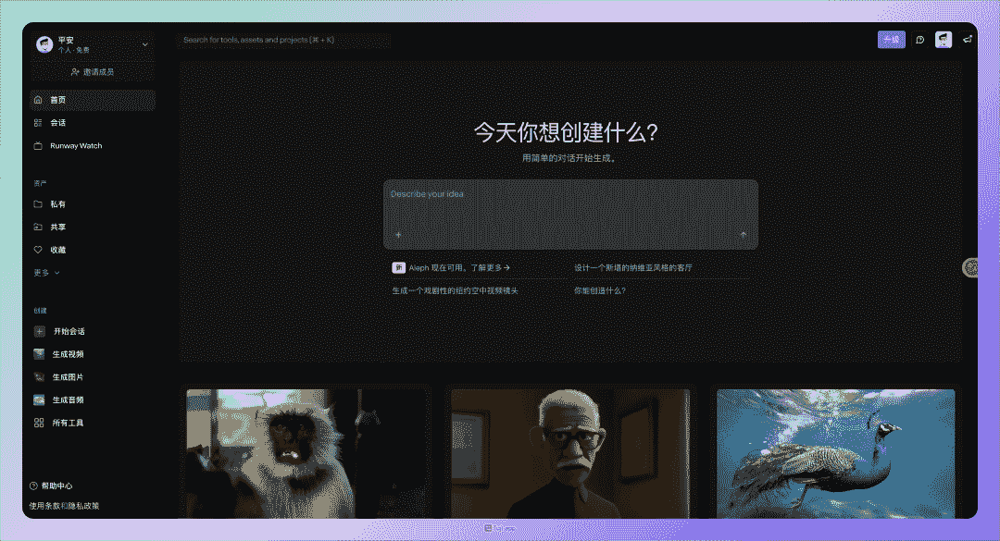

Runway 的核心功能包括：

+   **AI 视频创作与编辑**：包含动画、转场效果及视觉特效，并配备强大的视频编辑工具；

+   **图片生成和编辑**：支持图片生成、编辑，包括风格转换等；

+   **3D 艺术创作**：支持 3D 模型的生成、编辑、渲染功能，支持构建和交互实时 3D 场景；

+   **音频制作和编辑**：支持音频处理工具，包括语音合成、音乐创作及音效设计；

+   **支持 API 调用**：提供 API 支持，让开发者可以更方便的接入 Runway。

RunWay 除了 Gen-3 外，还提供了 26 个工具，包括：Generative、Video、Image、3D 和 Audio 等 。

## **8.HeyGen**

> 🔗 工具地址：https://www.heygen.com/

> 💻 支持平台：网页版

> 🌍 网络环境：需要魔法

HeyGen 是一个 AI 视频虚拟数字人生成平台，只需输入和点击，就可以把文本转换成发言人视频。可以从 100 多个 AI 虚拟数字人中选择，或者创建你自己的虚拟数字人。

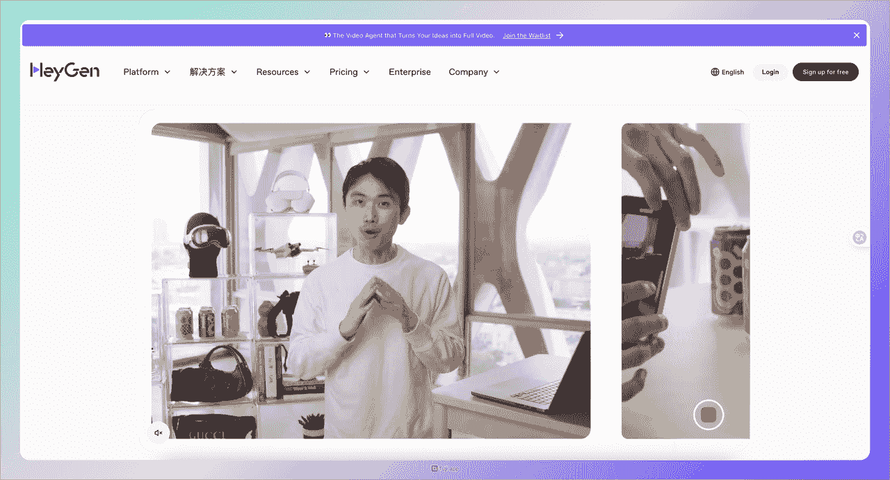

HeyGen 的核心功能包括：

+   **AI 虚拟形象选择及自定义**：HeyGen 提供 100+ 个可自定义的 AI 虚拟形象；

+   **多种高品质配音选项**：用户可以选择不同的配音选项；

+   **丰富的模板库**：用户可以轻松找到相关情境并套用，从而提高制作效率；

+   **AI 语音一键转换**：用户可以利用 AI 语音的一键转换功能，将文本转换成发言人视频；

+   **即时数字人视频制作**：用户可以上传或录制个性化视频内容，并即时生成数字人视频；

## **9.Pika**

> 🔗 工具地址：https://pika.art/

> 💻 支持平台：网页版

> 🌍 网络环境：需要魔法

Pika 是一款由 **P**ika Labs 推出的 AI 视频生成工具，旨在通过先进的生成式 AI 技术将用户输入的文字或图像转换成视频。

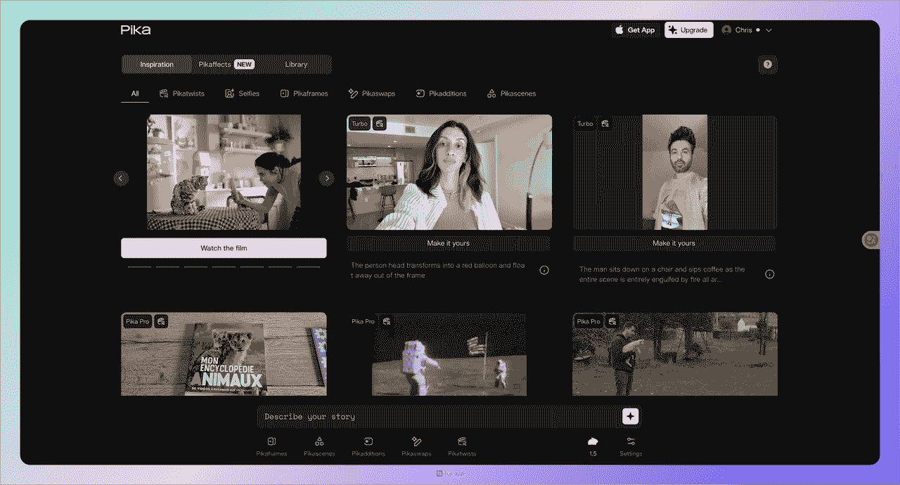

Pika 的核心功能包括：

+   **文本和图像生成视频**：输入简短的文本或上传图像，生成高质量的视频；

+   **视频实时重绘**：对视频中的背景环境、衣着道具等元素进行局部修改和重绘；

+   **视频尺寸编辑**：用户可以根据需要调整视频的宽高比；

+   **切换视频风格**：支持将现有视频转换为完全不同的风格，如黑白风、动漫风、自然风等；

+   **AI 视频编辑**：使用智能算法分析和编辑视频，如自动调整颜色、智能裁剪场景等。

## **10.WHEE**

> 🔗 工具地址：h[**ttps://www.whee.co**](https://www.whee.com/ai/image-to-video)m/ai/image-to-video

> 💻 支持平台：网页端、安卓和 iOS APP

> 🌍 网络环境：不需要魔法

WHEE 是由**美图公司**推出的一款 AI 视觉创作工具，提供文生视频、图生视频、文生图、图生图、画面拓展及局部修改等功能。用户可以通过输入文字或上传图片生成与之相匹配的视频，还能根据用户需求进行智能剪辑和编辑。

WHEE 的核心功能包括：

+   **文生视频和图生视频**：支持通过提示词和图片，生成相应的视频；

+   **文生图和图生图**：支持通过提示词或图片，生成相应的图片；

+   **线稿上色和涂鸦生图**：允许用户对线稿进行上色，通过涂鸦创作并生成新的图像；

+   **AI 改图和扩图**：对图片进行修改和优化，扩展图片的尺寸和内容；

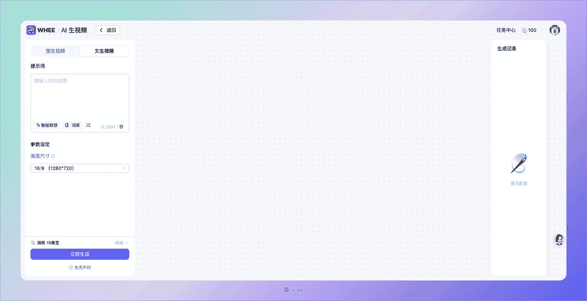