# 11 个 AI 领域的优质飞书知识库，完全免费，赶紧收藏起来！

> 来源：[https://docs.feishu.cn/docx/O8DFdymYUo8sz0xnD2ycVYrenLf](https://docs.feishu.cn/docx/O8DFdymYUo8sz0xnD2ycVYrenLf)

今天 Chris 和大家分享 11 个 AI 领域的优质飞书知识库，方便大家能更好的了解和学习 AI 相关的内容。内容比较多，也感谢每个知识库的作者们无私分享，为他们点赞！也欢迎大家评论区补充～

下面是这 11 个知识库的列表，排名不分顺序，Chris 大致分类了下：

+   通往 AGI 之路 知识大全

+   AGI 掘金知识库  知识大全

+   奔赴AGI  知识大全

+   AI洞察者中心  知识大全

+   AI 鹊桥 · 智库 实战总结

+   AI 知识库 ｜ AI 实验室 实战总结

+   LangGPT 结构化提示词 实战总结

+   水木AI知识库  行业报告

+   AI +X | Datawhale 学习指南 学习路径

+   AI 产品榜 数据分析

+   AI 产品数据榜 数据分析

Chris 也将自己所有文章，汇总到 AI 工具派飞书知识库，大家有兴趣可以看看：

[AI工具派](https://w7q6cydpxa.feishu.cn/wiki/MC1IwHBqdiF22skxoNkcPhmpnLh)

## 1.🌈 通往 AGI 之路

“通往AGI之路”文档是一份含金量超标**的 AI 领域的宝藏知识库**，提供一个全面系统的 AI 学习路径， 帮助大家了解从 AI 常见名词到 AI 应用等各方面知识，更重要的是希望引发大家思考“我可以用 AI 做什么，帮助自己更强大”， 对于系统学习 AI 帮助巨大。

Chris 之前分享过《通往AGI之路｜WaytoAGI知识库介绍》大家可以回顾下，点赞！

> 🔗 文档地址：

> 🏷 分类：知识大全

关键词：内容全面、高频更新、社群活跃、最新最全

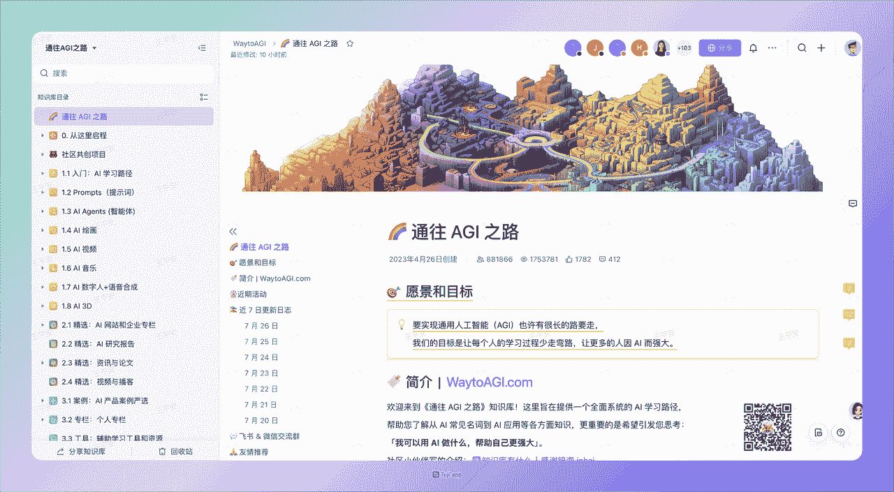

## 2.AGI 掘金知识库

AGI 掘金知识库是一个专注于 AG**I 相关研究和应用的创**新型知识库，使命是推动 AGI 技术和 AI 应用落地发展，应用于各行业创造价值，提供最新资讯、解决方案和有趣服务，愿景是让 AI 技术触手可及，为爱好者提供个性化知识工具。

> 🔗 文档地址：

> 🏷 分类：知识大全

核心内容：行业前沿资讯、AI 基础知识、行业报告、AIGC 应用榜、技术干货

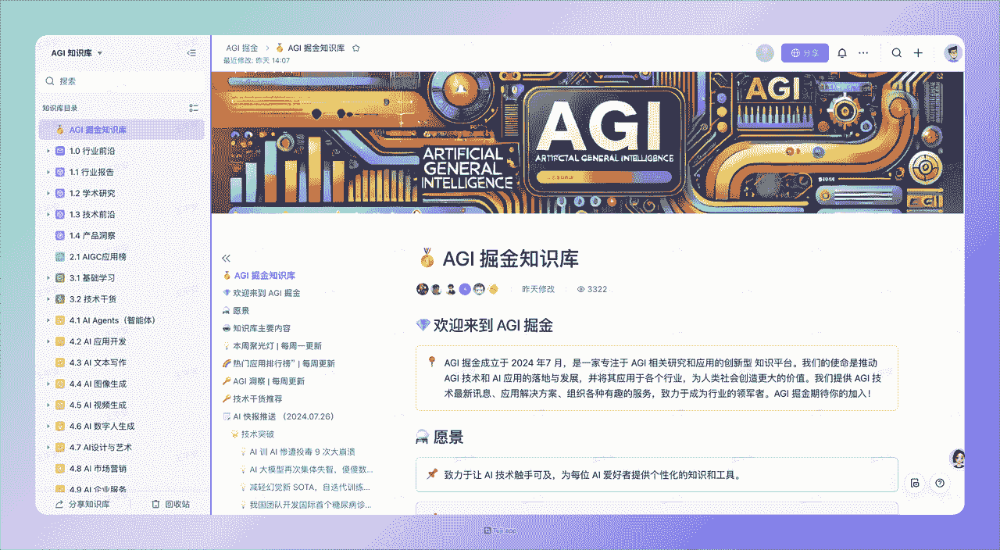

## 3.奔赴AGI

奔赴 AGI 知识库是一个完全免费、开放、大家一起建设和分享的平台，专门收集和分享最新、最有创意的 AIGC 学习资源。相信分享知识能让人进步、能激发创新。平台的使命是提供全面的 AIGC 学习资源，愿景是成为 AIGC 领域厉害的学习和资源共享中心，价值观就是开放分享、追求卓越、一直学习、互相尊重帮助。

> 🔗 文档地址：

> 🏷 分类：知识大全

核心内容：AI 产品库、AI 每日资讯、AI 数据库、热门 AI 工具研究、AI 提示词

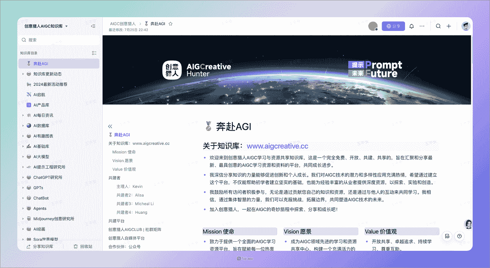

## 4.AI洞察者中心

AI 洞察者中心知识库面向 AI 产品创作者爱好者、想了解使用 AI** 人群、想学习 AI** 变现群体、想提升软实力的学生，帮助大家更好地利用 AI。有对小白友好的教学体系、每日更新的 AI 日报合集、每周更新的 AI Agent 智能体榜单、精选网站合集、变现方式，还有高手云集且对初学者友好的活跃社群。

> 🔗 文档地址：

> 🏷 分类：知识大全

核心内容：AI 日报、入门教学、进阶教学、变现方式、网站进行、AI Agent 榜单、Bot 拆解

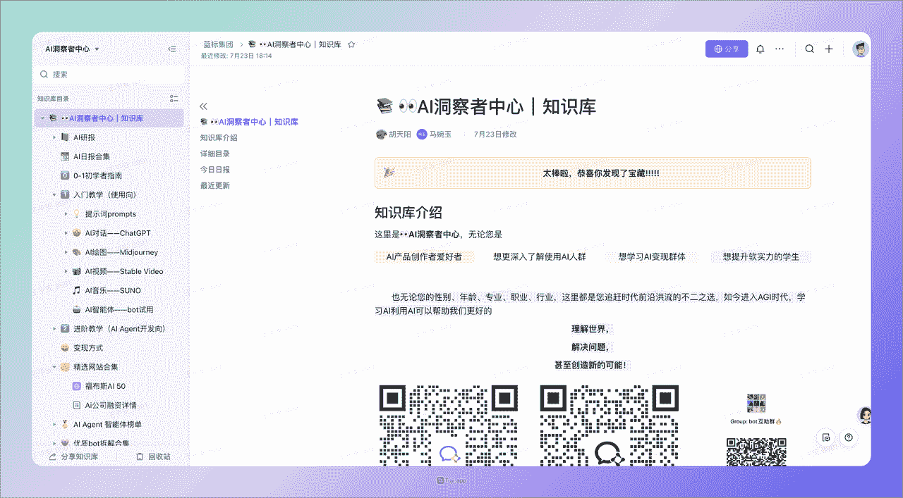

## 5.AI 鹊桥 · 智库

“AI 鹊桥·智库”专注于 **AI 实践的免费知识库**，提供 AI 商业化应用、行业动态、实用工具分享、研报阅读及教程技巧教学，还汇聚了众多志同道合者交流分享。在这里可以了解行业动态、掌握实用工具、沉淀知识技能、探索实践之路，是了解和学习 AI 知识的不错知识库。

> 🔗 文档地址：

> 🏷 分类：实战总结

核心内容：Midjoury 专栏、Stable Diffusion 专栏、大厂 AI 实践汇总

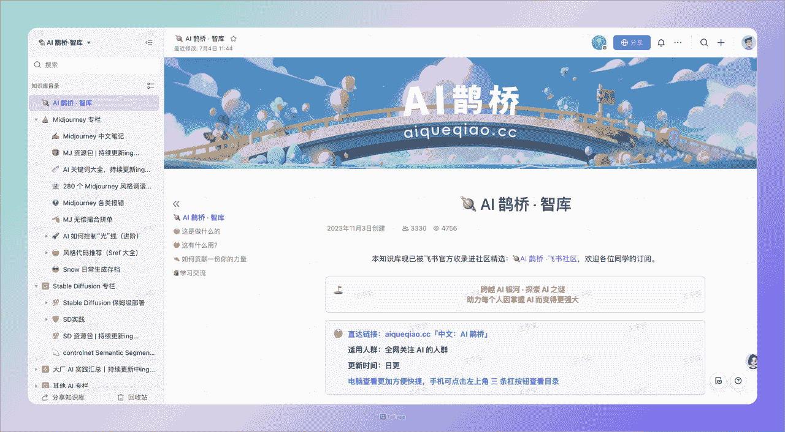

## 6.AI 知识库｜AI 实验室

AI 实验室旨在分享 AI 相关内容并探索其对未来的影响，**而“AI 知识库”是 AI 实**验室的一个专注于 AI 领域分享的知识库，帮助大家系统全面地学习 AI 知识和提升技能，了解行业动态、掌握实用工具、沉淀知识技能，还能助大家探索 AI 致富之路，实现更好的变现。

> 🔗 文档地址：

> 🏷 分类：实战总结

核心内容：ChatGPT 系列、AI 绘画系列、AI 工具教程 、AI 实用工具分享、变现思路、AI 研报资料库

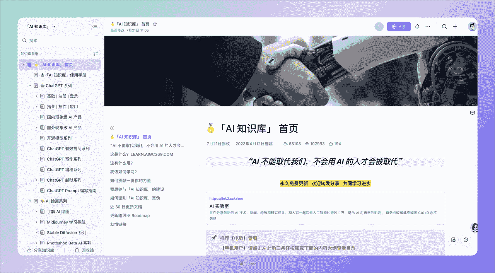

## 7.LangGPT 结构化提示词

LangGPT 社区是**国内最大的提示工程社区****，LangGPT 意为****结构化提示词，是帮助大家编**写高质量提示词的工具，基于一套模块化、标准化的编写方法论。结构化提示词被国内主流大模型智能体平台使用，该社区已成为国内最具影响力的提示词工程师学习交流社群，愿景是让人人都能写出高质量提示词。

> 🔗 文档地址：

> 🏷 分类：实战总结

核心内容：提示词教程、高质量提示词合计、RAG 系列、AI Agent 系列、Sora 系列、AI 文章精选

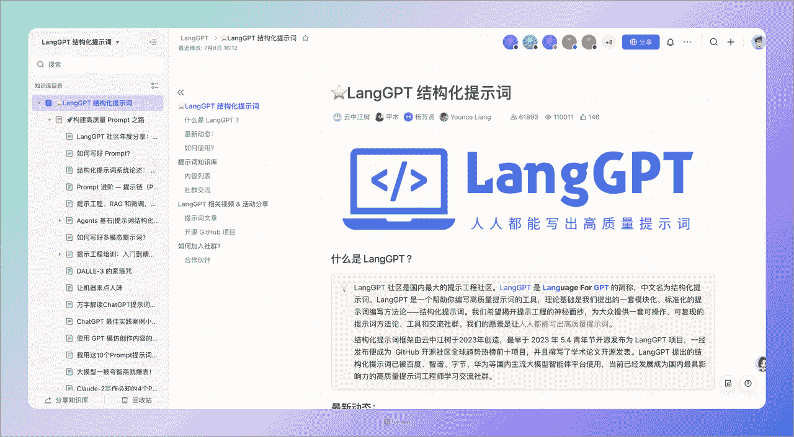

## 8.水木 AI 知识库

水木 AI 知识库由水木 AI 社区发起，致力于持续收集高质量的 AI 行业报告和学习资料供从业者学习，同时还会不定期组织线上线下的讲座、沙龙、名企行等丰富的社区活动，欢迎大家参与。

> 🔗 文档地址：

> 🏷 分类：行业报告

核心内容：各行业报告、AI 学习资源

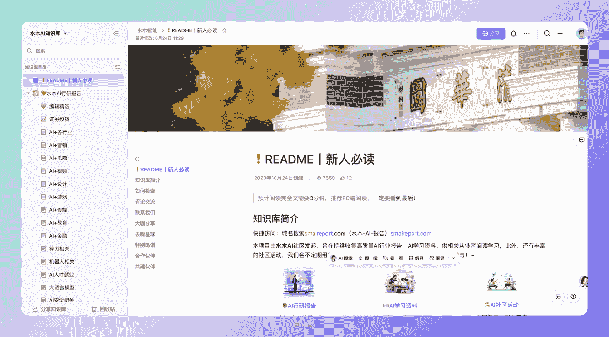

## 9.AI +X | Datawhale 学习指南

**“AI +X** | Datawhale 学习指南”通过开源学习模式，助力 AI 学习者与知识连接，与人连接，与场景连接，推动 AI 人才培养，学习指南真开源，可下载，可复制，引用请注明来源，遵循CC-BY-NC-SA协议。

> 🔗 文档地址：

> 🏷 分类：学习路径

核心内容：AI 学习路径、线上活动、AI + 学科、AI + 千行百业

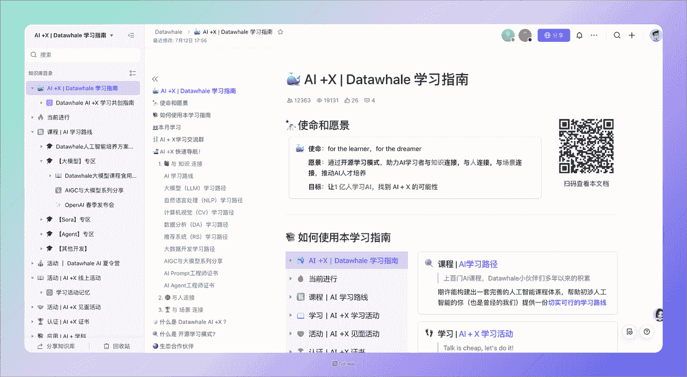

## 10.AI 产品榜

AI 产品榜单由李榜主主导，联合 30 多位 AI 领域公众号主理人发布，是被众多权威媒体和专家引用最多的榜单。该榜单精心筛选分析了 10,000 多款 AI 产品，涵盖关键数据并进行分类，涉及 100 个细分领域，为您呈现内容丰富、观点独到的 AI 产品排名。

> 🔗 文档地址：

> 🏷 分类：数据分析

核心内容：赛道总榜、全球 APP 增长榜、国内总榜、出海总榜、全球总榜、GPTs 总榜

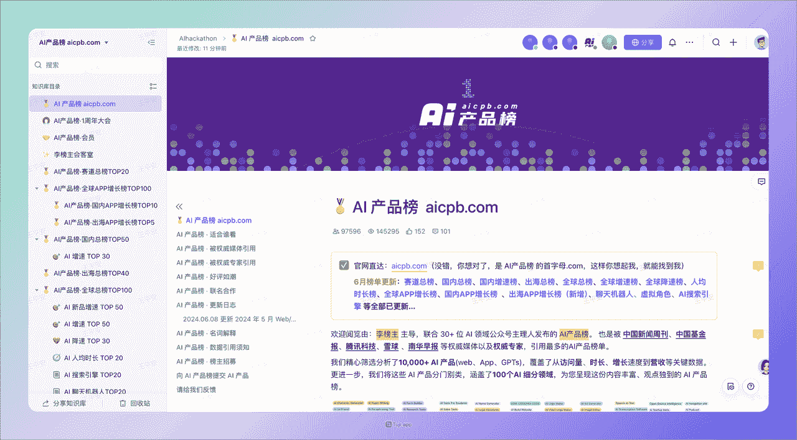

## 11.AI 产品数据榜

AI 产品数据榜由郎瀚威主导发布，精心筛选分析了超 10,000 个 Web 端 AI 产品，涵盖访问量、增长速度等关键数据，并对这些产品进行分类，涉及 50 多个 AI 细分领域，最终为用户呈现出内容丰富且观点独到的成果。

> 🔗 文档地址：

> 🏷 分类：数据分析

核心内容：GenAI 硬件榜单、全球总榜、国内总榜、出海总榜、垂直行业、国产 AI、海外 AI、投融资

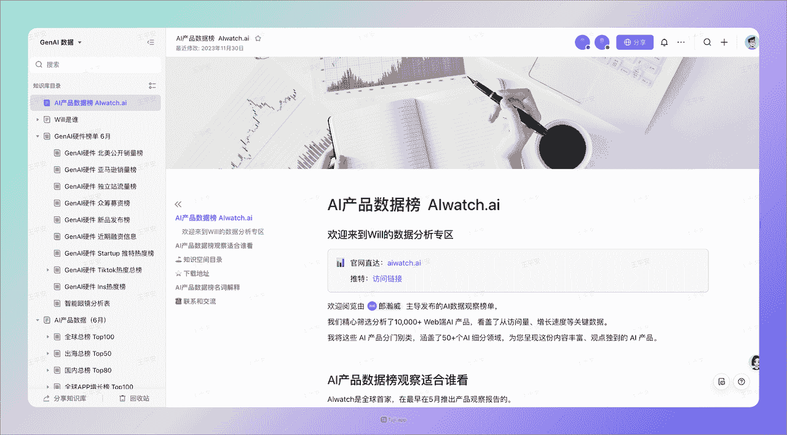

## 总结

今天 Chris 共分享了 11 个 AI 领域的优质飞书知识库，大家可以找适合自己的知识库进行学习，一起学习和进步，大家也可以为这些知识库贡献自己的一些内容～

最后，欢迎大家评论区补充其他优质知识库，让大家都能看到！