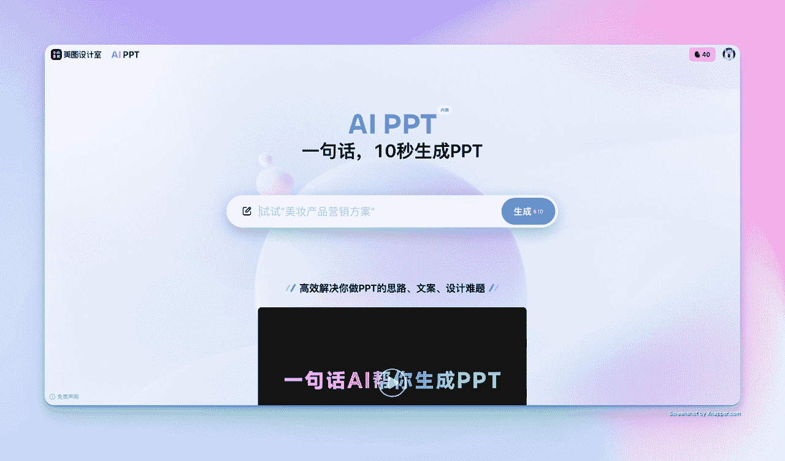
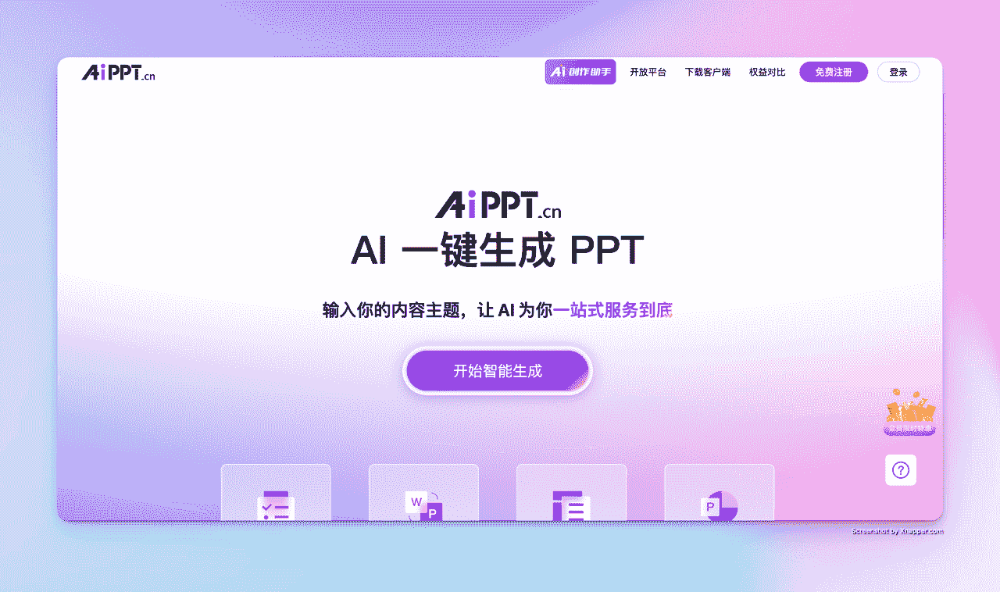
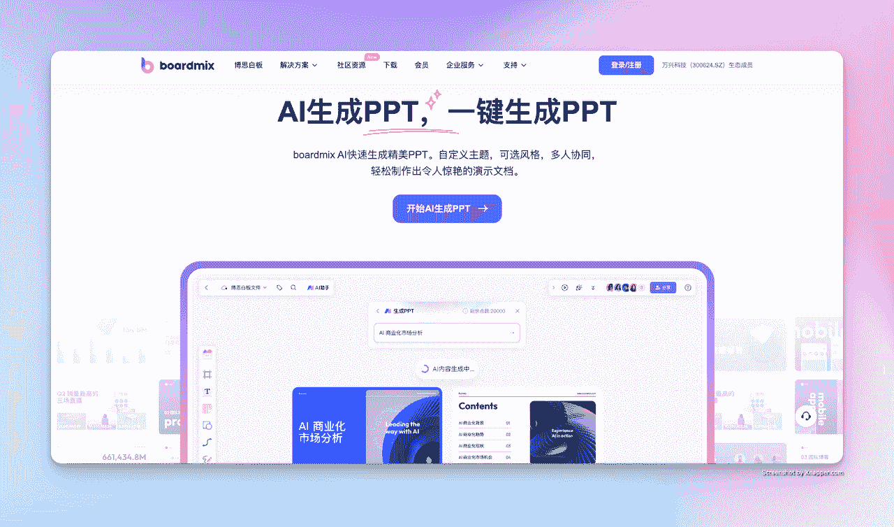
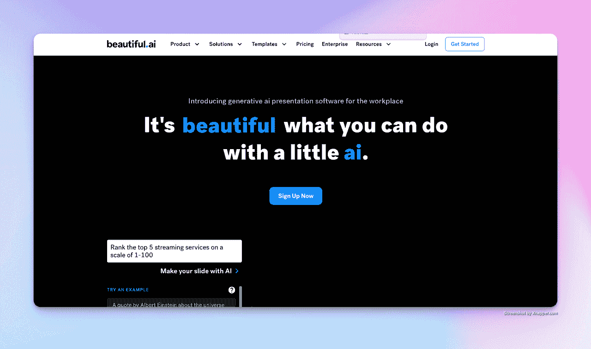
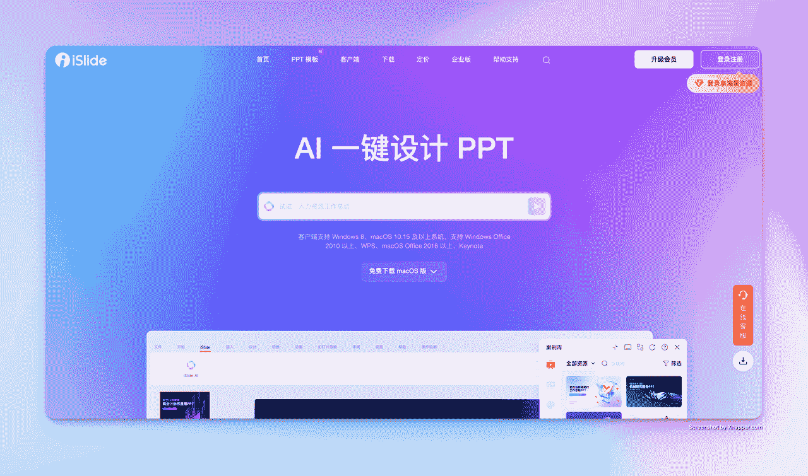
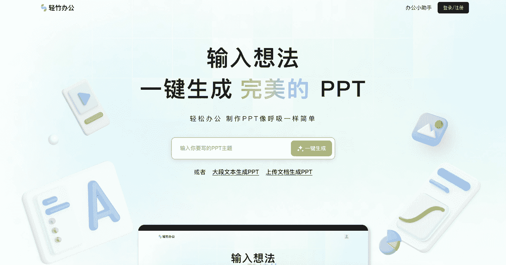

# 2024 年必备的 9 款 AI PPT 生成工具

> 来源：[https://docs.feishu.cn/docx/Kop9dL2SFohU6hxL97BcMwrFnec](https://docs.feishu.cn/docx/Kop9dL2SFohU6hxL97BcMwrFnec)

AI 工具派的社群中，经常会有小伙伴请教 AI 制作 PPT 的工具，看来这类工具的需求量还是蛮大的，今天 Chris 整理了 9 款不错的 AI PPT 制作工具，希望能够帮助到大家。

本文介绍的工具**全部无需🪜**，**国内可访问**，包括：

+   美图 AI PPT

+   AiPPT

+   Boardmix AI PPT

+   Beautiful.ai

+   iSlide

+   MindShow

+   讯飞智文

+   轻竹办公

+   MotionGo

## 1.美图 AI PPT

🔗 工具地址：https://www.x-design.com/ppt/

美图AI PPT 是「美图秀秀」旗下的「美图设计室」推出的「免费在线AI生成PPT设计工具」，用户通过输入自然语言，即可轻松打造精美 PPT。无论是什么类型风格的PPT，美图 AI PPT 都可以帮你打造，如行业分析、工作汇报、创意设计方案、企业团建策划、部门工作总结等。

Chris 之前写了篇《美图AI PPT：免费在线 AI 生成 PPT 设计工具详细介绍，大家可以查看一下。

## 2.AiPPT

🔗 工具地址：https://www.aippt.cn/

AiPPT 是一款 AI 驱动的 PPT 在线生成工具，只需要输入主题，AI 即可一键生成高质量 PPT，操作简单。

并且还支持在线自定义编辑和文档导入生成，提供 10w+ 个优秀模板和素材，帮助用户快速生成专业级 PPT。

Chris 之前写了篇《AiPPT：全智能 AI 一键生成 PPT详细介绍，大家可以查看一下。

## 3.Boardmix AI PPT

🔗 工具地址：https://boardmix.cn/ai-powerpoint/

Boardmix AI PPT 是一款强大的在线 AI 白板软件，它不仅支持 AI 自动生成 PPT，还提供了丰富的模板和编辑工具。用户可以通过简单的输入，快速创建出结构化的演示文稿，同时支持多人在线协作和演示。

**Boardmix **A**I PPT 支持一句话生成** **PPT、AI 提炼文档生成 **PPT、导入思维导图文件生成 PPT。

## 4.Beautiful.ai

🔗 工具地址：https://www.beautiful.ai/

Beautiful.ai 以其直观的界面和智能设计建议著称，能够帮助用户轻松创建好看的 PPT。它提供了可定制的模板、智能图表以及分析工具，让设计过程变得简单而高效。

Beautiful.ai 支持**智能设计建议**、**数据分析可视化**、 **PPT 数据分析**。

## 5.iSlide

🔗 工具地址：https://www.islide.cc/

iSlide AI 可以帮助用户轻松生成 PPT，节省大量的时间和精力。基于智能算法，自动分析用户主题内容，并生成逻辑清晰、结构完整的大纲，使用户可以更快速地规划和组织幻灯片演示内容。

用户输入一个主题，iSlide AI 可以快速辅助撰写 PPT 大纲，并且还可以选择【生成PPT】直接应用到PPT主题模板中。

## 6.MindShow

🔗 工具地址：https://www.mindshow.fun

MindShow 是一个智能的 PPT 生成器，它是国内独立开发者开发的输入内容自动生成演示工具，通过强大的AI人工智能技术，可以根据用户输入的大纲文字，自动生成精美的PPT页面。

## 7.讯飞智文

🔗 工具地址：https://zhiwen.xfyun.cn/home

讯飞智文，由科大讯飞推出的一键生成 ppt/word 产品。根据一句话、长文本、音视频等指令智能生成文档，同时支持在线编辑、美化、排版、导出、一键动效、自动生成演讲稿等功能，让AI全流程服务到底。

## 8.轻竹办公

🔗 工具地址：https://qzoffice.com/dashboard

轻竹办公 AI PPT 是一款专为国内用户设计的 AI PPT 工具，它结合了清华智谱 AI 技术，生成内容更符合中国人的需求。用户可以一键生成PPT，并享受在线编辑和模板切换的便捷。

轻竹办公 AI PPT 支持 **AI 一键生成 PPT**、**在线编辑与模板切换**、**高速下载**。

## 9.MotionGo

🔗 工具地址：http://motion.yoo-ai.com/

**MotionGo** 源于原口袋动画团队，特长是 PPT 动画生成。MotionGo 插件拥有全网独家智能动画库，允许用户一键生成专业 PPT 动画演示效果，让你的 PPT 表达更简单高效。

## 总结

今天介绍这些工具还挺多的，各有各的亮点，大家可以尝试看看，找到适合自己的 AI 工具，提高效率，这也是 Chris 一直以来对 AI 工具的看法～

赶紧去试试吧。