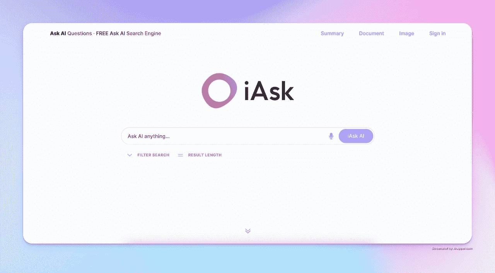
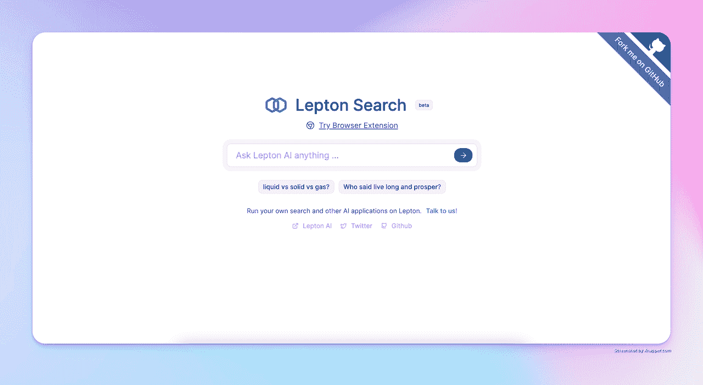
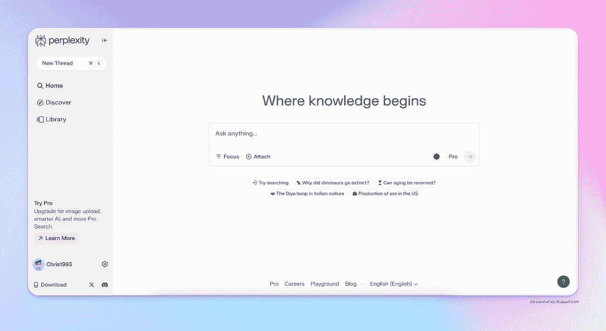
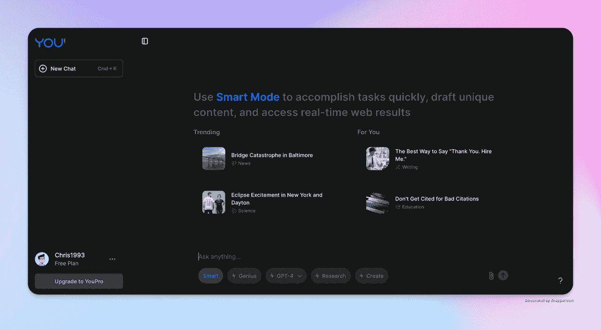
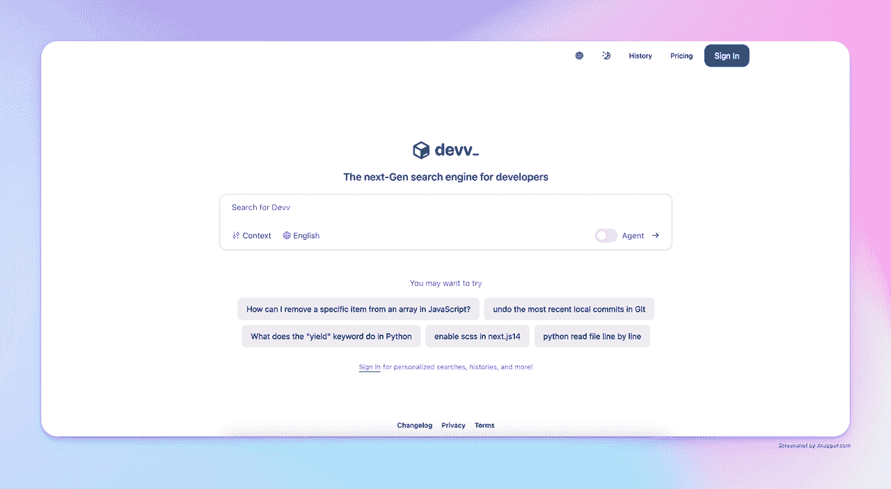
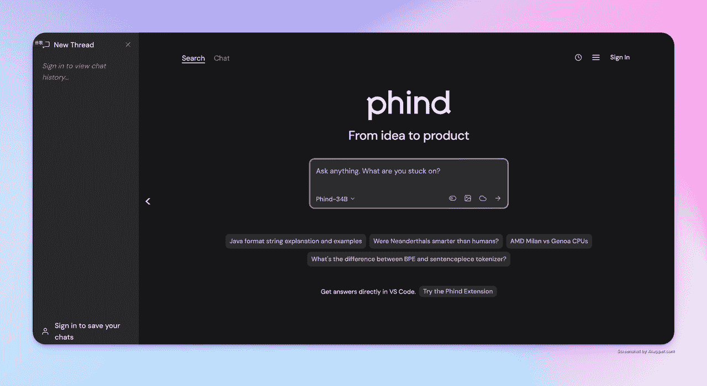

# 2024 年必备的 8 款 AI 搜索神器

> 来源：[https://docs.feishu.cn/docx/WKvLdDwAgoKl68xwTYfctJWWnoh](https://docs.feishu.cn/docx/WKvLdDwAgoKl68xwTYfctJWWnoh)

这两天社群的小伙伴向 Chris 推荐了几款 AI **搜索引擎工具，想**到之前写了两篇文章《精选 3 款优秀的 AI 搜索引擎工具和《推荐 3 款免费 AI 搜索工具，让信息检索更高效，今天就将这些一起汇总起来，方便阅读，觉得内容不错的小伙伴还请点赞收藏起来，Chris 感谢大家。

本文介绍的工具部分需要🪜，Chris 按照是否需要🪜进行排序，还请大家注意：

1.  秘塔 AI 搜索

1.  天工 AI 搜索

1.  iAsk.Ai

1.  Lepton Search

1.  Perplexity（🪜）

1.  You.com（🪜）

1.  Devv.ai（🪜）

1.  Phind（🪜）

## 1.秘塔 AI 搜索

🌐 网络环境：不需要🪜

🔗 工具地址：https://metaso.cn

秘塔 AI 搜索是由上海秘塔网络科技有限公司开发的新一代智能搜索引擎，「专注于为用户提供一个无广告、高效的搜索体验」。

秘塔 AI 搜索深度理解用户查询意图，并从「全网抓取信息进行分析」，以结构化的方式展示关键信息、事件时间线和相关人物资料。同时，它还提供详细的信息来源链接，确保用户能够验证搜索结果的准确性和可靠性。

## 2.天工 AI 搜索

🌐 网络环境：不需要🪜

🔗 工具地址：https://search.tiangong.cn/

天工 AI 搜索是昆仑万维推出的国内第一款 AI 搜索产品，它通过对话式交互，理解用户需求，提供精准和个性化的回答。

## 3.iAsk.Ai

🌐 网络环境：不需要🪜

🔗 工具地址：https://iask.ai/

iAsk.Ai是一个免费的AI搜索引擎，允许用户提问AI问题并立即获取准确、事实的答案，而不存储用户数据。它使用先进的自然语言处理（NLP）和经过精细调整的大规模Transformer语言模型，提供客观和可靠的回答。

## 4.Lepton Search

🌐 网络环境：不需要🪜

🔗 工具地址：https://search.lepton.run

Lepton Search 是一个开源的对话式人工智能（AI）搜索引擎，由前阿里巴巴技术副总裁贾扬清创办的 Lepton AI 推出。这个项目仅用了一个周末的时间，大约 500 行代码就构建完成，展示了构建 AI 应用的可行性和高效性。

## 5.Perplexity

🌐 网络环境：需要🪜

🔗 工具地址：https://www.perplexity.ai

Perplexity AI 是一个基于人工智能的「会话搜索引擎」，它结合了大型语言模型（如 OpenAI 的 GPT-3.5）和搜索引擎的功能，旨在为用户提供准确、直接的答案。

## 6.You.com

🌐 网络环境：需要🪜

🔗 工具地址：https://you.com/

You.com 是一款非常不错的 AI 搜索引擎，也是 Chris 使用的第一款 AI 搜索引擎。

You.com 可以「总结网上优质内容」，「没有广告」，有「极高的隐私性」，帮助用户从网页和应用中找到优质内容，并且「对中文搜索非常友好」。

## 7.Devv.ai

🌐 网络环境：需要🪜

🔗 工具地址：https://devv.ai/

Devv.ai 是面向程序员的新一代AI 搜索引擎。支持快速、精准地找到编程解决方案，提升开发效率。 通过强大的人工智能技术，Devv Search能够理解开发者的搜索意图，提供精准的搜索结果，极大提高了开发效率。定价灵活多样，适合个人开发者和企业用户。

## 8.Phind

🌐 网络环境：需要🪜

🔗 工具地址：https://www.phind.com/

Phind 是一款面向编程专家打造的智能搜索工具。该工具允许用户根据自身需求调整搜索参数，并将其设为默认设置，从而显著提升了搜索过程的便捷性和效率。

除此之外，Phind 还具备一项别具一格的“探索”特性，它通过人工智能技术为用户推荐与其搜索内容相关的主题和建议。同时，工具中还设有“惊喜我”选项，该功能可以随机选择不同主题，带给用户出人意料的新发现。

## 总结

今天介绍这些工具还挺多的，各有各的亮点，大家可以尝试看看，找到适合自己的 AI 工具，提高效率，这也是 Chris 一直以来对 AI 工具的看法～

赶紧去试试吧。