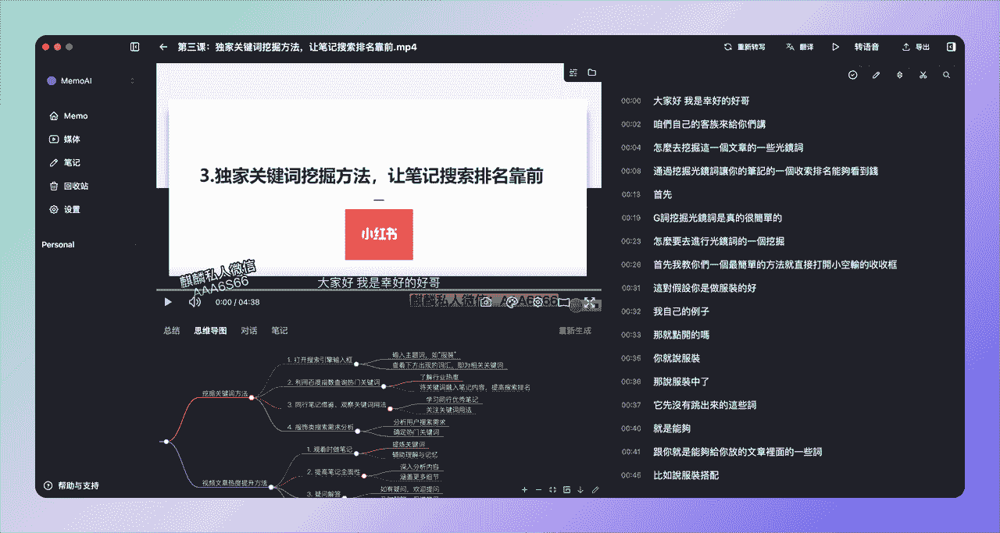
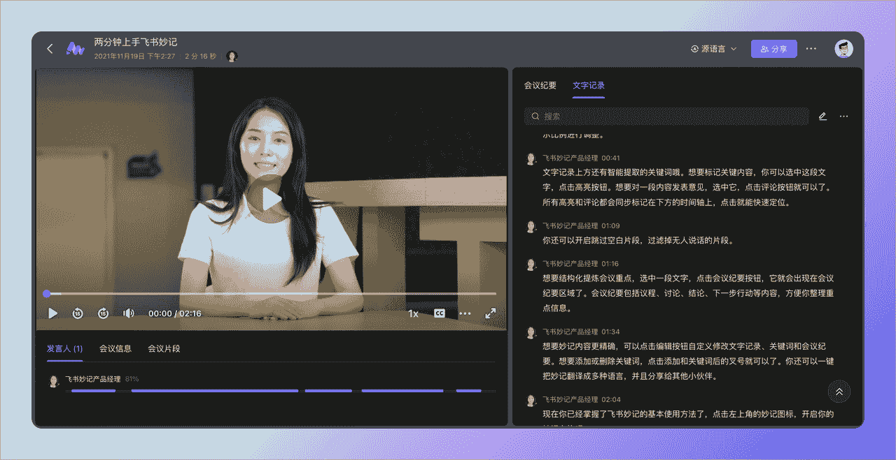
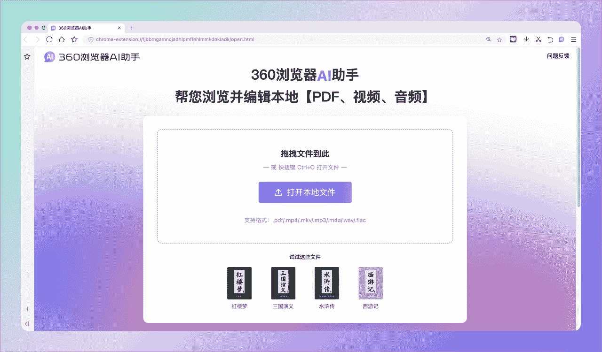
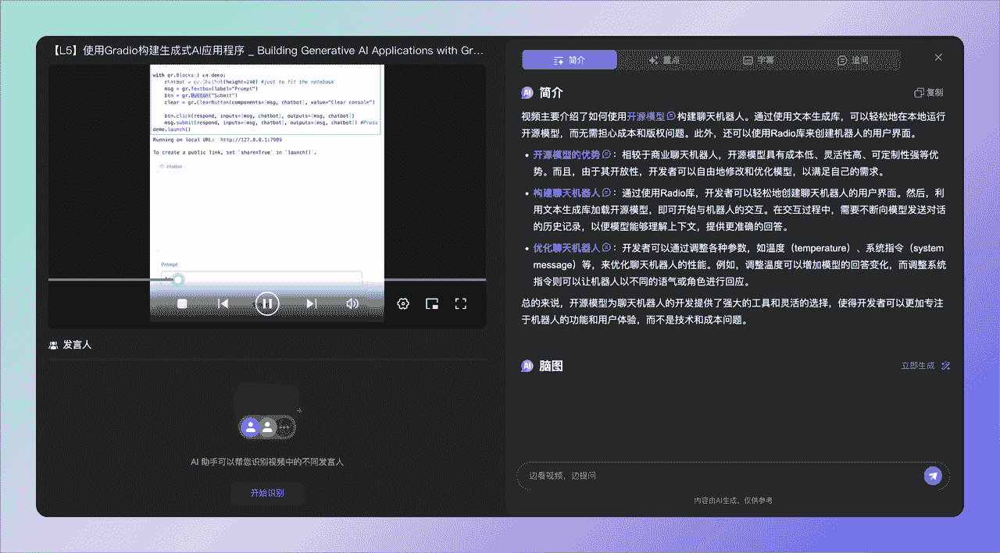

# 2024 年必备的 5 款 AI 音视频转录工具，一键生成文本、字幕、总结、思维导图等

> 来源：[https://docs.feishu.cn/docx/PbMDdjcH7oxx8GxgvD6cSBefnVf](https://docs.feishu.cn/docx/PbMDdjcH7oxx8GxgvD6cSBefnVf)

最近社群小伙伴在问**音视频转录**相关的 AI 工具，Chris  推荐 5 款国内可用的音视频转录 AI 工具，支持生成文本、字幕、总结、思维导图等，方便大家阅读和学习。

有需要加社群的朋友，可以添加我的🛰️，回复“AI”

按照惯例，先列出本文介绍的 AI 工具：

1.  通义听悟

1.  MemoAI

1.  飞书妙记

1.  讯飞听见

1.  360AI浏览器

之前还推荐的系列：

1.  《2024 年必备的 9 款 AI PPT 生成工具》

1.  《2024 年必备的 8 款 AI 搜索神器》

## 1.通义听悟

🔗 工具地址：https://tingwu.aliyun.com/

💻 支持平台：网页端、APP端、钉钉小程序、🛰️小程序、Chrome插件、Edge插件

通义听悟是一款阿里云推出的 **AI 音视频转录工具**，聚焦于音视频内容的工作学习 AI 助手，依托通义千问语言模型、音视频 AI 模型能力，帮助用户记录、整理和分析音视频内容，用大模型做音视频笔记、整理会议记录。

Chris 之前写了《**通义**听悟：阿里云推出的 AI 音视频转录工具介绍通义听悟，当时还是旧版，最近通义听悟已经更新最新版，合并到通义产品中，大家从官网打开会提示进入新版。

通义听悟的核心功能包括：

+   **实时记录**：实时语音转文字，同步翻译，智能总结要点。

+   **上传音视频**：音视频转文字，区分发言人，一键导出。

+   **文档阅读**：上传各类文档，分析文档中的关键内容信息。

+   **网页阅读**：添加网页链接，总结网页内容概述和主要观点。

+   **论文阅读**：上传学术论文，提炼出论文中最有价值的知识。

+   **图书阅读**：导入电子书籍，分章节整理书中的核心要点。

+   **播客链接转写**：输入RSS订阅链接无需下载，智能提炼总结。

## 2.MemoAI

🔗 工具地址：https://memo.ac/

💻 支持平台：Windows端、Mac端

MemoAI 是一款**完全本地运行**的优秀 AI 音视频转录工具，支持将 YouTube、播客、本地音频视频轻松转文本、字幕并翻译、合成新的语音，还可以由多种 AI 模型提炼内容精华。

目前 MemoAI 还在内测阶段，大家可以从首页进入申请内测码，基本也是秒过。

MemoAI 的核心功能包括：

+   🎥 视**频转文字：**轻松转 YouTube 视频、播客等为文字稿。

+   🌍 多**语言支持：**支持中文、英语、日语等90多种语言转录翻译。

+   🌐 翻**译：**转录音频同时可翻译至90多种语言。

+   📝 浮**动笔记：**音频播放时弹出关键点提醒。

+   💬 实**时字幕：**音频播放同步生成字幕。

+   🎞️ **支持本地媒体：**支持MP4、MP3、AAC、M4A等本地媒体文件。

+   ✂️ **音频分割**：隔离剪裁音频片段转录。

+   ⚙️ **自定义AI提示**：自定义AI助手提示以获得个性回复。

+   🤖 A**I摘要：**用AI智能汇总转录内容(需自备密钥)。

+   📄 导**出格式：**导出字幕、Markdown、Notion等格式。更多整合即将推出!

+   🖥️ 跨**平台：**支持Windows、macOS。

+   🔒 安**全隐私：**所有数据不离开设备,完全本地运行。

+   🚀 前**沿AI技术：**应用最新AI技术进行高质量转录。

+   💻 G**PU加速：**30分钟播客视频仅需2分钟。

+   🌍 A**I翻译：**高精度翻译长文档不同语言。

## 3.飞书妙计

🔗 工具地址：h[ttps://www.feishu](https://www.feishu.cn/product/minutes).cn/product/minutes

💻 支持平台：网页端、PC端

飞书妙记是飞书推出的一款 **AI 智能会议纪要工具**，用来帮助用户高效地记录、整理和回顾会议内容。会议信息无损记录、可回顾、好协作、易二创。

飞书妙记自动把视频会议转录成**易搜索**、**好整理**、**可翻译**的逐字稿，且支持**在线评论**、**@同事**，更有智能伙伴帮你**自动总结会议纪要与待办**，大幅提升回顾和协作效率。

飞书妙记的核心功能包括：

+   **精准快速转录**：视频会议、本地音视频、云盘文件，无需人工即可实现精准转为逐字稿。

+   **快速定位信息**：关键词智能提炼，选取或输入关键词，帮你一秒定位关注信息。

+   **智能翻译**：一键翻译内容，支持将语言翻译成 19 种常用语言。

+   **自动总结会议纪要**：基于整场会议输出的高度提炼，任何人都能快速把握整体讨论内容。

+   **结构化呈现章节纪要**：清晰展示会议脉络，不同人都能便捷查看自己关注的细化内容。

+   **识别后续待办任务**：无需人工记录，智能总结待办，对应会上讨论的责任人，让任务有记录、事事有着落。

+   **分享各类妙记素材**：支持将妙记导出为视频、文档，或创建特定片段，在分享时可一键修改权限范围。

## 4.讯飞听见

🔗 工具地址：https://www.iflyrec.com/

💻 支持平台：网页端、Word 插件、Windows端、Mac端、🛰️小程序

讯飞听见会记是一款专注录音转写整理的效率工具，支持语篇规整、全文摘要、多语种翻译、关键词提取等功能，可快速提升文稿结果可读性和记录整理效率。

讯飞听见的核心功能包括：

+   导入文件 1 小时音频最快 5 分钟出稿。

+   实时录音，一键成稿，准确率最高可达98%。

+   支持 9 国语音 +16 个专业领域效果优化。

+   说话人角色区分，AI 整理会议纪要。

## 5.360AI浏览器

🔗 工具地址：https://browser.360.cn/ai/

💻 支持平台：网页端、APP端、Windows端、Mac端

**360 AI 浏览器是** 360 公司推出的一款集成了 AI 技术的网络浏览器，通过 AI 技术提升用户的在线浏览和搜索体验。

360 AI 浏览器中内置了**音视频转录功能****，支持网**络**视频/本地视**频**，AI **视频助手帮您提取字幕、总结视频看点、思维导图等。使用时可以通过首页入口进入，或者右上角 AI 按钮进入，页面如下：

360 AI 浏览器的音视频转录的核心功能包括：

+   **总结视频看点**

+   **提取视频重点内容**

+   **思维导图总结**

+   **提取字幕内容**

+   **和视频内容对话**

+   **支持识别视频中不同发言人**

## 总结

今天分享的这 5 款 AI 音视频转录工具，各有各的亮点，大家可以自行选择，找到合适自己使用场景的工具，提高效率，这也是 Chris 一直以来对 AI 工具的看法～

赶紧去试试吧。