# 12 款热门 AI 视频生成工具，文生视频、图生视频都有！

> 来源：[https://docs.feishu.cn/docx/JCCHdzm5voR92Yxv0m8cGmfMnCd](https://docs.feishu.cn/docx/JCCHdzm5voR92Yxv0m8cGmfMnCd)

最近很多小伙伴在群里了解文本转视频的 AI 工具，这几天 Chris 精心整理了 12 款优秀的文本转视频 AI 工具，每款工具都有各有特色，大家可以体验看看。

有需要加入 AI 工具交流群，可以私聊我。

欢迎补充，以下排名不分顺序～～～～

## 1.即梦Dreamina

🔗 工具地址：h[ttps://jimeng.jianyi](https://jimeng.jianying.com/ai-tool/home)ng.com/ai-tool/home

💻 支持平台：网页版

🌍 网络环境：不需要魔法

**即梦**** Dreamina** 是一款由剪**映推出的 A**I 创作平台，集成了多种 AI 创作功能，用户可以通过文字生成图片和视频，还可以通过图片生成视频等功能，极大地提升了用户的创作体验和效率。

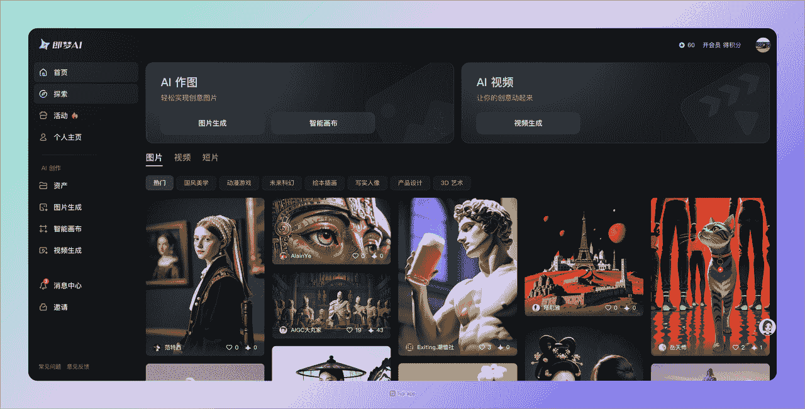

即梦 Dreamina 的核心功能包括：

+   **文字生成图片**：支持选择参考图、设置模型、精细度、图片尺寸和比例等；

+   **文字或图片生成视频****：支持设置运镜控制、运**动速度、生成时长、视频比例等，还有支持添加首帧和尾帧图片；

+   **智能画布**：通过提示词自由的绘制图片，并支持实时生成图片；

+   **活动和探索**：即梦提供了丰富的官方活动和使用示例，让大家可以更好的使用即梦进行创作。

官方提供了一些不错的文档，大家可以了解下：

+   即梦创作者使用指南（对外版）：[即梦创作者使用指南（对外版）](https://bytedance.larkoffice.com/docx/NjsYdFEdUoXyCRxJoqtcnYa1nlb)

+   教你如何写好prompt：[教你如何写好prompt](https://bytedance.larkoffice.com/wiki/XhpgwjagbinbpJkKSDEcYKGon5b)

## 2.AKOOL

🔗 工具地址：https://akool.com/zh-cn

💻 支持平台：网页端、安卓和 iOS APP

🌍 网络环境：不需要魔法

AKOOL是一家专注于视频营销领域的AI科技公司，支持从面部增强到实时数字人，再到未来新一代的视频编辑器，不仅提升了广告的互动性和个性化，还为品牌提供了全新的传播渠道。AKOOL已经推出的新一代AI视频编辑器，提供直观的用户界面，多样化的编辑选项，以及集成最新的AI功能，更是让视频内容制作变得简单又高效。

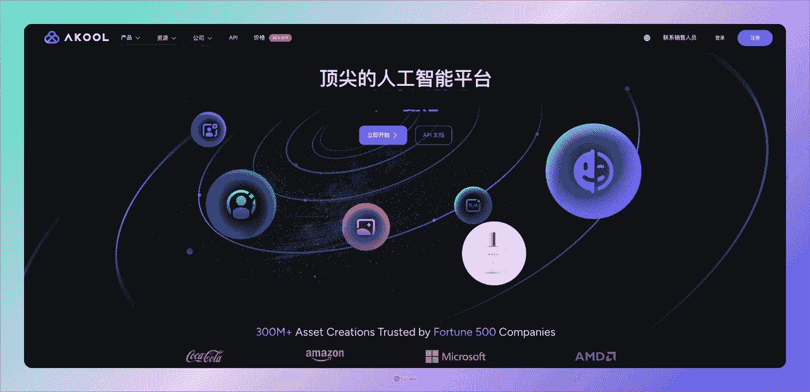

核心功能：

+   **实时视频生成**：支持文本驱动的实时视频创作，无需预先编写脚本。

+   **AI换脸与特效**：精准替换视频/图像中的人脸，支持150+语言实时翻译。

+   **数字人形象生成**：基于文本创建逼真虚拟形象，可用于企业培训、直播等。

+   **图像转视频**：快速简单地使用 AI 将图像转换为高质量的 4K 视频，并免费生成音频。

+   **专业级输出**：支持8K图像、60帧视频分辨率，确保高质量视觉效果。

## 3.Runway

🔗 工具地址：https://runwayml.com/

💻 支持平台：网页版

🌍 网络环境：不需要魔法

Runway 是一款基于人工智能的创意工具和平台，它提供了一系列强大的功能，旨在帮助用户在视觉内容创作、设计和开发过程中提高效率和创新能力。

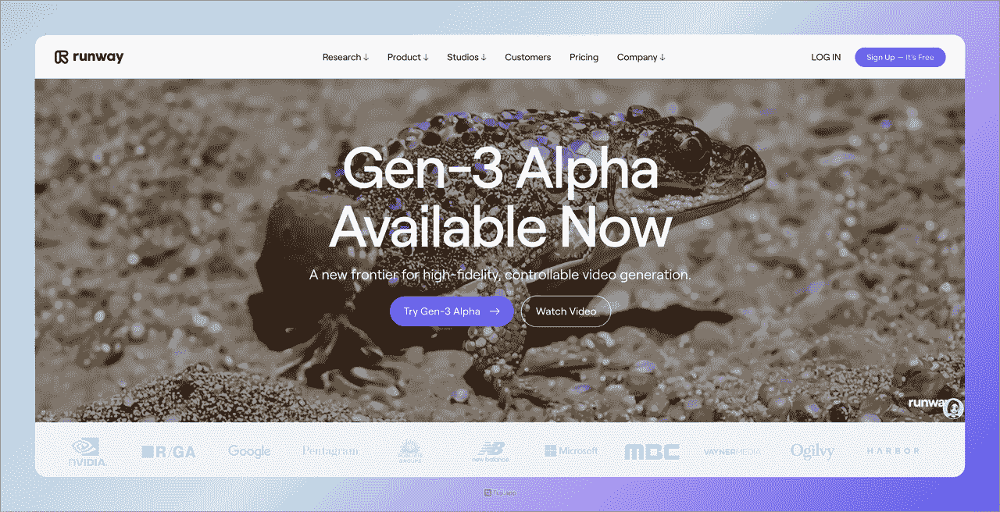

Runway 的核心功能包括：

+   **AI 视频创作与编辑**：包含动画、转场效果及视觉特效，并配备强大的视频编辑工具；

+   **图片生成和编辑**：支持图片生成、编辑，包括风格转换等；

+   **3D艺术创作**：支持 3D 模型的生成、编辑、渲染功能，支持构建和交互实时 3D 场景；

+   **音频制作和编辑**：支持音频处理工具，包括语音合成、音乐创作及音效设计；

+   **支持 API 调用**：提供 API 支持，让开发者可以更方便的接入 Runway。

RunWay 除了Gen-2 外，还提供了 26 个工具，包括：Generative、Video、Image、3D 和 Audio等 。

## 4.HeyGen

🔗 工具地址：https://www.heygen.com/

💻 支持平台：网页版

🌍 网络环境：不需要魔法

HeyGen 是一个 AI 视频虚拟数字人生成平台，只需输入和点击，就可以把文本转换成发言人视频。可以从100多个 AI 虚拟数字人中选择，或者创建你自己的虚拟数字人。

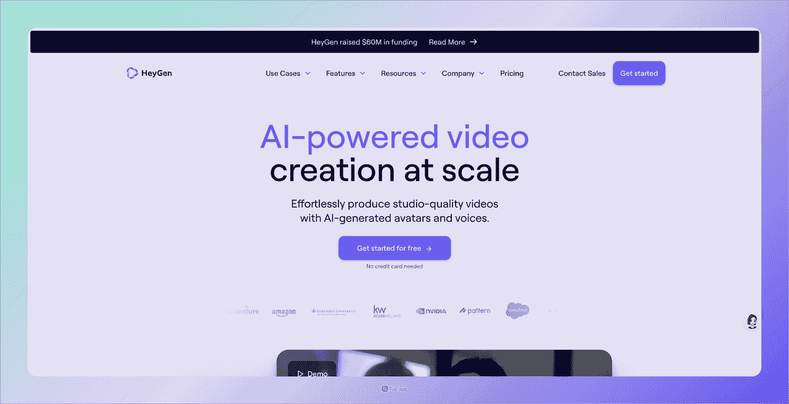

HeyGen 的核心功能包括：

+   **AI 虚拟形象选择及自定义**：HeyGen提供 100+ 个可自定义的 AI 虚拟形象；

+   **多种高品质配音选项**：用户可以选择不同的配音选项；

+   **丰富的模板库**：用户可以轻松找到相关情境并套用，从而提高制作效率；

+   **AI 语音一键转换**：用户可以利用 AI 语音的一键转换功能，将文本转换成发言人视频；

+   **即时数字人视频制作**：用户可以上传或录制个性化视频内容，并即时生成数字人视频；

## 5.可灵

🔗 工具地址：https://kling.kuaishou.com/

💻 支持平台：网页端、安卓和 iOS APP，内测中

🌍 网络环境：不需要魔法

可灵 AI 是由**快手大模型团队**基于自研的可灵大模型（Kling）开发的视频生成工具，具备强大的视频生成能力，支持生成长达 3 分钟、1080p分辨率的高清视频，并支持自由调整宽高比的功能。

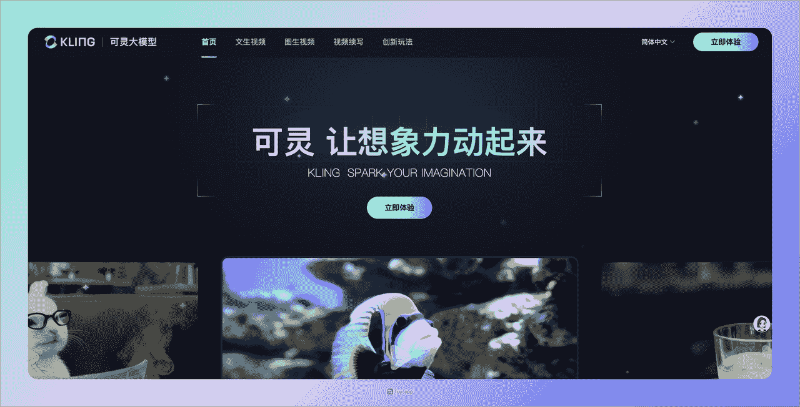

就在今天，可灵还进行一波大更新：

+   上线了 PC 网页端，地址是：https://klingai.kuaishou.com/

+   **文生视频**：画质升级、单次10s视频生成

+   **图生视频**：画质提升、支持自定义首尾帧

+   **运镜控制**：提供丰富的镜头控制选项，预设多种大师级镜头模式

+   在限免期间，「高表现」生成模式每账号每日最多使用3次，「高性能」模式生成次数不限

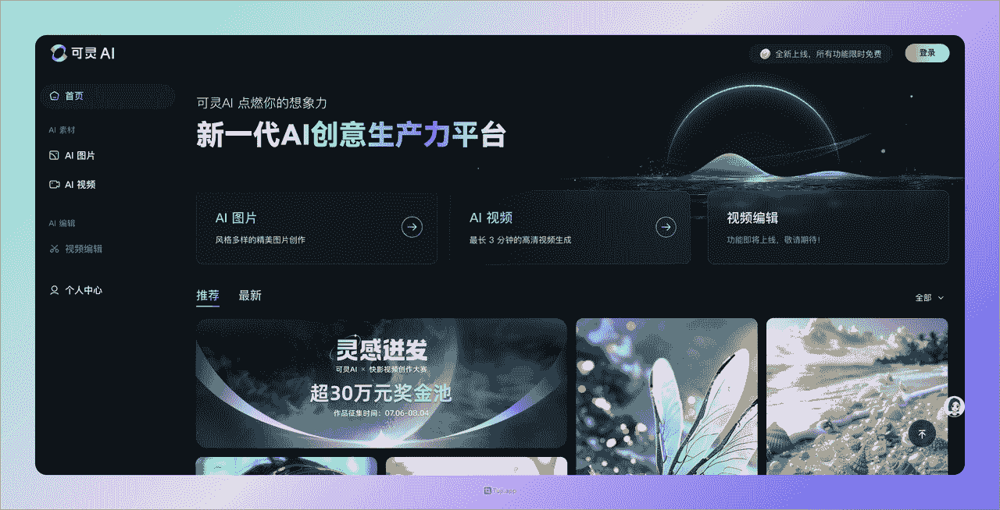

可灵目前还在内测，大家可以申请一下。

## 6.Pixverse

🔗 工具地址：https://pixverse.ai

💻 支持平台：网页版

🌍 网络环境：不需要魔法

PixVerse 是一款**爱诗科技**开发的 AI 视频生成工具，内置强大的生成式 AI 模型、支持灵活的多模态输入支持、高效的视频转换以及富有艺术创造力的输出。

往期推荐《PixVerse：免费且强大的 AI 视频生成工具》

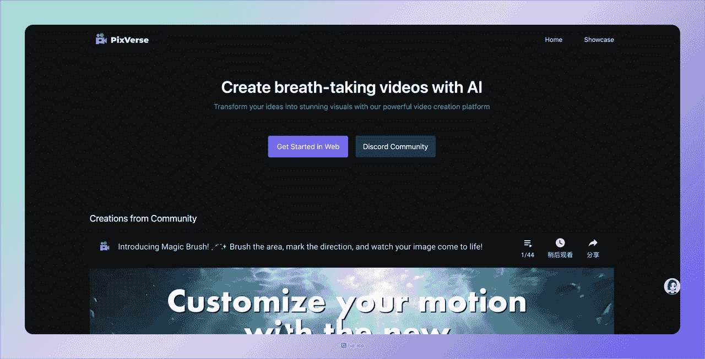

PixVerse 的核心功能包括：

+   **多模态输入支持**：支持包括图像、文本和音频等输入；

+   **角色一致性换背景**：支持在更换场景的情况下保持人物的一致性；

+   **实时预览与调整**：在编辑过程中，用户可以实时预览效果，并随时调整参数以达到最佳效果；

+   Magic Brush运动笔刷功能：允许用户通过涂抹区域和绘制轨迹来精确控制视频元素的运动。

## 7.Pika

🔗 工具地址：https://pika.art/

💻 支持平台：网页版

🌍 网络环境：需要魔法

Pika 是一款由 **Pika Labs **推出的 AI 视频生成工具，旨在通过先进的生成式 AI 技术将用户输入的文字或图像转换成视频。

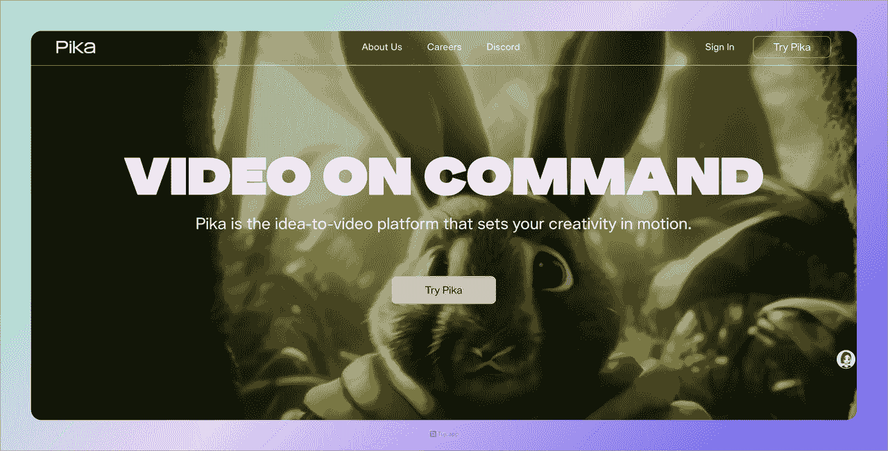

Pika 的核心功能包括：

+   **文本和图像生成视频**：输入简短的文本或上传图像，生成高质量的视频；

+   **视频实时重绘**：对视频中的背景环境、衣着道具等元素进行局部修改和重绘；

+   **视频尺寸编辑**：用户可以根据需要调整视频的宽高比；

+   **切换视频风格**：支持将现有视频转换为完全不同的风格，如黑白风、动漫风、自然风等；

+   **AI 视频编辑**：使用智能算法分析和编辑视频，如自动调整颜色、智能裁剪场景等。

## 8.Luma

🔗 工具地址：https://lumalabs.ai/

💻 支持平台：网页版

🌍 网络环境：需要魔法

Luma AI 是由 **LumaLabs** 开发的一款强大工具，专注于机器学习、增强现实和 3D 摄影。将 AI 与 3D 建模领域相结合，提供了一个沉浸式的环境来创建 3D 图形。

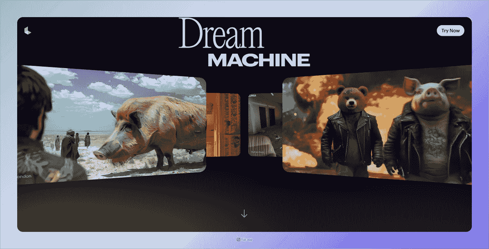

Luma AI 的核心功能包括：

+   **3D 模型生成**：Luma AI 利用 NeRF 技术，可以从文字、图片和视频中生成高质量的3D模型；

+   **视频生成**：根据简单的文本描述或上传的图片，快速生成高质量、逼真的视频；

+   **API 支持**：支持开发者使用 API 快速接入 Luma AI；

+   **多样化应用场景**：涵盖了多视角图像重建三维场景、3D 角色制作以及 2D 作画等多个领域。

## 9.WHEE

🔗 工具地址：h[ttps://www.whee.co](https://www.whee.com/ai/image-to-video)m/ai/image-to-video

💻 支持平台：网页端、安卓和 iOS APP

🌍 网络环境：不需要魔法

WHEE 是由**美图公司**推出的一款 AI 视觉创作工具，提供文生视频、图生视频、文生图、图生图、画面拓展及局部修改等功能。用户可以通过输入文字或上传图片生成与之相匹配的视频，还能根据用户需求进行智能剪辑和编辑。

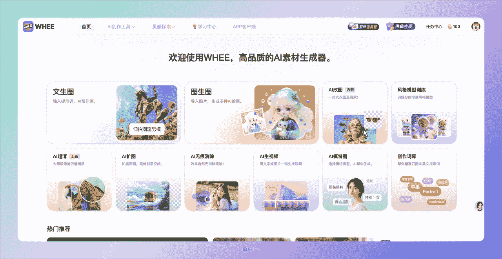

WHEE 的核心功能包括：

+   **文生视频和图生视频**：支持通过提示词和图片，生成相应的视频；

+   **文生图和图生图**：支持通过提示词或图片，生成相应的图片；

+   **线稿上色和涂鸦生图**：允许用户对线稿进行上色，通过涂鸦创作并生成新的图像；

+   **AI改图和扩图**：对图片进行修改和优化，扩展图片的尺寸和内容；

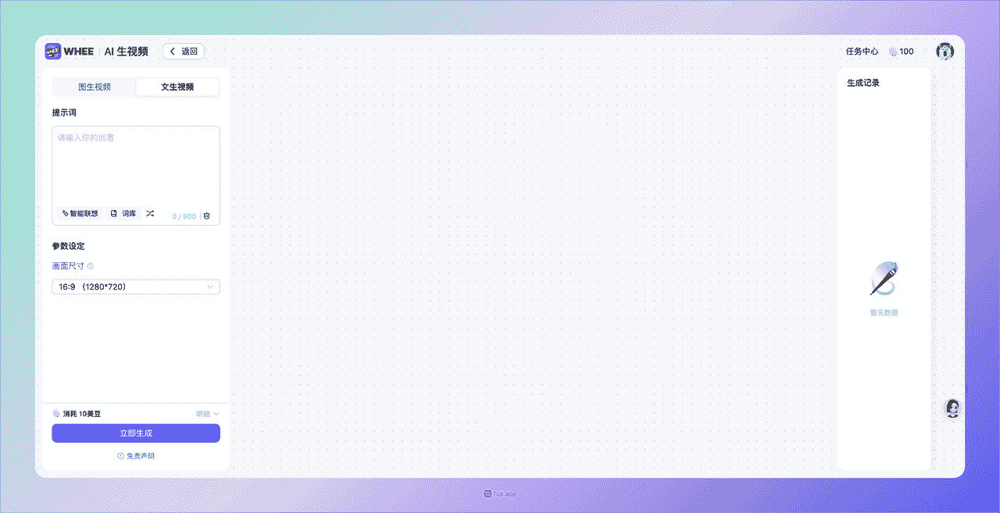

## 10.Pixeling

🔗 工具地址：https://www.hidreamai.com/lab

💻 支持平台：网页版

🌍 网络环境：不需要魔法

Pixeling 是由**智象未来****（HiDream.ai）开发的**一站式 AI 图片和视频生成平台，基于自研的生成式视觉多模态基础模型，旨在为用户提供高质量的视觉内容创作工具。

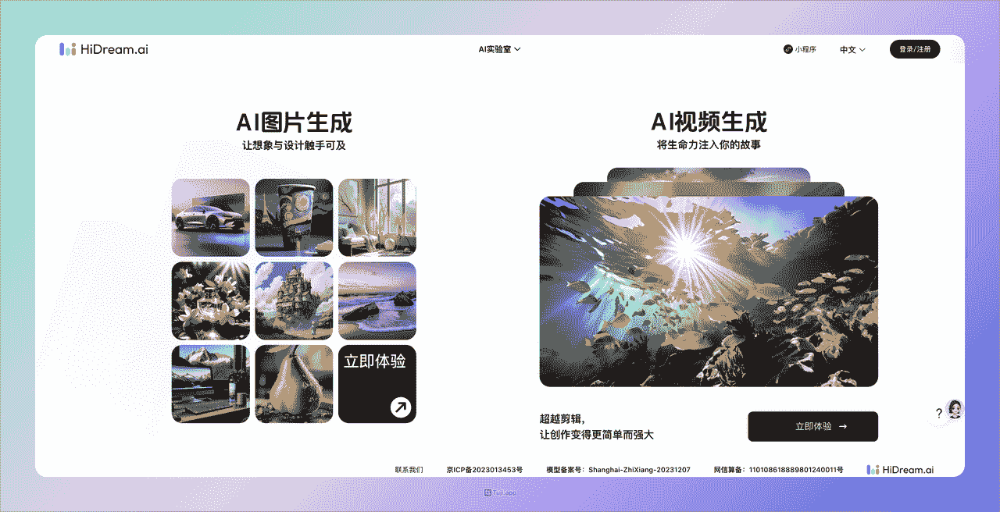

Pixeling 的核心功能包括：

+   **文字生成图片和视频**：通过输入简单的中英文描述或上传参考图，快速生成图片或视频；

+   **视频编辑**：包括智能重绘、智能拓图、图片增强等功能，帮助用户对现有视频进行编辑和优化；

+   **高清画面生成**：支持4K高清画面的生成，确保输出内容的高质量；

+   **全局/局部可控功能**：用户可以控制生成内容的全局或局部细节，实现更精准的内容生成；

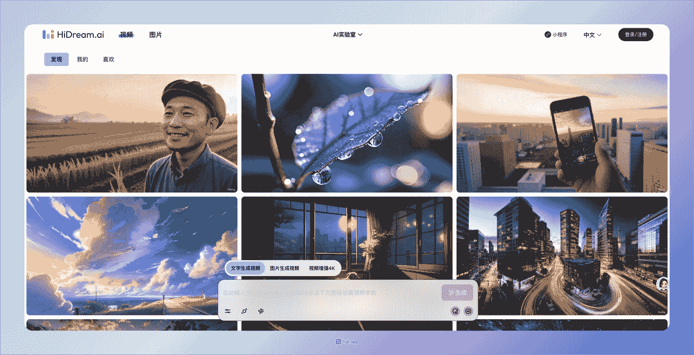

## 11.星火绘境

🔗 工具地址：https://typemovie.art/

💻 支持平台：网页版

🌍 网络环境：不需要魔法

星火绘境是一款由**科大讯飞**推出的 AI 短视频创作平台，将用户的文字描述自动转化为视频内容。特别适合内容创作者、营销人员和教育工作者等需要快速将创意或故事转化为视频的用户。

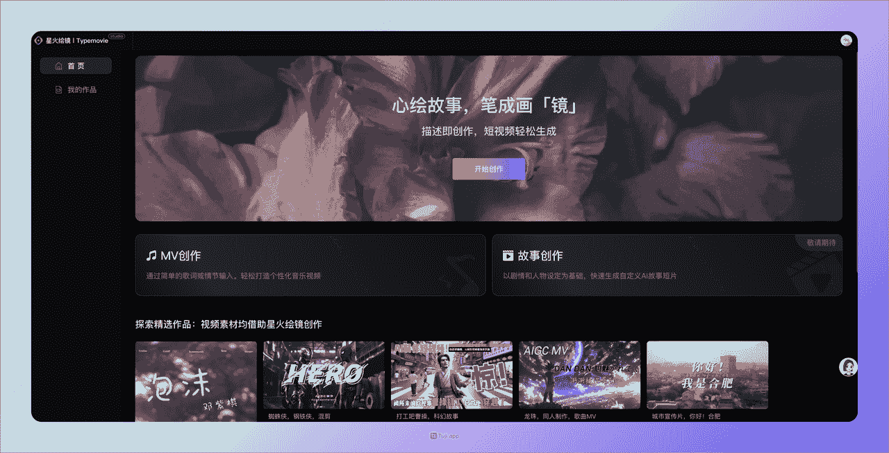

星火绘境的核心功能包括：

+   **MV 创作**：通过简单的歌词或情节输入。轻松打造个性化音乐视频；

+   **故事创作**：以剧情和人物设定为基础，快速生成自定义AI故事短片；

## 12.VegaAI

🔗 工具地址：https://www.vegaai.net/

💻 支持平台：网页版

🌍 网络环境：不需要魔法

VegaAI 是一款创新的在线创作工具，以其简化的操作流程和高效的内容生成能力，为创作者提供了一个快速、个性化、高效的创作环境。它不仅支持在线快速训练和定制，还率先开放了视频生成大模型，让视频创作变得非常简单。

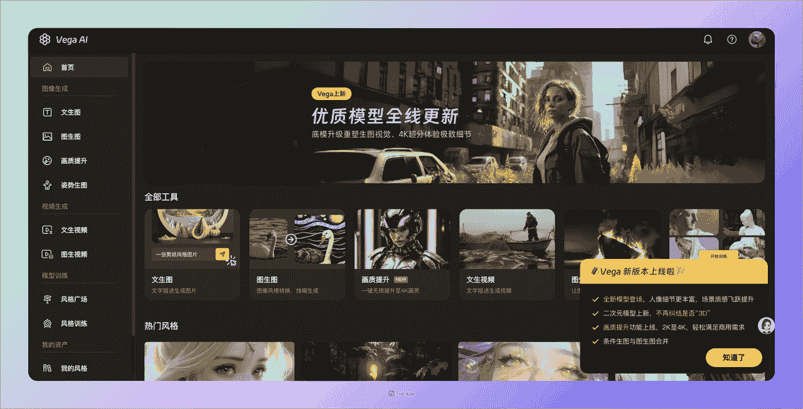

[Vega AI 最全教程](https://hf514kmkak.feishu.cn/docx/Ip0ZdadkWoV8qJxNGFScFneNnIb)egaAI 官方还提供了一份非常不错的教程，大家可以了解看看： 。

最近 VegaAI 又更新了全新模型，上线画质提升功能，支持 2K 至 4K 视频，非常不错。

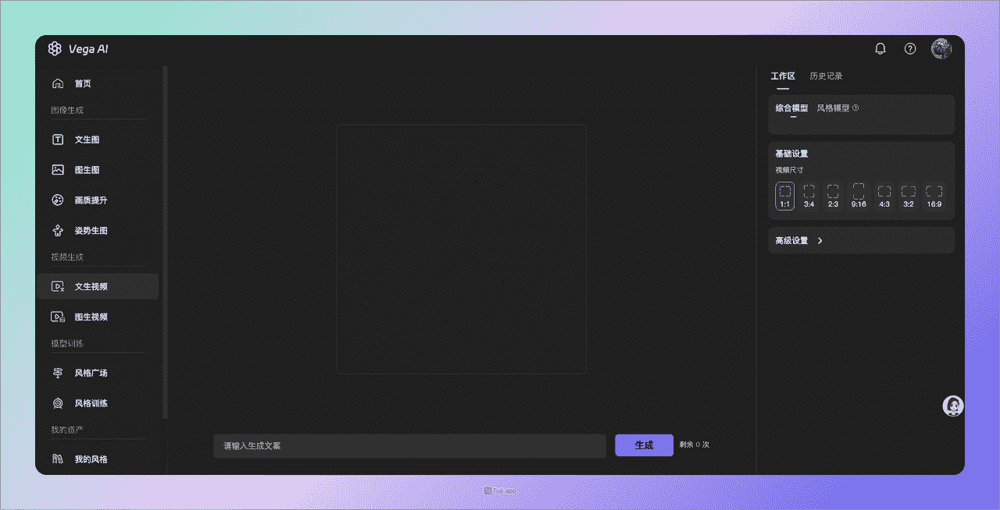

VegaAI 的核心功能包括：

+   **视频生成**：支持文生视频和图生视频；

+   **图片生成**：包括文生图、图生图、画质提升、姿势生图；

+   **模型训练**：包括风格广场和风格训练，方便用户训练自己的模型。

## 总结

今天 Chris 和大家总结分享了 12 款国内外热门文本转视频的 AI 工具，各有各的特点，大家可以体验看看，也欢迎大家推荐～