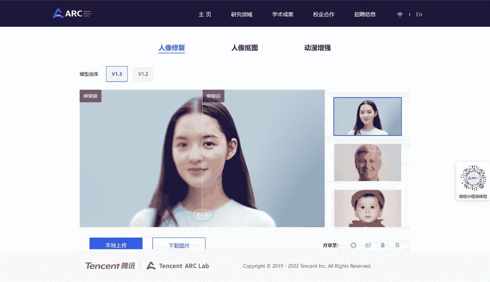
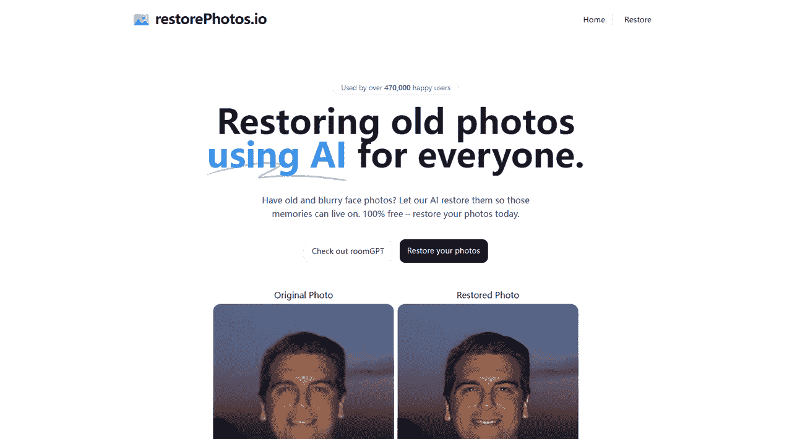
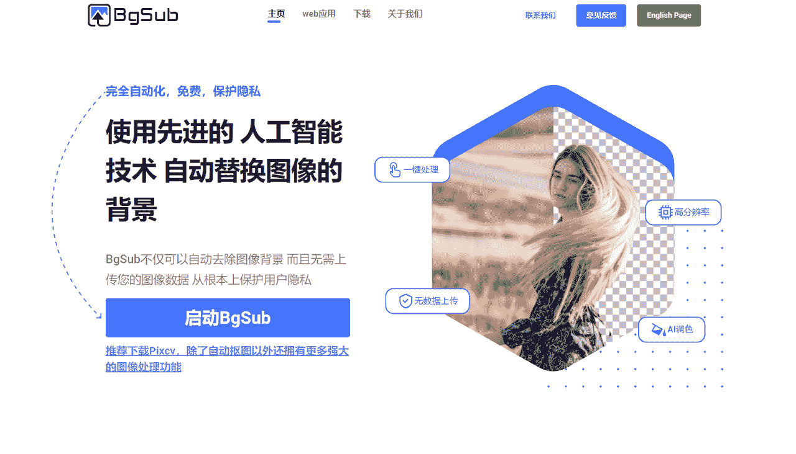

# 6 款好用的 AI 图片修复工具

> 来源：[https://docs.feishu.cn/docx/VT8cdFZmroYj17xW7bZcGxzOnss](https://docs.feishu.cn/docx/VT8cdFZmroYj17xW7bZcGxzOnss)

最近社群中有小伙伴在询问关于修复图片的 AI 工具，于是 Chris 精心挑选了 6 款比较不错的 AI 图片修复工具，希望能帮助大家在图像处理上更加得心应手。

## 1.ARC 图片增强

**关键词**：人像修复、人像抠图、动漫增强

**地址**：[https://arc.tencent.com/zh/ai-d](https://arc.tencent.com/zh/ai-demos/faceRestoration)emos/faceRestoration

**价格**：完全免费

**介绍**：ARC 图片增强是一款由腾讯AI产品提供的图像处理工具，核心功能包括人像修复、人像抠图、动漫增强等，非常专业高效的修复图片。主要用于修复老照片或者照片去背景等场景。

**其他**：来自腾讯 AI 实验室，支持小程序上使用。

## 2.RestorePhotos

**关键词**：还原老照片、留住美好回忆

**地址**：https://www.restorephotos.io/

**价格**：完全免费

**介绍**：RestorePhotos 是一款使用 AI 技术为用户恢复老照片的产品。无论用户的照片是模糊的还是老旧的，都可以帮助将它们恢复到完美的状态，让美好的回忆得以延续。

**其他**[：目前该项目免费开源，仓库地址：http](https://github.com/Nutlope/restorePhotos)s://github.com/Nutlope/restorePhotos

## 3.Remini

**关键词**：高清修复老照片，一键提升照片画质

**地址**：https://remini.ai/

**价格**：部分收费，详见官网

**介绍**：Remini 是一款在线实时照片增强应用，搭载世界顶级AI技术，专为转化低分辨率、模糊、像素化、老旧和损坏的照片而设计。除此之外，Remini还提供了一系列基于 AI 的图像处理功能，包括人像优化、艺术绘画风格转换、眨眼特效等，为用户的图像处理需求提供全方位的解决方案。

**其他**：支持 API 调用，官方介绍：https://remini.ai/api-services

## 4.Background Remover

**关键词**：自动擦除背景，秒速完成

**地址**：[https://magicstudio.com](https://magicstudio.com/background-remover/)/background-remover/

**价格**：部分收费，详见官网

**介绍**：Background Remover 是一款功能强大的在线照片编辑工具，采用先进 AI 技术，能够迅速去除照片背景、无损放大照片等。此外，它还能轻松帮助用户从任何图像中去除不需要的元素，是一种高效、无忧的照片编辑解决方案。

**其他**：该网站还有其他图片处理工具，如：图片生成、图片自动抠图等工具。

## 5.BgSub

**关键词**：高效、无需上传图像

**地址**：https://bgsub.cn/

**价格**：完全免费

**介绍**：BgSub 是一个使用AI技术自动删除或替换图像背景的网站。可以智能调色功能，所有操作均在浏览器内完成，无需图像上传，不仅节省时间，还确保隐私安全。并且适合多种使用场景，包括个人用户、网站/应用开发者、摄影师、电子商务专家、媒体行业工作者及市场营销人员，提供全面便捷的图像编辑体验。

**其他**：支持手机 APP，无需上传图片，保护隐私。

## 6.Remaker AI

**关键词**：速度快、去除水印和文本

**地址**：https://remaker.ai/

**价格**：完全免费

**介绍**：Remaker AI 是一个强大且免费的图像处理工具，为用户带来高效而便捷的图像编辑体验。不仅能够去除图像中的水印和文本，还可以去除不必要的图像部分，并重新构想图像。还支持无损放大功能，并提供保存处理历史记录和生成图像预览的选项，满足用户全方位的图像处理需求。

