# 17 款好用的国产 AI 聊天机器人

> 来源：[https://docs.feishu.cn/docx/ScaAdJKL7oHQngxGfW9csfj5nrf](https://docs.feishu.cn/docx/ScaAdJKL7oHQngxGfW9csfj5nrf)

最近有小伙伴问 Chris 无需梯子🪜即可访问的AI聊天机器人。目前流行的 ChatGPT、Claude2 等需翻墙才能使用。因此， Chris 整理了 17 款国产 AI 聊天机器人，它们无需梯子🪜即可访问。

本文旨在提供信息，并不比较各工具。欢迎大家在评论区补充。

以下**排名不分先后**，目录如下：

Chris 希望这 17 款 AI 聊天机器人能够帮助到你，让更多人用上 AI 助手！

接下来和 Chris 一起了解一下：

## 1.文心一言

**介绍**：文心一言是百度全新一代知识增强大语言模型，文心大模型家族的新成员，能够与人对话互动，回答问题，协助创作，高效便捷地帮助人们获取信息、知识和灵感。

**网址**：https://yiyan.baidu.com/

**其他**：支持网页端和 APP，拥有丰富插件，整体使用其他挺不错的。

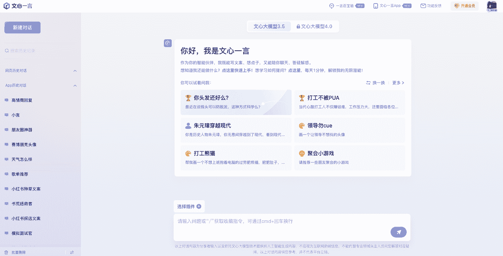

## 2.讯飞星火

**介绍**：讯飞星火认知大模型，是由科大讯飞推出的新一代认知智能大模型，拥有跨领域的知识和语言理解能力，能够基于自然对话方式理解与执行任务，提供语言理解、知识问答、逻辑推理、数学题解答、代码理解与编写等多种能力。

**网址**：https://xinghuo.xfyun.cn/

**其他**：支持网页端和 APP，拥有丰富插件，还有用户社区，很方便。

**往期推荐**：Chris 之前有写过一篇：

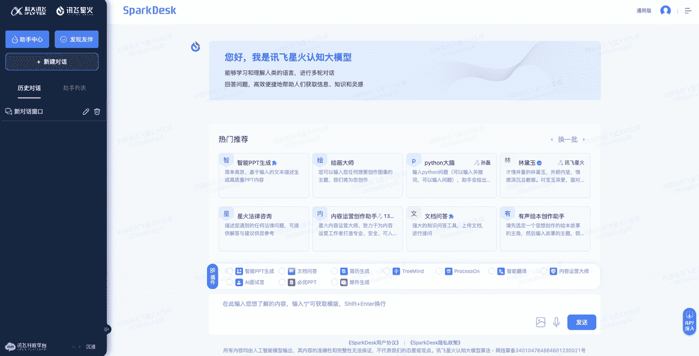

## 3.通义千问

**介绍**：通义千问是阿里巴巴旗下的一款智能问答机器人，它利用自然语言处理技术，为用户提供智能化的语音交互服务。通义千问能够回答用户的各种问题，并进行深入的分析和推荐，帮助用户解决各种生活和工作中遇到的疑问和难题。

**网址**：https://qianwen.aliyun.com/

**其他**：支持网页端和 APP，拥有丰富插件，还有图片理解和文档解析功能。

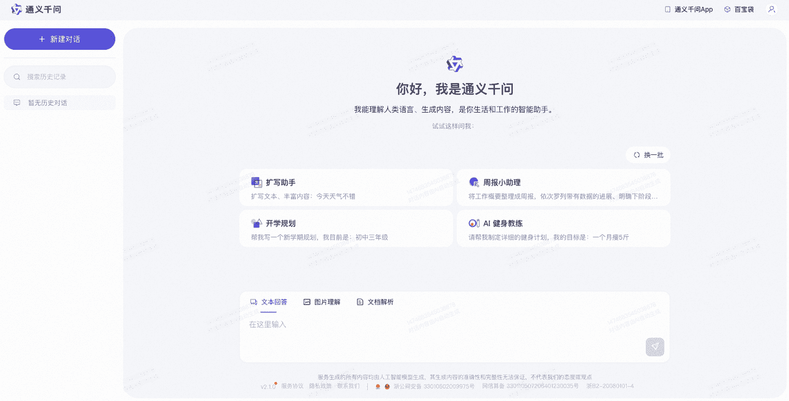

## 4.抖音豆包

**介绍**：豆包是字节跳动基于抖音云雀模型开发，提供聊天机器人、写作助手以及英语学习助手等功能。

**网址**：https://www.doubao.com/

**其他**：支持网页端和 APP，拥有丰富的 AI 智慧体，类似插件。

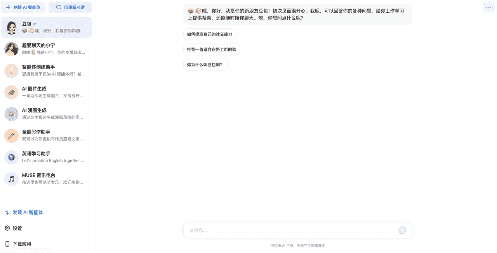

## 5.智谱清言

**介绍**：智谱清言基于智谱AI 自主研发的中英双语对话模型ChatGLM2，通过万亿字符的文本与代码预训练，结合有监督微调技术，以通用对话的产品形态成为更懂用户的智能助手，在工作、学习和日常生活中赋能用户，解答用户各类问题，满足用户问询需求。

**网址**：https://chatglm.cn/

**其他**：支持网页端、Windows、Mac 和 APP，拥有丰富的灵感，类似模板，支持文档解析、代码沙盒。

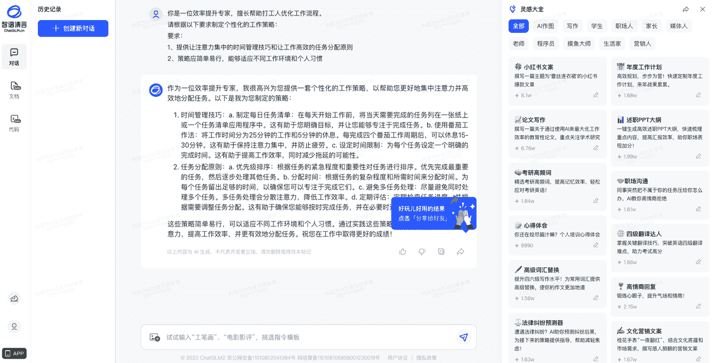

## 6.百川大模型

**介绍**：百川大模型是百川智能推出的大模型产品，其融合了意图理解、信息检索以及强化学习技术，结合有监督微调与人类意图对齐，在知识问答、文本创作领域表现突出。成立仅四个月，百川智能便相继发布了三款通用大语言模型。

**网址**：https://www.baichuan-ai.com/

**其他**[：支持开发者对接，详细可以查看文档](https://platform.baichuan-ai.com/docs)：https://platform.baichuan-ai.com/docs

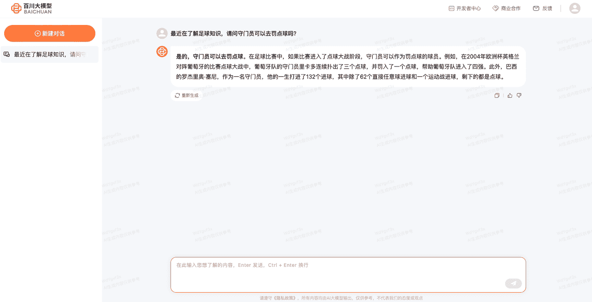

## 7.360智脑

**介绍**：“360智脑”是360自研的千亿级参数通用语言大模型，具有10项核心基础能力，分别是：生成与创作、多轮对话、代码能力、逻辑与推理、知识问答、阅读理解、文本分类、翻译、文本改写、多模态。

**网址**：https://chat.360.com/

**其他**：支持网页端和 APP，拥有丰富的对话角色，还支持自定义数字人和数字人广场，有点意思。

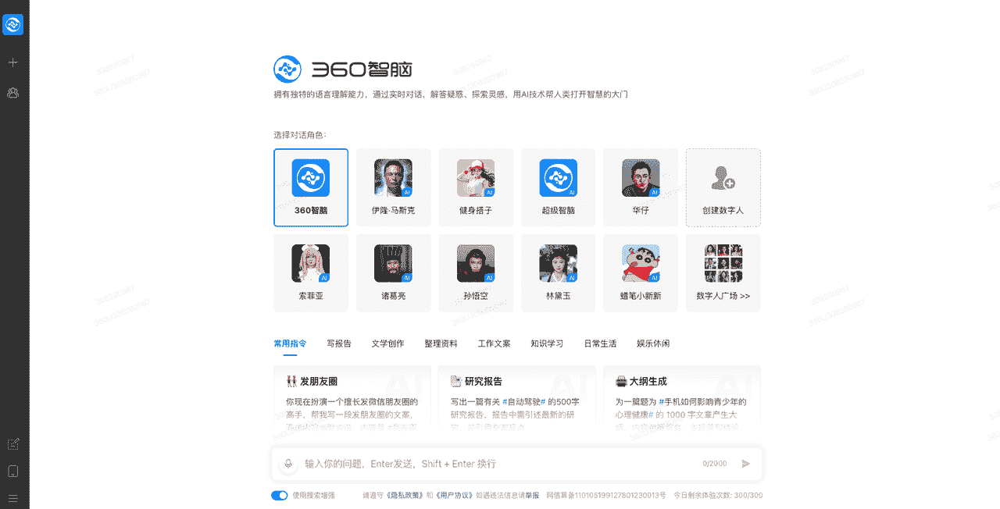

## 8.百度 AI 伙伴

**介绍**：百度搜索AI伙伴是百度最新上线的基于文心大模型的AI搜索对话工具，目前处于免费公测中，无需等待。用户可在桌面端或移动端的百度点击右上角的AI图标，即可进入该界面。

**网址**：https://chat.baidu.com/

**其他**：支持网页版、浏览器助手和手机版。

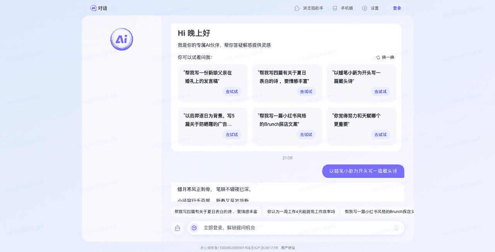

## 9.紫东太初

**介绍**：中科院自动化所和武汉人工智能研究院推出新一代大模型，从三模态走向全模态，支持多轮问答、文本创作、图像生成、3D理解、信号分析等全面问答任务，拥有更强的认知、理解、创作能力，带来全新互动体验。

**网址**：https://taichu-web.ia.ac.cn/

**其他**：支持开发者接入，具体可以查看文档：https://ai-maas.wair.ac.cn/#/doc

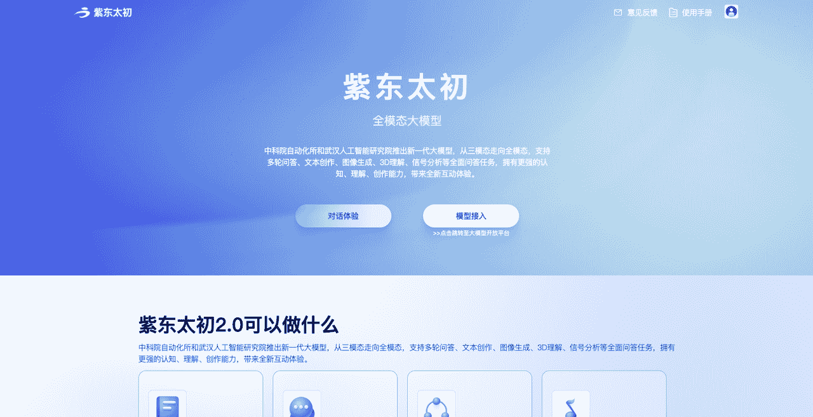

## 10.Kimi Chat

**介绍**：Kimi Chat 是国内人工智能初创公司Moonshot AI（月之暗面）推出的智能对话助手，支持输入长达20万汉字的上下文。Kimi Chat擅长中文和英文的对话，可以帮助用户解决各类生活和工作中的问题、提供实用的信息和参考建议。

**网址**：https://kimi.moonshot.cn/

**其他**：类似 Claude2，支持网站链接和文档上传。

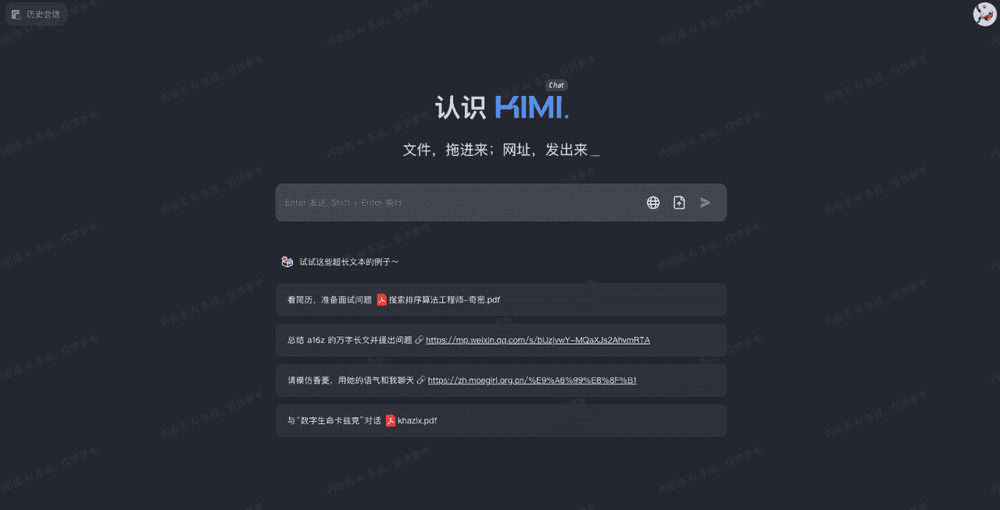

## 11.天工Chat

**介绍**：「天工」是国内首个对标 ChatGPT 的双千亿级大语言模型，也是一个对话式AI助手。「天工」通过自然语言与用户进行问答交互，AI 生成能力可满足文案创作、知识问答、逻辑推演、数理推算、代码编程等多元化需求。支持1万字以上文本对话，实现20轮次以上用户交互，在学习、职场、生活等多类问答场景中都能实现较高的输出水平。

**网址**：https://chat.tiangong.cn/

**其他**：支持丰富的助手、插件和热门话题。

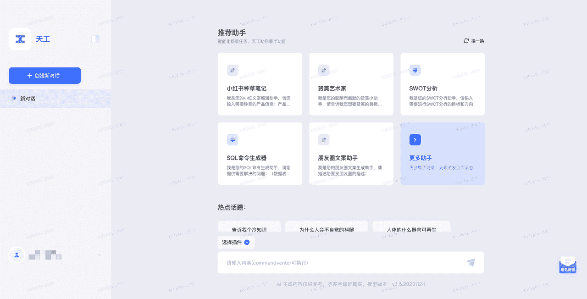

## 12.腾讯混元助手

**介绍**：腾讯混元助手支持 AI 问答，可以回答各类问题，也能处理多种任务，如获取知识、解决数学问题、翻译、提供旅游攻略、工作建议等。

**网址**：https://hunyuan.tencent.com/

**其他**：支持网页端和小程序端。

## 13.小悟空

**介绍**：小悟空原是字节跳动推出的综合类搜索引擎“悟空搜索”，现已更名并转型为 AI对话助手和个人助理。通过与小悟空对话，可以看出其内核是与字节此前推出的 豆包 AI聊天机器人同款，但相比豆包提供了更多开箱即用的预设工具，支持智能对话和多种内容创作功能。

**网址**：https://wukong.com/

**其他**：支持丰富的工具，可以自行选择。

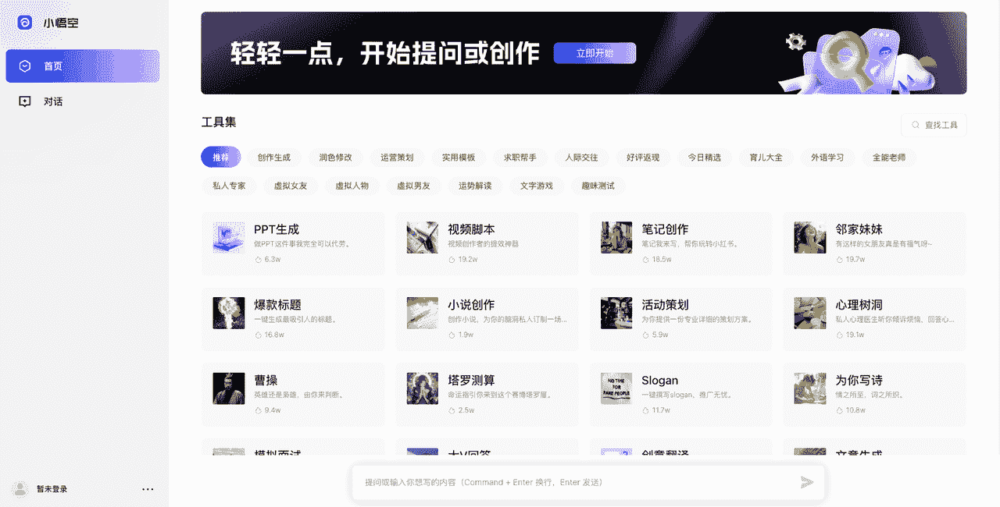

## 14.魔搭GPT

**介绍**：ModelScopeGPT（魔搭GPT）， 是阿里巴巴达摩院最新推出的一个大小模型协同的智能助手，具备作诗、绘画、视频生成、语音播放等多模态能力。除此之外，魔搭GPT还集成了知识库检索引擎，可以解答用户在魔搭社区使用模型遇到的问题以及模型知识相关问答。

**网址**：[h](https://www.modelscope.cn/studios/damo/ModelScopeGPT)ttps://www.modelscope.cn/studios/damo/ModelScopeGPT

**其他**：具备多种能力，可以通过大模型做中枢（controller），来控制魔搭社区的各种多模态模型api回复用户的问题。

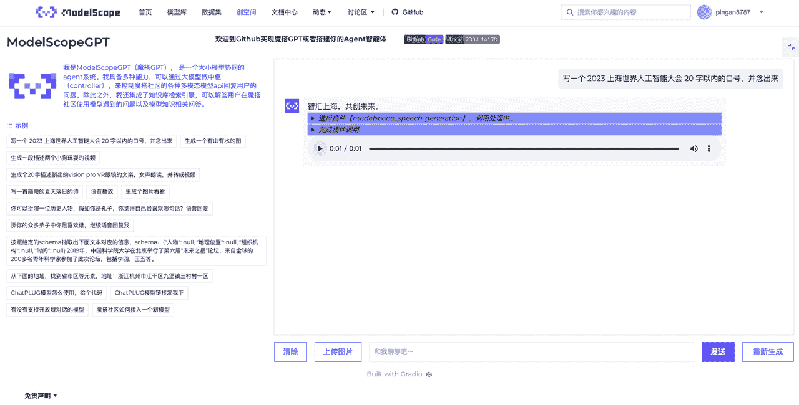

## 15.应事AI

**介绍**：应事AI是基于MiniMax最新一代中文大语言模型的AI聊天机器人，产品前身是Inspo，现已通过备案并向社会开放。应事是您值得信赖的AI智能助理，可帮助高效写作、激发灵感、获取知识、做出决策。

**网址**：https://yingshi-ai.com/

**其他**：支持网页端和 APP。

## 16.商量语言大模型

**介绍**：“商量”是由商汤科技研发的一款基于自然语言处理技术的人工智能大语言模型，具备超凡的语言理解、生成能力，将科技与人文相互交融。作为高效聊天助手，它能秒解复杂问题，提供定制化建议，还能辅助创作一流文本，具备不断学习进化的特性。

**网址**：https://chat.sensetime.com/

**其他**：Chris 目前没有企业邀请码无法注册，大家可以想办法试试。

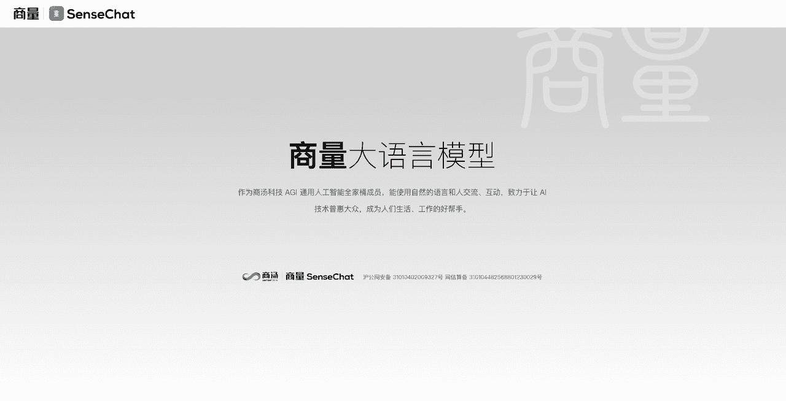

## 17.MOSS 复旦大模型

**介绍**：复旦大学MOSS是一个支持中英双语和多种插件的开源对话语言模型，具有160亿参数。MOSS基座语言模型在约七千亿中英文以及代码单词上预训练得到，后续经过对话指令微调、插件增强学习和人类偏好训练具备多轮对话能力及使用多种插件的能力。

**网址**：https://moss.fastnlp.top/

**其他**：Chris 暂时没有申请到账号，大家可以自行申请测试一下。

