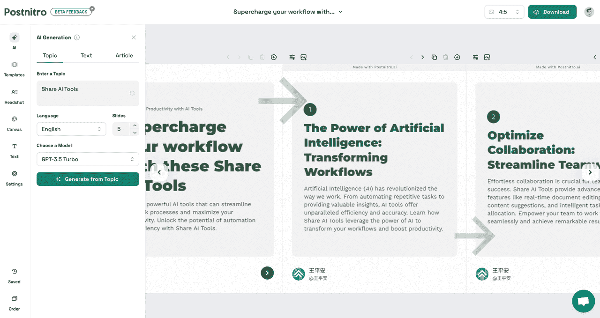
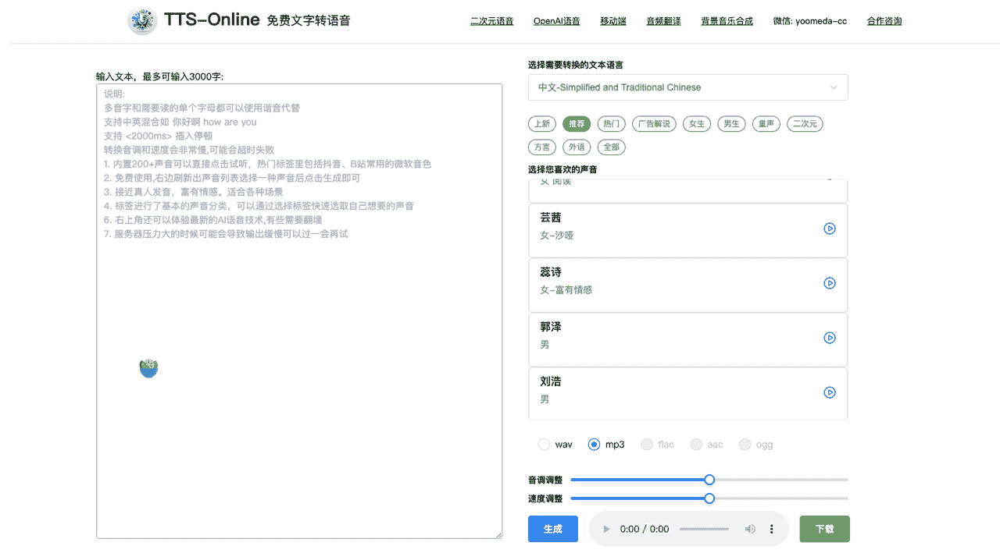
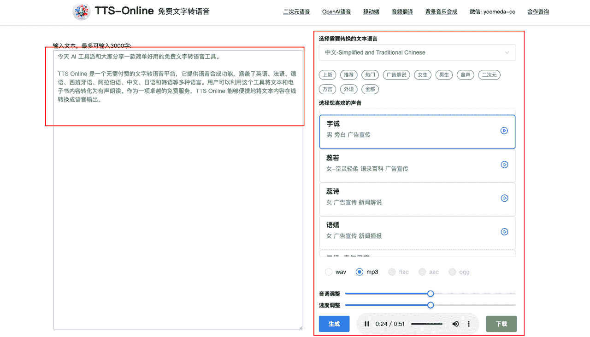
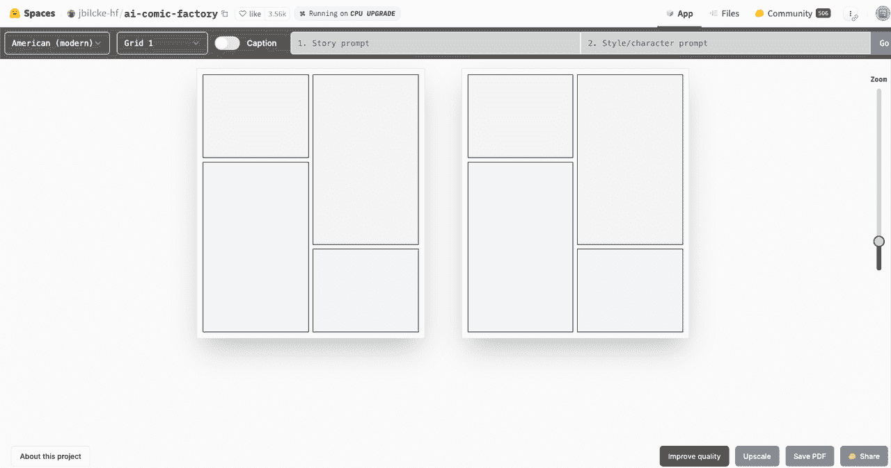
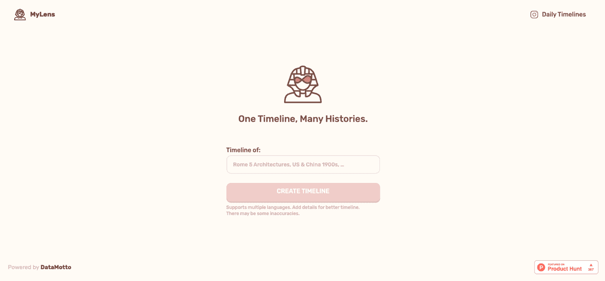
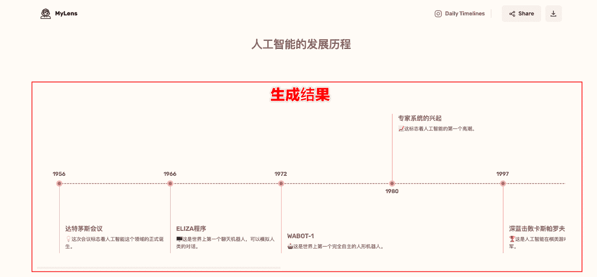
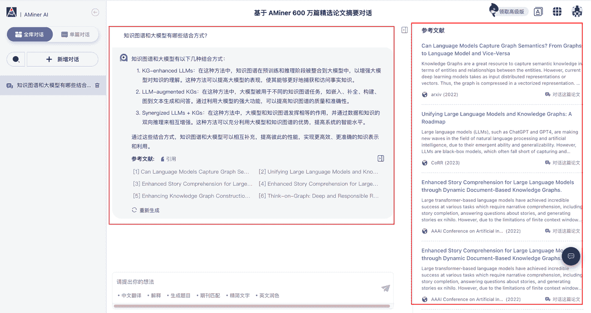

# 5 款不错的 AI 工具：小红书做号神器、漫画生成、AI 学术、文本转语音等

> 来源：[https://docs.feishu.cn/docx/AJ9gdJEMGokCc1xCiJfc0lwFnuc](https://docs.feishu.cn/docx/AJ9gdJEMGokCc1xCiJfc0lwFnuc)

Hi，大家好，今天 Chris 和大家分享 5 款不错的 AI 工具，它们不仅功能强大，而且操作简便，能够帮助你在各个领域提升效率和创造力。接下来一起看看吧：

# 1.Postnitro：小红书做号神器

工具地址：https://postnitro.ai/

工具亮点：免费、无需🪜、高效便捷、模板多样、高度定制化

Postnitro 是一款专为社交媒体内容创作者、品牌和个人博主设计的AI工具，专注于快速创建吸引人的社交媒体封面图片，尤其适合小红书等平台。用户通过输入主题，Postnitro 能迅速生成封面设计。

核心功能：

+   **快速封面设计**：AI算法根据用户输入快速生成封面图。

+   **个性化定制**：提供丰富的模板库，支持用户自定义图片、颜色和字体等。

+   **智能文案建议**：AI系统提供与封面风格相匹配的文案建议，帮助吸引目标受众。

+   **多格式导出**：支持将封面导出为PNG或PDF格式，适用于多种社交平台。

Chris 输入简单的主题内容，就可以生成多张不错的封面图：

# 2.TTS-Online：多语言文字转语音平台

工具地址：https://www.ttson.cn/

工具亮点：免费、无需🪜、内置声音种类丰富。

TTS Online 是一个无需付费的文字转语音平台，它提供语音合成功能，涵盖了英语、法语、德语、西班牙语、阿拉伯语、中文、日语和韩语等多种语言。用户可以利用这个工具将文本和电子书内容转化为有声朗读。作为一项卓越的免费服务，TTS Online 能够便捷地将文本内容在线转换成语音输出。

Chris 在左侧输入要转语音的文本，右侧进行配置即可：

# 3.AI Comic Factory：漫画生成工具

工具地址：[h](https://huggingface.co/spaces/jbilcke-hf/ai-comic-factory)ttps://huggingface.co/spaces/jbilcke-hf/ai-comic-factory

工具亮点：开源免费

AI Comic Factory 是一**款基于 Hugging **Face 平台的开源免费在线漫画创作工具，它结合了大型语言模型（LLM）和风格转换技术（SDXL），允许用户通过输入简短的文字描述创作出精美的漫画。这些由AI生成的图片不仅支持无损放大，而且操作简单，无需任何先前的学习经验，适合所有年龄段的用户。

使用时，只需要再顶部输入提示词内容，然后开始生成即可：

生成结果支持每张图片单独修改，不过 Chris 发现，对于人物的手指，还是有问题的。

# 4.MyLens：时间线生成工具

工具地址：https://mylens.ai/

工具亮点：免费、无需🪜、以时间线方式学习知识更方便。

MyLens 是一款**完全免费且免登录**的 AI 时间线生成工具，用户只需要输入想要了解的主题，MyLens 就会自动生成这个主题的完整时间线，并且每个节点都有详细介绍。

比如 Chris 输入想要了解的主题“AI发展历史”，可以看到 MyLens 生成的效果，还不错。背后使用的可能是 GPT3，训练是数据集可能只到 2020 年。

# 5.Aminer：新一代 AI 学术搜索平台

工具地址：[www.aminer.cn](https://www.aminer.cn/)

工具亮点：免费、无需🪜、国产完全自主知识产权、功能强大

AMiner 是由清华大学教授唐杰领导的团队创建的新一代科技情报分析与挖掘平台，具有完全自主知识产权。自2006年上线以来，AMiner吸引了全球220个国家和地区的800多万独立IP访问，成为学术搜索和社会网络挖掘研究的重要数据和实验平台。

AMiner 主要功能：

+   **论文推荐**；

+   **论文 AI 对话**；

+   **论文排名**；

+   **期刊顶会**；

+   **必读论文**；

+   **热点论文**；

+   **开放平台**；

AMiner 基于科研人员、科技文献、学术活动三大类数据，构建三者之间的关联关系，提供学者、论文文献等学术信息资源检索，以及多种专业知识服务。

其中“论文 AI 对话”非常有用，可以让我们很方便的学习论文：

