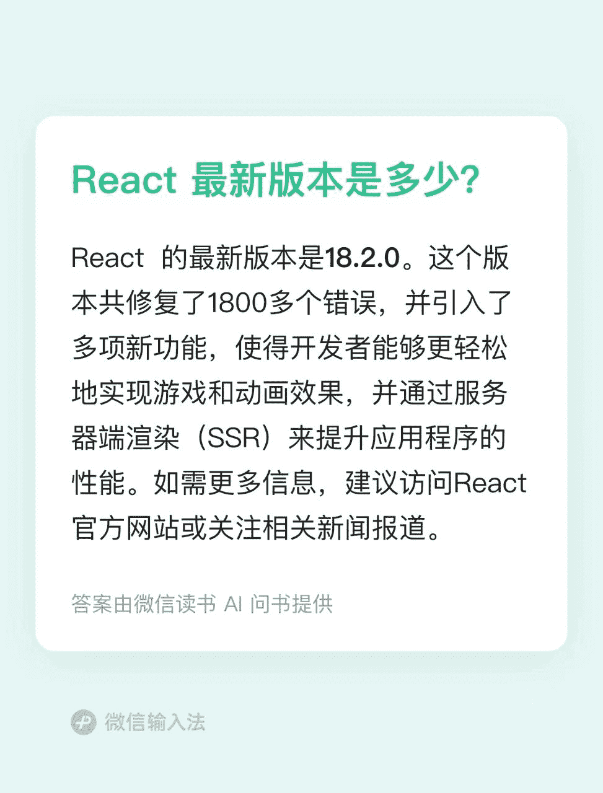
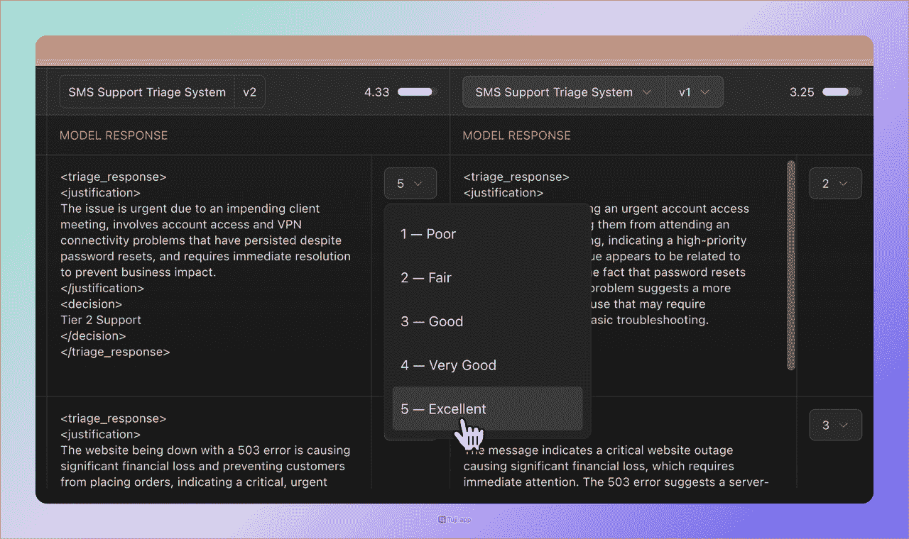
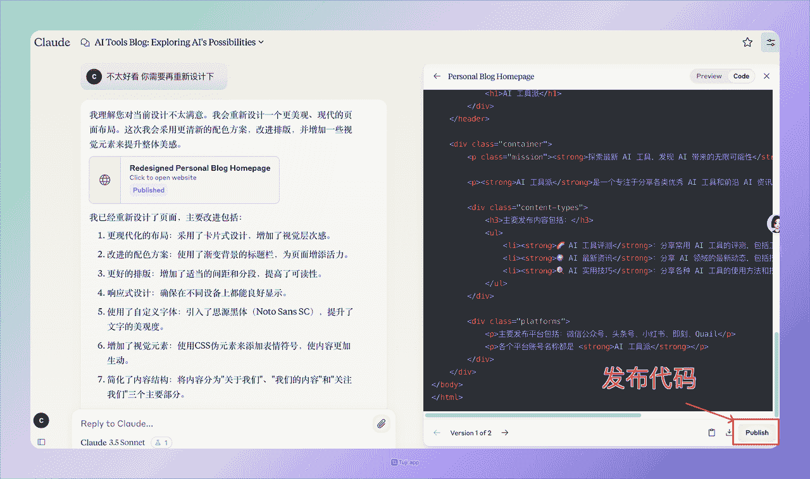
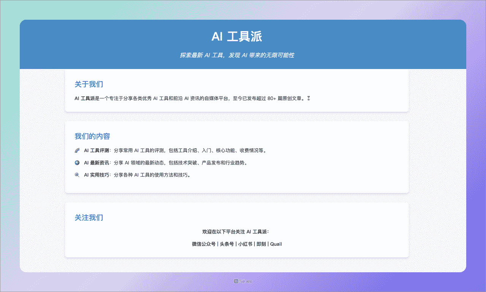
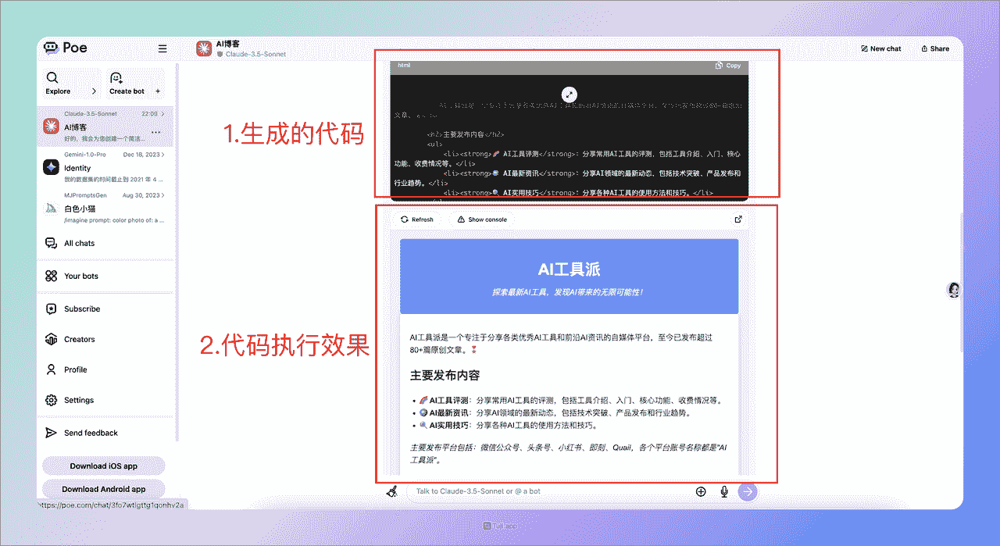
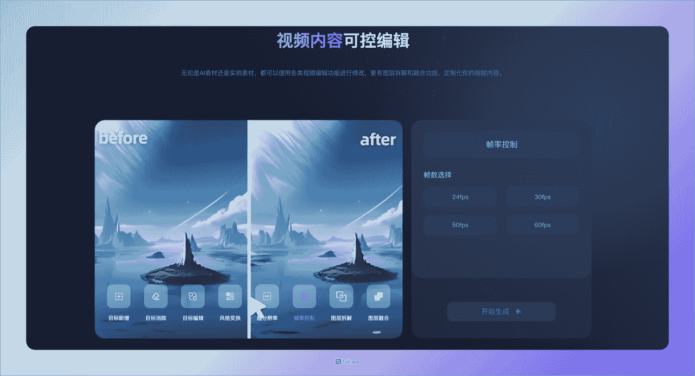
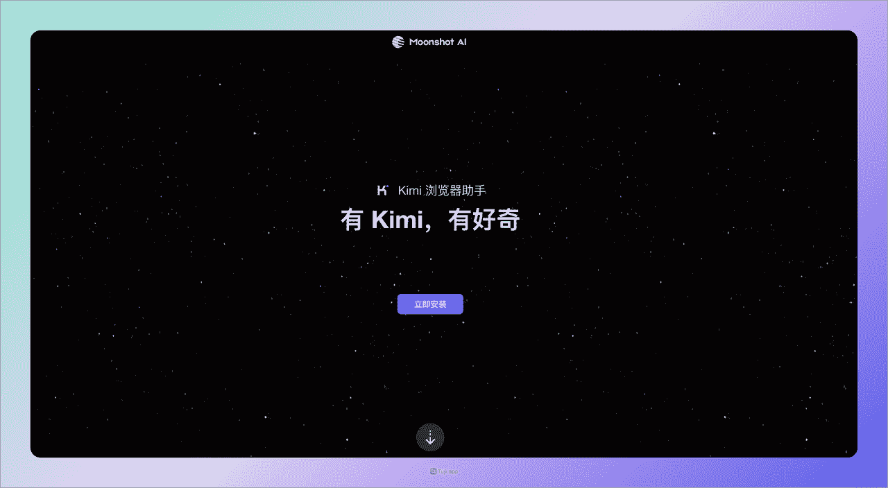
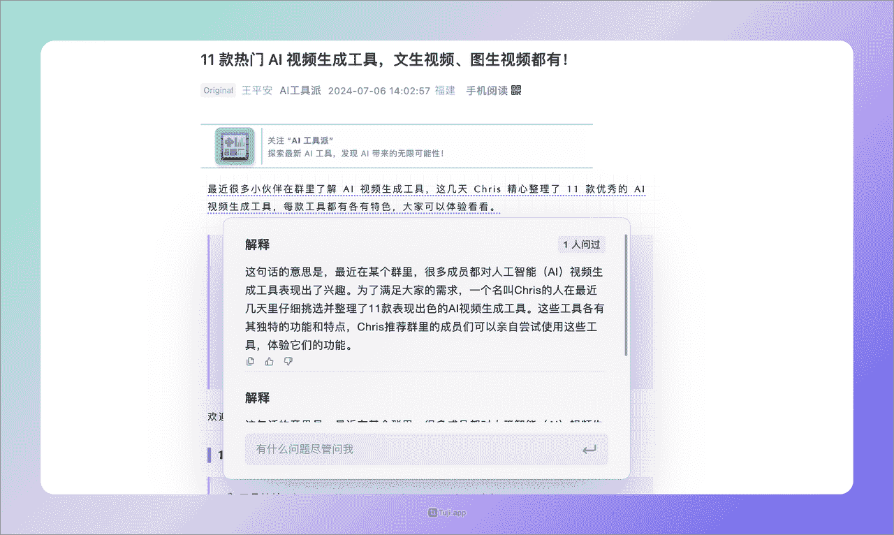
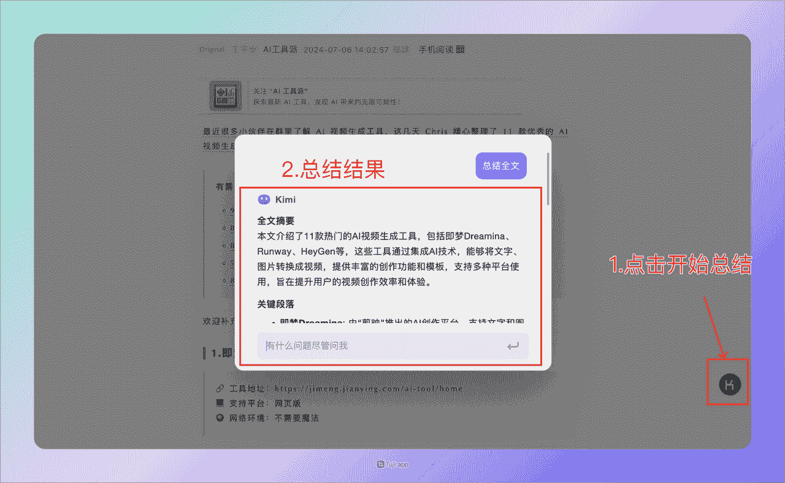

# 第1期：微信输入法 iOS 版上线「问 AI」功能，Claude 支持发布分享代码！

> 来源：[https://docs.feishu.cn/docx/CcIgdxmKsoYMNOxjZewcXqUxn8E](https://docs.feishu.cn/docx/CcIgdxmKsoYMNOxjZewcXqUxn8E)

> 「AI 小报」是「AI 工具派」的一个新专栏，Chris 将与大家分享一些实用 AI 工具资讯，向大家说一声“大家好”～

今天 Chris 分享的「AI 小报」主要内容如下：

+   🤖 微信输入法 iOS 版上线「问 AI」功能；

+   ✨ Claude 深夜发布新功能，支持发布分享代码；

+   🎉 Poe 推出 Previews 的新功能；

+   🎬 阿里 AI 视频平台「寻光」开启内测；

+   🧩 KimiChat 上线浏览器插件；

接下来和 Chris 一起了解下。

## 🤖 微信输入法 iOS 版上线「问 AI」功能

今天下午微信输入法 iOS 版正式上线“问 AI”功能，终于在手机上也可以使用微信输入法的 AI 功能了。还记得前段时间 PC 端微信输入法上线了 AI 功能，通过输入 = 号唤醒 AI 功能。

微信输入法 iOS 版最新版本的版本号为 1.3.1，大家可以自行更新到最新版，使用方式如下：

AI 生成的结果，支持“**保存到相册**”和“**发送**”，生成的图片效果如下，还是挺清新好看的：

「问 AI」的交互方式是当你输入内容的过程中，需要使用 AI 时，才点击按钮打开，在 Chris 实际使用过程中，这种交互非常自然，点赞。

## ✨ Claude 深夜发布新功能，支持发布分享代码

Claude 真的是太敬业了，又发布几个新功能，包括：

+   Claude 网页版支持支持发布和分享 Artifacts 生成的代码；

+   Claude 开发平台支持 Claude 自动生成测试用例；

+   Claude 开发平台增加新的输出模式，支持并排比较多个提示的输出结果；

其**中最让 Chr**is 喜欢的功能就是终于可以分享 Artifacts 生成的代码了，现在在 Artifacts 面板底部，点击“Publish”发布按钮即可：

Chris 让 Claude 制作了一个“AI工具派”的主页[，](https://claude.site/artifacts/e4b2169b-4595-4f3f-97e7-b0c4f28e0a04)效果如下，有兴趣的朋友也可以访问地址：https://claude.site/artifacts/e4b2169b-4595-4f3f-97e7-b0c4f28e0a04

## 🎉 Poe 推出 Previews 的新功能

Poe 推出了一项叫做“Previews”的新功能，让用户在聊天过程中直接查看并与生成的 Web 应用程序进行互动。可以理解为 Poe 版 Claude 的 Artifacts 功能，妙啊～

> 官网地址：https://poe.com/

使用方式也是和 Claude 的 Artifacts 一样，在生成的代码后面，可以直接预览代码的效果：

考虑到现在 Claude 账号非常难注册，如果大家也想体验 Claude 的 Artifacts 功能，可以直接使用 Poe，功能类似。

不过 Poe 还不支持 Previews 代码的发布和分享，相信 Poe 也会追上脚步～～

## 🎬 阿里 AI 视频平台「寻光」开启内测

**前两天由**阿里巴巴达摩院视觉技术实验室推出的 AI 视频生成平台“寻光”，也开启内测了，大家可以自行申请内测，真的是开启全民 AI 生成视频啦！

> 官方网址：https://xunguang.damo-vision.com/

从官网介绍可以看到“**寻光**”的核心功能包括：

+   **故事板生成**：一键生成分镜故事板，从剧本到分镜，让AI辅助你的导演创作之旅，无需再凭想象，画面油然而生，让好的故事立马生动起来。

+   **角色库管理**：定制故事角色，谁能成为你的主角，在你的故事里狂飙演技，现在交由AI为你专属定制，你的演员由你做主。

+   **视觉素材创作**：自由创作视觉素材，现在让AI按照你的想法，生成具备一致性的角色和场景画面，再利用运镜控制、运动编辑，创作你的个人大片。

+   **视频内容编辑**：无论是AI素材还是实拍素材，都可以使用各类视频编辑功能进行修改，更有图层拆解和融合功能，定制化你的视频内容。

官网也提供了这些功能的体验效果，大家有兴趣可以进入官网体验看看：

## 🧩 KimiChat 上线浏览器插件

在如今 AI 对话工具竞争如此激烈的情形下，各个厂商也纷纷下场推出自家的浏览器插件，比如豆包浏览器插件！Chris 非常喜欢用的豆包浏览器插件，还有独立开发者开发的 Elmo 等， KimiChat 也终于上线了自家的浏览器插件。

> 下载地址：[https://kimi.moonshot.c](https://kimi.moonshot.cn/extension/download)n/extension/download

目前 KimiChat 浏览器插件的主要功能包括：

+   **划词提问**：以**划词工具栏**形式，选取网页文字，Kimi 插件会在理解上下文的基础上，结合具体场景，进行详细解释；

+   **网页总结**：以**右侧悬浮按钮**形式，点击按钮，可以快速触发总结全文的功能，支持继续追问，讨论页面内容；

+   **网页对话**：以**浏览器侧边栏模式**和**悬浮按钮形式**，与当前网页进行对话，也可以帮助你进行文章创作；

+   **快捷键打开 Kimi**：支持通过快捷键唤醒 Kimi：Mac 使用 Command + K，Windows 使用 Alt + K。

今天的「AI 小报」内容就到这，我们下一期见！