# GPT最全应用手册

> 来源：[https://diwfpqo78m.feishu.cn/docx/G1yVdqaORoI4IHxoidlcHkNunde](https://diwfpqo78m.feishu.cn/docx/G1yVdqaORoI4IHxoidlcHkNunde)

> 本文档并未对所有人开放，看到此页面，说明您获得查看和分享的授权。Enjoy!目前共有1400人在使用。

> （部分链接打不开是因为你没有魔法。知识库每日更新。手机端目录在左上角）

> 日更AI新闻海报 [AI觉醒日报（一觉醒来发生了什么）](https://diwfpqo78m.feishu.cn/wiki/wikcnI3exPnHHzON4ikfEsucckb)

> 更多资源，添加站长🛰️：13913041

> AI觉醒社区  https://360ai.cc

# GPT启发

> 取代你的可能不是AI，而是比你更会使用AI的人，你可以通过与GPT进行对话聊天来使用它。

# 一、GPT使用和注册

在注册和使用GPT之前，我强烈推荐你花50分钟先看看这个视频《万字科普GPT4为何会颠覆现有工作流》

### 1.1 官网

> 国内暂不可用，需要🪜访问。

> https://ai.com

> https://chat.openai.com

### 1.2 国内镜像网站

> 因官网国内不能直接访问，可使用镜像网站试用（回复的内容质量可能不如官网）

> 镜像网站合集：免费的的GPT镜像网站列表，助力工作的你。

### 1.3 注册GPT和购买plus版

> 开通 GPT Plus：手把手教你如何开通GPT Plus 使用GPT-4

---

# 二、使用教程

### 2.1 使用技巧和方法

> **向****GPT****高效提问的通用公式**

> **「角色+背景信息+目标」**

> 1、给它一个角色身份，告诉它“它”是谁。

> 2、给它充分的上下文背景信息。

> 3、告诉它你要实现什么目标，以及为什么要实现这个目标。

> **更多技巧和方法**

> 1、有了这份GPT 有效对话技巧和使用指南，他会更懂你！

> 2、经验：调教 200 多个 GPT 模型后的经验分享

> 3、一招搞定GPT调教的心流法《身份篇》

> 4、GPT中国应用社区实践总结出来的独创问答预设输入方法-今日头条

> 5、[CHATGPT使用宝典](https://diwfpqo78m.feishu.cn/wiki/Gr8qwCMkJie03Dkfmn4cd8obnxb)

### 2.2 提示指南库

> 中文指南库

> 1、[提示指南-可复制 ](https://diwfpqo78m.feishu.cn/wiki/wikcnj9o5PX3sL5fxrvnUWXqOLg)

> 2、[G](https://newzone.top/chatgpt/)PT Shortcut - 简单易用的 GPT 快捷指令 | 标签筛选、关键词搜索和一键复制 Prompts

> 3、[GPT 指令大全](https://www.explainthis.io/zh-hans/chatgpt)

> 4、[ 角色扮演清单 ](https://fork-way.feishu.cn/sheets/shtcn1IbUR0wZeRydb3DOuBfJle)

> 5、[LangGPT —— 人人都可编写高质量 Prompt ](https://diwfpqo78m.feishu.cn/wiki/BZQPwsWr5ipVqhkfP3XcBWVZnkK)

> 6、[Mr. Ranedeer：最强大的ChatGPT Prompt，能帮助你学习任何东西的 AI 导师](https://esouqpttmy.feishu.cn/docx/ZRGIdEVy6ors1CxyZsdcpnmgnQe)

> 英文指南库

> 1、[GPT Prompts and P](https://promptvine.com/)roducts | PromptVine

> 2、GPT Cheat Sheet & Quick Reference

> 3、Awesome GPT Prompts

> 4、[SaaS Prompts - 500+ ](https://saasprompts.com/)GPT Prompts for SaaS

### 2.3 AI小应用资源库

> 通过提示词，可以把GPT调教成任意角色，创造各种人工智能产品。

> **中文应用库**

> OpenGPT：平台有数千个 GPT 小应用，在几秒钟内可以创建属于自己的应用

> AICodeHelper - AI工具箱

> 英文应用库

> [FlowGPT - The Ultimate Inte](https://flowgpt.com/)rface of GPT Prompts

## 2.4 GPT用途案例

### 2.4.1 辅助学习

> 1、[如何利用GPT学英语？](https://mp.weixin.qq.com/s/U-tGtYFohS2CCbe5Ulz21g)

> 2、[当GPT遇到复试，可能比我还强](https://mp.weixin.qq.com/s/DD0YkOaEtfWF8PSBj5GiTw)

> 3、[ChatGPT 投喂指南](https://k0z8o16zas8.feishu.cn/docx/SUTKd7wdDoAg2Exv7hoc8m0BnOK)

### 2.4.2 辅助创作

> **知乎答题**

> 1、利用GPT+RPA，实现知乎7x24小时不间断自动答题

> **制作视频**

> 1、使用 GPT[ + Midjour](https://www.bilibili.com/video/BV1wW4y1G7a3/?share_source=copy_web&vd_source=b68f853f829d65fae4ec428042e47343)ney + Clipchamp 制作视频：人类还剩几集可以逃？

> 2、使用 GPT[ + 知乎/钉钉/剪映](https://mp.weixin.qq.com/s/5jUUrZLKJCoN6rwdKE2pHw) 制作视频：如何利用GPT做推广？

### 2.4.3 辅助办公

> 1、运用两个AI工具，完成从数据到PPT制作

> 2、全球首个集成GPT的Office软件来了

> 3、GPT搭配闪击PPT三分钟生成PPT，你只需要输入一个标题

> 4、如何用GPT,3分钟做个ppt

> 5、零基础让 GPT生成VBA 帮你做PPT

> 6、[ChatGPT实战应用：一分钟制作流程图！](https://two8yjzwpm7.feishu.cn/docx/YrvkdwuOOovYzbxdlb1cdp7unYh)

### 2.4.4 辅助编程

> **开发****AI****产品**：0编程基础搭建属于自己的 AI 产品

> **python编程**：如何用 GPT 帮你写 Python 爬虫？实际样例循序渐进手把手教程

> **修代码bug**：GPT修bug横扫全场，准确率达78%！网友：程序员要开心了

> **模拟****Mysql****数据库**：如何把GPT变成MySQL数据库

> **Excel 公式和VBA**：再记公式弱爆了！用GPT处理Excel问题，效率狂升.

> **构建****神经网络**：我用GPT写神经网络：一字不改，结果竟然很好用

### 2.4.5 各职业应用

> 教师：[中小学教师 GPT的30种用法](https://mp.weixin.qq.com/s/PXA4zGs0nDfeSKw3JKBDig)

> 咨询顾问：[GPT将彻底改变咨询行业](https://mp.weixin.qq.com/s/45S25ztA673Nlf9H0lxAfg)

> 研究员：GPT还能写研报？有券商实测了：文辞优美，但有三大问题！

> 公关：公关会下岗吗？GPT回答了20个公关问题

> 运维工程师：作为一名运维工程师，我对 GPT 的一些看法

### 2.4.6 其他用途

> 1、前沿观察 | 20个GPT的有趣用法，带你打开思路

> 2、[GPT 最火的五个使用场景](https://mp.weixin.qq.com/s/lwjH8s0B2cDt2JC3T8OVIA)

### 2.5 提示工程课程学习

> [提示工程课程学习](https://learnprompting.org/zh-Hans/docs/basics/intro)：关于与人工智能通信的免费开源课程

> 每章的大概内容如下：

> **基础**：什么是提示工程和一些提示工程的简单技巧。

> **中级**：稍微复杂一些的提示工程技术。

> **使用提示**：由社区成员编写的一些完整提示工程案例。

> **进阶应用**：一些非常强大但更进阶的提示工程应用。

> **可靠性**：如何使语言模型（LLMs）更加可靠。

> **提示工程在图像方面的应用**: 用于文本到图像模型（如 DALLE 和 Stable Diffusion）的提示工程！

> **提示注入**：用于提示工程的黑客攻击。

> **提示工具**: 不同的提示工程的工具。

> **提示微调**：用梯度微调提示。

### 2.6 内置GPT产品（或类GPT产品）

### 2.6.1 新必应（Bing搜索）

> GPT版本的Bing搜索应用案例，解决了原来GPT的两个核心问题

> 1.GPT只有2021年以前的数据，Bing支持最新的数据

> 2.可以看到每一句话的来源，更容易验证数据准确性

> 新 Bing GPT 申请教程（国内可以直接访问）

> [GPT+微软新Bing实在过于机智](https://www.bilibili.com/video/BV1tx4y1V7nR/?share_source=copy_web&vd_source=b68f853f829d65fae4ec428042e47343)，没想到我会为此放弃chrome和谷歌

> GPT 版 Bing 支持读取本地文件或网页

### 2.6.2 文心一言（百度）

> 文心一言官网（个人申请）：https://yiyan.baidu.com/welcome

> 使用指引：文心一言测试指引 .pdf

> 企业邀请码申请链接：https://cloud.baidu.com/survey_summit/wenxin.html

> 企业邀请码填写地址：https://yiyan.baidu.com/invitationCode

### 2.6.3 商汤

> 商汤发布大模型「日日新」，包括商量、秒画、如影、琼宇、格物、明眸[，分别对应了 文本对话、AI 作](https://lm_experience.sensetime.com/)画、虚拟数字人、数字孪生、建模、数据标注服务。  申请API地址：https://lm_experience.sensetime.com/

### 2.6.4 飞书AI(字节跳动)

> AI时代，每位飞书用户都会拥有专属的智能助手。

> 来跟我们一起畅想下Ta能帮我们做点什么？

> 你可能会想让 Ta 来帮你撰写一篇汇报文档，分析一份经营数据，或总结一场错过的会议。

> 但“My AI”能做的远不止于此。快来看看视频！

> 未来，更强大的智能助手，也会让工作中的你更强大。

> [https://www.bilibili.com/video/BV1x24y1w7Hz/?spm_id](https://www.bilibili.com/video/BV1x24y1w7Hz/?spm_id_from=333.999.0.0&vd_source=3b7b8bcdda0ce708d093af20207201d2)_from=333.999.0.0&vd_source=3b7b8bcdda0ce708d093af20207201d2

# 三、技术教程

## 3.1 官方文档

> [OpenAI API文档](https://platform.openai.com/docs/guides/completion/introduction)

## 3.2 技术研究

> 1、GPT 背后的技术路线问题

> 2、API接口调用方法和案例

> 3、台大李宏毅老师关于GPT原理剖析的三部曲

> 4、OpenAI 闭门讨论会纪要_拾象0305.pdf

> 5、1_OpenAI 闭门讨论会V3纪要【GPT-4】_拾象_0319.pdf

> 6、[State of GPT：大神Andrej揭秘OpenAI大模型原理和训练过程](https://diwfpqo78m.feishu.cn/wiki/PVzqwbXXKivFTak1twOc9WjdnZg)

## 3.3 技术应用开发

> **聊天机器人****开发**

> 1、[🛰️聊天机器人](https://gitee.com/xingruispace/wechatgpt)（有封号风险）

> 2、[飞书聊天机器人](https://github.com/bestony/ChatGPT-Feishu)

> 3、[Siri聊天机器人](https://github.com/Daiyimo/Access-chatGPT-in-Siri)

> 4、[钉钉聊天机器人](https://github.com/eryajf/chatgpt-dingtalk)

> 5、[🛰️小程序聊天机器人](https://github.com/xenice/chat)（小程序名字不能带GPT）

> 6、[🐧 聊天机器人](https://github.com/lss233/chatgpt-mirai-qq-bot)

> 7、[Twitter机器人](https://github.com/transitive-bullshit/chatgpt-twitter-bot)

> 8、[用语音和GPT对话](https://github.com/platelminto/chatgpt-conversation)

> **网站开发**

> 利用vercel一键部署自己的GPT网站

> 更多技术应用：[GPT技术应用 ](https://mv8fvfauu22.feishu.cn/docx/Fau6dxk6fotvypxDa5dc73sEnYf)

## 3.4 插件

> 1、Google显示GPT结果的Chrome插件

> 2、[GPT VSCode插件](https://github.com/mpociot/chatgpt-vscode)

> 3、可联网GPT Chrome插件（把搜索结果当输入)

> 4、GPT生成页面内容摘要的浏览器插件

> 5、把GPT集成到每一个文本框中的浏览器插件

> 6、供Google Docs和Word用的GPT插件

> 7、更多插件合集：⁡⁡⁢⁢⁢⁡⁡⁣⁤⁢⁤⁢⁡⁣⁤⁣⁣⁡⁢GPT相关插件

>

---

# 四、变现案例

> 提示：所有案例都是从网上收集而来，标记的价格是截图时的价格。

> 案例仅供大家了解GPT最直接的变现案例和方法，不是打广告！

## 4.1 卖账号（GPT账号或者Plus）

##### 1、GPT账号销售平台1（12元/号）

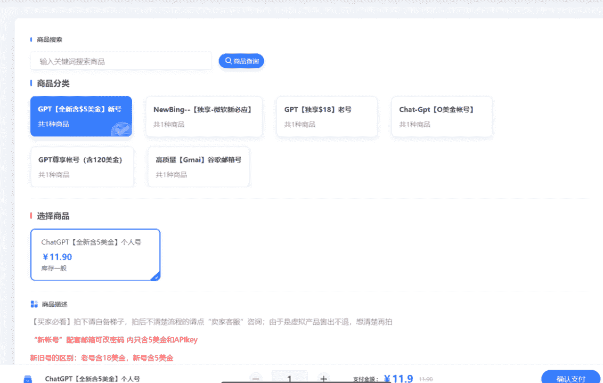

#####  2、GPT账号销售平台2（15元/号）

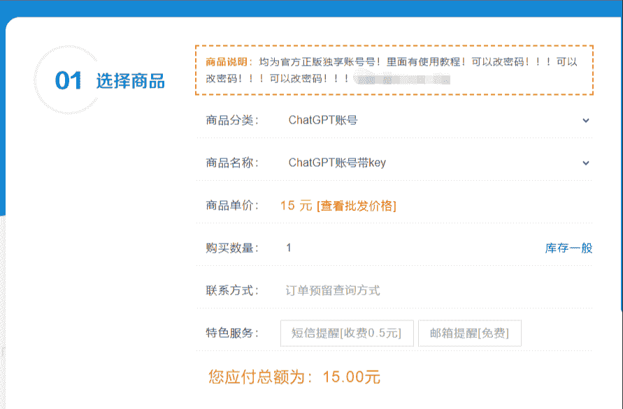

## 4.2 卖验证码（注册账号接码平台）

##### [sms-activate](https://sms-activate.org/?ref=3840966)（最低充值2美元）

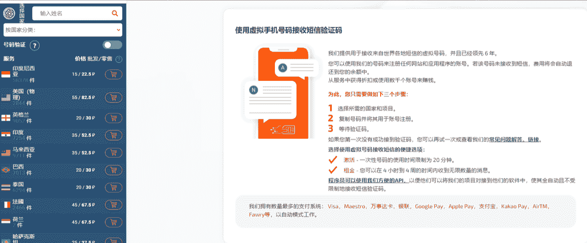

## 4.3 卖AI应用使用次数

##### 1、GPT小应用合集网站（3美元/50次）

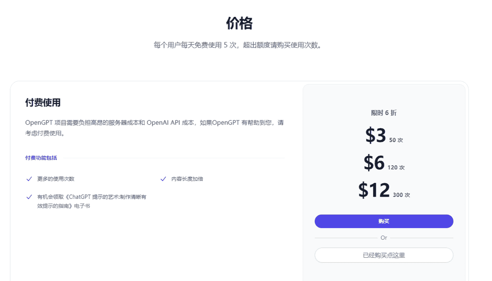

##### 2、GPT镜像网站（1元/9999次）

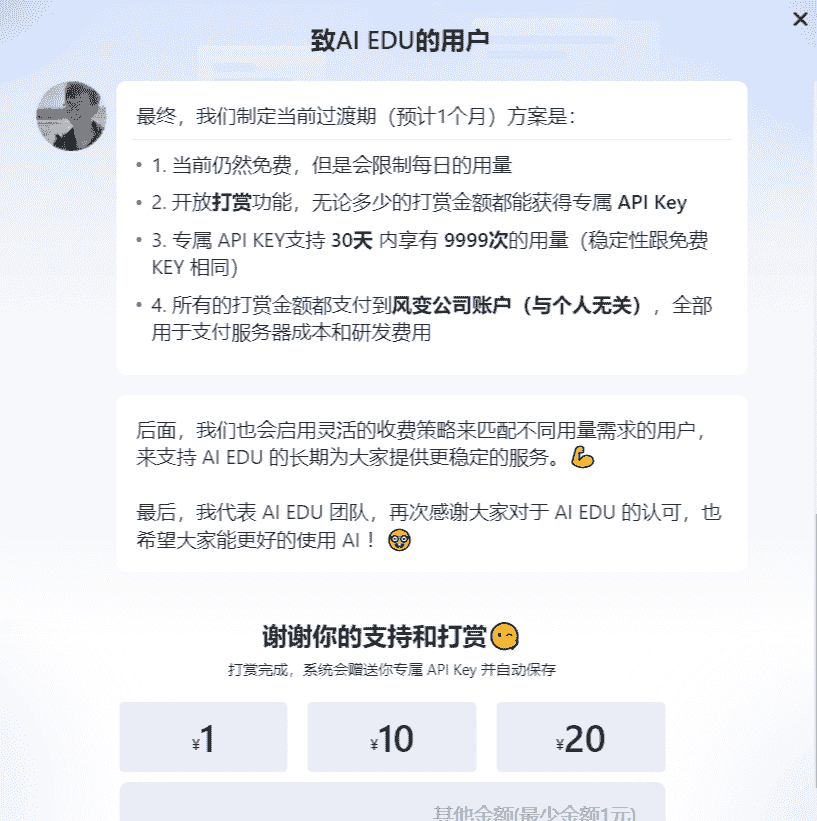

##### 3、👸号GPT聊天机器人（9.9元/30次）

## 4.4 卖提示词

##### **付费提示词（2-10美元）**

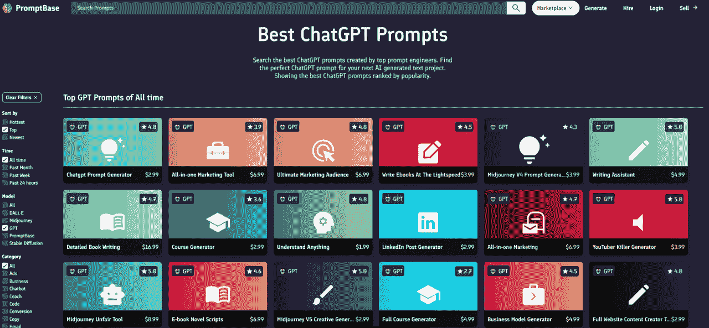

## 4.5 卖资料

##### **1、****GPT****零成本赚点小钱（69.9元）**

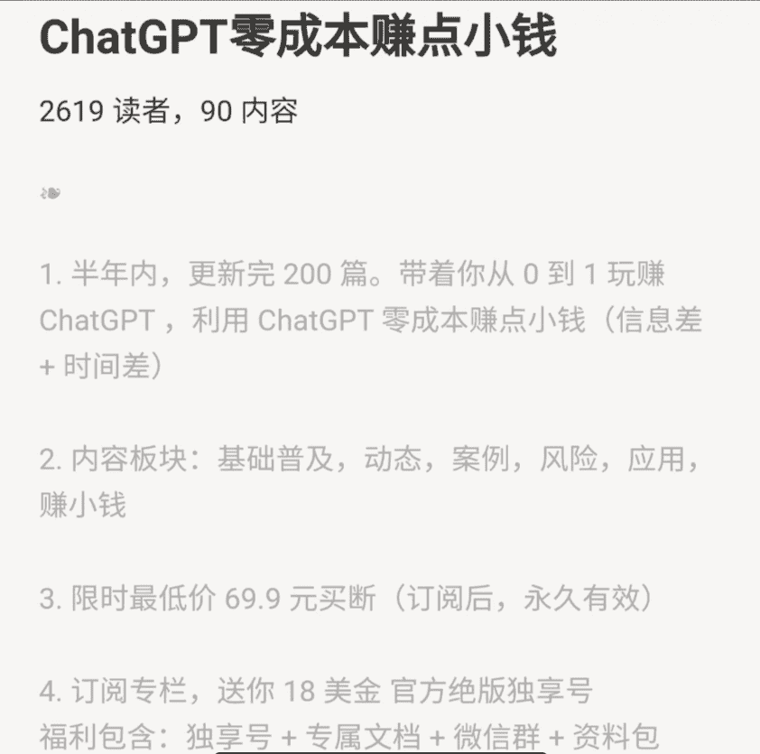

##### **2、****AI****项目商业解析（66元）**

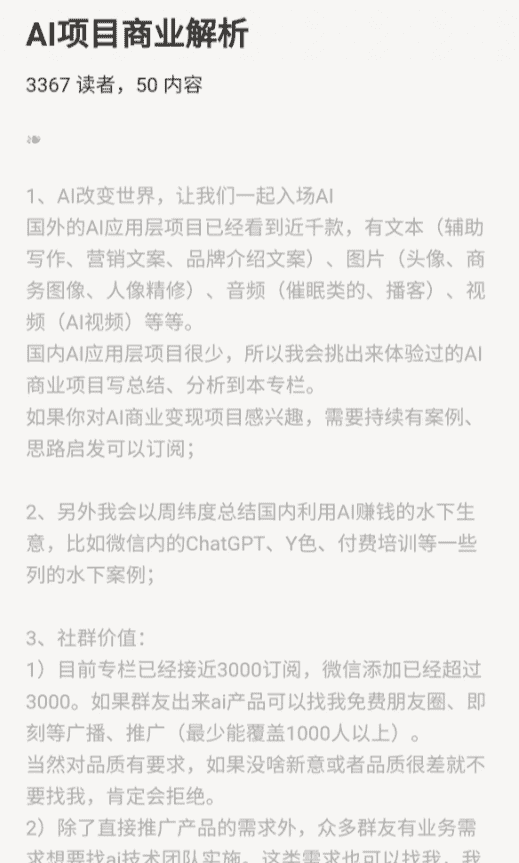

## 4.6 卖课程

##### 玩赚GPT（399元）

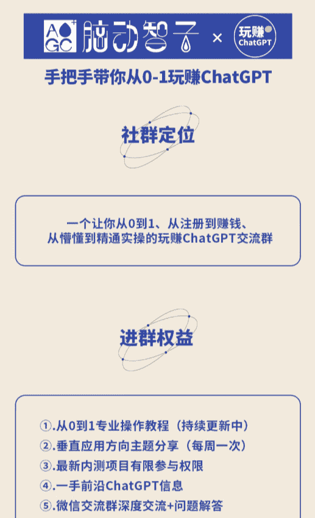

## 4.7 卖认证

##### 《GPT与AIGC人工智能生成内容关键技术发展与治理》线上高级研修班（3880元）

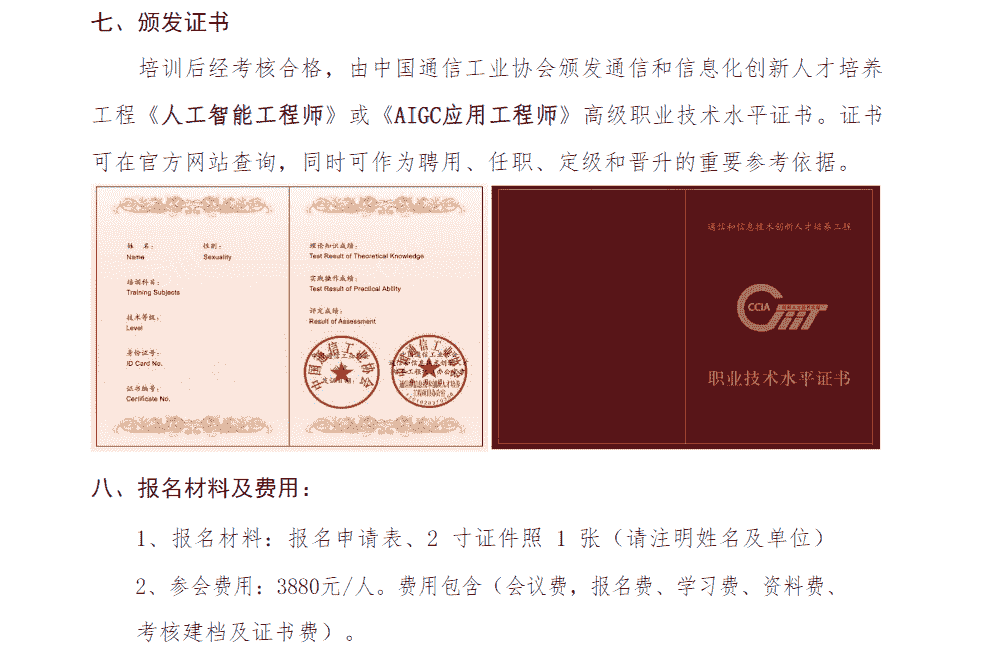

## 4.8 付费社区（社群）

#####  1、AIGC知识星球

> 星球重点分享GPT的技术应用教程，帮助编程小白零基础也能实践开发各类GPT应用，

> 比如聊天机器人。

> 除了技术应用教程，本星球也将长期分享各类AI的使用技巧，变现思路，研究报告，资源合集。

> 欢迎大家一起交流经验和心得！

> 新加入星球的你可以获得：

> 1.配套最干货的AIGC🛰️交流群；

> 2.附赠国内最全的AIGC知识库（含付费资料），加入飞书群自动获得权限；

> 3.100+无水印AIGC研究报告免费下载，知识星球内可直接下载，加入飞书群后可在飞书直接下载；

> 4.不定时分享星主在AIGC的商业变现思路和技术实践经历；

> 5.本星球持续更新GPT等AIGC优质内容。

##### 2、AI破局俱乐部（目前最大最专业的人工智能圈子）

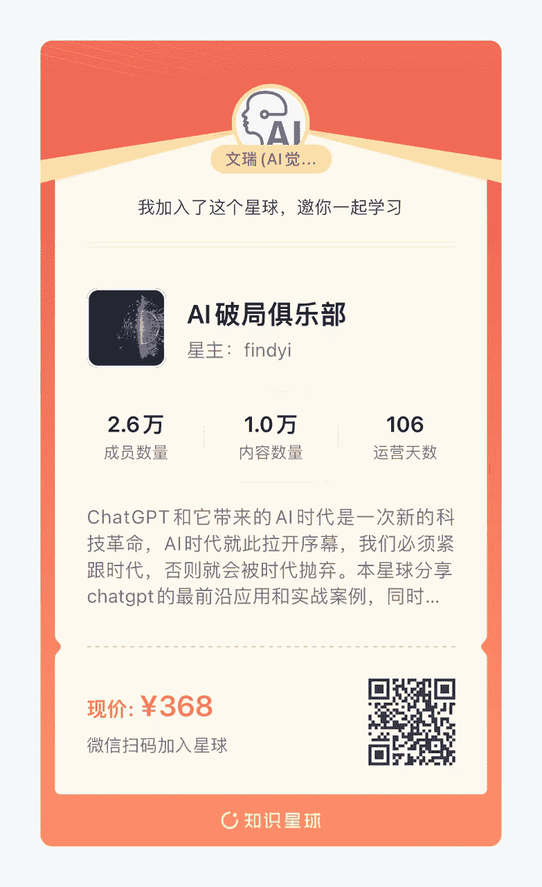

## 4.9 其他

> **1、内容创作**

> [如何用GPT赚钱](https://mp.weixin.qq.com/s/0330uatpzmNbgdC2EJYlDQ)

> [GPT写SEO文章SOP全流程](https://mp.weixin.qq.com/s/XMKZG0jb45exITTzHgoqRA)

> [GPT+今日头条变现方法](http://istester.com/toutiao)

> **2、镜像产品**

> 注册200个账号，卖5万一套的系统，那些靠GPT赚钱的人

> **3、营销文案系统**

> 仅2年时间，Copy.ai的ARR达1000万美金用户突破200万

> **4、成立AIGC公司**

> GPT大火，如何成立一家AIGC公司，然后搞钱？

> **5、汇总**

> [GPT赚钱变现的15种方法](https://mp.weixin.qq.com/s/KTR-btums72l7rte6Ix4Rw)

> [AIGC开源商业项目库](https://docs.qq.com/sheet/DRE5jalZKeVZzQlFj?tab=BB08J2)

# 五、资源信息

## 5.1 导航资源

> 1、AIGC工具导航 | 发现全球优质AIGC工具，与创作者一同成长

> 2、AINAV.cn—AI导航网 - 人工智能领域的导航网站

> 3、[一起用AI | AI工具导航 | ](https://17yongai.com/)AI教程 | AI集合 | OpenAI

> 4、[600+ GPT](https://gpt3demo.com/)

> 5、[All Things AI - The Complete Resource Of ](https://allthingsai.com/)Artificial Intelligence Tools & Services

> 6、[Futurepedia - The Largest AI To](https://www.futurepedia.io/)ols Directory | Home

> 7、https://github.com/humanloop/awesome-GPT

> 8、[Notion – The all-in-one workspace for ](https://enchanting-trader-463.notion.site/Full-ChatGPT-Prompts-Resources-8aa78bb226b7467ab59b70d2b27042e9)your notes, tasks, wikis, and databases.

> 9、[No.1 - 关于 AI 的 1](https://mp.weixin.qq.com/s/Gjts6U3KgjVsW3fXYjHtcQ)07 个人，61 个工具和 28 个通讯

> 10、[B站GPT来啦导航视频](https://www.bilibili.com/list/group/120002?share_source=weixin_web&vd_source=b68f853f829d65fae4ec428042e47343)

> 11、[AI 项目库｜ Top50 ](https://pfbf3dkb9h.feishu.cn/wiki/wikcnYqcPcqBgfsCSZEsM3E8ZDe?table=tblgw8jEMB99k1KQ&view=vew2JA1hI3)

> 12、[学习提示资源数据库](https://clover-talos-e04.notion.site/74f8417345cc447cb0535112b949fd8f?v=c171abee37204091852bb1a113030f6c)

> 13、136个ChatGPT plugins 插件

## 5.2 行业研究

> [2023年度AIGC行业报告700+](https://diwfpqo78m.feishu.cn/wiki/wikcn3nDOfvKBh2KgkzzeVA6HKb)

> [ChatGPT预测的未来：2030年的机会、挑战、应对](https://diwfpqo78m.feishu.cn/wiki/KIipwbs79iX3GRkoG7Dc6iLrnfg)

## 5.2.1 券商报告

> [2023年度AIGC行业报告700+](https://diwfpqo78m.feishu.cn/wiki/wikcn3nDOfvKBh2KgkzzeVA6HKb)

## 5.2.2 36氪

> 1、[GPT中国变形记｜深氪](https://36kr.com/p/2137546486548612?channel=wechat)

## 5.2.3 机器翻译观察👸号

> 1、ChatGTP全景图 | 背景+技术篇

> 2、[GPT全景图 | 产品+商业篇](https://mp.weixin.qq.com/s/sXCiqgCocrZdaZ_sBsy-YQ)

> 3、GPT全景图之三 | 全球竞争格局篇（上）

## 5.2.4 马丁的面包屑👸号

> 1、万字长文：AI产品经理视角的GPT全解析

> 2、深度思考：AIGC这波技术狂潮能否商业化落地？（内含思维导图）

> 3、[轻松小补充：GTP APP全景地](https://mp.weixin.qq.com/s?__biz=MzUxNTg3NjA5Mg==&mid=2247483787&idx=1&sn=af11c208463e93ac93b6a72beddc60fb&chksm=f9aeb418ced93d0e91ad99c8b2a97f8a45cfdb0febd0c58d6c761a36c7b4bde9f81bdff5dbe2&scene=21#wechat_redirect)图+虚拟人构造想法+prompt模式详解

> 4、万字长文：产品经理视角下的AI绘画全解析

>

## 5.2.5 文章分享报告

> [2023年度AIGC行业报告700+](https://diwfpqo78m.feishu.cn/wiki/wikcn3nDOfvKBh2KgkzzeVA6HKb)

## 5.3 新闻事件

> [AI觉醒日报（一觉醒来发生了什么）](https://diwfpqo78m.feishu.cn/wiki/wikcnI3exPnHHzON4ikfEsucckb)

## 5.4 社会话题

> 1、[GPT 爆火带动全新职业提示工程师](https://www.zhihu.com/question/585294957)，提示工程有多重要？未来该职业走向如何？

> 2、[周鸿祎称 GPT 可能两三年内就会产生自我意](https://www.zhihu.com/question/585757225?utm_campaign=Sharon&utm_medium=social&utm_oi=792817096856842240&utm_psn=1612465296727666688&utm_source=wechat_session&utm_content=group3_supplementQuestions)识威胁人类， GPT 存在哪些安全问题？

>

#### AIGC B站合集 入门必刷/技术科普/实用教程/花式整活