# 2023年最全AI绘画应用教程

> 来源：[https://diwfpqo78m.feishu.cn/docx/AmL5d0cMoouV3TxZ5xycC2kCnbb](https://diwfpqo78m.feishu.cn/docx/AmL5d0cMoouV3TxZ5xycC2kCnbb)

这是一个**召唤****AI****画师**的时代！

2022年夏天，无绘画基础的游戏设计师杰森·艾伦（[Jason Alle](https://midjourney.com/)n）通过AI绘图工具Midjourney生成了AI画作《太空歌剧院》，并获得美国科罗拉多州新兴数字艺术家竞赛一等奖。同时，《太空歌剧院》及其背后一众类似的AI画作引发画家群体集体抗议维权。

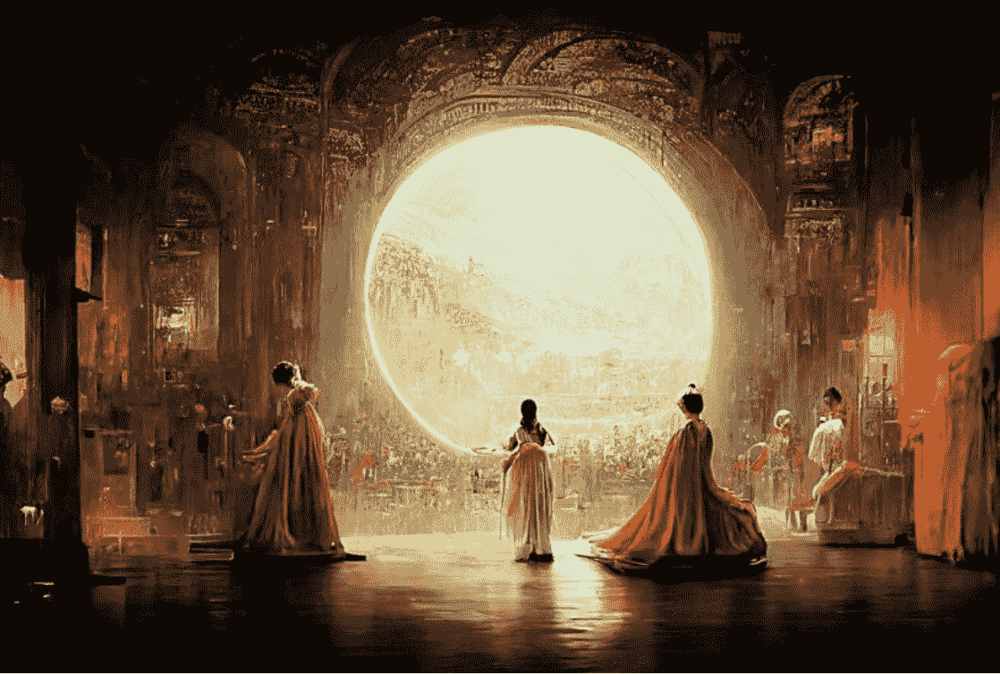

2022年Midjourney点燃，开始火爆：小红书“AI插画”词条已有五万+篇内容；B站等视频网站出现AI绘画教程

2月Disco Diffusion面世，4月MidJourney上线、DALL-E 2内测，再后来陆续出现了Imagen、Parti、Stable Diffusion、NovelAI等AI绘画平台。

9月底，微博CEO“来去之间”发起“呼叫AI帮我画”话题，并@名为“6pen”的AI绘画产品。昨天，“AI绘画是否会取代真人”话题再次引发热议，截至目前，共有692.9万次阅读。

# 大纲目录

一、**模型介绍**：[GAN模型](https://diwfpqo78m.feishu.cn/wiki/wikcnrgtLCnRGdF0D12qpJazxIf#Q2yYdWKSmoscMix85Twcp41znEf)、Sta[ble Diffusi](https://diwfpqo78m.feishu.cn/wiki/wikcnrgtLCnRGdF0D12qpJazxIf#part-B0vYdY6BYoAKPjxeks9cBs54n5e)o[n模型及变种C](https://diwfpqo78m.feishu.cn/wiki/wikcnrgtLCnRGdF0D12qpJazxIf#part-OfHFdKP8IoyUxQxg3Xzc2wecnwg)h[illoutmix、](https://diwfpqo78m.feishu.cn/wiki/wikcnrgtLCnRGdF0D12qpJazxIf#part-Ze3TdLfOYon6uzxenqPcWPvjnXg)NovelAI、ControlNet，Disco Diffusion模型

二、**工具介绍**：[SD-WebUI](https://diwfpqo78m.feishu.cn/wiki/wikcnrgtLCnRGdF0D12qpJazxIf#part-C1E5dhT40oPzkixQGr2cCiGbn0p)的安装和[参数配置](https://diwfpqo78m.feishu.cn/wiki/wikcnrgtLCnRGdF0D12qpJazxIf#part-I7KsdnfOmolJDOxsBntc5juTnIb)，以及[Docker](https://diwfpqo78m.feishu.cn/wiki/wikcnrgtLCnRGdF0D12qpJazxIf#part-NZ00d5WxOofAMSxRdeCc9lJrnpb)、[Win](https://diwfpqo78m.feishu.cn/wiki/wikcnrgtLCnRGdF0D12qpJazxIf#part-KZL7d5CXooMcsTxydqBcZUYwnYe)、[Mac](https://diwfpqo78m.feishu.cn/wiki/wikcnrgtLCnRGdF0D12qpJazxIf#part-NfKsdGasroNHsvxZAMFcqpxYnQh)、[iOS版](https://diwfpqo78m.feishu.cn/wiki/wikcnrgtLCnRGdF0D12qpJazxIf#part-KxMEd6xTXocIjuxoqtMcEUZAnOh)，[Naifu官网版](https://diwfpqo78m.feishu.cn/wiki/wikcnrgtLCnRGdF0D12qpJazxIf#part-YNzDdexBSoD3H7xbT9lcA45Qnvh)

三、**应用介绍**：推荐的[主流在线服务](https://diwfpqo78m.feishu.cn/wiki/wikcnrgtLCnRGdF0D12qpJazxIf#part-TA9tdI57XoPEBpxhKcPcBjqNnCE)，[国外项目清单](https://diwfpqo78m.feishu.cn/wiki/wikcnrgtLCnRGdF0D12qpJazxIf#part-CF5MdVa2SoJPWxxrgFGcGNAznzc)、[国内项目清单](https://diwfpqo78m.feishu.cn/wiki/wikcnrgtLCnRGdF0D12qpJazxIf#part-IZY9dlahYo1qnqxdlZVcG9thnre)

四、**应用场景**：[提示词Prompt工具](https://diwfpqo78m.feishu.cn/wiki/wikcnrgtLCnRGdF0D12qpJazxIf#part-QSrmd0de6o8lMBxkh2YcTHognPh)，包括分类、标签、组合生成、反向抽取

五、**计算平台**：常见的[模型计算平台](https://diwfpqo78m.feishu.cn/wiki/wikcnrgtLCnRGdF0D12qpJazxIf#part-NnlsdAG5VoGXFXx8jetc7cknnDf)，如[Google Colab](https://diwfpqo78m.feishu.cn/wiki/wikcnrgtLCnRGdF0D12qpJazxIf#part-OFxcdtoDio9F2xx2LEgcmP81nwc)、[Kaggle](https://diwfpqo78m.feishu.cn/wiki/wikcnrgtLCnRGdF0D12qpJazxIf#part-PCLpdeQjzolRzax9aXWci2ZZnGb)、[百度飞浆](https://diwfpqo78m.feishu.cn/wiki/wikcnrgtLCnRGdF0D12qpJazxIf#part-Z1eWd1MQGo0NyQx9CZ2cwjQdnbT)、[HuggingFace](https://diwfpqo78m.feishu.cn/wiki/wikcnrgtLCnRGdF0D12qpJazxIf#part-SvDldQFFNop4NpxrwZscuCkOngf)，以及[常用术语和FAQ](https://diwfpqo78m.feishu.cn/wiki/wikcnrgtLCnRGdF0D12qpJazxIf#part-HQQCdETUeokchNx0Aq6ctGaNnKh)

六、**项目变现**：AI绘画[变现模式梳理](https://diwfpqo78m.feishu.cn/wiki/wikcnrgtLCnRGdF0D12qpJazxIf#part-OJztdvytGoSCVIxcn0Rc6UZjnyd)

七、**领域情报**：垂直圈子的[深入实践导航](https://diwfpqo78m.feishu.cn/wiki/wikcnrgtLCnRGdF0D12qpJazxIf#part-W7iSdQKFQoJs5NxQtgmcP63fnSe)、[AI绘画领域情报](https://diwfpqo78m.feishu.cn/wiki/wikcnrgtLCnRGdF0D12qpJazxIf#part-DuDldHKrFoQTlexyXiIcokyzngd)

获取更多情报

1. [**更多情报->入口**](https://diwfpqo78m.feishu.cn/wiki/wikcnrgtLCnRGdF0D12qpJazxIf#part-BDxndjHd0o0y8fx0WZDccatPnCd)

2.[AIGC 智绘学习笔记](https://gr5d0dzlsv.feishu.cn/wiki/T06ewonXViNaLaknydLctC3knNs)

# GAN 模型

生成对抗网络（Generative Adversarial Nets，GAN）是一种基于对抗学习的深度生成模型，最早由Ian Goodfellow于2014年在《Generative Adversarial Nets》中提出，一经提出便成为了学术界研究的热点，也将生成模型的热度推向了另一个新的高峰。

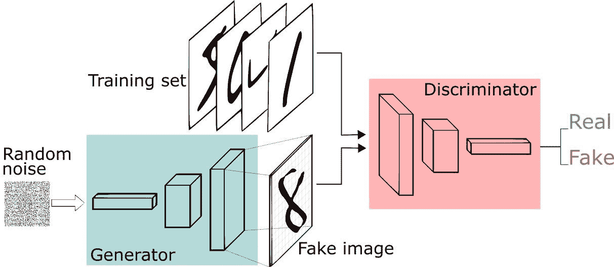

参考

1.[GAN模型总结](https://zhuanlan.zhihu.com/p/421332968)

2.GAN 的设计初衷、基本原理、10种典型算法和13种实际应用

# Big Sleep

基于Python，通过生成对抗网络（GAN）绘图。

https://github.com/lucidrains/big-sleep

# Stable Diffusion 模型

Stable diffusion是一个基于Latent Diffusion Models（潜在扩散模型，LDMs）的文图生成（text-to-image）模型。相比GAN有更好图片生成效果，但因为是自回归模型，需要反复迭代计算，因此训练和推理代价都很高。论文提出一种在潜在表示空间（latent space）上进行diffusion过程的方法，能在获得不错的效果同时，大大减少计算复杂度。

在Stability AI的计算资源和 [LAION](https://laion.ai/) 数据资源支持下，在LAION-5B的一个子集上训练了一个Latent Diffusion Models，该模型专门用于文图生成。

+   论文：High-Resolution Image Synthesis with Latent Diffusion Models

+   A latent text-to-image diffusion model：https://github.com/CompVis/stable-diffusion

主要任务场景

1.  无条件图片生成（unconditional-image ）

1.  类别条件图片生成（unconditional-image ）

1.  文图生成（text-to-image）

1.  布局图片生成（layout-to-image）

1.  超分辨率（super-resolution）

1.  图片修复（inpainting, object removal）

1.  风景图语义合成（semantic-to-image，semantic synthesis of landscape images）

# 模型版本

模型都是基于一套算法和某个数据集训练出来，在某个特定状态可以生成checkpoint（.ckpt文件），包含了不同的模型参数权重，对应不同的图片生成效果。

+   Stable Diffusion v1.2

+   Stable Diffusion v1.3

+   Stable Diffusion v1.4

+   Waifu Diffusion，SD 1.4的微调版：https://huggingface.co/hakurei/waifu-diffusion-v1-3

+   Stable Diffusion v1.5

+   Stable Diffusion v2.0

# Chilloutmix 模型

突破性的模型，基于Stable Diffusion生成真人一样的 AI 照片。

模型地址：https://civitai.com/models/6424/chilloutmix

其他真人类模型：

1.  Realistic Vision V1.3：https://civitai.com/models/4201/realistic-vision-v13

1.  Korean Doll Likeness：https://civitai.com/models/7448/korean-doll-likeness

# NovelAI 模型

也是基于SD模型，但用了二次元网站 danbooru 数据训练。

简称 NAI， 用于 AI 辅助创作、讲故事、虚拟陪伴。侧重于二次元风格。

官网：https://novelai.net/

模型下载：https://huggingface.co/acheong08/secretAI/resolve/main/stableckpt/animefull-final-pruned/model.ckpt

# NovelAI模型清单

+   藏单阁：https://docs.qq.com/doc/DY0lFeWZuVXRCdUJU

+   对应私有库：http://www.123114514.xyz/models/ckpt

# NovelAI模型泄漏事件

NAI 使用数千万 Danbooru（图站）图片训练的模型被泄漏了两次。 目前社区广泛使用 Stable Diffusion WebUi 生成框架 （简称 SDWebUi）装载 NAI 的模型。

+   泄露 Part 1 —— 包含生产模型，程序 —— 53.66 GB，其中需要下载的相关模型有 7GB 和 4GB 两种。

+   泄露 Part 2 —— 包含历史测试代码和模型，程序 —— 124.54 GB，其中需要下载的相关模型与 Part1 相同。

NovelAILeaks 4chan、NovelAILeaks animefull-latest

# LoRA 模型

简单理解为滤镜，在基础模型之上的一个补丁模型，用来训练特定风格、特定人物、特定动作等效果。

教程

1.[LoRA人物模型训练](https://www.bilibili.com/video/BV1fs4y1x7p2/)

**真人模型：**

1.Arknights-Texas the Omertosa：https://civitai.com/models/6779/arknights-texas-the-omertosa

2.Korean Doll Likeness：https://civitai.com/models/7448/korean-doll-likeness

**教程**

1.[**AI纸片老婆生成指南**](https://www.notion.so/d8318ae0d5964670a87572f16ae7b7d0)

2.Kaggle：Lora模型使用教程

# ControlNet

2023年2月10日论文，详细介绍了一种控制预训练的大型扩散模型以支持额外的输入条件的方法，同日作者在GitHub公开源代码。2023年2月13日，支持该方法的WebUI插件上线 。

腾讯AI的类似方案和模型：[T2I-Adapter](https://github.com/TencentARC/T2I-Adapter)

作者几年前曾开发过AI上色算法style2paints。

项目Github地址：https://github.com/lllyasviel/ControlNet

SD-WebUI 插件：https://github.com/Mikubill/sd-webui-controlnet

预训练的ControlNet模型：https://huggingface.co/webui/ControlNet-modules-safetensors

下载后放到WebUI目录下extensions\sd-webui-controlnet\models 中。

教程

1.  复制图像上的人物姿势：controlnet插件安装与读取骨骼极简教程

1.  人物动作控制/景深/线稿上色 Controlnet安装使用教程

1.  [Ultra fast Contro](https://huggingface.co/blog/controlnet)lNet with  Diffusers

效果图

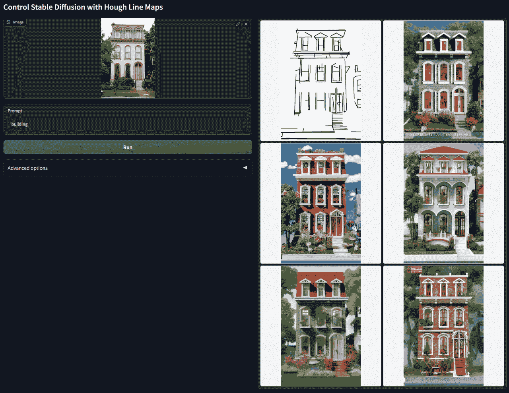

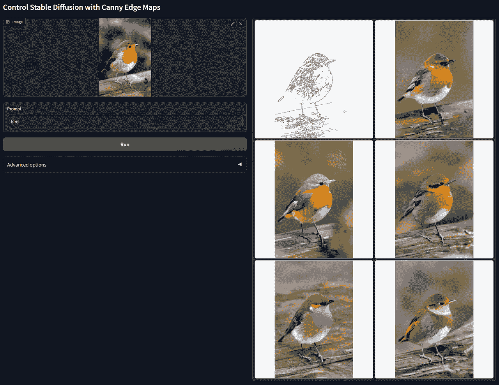

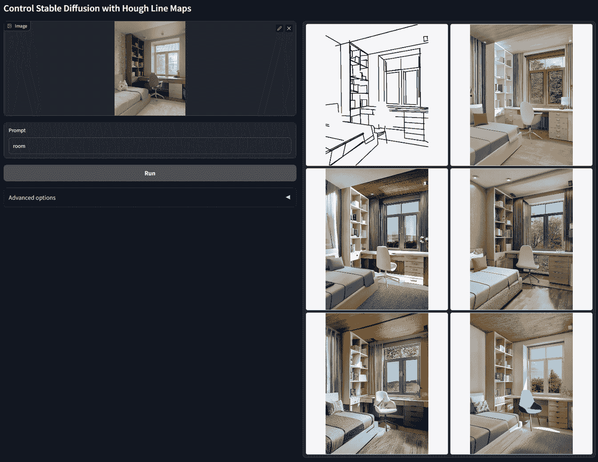

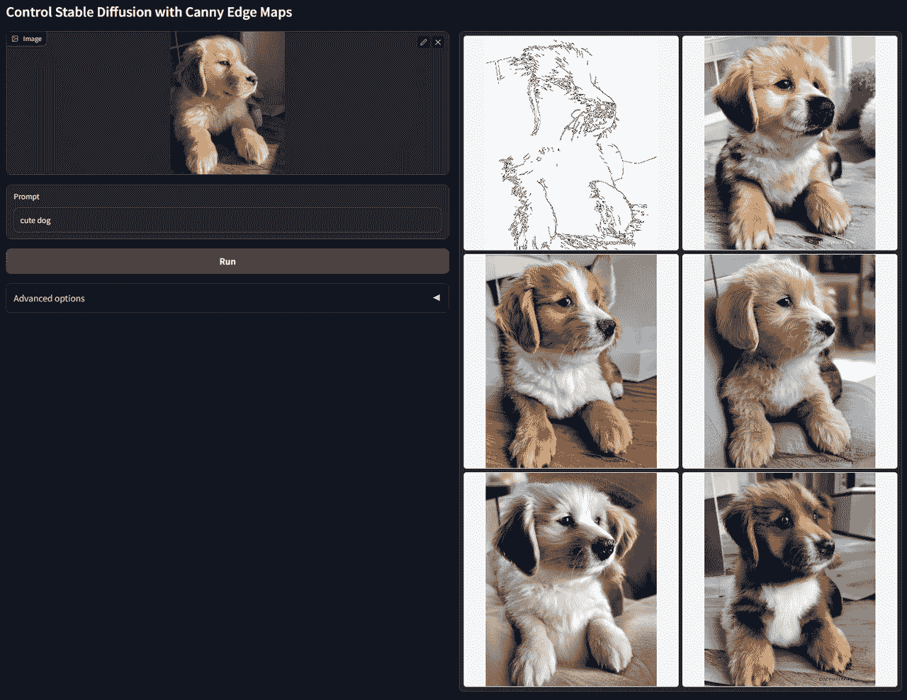

更多ControlNet模型效果图参考：https://flowus.cn/wechats/share/2e8e0995-d29d-4300-8a7c-4457028aa37d

# HuggingFace模型收藏

1.  碎片感的模型：https://huggingface.co/Stkzzzz222/fragments_V2

1.  新的训练方式 custom-diffusion，类似 dreambooth：https://github.com/adobe-research/custom-diffusion

1.  支持9种语言的多语言图像到文本模型：https://huggingface.co/spaces/BAAI/dreambooth-altdiffusion

1.  腾讯领衔 TextTo3D：https://bluestyle97.github.io/dream3d/

1.  一张图进行训练，使用 SinDDM，可以从单个自然图像训练生成模型，然后从给定的图像生成随机样本：https://github.com/fallenshock/SinDDM

1.  Maximum Diffusion，同时运行12个模型，进行对比：https://huggingface.co/spaces/Omnibus/maximum_diffusion

1.  新的高质量模型：https://huggingface.co/22h/vintedois-diffusion-v0-1

1.  绝对纯净的二次元生成模型：https://huggingface.co/aipicasso/cool-japan-diffusion-2-1-0-beta

# 更多模型清单

1.  https://rentry.org/sdmodels

1.  https://cyberes.github.io/stable-diffusion-models/

1.  https://cyberes.github.io/stable-diffusion-textual-inversion-models/

1.  https://civitai.com/

1.  https://huggingface.co/

1.  Sd-Outpainting：https://github.com/lkwq007/stablediffusion-infinity

# 模型算法原理

[AI作画stable diffu](https://zhuanlan.zhihu.com/p/573984443)sion技术：背后的潜在扩散模型论文解读

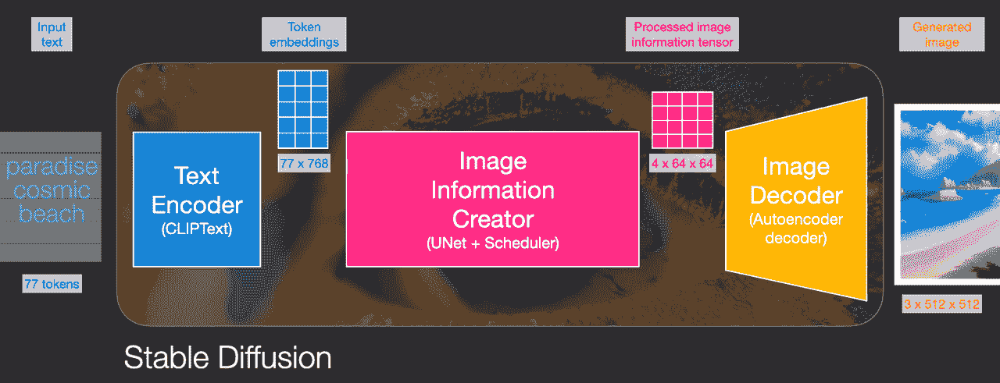

1.  Text Encoder：提示词的解析由 Text Encoder/CLIP 处理 (token embedding)。文本编码器负责将输入的提示转换为 U-Net 可以理解的嵌入空间。它通常是一个简单的基于变换器的编码器，将一连串的输入标记映射到一连串的 latent text-embeddings 中。稳定扩散使用 ClipText 用于文本编码。输入文本，输出 77 个标记嵌入向量，每个都有 768 个维度。

1.  information creator：完全在图像信息空间（或潜伏空间）中工作。这一特性使它比以前在像素空间工作的扩散模型更快。在技术上，这个组件是由一个 UNet 神经网络和一个调度算法组成的。UNet + Scheduler（也就是采样算法）在潜在空间中逐步处理/分散信息。它输入文本嵌入和一个由噪声组成的起始多维数组（结构化的数字列表，也叫张量），输出一个经过处理的信息阵列。

1.  Image Decoder：Text Decoder 根据从 information creator 那里获得的信息绘制一幅图画。 它只在过程结束时运行一次以生成最终图像。

**CLIP 的工作**

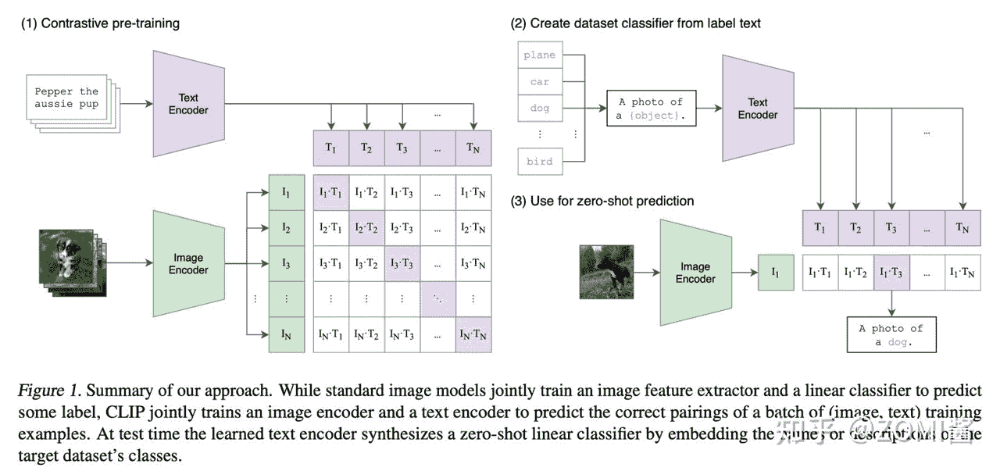

**CLIP 训练图**

参考

1.  [什么是扩散模型？](https://lilianweng.github.io/posts/2021-07-11-diffusion-models/)

1.  The Illustrated Stable Diffusion

1.  [稳定扩散模型，入门](https://huggingface.co/blog/stable_diffusion)

1.  [数学原理，原理解析](https://www.cs.unc.edu/~ronisen/teaching/fall_2022/pdf_lectures/lecture8_diffusion_model.pdf)

1.  [AI训练术语](https://www.cs.unc.edu/~ronisen/teaching/fall_2022/pdf_lectures/lecture8_diffusion_model.pdf)

# SD相关工具

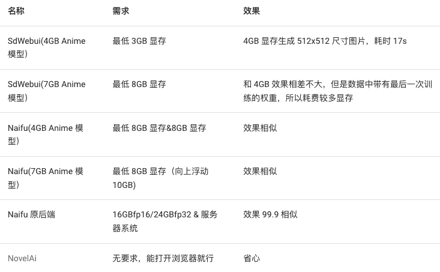

## SD-WebUI

St[able D](https://gradio.app/)iffusion web UI，简称 SDWebUi，是一个基于 Gradio 库的 Stable Diffusion 浏览器界面。

官方网站：https://github.com/AUTOMATIC1111/stable-diffusion-webui

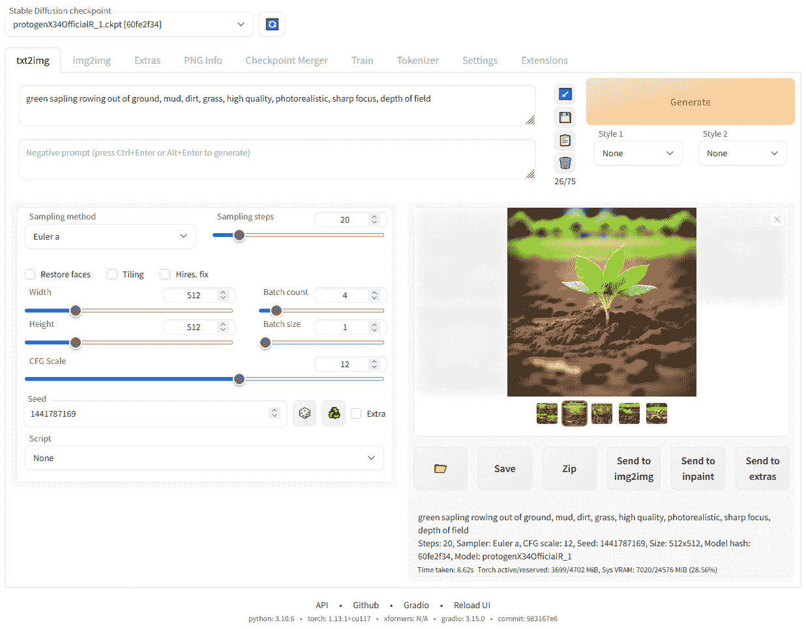

**SD-WebUI教程：**

1.  基本使用：https://www.bilibili.com/video/BV1yx4y1V7xQ

1.  安装 by 秋葉aaaki：https://www.bilibili.com/video/BV17d4y1C73R/

1.  启动器安装：https://www.bilibili.com/video/BV1ne4y1V7QU/

## 常用参数介绍

+   Prompt（提示词）：对你想要生成的东西进行文字描述。

+   Negative prompt（反向提示词）：用文字描述你不希望在图像中出现的东西。

+   Sampling Steps（采样步数）：扩散模型的工作方式是从随机高斯噪声向符合提示的图像迈出小步。这样的步骤应该有多少个。更多的步骤意味着从噪声到图像的更小、更精确的步骤。增加这一点直接增加了生成图像所需的时间。回报递减，取决于采样器。

+   Sampling method（采样器）：使用哪种采样器。Euler a（ancestral 的简称）以较少的步数产生很大的多样性，但很难做小的调整。随着步数的增加，非 ancestral 采样器都会产生基本相同的图像，如果你不确定的话，可以使用 LMS。

+   Batch count/n_iter：每次生成图像的组数。一次运行生成图像的数量为 Batch count * Batch size。

+   Batch size：同时生成多少个图像。增加这个值可以提高性能，但你也需要更多的 VRAM。图像总数是这个值乘以批次数。除 4090 等高级显卡以外通常保持为 1。

+   CFG Scale（无分类指导规模）：图像与你的提示的匹配程度。增加这个值将导致图像更接近你的提示（根据模型），但它也在一定程度上降低了图像质量。可以用更多的采样步骤来抵消。

+   Width：图像的宽度，像素。要增加这个值，你需要更多的显存。大尺度的图像一致性会随着分辨率的提高而变差（模型是在 512x512 的基础上训练的）。非常小的值（例如 256 像素）也会降低图像质量。这个值必须是 8 的倍数。

+   Height：图像高度。

+   Seed：随机数的起点。保持这个值不变，可以多次生成相同（或几乎相同，如果启用了 xformers）的图像。没有什么种子天生就比其他的好，但如果你只是稍微改变你的输入参数，以前产生好结果的种子很可能仍然会产生好结果。

## SD-Naifu

[4chan论坛](https://www.4chan.org/)流出的基于 NovelAILeaks 制作的工具包，俗称官网版。

Naifu 部署需要准备一台拥有 12GB 以上显存的 Linux 系统 的 GPU 服务器。

"naifu.tar"，修改优化的版本流传于社交网络之间，以及各类基于Google Colab的脚本。

## SD-Docker版

1.  GPU加速容器：https://github.com/fboulnois/stable-diffusion-docker

1.  SD-WebUI的Docker版：https://github.com/AbdBarho/stable-diffusion-webui-docker

## SD-Colab版

1.  https://colab.research.google.com/drive/1AfAmwLMd_Vx33O9IwY2TmO9wKZ8ABRRa#scrollTo=g0Sy0dk0Mkkg

1.  https://colab.research.google.com/drive/1Iy-xW9t1-OQWhb0hNxueGij8phCyluOh

教程：

[用Colab免费部署自己的AI绘画云平](https://mp.weixin.qq.com/s/2H1gCoOVBK89dIhEqoTQmA)台—— Stable Diffusion

## InvokeAI

目前国外有不少公司（如https://rundiffusion.com/）会提供在线SD运行环境，

其中除了[SD Web UI](https://github.com/AUTOMATIC1111/stable-diffusion-webui)，就是InvokeAI。

Github: github.com

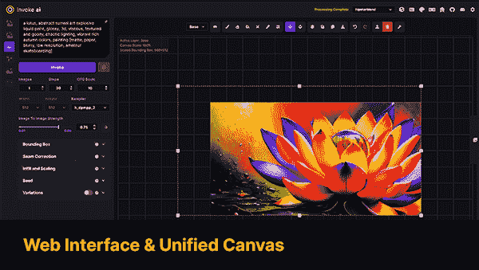

##  Windows 本地 SD-GUI

NMKD Stable Diffusion GUI

## MacOS 本地 SD-GUI

官网：https://diffusionbee.com/

Github：https://github.com/divamgupta/diffusionbee-stable-diffusion-ui

## iOS移动端SD

1.  https://github.com/madebyollin/maple-diffusion

1.  iOS APP 直接跑 Stable Diffusion 2.0：https://github.com/ynagatomo/ImgGenSD2

## SD 在线服务

### DreamStudio

由 Stability AI 公司开发，生成速度最快（几秒），有 200 积分免费的图像生成额度。

官网：https://beta.dreamstudio.ai/

版权：CC0 1.0 公共版权协议

右侧面板部分参数概念：

+   Clg Scale：表示生成图像与文本提示的相似度，越高越像

+   Steps：代表模型的渲染步数，越高图片越精细，所需的渲染时间也越长，一般50左右就足够了

+   Sampler：表示扩散采样方式，不同方式生成的图像效果不同

+   Seed：表示种子数，即图片中央的那串数字，渲染时填上种子能让相同文本提示再次生成一样的图片

# Disco Diffusion 模型

Disco Diffusion 是基于 MIT 许可发布于 Google Colab 数字艺术开源创作工具。

相比SD模型，更擅长插画、概念图、艺术创作。

第一次用有些门槛，需要配置一些参数，可二次开发，出图速度慢，平均一张图需要20分钟。

官网访问地址：https://colab.research.google.com/github/alembics/disco-diffusion/blob/main/Disco_Diffusion.ipynb，需要准备Google账号，且高内存配置需要付费订阅。

Github地址：https://github.com/alembics/disco-diffusion

当前版本（2023.02.20）：Disco Diffusion v5.7 [Now with MiDaS (3D mode) not being broken]

教程

1.  人工智能绘画工具 Disco Diffusion 入门教程

1.  最全AI绘画Disco Diffusion教程

1.  整理一条录制的Disco Diffusion 生成器教程的内容

+   基础教程:【人工智能绘画接地气教学-1 新手走流程-哔哩哔哩】

+   【人工智能绘画接地气教学-2 新手设置-哔哩哔哩】

+   【人工智能绘画接地气教学-3 参照设置-哔哩哔哩】

+   【Disco Diffusion出图画质调整——内部调整-哔哩哔哩】

+   [进阶教程【AI绘画进阶--爆肝百图！只为](https://www.bilibili.com/video/BV1Qr4y1p7xX/)让你了解描述词的全部！不藏私-哔哩哔哩】

+   【AI绘画最全渲染模式整理！你值得拥有-哔哩哔哩】

+   【AI绘画进阶--萌新纠错指南大全-哔哩哔哩】

+   [【人物？场景？我全都要！Disco D](https://www.bilibili.com/video/BV1n44y1G7eR)iffusion参照图利用-哔哩哔哩】

+   [【随心所欲控制描述比例！Disco Diff](https://www.bilibili.com/video/BV1Z34y1v7mq)usion高阶权重技能分享-哔哩哔哩】

1.  [速查工具属性](https://eggzhao.notion.site/Disco-Diffusion-d8a78d7a5a8b40238da820687615dee6)

# 在线服务推荐

## MidJourney

托管在 Discord 服务器上，对初学者友好，使用简单，生成的图片质量高，速度快，一分钟左右能出四张图。

缺点：需要付费，前期实验能免费生成几十张图片玩一玩。

未付费用户只能在newbie频道里体验AI创作。在输入“prompt:sea of roses,boundless,red,lonely moon,romantic,bloom,Grand,little boy wearing a crown,WAIIting”之后，鞭牛士得到以下四张图片：

官网地址：https://midjourney.com/

官方文档：https://midjourney.gitbook.io/docs

版权：平台

**教程**

1.  Midjourney 注册教程教学

1.  这类平面插画风格可以大部分交给AI了

1.  10分钟教你怎么样用MidJourney创作自己的漫画系列

1.  [随机生成AI老婆图片，1天打造出一个虚拟IP](https://www.bilibili.com/video/BV1cY411q7WJ)，可用于绘本/漫画/电影固定角色分镜制作

1.  使用midjourney创建unity2d资产

1.  如何用chatGPT批量生成工业级提示词，并在MJ里面生成AI图片

1.  影视从业者 AI 工具指南 Midjourney+Chatgpt

# 百度文心 ERNIE-ViLG（大模型）

飞浆· 文心大模型中的一项简单的功能

官网地址：https://wenxin.baidu.com/ernie-vilg

模型：https://huggingface.co/spaces/PaddlePaddle/ERNIE-ViLG

文心一格还提供周边定制，生成作品之后可以选择定制成手机壳、马克杯、帆布包等。不过，只有通过审核的图片才能定制相关周边。

每个账号单日体验上限 100 次，历史累计体验次数 500 次

## 百度文心一格

https://yige.baidu.com/

## NightCafe

艺术图片生成

官方网站：https://nightcafe.studio/

版权：生成者

## DALL-E 2

OpenAI开发的一款AI绘画生成器。

官网网址：https://openai.com/dall-e-2/

## Deep Dream Generator

官网网址：https://deepdreamgenerator.com/

根据提供的原图，生成新的图片

有三种风格：Deep Style、Thin Style、Deep Dream。

## Artbreeder

https://www.artbreeder.com/

一款图像质量增强器，可以在Artbreeder上创建风景、动漫人物、肖像和各种其他艺术作品。

支持对图像部分修改，改变人物的面部特征，如：肤色、头发和眼睛等。

还可以用Artbreeder将照片转换为动画。

# 国外其他项目

## Dream by WOMBO

入门级，免费使用但是像素偏低

官网地址：https://dream.ai/

旧地址：wombo.art

## Imagen

Google的文本-图像AI模型，先用text-to-image模型生成64x64，再用清晰度模型放大到256x256和1024x1024。

官方网站：https://imagen.research.google/

## ELBO AI

https://art.elbo.ai/

## Craiyon

https://www.craiyon.com/

## GetimgAI

https://getimg.ai/

## Eye for AI

定义了方便的工作流

https://eyeforai.xyz/

## DeepAI

创立于2016年的开源软件。

官网地址：https://deepai.org/

## StarryAI

免费NFT生成器的AI绘画生成器，自动学习算法处理图像，图像完成后你可以完全拥有所创建内容的所有权。

官网地址：https://starryai.com/

## Fotor

NFT艺术的AI绘画生成器，无需注册。

官网地址：https://www.fotor.com/

## Runway ML

创建动画和3D模型，带视频编辑器工具，可替换视频背景图像，还有相对运动分析工具、对象识别功能等。

官网地址：https://runwayml.com/

## PicSo

https://picso.ai/

## ZMO

https://www.zmo.ai/

# 国内其他项目

## 意间AI

官网：http://portal.yjai.art/

H5移动：http://m.yjai.art/

App：http://h5.yjai.art/

API：http://open.yjai.art/

免费次数+付费

## 飞链云

PC：https://ai.feilianyun.cn/

小程序

微信公众号：飞链云 3D 数字生态

注册即赠送100次AI绘画次数，实名认证送100次。

## 6pen（国内）

面包多团队开发，艺术图生成，有StableDiffusion和自研模型。

每天免费西瓜5次，充值点数

https://6pen.art/

官方文档：[你好，AI 艺术家 ](https://maoxianqiu.feishu.cn/wiki/wikcnbFlktQ0OrsGustVLlg8rIg)

版权：生成者

## DraftArt（国内）

二次元风格

https://draft.art/

## KK 画廊

付费

公众号：KK 画廊

版权：生成者

## TIAMAT AI

小程序，注册登录即赠送 500 画力值

## 盗梦师

西湖心辰旗下产品

造梦笔记：https://printidea.art/

免费次数+付费

参考笔记：https://zhuanlan.zhihu.com/p/565596660

## PAI AI

官方网站：https://artpai.xyz/

官方指南：[PAI使用指南 ](https://qupbvle53j.feishu.cn/docx/TeUPd8HnnoqqlhxxTiqc24jDnXO)

目前免费

## YUAN 初

官方网站：https://yuan.zmoai.cn/

小程序，用正常的人类语言描述即可，注册送60点。

生成：漫画、真实图片、插图、3D 渲染。

太复杂，冗长的描述可能会生成得图不对文；如果想要更丰富人物细节，可以加上  “近景”。

## 即时 AI

官方网站：https://js.design/

AI绘画嵌入到在线设计平台，深度捆绑融合。

## 爱作画

官方网址：https://aizuohua.com/

AIGC开放平台

+   Stable Diffusion 免费版：该模型可以驾驭各种风格，每天可以免费生 成 30 张图片

+   Stable Diffusionv1.5：该模型在免费版的基础上增加了更多专业参数设置，图片生成效果更好，每次消耗 1 爱币

+   Waifu Diffusion：该模型以二次元创作为主，适合二次元爱好者，每次消耗 1 爱币

## 画宇宙

官方网站：https://creator.nolibox.com/

目前免费。

教程：[最易于操作的人工智能绘画教学](https://www.bilibili.com/video/BV1Ev4y1D7hn)

## 万兴爱画

官方网址：https://aigc.wondershare.cn/

游客随机生成创作品体验，登录后每天赠送2次创作，更多需要付费。

## 站酷AI实验室（梦笔）

官方网站：https://www.zcool.com.cn/ailab

满足业余爱好者入门体验，简单上手，但自定义空间少，生成效果的随机性较大。

## 一帧秒创

官网网址：https://aigc.yizhentv.com/

AI绘画地址：https://aigc.yizhentv.com/h5/ai-paint

## Freehand 意绘

官方网址：https://freehands.cn/

采用 Stable Diffusion 开源 AI 模型。

## 画 der

小程序：画 der

## 数画

官方网址：https://www.shuxuehua.com/

App，API（按点数收费）

## MuseArt

小程序：MuseArtAI绘画

## 画几个画

小程序

## MewxAI人工智能

小程序

## Niko绘图

小程序

## 意见AI绘画

小程序

## 皮卡智能AI

https://www.picup.shop/text2image.html

## 触手AI绘画

ACGN类AI绘画，提供prompt生成器。

支持三种风格：CG国风、粉彩混合、韩式写真，支持照片转二次元。

小程序

## 提示词Prompt和社区

**基本流程**

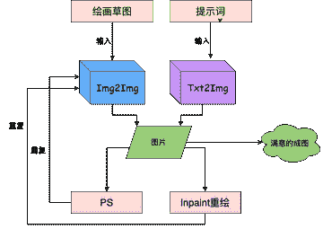

公式案例：[形容词+主语/主语+状语]，[细节/背景]，[画面类型]，[选择风格/艺术家]，[灯光/色调]，[视角/修饰词]

+   风格、画面等提示词，可以提升美感和艺术性，如 Realistic（写实）、Oil painting（油画）、Pencil drawing（铅笔画）、Concept art（概念艺术）

+   用艺术家名称，让风格更具像或保持风格一致。如抽象艺术用[made by Pablo Picassoa]、[ raw prompt,Picassoa]，同时输入多名艺术家效果会更加有趣。

+   文本末尾加上最终修饰词，如想要逼真的灯光，加上“Unreal Engine”；展现精密细节加上“4K”或“8K”；想要更有艺术性可以加上“trending on artstation”

## 艺术家及艺术风格参考

+   [稳定扩散的艺术家风格研究](https://proximacentaurib.notion.site/e28a4f8d97724f14a784a538b8589e7d?v=42948fd8f45c4d47a0edfc4b78937474)

+   [Stable Diffusion ](https://moritz.pm/posts/parameters)prompting cheatsheet

+   Stable Diffusion Akashic Records：模型原理、艺术风格、提示词、使用技巧和其他有用的工具

+   [Top-sd-artists](https://www.urania.ai/top-sd-artists)

+   [artiststostudy](https://artiststostudy.pages.dev/)

+   [Stable Diffusion ](https://proximacentaurib.notion.site/e28a4f8d97724f14a784a538b8589e7d?v=ab624266c6a44413b42a6c57a41d828c)Artist Style Studies

+   Stable Diffusion Artist Study

+   [70多个艺术家风格案例](https://weirdwonderfulai.art/resources/disco-diffusion-70-plus-artist-studies/)

## Prompt社区

1.  [PromptBase](https://promptbase.com/)

1.  [公开Prompts](https://publicprompts.art/)

1.  AI画廊，[关键词生成器](https://www.aigallery.top/tool)

1.  [KreaAI](https://www.krea.ai/)

关键词生成器&提取器

1.  [Promptomania](https://promptomania.com/stable-diffusion-prompt-builder/)

1.  [PromptHero](https://prompthero.com/)

1.  MidJourney Prompt Helper

1.  Prompt Search Anime

1.  [PromptGenerator](https://huggingface.co/spaces/doevent/prompt-generator)

1.  MIJ Prompt Helper

1.  NovelAI [tag生成器](http://wolfchen.top/tag/)、[标签超市](https://tags.novelai.dev/)

1.  Novel AI 元素魔法全收录

1.  Google Sheet：[手抄魔法本](https://docs.google.com/spreadsheets/d/14Gg1kIGWdZGXyCC8AgYVT0lqI6IivLzZOdIT3QMWwVI/)、[魔法书](https://docs.google.com/spreadsheets/d/e/2PACX-1vRa2HjzocajlsPLH1e5QsJumnEShfooDdeHqcAuxjPKBIVVTHbOYWASAQyfmrQhUtoZAKPri2s_tGxx/pubhtml#)

1.  [魔咒百科词典](https://aitag.top/)、[魔咒法典](http://tomxlysplay.com.cn/)

1.  [词汇加速器](https://ai.dawnmark.cn/)

1.  NovelAI [反向解析关键词](https://spell.novelai.dev/)

1.  反向解析prompt并寻找类似图

1.  [Img2Prompt](https://replicate.com/methexis-inc/img2prompt)

1.  [PromptTool](http://www.prompttool.com/NovelAI)

1.  Danbooru 标签比例冰山图

1.  Danbooru wiki Tag

1.  [MidJourney-Styles-an](https://github.com/willwulfken/MidJourney-Styles-and-Keywords-Reference)d-Keywords-Reference

1.  nai-anime-pure-negative-prompt docs

1.  donmai官网：[绘画技术分类](https://danbooru.donmai.us/wiki_pages/tag_group%3Aimage_composition)、[地点分类](https://danbooru.donmai.us/wiki_pages/tag_group%3Alocations)、[服装分类](https://danbooru.donmai.us/wiki_pages/tag_group%3Aattire)

1.  其他：[表情符号参考](https://unicode.org/emoji/charts/emoji-list.html)、[颜色列表](https://en.wikipedia.org/wiki/List_of_colors_by_shade)、[美学风格分类](https://aesthetics.fandom.com/wiki/List_of_Aesthetics)

工具参考

+   [快速分享-在线剪切板](https://netcut.cn/)

+   AiPhotoShop-无限外延画布的在线工具

+   NAI<=>WebUi 权重转换 Telegram 服务

+   NAI 的分词器，用来查看你的文本被识别为哪些

+   [批量裁切](https://www.birme.net/)

+   Real-ESRGAN 降噪提高分辨率神器

+   DeepDanbooru 通过图像识别提示

## 社区

分享模型、prompt、作品等。

1.  [HuggingFace](https://huggingface.co/)：模型交流社区，有大量模型共享。

1.  [Civitai](https://civitai.com/)：模型、checkpoint、VAE、LoRA等，可以查看对应效果图。

1.  [LexicaArt](https://lexica.art/)

1.  滴墨社区App，[大画家 domo](https://www.domo.cool/)

1.  [无界版图](https://www.wujiebantu.com/)，一个数字版权在线拍卖平台

# 计算平台和工具

## Colossal-AI框架

降低训练成本

[硬件预算最高直降46倍！低成本上手AIGC和千亿大模型，一行代](https://mp.weixin.qq.com/s/IdK0XLitqfu0iPGqHnNQzw)码自动并行，Colossal-AI再升级

## GPU选型

AI 绘图非常吃显卡和内存，需要强大的 GPU 算力支持，GPU 价格最低几千，普通的上万，甚至几十万。

时代变了，大人：RTX 3090时代，哪款显卡配得上我的炼丹炉

显卡厂家对于深度学习卡的保修政策等同于矿卡。 过度玩耍（比如连续 3 天出图），显卡会有坏掉的风险。

参考：[显卡稳定性测试报告](https://docs.google.com/spreadsheets/d/1Zlv4UFiciSgmJZncCujuXKHwc4BcxbjbSBg71-SdeNk/edit#gid=0)

## Nvidia

https://www.nvidia.com/en-us/studio/canvas/

## CUDA技术

Nvidia公司提供的一套开发套件，配合 CUDA 技术，显卡可以模拟成一颗 PhysX 物理加速芯片。

官网地址：https://developer.nvidia.com/cuda-toolkit-archive

英伟达显卡支持良好；AMD 可以用但速度明显慢于英伟达显卡；用 CPU 得花几百倍时间。

安装参考

AMD：[A](https://rentry.org/ayymd-stable-diffustion-v1_4-guide)yyMD Stable Diffuse v1.4 for Wangblows 10，Install and Run on AMD GPUs

## Google Colab

Google Colab Pro 订阅（65 RMB/M @Taobao）

SD：https://colab.research.google.com/github/huggingface/notebooks/blob/main/diffusers/stable_diffusion.ipynb

本地运行：https://research.google.com/colaboratory/local-runtimes.html

替换图片

+   效果：https://www.youtube.com/watch?v=N913hReVxMM

+   模型：https://colab.research.google.com/drive/1R2HJvufacjy7GNrGCwgSE3LbQBk5qcS3?usp=sharing

3D生成：https://colab.research.google.com/drive/1u5-zA330gbNGKVfXMW5e3cmllbfafNNB

## Kaggle

https://www.kaggle.com/

教程

https://www.bilibili.com/video/BV1vD4y1J7Ba

## 百度飞浆AI Studio

https://aistudio.baidu.com/

## HuggingFace

模型交流社区，以及Git同步和在线计算等。

官网地址：https://huggingface.co/

Diffusers支持Pipeline：https://huggingface.co/docs/diffusers/quicktour

## 智星云

http://gpu.ai-galaxy.cn/store

## AutoDL

https://www.autodl.com/

## 一些工具

将 pt 格式的训练模型文件转换为 png 格式

## FAQ&常见黑话/术语/缩写

1.  安装配置

1.  汉化问题

1.  图片生成出错

1.  效果不好

1.  模型问题

1.  爆内存问题

1.  模型训练问题：风格化、基本常识、训练方法

1.  绘图指南

## 术语清单

https://draw.dianas.cyou/GettingStarted/term/

+   oneshot：一张图

+   aug：augmentaion, 通过裁切，翻转获取更多数据集的方式

+   ucg：unconditional guidance

+   ML：Machine Learning，机器学习

+   LatentSpace：潜在空间

+   LDM：Latent Diffusion Model 潜在扩散模型

+   Stable Diffusion：稳定扩散

+   超分：一般指使用Ai技术提升图片分辨率，提高清晰度

+   NAI：Novel AI，一般特指 Leak

+   咒语：prompts

+   施法/吟唱/t2i：Text2Image

+   魔杖：t2i/i2i 参数

+   i2i：Image2Image, 一般特指全部图片生成

+   inpaint: i2i 一种 maskredraw，可以局部重绘

+   ti/emb/炼丹: Train 中的文本反转，一般特指 Embedding 插件

+   hn/hyper/冶金: hypernetwork，超网络

+   炸炉: 指训练过程中过度拟合，但炸炉前的日志插件可以提取二次训练

+   废丹: 指完全没有训练成功

+   美学/ext: aesthetic_embeddings, emb 一种，特性是训练飞快，但在生产图片时实时计算。

+   db/梦展: DreamBooth，目前一种性价比高（可以在极少步数内完成训练）的微调方式，但要求过高

+   ds: DeepSpeed，微软开发的训练方式，移动不需要的组件到内存来降低显存占用，可使 db 的 vram 需求降到 8g 以下。开发时未考虑 win, 目前在 win 有兼容性问题故不可用

+   8bit/bsb: 一般指 Bitsandbyte，一种 8 比特算法，能极大降低 vram 占用，使 16g 可用于训练 db。由于链接库问题，目前/预计未来在 win 不可用

+   VAE：Variational autoencoders (VAEs) 是一种用于学习潜在表示的深度学习技术。它们也被用来绘制图像，在半监督学习中取得最先进的成果，以及在句子之间进行插值。

+   CFG：Classifier Free Guidance Scale，用于衡量模型生成的预期图片和你的提示保持一致的程度。 Cfg Scale 值为 0 时，会生成一个基于种子的随机图像。论文地址

+   Loss functions：在优化算法的上下文中，用于评估候选解决方案（即一组权重）的函数称为目标函数。对于神经网络，我们寻求最小错误。 因此，目标函数通常被称为成本函数或损失函数，由损失函数计算的值简称为“loss”。原理解析

+   潜在空间：压缩数据的表示，其中相似的数据点在空间上更靠近在一起。参考阅读

+   损失：一种衡量指标，用于衡量模型的预测偏离其标签的程度。或者更悲观地说是衡量模型有多差。要确定此值，模型必须定义损失函数。例如，线性回归模型通常将均方误差用于损失函数，而逻辑回归模型则使用对数损失函数。

+   超参数：Hyperparameter，机器学习算法的参数。 示例包括在决策林中学习的树的数量，或者梯度下降算法中的步长。 在对模型进行定型之前，先设置超参数的值，并控制查找预测函数参数的过程，例如，决策树中的比较点或线性回归模型中的权重。

+   Pipeline：要将模型与数据集相匹配所需的所有操作。 管道由数据导入、转换、特征化和学习步骤组成。 对管道进行定型后，它会转变为模型。

+   epoch：在训练时，整个数据集的一次完整遍历，以便不漏掉任何一个样本。因此，一个周期表示（N/批次规模）次训练迭代，其中 N 是样本总数。

+   batch size：一个批次中的样本数。例如，SGD 的批次规模为 1，而小批次的规模通常介于 10 到 1000 之间。批次规模在训练和推断期间通常是固定的；不过，TensorFlow 允许使用动态批次规模。

+   iteration 迭代：模型的权重在训练期间的一次更新。迭代包含计算参数在单个批量数据上的梯度损失。

+   Tensor：TensorFlow 程序中的主要数据结构。张量是 N 维（其中 N 可能非常大）数据结构，最常见的是标量、向量或矩阵。张量的元素可以包含整数值、浮点值或字符串值。

+   checkpoint：一种数据，用于捕获模型变量在特定时间的状态。借助检查点，可以导出模型权重，跨多个会话执行训练，以及使训练在发生错误之后得以继续（例如作业抢占）。请注意，图本身不包含在检查点中。

+   embeddings：一种分类特征，以连续值特征表示。通常，嵌入是指将高维度向量映射到低维度的空间。在 TensorFlow 中，会按反向传播损失训练嵌套，和训练神经网络中的任何其他参数时一样。

+   激活函数：一种函数（例如 ReLU 或 S 型函数），用于对上一层的所有输入求加权和，然后生成一个输出值（通常为非线性值），并将其传递给下一层。

+   weight：线性模型中特征的系数，或深度网络中的边。训练线性模型的目标是确定每个特征的理想权重。如果权重为 0，则相应的特征对模型来说没有任何贡献。

+   ENSD：ENSD 是 eta 噪声种子增量，它改变了种子。NAI 使用 31337。

+   CLIP：一种非常先进的神经网络，可将提示文本转换为数字表示。对一个相对复杂场景的文本描述，AI 需要能“理解”并匹配到对应的画面，大部分项目依赖的都是一个叫 CLIP 的模型。CLIP 在生成模型的潜在空间进行搜索，从而找到与给定的文字描述相匹配的潜在图像，它非常现代且高效。WebUi 使用的是 clip-interrogator 项目，它结合了 blip 和 clip 项目，优化图像到文本的过程。blip 负责从原图片中解读文本，由 clip 负责解读适合创作的新图像的描述。ignore-last-layers-of-clip-model

+   LoRA：就像滤镜，在基础模型之上的一个补丁模型，用来训练特定风格、特定人物、特定动作等效果。

+   ACGN Diffusion：Animation/Comic/Game/Novel，动画/漫画/游戏/小说。

## 项目变现

**变现模式**

1.  接口费用，会员费或点数

1.  商业版权，如剧院200块钱获得图片商业授权、化妆品品牌的商单

1.  流量引流和广告

1.  卖图、卖关键词

1.  代跑AI绘画，闲鱼，提供图片关键词，卖家用MidJourney、Disco Diffusion生成图片，售价5-15元不等

1.  卖国外AI绘画平台教程，199元AI绘画课程

+   商家提供海外AI绘画平台使用教程、壁纸下载公众号的入驻通道，学员把生成AI图片放到公众号供下载

+   商家每天发布壁纸下载量的前二十名，前几名一般都有一千多下载量，一次下载0.2-0.3元，一天两三百

+   买教程的人，大部分是工作需要，如画师、游戏概念设计的

+   工作更高效，甲方给一个主题，可以同时给他生成七八张图，之前确认一个草图花三天，现在一个小时

+   文字向游戏不需高价请画师配图，直接找AI生成图片，对大众审美够用

+   用AI绘画来寻找灵感

+   服装设计、珠宝设计、厨具设计、CG游戏角色，服装博主“JINNY ”使用AI生成的概念图作为设计参考，博主“小狐狸毕减索是AI玩家”用AI做杯子设计，用NovelAI生成“小黄图”

# 情报导航

## https://www.360AI.cc

## 收藏导航

https://github.com/hua1995116/awesome-ai-painting

https://pharmapsychotic.com/tools.html

[https:](https://github.com/sudoskys/StableDiffusionBook)//draw.dianas.cyou/，@Github

https://www.aiartapps.com/

https://guide.novelai.dev/

## 2022-10.1 ~ 2023-2月21日

+   [真·拿嘴做视频！Meta「AI导演」一句话搞](http://mp.weixin.qq.com/s?__biz=MzI2MzEzNTI1NQ==&mid=2650045848&idx=2&sn=9f314ecb68b274255c537767f402c4fd&chksm=f24054e0c537ddf6087926096efd68bf8ef9360b74d0f5f47c42db23b61563fade4acddabc45&mpshare=1&scene=1&srcid=0930IDxRARBOXCzqQXQnjH3G&sharer_sharetime=1664547850209&sharer_shareid=729af761aea5c233c025deeee8543377#rd)定视频素材，网友：我已跟不上AI发展速度

+   大神微调Stable Diffusion，打造神奇宝贝新世界

+   从第一性原理出发，分析AI会如何改变视觉内容的创作和分发-36氪

+   [谷](https://www.zhihu.com/question/557935539?utm_medium=social&utm_oi=720050542423838720&utm_psn=1561324782750244864&utm_source=ZHShareTargetIDMore)歌最近放出了两个工作：Imagen Video和Phenaki，如何看待文本生成视频工作的发展？ - 知乎

+   [用嘴做视频，这款应用太逆天](https://mp.weixin.qq.com/s/S53_hq-4CLaGtwID6sPRTg)

+   如何评价ai绘画网站novelai？ - 知乎

+   [GAN、扩散模型应有尽有，CMU出品的生成](http://mp.weixin.qq.com/s?__biz=MzA3MzI4MjgzMw==&mid=2650858235&idx=1&sn=4040fbf9ab7bd2f18f7bf09fd9557d57&chksm=84e52685b392af938495d9d25e29574990eac34ed695ea2b436ca1cc8516fa29317a636a04a6&mpshare=1&scene=1&srcid=1008KZSaQ7A4N1qJOSY2ZjRQ&sharer_sharetime=1665206274211&sharer_shareid=729af761aea5c233c025deeee8543377#rd)模型专属搜索引擎Modelverse来了

+   「羊驼打篮球」怎么画？有人花了13美元逼DALL·E 2亮出真本事

+   [AI时代的巫师与咒语](http://mp.weixin.qq.com/s?__biz=MzI3NDQzNTk2Mw==&mid=2247484347&idx=1&sn=ce81d3c4532660d3bbbf675f71246f48&chksm=eb1559afdc62d0b90b922e828adb4ef987a3022e64bf2fbb54f91c7c7e9622e8f4c9518c11d0&mpshare=1&scene=1&srcid=1007PG2QiWqikGvlKsNaBzKB&sharer_sharetime=1665134898726&sharer_shareid=fd4057a7e98d0f662cb30b87c6d9f24e#rd)

+   https://twitter.com/hashtag/novelAI?src=hashtag_click

+   太酷了！网页端实现真实3d世界！打造GTA不是梦！Web3d潜力无限！

+   [AI终于能生成流畅3D动作片了，不同动作过渡衔接不出](https://zhuanlan.zhihu.com/p/570968101)bug，准确识别文本指令丨开源 - 知乎

+   AI绘画的当下，人类美术还有未来吗？ - 知乎

+   如何评价2022年九，十月份的一系列AI绘画最新技术？ - 知乎

+   实测 | AI 绘画三大难题，女生与拉面不可兼得？！

+   [AI绘画开始抢画师「饭碗」](https://news.pedaily.cn/202212/504858.shtml)

+   AI绘画热度居高不下！多家大厂纷纷入局

+   万字长文：产品经理视角下的AI绘画全解析

+   [AI绘画软件设计的概念裙子](https://www.dazuoshe.com/aihuihuaruanjianshejidegaini.html)

+   [QQ AI画画｜探索机器创造力](https://cloud.tencent.com/developer/article/2216329)

# 获取更多情报

**更多情报欢迎进群订阅**

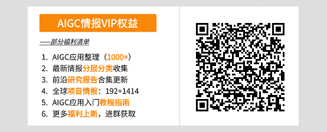

（2023年4月3日）当前的权益说明

1.  最新情报十大分类导航

1.  最新发布前沿研究报告

1.  可移动端访问AI应用汇总表（目前已更新629个）

1.  4未来每增加一份精品VIP情报整理，涨价10元

1.  同时已进群的老会员权益自动升级，无需补价

1.  提供ChatGPT3.5 模型 && AI绘画 体验群

1.  AI绘画系统教程指南，会员入口：2023年最全AI绘画应用教程

1.  1414个关于人工智能、机器学习和数据公司的收录和图谱

1.  AI绘画效果合集

**部分情报相关内容一览**

9大分类全方位跟踪ChatGPT和AIGC情报

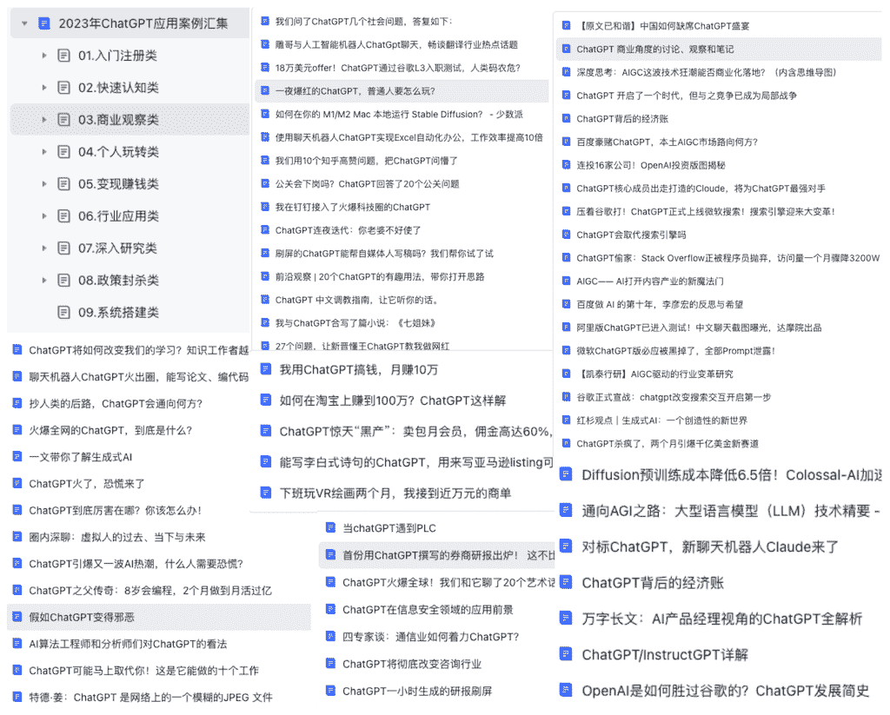

实时收集精选研究报告及商业洞察

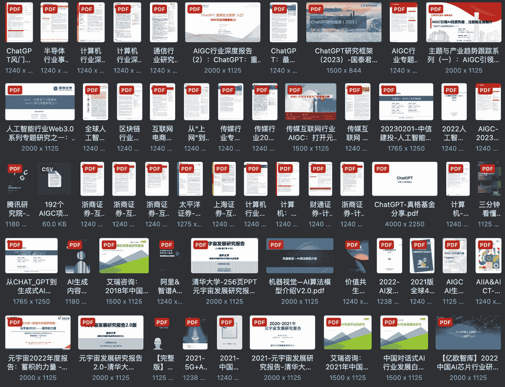

451个AI应用分类收录，链接和介绍表

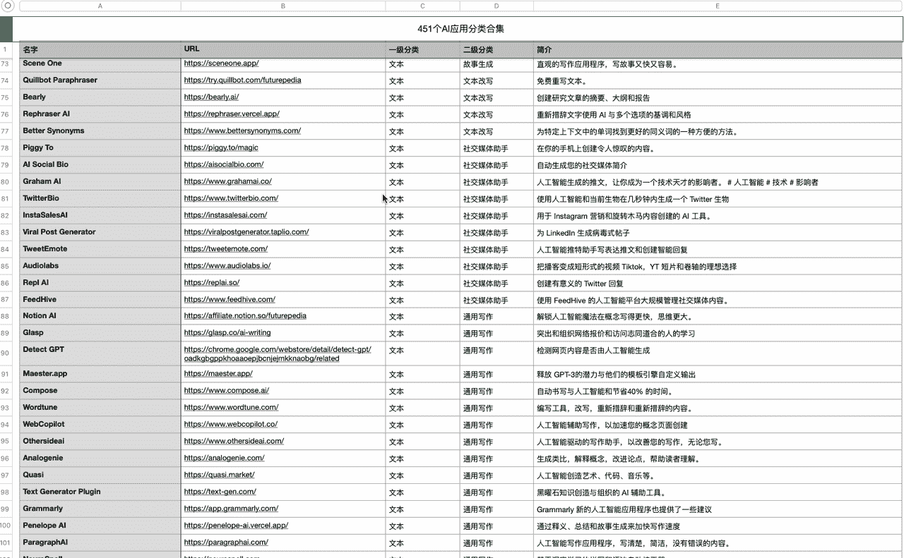

全球收录1414个MAD公司名录和背景

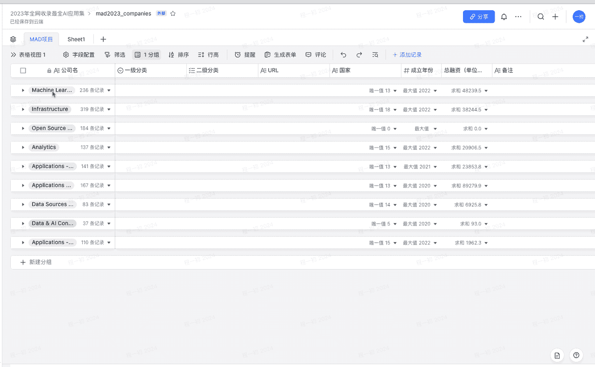

AI绘画从在线体验到模型应用及变现思路

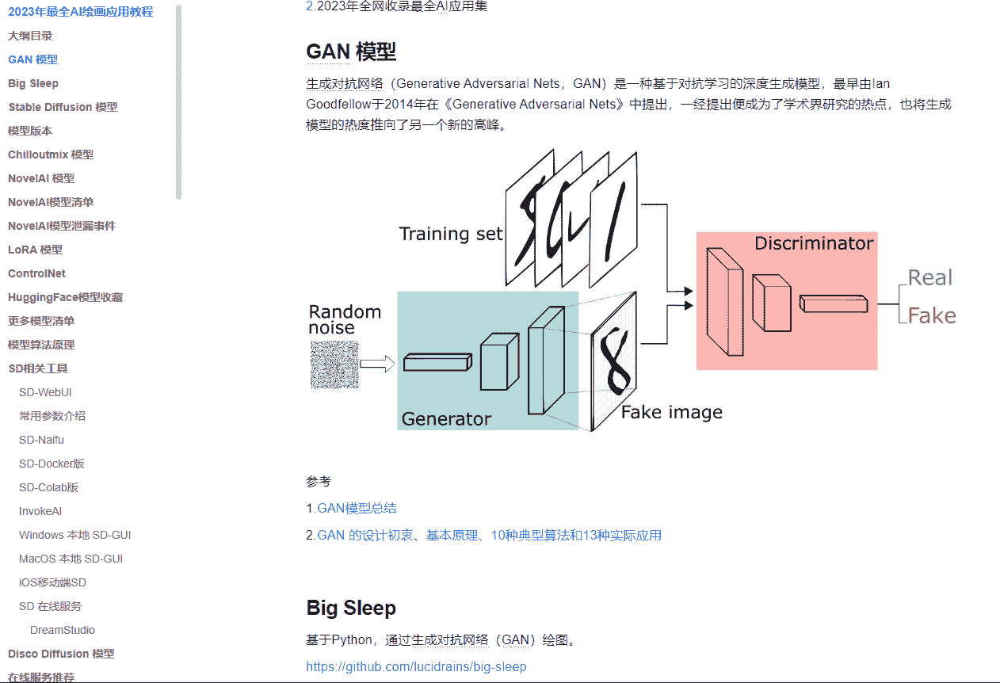

提供艺术家风格参照和Prompt手册工具

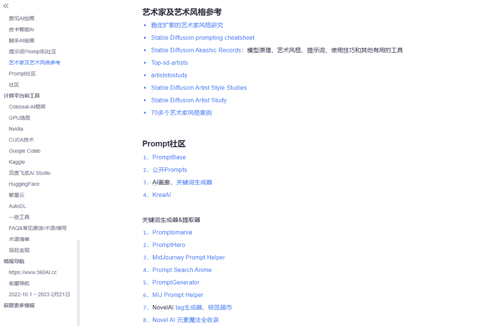