# 最全AI绘画Disco Diffusion教程

> 来源：[https://diwfpqo78m.feishu.cn/docx/OyW8dgqwsoS2HxxiSuTccIMun0d](https://diwfpqo78m.feishu.cn/docx/OyW8dgqwsoS2HxxiSuTccIMun0d)

---

最近，我被 AI 绘画刷屏了。让我不敢相信的是，我所看到**的一幅幅精美**、具备艺术性的作品竟然是由 AI 创作的。

在我的印象中，AI 创作的东西都是很死板的，并不具备艺术性，比如：用 AI 来下棋、用 AI 来翻译文章、用 AI 来辅助自动驾驶等一系列具备规则性的、看似固化的“创作”。

**但随着时代的发展，没想到它还可**以创作具有「艺术性」的绘画作品。这就让我很惊讶了。

1.  艺术与思想

> 黑格尔曾说：艺术是绝对精神的“外化”，艺术是人类活动最高精神之一。

由此可见，艺术对每个人都是很重要的。我们每个人都需要自我表达，而艺术是最好的自我表达方式。

以往，由于我们不懂一系列创作思想和绘画技巧，而无缘艺术创作。

但现在，我们可以依靠 AI 来表达我们的思想，**通过艺术作品来外化我们的思想，帮助我们将思想**作品化，这对我们每个人来说就很有意义了。

---

1.  使用 AI 创作绘画作品

好了，说了这么多，我们如何使用 AI 创作绘画作品呢？

其实很简单，并没有大家以为的那么难。

**并不需要你懂深奥的技术，只要你有只字不差的阅读能力，跟****着我****下面的步骤一步步操作，你也**可以使用 AI 创作出属于你的绘画作品。

## 2.1 进入在线创作平台

我们要使用的这个 AI 创作工具是机器学习圈子很火的 Disco Diffusion V 5.2，它是一个开源项目，利用了 CLIP-Guided Diffusion 的人工智能图像生成技术，让你可以通过简单的文本输入创造出精美的图像，我们可以使用 Google Colab 笔记本运行它。

首先，你需要用浏览器打开 Disco Diffusion V 5.2 Colab 的在线创作地址：

> [ht](https://colab.research.google.com/github/alembics/disco-diffusion/blob/main/Disco_Diffusion.ipynb)tps://colab.research.google.com/github/alembics/disco-diffusion/blob/main/Disco_Diffusion.ipynb

> 温馨提示：访问此网站需要科学上网，请自行解决哦~

打开链接后，你可以看到如下内容。代码看不懂没关系，跟着接下来的步骤一步步操作就好了。

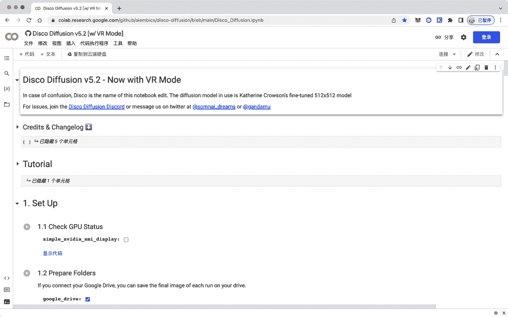

### 2.1.1 保存副本文件

进入后，你要先在云端硬盘中保存一份副本，在副本上进行接下来的操作。若是直接在现有网页程序中操作，你后续对程序的修改将不会生效。

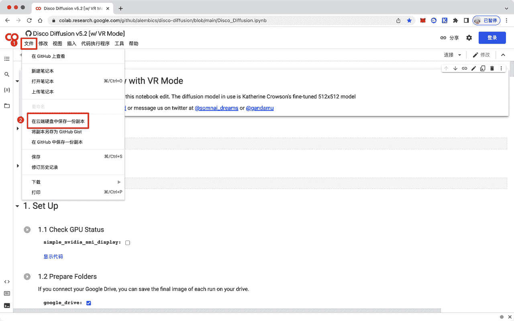

根据提示登录 Google 账号。

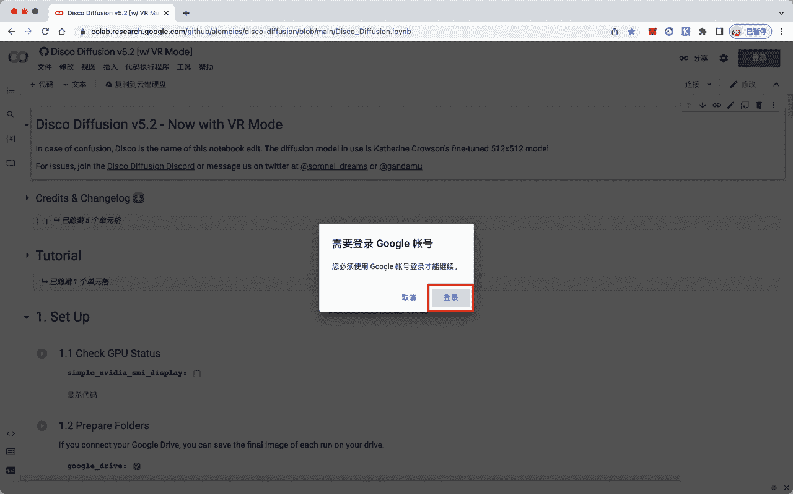

### 2.1.2 确认程序能正常运行

登录后，系统会自动在你的 Google 云盘中复制一个副本。接下来，进入副本程序，先确认程序是否可以正常运行。点击「代码执行程序 - 全部运行」，点击「连接到 Google 云端硬盘」。

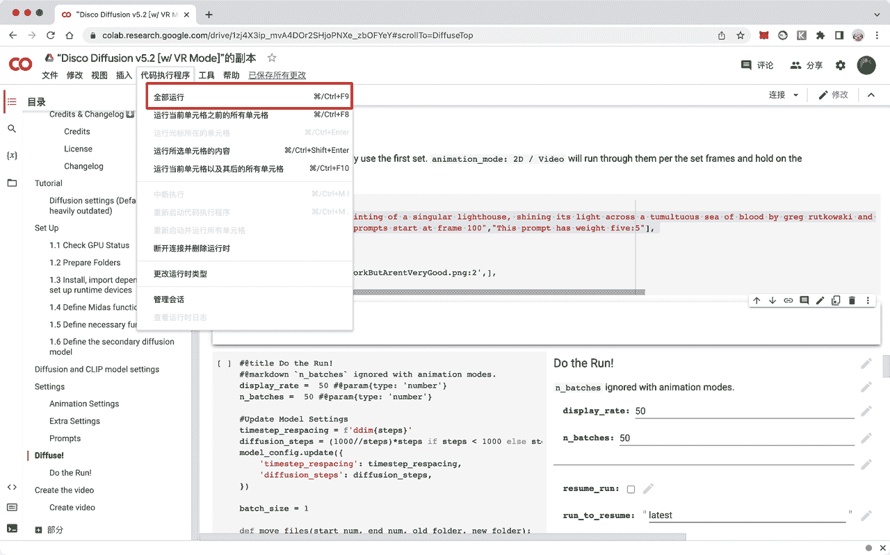

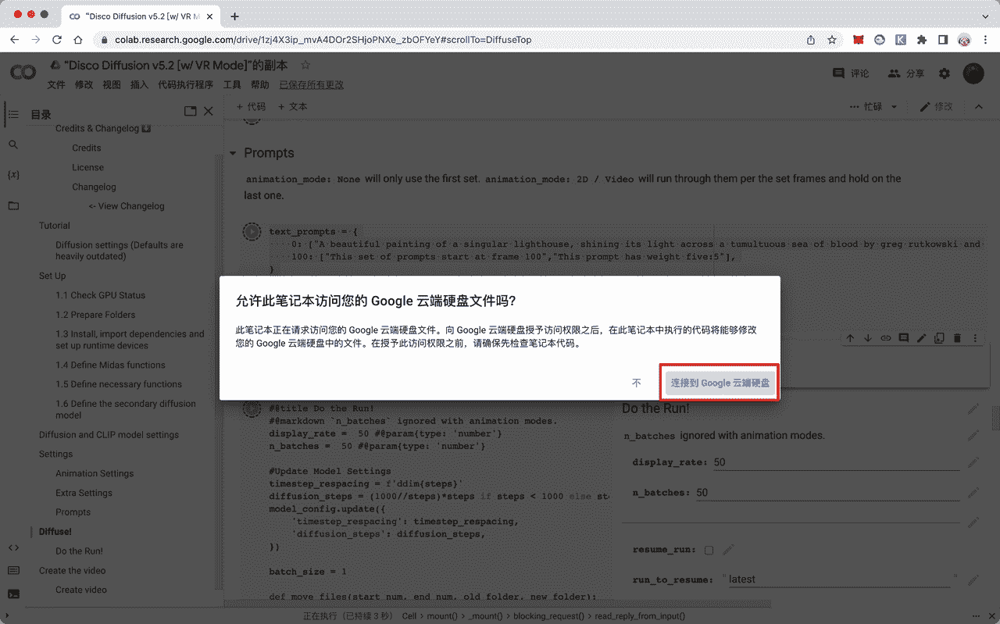

若是能在程序的 「Diffuse!」 模块中看到 AI 实时生成的画面，就代表程序在正常运行。

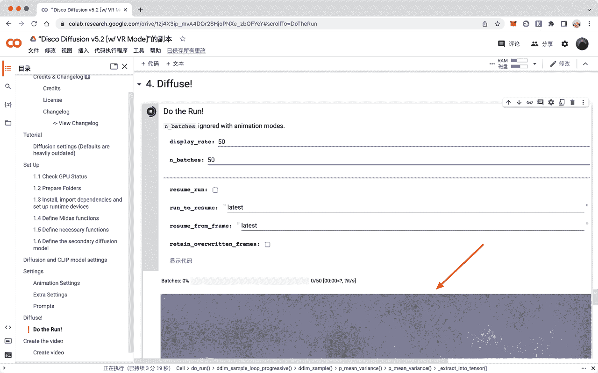

随后，你可以让程序持续运行生成默认作品；或者点击「代码执行程序 - 中断执行」，开始个性化配置，生成属于你的作品。

## 2.2 快速创作你的作品

刚刚你已经运行了系统默认程序，并且生**成了默认作品。**如果你想快速学会「如何通过简单的语言描述生成绘画作品」，你可以只看 2.2 节内容。

我会在后面章节详细讲解整个程序的所有设置，你可以根据教程创作出更加个性化的作品。

### 2.2.1 如何快速生成属于你的绘画作品？

你想要 AI 知道你想要创作怎样的作品，就需要用简单的语句描述出作品的画面。

（1）修改 text_prompts

**首先，你需要找到程序中的 Prompts 部分，****修改**** text_prompts 中**对画面的描述，然后点击「代码执行程序 - 全部运行」，AI 将根据你的描述自动生成画面。

接下来，我们仔细看看需要怎么修改呢？

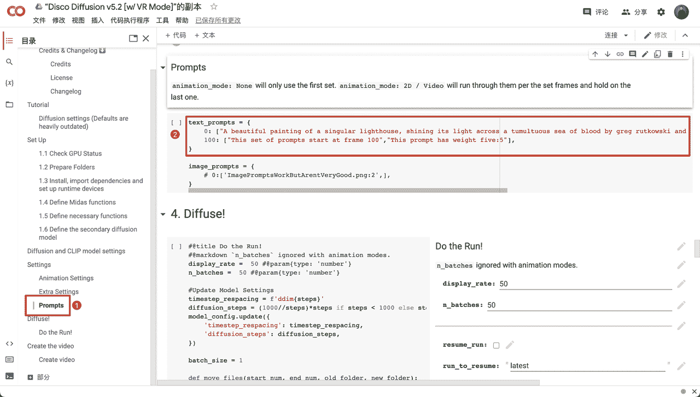

这是程序中默认的 text_prompts 的描述。

```
text_prompts = {
    0: [&quot;A beautiful painting of a singular lighthouse, shining its light across a tumultuous sea of blood by greg rutkowski and thomas kinkade, Trending on artstation.&quot;, &quot;yellow color scheme&quot;],
    100: [&quot;This set of prompts start at frame 100&quot;,&quot;This prompt has weight five:5&quot;],
}
```

> A beautiful painting of a singular lighthouse, shining its light across a tumultuous sea of blood by greg rutkowski and thomas kinkade, Trending on artstation.（一幅由格雷格-鲁特科夫斯基和托马斯-金凯德创作的奇异灯塔的美丽画作，将其光芒照耀在一片动荡的血海中，在artstation上流行。）

> yellow color scheme 为黄色配色

我们可以很清晰地看到默认的描述以及绘画作品的配色，此时，我们只需要：

+   **将** **「A b**e**autiful pai**nting of a singular lighthouse, shining its light across a tumultuous sea of blood by greg rutkowski and thomas kinkade, Trending on artstation.」 替换为你对画面的描述。

+   画面描述的结构推荐：【主题】，【介词细节】，【背景】，【元修饰语和艺术家】

+   将「yellow color scheme」替换为你想要的画面配色

（2）修改 image_prompts

你可以在此模块描述你想要作品展现的特征，或不想要作品展现的特征。不同特征有不同的权重，权重可以是负的。负的权重可以帮助抑制不希望的提示的特征。（若有多个权重，权重之和不能为 0）

程序默认的配置如下：

```
image_prompts = {
    # 0:[&#x27;ImagePromptsWorkButArentVeryGood.png:2&#x27;,],
}
```

表示接下来创作的画面的特征将近似 ImagePromptsWorkButArentVeryGood.png这张图。

假设我对其做如下修改，则表示，我想让作品有点 beach 的特征，我不想有更多 sky 的特征。

```
0: [&quot;beach:2&quot;,&quot;sky:-1&quot;]
```

（3）点击「代码执行程序 - 全部运行」，AI 会自动运行程序，然后程序会根据你刚刚修改的描述信息生成你想要的绘画作品。

（4）创作完成后，你可以进入 [Google 云端硬盘](https://drive.google.com/drive/my-drive)的「AI / Disco_Diffusion / images_out / TimeToDisco」路径文件夹中找到创作完成的作品，随后可以下载到本地。

> Google 云端硬盘地址：[https://drive.googl](https://drive.google.com/drive/my-drive)e.com/drive/my-drive

下图是云端硬盘中存放的绘画作品。

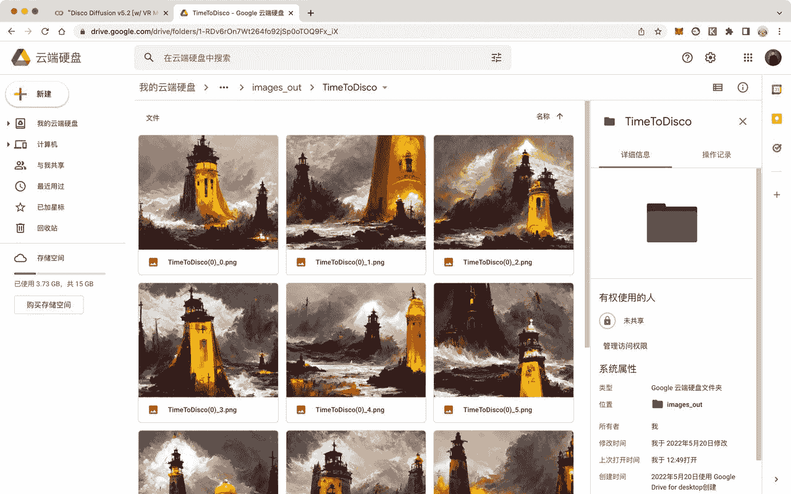

至此，你已经掌握了如何快速生成你想要的绘画作品了。若是你想让你的作品变得更加个性化、更加精美，那么你需要继续学习下面的章节。

## 2.3 深入学习个性化配置

打开副本程序中的目录后，可以看到如下内容。

+   Tutorial

+   Set Up

+   Diffusion and CLIP model settings

+   Settings

+   Diffuse!

+   Create the video

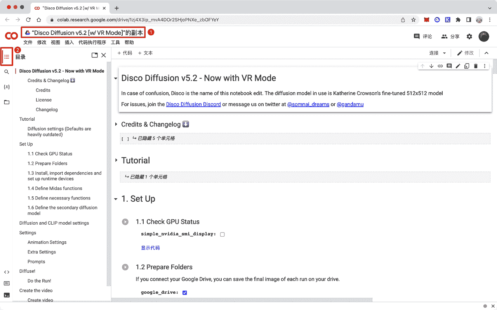

**若**是想要作品变得更加精美，我们需要调整上述目录中的相关参数后，再点击「代码执行程序 - 全部运行」，生成自己的作品。

那么，如何来调整呢？现在我们开始学习每个参数所代表的意思，随后你可以根据自己想要的画面设定参数。

### 2.3.1 Tutorial（教程）

这部分是官方给出的教程，里面有关于此程序的扩散设置（不过其中大多数内容已经过期），接下来，我会尽可能将每个参数表示的意思都写清楚。

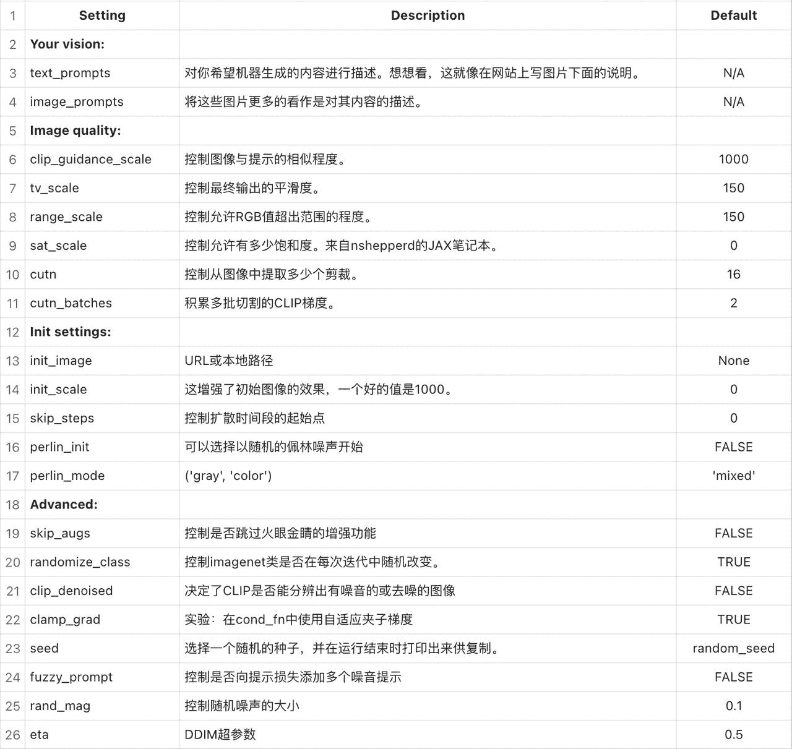

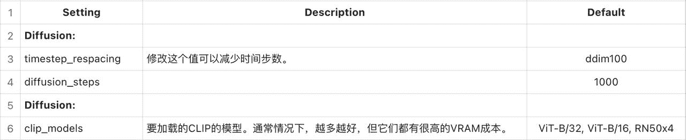

你还可以加入到 Disco Diffusion 用户讨论组，从活跃的用户社区中学习：

> https://discord.gg/XGZrFFCRfN

> 温馨提示：访问此网站需要科学上网，请自行解决哦~

### 2.3.2 Set Up（设置）

在这个部分，程序会在这部分检查 GPU 的状态，准备程序相关的文件夹，安装相关的依赖和运行环境，定义迈达斯功能，定义必要的功能，定义二次扩散模型。

你不用操作此模块中的任何参数。

### 2.3.3 Diffusion and CLIP model settings（扩散和CLIP模型设置）

在这个部分，是扩散和 CLIP 模型设置。程序给你提供了八种不同的 CLIP 模型可供你在图像生成期间使用，有兴趣可以尝试打开看看。

ViTB32、RN50、RN101、ViTB16、RN50x4、RN50x16、RN50x64、ViTL14

（根据内存使用排序：最小到最大，对应速度：最快到最慢）

> 需要注意的是：如果你在本节中改变了任何扩散和 CLIP 模型的设置，你应该重新启动你的程序并再次运行所有的单元，以确保必要的库被正确加载。

### 2.3.4 Settings（设置）

在这个部分是相关设置。

#### 2.3.4.1 基础设置

+   batch name :
批次的文件和文件夹名称。最终的图像和视频将被保存在：/My Drive/Ai/Disco_Diffusion/images_out/batch name

+   setps：(250 | 50-10000)
当创建一个图像时，去噪曲线被细分为处理步骤。每一步（或迭代）涉及人工智能查看被称为“切割”的图像子集，并计算图像应被引导的“方向”，使其更像提示。然后，它在扩散去噪器的帮助下调整图像，并进入下一个步骤。

+   增加步骤将为人工智能提供更多的机会来调整图像，而且每次调整都会比较小，因此会产生更精确、更详细的图像。步数是以延长渲染时间代价的。另外，虽然增加步数通常会提高图像质量，但增加步数后的回报率会递减。

+   一般设置为 250 - 500 步。然而，一些复杂的图像可能需要 1000、2000 或更多步骤，这取决于你的作品。

+   **只要知道渲染时间与步骤数直接相关，其他许多参数对图**像质量有重大影响，而不需要花费额外时间。

+   width_height：([1280，768] | limited by VRAM)
期望的最终图像尺寸，单位是像素。你可以有一个正方形、自定义宽高的图像，但是每条边的长度应该被设置为64px的倍数，在默认的 CLIP 模型设置上，最小为 512 px。

+   需要注意的是宽和高都需要是 64 的倍数，例如：[512 x 768]。如果你设置的不是 64 的倍数，程度会调整你的图像的尺寸。

+   clip_guidance_scale：
与图像质量有关，你可以尝试更改： 5000 - 7500。

+   tv_scale: (0 | 0 - 1000)
总方差去噪。可选的，设置为零即可关闭，控制最终输出的“平滑度”。如果使用，tv_scale 将尝试平滑你的最终图像，以减少整体噪音。

+   range_scale: (150 | 10 - 1000)
可选的，设置为零即可关闭。用于调整颜色的对比度。较低的 range_scale 会增加对比度。非常低的数字会产生一个缩小的调色板，从而产生更多鲜艳的或类似海报的图像。较高的 range_scale 会降低对比度，使图像更加柔和。

+   sat_scale: (0 | 0 - 20000)
饱和度。可选的，设置为零即可关闭。如果使用，sat_scale 将有助于减轻过饱和度的影响。如果你的图像过于饱和，增加 sat_scale 来降低饱和度。

+   cutn_batches: (4 | 1 - 8)
每次迭代，人工智能都会将图像切割成更小的片段，称为切割，并将每个切割与提示进行比较，以决定如何指导下一个扩散步骤。更多的切割通常可以带来更好的图像，因为程序在每个时间步骤中有更多的机会来微调图像的精度。

+   然而，额外的切割会消耗内存，如果程序试图一次评估太多的切割，它可能会耗尽内存。你可以使用 cutn_batches 来增加每个时间段的切割，而不增加内存的使用。

+   在默认设置下，程序被安排在每个时间段做 16 次切割。如果 cutn_ batches 被设置为 1， 那么每个时间段只有 16 次切割。

+   然而，如果 cutn_batches 增加到 4， 程序将在每个时间步中总共做 64 次切割，分为 4 个连续的批次，每个批次 16 次切割。因为每次只评估 16 个切割，所以程序只使用 16 个切割所需的内存，但给你带来 64 个切割的质量优势。

+   当然，这样做的代价是，渲染每张图片需要 4 倍的时间。因此，（预定的切割） x （切割批次） = （每个时间段的总切割）。然而，增加 cutn_batches 会增加渲染时间，因为这些工作是按顺序进行的。程序的默认切割计划是一个很好的开始，但是切割计划可以在 Cutn_Scheduling 部分进行调整。

+   skip_augs:
作为其代码的一部分，程序有一些 “Torchvision 增强”， 在图像创建过程中引入随机的图像缩放、透视和其它选择性调整。这些增强的目的是帮助提高图像质量，但会对边缘产生你可能不希望看到的“平滑”效果。通过将 skip_augs 设置为 “true”，你可以跳过这些增强，稍微加快你的渲染速度。建议你试验一下这个设置，了解它对你的程序有什么影响。

#### 2.3.4.2 初始化设置

+   init_image
可选的。回顾一下，在上面的图像序列中，显示的第一个图像只是噪声。如果提供了 init_image，diffusion 将用 init_image 替换噪音，作为其起始状态。要使用 init_image，请将图像上传到程序实例或你的 Google 云端硬盘，并在这里输入完整的图像路径。

+   如果使用 init_image，你可能需要增加 skip_steps 到总步骤的 50号，以保留 init 的特性。进一步讨论见上面的 skip_steps。

+   init_scale: (1000 | 10 - 20000)
这控制了 CLIP 将多大程度地尝试与提供的 init_image 匹配。这是与上面的clip guidance scale (CGS) 相平衡的，太多的 init_scale，图像在扩散过程中不会有太大变化，太多的 CGS，初始图像将被丢失。

+   skip_steps:
用低的 steps，你可以得到一个受 init_image 启发的结果，它将保留颜色和粗略的布局和形状，但看起来很不同。使用高跳步，你可以保留 init_image 的大部分内容，只是对纹理进行微调。

#### 2.3.4.3 动画设置

##### 2.3.4.3.1 动画模式

+   Animation_mode:
无、二维、三维或视频动画选项。详情见下面各节。

+   无：动画模式被关闭。将使用图像和批次设置创建一批单独的图像。

+   二维动画将每一帧作为一个平面，并根据参数对其进行变换（旋转、缩放、平移 x 或 y）。然后，它使用该转换后的图像作为动画的下一帧的图像初始。

+   三维动画采取每一帧，计算一个估计的三维深度图和估计的虚拟三维空间。然后，利用这个三维空间，它在这个虚拟空间中移动一个虚拟摄像机，并利用深度图和新的“摄像机”位置图像进行变换/扭曲，产生的扭曲图像被用作下一个动画帧的图像初始。视频输入将视频的每一帧初始化，并将它们作为一系列程序输出图像的图像输入。

##### 2.3.4.3.2 视频输入设置

+   video_init_path:（仅指视频）
用户提供的视频的源路径，作为动画的图像输入源。要使用视频初始化。将视频上传到程序实例或你的 Google 云端硬盘，并输入完整的源路径，一个典型的路径是 /content/video_name.mp4。

+   如果你的程序版本有两个名为 video_init_path 的字段，请在两个字段中输入相同的值。

+   extract_nth_frame :（仅限视频）（2 | 1 - 6）
允许你提取视频的第 n 个帧。如果你有一个 24 fps 的视频，但只想渲染每秒 12 帧的程序图像，把 extract_nth_frame 设置为 2。

+   video_init_seed_continuity:（仅限视频）（On | Off / On）
通过在视频的每一帧重复使用相同的图像创建种子，提高视频动画的流畅度和帧的连续性，取消选择这个选项将导致视频的纹理更加混乱、随机化。上面的视频输入模式设置与从动画帧创建最终输出视频，无关创建和保存最终视频的设置将在下面的创建视频部分讨论。

##### 2.3.4.3.3 2D 动画设置

+   key_frames：
开启关键帧系统，允许二维和三维动画参数随时间变化。程序中提供了关键帧
的语法示例，另外，你也可以将关键帧应用于文本或图像提示，见程序中提供的语法示例，允许在动画的长度上有一个不断变化的文本提示来引导图像。

+   max_frames：
在二维或三维动画中要创建的总帧数。程序中的所有动画都是以帧为单位，而不是以“时间”为单位，所以你需要确定你的最终动画的每秒帧数，并自己计算出帧数。

+   注意：maxframes 在视频输入模式下被忽略，源视频的长度将决定要创建的动画帧的总数。

+   angle: （0 | -3 to 3）（2D only）
每帧将图像旋转() 度。正的角度值会使图像逆时针旋转，感觉就像摄像机在顺时针旋转一样。

+   zoom: （2D only）（1.10 | 0.8 - 1.25）
每一帧图像按（）百分比缩放。1.10 是前向缩放的一个好的起始值，低于1.0的数值将被放大。

+   translation_x，translation_y （在 2D 模式下）。
（01-10 到 10）在 2D 模式下，平移参数每帧将图像移动（）像素。

+   x 是左 / 右；正的 translation_x 使图像向右移动（感觉像摄像机向左移动）。

+   Y 是向上 / 向下的；正的 translation_y 使图像在屏幕上向下移动（感觉像是摄像机向上移动）

+   translation_x，translation_y, translation_z (in 3D mode) :
（01 - 10 to 10）在三维模式下，平移参数的行为与二维模式不同，它们在虚拟三维空间中移动摄像机。

+   x 是左 / 右；正的 translation_x 使摄像机向右移动。

+   y 是向上 / 向下的，正的 translation_y 使摄像机向上移动。

+   z 是向前 / 向后(缩放) ；正的 translation_z 使摄像机向前移动。在 3D 模式中，平移（x、y 或 z）的距离单位被设置为一个任意的尺度，其中 10 个单位是通过 translate_z 向前放大的合理距离。根据你的场景和比例，你将需要试验不同的平移值来实现你的目标。

+   rotation_3d_x: (仅3D) (0 | -3 to 3)
以度数计算。围绕 x 轴旋转摄像机，从而使摄像机的三维视图向上或向下移动。类似于飞机的俯仰。正数的旋转 3d_x 使摄像机向上倾斜。

+   rotation_3d_y: (仅3D) (0 | -3 to 3)
以度数计算。围绕 y 轴旋转摄像机，从而使摄像机的三维视图向左或向右移动。类似于飞机上的偏航。正的旋转 3d_y 使摄像机向右平移。

+   rotation_3d_z: (仅3D) (0 | -3 to 3)
以度数计算。围绕 z 轴旋转摄像机，从而顺时针或逆时针旋转摄像机的三维视图。类似于飞机上的滚动。rotation_3d_z 为正数时，摄像机会顺时针滚动。

+   midas_depth_model:(仅 3D)
留作 dpt_large。

+   midas_weight:(仅 3D)
MIDAS 与 adabins 的 3D 深度图混合。保留为 0.3。

+   near_plane:(仅 3D)
到 3D 视图喲近剪裁平面的距离。这个距离的测量单位与上面的 translation_x/y/z 不一样。將此值保留为 200。

+   far_plane: (仅3D)
到 3D 视图外壳的远剪裁平面的距离。这个距离的测量单位与上面的
translation_x/y/z 不一样。将此值保留为 10000。

+   fov:(仅3D) (40 | 20 - 120)
调整虚拟摄像机的视场，以实现 3D 转换。用这个设置进行实验，并分享你的结果。较低的数字产生一个戏剧性的 3D 效果，对于极端的特写图像有用；高的数字会减少 3D 效果，对风景和大场景很有用。

+   padding_mode:(仅3D)
决定图像边缘的卷积行为。留作“边界”。

+   sampling_mode: （仅适用于3D）
决定了在对图像进行 3D 扭曲重新取样时的卷积行为。保留为“二立方”。

##### 2.3.4.3.4 涡轮模式（仅限 3D 动画）

在第 [10 帧后开始跳过扩散步骤，只使用深度图来扭曲跳过的帧的图](https://github.com/zippy731/disco-diffusion-turbo)像。渲染速度提高了 2 - 4 倍，并可能改善帧之间的图像一致性。frame_blend_mode 可以平滑两帧之间的突然纹理变化。关于为涡轮模式调整的不同设置，请参考原始的 Disco-Turbo Github：https://github.com/zippy731/disco-diffusion-turbo

+   turbo mode: (3D only)
打开 / 关闭 turbo 模式。在涡轮模式下，扩散图像的生成将只是间歇性地进行，之前的扩散图像的三维扭曲版本将被用于中间的帧。这有助于帧的连续性，并加快渲染速度。

+   turbo steps: (仅3D) (3 | 2 - 6)
在 turbo 模式下，每个扩散帧之间的步数。因为 turbo 是使用 3D 动画转换来推断缺失的图像，所以在图像开始出现扭曲之前，3 或 4 的 turbo_steps 是合理的极限。如果动画动作很慢，可以使用更高的 turbo_steps 值。

##### 2.3.4.3.5 连贯性设置

frame_scale 试图引导新帧看起来像旧帧，一个好的默认值是1500。

+   frames_scale: (1500 10-50000)
在 2D 和 3D 模式中，前一帧被用作每一帧的图像初始。对于所有这些，frames_scale 决定了前一帧图像在创建新帧时的强度。这与 clip_guidance_scale 的权重以及所有其它通常有助于创建下一帧的设置相平衡。

+   需要记住的一点是，除了来自 frames_scale 的权重外，前一帧的图像也被用作当前帧创建的图像初始。最近的一些实验表明，使用较低的帧尺度（即 1000 或以下）可能是一种帮助缓解长三维动画的色彩剪切的方法。在视频输入动画模式下，frames_scale 将决定视频源图像在创建新帧时的强度，并与文本提示的重量和其它设置相平衡。

+   frames_skip_steps。 (60% | 40% - 808)
在二维、三维和视频动画模式中，frames_skip_steps 的作用类似于上面使用图像作为 init 时的 skip_steps。对于动画中的每一帧，（）的扩散曲线将被跳过，源图像将被作为一个起点，然后扩散将继续。50 - 70 号是一个很好的值，可以确保前一帧的图像在创建下一帧的时候很突出。

##### 2.3.4.3.6 VR模式（仅3D动画）

启用左 / 右眼视图的立体渲染（支持 Turbo），这些视图使用不同的（鱼眼）摄像机投影矩阵。

注意你所提示的图像如果有一些固有的广角方面，效果会更好，生成的图像将需要组合成左 / 右视频。然后，这些可以拼接成 VR 180 的格式。谷歌制作了VR180 Creator 工具，但随后停止了对它的支持。

它可以在一些地方下载，包括 [h](https://www.patrickgrunwald.de/vr180-creator-download)ttps://www.patrickgrunwald.de/vr180-creator-download 该工具不仅有利于拼接（视频和照片），还可以在现有的视频中添加正确的元数据，这是 YouTube 等服务正确识别格式所需要的。

观看 YouTube 的 VR [视频不一定是最容易的，这取决于你的头盔。例如，Ocul](https://creator.oculus.com/manage/mediastudio/%E3%80%82)us 有一个专门的媒体工作室和商店，使文件更容易在 Quest https://creator.oculus.com/manage/mediastudio/。

让 ffmpeg 为每只眼睛连接帧的命令是这样的：ffmpeg -framerate 15 -i frame_%4d_l.png l.mp4 (对r重复)

+   vr_mode: (off | on / off)
打开 / 关闭 VR模式。

+   vr eye angle: (0.5 | 0 - 1.0) (单位:度)
y 轴旋转角度，与眼睛向内的直线相偏。0.0 将是直线前方，但通常我们的眼睛会非常轻微地指向内部。

+   vr_ipd: （5.0 | 1 - 20）瞳孔间距离，即眼睛之间的距离。使用与x_translation 相同的单位 ipd 是眼睛之间的总距离，所以它在每个方向都减半。

+   VR 模式模块创建者 Nin 的说明。默认参数似乎可以得到一个体面的输出。请注意，从深度估计中推断出的比例可能因场景而异，所以 ipd 最终可能需要调整。

+   一般来说，渲染一到两帧并使用 VR 180 创建者工具只是为了做一个图像测试（它可以做图像以及视频）是个好主意。你可以把这个加载到你的耳机里，然后感受一下你的立体声效果是太小还是太大。

+   不幸的是，比例会随着场景的变化而变化，所以目前（在根据深度输出做进一步推理之前)，可能需要在动画的不同部分手动改变 ipd 。此外，输出需要尽可能高的清晰度，例如，Oculus 喜欢疯狂的高分辨率，而我们大多数人在程序中渲染的分辨率，你很可能需要提升你的输出。

#### 2.3.4.4 额外设置

##### 2.3.4.4.1 保存

+   intermediate saves:
除了最终图像外，程序还可以保存扩散曲线中的中间图像。这对诊断图像问题很有帮助，或者如果你想制作扩散过程本身的时间线或视频。

+   Intermediates in subfolder: （默认: True）
如果保存中间图像，该选项将把中间图像存储在一个名为 “partials” 的子文件夹中。

+   中间步骤将在你指定的时间间隔内保存一份副本，你可以把它格式化为一个单一的整数或一个具体步骤的列表。

2 的值将在 33% 和 66% 的时候保存一份副本。0 将不保存。

一个 [5, 9, 34, 45] 的值将在第 5、9、34 和 45 步保存。

##### 2.3.4.4.2 高级设置

Perlin init 将取代你的 init，所以如果使用 init，请取消勾选。

+   perlin_init：
通常情况下，程序会使用一个充满随机噪声的图像作为扩散曲线的起点。如果选择了 perlin_init，程序将使用一个 Perlin 噪声模型作为初始状态。

+   Perlin 有非常有趣的特性，与随机噪声不同，所以值得为你的程序进行实验。除了 Perlin，你当然也可以生成你自己的噪声图像（比如用 GIMP 等），并将其作为 init_image （不跳过步骤）。选择 perlin_init 并不影响实际的扩散过程，只是扩散的起点。

+   请注意，选择 perlin_init 将取代并覆盖你可能已经指定的任何init_image，此外，如果你在使用动画模式时启用 Perlin，2D、3D 和视频动画系统都依赖于 init_image 系统。

+   perlin_ init 将跳到任何先前的图像或视频输入前面，程序将不会给你预期的连贯图像序列。

+   综上所述，将 Perlin 和动画模式结合起来使用，确实能做出非常丰富多彩的彩虹效果，可以创造性地使用。

+   perlin_mode：
设置 Perlin 噪声的类型：彩色、灰色或两者的混合，给你额外的噪声类型选择。实验一下，看看这些在你的程序中的作用。

+   set_seed: (“random_seed” | any integer)
在扩散代码的深处，有一个随机数“种子”，它被用来作为确定扩散初始状态的基础。默认情况下，它是随机的，但你也可以指定你自己的种子。如果你喜欢一个特定的结果，并希望运行更多的迭代，这很有用。

+   每次运行后，实际使用的种子值将在参数报告中报告，如果需要，可以在这里输入种子来重复使用。如果重复使用一个特定的数字种子，产生的图像将相当相似，但不完全相同。

```
注意：通过 set_seed 设置种子值只会为一个批次或一个动画中的第一个图像设置种子。后续的种子仍将是随机的。
```

+   eta: (0.5 | 0 - 1.0) eta (希腊字母 η)
是一个扩散模型变量，它在每个时间步长中混入随机量的比例噪声。0 是没有噪音，1.0 是更多的噪音。和大多数程序参数一样，你可以把 eta 值调到 0 以下，但可能会给你带来不可预测的结果。

+   步数参数与 eta 参数有密切关系。如果你把 eta 设置为 0，那么你只需50 - 75 步就可以得到体面的输出。将 eta 值设置为 1.0 有利于提高步数，最好是 250 步以上。eta 值对图像有一个微妙的不可预测的影响，所以你需要进行实验，看看这对你的程序有什么影响。

+   clamp_grad (True|True or False)
根据我的理解，clamp_grad 是一个内部限制器可以阻止程序产生极端的结果。试试你的图像在有和没有 clamp_grad 的情况下。如果在关闭 clamp_grad 的情况下，图像发生了巨大的变化，这可能意味着你的 clip_guidance_scale 太高，应该降低。

+   clamp_max: (0. 05|0-0.30)
设置 clamp_grad 的限制值。默认值是 0.05，为图像提供更平滑、更柔和的色彩，但设置更高的值 (0.15 - 0.3) 可以提供有趣的对比度和鲜度。

##### 2.3.4.4.3 削减计划

格式：[40] 400 + [20] 600 = 前 400 / 1000 步有 40 次切割，然后后 600 / 1000 有 20 次切割。

cut_overview 和 cut_innercut 在任何给定的步骤上都是累计的总切割。概述切割可以看到整个图像，有利于早期结构，内部切割是你的标准切割。

+   cut_ove_rview:
概述切割的时间表。

+   cut_innercut：
内部切割的时间表。

+   cut_ic_pow: (1.010.5-100)
这设置了用于内部切割边界大小高的 cut_ic_pow 值有更大的边框，因此切割本身会更小，提供更精细的细节。如果你有太多或太小的内切，你可能会失去整体图像的连贯性，并且 / 或者会造成不受欢迎的“马赛克“效果。低的 cut_ic_pow 值将允许内部切割更大，有助于图像的连贯性，同时仍然有助于一些细节的处理。

+   cut_icgray_p:
除了整体的剪切计划外，还可以将部分剪切设置为灰度而不是彩色。这可能有助于改善形状和边缘的定义，特别是在早期的扩散步骤中，图像结构正在被定义。

+   cut_icgray_p 影响概述和内部切割大多数初级用户不需要调整 cutn_schedul_ing，所以在你对其它控制有良好感觉之前，不调整这个设置是一个好主意。

#### 2.3.4.5 提示

animation_mode: None 将只使用第一组动画。

animation_mode: 2D / Video 将按照设定的帧运行，并在最后一个帧上保持。

**t**ext_prompts 和 image_prompts 解释见 「2.2.1 如何快速生成属于你的绘画作品？」

### 2.3.5 Diffuse!（扩散性！）

+   display_rate: (50 | 5 - 500)
在扩散运行过程中，你可以用这个变量监控每个图像的创建进度。如果display_rate 被设置为 50，程序将每隔 50 个时间段向你显示正在进行的图像。

+   把这个设置成一个较低的值，如 5 或 10，是一个很好的方法，可以提前窥见你的图像的走向。如果你不喜欢这个进展，只要中断执行，改变一些设置，然后重新运行。

+   如果你打算做一个长的、不受监控的批次，最好把 display_rate 设置为等于步骤，因为显示中期图像会使程序的速度稍微慢一些。

+   如果你的批处理运行被打断了（无论是因为你停止了它，还是因为断线），你可以用这个复选框在你离开的地方恢复你的批处理运行。然而，你不能批处理中的设置，否则它不能可靠地恢复。其它参数（run_to_resume，resume_from_frame，retain_overwritten_rames）控制你希望如何恢复批处理。

+   如果你中断了一个运行并调整了设置，你不应该使用 resume_run，因为这将被认为是一个带有新设置的新运行。

+   n_batches: （50 | 1 - 100）
这个变量设置你希望程序创建的静态图像的数量。如果你使用的是动画模式（详见下文)，程序将忽略 n_batches, 并根据动画设置创建一套简单的动画。

+   n_batches 在动画模式下被忽略。

+   run_to_resume，resume_from_frame，retain_overwritten_frames:
控制你希望如何恢复批处理。如果你中断了一个运行并调整了设置，你不应该使用 resume_run,，因为这将被认为是一个带有新设置的新运行。

### 2.3.6 Create the video（创建视频）

> 视频文件将与你的图像保存在同一文件夹中。

+   skip_video_for_run_all: （默认值: True）
创建一个最终的视频是可选的，而且很耗时，所以默认情况下，当你使用run_all 命令时，程序不会创建一个视频。

+   folder: (“batch_name” | any path)
程序默认为在上面定义的批次文件夹中寻找图像来创建视频，你可以选择一个替代的文件夹。

+   run: (“latest_run” | alternate run number)
程序默认为使用批处理文件夹中最近的运行来创建视频的图像。运行是有编号的，所以你可以用运行编号范围内的一个整数来选择一个备用的运行。

+   init_frame: (1 | any frame number)
程序默认使用它在运行中发现的第一个图像来启动视频。你可以在这里使用一个不同的帧数来启动视频。

+   last_frame: (“fina1_frame” | any frame number)
程序默认在运行中发现的最后一个图像上结束视频。你可以在这里使用一个不同的帧数来提前结束视频。

+   fps :(12 | 12 - 60)
输出视频的每秒帧数。

+   程序将把你的图像和视频存储到你的谷歌云盘中。
/My Drive/Ai/Disco_Diffusion/images_out/batch name

+   你可以在第二个窗口中浏览这个目录，以监测进度，并在你的程序完成后下载整个文件夹。

+   **以上就是所有自定义配置了，你可以根据自**己需要的配置调整相关参数，然后运行程序。

## 2.4 本地配置

[若你的电脑配置比](https://www.anaconda.com/)较高，你还可以使用 Anaconda 将此项目部署到本地电脑中运行。

> [项目仓库 Disco Diffusion Gi](https://github.com/alembics/disco-diffusion)thub：https://github.com/alembics/disco-diffusion

## 2.5 作品赏析

### 2.5.1 默认作品

以下是程序默认配置创作的绘画作品，请欣赏~

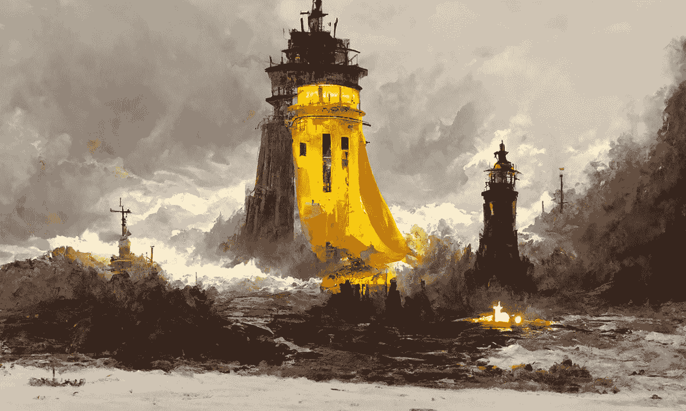

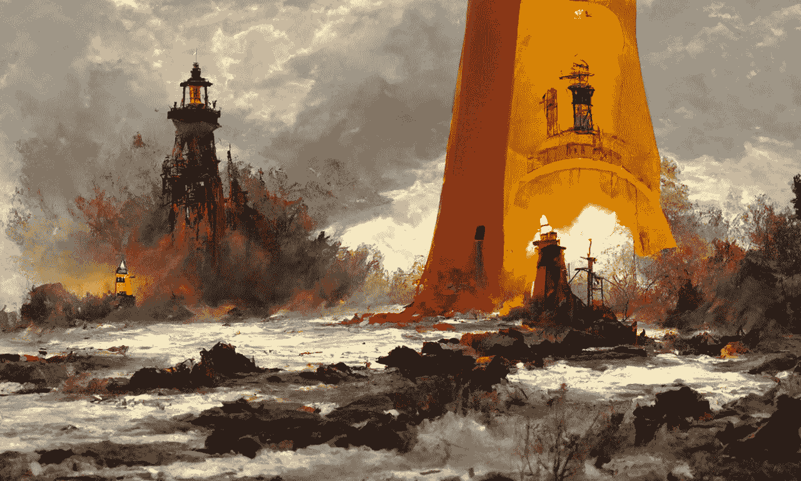

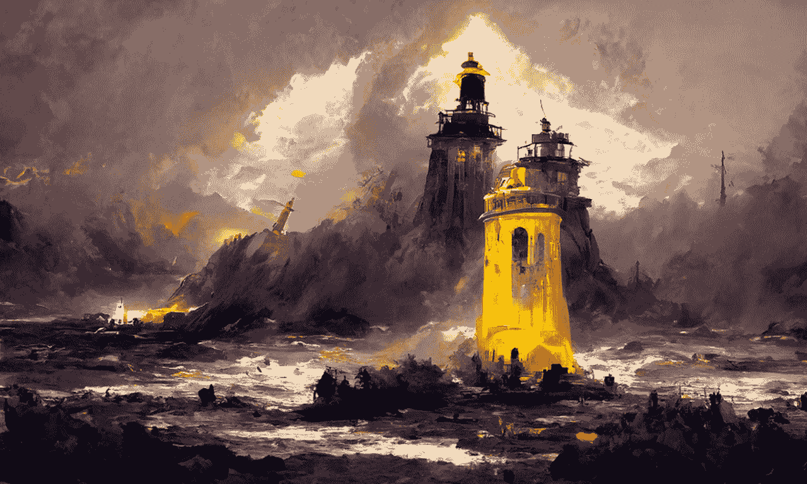

### 2.5.2 网友作品

以下是网友自定义创作的绘画作品，请欣赏~

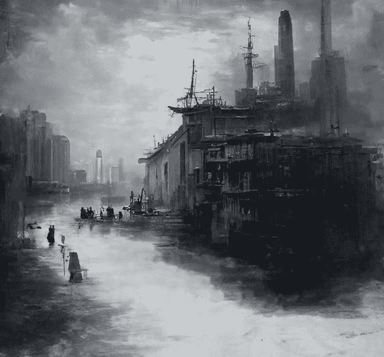

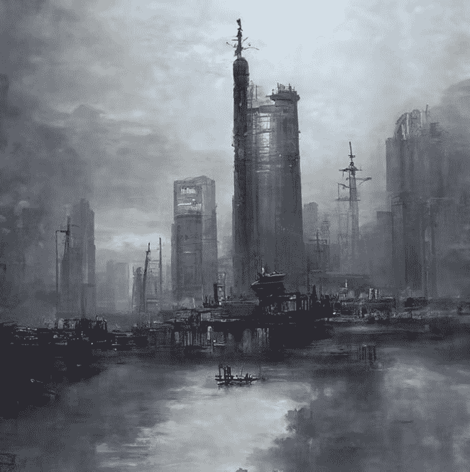


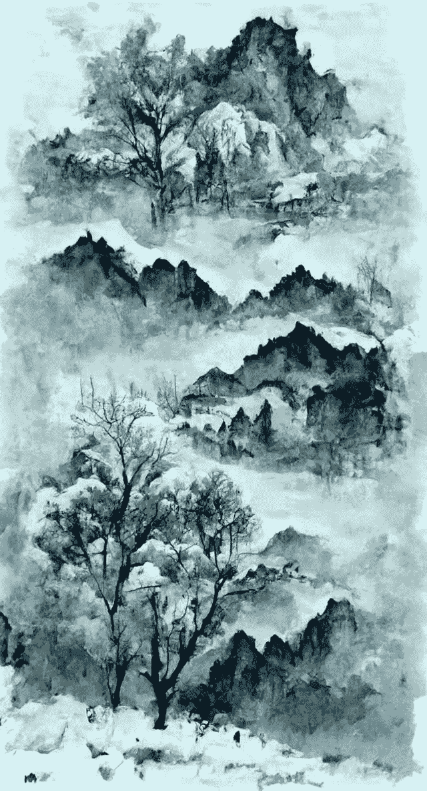

1.  结语

> 未来不是知识的对象，而是希望和恐惧的对象。

复**旦**大学王德峰老师说：人类以筹划和下决心的方式走向未来，如今的资本和技术以一种方式把过去转化为创建未来的力量；而艺术，它以作品直观地创建对未来的筹划，艺术作品是探索、冒险、做出决断，我们的未来可以在艺术中更好地呈现。

时代在发展，由资本扩张引起的技术革命也在世界各地持续上演，由此产生了许许多多的新技术。但我们始终要知道，技术产生工具，工具是中性的，希望大家能善于使用工具，不断创造出更符合我们未来发展的美好事物。

原文链接：https://www.qz.net/page/756    作者：朱攀