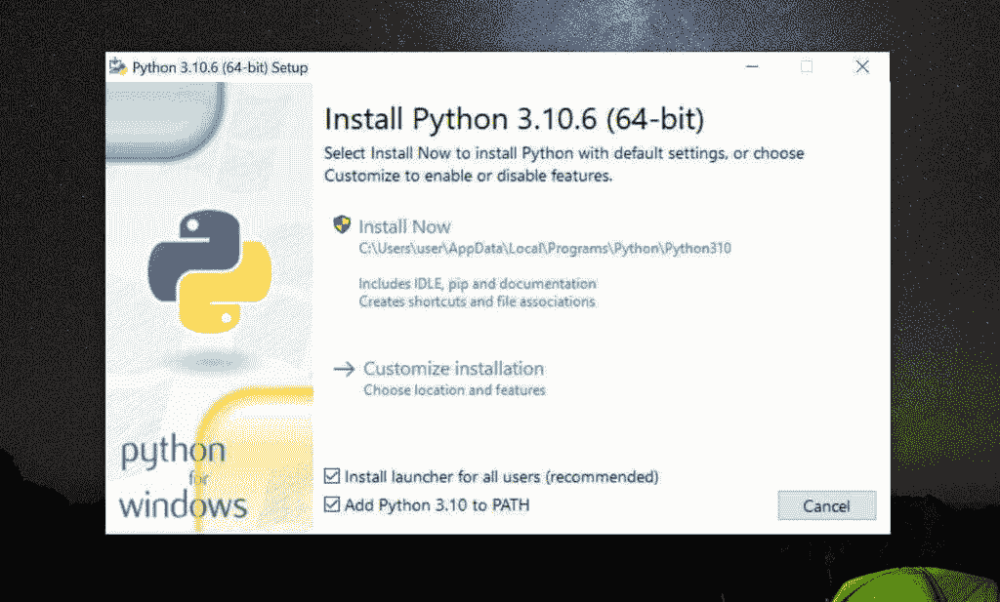
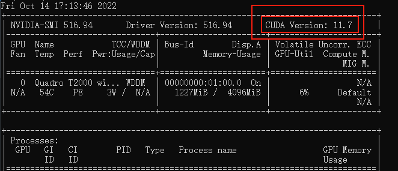
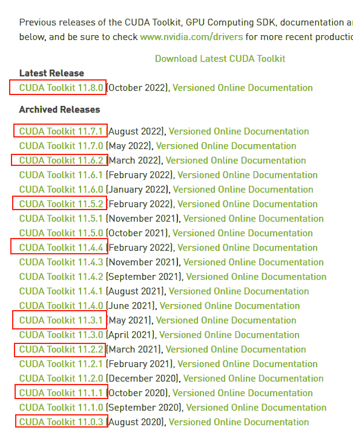
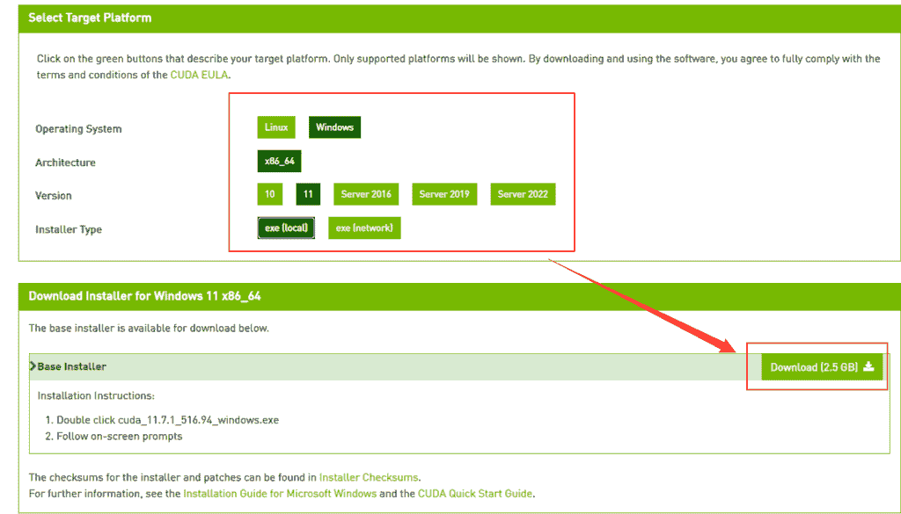
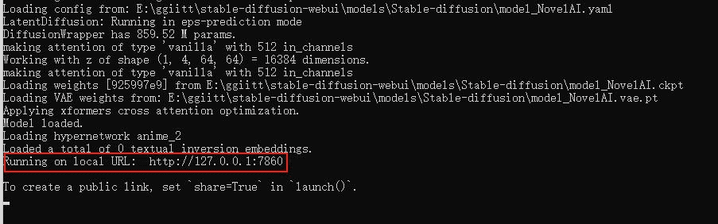
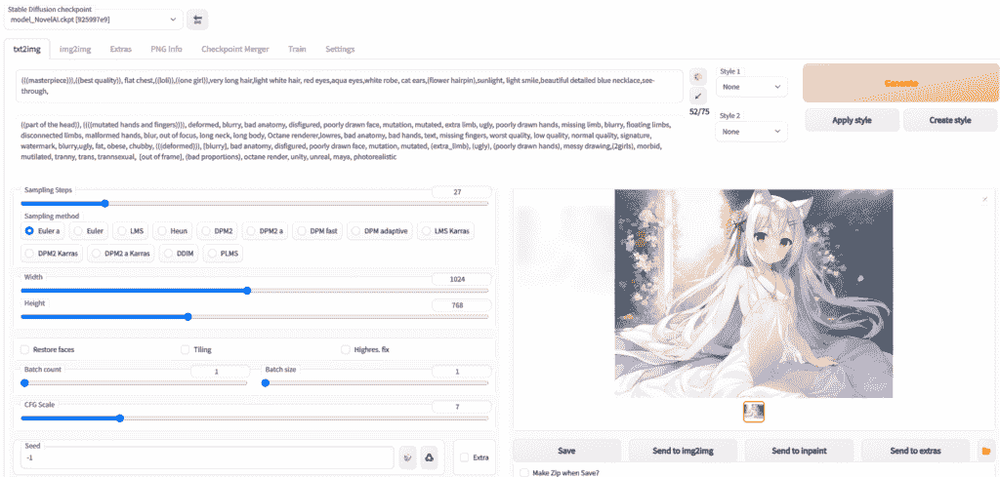

# 本地部署 AI作画工具 stable-diffusion-webui 多种模型 可生成NSFW

> 来源：[https://diwfpqo78m.feishu.cn/docx/Mj6rd7p02oA6h2xJZ60cJ6fBnRd](https://diwfpqo78m.feishu.cn/docx/Mj6rd7p02oA6h2xJZ60cJ6fBnRd)


AI作画最近非常火热啊，本文是在使用N卡的电脑上，本地部署stable-diffusion-webui前端+替换默认的模型，实现生成高质量的二次元图像，并且可以不受限制的生成图片（在线版一般会阻止NSFW内容生成）。

---

+   AI绘画系列文章之一：[本地部署 AI作画工具 stable diffusio](https://www.tjsky.net/tutorial/457)n webui 多种模型 可生成NSFW

+   AI绘画系列文章之二：[AI绘画指南 stable diffusion web](https://www.tjsky.net/tutorial/488)ui （SD webui）如何设置与使用

+   AI绘画系列文章之三：[A](https://www.tjsky.net/tutorial/498)I作画工具 stable diffusion webui 一键安装工具（A1111-Web-UI-Installer）

+   AI绘画系列文章之四：[AI 绘画与作画 stable diffu](https://www.tjsky.net/tutorial/583)sion webui 常见模型汇总及简介

---

**所需资源下载位置：**

Git：https://git-scm.com/download

CUDA：https://developer.nvidia.com/cuda-toolkit-archive

Python3.10.6：https://www.python.org/downloads/release/python-3106/

waifu-diffusion：https://huggingface.co/hakurei/waifu-diffusion

waifu-diffusion-v1-3：https://huggingface.co/hakurei/waifu-diffusion-v1-3

stable-diffusion-v-1-4-original： https://huggingface.co/CompVis/stable-diffusion-v-1-4-original

stable-diffusion-v-1-5： https://huggingface.co/runwayml/stable-diffusion-v1-5

stable-diffusion-webui：https://github.com/AUTOMATIC1111/stable-diffusion-webui

NovelAILeaks 4chan:https://pub-2fdef7a2969f43289c42ac5ae3412fd4.r2.dev/naifu.tar

NovelAILeaks animefull-latest:https://pub-2fdef7a2969f43289c42ac5ae3412fd4.r2.dev/animefull-latest.tar

---

**文章目录**

+   [开始](https://diwfpqo78m.feishu.cn/wiki/wikcnWg7fxGmBLqQQtZsXwAJ0Gf#part-FZfIduPekoqatmxZiaZcqi8NnFd)

+   [准备运行环境](https://diwfpqo78m.feishu.cn/wiki/wikcnWg7fxGmBLqQQtZsXwAJ0Gf#part-La0eddXq7owVQkxNmWJcOjWknTg)

+   安装 Python 3.10.6 与 pip

+   [安装 Git](https://diwfpqo78m.feishu.cn/wiki/wikcnWg7fxGmBLqQQtZsXwAJ0Gf#part-ZD6VdoIXmo1ZPtxc2b7co47znEb)

+   [安装 CUDA](https://diwfpqo78m.feishu.cn/wiki/wikcnWg7fxGmBLqQQtZsXwAJ0Gf#part-QexLde5RZoRqZfxUcqwc5HUInLe)

+   下载stable-diffusion-webui

+   [下载模型文件](https://diwfpqo78m.feishu.cn/wiki/wikcnWg7fxGmBLqQQtZsXwAJ0Gf#part-LZHNd3Be4okmmLx9t0jcClWVnfq)

+   [模型的大致区别](https://diwfpqo78m.feishu.cn/wiki/wikcnWg7fxGmBLqQQtZsXwAJ0Gf#part-NsgxdSZ7TovQDkxvM3xc9OfPnde)

+   下载stable-diffusion

+   下载 waifu-diffusion

+   [下载 NovelAILeaks](https://diwfpqo78m.feishu.cn/wiki/wikcnWg7fxGmBLqQQtZsXwAJ0Gf#part-MJiNdnvhyomZd9xx9hfcJOiUn8d)

+   [下载其他模型](https://diwfpqo78m.feishu.cn/wiki/wikcnWg7fxGmBLqQQtZsXwAJ0Gf#part-SL2gd4RRnoSyG6xIoENcVqXznRf)

+   [运行](https://diwfpqo78m.feishu.cn/wiki/wikcnWg7fxGmBLqQQtZsXwAJ0Gf#part-BUo7d9CDuopt3bx5km0cqyVvnMb)

+   [生成第一张AI作图](https://diwfpqo78m.feishu.cn/wiki/wikcnWg7fxGmBLqQQtZsXwAJ0Gf#part-FAQcdJKT1oFJ8Fxffz7cIEy5nJe)

+   [后话](https://diwfpqo78m.feishu.cn/wiki/wikcnWg7fxGmBLqQQtZsXwAJ0Gf#part-Et3Jd7pYoo00qnxaTnQcbK3onig)

# 开始

首先请确定你有基本的理解能力和动手能力，基本的网络搜索检索信息的能力。过于基础的东西比如“什么是命令行”，“如何下载文件”，“magnet是什么东西”，“满屏英语看不懂”，“怎么给Python，Git加上魔法上网”等等这些过于基础的问题，我这里无法做出说明，也不会解答。

要顺利运行 **st**able-diffusion-webui与模型，

需要足够大的显存，最低配置4GB显存，基本配置6GB显存，推荐配置12GB显存。

当然内存也不能太小，最好大于16GB。

显存大小决定了你能生成的图片尺寸，一般而言图片尺寸越大，AI能发挥的地方越多，画面里填充的细节就越多。

GPU主频和显存位宽，则决定了你能生成的多快。

当显存不足时，只能用时间换性能，将生成时间延长4倍，甚至8~10倍来生成同样的图片。

教程部署环境为

CPU：Intel® Core™ i7-10750H

GPU：NVIDIA Quadro T2000 with Max-Q Design (显存4GB)

内存：16GB * 4

磁盘：1TB * 2 SSD

OS：win11 21H1

---

# 准备运行环境

需要准备3个或4个东西

Python 3.10.6，Git ，CUDA，这三个的下载地址在文章的最前边。

视情况，你可能还需要一个魔法上网工具（假设你的魔法上网工具代理在127.0.0.1:6808）

## 安装 Python 3.10.6 与 pip

请一定安装3.10.6版本的Python，其他版本高几率无法运行

请一定安装3.10.6版本的Python，其他版本高几率无法运行

请一定安装3.10.6版本的Python，其他版本高几率无法运行

我这里采用直接系统内安装Python 3.10.6的方式

如果你会用Miniconda，也可以用Miniconda实现Python多版本切换，具体我这里不教需要的自己琢磨。

1.  访问 [Python3.10.6](https://www.tjsky.net/goto/?url=https://www.python.org/downloads/release/python-3106/) 下载页面

1.

1.  把页面拉到底，找到【Windows installer (64-bit)】点击下载

1.  安装是注意，到这一步，需要如下图这样勾选 Add Python to PATH



然后再点上边的** Install No**w

python

1.

1.  安装完成后，命令行里输入Python -V，如果返回Python 3.10.6那就是成功安装了。

1.  命令行里输入 python -m pip install --upgrade pip安装升级pip到最新版。

请一定安装3.10.6版本的Python，其他版本高几率无法运行

请一定安装3.10.6版本的Python，其他版本高几率无法运行

请一定安装3.10.6版本的Python，其他版本高几率无法运行

## 安装 Git

1.  访问 [Git](https://www.tjsky.net/goto/?url=https://git-scm.com/download) 下载页面

1.

1.  点击【Download for Windows】，【64-bit Git for Windows Setup】点击下载

1.  一路下一步安装

1.  命令行运行git --version,返回git version 2.XX.0.windows.1就是安装成功了。

## 安装 CUDA

1.  命令行运行nvidia-smi,看下自己显卡支持的 CUDA版本
（升级显卡驱动有可能会让你支持更高版本的 CUDA）



1.  接下来前往英伟达 [CUDA](https://www.tjsky.net/goto/?url=https://developer.nvidia.com/cuda-toolkit-archive) 官网，下载对应版本。
注意请下载，你对应的版本号最高的版本，比如我的是11.7的，那就下11.7.1（这里最后的.1意思是，11.7版本的1号升级版）



1.  选你自己的操作系统版本，注意下个离线安装包【exe [local]】，在线安装的话，速度还是比较堪忧的。



## 下载stable-diffusion-webui

找一个你喜欢的目录，在资源管理器，地址栏里敲CMD，敲回车，启动命令提示行窗口，输入以下命令

# 下载项目源代码git clone https://github.com/AUTOMATIC1111/stable-diffusion-webui.git # 切换到项目根目录cd stable-diffusion-webui

Bash

Copy

+   他会在你选择的目录下生成stable-diffusion-webui文件夹，放项目

+   这东西本体+虚拟环境+集中模型+增强脚本最后会很大的，目前我已经占用了快20GB了，请放到磁盘空间富裕的盘符

+   整个路径中，不要有中文（比如“C:\AI作画工具\”），也不要有空格（比如“C:\Program Files”）可以避免很多奇怪的问题。

## 下载模型文件

stable-diffusion-webui只是个工具，他需要后端的训练模型来让AI参考建模。

目前比较主流的模型有

+   stable-diffusion：偏真人（一般简称为 SD 模型， SDwebui 模型）

+   waifu-diffusion：偏向二次元（一般简称 Waifu 模型，WD模型）

+   Novel-AI-Leaks：更加偏向二次元（一般简称 Naifu 模型）

模型文件一般都比较大，请找个空间富裕的磁盘下载。

更多模型下载可以看下这个：《AI 绘画与作画 常见模型汇总及简介》

### **模型的大致区别**

+   注意这里显存指的是512X512尺寸，默认配置下，出图时软件所需要占用的显存。2GB显存起步，意味浙你电脑显卡实际显存最少也要3GB（因为系统桌面，浏览器的显示也需要占用一部分显存）

+   通过增加各种“优化”参数，可以通过性能的部分下降换取显存占用减少。

+   Nafu模型名称说明1：animefull-final-pruned = full-latest = NAI 全量模型(包含NSFW)

+   Nafu模型名称说明2：animesfw-latest = NAI 基线模型

### 下载stable-diffusion

下载的方式有 3 个

+   官网下载：[h](https://www.tjsky.net/goto/?url=https://huggingface.co/CompVis/stable-diffusion-v-1-4-original)ttps://huggingface.co/CompVis/stable-diffusion-v-1-4-original

+

+   File storage：[h](https://www.tjsky.net/goto/?url=https://drive.yerf.org/wl/?id=EBfTrmcCCUAGaQBXVIj5lJmEhjoP1tgl)ttps://drive.yerf.org/wl/?id=EBfTrmcCCUAGaQBXVIj5lJmEhjoP1tgl

+   磁力链接 magnet:?xt=urn:btih:3a4a612d75ed088ea542acac52f9f45987488d1c&dn=sd-v1-4.ckpt&tr=udp%3a%2f%2ftracker.openbittorrent.com%3a6969%2fannounce&tr=udp%3a%2f%2ftracker.opentrackr.org%3a1337

+   将解压出.ckpt文件放在\stable-diffusion-webui\models\Stable-diffusion\ 下
文件名可以是任何你喜欢的英文名。比如stable-diffusion .ckpt

### 下载 waifu-diffusion

+   官网下载：[h](https://www.tjsky.net/goto/?url=https://huggingface.co/hakurei/waifu-diffusion-v1-3/tree/main)ttps://huggingface.co/hakurei/waifu-diffusion-v1-3/tree/main

+   下那个 wd-v1-3-float16.ckpt 就行

+   将解压出.ckpt文件放在\stable-diffusion-webui\models\Stable-diffusion\ 下
文件名可以是任何你喜欢的英文名.比如waifu-diffusion-16.ckpt

### **下载 NovelAILeaks**

+   [N](https://www.tjsky.net/goto/?url=https://pub-2fdef7a2969f43289c42ac5ae3412fd4.r2.dev/naifu.tar)aifu Leaks 4chan:https://pub-2fdef7a2969f43289c42ac5ae3412fd4.r2.dev/naifu.tar

+   [Naifu Leaks animefull-latest:htt](https://www.tjsky.net/goto/?url=https://pub-2fdef7a2969f43289c42ac5ae3412fd4.r2.dev/animefull-latest.tar)ps://pub-2fdef7a2969f43289c42ac5ae3412fd4.r2.dev/animefull-latest.tar

+   找到naifu\models\animefull-final-pruned\model.ckpt放在\stable-diffusion-webui\models\Stable-diffusion\ 下文件名可以是任何你喜欢的英文名，比如Naifu-Leaks- 4chan.ckpt

+   找到naifu\models\animefull-final-pruned\config.yaml放在\stable-diffusion-webui\models\Stable-diffusion\ 下文件名改成上边和你上边的文件同名,比如Naifu-Leaks- 4chan.yaml

+   找到naifu\modules\,把里面所有的.pt文件复制到\stable-diffusion-webui\models\hypernetworks\文件夹下，没有这个文件夹就自己新建一个。

### **下载其他模型**

[出于篇幅问题，其他常见的绘画用模型请参考另一篇](https://www.tjsky.net/tutorial/583)文章

《AI 绘画与作画 stable diffusion webui 常见模型汇总及简介》

## 运行

1.  双击运行\stable-diffusion-webui\webui-user.bat

1.

1.  耐心**等待，脚本会自己检查依赖****，会下****载大**约几个G的东西，解压安装到文件夹内（视网速不同，可能需要20分钟~2小时不等）无论看起来是不是半天没变化，感觉像卡住了，或者你发现电脑也没下载东西，窗口也没变化。千万不要关闭这个黑乎乎的CMD窗口，只要窗口最下方没显示类似“按任意键关闭窗口”的话，那脚本就是依然在正常运行的。

1.  当你看到下图这行字的时候，就是安装成功了



1.  复制到浏览器访问即可（默认是 http://127.0.0.1:7860 ）（注意不要关闭这个窗口，关闭就退出了）

# 生成第一张AI作图



这里只是简单说一下，稍微详细一点的教程请看另一篇文章：《AI绘画指南 （SD webui）如何设置与使用》

1.  Prompt 里填写想要的特征点

(((masterpiece))),((best quality)), flat chest,((loli)),((one girl)),very long light white hair, beautiful detailed red eyes,aqua eyes,white robe, cat ears,(flower hairpin),sunlight, light smile,blue necklace,see-through,

以上大概意思就是

杰作，最佳品质，贫乳，萝莉，1个女孩，很长的头发，淡白色头发，红色眼睛，浅绿色眼睛，白色长裙，猫耳，发夹，阳光下，淡淡的微笑，蓝色项链，透明

1.  Negative prompt 里填不想要的特征点
((part of the head)), ((((mutated hands and fingers)))), deformed, blurry, bad anatomy, disfigured, poorly drawn face, mutation, mutated, extra limb, ugly, poorly drawn hands, missing limb, blurry, floating limbs, disconnected limbs, malformed hands, blur, out of focus, long neck, long body, Octane renderer,lowres, bad anatomy, bad hands, text, missing fingers, worst quality, low quality, normal quality, signature, watermark, blurry,ugly, fat, obese, chubby, (((deformed))), [blurry], bad anatomy, disfigured, poorly drawn face, mutation, mutated, (extra_limb), (ugly), (poorly drawn hands), messy drawing,(2girls), morbid, mutilated, tranny, trans, trannsexual, [out of frame], (bad proportions), octane render, unity, unreal, maya, photorealistic
大概意思就是排除一些负面标签，比如奇怪的手，奇怪的肢体，减少生成奇怪图片的几率

1.

1.  Sampling Steps 你可以理解让AI推演多少步，一般来说超过17基本就能看了，步数越多，画面中的细节就越多，但需要的时间也就越久，一般20~30是一个比较稳妥的设定。这个数不会改变画面内容，只会让内容更加精细，比如20的项链就是一个心形钻石，而50的项链还是同样的心形钻石，只是钻石上会有更加复杂的线条

1.  Sampling method 你可以理解成AI推演的算法，一般Euler a，Euler ，DDIM，都是不错的，任选一个就行。

1.  图片分辨率 这个就是拼显卡显存的，自己调吧，低于512X512可能画面就不会有太多细节了，越大的分辨率AI能发挥的地方就越多。

1.  下边是3个扩展选项，一般不需要勾选。
Restore faces：勾选后可以生成更真实的脸，第一次勾选使用时，需要先下载几个G的运行库。
Tiling：让图片可以平铺（类似瓷砖，生成的图案左右上下都可以无缝衔接上自己）
Highres. fix：超分辨率，让AI用更高的分辨率填充内容，但生成的最终尺寸还是你上边设定的尺寸。

1.  生成几次，每次多少张
Batch count：是一次运行几次
Batch size： 是同时生成多少张

比如：Batch count设置为4,用时N分钟*4，生成4张图；Batch count设置为4,用时N分钟，生成4张图，但是同时需要的显存也是4倍。512X512大概需要3.75GB显存，4倍就是15GB显存了。

1.  CFG Scale AI有多参考你的Prompt与Negative prompt
开得越高，AI越严格按照你的设定走，但也会有越少的创意
开的越低，AI就越放飞自我，随心所欲的画。
一般7左右就行。

1.

1.  Seed 随机数种子，AI作画从原理上其实就是用一个随机的噪声图，反推回图像。但因为计算机里也没有真随机嘛，所以实际上，AI作画的起始噪声，是可以量化为一个种子数的。

1.  Generate 开始干活按钮，这个就不用说了吧，点了AI就开始干活了。

1.  Stable Diffusion checkpoint 在最左上角，是选择模型的，前边让你下载了三个，请根据自己需求和体验自行选择使用。

---

# 后话

1.  使用NovelAILeaks模型，有一个额外的设置，请在页面中选择【settings选项卡】，把页面往下拉到底，找到setting CLIP stop at last layers（Clip 跳过层），把他设置为2

1.  AI作图不是释放魔法，不是魔咒越长施法前摇越长的魔咒威力就越大。请简洁、准确、详细的描述你需要的Prompt即可。像我上边的要求就是，1个萝莉，穿白色连衣裙，瞳孔红色，长发，白色，带发卡，猫耳，微笑，阳光下。半透明材质衣服，已经WebUI是有75个词限制的。

1.  如果你想生成更大尺寸的图，但是显卡显存不足

用文本编辑器打开\stable-diffusion-webui\webui-user.bat。

在COMMANDLINE_ARGS=后添加–medvram

如果还不行，改成–medvram –xformers

如果还不行，改成–medvram –opt-split-attention –xformers

如果还不行，改成–lowvram

如果还不行，改成–lowvram –xformers

如果还不行，改成–lowvram –opt-split-attention

注意这是个用生成时间换图片尺寸的事情，最极端的参数可能导致你图片生成时间是之前的好几倍。

最极端参数是个什么概念呢，比如默认配置512X512一张图是10秒内，但显存需要4G，改成最极端配置，显存仅需0.5~0.7G（和Sampling method有关），但代价是时长变成3分钟。

1.  16XX系显卡，需要用文本编辑器打开\stable-diffusion-webui\webui-user.bat。
在COMMANDLINE_ARGS=后添加–precision full –no-half
类似下边这样，不然生成图会是黑块或者绿块，这是个16XX系显卡的bug

```
@echo off

set PYTHON=set GIT=set VENV_DIR=set COMMANDLINE_ARGS=---precision full --no-half

call webui.bat
```

Bash

Copy

1.  示意图中tag如下,理论上只要参数完全一致，就可以复现出一样的画（仅些微细节不同）

```
Stable Diffusion checkpoint:NovelAILeaks 4chan[925997e9]
prompt:
(((masterpiece))),((best quality)), flat chest,((loli)),((one girl)),very long hair,light white hair, red eyes,aqua eyes,white robe, cat ears,(flower hairpin),sunlight, light smile,beautiful detailed blue necklace,see-through,
Negative prompt: ((part of the head)), ((((mutated hands and fingers)))), deformed, blurry, bad anatomy, disfigured, poorly drawn face, mutation, mutated, extra limb, ugly, poorly drawn hands, missing limb, blurry, floating limbs, disconnected limbs, malformed hands, blur, out of focus, long neck, long body, Octane renderer,lowres, bad anatomy, bad hands, text, missing fingers, worst quality, low quality, normal quality, signature, watermark, blurry,ugly, fat, obese, chubby, (((deformed))), [blurry], bad anatomy, disfigured, poorly drawn face, mutation, mutated, (extra_limb), (ugly), (poorly drawn hands), messy drawing,(2girls), morbid, mutilated, tranny, trans, trannsexual, [out of frame], (bad proportions), octane render, unity, unreal, maya, photorealistic
Steps: 27, S
ampler: Euler a, 
CFG scale: 7, 
Seed: 2413789891, 
Size: 1024x768, 
Model hash: 925997e9, 
Clip skip: 2
```

1.  如果你想了解AI绘画的原理，这里有一篇不错的文章：学习AI绘画，从Diffusion和CLIP开始