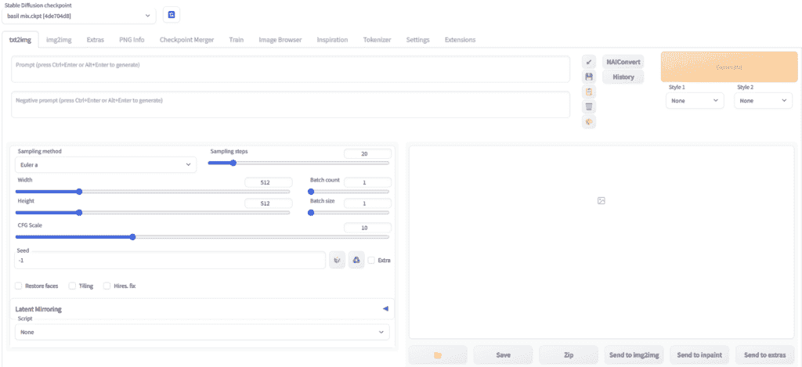
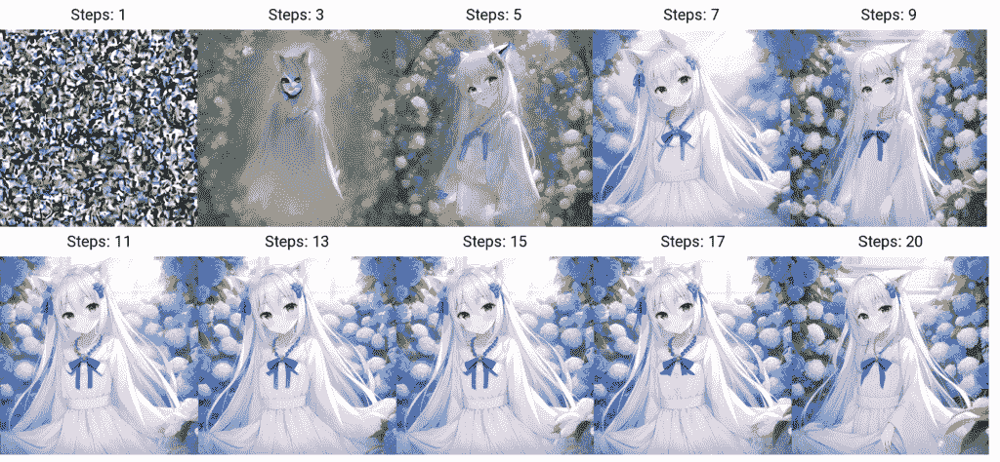

# AI绘画指南 stable diffusion webui （SD webui）如何设置与使用

> 来源：[https://diwfpqo78m.feishu.cn/docx/M7PqdTXSmo8LdExB36Vc7R6Zn3P](https://diwfpqo78m.feishu.cn/docx/M7PqdTXSmo8LdExB36Vc7R6Zn3P)

不敢妄称教程，只是根据自己最近的理解与实践，只能说是给后来的AI绘画作画者一点快速上手入门的参考吧。

主要是涉及 SD webui 界面介绍、参数含义及调整，txt2img 怎么设置特征点，img2img 怎么完善原始图像等内容。



---

## 文章目录

- [stable diffusion webui （SD webui）界面介绍](#part-Fs8OdOsOYoNbTcx6VRNcNIMsnud)
- [各选项卡的一句话介绍](#part-XgfudCBZco43jMxauKLcgWInned)
- [【文生图界面】](#part-KRnHd6mscoHiRBxCR32c3Ndunce)
- [提示词 Prompt](#part-IpY2d5xelo8MxxxZLaCcAJh5nvb)
- [支持的语言](#part-GqlWdLIyPo0N0pxPAApcKivZnKc)
- [tag语法](#part-PYNBdP9RlotLcVxGy75cQXhfnkb)
- [tag书写示例](#part-D4sfdu6VMordtExGkZTcAFrAned)
- [tag书写要点](#part-IMqrdLIm8o7imoxfxdtcDrohnne)
- 反向提示词 Negative prompt
- 采样迭代步数 Sampling Steps
- 采样方法 Sampling method
- 生成批次Batch count/n_iter
- [每批数量 Batch size](#part-IbZ0dTTiwo5c5exma5AcwRREnOc)
- 提示词相关性 CFG Scale
- 宽度 X 高度 Width X Height
- [随机种子 Seed](#part-C4LodsYZWoe6TYxkz5VcULdsnag)
- [面部修复](#part-KULsdOT9HoMykAxUuwJcoPsbnBc)
- [可平铺(Tiling)](#part-A153d87UqoGrTGxYZ1vcSJTsnAe)
- [超分辨率 Hires. fix](#part-T5JQdhUTpoh3q1xebHUcQtmunhf)
- [【设置】 Settings](#part-WfY5dIlbVokYYixkb29cAuCgnvg)
- 用户界面 User interface
- 【扩展界面】 Extensions
- [已安装扩展 Installed](#part-LVlEdmJ9YonlnqxpE7ecNjDSnHb)
- [可用 Available](#part-Cvr4dmGGToFzDLxDfh6cEpedntc)
- 从URL安装 Install from URL
- [怎么设定为中文版](#part-SOGLdZY7LoxHeIxBQmGcZqL4nBd)

## stable diffusion webui （SD webui）界面介绍

- SD webui 的默认地址为 `127.0.0.1:7860`
- 目前有中文界面了（[点击查看设置步骤](#part-PoEsdlrHcoPOoCxanfgcsKusn6d)），下文将以中文版为主，结合英文原文介绍。
- 项目日常更新频繁，请定期`git pull`更新：一个小白点的方法：在电脑资源管理器内，打开`stable-diffusion-webui`文件夹，在地址栏输入`cmd`，然后敲回车，在该目录下调出命令提示行，然后在命令提示行窗口里输入`git pull`，然后敲回车即可。

### 各选项卡的一句话介绍

1. txt2img 文生图：顾名思义就是用文字生成图片
2. img2img 图生图：顾名思义就是用图片生成图片
3. Extras 更多：这里其实是“无损”放大图片用的
4. PNG info 图片信息：从图片exif里获取图片的信息，如果是SD原始生成的png图片，图片的exif信息里会写入图片生成参数的，所以你在网上看到大佬生成的美图，可以用这个功能帮你查看
5. Checkpoint Merger 模型（ckpt）合并：合并不同的模型，生成新的模型
6. Train 训练：自己炼 embedding 或者 hypernetwork
7. Settings 设置：顾名思义就是设置页面
8. Extensions 扩展：顾名思义这里是扩展的管理页面。

下边开始较为详细的介绍一下各个界面

### 【文生图界面】

这估计是新人最常用的界面了，顾名思义就是用文字生成图片的地方

#### 提示词 Prompt

用文字描述你想要生成的东西

##### 支持的语言

支持的输入语言为英语（不用担心英语不好的问题，目前网上有很多tag生成器供你使用），SD支持用自然语言描述，不过还是推荐使用用逗号分隔的一个个的关键词来写，当然表情符号，emoji，甚至一些日语都是可以用的。

##### tag语法

1. 分隔：不同的关键词tag之间，需要使用英文逗号`,`分隔，逗号前后有空格或者换行是不碍事的

   ex：`1girl,loli,long hair,low twintails`（1个女孩，loli，长发，低双马尾）

2. 混合：WebUi 使用 `|` 分隔多个关键词，实现混合多个要素，注意混合是同等比例混合，同时混。

   ex: `1girl,red|blue hair, long hair`（1个女孩，红色与蓝色头发混合，长发）

3. 增强/减弱：有两种写法

   - 第一种 `(提示词:权重数值)`：数值从0.1~100，默认状态是1，低于1就是减弱，大于1就是加强

     ex: `(loli:1.21),(one girl:1.21),(cat ears:1.1),(flower hairpin:0.9)`

   - 第二种 `(((提示词)))`，每套一层`()`括号增强1.1倍，每套一层`[]`减弱1.1倍。也就是套两层是1.1*1.1=1.21倍，套三层是1.331倍，套4层是1.4641倍。

     ex: `((loli)),((one girl)),(cat ears),[flower hairpin]`和第一种写法等价

   - 所以还是建议使用第一种方式，因为清晰而准确

4. 渐变：比较简单的理解时，先按某种关键词生成，然后再此基础上向某个方向变化。

   `[关键词1:关键词2:数字]`，数字大于1理解为第X步前为关键词1，第X步后变成关键词2，数字小于1理解为总步数的百分之X前为关键词1，之后变成关键词2

   - ex：`a girl with very long [white:yellow:16] hair` 等价为

     开始 `a girl with very long white hair`

     16步之后`a girl with very long yellow hair`

   - ex：`a girl with very long [white:yellow:0.5] hair` 等价为

     开始 `a girl with very long white hair`

     50%步之后`a girl with very long yellow hair`

5. 交替：轮流使用关键词

   ex：`[cow|horse] in a field`比如这就是个牛马的混合物，如果你写的更长比如`[cow|horse|cat|dog] in a field`就是先朝着像牛努力，再朝着像马努力，再向着猫努力，再向着狗努力，再向着马努力

##### tag书写示例

建议按类似这样的格式书写提示词

```
画质词>>
这个一般比较固定，无非是，杰作，最高画质，分辨率超级大之类的

风格词艺术风格词>>
比如是照片还是插画还是动画

图片的主题>>
比如这个画的主体是一个女孩，还是一只猫，是儿童还是萝莉还是少女，是猫娘还是犬娘还是福瑞，是白领还是学生

他们的外表>>
注意整体和细节都是从上到下描述，比如
发型（呆毛，耳后有头发，盖住眼睛的刘海，低双马尾，大波浪卷发），
发色（顶发金色，末端挑染彩色），
衣服（长裙，蕾丝边，低胸，半透明，内穿蓝色胸罩，蓝色内裤，半长袖，过膝袜，室内鞋），
头部（猫耳,红色眼睛），
颈部（项链），
手臂（露肩），
胸部（贫乳），
腹部（可看到肚脐），
屁股（骆驼耻），
腿部（长腿），
脚步（裸足）

他们的情绪>>
表述表情

他们的姿势>>
基础动作（站，坐，跑，走，蹲，趴，跪），
头动作（歪头，仰头，低头），
手动作（手在拢头发，放在胸前 ，举手），
腰动作（弯腰，跨坐，鸭子坐，鞠躬），
腿动作（交叉站，二郎腿，M形开腿，盘腿，跪坐），
复合动作（战斗姿态，JOJO立，背对背站，脱衣服）

图片的背景>>
室内，室外，树林，沙滩，星空下，太阳下，天气如何

杂项>>
比如NSFW，眼睛描绘详细
```

将不同的分类的词，通过换行区分开，方便自己随时调整

```
(masterpiece:1.331), best quality,
illustration,
(1girl),
(deep pink hair:1.331), (wavy hair:1.21),(disheveled hair:1.331), messy hair, long bangs, hairs between eyes,(white hair:1.331), multicolored hair,(white bloomers:1.46),(open clothes),
beautiful detailed eyes,purple|red eyes),
expressionless,
sitting,
dark background, moonlight, ,flower_petals,city,full_moon, 
```

于是我们得到这样一张图


##### tag书写要点

1. 虽然大家都管这个叫释放魔法，但真不是越长的魔咒（提示词）生成的图片越厉害，请尽量将关键词控制在75个（100个）以内。
2. 越关键的词，越往前放。
3. 相似的同类，放在一起。
4. 只写必要的关键词。

#### 反向提示词 Negative prompt

用文字描述你不想在图像中出现的东西

AI大致做法就是

1. 对图片进行去噪处理，使其看起来更像你的提示词。
2. 对图片进行去噪处理，使其看起来更像你的反向提示词（无条件条件）。
3. 观察这两者之间的差异，并利用它来产生一组对噪声图片的改变
4. 尝试将最终结果移向前者而远离后者

一个相对比较通用的负面提示词设置

```
lowres,bad anatomy,bad hands,text,error,missing fingers,
extra digit,fewer digits,cropped,worst quality,
low quality,normal quality,jpeg artifacts,signature,
watermark,username,blurry,missing arms,long neck,
Humpbacked,missing limb,too many fingers,
mutated,poorly drawn,out of frame,bad hands,
unclear eyes,poorly drawn,cloned face,bad face
```

#### 采样迭代步数 Sampling Steps

AI绘画的原理用人话说就是，先随机出一个噪声图片

然后一步步的调整图片，向你的提示词 Prompt 靠拢

Sampling Steps就是告诉AI，这样的步骤应该进行多少次。

步骤越多，每一步移动也就越小越精确。同时也成比例增加生成图像所需要的时间。

大部分采样器超过50步后意义就不大了

下图是同一个图从1step到20step，不同step时图像的变化。



#### 采样方法 Sampling method

使用哪种采样器，人话就是让AI用什么算法。

这里只介绍常用的，不太常用的就自己去琢磨吧

1. Euler a：富有创造力，不同步数可以生产出不同的图片。超过30~40步基本就没什么增益了。
2. Euler：最最常见基础的算法，最简单的，也是最快的。
3. DDIM：收敛快，一般20步就差不多了。
4. LMS：eular的延伸算法，相对更稳定一点，30步就比较稳定了
5. PLMS：再改进一点LMS
6. DPM2：DDIM的一种改进版，它的速度大约是 DDIM 的两倍

#### 生成批次Batch count/n_iter

同样的配置，循环跑几次

#### 每批数量 Batch size

同时生成多少个图像。增加这个值可以并行运行，但你也需要更多的显卡显存，具体可以自己看着任务管理器里的显存占用显示，自己调。

基本512X512的图，SD1.4模型，Euler a，4G显存可以并行2张，8G显存可以并行8张。

每点一次生成按钮，生成的图像总数=生成批次 X 每批数量

#### 提示词相关性 CFG Scale

图像与你的提示的匹配程度。

增加这个值将导致图像更接近你的提示，但过高会让图像色彩过于饱和（你可以自己试试看）

太高后在一定程度上降低了图像质量。可以适当增加采样步骤来抵消画质的劣化。

一般在5~15之间为好，7，9，12是3个常见的设置值。

#### 宽度 X 高度 Width X Height

单位是像素，适当增加尺寸，AI会试图填充更多的细节进来。

非常小的尺寸（低于256X256），会让AI没地方发挥，会导致图像质量下降。

非常高的尺寸（大于1024X1024），会让AI乱发挥，会导致图像质量下降。

增加尺寸需要更大的显存。4GB显存最大应该是1280X1280（极限）

> 因为常见的模型基本都是在512×512和768X768的基础上训练
>
> 分辨率过高，图片质量会随着分辨率的提高而变差
>
> 一般1024X1024以上尺寸AI就会搞出搞各种鬼畜图。
>
> 如果模型明确某些分辨率最优，请遵照模型的要求
>
> 比如3DKX系列模型就是明确推荐图片分辨率为1152 x 768。

如果你确实想生成高分辨率图像，请使用“Hires. fix”功能。

#### 随机种子 Seed

前边说过，AI绘画的原理是，先随机出一个噪声图片

因为计算机世界里不存在真随机

保持种子不变，同一模型和后端，保持所有参数一致的情况下，

相同的种子可以多次生成（几乎）相同的图像。

如果你用某个种子在某tag下生成了很棒的图，

保持种子数不变，而稍微改一点点tag，增减一点细节，一般得到的图也会不错。

- 不同型号的显卡即使参数与模型完全一致，也可能会生成完全不同的图。

  10XX和16XX系显卡基本每种型号都会是不同的结果，20XX系和30XX系基本都可以完美复现图片。

- 这里不是10XX系显卡不适合AI作画的意思，只是你可能看网友的参数图很棒，你想照搬一下结果却大不一样。


- 某些模型比如 `anything3.0`，因为模型过于混沌，图像复现性能一样很差。
- 设置中有个选项参数叫 `ENSD`（`eta` 噪声种子增量），这个会改变种子，有些扩展也可以实现同 `seed` 下随机微调种子，可能会造成无法复现其他人的图。

## 面部修复

使用模型，对生成图片的人物面部（主要是三次元真人）进行修复，让人脸更像真人的人脸，具体设定在【设置】-【面部修复】。

1. 基本就是 2 种模型：`CodeFormer` 和 `GFPGAN`，至于哪个更好，这个不好说，这个看模型的，建议都试试。
2. `CodeFormer` 权重参数：为 0 时效果最大，为 1 时效果最小，建议从 0.5 开始，左右尝试，找到自己喜欢的设置。
3. 倒不是说二次元图就不能用面部修复了，一定程度上也能提升二次元面部的作画质量。

## 可平铺（`Tiling`）

一句话：生成可以往左右上下连续拼接的图像。（见过拼贴的瓷砖不？）

## 超分辨率 `Hires. fix`

`txt2img` 在高分辨率下（1024X1024）会生成非常怪异的图像。而此插件使得 AI 先在较低的分辨率下部分渲染你的图片，再通过算法提高图片到高分辨率，然后在高分辨率下再添加细节。

- 放大算法：如果不知道选什么，一般无脑选 `ESRGAN_4x`。
- 重绘幅度：放大后修改细节的程度，从 0 到 1，数值越大，AI 创意就越多，也就越偏离原图。
- `Upscale by`：放大倍数，在原有宽度和长度上放大几倍，注意，这个拉高需要更高的显存。

## 【设置】 Settings

设置界面就太复杂了，不细说，只说怎么设定翻译和选择模型使用参数吧。

### 用户界面 User interface

拉到最底下是选择界面翻译的，选择后，记得到网页最上边，先保存（`Apply settings`），后重启（`Reload UI`）。

## 【扩展界面】 Extensions

### 已安装扩展 Installed

显示已经安装的扩展（脚本，翻译，选项卡），勾选了就是启用的扩展，不勾选就是不启用。

- 应用并重启 UI（`Apply and restart UI`）：更新后重启界面，重载 UI 界面。
- 检查更新（`Check for updates`）：检查已安装扩展更新。

### 可用 Available

显示目前支持的扩展，点击加载按钮，去官方拉取最新的扩展列表（需要你能访问 GitHub）。

- 隐藏勾选类型的扩展（`Hide extensions with tags`）：就是勾了的类型的扩展就被隐藏，一般推荐勾选，`ads`（含广告）、`installed`（已安装）。
- 排序方式（`Order`）：就是设定扩展列表的排序方式，是最新到最久，还是按字母顺序等。
- 下方是扩展的目录，显示扩展的名字、简介和 `Install` 安装按钮。点击扩展的名字可以跳转到对应扩展的仓库页，查看作者详细的介绍。

### 从 URL 安装 Install from URL

用来自行安装扩展，输入扩展给你的安装 URL 地址，点 `Install` 按钮即可。

## 怎么设定为中文版

1. 先点击切换到【扩展页面 Extensions】，再点击【可用 Available】，再点击【`Load from:` 加载自：】。
2. 在【隐藏勾选类型的扩展 `Hide extensions with tags`】中，取消勾选“`localization`”。
3. 找到 `zh_CN Localization` 或 `zh_TW Localization`，点击最后的 `Install` 按钮。
4. 点击【已安装扩展 Installed】分页，确保页面下方已经勾选了“`stable-diffusion-webui-localization-_`”，点击【应用并重启 UI】（`Apply and restart UI`），重启页面。
5. 切换到【设置页面 Settings】，左侧找到【用户界面 User interface】，往下拉到底。
6. 下拉框内选择你需要的语言。
7. 返回网页最上方，先点击【应用设置】（`Apply settings`），再点击【重新加载 UI】（`Reload UI`）。
8. 如果没有问题，你的界面就是中文的了。
