# 35张图，直观理解Stable Diffusion - 掘金

> 来源：[https://diwfpqo78m.feishu.cn/docx/EEhndK0MDonDkmxFZjOcB7eonCx](https://diwfpqo78m.feishu.cn/docx/EEhndK0MDonDkmxFZjOcB7eonCx)

**作者｜Jay Alammar**

**翻译｜杨婷、徐佳渝**

最近，AI 图像生成引人注目，它能够根据文字描述生成精美图像，这极大地改变了人们的图像创作方式。Stable Diffusion 作为一款高性能模型，它生成的图像质量更高、运行速度更快、消耗的资源以及内存占用更小，是 AI 图像生成领域的里程碑。

在接触了 AI 图像生成以后，你可能会好奇这些模型背后的工作原理。

下面是对 Stable Diffusion 工作原理的概述。

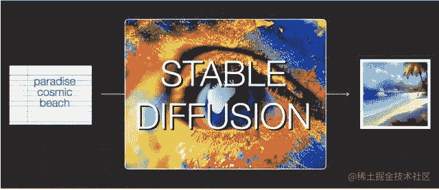

Stable Diffusion 用途多样，是一款多功能模型。首先它可以根据文本生成图像(text2img)。上图是从文本输入到图像生成的示例。除此之外，我们还可以使用 Stable Diffusion 来替换、更改图像（这时我们需要同时输入文本和图像）。

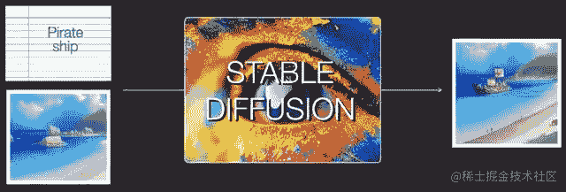

下面是 Stable Diffusion 的内部结构，了解内部结构可以让我们更好地理解 Stable Diffusion 的组成、各组成部分的交互方式、以及各种图像生成选项/参数的含义。

**1**

# Stable Diffusion 的组成

Stable Diffusion 并不是一个单一模型，而是由多个部分和模型一起构成的系统。

从内部来看，首先我们可以看到一个文本理解组件，这个组件将文本信息转化为数字表示（numeric representation）以捕捉文本意图。

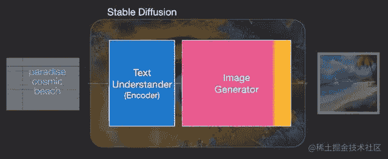

这部分主要对 ML 进行大概介绍，文章后续还会讲解更多细节。可以说这个文本理解组件（文本编码器）是一个特殊的 Transformer 语言模型（严格来说它是一个 CLIP 模型的文本编码器）。将文本输入到 Clip 文本编码器得到特征列表，对于文本中的每一个 word/token 都有会得到一个向量特征。

然后将文本特征作为图像生成器的输入，图像生成器又由几部分组成。

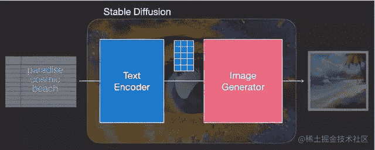

图像生成器两步骤：

**1-图像信息创建器（Image **information creator）

图像信息创建器是 Stable Diffusion 特有的关键部分，也是其性能远超其他模型的原因。

图像信息创建器运行多个 step 生成图像信息。Stable Diffusion 接口（interfaces）和库（libraries）的 step 参数一般默认为 50 或 100。

图像信息创建器完全在图像信息空间（亦称潜在空间）上运行，这让 Stable Diffusion 比以前在像素空间（pixel space）上运行的扩散模型速度更快。从技术上讲，图像信息创建器由 UNet 神经网络和调度算法组成。

“扩散”一词描述了图像信息创建器中发生的事情。因为图像信息创建器对信息作了逐步处理，所以图像解码器（image decoder）才能随后产出高质量图像。

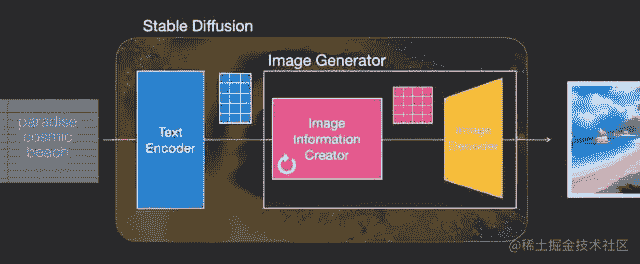

2-图像解码器（Image Decoder）

图像解码器根据图像信息创建器的信息绘制图像，它只用在过程结束时运行一次，以生成最终的像素图像。

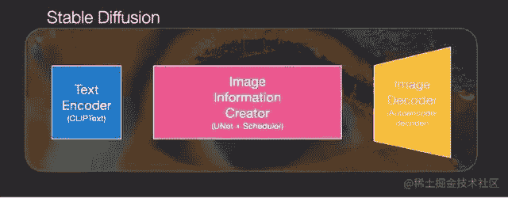

这样就构成了 Stable Diffusion 的三个主要组成部分，每个部分都有自己的神经网络：

+   ClipText： 用于文本编码。输入: 文本。输出: 77 个 token embeddings 向量，每个向量有 768 维。

+   UNet+调度程序： 在信息（潜在）空间中逐步处理信息。输入: 文本 embeddings 和一个初始化的多维数组（结构化的数字列表，也称为张量）组成的噪声。输出：经过处理的信息数组。

+   自动编码解码器（Autoencoder Decoder）： 使用经过处理的信息数组绘制最终图像。输入：经过处理的信息数组（维数：(4,64,64)）输出: 生成的图像（维数：（3,512,512），即（红/绿/蓝；宽，高）)。

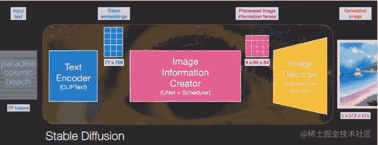

**2**

# 到底何为扩散（Diffusion）？

扩散是发生在粉色区域图像信息创建器组件中的过程。这一部分有一个表示输入文本的 token embeddings 和一个随机初始化的图像信息数组，这些数组也被称为 latents，在这个过程中会产生一个信息数组，图像解码器（Image Decoder）使用这个信息数组生成最终图像。

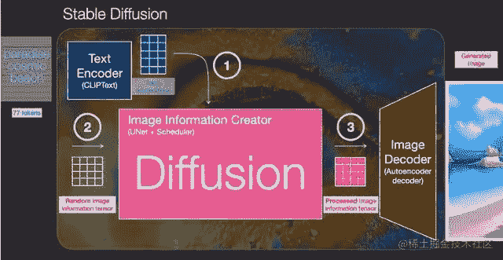

扩散是循序渐进逐步发生的，每一步都会增加更多的相关信息。为了更加直观地了解这个过程，我们可以检查随机 latents 数组，看它是否转化为了视觉噪音（visual noise）。在这种情况下，视觉检查（Visual inspection）是通过图像解码器进行的。

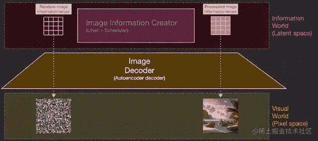

扩散分为多个 step，每个 step 都在输入的 latents 数组上运行，并且会产生另一个 latents 数组，这个数组更类似于输入文本以及模型在模型训练时的所有图像中获取的所有视觉信息。

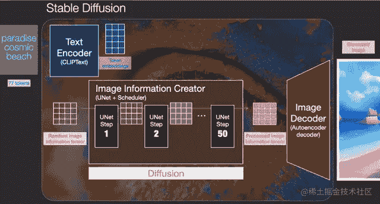

我们可以对一组这样的 latents 数组执行可视化，看看每一步都添加了什么信息。这一过程令人叹为观止。

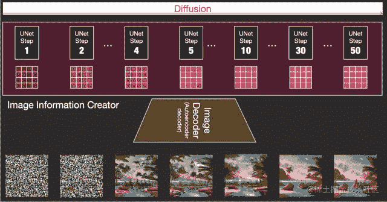

[「链接」](https://link.juejin.cn/?target=https%3A%2F%2Foneflow-public.oss-cn-beijing.aliyuncs.com%2Fimages%2FOneTeam%2F20230103-translate-The_Illustrated_Stable_Diffusion%2Fdiffusion-steps-all-loop%25E8%25A7%2586%25E9%25A2%25911.webm)

在这种情况下，步骤 2 和 4 之间发生了一些特别有意思的事情，就好像轮廓是从噪音中浮现出来的。

[「链接」](https://link.juejin.cn/?target=https%3A%2F%2Foneflow-public.oss-cn-beijing.aliyuncs.com%2Fimages%2FOneTeam%2F20230103-translate-The_Illustrated_Stable_Diffusion%2Fstable-diffusion-steps-2-4%25E8%25A7%2586%25E9%25A2%25912.webm)

**3**

# Diffusion 的工作原理

扩散模型图像生成的核心是强大的计算机视觉模型。在足够大的数据集的基础上，这些模型可以学会很多复杂运算。扩散模型通过如下方式建构问题来实现图像生成：

假设我们有一个图像，我们首先生成一些噪音（noise），然后将这些噪音添加到图像上。

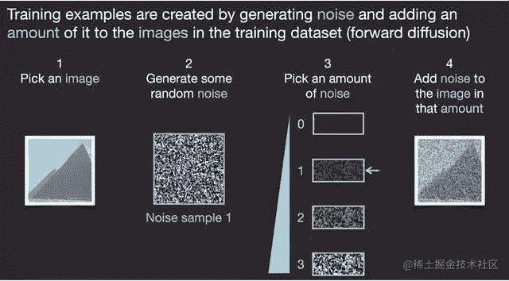

我们可以将这看成是一个训练示例。之后我们使用同样的公式去创建更多的训练示例，然后用这些示例去训练图像生成模型的中心组件。

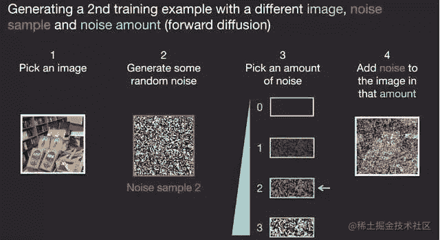

虽然这个例子展示了从图像（总量 0，没有噪音）到总噪音（总量 4，总噪音）的一些噪音值，但是我们可以轻松控制向图像中添加的噪音，因此我们可以将其分为数十个 step，为数据集中的每个图像创建数十个训练示例。

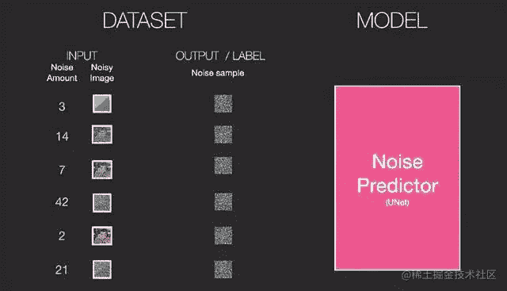

有了这个数据集，我们可以训练噪音预测器（noise predictor），并最终得到一个在特定配置下运行时可以创建图像的预测器。接触过 ML 的人会觉得训练步骤非常熟悉：

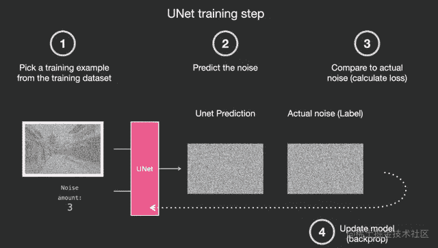

接下来我们来看看 Stable Diffusion 是如何生成图像的。

**4**

# 通过降噪绘图

经过训练的噪音预测器可以对噪音图像进行降噪处理，并且可以预测噪音。

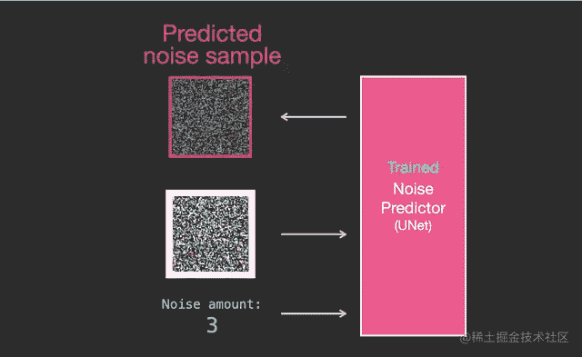

因为样本噪音（sampled noise）被预测，所以如果我们从图像中去掉这个样本，我们得到的图像就会更接近模型训练的图像。（这个图像不是确切的图像本身，而是图像分布，也就是图像的像素排列，在像素排列中天空通常是蓝色的，高于地面，人有两只眼睛，猫有尖耳朵并且总是懒洋洋的）。

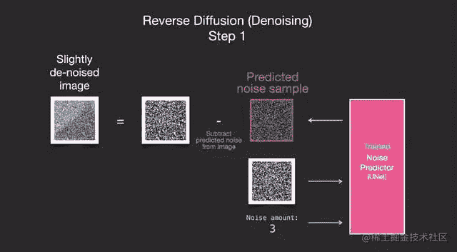

如果训练数据集中的图像比较美观，比如说 Stable Diffusion 训练的 LAION Aesthetics，那么训练出来的图像的可观赏性也会更高。如果我们在 logo 图像上对其进行训练，那么我们最终会得到一个 logo 生成模型。

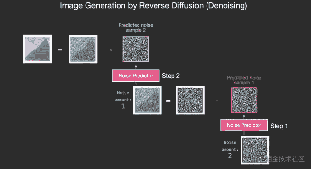

这里总结了扩散模型处理图像生成的过程，主要如论文 Denoising Diffusion Probabilistic Models 所述。相信你对扩散的含义有了一定的了解，知道了 Stable Diffusion、Dall-E 2 和谷歌 Imagen 的主要组件。

值得注意的是，到目前为止我们所描述的扩散过程，没有使用任何文本数据，只需运行模型就能生成精美图像。不过我们无法控制图像的内容，它可能是一座金字塔，也可能是一只猫。接下来，我们将讨论如何将文本信息融入扩散过程以控制图片类型。

**5**

# 速度提升：在压缩（Latent）数据中扩散

为了加快图像生成过程，Stable Diffusion 论文没有在像素图像上进行运行，而是在图像的压缩版本上运行。论文将这称为前往潜在空间(Departure to Latent Space)。

压缩（随后是解压缩/绘图）通过编码器完成。自动编码器使用 Image Encoder 将图像压缩进潜空间，然后使用 Image Decoder 再对压缩信息进行重构。

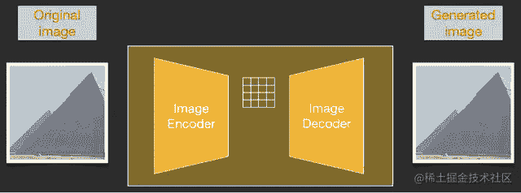

正向扩散在潜空间上完成。噪声信息应用于潜空间，而不是应用于像素图象。因此，训练噪声预测器（noise predictor）实际上是为了预测压缩表示（compressed representation）上的噪音，这个压缩表示也被称为潜空间（latent space）。

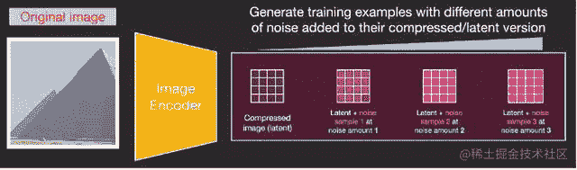

正向扩散是使用 Image Encoder 生成图像数据，来训练噪声预测器。训练一旦完成，就可以执行反向扩散，使用 Image Decoder 生成图像。

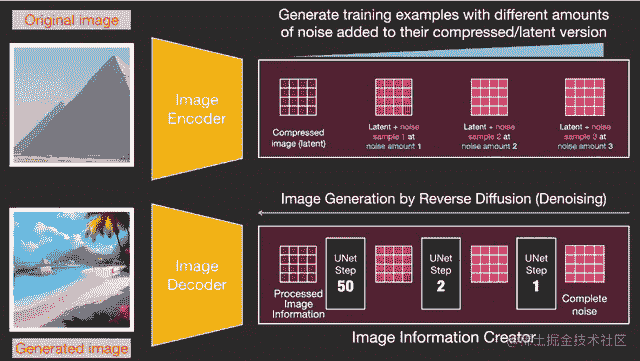

LDM/Stable Diffusion 论文的图 3 中提及了这两个过程：

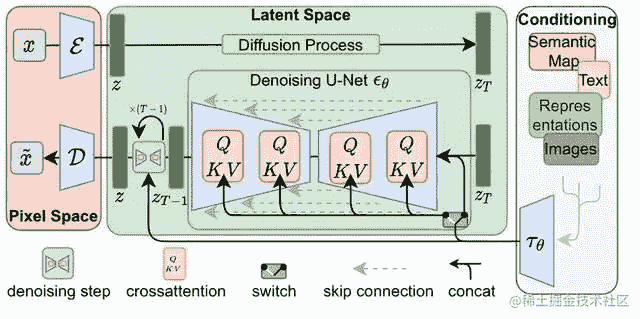

上图还显示了“conditioning”组件，这个组件在本例中是描述模型生成图像的文本提示词（text prompts）。接下来，我们继续探讨文本组件。

**6**

# 文本编码器：一种 Transformer 语言模型

Transformer 语言模型作为语言理解组件，能够接受文本提示词，生成 token embeddings。Stable Diffusion 模型使用的是 ClipText（基于 GPT 的模型），而论文中采用的是 BERT。

Imagen 论文表明，语言模型的选择相当重要。相较于较大的图像生成组件，较大的语言模型组件对生成图像的质量影响更大。

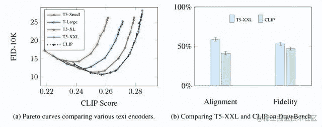

较大的/更好的语言模型对图像生成模型的质量有巨大的影响。资料来源：Saharia 等人所著论文 Google Imagen 中的图 A.5。

早期的 Stable Diffusion 模型仅使用了 OpenAI 发布的预训练模型 ClipText。未来模型可能转向新发布的更大的 CLIP 变体 OpenCLIP。（更新于 2022 年 11 月，详情见 Stable Diffusion V2 uses OpenClip。与仅含有 630 万文本模型参数的 ClipText 相比，OpenCLIP 文本模型参数多达 3.54 亿。）

**7**

# 如何训练 CLIP

CLIP 模型是在图像和图像说明数据集上训练的。我们可以设想这样一个数据集，它里面有 4 亿张图像以及这些图像说明的材料。

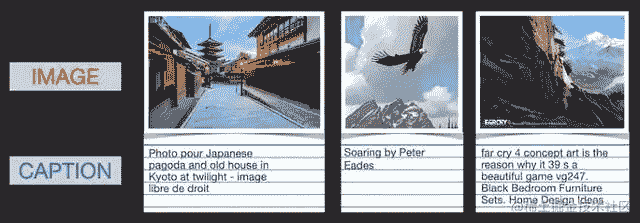

图像及图像说明数据集

实际上，CLIP 是在网络上抓取的带有“alt”标签的图像上训练的。CLIP 是图像编码器和文本编码器的结合。简单来说，训练 CLIP 就是分别对图像和图像文本说明进行编码。

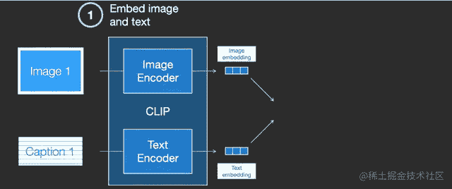

然后，使用余弦相似度来比较生成的 embeddings。刚开始训练时，即使文本正确描述了图像，相似度也会很低。

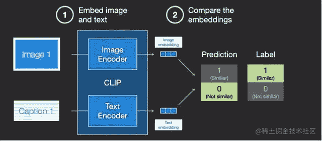

我们更新了这两个模型，这样下次嵌入它们时就可以得到相似的 embeddings。

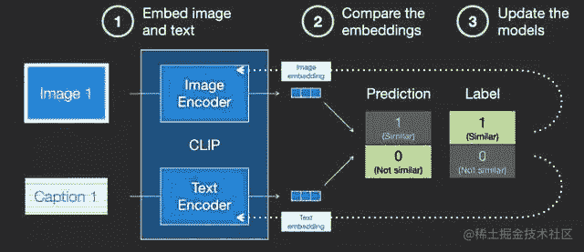

通过在数据集上重复此操作并使用大的 batch size，最终使编码器能够生成图像和文本说明相似的 embeddings。如 word2vec，训练过程也需要包含不匹配的图像和文本说明作为负样本，以得到较低的相似度分数。

**8**

# 将文本信息融入图像生成过程

为了使文本融入图像生成，我们须调整噪声预测器来输入文本。

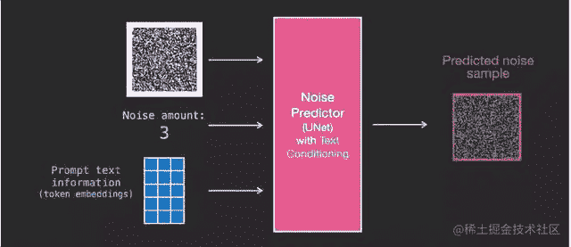

现在，在数据集中加入文本。因为我们是在潜空间中运行，所以输入的图像和预测的噪声都处于潜空间中。

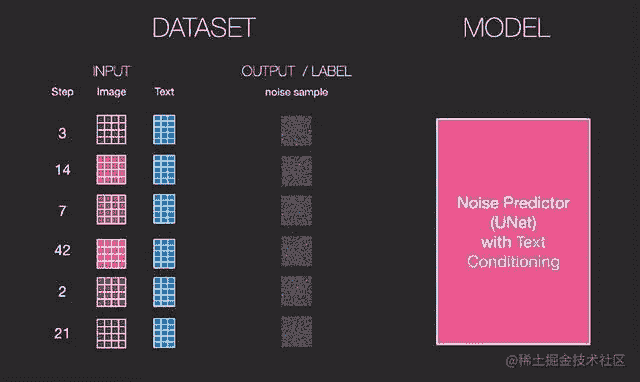

为了更好地理解 UNet 中文本 tokens 的使用方式，下面我们将进一步探究 UNet 模型。

Unet 噪声预测器的 Layers(未使用文本)

首先来看没有使用文本的 UNet，其输入和输出如下：

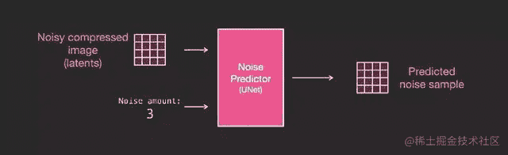

可以看到：

+   UNet 是一系列用于转换 latents 数组的 layers

+   每一 layer 都对前一个 layer 的输出进行操作

+   Some of the outputs are fed (via residual connections) into the processing later in the network

+   通过残差连接（residual connections），将网络前面的 layer 输出送入到后面的 layer 进行处理

+   时间步长被转化为 embedding 向量，在网络层中使用

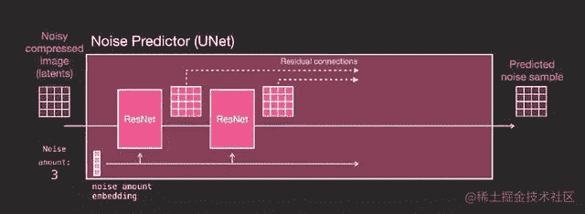

Unet 噪声预测器中的 Layers (带文本)

现在让我们看看如何改变该系统以增加对文本的关注度。

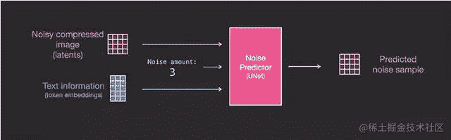

为了给文本输入提供支持，也就是专业上所说的文本条件（text conditioning），我们需要在系统的 ResNet blocks 之间添加一个注意力层（attention layer）。

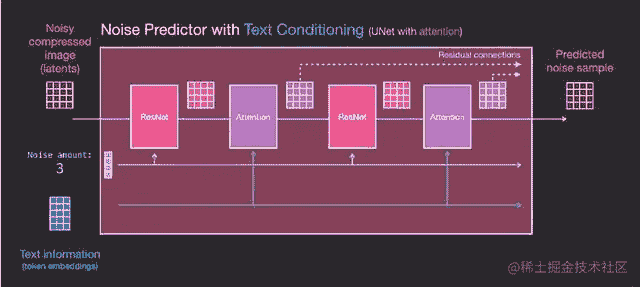

文本信息不直接由 ResNet 处理，而是通过注意力层将这些文本表示融入到 latents 中。这样，下一个 ResNet 就能在处理过程中利用融入的文本信息。

**9**

# 总结

希望本文能帮助你深入了解 Stable Diffusion 的运作机制。虽然还涉及到许多其他概念，但是只要熟悉了以上板块，这些概念就会变得很容易理解。下面是一些我认为很有用的资源。

**资源**

+   www.youtube.com/shorts/qL6m…

+   huggingface.co/blog/stable…

+   huggingface.co/blog/annota…

+   www.youtube.com/watch?v=J87…

+   www.youtube.com/watch?v=ltL…

+   ommer-lab.com/research/la…

+   lilianweng.github.io/posts/2021-…

+   www.youtube.com/watch?v=_7r…

（本文在遵循 CC BY-NC-SA 4.0 协议的基础上由 OneFlow 编译发布，译文转载请联系获得授权。 原文： Alammar, J (2018). The Illustrated Transformer [Blog post].

jalammar.github.io/illustrated…

欢迎 Star、试用 OneFlow 最新版本：

github.com/Oneflow-Inc…