# 中国AI绘画行业调查报告——技术，用户，争议与未来

> 来源：[https://diwfpqo78m.feishu.cn/docx/JyMJdKP2foTveWx3JwFco2munmh](https://diwfpqo78m.feishu.cn/docx/JyMJdKP2foTveWx3JwFco2munmh)

🔗 原文链接： https://sspai.com/post/76141

## 前言

多家机构在近期都发布了 AIGC 报告，这个尚在萌芽的赛道获得了巨大的关注，但在更早一些的时候，其中一些更细，更窄的领域，就已经发生了惊天动地的变化，我们将专注其中一个赛道，即 AIGC 中的「生成式文生图」领域，从技术发展，用户调研，商业模式和争议，以及对未来的一些展望，为大家呈现这份报告。

报告的数据及来源包括公开新闻媒体文章，第三方统计数据，6pen 自身数据，以及我们收回的 2398 份问卷调查和对部分行业资深人士的深度访谈。我们的问卷通过 6pen 自有渠道，即刻，微博，以及行业 KOL 分发，最终有效收到 2398 个提交，它们可能是这个行业首次的大批量对用户的直接调查，并聚焦在国内市场，我们认为其具有相当的参考性。

利益相关：本报告由 [6pen ](https://sspai.com/link?target=https%3A%2F%2F6pen.art%2F)调查发布，作为行业从业者，本报告将更多从技术，用户及行业整体视角出发。

## AI绘画技术发展的简要脉络

### GAN时代

在 diffusion 被广泛运用于AI绘画之前，这种艺术形式的主要实现方式 GAN [（Gener](https://sspai.com/link?target=https%3A%2F%2Fgithub.com%2FNVlabs%2FSPADE)ative Adversarial Nets ），以NVlabs的 SPADE 为例：用户提供草图，由GAN模型将其转化为真实的风景图像。这听起来有点像AI绘画里的img2img，但在这类模型里，用户无法通过文本影响生成结果。

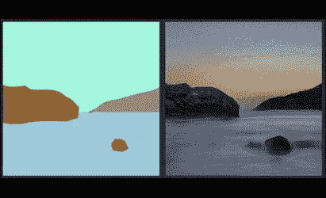

直到类似 CLIP 这种跨模态的图文模型出现，才让[用户有办法用文字实现A](https://sspai.com/link?target=https%3A%2F%2Fgithub.com%2Fnerdyrodent%2FVQGAN-CLIP)I作[画。后来者如 VQG](https://sspai.com/link?target=https%3A%2F%2Fgithub.com%2Forpatashnik%2FStyleCLIP)AN+CLIP 或 StyleCLIP ，均是因为CLIP打通文本和图形域(domain)，用户输入的文本与GAN生成的结果真正有了「可比较性」，这使得计算二者误差并迭代效果成为了可能。

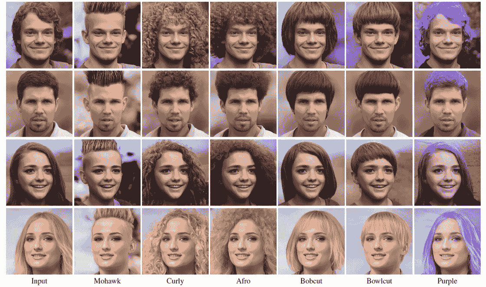

GA**N**在模拟分布方面有着天然的优势，因此它在人脸属性编辑、风格模仿等领域大放异彩，例如给人戴上墨镜、加上胡子、生成动漫脸、模仿小说风格。也正因如此，它也很容易陷入模型坍缩(Model Collapse)，即 生成器(Generator)倾向于生成那些最不容易出错、能骗过判别器(Discriminator)的结果 ，例如当用户希望生成"眼睛长在鼻子下面的人脸"，或"戴着用鲜花构成的眼镜"这种域外(Out-Of-Domain)的结果时，GAN通常会失效。

### Diffusion 崛起

和大多数人以为的相反，Diffusion 其实是早于 GAN 被提出的，但因为 Diffusion 依赖大模型实现，所以对大部分用户的进入门槛较高，研究者也不多，直到 2021 年，因为开源项目 Disco Diffusion(也被简称为DD)，Open AI的商业服务 Dalle 等，Diffusion 才开始被更多人了解。

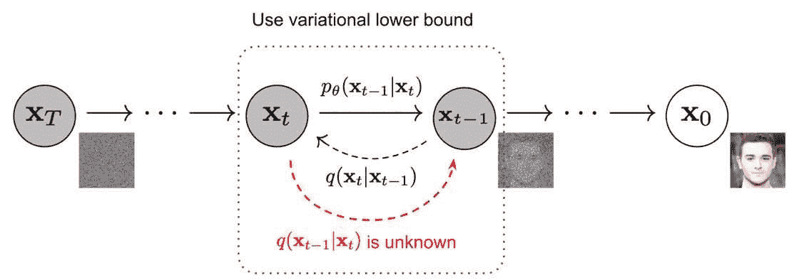

2022年，Disco Diffusion 经过更多开发者的贡献，效果有了较大提升，通过 Google colab 的方式运行(很多人因此误以为 DD 是 Google 发布的)，也降低了使用者尝试使用的门槛，在 2022 年 4 月左右，DD 生成的图像在社交网络上得到广泛传播，进一步带动了 Disco Diffusion 的破圈。

同一时期，包括 6pen 在内，国内开始有小部分团队和公司进行 DD 的产品化工作，旨在进一步降低 DD 的使用门槛，包括：

+   提供人机友好的交互界面

+   提供云端的算力服务

+   对 DD 的模型做 finetune（微调）

+   通过封装 CLIP 关键词等方式，降低用户使用门槛，提高风格化效果

在研究领域，也有诸多机构或公司进入模型层的研究，例如 6pen 的南瓜模型，清华大学的 cogview ，百度的文心等等，因为 DD 在社交网络的破圈，这些产品和模型都得到了更多人的关注和使用，但依然有很多较专业的中国用户会通过各种方式使用 midjourney 和 Dalle2 等国外的商业化产品。

### Stable Diffusion 开源的潘多拉魔盒

**在 Sta**ble Diffusion 之前， 开源方案 里最好的AI绘画实现毫无疑问是 Disco Diffusion，但 Disco Diffusion 也存在诸多问题，例如：

+   生成速度慢（基于像素迭代），由此带来的问题是生成成本高（显卡成本高昂）

+   生成图片逻辑性较差，画面结构经常错乱

+   几乎无法生成人和物体

弥补 Disco Diffusion 的不足，是许多模型或研究团队的方向。CompVis提出的 latent diffusion 将diffusion过程从图像层面迁移到了隐变量(latent)层面，这将推理耗时降低了一个数量级(~10min->30s)。latent diffusion 在模型内嵌了一个很小的文本模型，使得生成过程不必依赖CLIP等开源语言大模型，但这也使模型对用户输入文本的理解能力较弱，生成的结果文不对题。

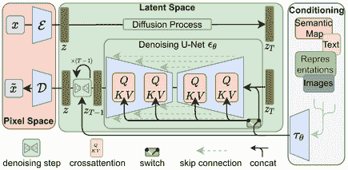

6pen 提供的南瓜正是基于对它的某种改进：将 CLIP 模型替换掉 latent diffusion 自有的文本编码小模型，计算模型结果与文本间的 CLIP 误差来优化生成过程，因此模型对用户文本理解能力、生成质量都有了明显提升。后来的 Stable Diffusion 也是基于 latent diffusion + CLIP 思路做了模型结构、数据方面的优化，并进行了大规模的训练，达到了堪称惊艳的效果。

Stable diffusion 在 2022 年 8 月下旬由 Stability 发布，Stable diffusion 拥有强大的特性：

+   极快的速度（基于隐空间迭代）

+   远超 DD 的画面逻辑

+   能较好的处理人和物体

+   更多的风格化，例如二次元风格

+   更简易的训练框架

Stable Diffusion 极大降低了行业的进入门槛，包括技术门槛和储备显卡的成本，带来了较多的竞争者入场，但同时也有部分基于 Stable Diffusion 的创新应用开始出现，例如文生视频，图片无限拓展，和 3D 建模工具结合等等，毫无疑问，Stable Diffusion 具有这个时代的革命性。

我们目前就处在这个时间节点。

## AI绘画的用户画像

### 用户基础画像

根据我们的回收报告显示，国内的AI绘画用户特点是年轻化，其中 46% 以上是大学生和研究生，其中甚至有 18% 是初中和高中生。

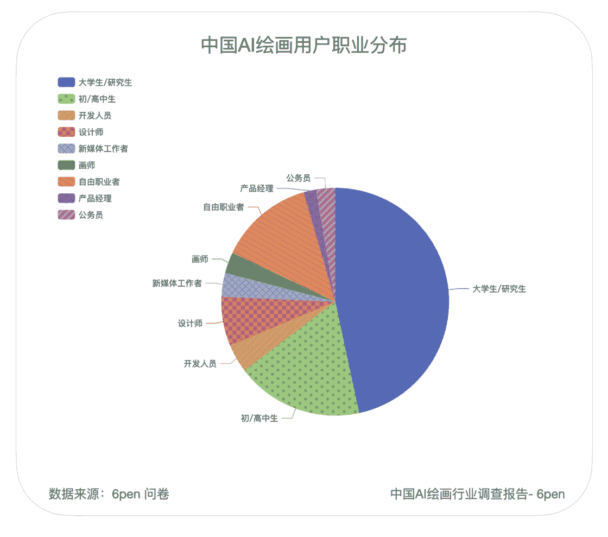

从城市分布上，绝大多数用户还是分布在一二线城市，其中北京占8.7%，深圳占7.8%，但青岛出人意料的排在了第四，占到了6.1%。南方城市占绝大多数，北方城市较少。

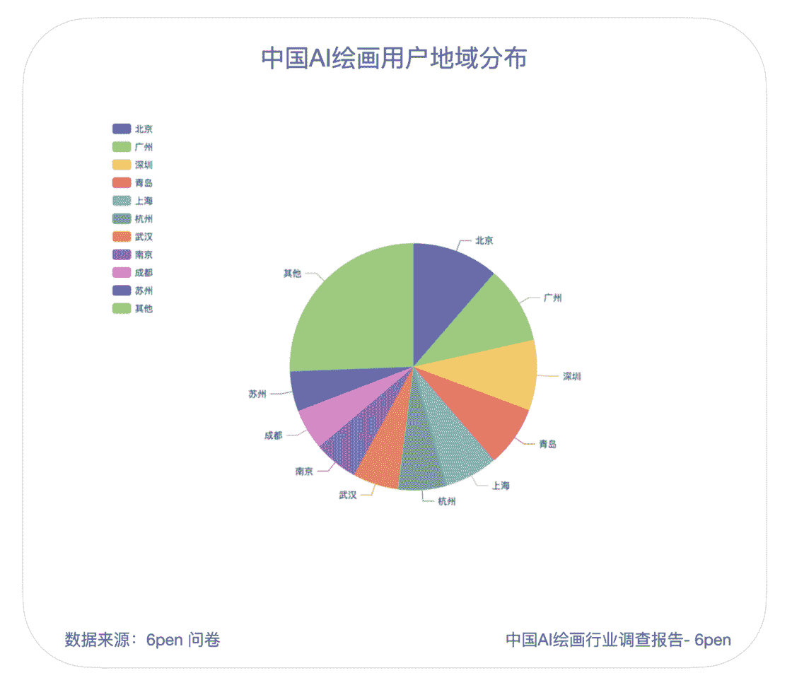

在受众用户的行业分布上，调查结果和我们预期差异较大，美术和设计工作者仅仅只占 24.2%（排名第二），排名第一的行业是线下行业（26%），排名第三的是互联网行业（24%）

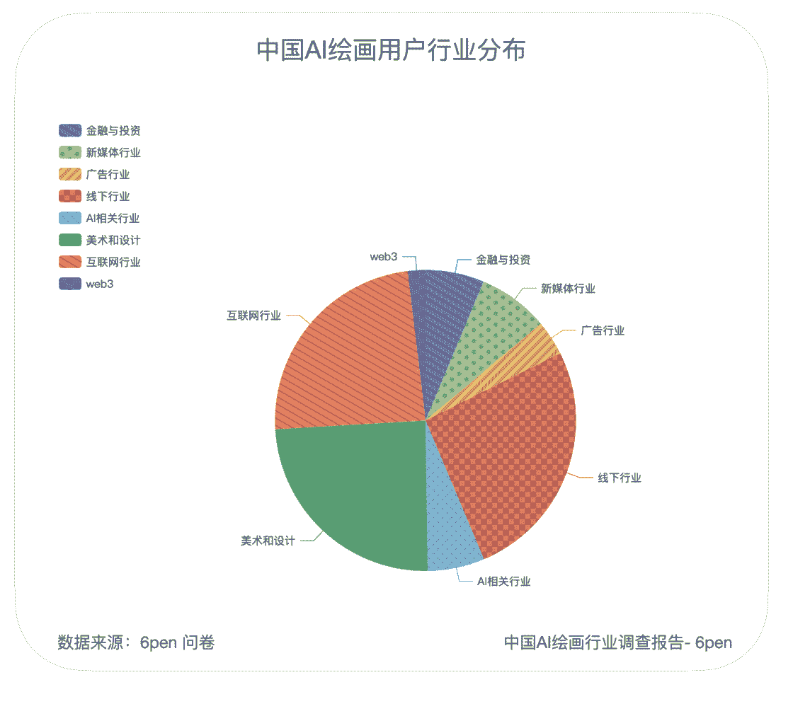

在使用AI绘画的具体方式上，38% 的用户只使用在线服务，使用自己显卡的用户占到16%，即便如此，依然有21%的用户表示，虽然目前自己使用在线服务，但未来希望使用自己的显卡，与之相反，现在使用显卡，并表示未来会使用在线服务的用户，只占 4%

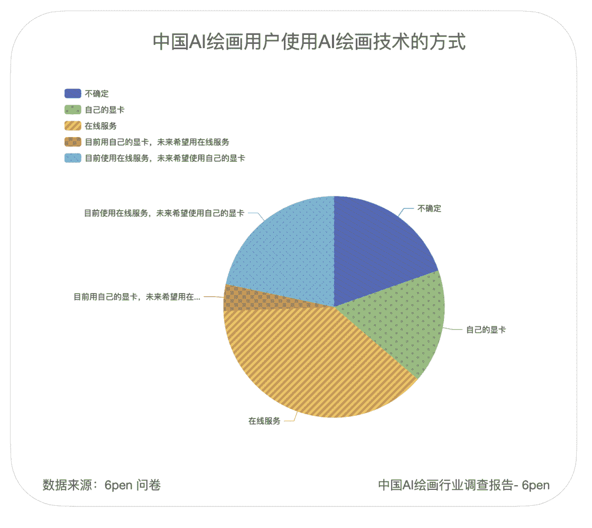

### 用户付费及收入调查

根据我们的调查，60% 的用户并没有在使用AI绘图产品上有过付费行为，也就是完全免费在使用，剩下40% 的付费用户中，16% 付费在 10 元以内，14% 在100元以内，付费超过 100 元的不到 10%

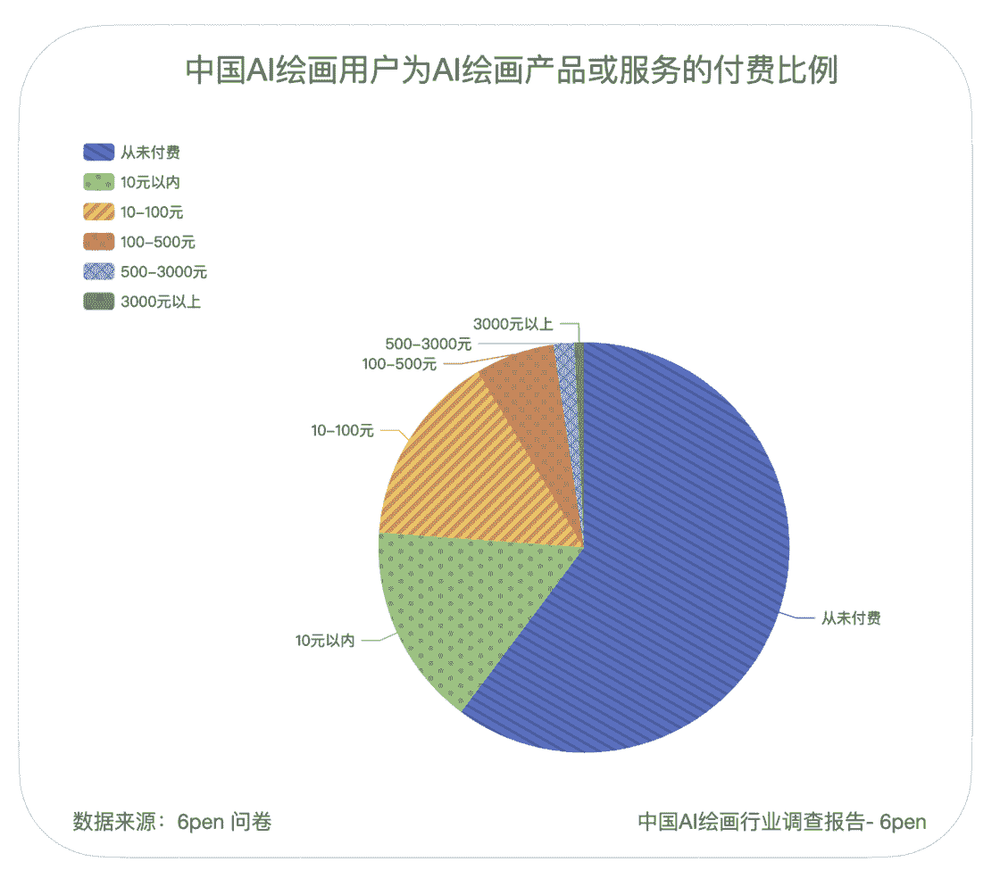

于此同时，我们也调查了用户通过AI绘画产生收入的情况，结果显示绝大部分用户（92%）没有通过AI绘画产生收入，也就是「单纯娱乐使用」，4% 的用户获得了 100 元以下的收入，1.9% 的用户获得了1000 元以下的收入，而获得超过 1000 元收入的用户，占 2%

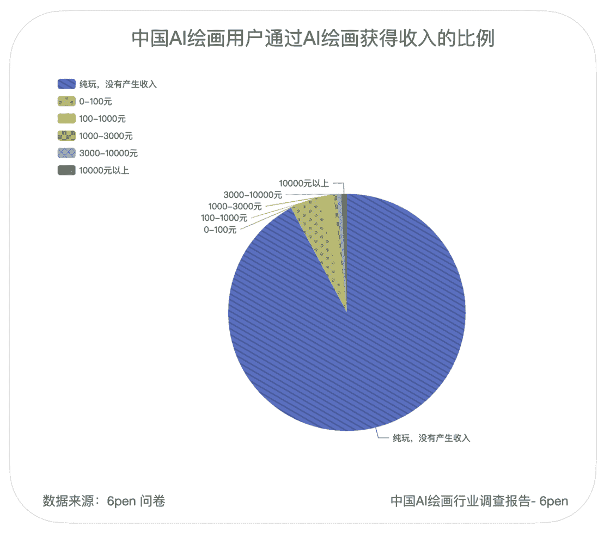

### 用户认知

问卷调查显示，42% 的用户认为 AI 绘画单纯只能满足娱乐需求，38% 的用户认为AI绘画可以部分运用到工作之中，9.17% 的用户认为AI绘画具有颠覆性，与此同时，也有 7% 的用户认为这根本不值一提。

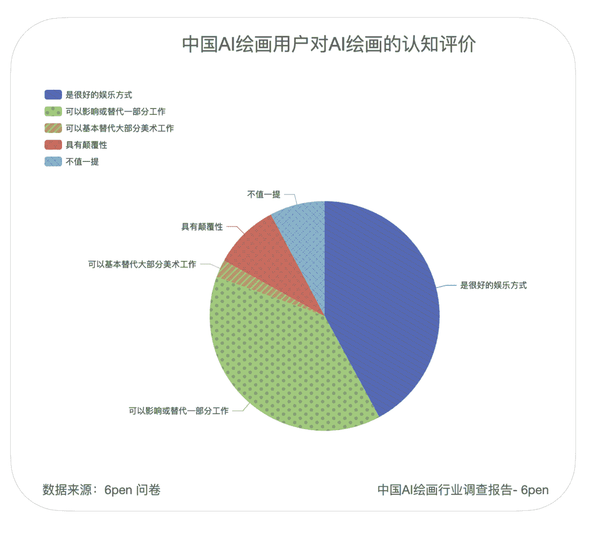

绝大部分受访者在最近一个月（8-9月）才了解到AI绘画领域，今年上半年开始接触的占 27%，去年就了解的仅占 23%

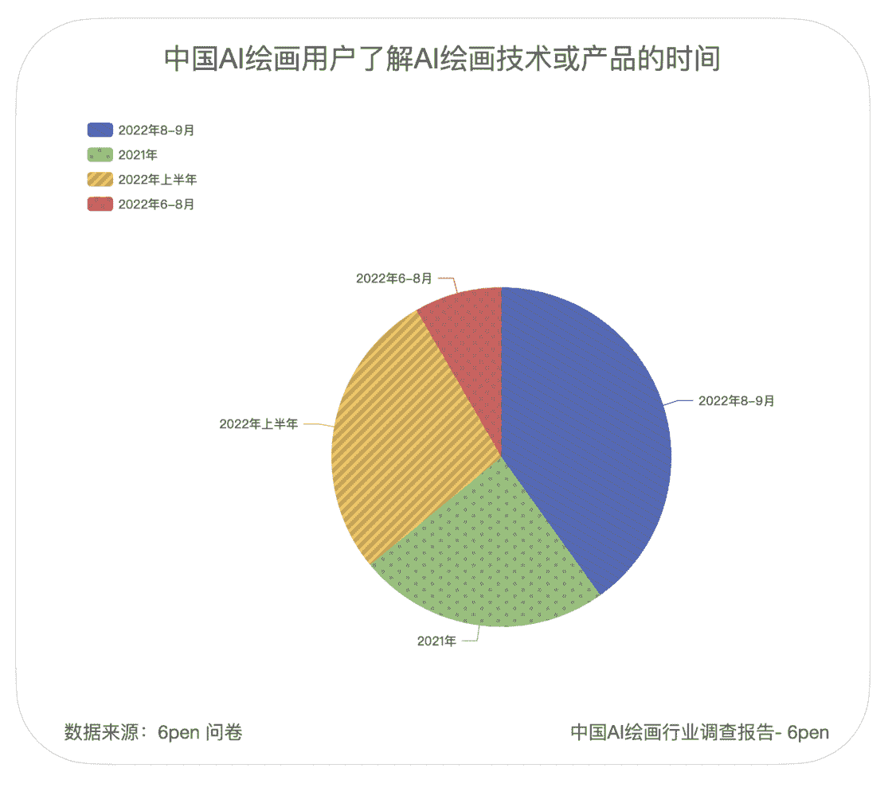

我们的问卷包括对模型的使用，为了保证客观，我们排除了 6pen （来自6pen渠道的用户会影响数据准确性，我们将单独展示 6pen 不同模型的使用比例），对用户使用其余模型进行了统计，目前可以看到 Disco Diffusion 略微占优，第二名是 Stable Diffusion，第三名则是 midjourney ，令我们惊讶的是，老牌的 AI 绘图产品 wombo dream ，依然有比较广泛的受众，甚至比著名的 Dalle 系列被更多人使用。

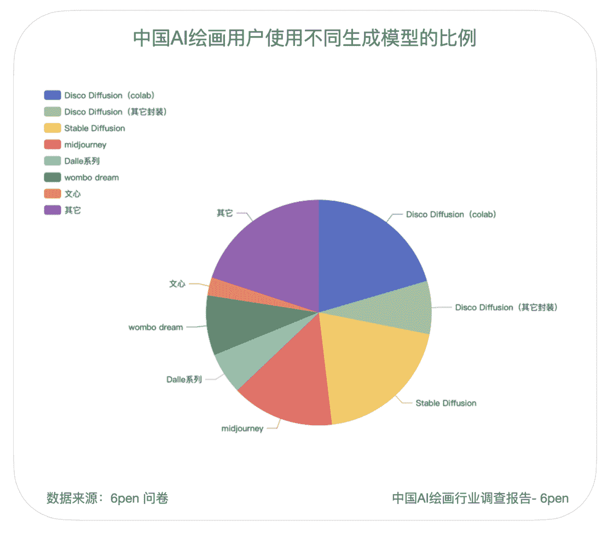

与此同时，6pen 内的近千万次用户使用模型数据则显示，Stable Diffusion 被使用的最多，占到了77%，Disco Diffusion模型占 10%，南瓜占 13%

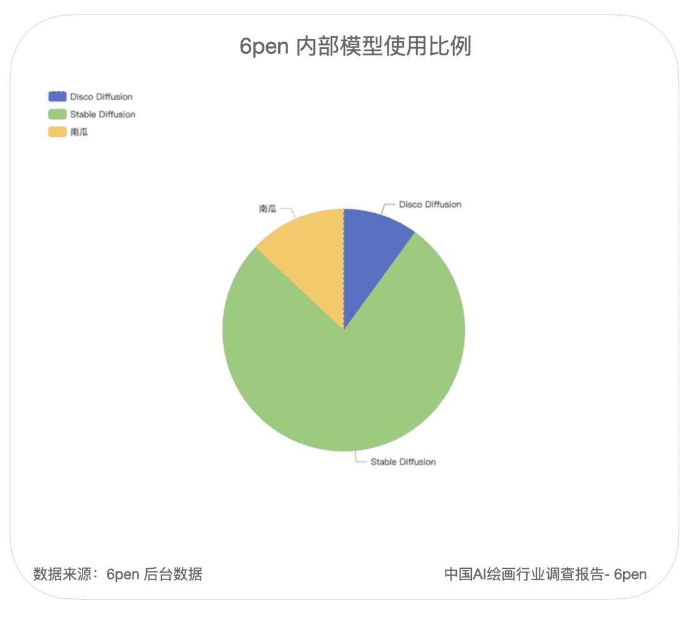

### 用户的使用场景

绝大部分的用户表示，使用AI生成绘画作品，仅仅是自己欣赏，同时表示会分享给朋友的占 56%，6%的用户用表示会自己加工之后在工作中使用，低于2%的用户会将生成图片直接商业使用，此外还有23%的用户表示，会发布在社交网络媒体以增加粉丝关注。

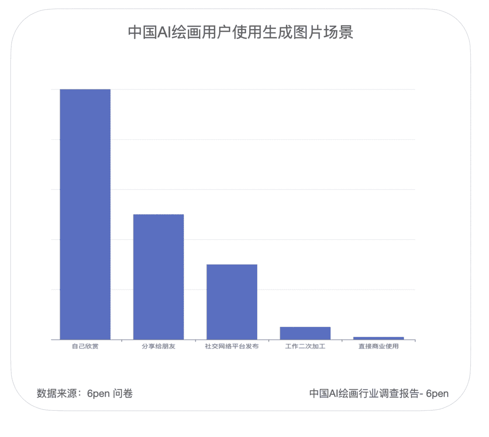

## 平台和工具的商业模式

### 直接向用户收费

目前，绝大多数 **产品化的 AI 绘画服务 **几乎都通过按照生成收费的方式获得收入，如下：

+   Stable Diffusion

+   模型开源免费

+   Dream Studio 及 API ：0.01 欧元 / 基础调用

+   midjourney

+   10 美元 / 月：200次快速生成+不限量的排队生成

+   30 美元 / 月：900次快速生成+不限量的排队生成

+   4 美元 / GPU小时

+   600 美元 / 年 企业套餐

+   Dalle

+   0.13 美元 / 生成

+   6pen

+   免费排队生成

+   付费快速生成： 0.1人民币起

可以看出，商业化的 AI绘画的服务目前几乎不区分 ToB 或 ToC ，更多是提供按量或按需付费的服务，无论是企业还是个人用户都可以使用。这种收费模式是因为这些原因：

+   AI生成使用显卡服务器，维持免费使用需要付出巨大成本

+   缺乏生成图之后的闭环，无法从免费用户获得其他方面的收入

+   受限于尚处在争议中的版权及其它道德因素，其它商业化手段还有待探索

### ToB 的可能性

AI绘画在 ToB 领域天然拥有更多可能性，但受限于模型质量，版权争议，以及目前较早期的技术阶段，还很少有公开落地的案例，但我们认为在下列方向，可能会在未来涌现出更多 ToB 的成功案例：

+   广告行业

+   ToB 素材库

+   设计师/美术工作者辅助工具

+   营销定制服务

+   线下实体结合服务

+   元宇宙等线上虚拟空间

## 争议，问题，潜力和未来

### 争议

目前 AI 绘画的最大的争议在于版权归属，以及模型是否有权利指定版权归属，众所周知，AI模型训练所使用的大量素材，可能包含了未经授权的，有明确版权方的图片数据，因此模型源头就带有「未经授权」的烙印，支持者一方则认为，AI模型经过训练，迭代，蒸馏，最终沉淀下来的是单纯的，崭新的运算方法，由这种运算方法产出的图片，版权归属应该由模型指定。

即便如此，目前获得较多认可的说法是，如果在AI生成图片的文本描述( prompt )中，指定了在世的艺术家，那么绝对不应该申明该图片的版权。

我们提倡，如果在生成 prompt 中指定了在世艺术家，那么至少应该将AI生成的图片以 CC0 协议发布，同时应该保留艺术家的相关信息，并且在得到艺术家授权前，尽量不做商业用途，即便这样，依然可能会对艺术家造成困扰，目前全世界范围内对此都还在进行讨论，AI和人类艺术家的更好的合作规则也急需尽快建立。

### 版权问题的探索

6pen 对原创艺术家发放问卷，并搜集到了 368 份艺术家反馈，其中 7.1% 的受访艺术家明确表示自己已经被 AI 模型学习，67%的艺术家对此还不确定。

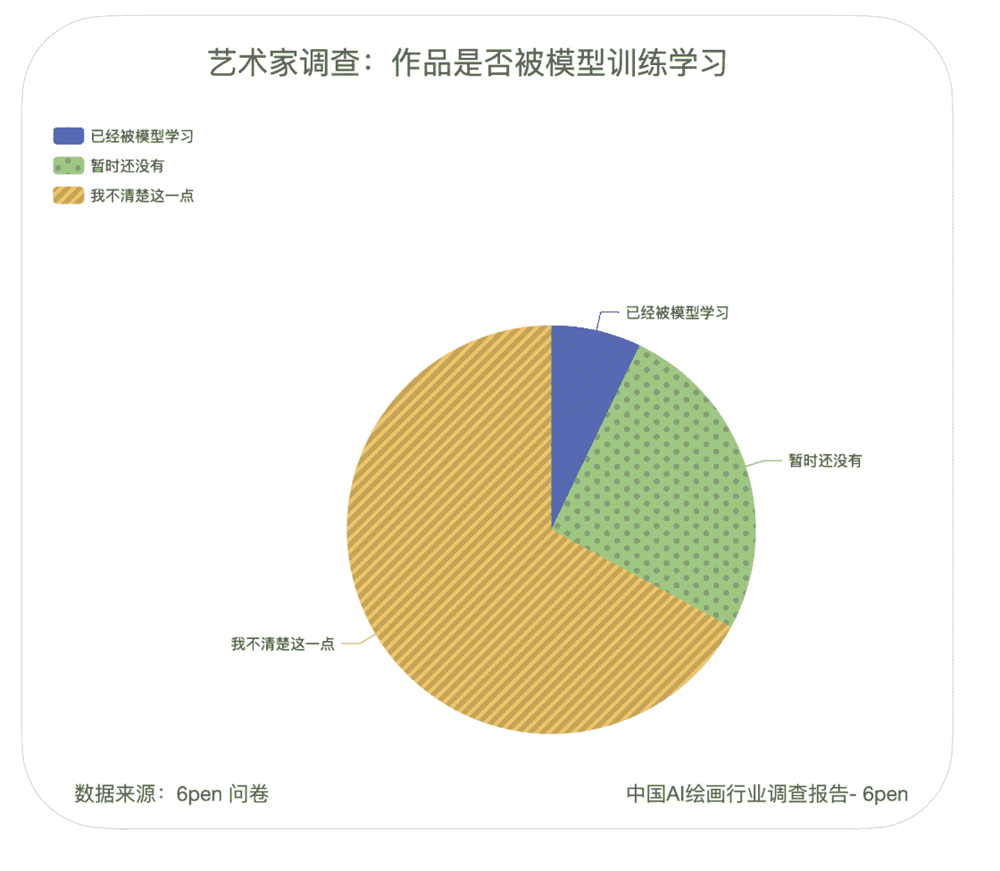

27% 的艺术家无论如何都不希望AI模型使用自己的风格，27%的艺术家希望如果生成者使用了自己的风格，那么需要在使用图片时展示艺术家的信息，37%的艺术家希望如果使用自己的风格，那么需要向自己付费，完全不介意的只有6.9%

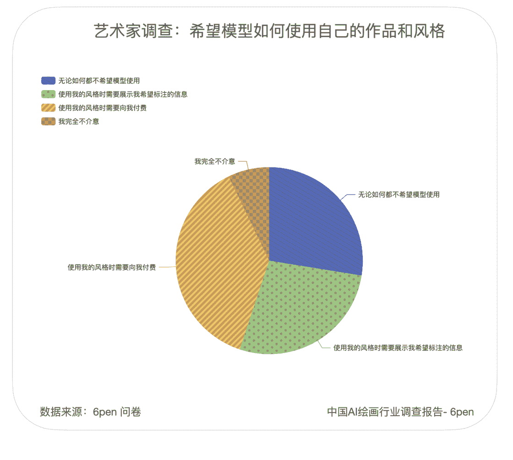

对目前的 AI 绘画（包括模型和产品），绝大部分艺术家都持有负面的态度，NPS评分低至-89，这主要的原因在于，那些在未经授权就被模型学习的大量人类艺术家，其本身并不能从模型生成中获益，但生成的图片却可能为生成者带来收益，这既不公平，也在某种程度上破坏了生产关系，还将进一步瓦解人类的创作动力——为了免于成为模型学习的素材，原创性的探索将会减少，新的风格，范式，流派都可能会停止出现。

但是，如果未来AI绘画能更具规范，例如：

+   使用版权干净的素材训练模型

+   使用艺术家风格，向其进行分成付费

+   和艺术家共同探索新的风格边界

+   为人类创作提供辅助性功能

+   尊重艺术家 **不被AI模型学习 **的意愿

根据我们的问卷调查，如果这些问题得到解决，那么艺术家对AI生成图片技术的 NPS 评分将提高 4 倍，绝大多数艺术家认为这样的 AI 生成是可以被接受的。

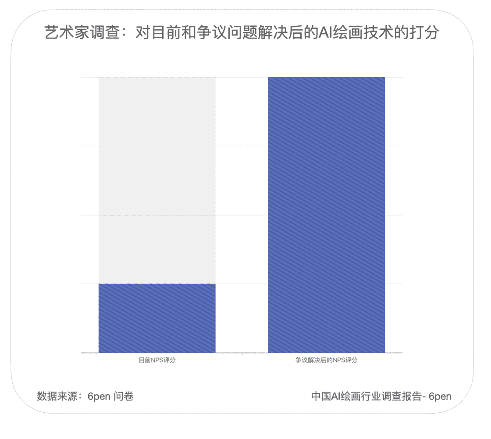

然而这样的模式建立也并不容易，其中在技术，产品和规则上都需要很多创新和尝试，6pen 将在搜集更多反馈后开始行动，我们也会将探索的过程随时分享。

### 其他问题

#### 技术问题

虽然在过去的几个月，AI绘画技术已经得到了快速的发展，但依然有一部分问题一直存在，包括：

+   对显卡，主要是显存，要求较高，成本高昂

+   无法精确的指定画面对象的数量，例如“三只猪和四只老虎”

+   人的肢体（主要是手指）和眼球效果较差

+   多主体对象生成效果差（往往只会保留一个或两个主体对象）

+   无法进行有逻辑延续的故事性生成

不过，这些问题有望在未来 6-12 个月得到较大改善

#### 技术性道德问题

和其它赛道不同，AI绘画既依托先进的AI技术，又(很多时候)依托开源世界的能力，因此可能会有一些其他行业所不存在的可能的道德问题，例如在 Stable Diffusion 开源之后，从国内涌现出较多的封装型产品，其中许多都存在技术性道德问题，包括：

+   不遵守开源模型 licence ，包装成自研或国产 AI 进行营销 *

+   直接将可能含有艺术家风格的生成图片用于版权交易或NFT

+   将未经安全过滤的图片直接展示给用户，可能含有歧视，暴力，色情或其他内容

+   过度封装，隐藏艺术家的相关信息

+   使用非开源服务，用爬虫等方式获取其他服务的生成结果，封装成独立产品

* 据我们统计，2022年9月后国内涌现的AI绘画产品，95% 都使用了 Stable Diffusion，但是按照 Stability License 展示必要信息的，只有不到 10 %

这些问题可能会阻碍行业的健康发展，甚至加剧不同立场的用户群体之间的矛盾，其中有些难以避免，另一些则完全是故意为之，我们也再次呼吁，从业者应该理性的，有尊严的进行探索和创新。

### 未来的市场预估

AI 绘画目前依然是快速增长的市场，技术也在快速发展，根据我们的预测，在未来五年，全世界的图片内容可能有10-30%为AI生成或AI辅助生成，据此估算其市场规模可能超过600亿。

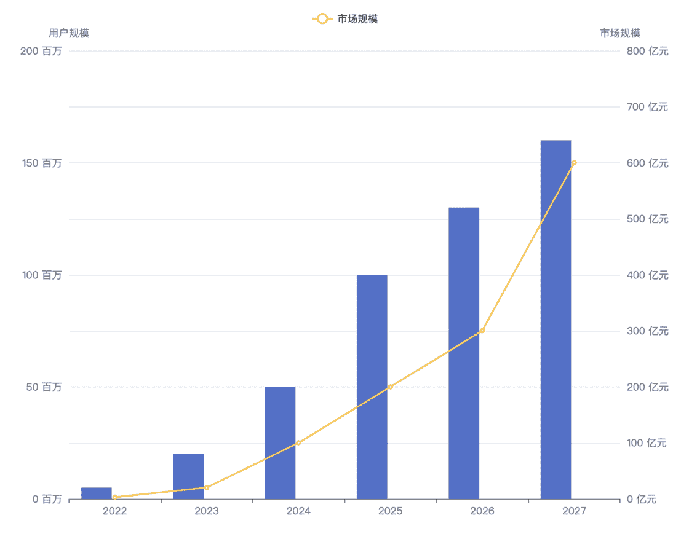

但如果要达到这样的数字，前述的问题和争议都需要得到妥善的解决，就总体而言，AI绘画的技术发展确实很快，甚至快到法律和规则还远远没有跟上，就已经产生了巨大的影响力，这不一定是好事，但也蕴含着许多新的可能性，我们应该更加谨慎，小心的进行探索，尽可能的保护而非损害更多人的利益。

如果AI技术的发展是以人类创作力的枯竭为代价，那 AIGC 将是人类之最大不幸，但如果我们能找到好的方式，来激励人类无穷的创造力，并让所有人都从中受益，那么，这将能成为开启一个更美好的世界的钥匙，我们正处在这两条道路的中间，我们无法停止前进，我们也将注视着，看到人类将迈向何方。

我们希望，能走向对的那方。