# StableDiffusion模型资源探索食用指南

> 来源：[https://diwfpqo78m.feishu.cn/docx/A1UxdkXAxouOq9xUc49cZkpCnsJ](https://diwfpqo78m.feishu.cn/docx/A1UxdkXAxouOq9xUc49cZkpCnsJ)

### 目录

[给模型添加预览图 便于查找](https://diwfpqo78m.feishu.cn/wiki/wikcnBDFds3t0CdTT8R3OVs0iAc#part-E0bodmnzDosgeyxvu3hcgXZsncc)

常用模型分发传播流程、资源渠道汇总

+ HuggingFace的Stable Diffusion模型分区
+ Discord&TG&Reddit
+ [Civitai](https://diwfpqo78m.feishu.cn/wiki/wikcnBDFds3t0CdTT8R3OVs0iAc#part-U18YdbDddoOKU6xpxvlcmBp9nWb)

[模型常见格式介绍](https://diwfpqo78m.feishu.cn/wiki/wikcnBDFds3t0CdTT8R3OVs0iAc#part-K1qMd8mYjoOQBix79wWcU9RnnDh)

+ [Safetensors](https://diwfpqo78m.feishu.cn/wiki/wikcnBDFds3t0CdTT8R3OVs0iAc#part-LaLgdEQssohlKbxuEOuccOHOntg)

[模型文件名常见后缀含义解读](https://diwfpqo78m.feishu.cn/wiki/wikcnBDFds3t0CdTT8R3OVs0iAc#part-Ag52dqkKao7yNsxtj20ceKRFnRg)

+ [ControlNet](https://diwfpqo78m.feishu.cn/wiki/wikcnBDFds3t0CdTT8R3OVs0iAc#part-XTFcdAwVfoW1lkx7J02cphVBn5e)
+ instruct-pix2pix
+ [fp16、fp32](https://diwfpqo78m.feishu.cn/wiki/wikcnBDFds3t0CdTT8R3OVs0iAc#part-JlVzdmFXto9e4ExRam3cXWzjntc)
+ [512、768](https://diwfpqo78m.feishu.cn/wiki/wikcnBDFds3t0CdTT8R3OVs0iAc#part-RPS3dDQHaosQGlxPeuicSLzznWc)
+ [inpaint](https://diwfpqo78m.feishu.cn/wiki/wikcnBDFds3t0CdTT8R3OVs0iAc#part-Olvkd5DWnohFSyxIBLzcHJmknZb)
+ [depth](https://diwfpqo78m.feishu.cn/wiki/wikcnBDFds3t0CdTT8R3OVs0iAc#part-BBn1d5SzLo1geBxXNxtcxovSnkh)
+ [EMA](https://diwfpqo78m.feishu.cn/wiki/wikcnBDFds3t0CdTT8R3OVs0iAc#part-W4pAdVk6PoXPgmxUSSjcRck8nSf)

寻找好的模型，给自己找到趁手的魔法水晶球

+ kawaye1_6000(Q萌)
+ dreamlike-photoreal-2.0(写真风)
+ [FloydianSound/WLOP_Diffusion_v1-5](https://diwfpqo78m.feishu.cn/wiki/wikcnBDFds3t0CdTT8R3OVs0iAc#part-HyPXd2wsEoBeHvx0J3ocr0HxnQg) (WLOP 厚涂)

[模型下载方法汇总](https://diwfpqo78m.feishu.cn/wiki/wikcnBDFds3t0CdTT8R3OVs0iAc#part-HfRldvDwWojHgXxmRtIcsIWlnlg)

+ [本地机器](https://diwfpqo78m.feishu.cn/wiki/wikcnBDFds3t0CdTT8R3OVs0iAc#part-HfRldvDwWojHgXxmRtIcsIWlnlg)
+ [linux服务器](https://diwfpqo78m.feishu.cn/wiki/wikcnBDFds3t0CdTT8R3OVs0iAc#part-PitVdt3vpomaqQxHDK2cpFbunFc)
+ [使用aria2c下载模型文件](https://diwfpqo78m.feishu.cn/wiki/wikcnBDFds3t0CdTT8R3OVs0iAc#part-G51Kd3ILdo4fGGxFWSlcQNjfnNb)
+ 服务器上编写python脚本优雅下载模型文件

0. 安装huggingface hub库

[1.创建脚本、填写参数](https://diwfpqo78m.feishu.cn/wiki/wikcnBDFds3t0CdTT8R3OVs0iAc#part-I8D9dxAvxofjEYx7KuzcZPhVnS4)

[2.执行下载脚本](https://diwfpqo78m.feishu.cn/wiki/wikcnBDFds3t0CdTT8R3OVs0iAc#part-A8PRdbiPLoimPUxOosBcC1mTnld)

[3.使用模型](https://diwfpqo78m.feishu.cn/wiki/wikcnBDFds3t0CdTT8R3OVs0iAc#part-WcQ8dHiuYo2WejxtLC4c1ZnhnBe)

[Changelog](https://diwfpqo78m.feishu.cn/wiki/wikcnBDFds3t0CdTT8R3OVs0iAc#part-KiVNdlQF4ol471x52MxcV3Qln6f)

3.20号 ChatGPT国产开源平替--ChatGLM部署教程

3.3号 搭建自己的stablediffusion绘画机器人 图文教程

[3.3号 更新显存优化常见思路](https://diwfpqo78m.feishu.cn/wiki/wikcnBDFds3t0CdTT8R3OVs0iAc#part-VvINdE4pLob0MrxLVZ3cUJ8CnOb)

[1.27号更新 img2img专用模型 自然](https://diwfpqo78m.feishu.cn/wiki/wikcnBDFds3t0CdTT8R3OVs0iAc#part-CcTEdeMRnoM1izxbBWCcyYnonog)语言指导图像编辑 生成速度极快 (几秒)

1.23号更新 Lora 模型使用

[1.15号更新 补充EMA depth ](https://diwfpqo78m.feishu.cn/wiki/wikcnBDFds3t0CdTT8R3OVs0iAc#part-TRNDddTKjo9XU0xe456cznv9nJc)等模型后缀名的含义、补充Reddit社区

1.14 号更新 关于VAE文件，你需要了解的都在这

[1.12 号更新 使用huggingface hub api 优雅下载模型](https://diwfpqo78m.feishu.cn/wiki/wikcnBDFds3t0CdTT8R3OVs0iAc#part-T5rfd8gAPoO7gKxzCxqcM8iOnWb)

[TODO](https://diwfpqo78m.feishu.cn/wiki/wikcnBDFds3t0CdTT8R3OVs0iAc#part-WU1qdHFSFox6TRx7fFHcL8NtnZe)

> 问渠哪得清如许 为有源头活水来


经过小半年的发展积累，全民炼炉热潮仍如火如荼的进行，大到各路厂牌亲自下场，小到社区社群用户的遍地建私炉。以SD1.4/1.5 为基线模型、多方向、多维度、交叉螺旋进化发展着。包括各式各样的自训练微调方法(text inversion、hypernetwork、dreambooth、native training、DreamArtist、Lora)，社区一直在探索在大模型基础上Fine-tune(自训练)的最优雅的解决方案，试图寻找一种让模型在不断高效学习具体风格或实物的同时又不至于抛弃模型原先的泛化性的(生成时二三次元皆可 而不是只能生成特定的风格)可持续的(不断把新东西加进去)、弹性的(按需训练，量大量小皆可)训练方案。

本文主要讲的是完整结构的稳定扩散模型( vae decoder、 unet clip、 encoder)几个G的那种

## 给模型添加预览图 便于查找

新版webUI自带模型预览图功能，默认本地所有模型上都显示 no preview 即没有预览图，我们可以生成完图片后 再次找到添加模型的位置，鼠标移动模型卡标题处，上方会出现replace preview(替换预览)红色字样 点击即可将刚刚生成的图设置为此模型的预览图

如果想把任意一张图片设置为模型的预览图，可以将图片拖拽到img2img中 然后进行替换。

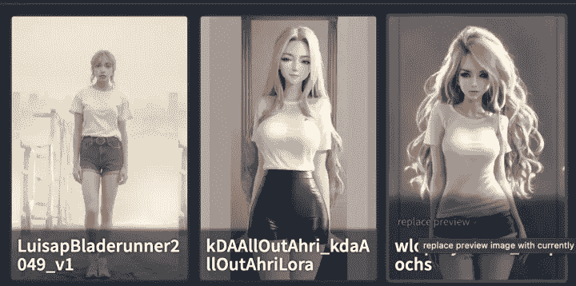

lora的下载使用见2023.1.23更新的教程

LoRA 指南 158 赞同 · 22 评论 文章


text inversion、hypernetwork下载使用

[NovelAI hypernetwork 自训练教程](https://zhuanlan.zhihu.com/p/576041621) 115 赞同 · 44 评论 文章


纷繁复杂的模型迭代推新让人眼花撩乱，而普通AIGC绘画者更多地还是考虑如何便捷地找到自己心仪的优秀模型文件并创作出让人眼前一亮的作品。因此，有必要讲讲寻找检索心仪模型并应用的Workflow.（ 至于如何搭建部署webui 可以去看之前的文章教程 ）

[使用stable-diffusion-webui部署NovelAi/Stable Diffusion 保姆级教程、命令解释、原理讲解(colab、windows、Linux )](https://zhuanlan.zhihu.com/p/574200991) 240 赞同 · 95 评论 文章


## 常用模型分发传播流程、资源渠道汇总

### HuggingFace的 Stable Diffusion模型分区

+ 模型训练作者在训练完模型、测试效果后，通常会将模型上传到HuggingFace的 Stable Diffusion模型分区

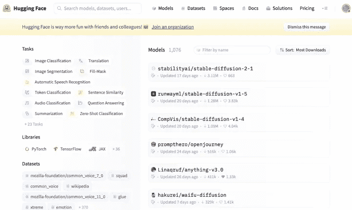

Hugging Face SD模型分区

Huggingface TI分区

[https://cyberes.github.io/stable-diffusion-textual-inversion-models/](https://cyberes.github.io/stable-diffusion-textual-inversion-models/)

### Discord&TG&Reddit

而这些作者往往都是开源社区、社群的活跃成员，所以除了在HuggingFace上传模型外也会编写相关介绍帖子及模型链接在Discord TG Reddit中的社区社群中。

**电报模型分享群(需🪜)**

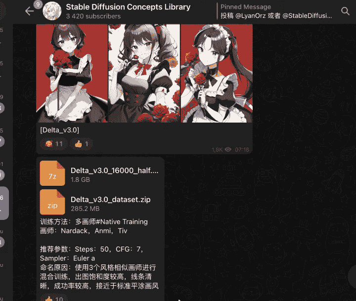

**Discord**相关频道中模型帖子区 (需🪜)

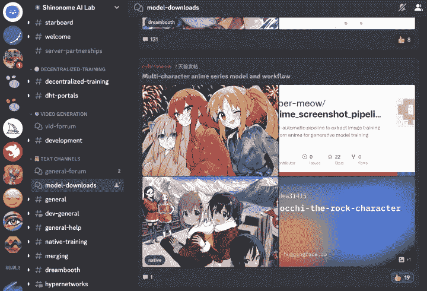

Shinonome AI Lab discord截图

reddit的 stable diffusion 社区

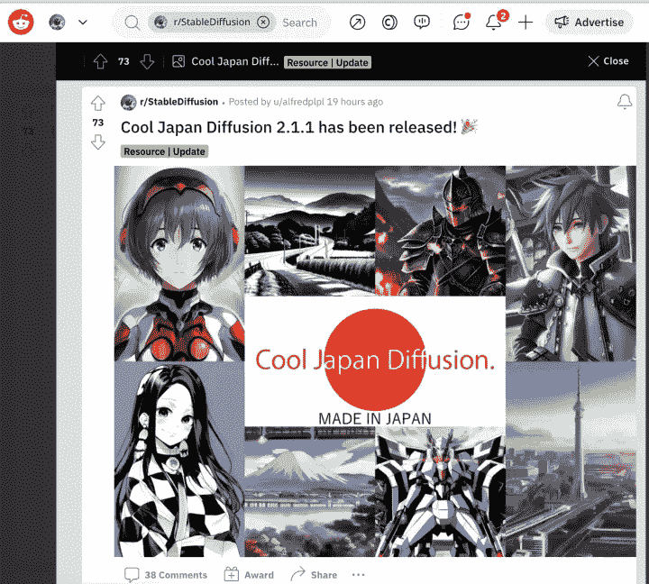

### [Civitai](https://civitai.com/)

一些优秀的模型会被收录到专门的模型汇总网站如Civitai中， UI清爽无需登陆

[Civitai | Stable Diffusion models, embeddings, hypernetworks and more](https://civitai.com/)

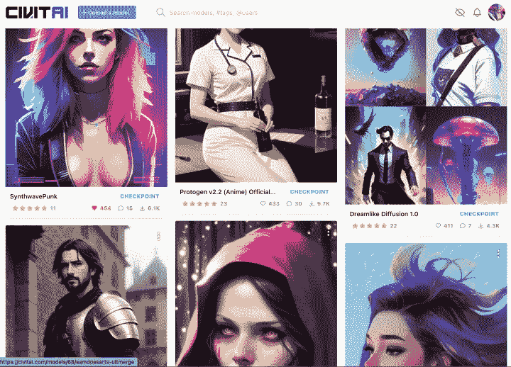

civitai网站截图

## 模型常见格式介绍

刚接触huggingface模型仓库的同学难免会被一堆文件感到困惑，搞不清自己到底该下那个文件。所以在这里讲下这些仓库的常见构成

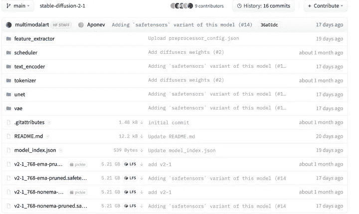

huggingface SD2.1官方仓库

如图、此种情况下模型训练作者一般都会上传ckpt格式(即webui适用的格式)的同时上传适用于diffusers库的格式，也即把sd各个部分(unet, vae-变分自编码器, clip-文本编码器) [1] 训练好的权重(一般是bin格式)以及scheduler(调度算法)和tokenizer(分词器)等等配置信息分别单独保存在不同的文件夹中。所以我们只需找到ckpt格式的模型文件下载即可。

### Safetensors

huggingface 后来又推出了safetensors 格式，旨在取代前面介绍的格式，使用方法上与ckpt格式类似，也是下载到webui的model文件夹下即可(如果webUI加载不出safetensors格式模型，可能是webui版本过旧，请`gitpull`更新)

比ckpt格式加载速度更快更安全

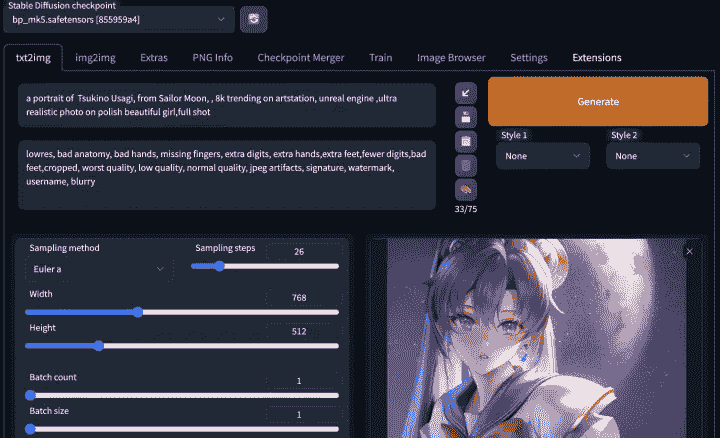

safetensors直接可以在webUI中原生调用，无需转换格式

在webUI中使用safetensors格式模型的具体细节可以参阅下方给出的链接

[https://github.com/AUTOMATIC1111/stable-diffusion-webui/pull/4930](https://github.com/AUTOMATIC1111/stable-diffusion-webui/pull/4930)

## 模型文件名常见后缀含义解读

有时仓库里会有多个模型文件，文件名后缀各不相同，这里简单介绍下文件名常见后缀及其含义：

### ControlNet

[AI 绘画引入 ControlNet，将会带来哪些影响？](https://www.zhihu.com/question/584139316/answer/2898668982) 133 赞同 · 7 评论 回答


### instruct-pix2pix

在 stable-diffusion-webui 中使用 instruct-pix2pix (1.27号更新 img2img专用模型 自然语言指导图像编辑 生成速度极快 (几秒) )

[在 stable-diffusion-webui 中使用 instruct-pix2pix模型](https://zhuanlan.zhihu.com/p/601208059) 111 赞同 · 9 评论 文章


### fp16、fp32

代表着精度不同，精度越高所需显存越大、效果也会相应增加；

### 512、768

代表着默认训练分辨率时512X512还是768X768，理论上默认分辨率高生成效果也会相应更好；

### inpaint

代表着是专门为imgtoimg中的inpaint功能训练的模型，在做inpaint时效果会相对来说较好。

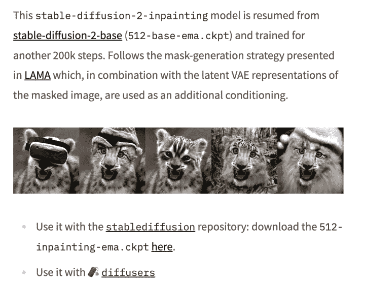

### depth

代表此模型是能包含处理图片深度信息并进行inpainting和img2img的

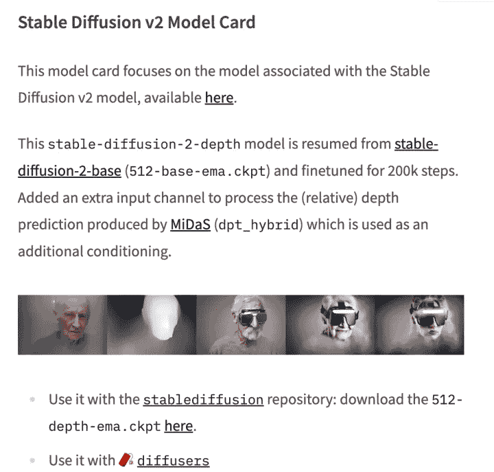

### EMA

模型文件名中带EMA一般意味着这是个用来继续训练的模型，文件大小相对较大

与之相比，正常的、大小相当较小的那个模型文件是为了做推理生成的

对于那些有兴趣真正理解发生了什么的人来说，应该使用EMA模型来进行推理

小模型实际上有EMA权重。而大模型是一个 "完整版"，既有EMA权重，也有标准权重。因此，如果你想训练这个模型，你应该加载完整的模型，并使用`use_ema=False`。

什么是EMA权重，为什么它们应该是更好的？

就像你作为一个学生在接受训练时，也许你会在最后一次考试中寄了，或者决定作弊并记住答案。所以一般来说，通过使用考试分数的平均值，你可以更好地了解到学生的表现。


由于你不关心幼儿园时的分数，如果你只考虑去年的分数（即只用一组最近的实际数据值来预测），你会得到 `MA`（moving average 移动平均数）。而如果你保留整个历史，但给最近的分数以更大的权重，则会得到 `EMA`（exponential moving average 指数移动平均数）。

这对具有不稳定训练动态的GANs来说是一个非常重要的技巧，但对扩散模型来说，它其实并不是那么重要。

### VAE

`vae`模型文件并不能和正常模型文件一样独立完成图片生成，关于`VAE`文件，我写了篇比较全面的文章，可以跳转查看

[在StableDiffusion中说起VAE时，我们在谈论什么？](https://zhuanlan.zhihu.com/p/599129815) 86 赞同 · 6 评论 文章


模型安利及魔法少女


## 寻找好的模型，给自己找到趁手的魔法水晶球

这部分安利三个模型（因为篇幅原因先介绍这些，这三个模型都是`ckpt`文件，下载到`model`文件夹下，`webui`里就可以直接调用了，模型下载链接已嵌到每个模型标题中）。与此同时将会以魔法少女为生成主题给大家演示下各个模型的使用，用到的`prompt`也会分享给大家。

### [`kawaye1_6000`](https://link.zhihu.com/?target=https%3A//pan.baidu.com/s/1EI2Mcgm19iPeullihUJefg%3Fpwd%3Dhmfv)（Q萌）

画师：[디얍/opinew6](https://link.zhihu.com/?target=https%3A//www.pixiv.net/users/42399563)

作者：厨子

备注：`webui`中直接使用即可，如加特定`tag[chibi]`

`prompt`示例：直接输角色英文名即可

**美少女战士** -> `a portrait of Tsukino Usagi, from Sailor Moon,chibi`

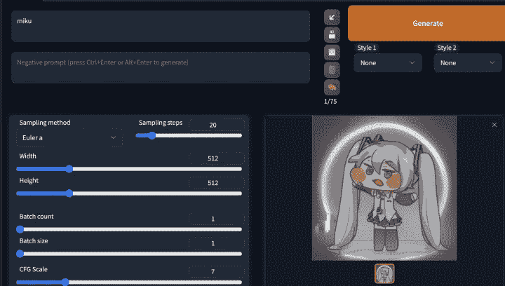

效果演示：月野兔 弹丸论破 蒂法 拉克丝 miku

### `dreamlike-photoreal-2.0`（写真风）

Dreamlike Photoreal 2.0是一个基于Stable Diffusion 1.5的拟真模型，由dreamlike.art制作。

你可以给你的`prompt`添加`photo`，使你的生成看起来更逼真。

非正方形的长宽比对某些提示的效果更好。如果你想要一张肖像照片，试着使用垂直长宽比。如果你想要一张风景照片，试着使用一个水平的长宽比。

这个模型是在768x768px的图像上训练的，所以使用768x768px、640x896px、896x640px等。在更高的分辨率下，如768x1024px或1024x768px，它的效果也相当好。

**星守拉克丝prompt** -> `the Lady of Luminosity,star guardian from league of legends, character portrait, ultra realistic, concept art, intricate details, highly detailed`

**月野兔prompt** -> `amazing masterclass portrait of sailor moon ], hearthstone splash art, deiv calviz, splash art, natural light, elegant, intricate, fantasy, atmospheric lighting, hd wallpaper, ultra high details, cinematic composition, sharp focus, depth of field, f/1.8, 24mm, full shot`

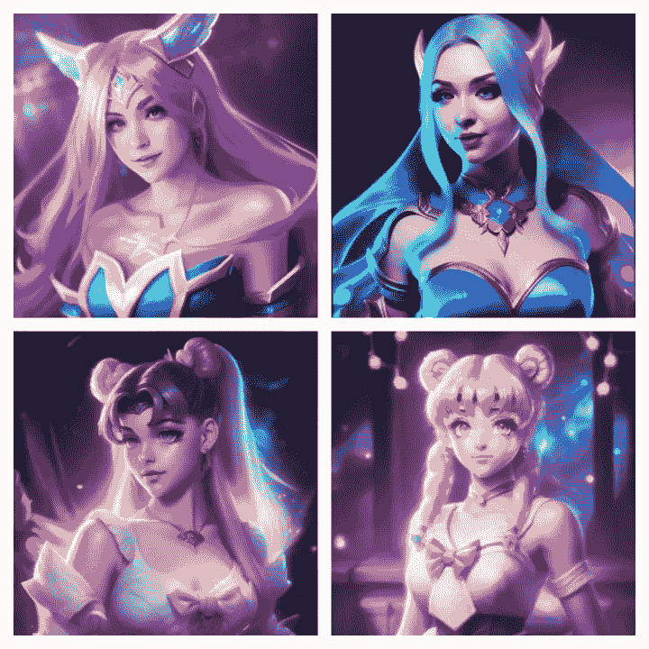

效果演示：拉克丝 月野兔

### `FloydianSound/WLOP_Diffusion_v1-5`（WLOP 厚涂）

有能力请到WLOP官网支持WLOP大大

[h](https://link.zhihu.com/?target=https%3A//www.artstation.com/wlop)ttps://www.artstation.com/wlop  www.artstation.com/wlop

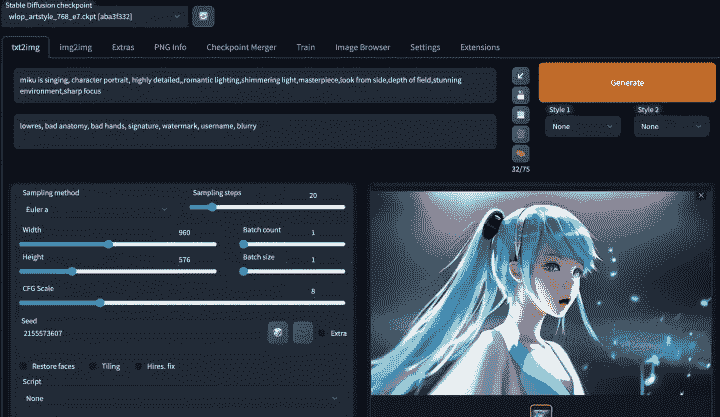

`prompt`：`amazing masterclass portrait of lux from league of legends, character portrait, highly detailed, blonde curls, big blue eyes ,fantasy art,atmospheric lighting,a detailed painting by wlop ,masterpiece, magic girl,full shot`


`prompt`：`amazing masterclass portrait of sailor moon , hearthstone splash art, natural light, elegant, intricate, fantasy, atmospheric lighting, hd wallpaper, ultra high details, holding a magic book`


`amazing masterclass portrait of sailor moon , natural light, elegant, intricate, fantasy, atmospheric lighting, hd wallpaper, ultra high details, cinematic composition, sharp focus, f/1.8, 24mm, {{arms behind back}},stunning environment`

`amazing masterclass portrait of lux from league of legends, character portrait, highly detailed,a picture of a woman , blonde curls, big blue eyes ,trending on pixiv, fantasy art,romantic angelic,a detailed painting by wlop ,masterpiece`


`the Lady of Luminosity, from league of legends, character portrait, highly detailed,a picture of a woman , blonde curls, big blue eyes ,trending on pixiv, fantasy art,romantic angelic,a detailed painting by wlop ,masterpiece`


`miku is singing, character portrait, highly detailed,,romantic lighting,shimmering light,masterpiece,look from side,depth of field,stunning environment,sharp focus`


[🎦 点击观看视频](https://vdn.vzuu.com/SD/b5be215a-8f6e-11ed-85bb-ce7b0ab849b6-v1_f4_t2_mDjMxzSm.mp4?disable_local_cache=1&bu=078babd7&c=avc.1.1&f=mp4&expiration=1680880601&auth_key=1680880601-0-0-8d3ad3cd3aaa68dcb769bccb0b660ed9&v=ali&pu=078babd7)

`img2img`


[🎦 点击观看视频](https://vdn3.vzuu.com/SD/bcb9267c-8f72-11ed-a506-52ddf8635361-v1_f4_t2_L3xRngHk.mp4?disable_local_cache=1&bu=078babd7&c=avc.1.1&f=mp4&expiration=1680880601&auth_key=1680880601-0-0-04c92d0b91cd1e61f7fb3c772f7fefd9&v=tx&pu=078babd7)

炫彩皮肤

## 模型下载方法汇总

### 本地机器

如果带GUI本地机器运行`stablediffusion`，下载没啥好说的，直接浏览器找到下载按钮点击就完事了，慢的话`fq`或者复制下载链接到迅雷等下载软件里。

### linux服务器

如果是服务器，下面介绍两种方法。

#### 使用`aria2c`下载模型文件

运行 `apt install aria2` 下载安装 `aria2`。

使用命令 `aria2c` 加上模型下载链接，`huggingface`、`civital`的都可以，然后回车即可。

下载链接可参考下面的截图。

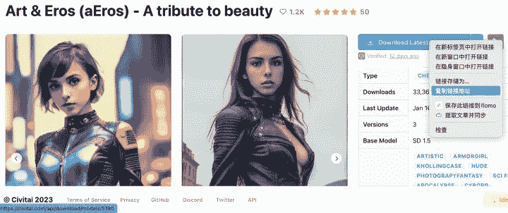

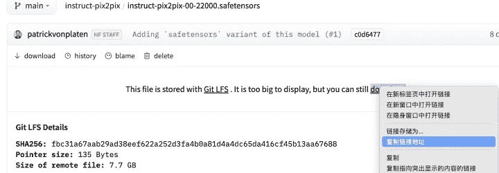

```
#使用示例
aria2c https://civitai.com/api/download/models/5180
```

#### 服务器上编写python脚本优雅下载模型文件

来回在自己电脑和服务器之间用FTP传模型非常耗时费力，可以在服务器上编写几行`python`代码就能快速从`huggingface`上下载自己需要的模型文件（当然也可以用`aria2c`来下载，可以根据实时网络环境择优选择）。

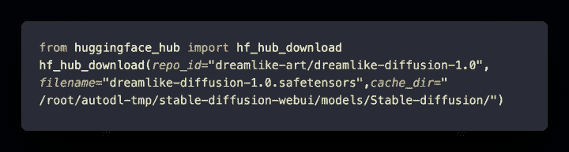

下载模型脚本代码示例

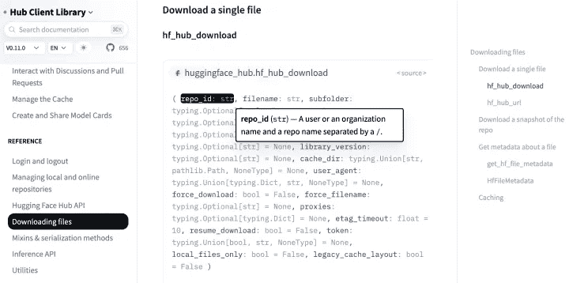

##### 0. 安装huggingface hub库

没有安装的话，在终端命令行中输入以下安装命令并回车：

`pip install huggingface_hub`

##### 1. 创建脚本、填写参数

在任意路径创建一个`python`文件，文件名随意，将下面代码复制进去：

```
from huggingface_hub import hf_hub_download
hf_hub_download(repo_id=&quot;&quot;,filename=&quot;&quot;,cache_dir=&quot;/root/autodl-tmp/stable-diffusion-webui/models/Stable-diffusion/&quot;)
#cache_dir后是webui存放sd模型的路径、如有不同自行修改
```

复制你要去下载的模型所在仓库名并填入`repo_id`参数中。

[🎦 点击观看视频](https://vdn.vzuu.com/SD/bcba1a50-935a-11ed-bba9-2af288d88e99-v1_f4_t2_SDK8feAx.mp4?disable_local_cache=1&bu=078babd7&c=avc.1.1&f=mp4&expiration=1680880602&auth_key=1680880602-0-0-20c795549ad85ca388e43e7d2b08a650&v=ali&pu=078babd7)

复制你要模型具体文件名并填入`filename`参数中。

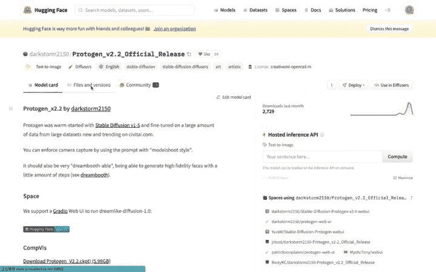

[🎦 点击观看视频](https://vdn3.vzuu.com/SD/56b6d698-935b-11ed-bddd-d6e6cc22ba2c-v1_f4_t2_scz6mYux.mp4?disable_local_cache=1&bu=078babd7&c=avc.1.1&f=mp4&expiration=1680880603&auth_key=1680880603-0-0-7f9ff08b518a1e99bce38889ff35726f&v=tx&pu=078babd7)

`cache_dir`参数是模型下载存放路径，为方便起见，直接填写`webui`存放`sd`模型的路径，这样下载完就可以直接在`webUI`启动后读取调用。路径如有不同自行修改。

##### 2. 执行下载脚本

`ps:` 如果和我一样使用`autodl`平台，可以在使用脚本前使用平台提供的加速代理。

[AutoDL帮助文档  www.autodl.com/](https://link.zhihu.com/?target=https%3A//www.autodl.com/docs/network_turbo/)docs/network_turbo/

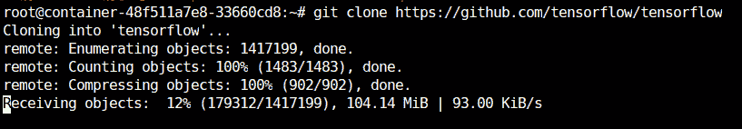

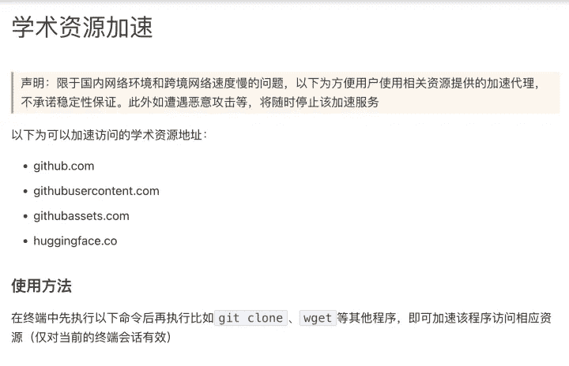

终端命令行跳转到`python`脚本所在路径，输入 `python <脚本文件名>.py` 并回车即可开始下载。

`autodl`加速后模型下载速度从几`mb`每秒到十几`mb`每秒，这样下载一个模型的时间都能控制在五六分钟左右，节省了很多时间。

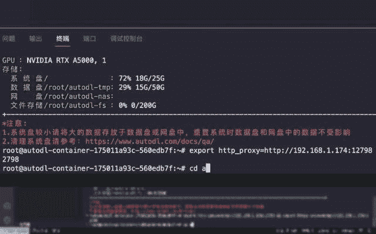

##### 3. 使用模型

下载完成后，`sd models`模型文件夹会多出来这些东西，跟我们平时直接上传单独模型文件不一样。

这里是因为`huggingface`要在我们机器上维护一套模型缓存系统，所以所有下载的模型都按照这个统一的格式保存。

`blobs`文件夹下是实际的模型文件，`snapshots`文件夹下的只是`blobs`模型文件的符号软连接（再深究就是Linux文件系统的知识了，感兴趣的同学可以去下面这个`issue`看看）。

[https://github.com/huggingface/huggingface_hub/issues/1240](https://github.com/huggingface/huggingface_hub/issues/1240)  github.com/huggingface/huggingface_hub/issues/1240

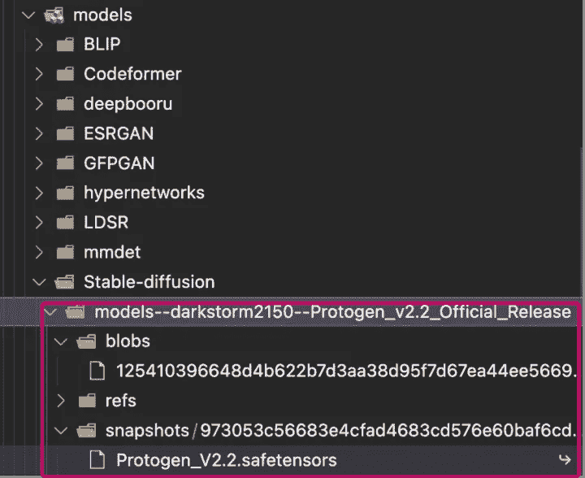

`webui`会自动识别到嵌套文件夹下的模型，所以我们无需对这样的文件结构做调整。

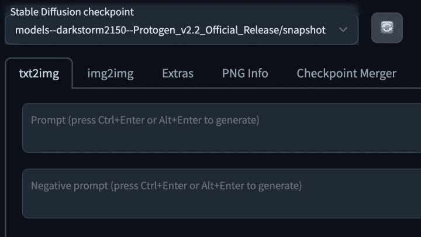

`webUI`中直接可以识别。

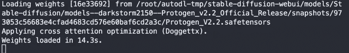

`safetensors`格式速度确实快。

之后要下别的模型只需把脚本文件的两个参数改下即可复用。

> 优雅 永不过时


`+ wlop lora`

[更多huggingface hub的API使用方法，请查看官方文档](https://link.zhihu.com/?target=https%3A//huggingface.co/docs/huggingface_hub/package_reference/file_download)

## Changelog

### 3.20号 ChatGPT国产开源平替--ChatGLM部署教程

[SeASnAkE：ChatGPT国产开源平替--ChatGLM部署教程](https://zhuanlan.zhihu.com/p/615395955) 75 赞同 · 11 评论 文章


### 3.3号 搭建自己的stablediffusion绘画机器人 图文教程

[搭建自己的stablediffusion绘画机器人](https://zhuanlan.zhihu.com/p/611388521) 121 赞同 · 22 评论 文章

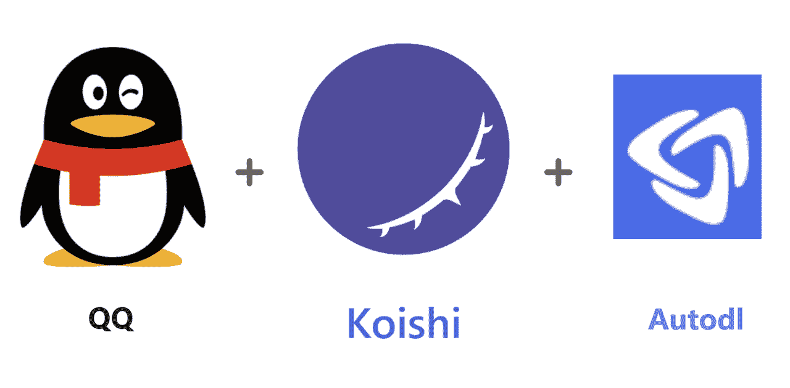

### 3.3号 更新显存优化常见思路

[StableDiffusion Optimization(显存优化 推理加速 xFormers、cuDNN)](https://zhuanlan.zhihu.com/p/611173551) 45 赞同 · 8 评论 文章

### 1.27号更新 img2img专用模型 自然语言指导图像编辑 生成速度极快 (几秒)

[在 stable-diffusion-webui 中使用 instruct-pix2pix模型](https://zhuanlan.zhihu.com/p/601208059) 111 赞同 · 9 评论 文章


## 1.23号更新 Lora 模型使用

LoRA 指南 158 赞同 · 22 评论 文章


## 1.15号更新 补充EMA depth 等模型后缀名的含义、补充Reddit社区

## 1.14号更新 关于VAE文件，你需要了解的都在这

[在StableDiffusion中说起VAE时,我们在谈论什么?](https://zhuanlan.zhihu.com/p/599129815) 86 赞同 · 6 评论 文章


## 1.12号更新 使用huggingface hub api 优雅下载模型

## TODO

下面是将于近期陆续更新的内容 敬请期待

+ 如何使用huggingface hub api 优雅下载模型 `\sqrt{}`
+ 包括多语言模型在内的更多优秀模型推荐
+ `transformers` 和 `diffusers` 讲解使用
+ prompt书写策略 `\sqrt{}`
+ sd api模式运行 以及 `python` `nodejs` 调用 中间件封装整合

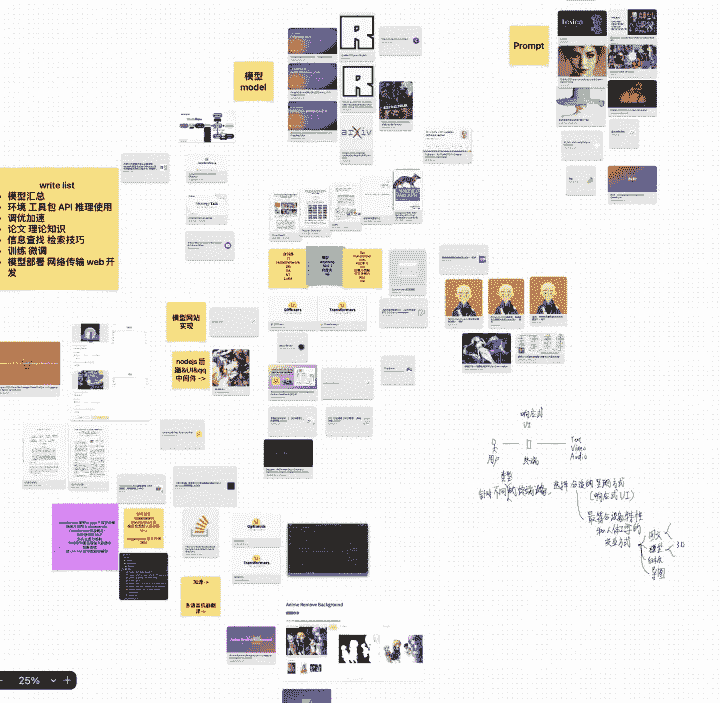

用无边记做的部分汇总

## 参考

1. 关于SD的结构（`unet`、`vae`、`clip-text_encoder`）的更多信息，可以参阅 [HuggingFace官方的博客](https://huggingface.co/blog/stable_diffusion) https://huggingface.co/blog/stable_diffusion

编辑于 2023-03-20 11:55 ・IP 属地浙江
