# 省了几千块! Stable Diffusion“网页版”上线，超详细教程

> 来源：[https://diwfpqo78m.feishu.cn/docx/X467d7PMpooD2SxGlXPcJvrvn3d](https://diwfpqo78m.feishu.cn/docx/X467d7PMpooD2SxGlXPcJvrvn3d)

一个抖音AI绘画博主绝对不会告诉你的Stable Diffusion内幕

前几周，我在抖音上看到有人分享关于Stable Diffusion的安装和绘画教程。Stable Diffusion，简称SD，是一款比我之前提到的Midjourney更强大的AI绘画软件。如果说Midjourney是一个艺术家，那么Stable Diffusion就是一个专业设计师。而且使用它是完全免费的，而且它所生成的图像非常惊艳。

我对它进行了一番研究，发现大部分人不仅出售Stable Diffusion的安装教程，还附带AI绘画的教学内容。

除此之外，目前Stable Diffusion主要用于电商AI模特、产品摄影图和辅助AI绘画等领域。

起初，我对在抖音上教普通人使用SD持怀疑态度，因为能够熟练使用SD的人实在是太少了。

首先，SD的安装过程相对复杂，大多数普通人并不了解如何操作。

其次，SD对显卡要求较高，大部分电脑无法满足运行要求。

再者，即使在低配电脑上安装了SD，生成图像的速度也非常缓慢。

然而，我发现了一个小秘密，他们所教的Stable Diffusion实际上不受电脑配置的限制。

顺藤摸瓜，我发现国内已经有一家公司上线了一个SD界的神器

Stable Diffusion网页版

[h](https://www.lanrui-ai.com/register?invitation_code=0951224320)ttps://www.lanrui-ai.com/register?invitation_code=0951224320

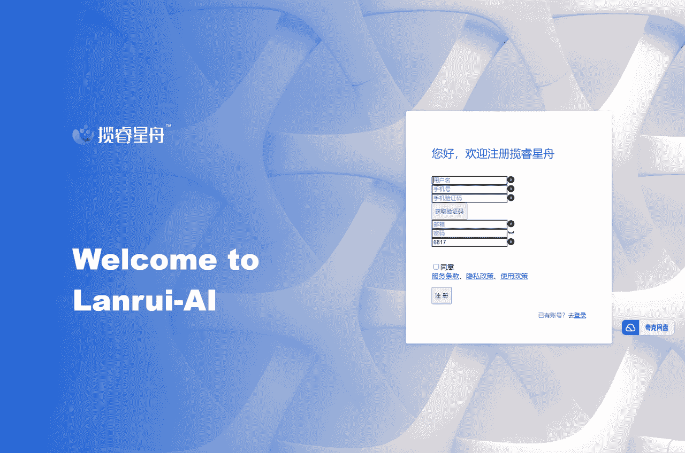

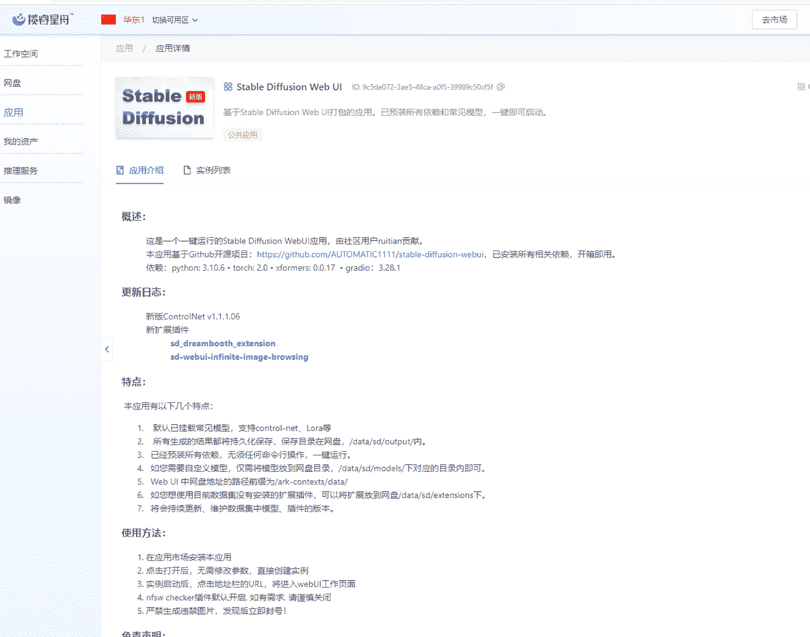

你可以将网页版的Stable Diffusion理解为一个云游戏平台的工作原理。如果对云游戏的概念不太了解的话，我来简单解释一下。

云游戏的核心思想是将游戏的所有运算工作都放在云端完成，然后将游戏画面传输到你的低配电脑上，这样你就可以通过远程方式来玩高端游戏了。举个例子，比如你想玩《原神》，这款游戏占用的存储空间很大，你的手机或者电脑可能无法承载，但你可以在一个云游戏平台上注册，通过流媒体的方式来进行游戏。

现在的Stable Diffusion和Midjourney一样，只需要一台电脑就可以轻松启动了。它的工作方式类似于云游戏平台，所有的处理工作都在云端完成，而你所需要做的只是通过键盘来进行操作。

而且，这个网页版的功能和体验与安装在你自己电脑上的版本几乎没有差别。

然而，由于这个工具目前在AI绘画的小圈子中传播，很多人还不知道它的存在。

最近，我注意到在抖音和📕上已经有很多人利用这个信息差来赚钱。

Stable Diffusion的前景实际上比Midjourney更广阔，比如国内上个月上线的Vega AI，因为它可以让用户自己训练模型，因此用户数量大幅增加。

我估计等门槛再降低一点，Stable Diffusion在国内也将迎来爆发期。

下面是Stable Diffusion的“网页版”超详细教程！

为了方便大家理解，你可以把它当成一个AI绘画游戏。

按照下面的步骤，你可以生成一个属于自己的绘画网址。

最酷的是，你可以将这个链接发送给你的朋友或同事（他们也可以使用这个绘画工具），当然，使用它会扣除你的余额。

打开网站并安装Stable Diffusion。

2、创建工作空间

点击右上角的[进控制台]。

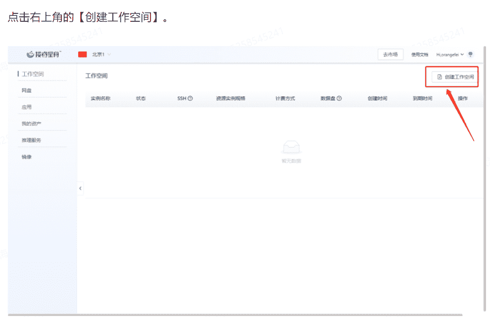

接着你需要选择显卡，比如我选择的是这个[3090-24G]

目前价格还可以，1.9/小时，比买一张显卡便宜。

启动速度就俩字一一牛逼

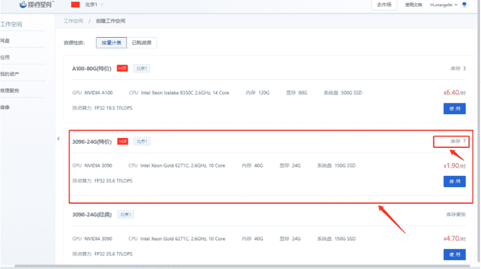

名称:自己起一个就好了，一般就用默认的

运行环境镜像: 公有镜像/others/sd-webui/v4.27

网盘: 挂载

数据盘会计费，看自己需要选择用不用.

数据集: sd-base

启动以后大概要等[3-5分钟]，你就可以进入VsCode界面

3、VsCode界面

确认是[运行中]的状态，点击[进入]，选择[VS Code]

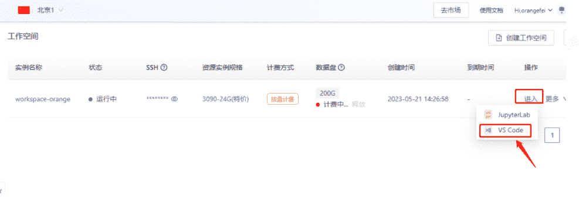

选择 Terminal -New Terminal

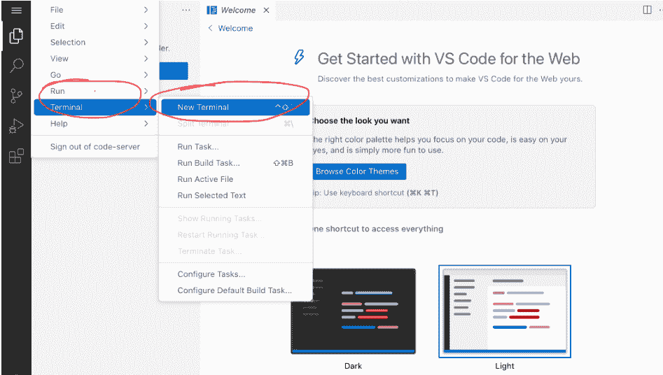

然后输入这两行命令，这一步之前有很多人说出错，其实很简单。

先输入 cd /app

然后按回车键，等第二行出现了user@lsp-ws:/app$

再输入 bash start.sh

再按回车键

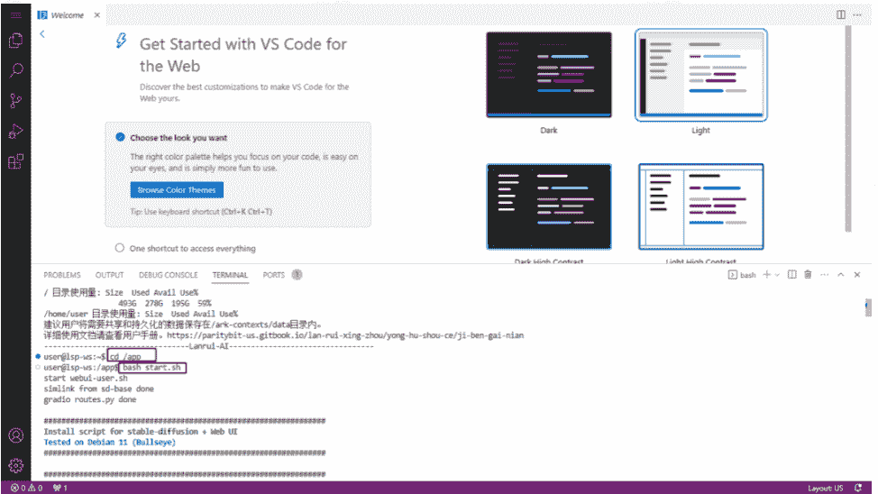

等到一连串的代码出现running on local url，就说明成功了

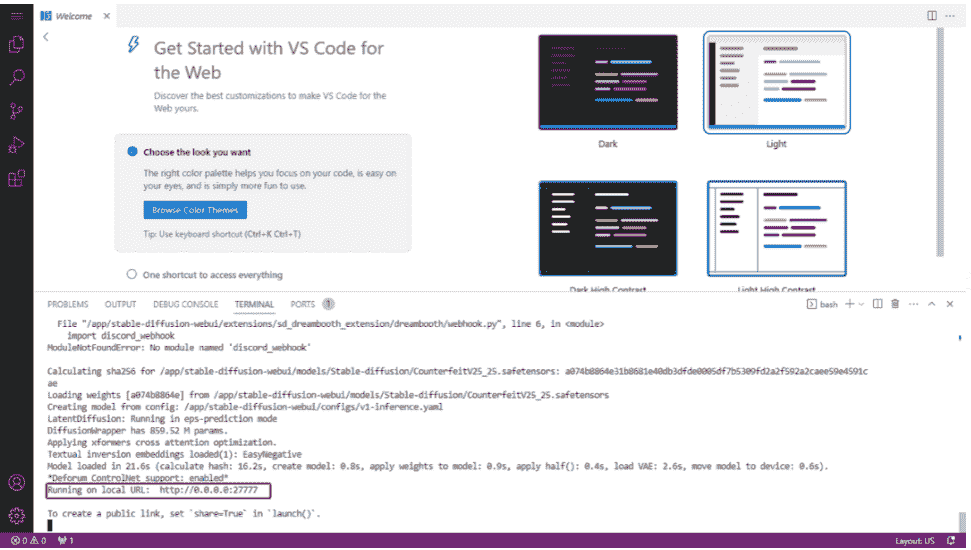

启动完成，回到控制台，点击复制调试地址，会复制一个网址。

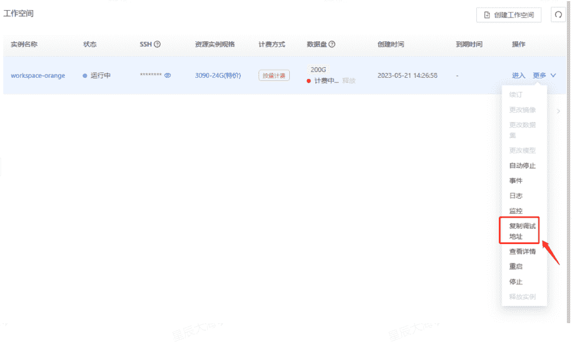

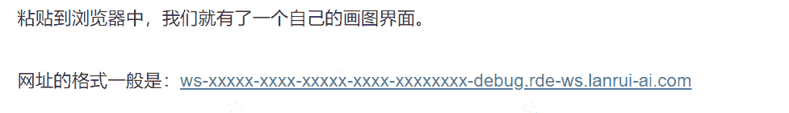

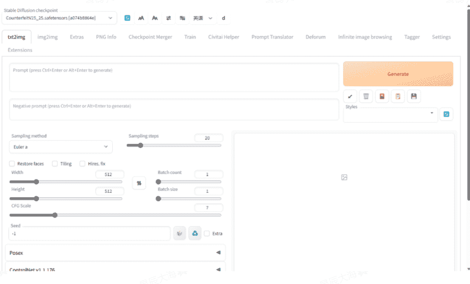

Stable Diffusion"网页版”画图测试

接下来我们要先测试一下我们的Stable Diffusion有没有启动成功?

(1) 先切换一下主模型

这个里面已经有一些自带的了，比如 (chilloutmix NiPrunedFp16Fix]

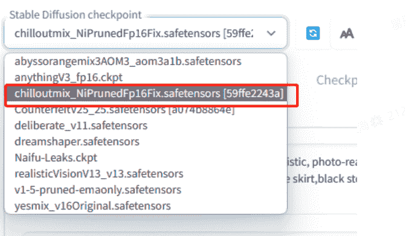

(2) 接着输入这两行prompt

正面提示词: (masterpiece:1.1), (best quality:1.1), highly detailed, {highres), fan extremelydelicate and beautiful, (ultra detailed), (disheveled hair), (illustration), (dynamic angle), (1girl),colored hair:1.5)), (Fashionable clothing), standing,Fashion model, looking at viewer, (interview)simple background), beautiful detailed eyes, delicate beautiful face, Floating, (high saturation).(colorful splashes), (colorful bubble), (shining),(beautiful detailed Light and shadow)

负面提示词: easynegative, paintings, sketches,(worst quality:2), (low quality:2), (normaquality:2), lowres, normal quality, ((monochrome)), ((grayscale)), skin spots, acnes, skinblemishes, age spot, glansextra fingers,fewer fingers,strange fingers,bad hand

(3) 设置一下其他参数

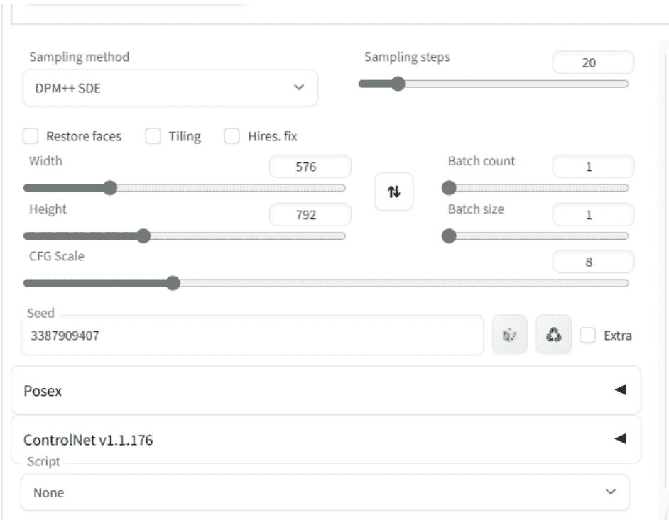

(4) lora模型选择，韩国娃娃

点击右上方的[Generate] 按钮，启动成功

1分钟左右，出图的速度快到飞起

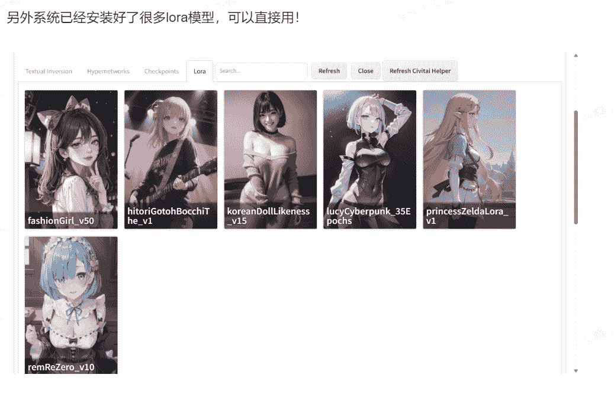