# 3D图标画不出？看这里，AI绘画3分钟搞定！

> 来源：[https://diwfpqo78m.feishu.cn/docx/S9ondmAkcoInIKxfYX1c7XTUnqt](https://diwfpqo78m.feishu.cn/docx/S9ondmAkcoInIKxfYX1c7XTUnqt)

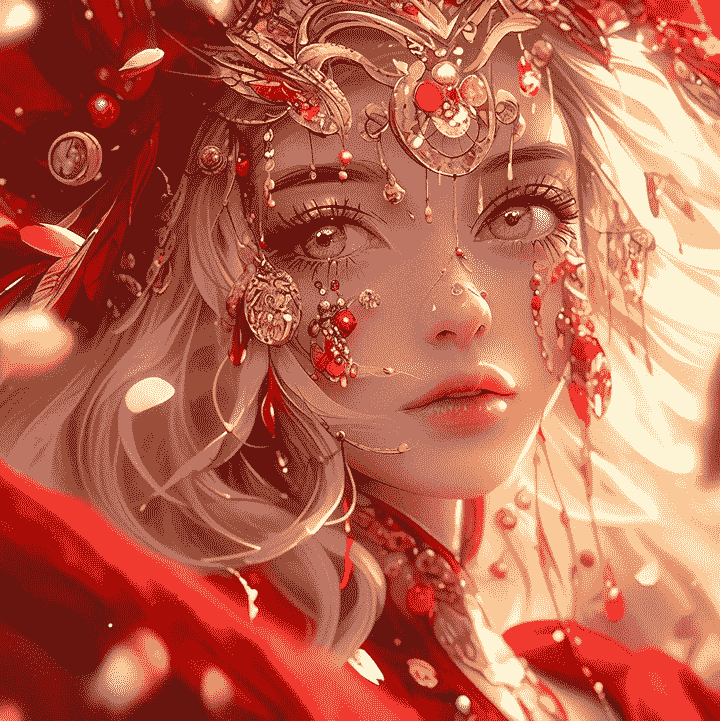

细心小伙伴，可能发现「我们的设计日记」👸号已经改名「 AI 绘画师日记 」，近期星球内容和框架，也会做一些调整，会带着大家往新的方向走。 正如我昨天说的，AI 绘画是生产力革命，发展很快，明天会怎么样，我不知道。 但至少在这个浪潮里，我们是一个冲浪者。

图标设计 已经成为设计里面很重要的一部分，无论是 UI 设计还是创意设计，用心设计的图标都能吸引用户注意力，在这个碎片化时代，图标设计的对品牌起着至关重要的作用。

借助 midjourney 我们可以快速 尝试各种风格设计 ，今天我整理了一些 midjourney 提示词，它能帮我们快速设计出不同的图形。

# **1.直播礼物图标**

如果在平时工作中，接到一组直播图标需求，可能设计师先要画草图，再尝试风格，确定风格后再深入细化，一组图标下来你可能需要小一周时间，但今天你借助 midjourney 你能快速设计出类似的图标风格。不废话，直接上礼物图标公式。

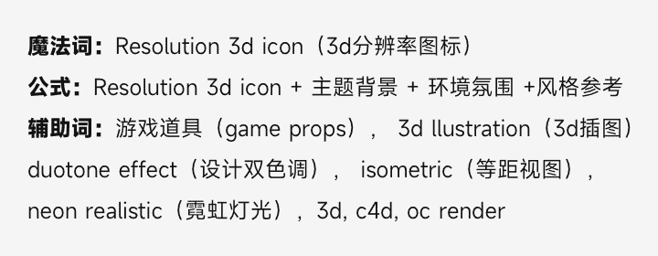

通过这组公式，你能很轻松画出你想要的游戏图标类型，我们来看看星球小伙伴通过这个公式画的直播礼物图标。

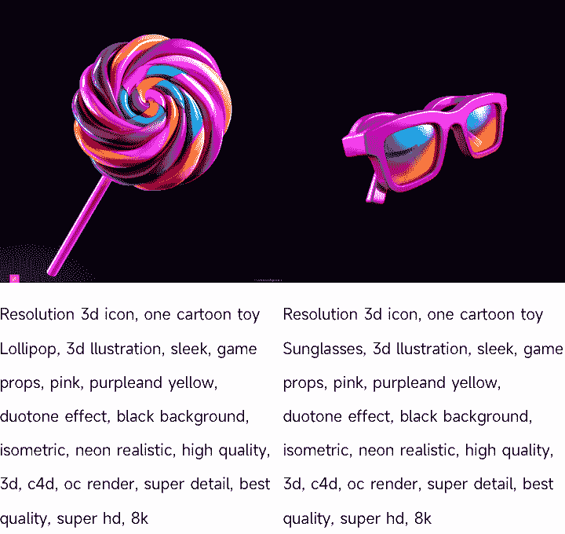

当然这中间的各种参数你都可以灵活调整，比如色彩，背景颜色，学 AI 绘画一定是理解背后的核心，而不是被单词，就像我们学英语一样，一定不是死记硬背，而是心中有画面，再让 ai 把我们想法实现出来。 通过上面那个公式，我们就可以举一反三做更多的变化，当然在后面，我们也会在星球组织各种打卡活动，带着大家在 AI 绘画方向进行实战，掌握这些各种参数细节。

# **2.APP图标**

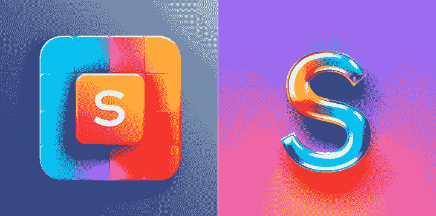

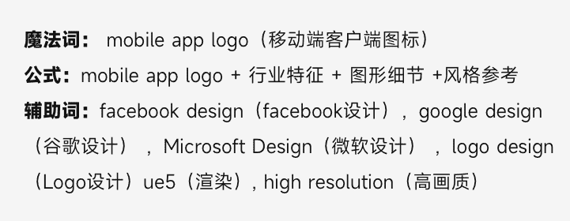

通过这组Ai公式，我们可以快速设计出一些 app 图标，各种风格都能快速出图，当然目前 AI 出的图标因为是图片，很多细节可能需要二次调整，但是已经大大释放了我们生产力，让设计师可以更加专注在创意上。

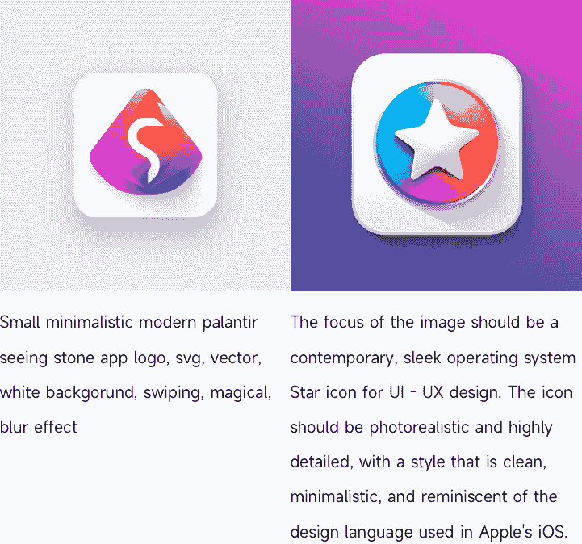

目前 AI 才一岁不到，虽然目前很多设计都显得很智能，但是在前期作为创意方向完全是可以帮助设计师更快找到灵感。 所以我星球给星球小伙伴说，AI 来了其实不可怕，关键我们要 把 AI 当作我们的武器，去拥抱变化 。

# **3.毛玻璃风格图标**

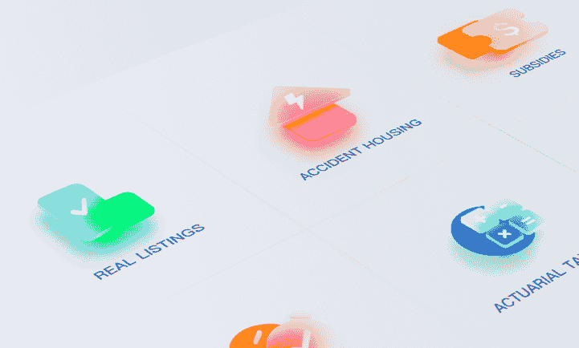

微软毛玻璃风格可以说是当前最流行的图形趋势，它的细节层次感，纹理的处理，以及玻璃的质感，让很多设计师追随，今天你可以通过 AI 绘画轻轻松松画出这样的风格。

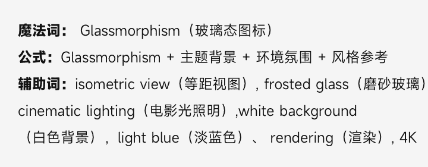

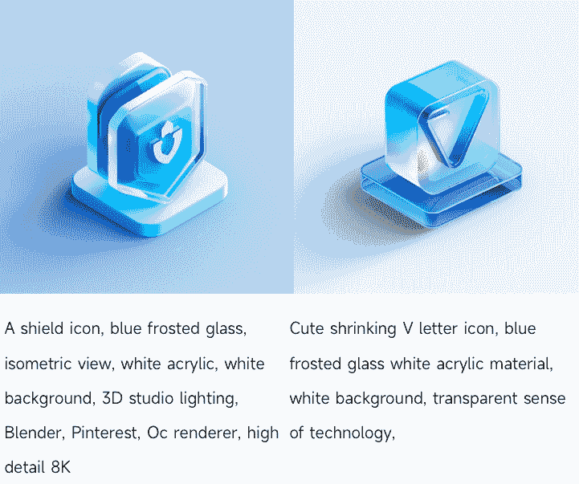

这种风格阿里云，腾讯云都很流行，就适合在 B 端场景去学习，去运用，如果你想系统掌握这套风格，不妨按照我上面的公式试试。

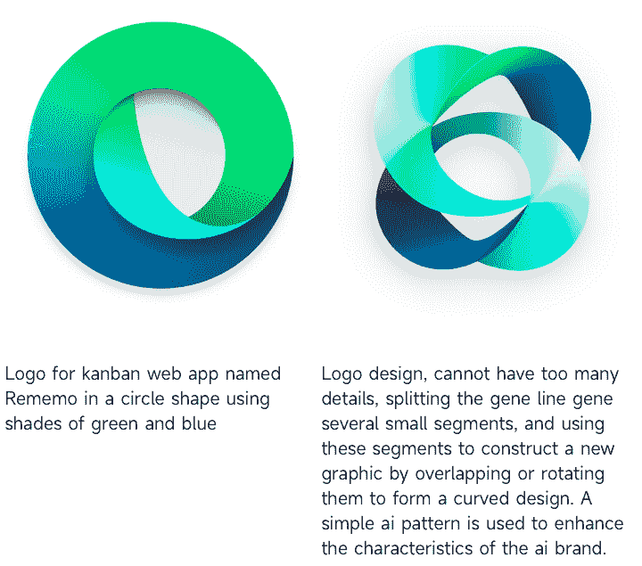

如果你想做的扁平化一点，修改相关提示词也可以完成类似效果。

# **4.线条填充图标**

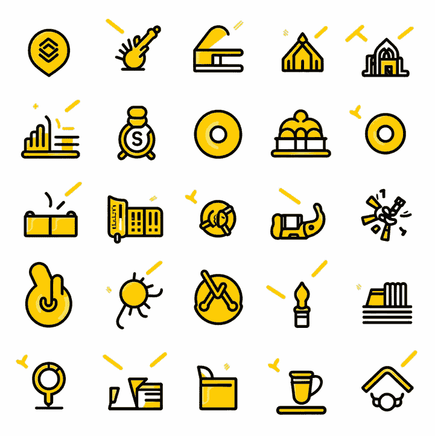

线的图标大家都见的比较多，这两年这种带品牌色的图标设计非常流行，在 AI 里面也能快速实现这种效果。

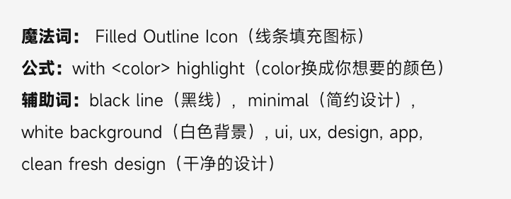

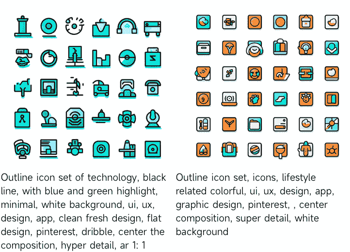

通过这个公式，我们加上行业特征，以及颜色要求就能轻松完成各种线条图标的设计，非常适合于设计师我们前期快速做图标灵感。

# **5.3d 图标**

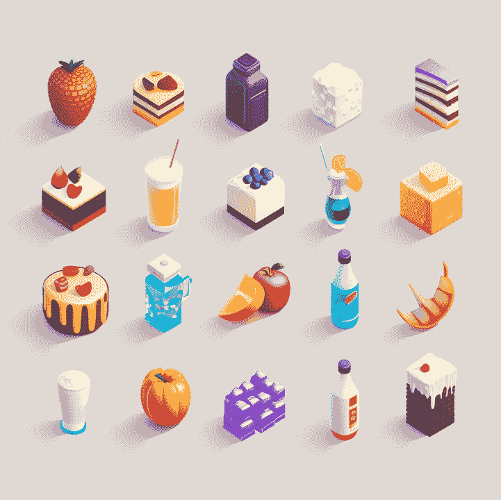

如果在从前，你拿到一组 3d 图标需求，我估计设计师要熬夜几个通宵，但今天不会，你只需要掌握了这个 3d 图标公式，轻轻松松完成。

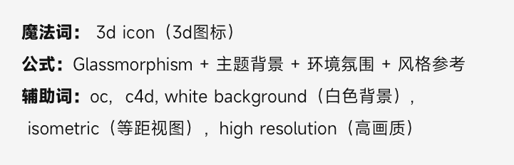

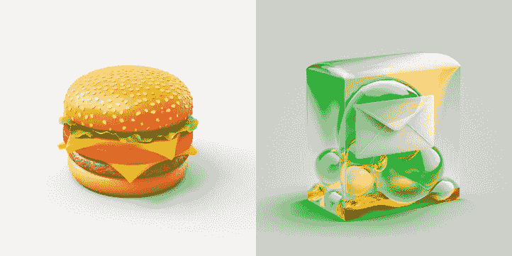

我们能通过这些关键词组合，能得出很多很多立体图标设计，你可以用在你需要的场景里面，这里面其实用的关键词，如果学过 3d 同学可能很熟悉，3d 渲染，c4d，这些关键词。 非常适合于在一些科技行业和一些大型项目里面。

AI 的出现让这些平时做设计很难的图形，今天变的简单，作为设计师我们一定要拥抱 AI 绘画而不要去排斥它。

# **6.卡通图标**

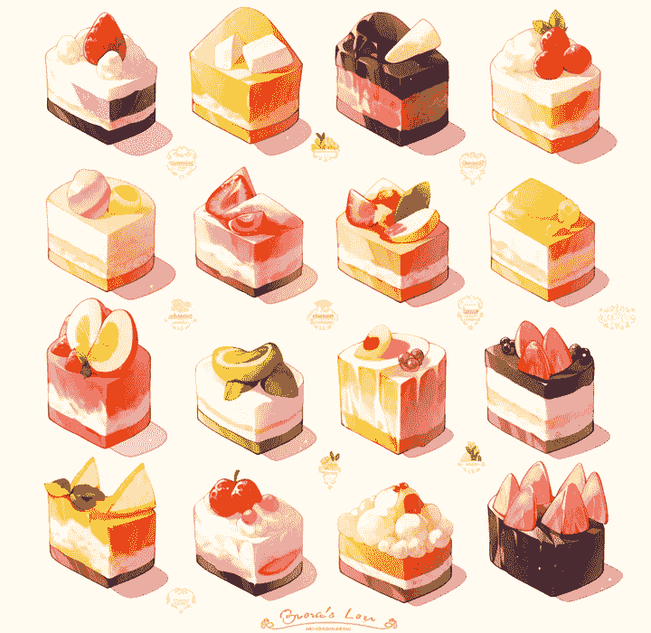

这种图标相信大家都见过，特别在夏天非常清爽，很适合去一些店铺的海报，这种图标像水彩画的，非常细腻。 如果你的产品场景中需要有一些手绘插画的形式，那么也可以轻松通过 AI 绘画完成这类型图标设计。

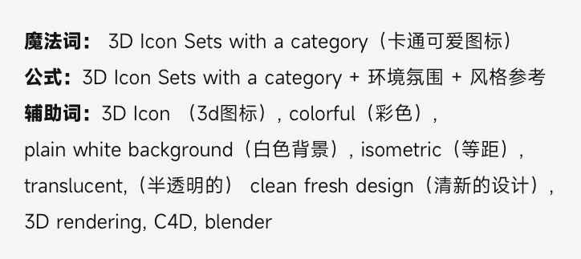

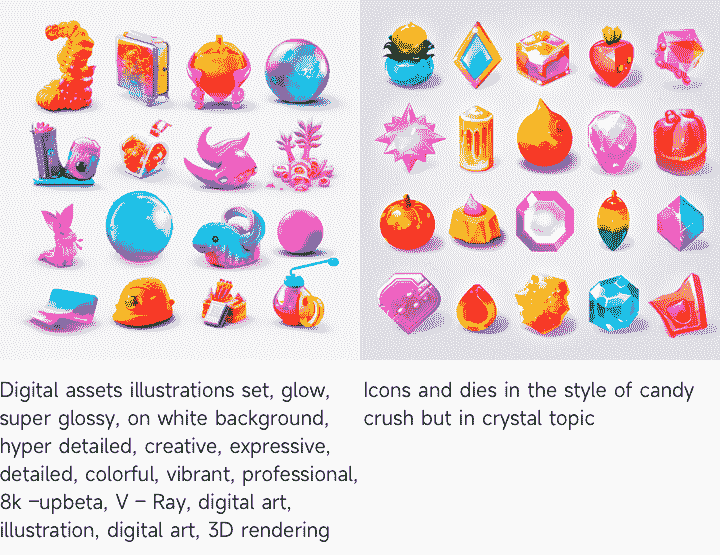

说到 niji 模式可能新手不太清楚，它是 AI 绘画软件 midjourney 下面一个模型，专注于动漫设计，能让你画风瞬间变得二次元和卡哇伊，非常适合于在一起写插画创作，二次元等场景，当然画这种图标也很是很轻松。 感兴趣的同学到时候可以在我们星球打卡的课程里面，我详细的和大家讲解。

# **最后**

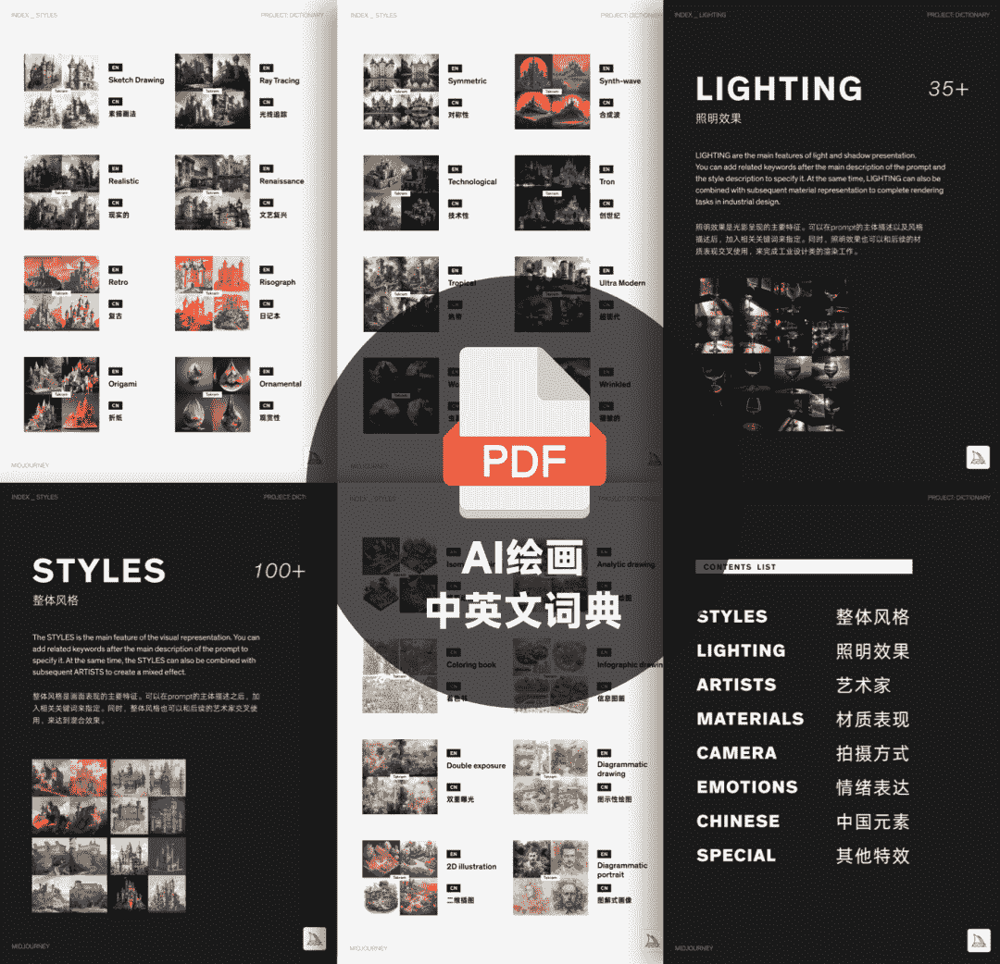

希**望今天这篇 AI 绘画的**文章能给大家一些启发，能在工作中帮助大家解决一些困惑。 最后文末，送给大家一份 《AI绘画中英文词典》 里面有上千个AI绘画提示词，帮大家能更好理解 AI 绘画和掌握 AI 绘画。

同时，这周我会有一个 **AI**** 绘画的公开课 **，给大家系统讲讲 AI 绘画软件如何使用，怎么注册，文中的案例也会有实操。想听公开课的同学直接 扫码报名 ，资料会在群里发放。

🔗 原文链接： h[ttps://mp.weixin.q](https://mp.weixin.qq.com/s/FmrjrZriqqu94j-jeGzHdA)q.com/s/FmrjrZri...