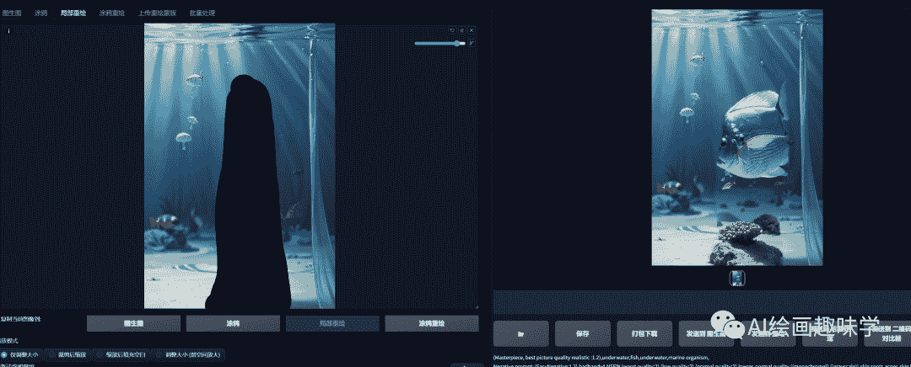
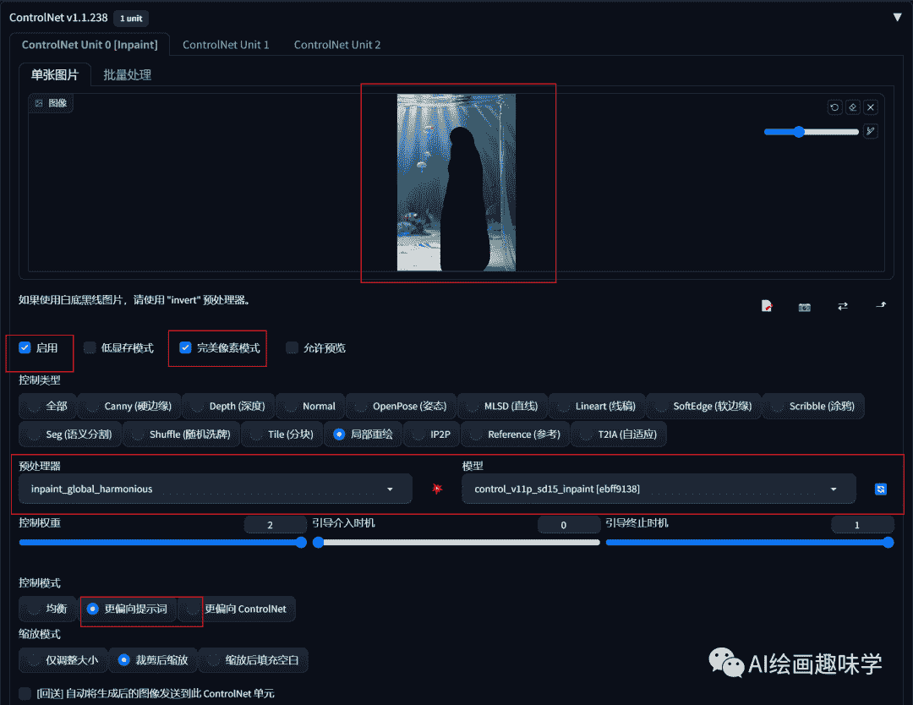
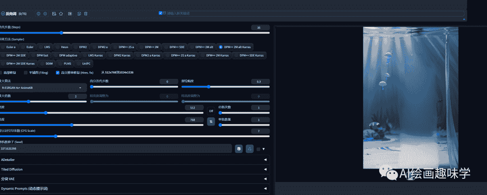
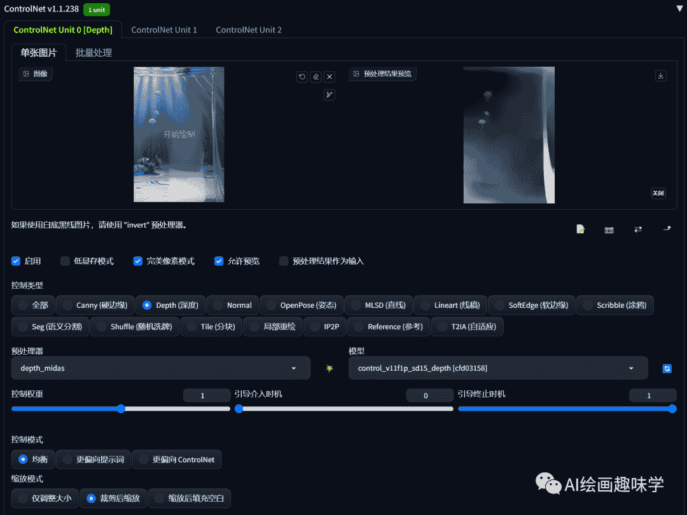
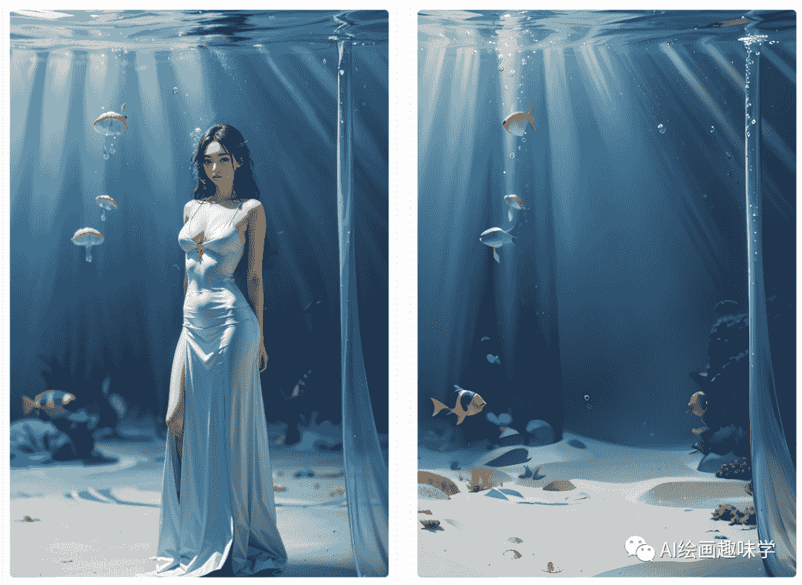
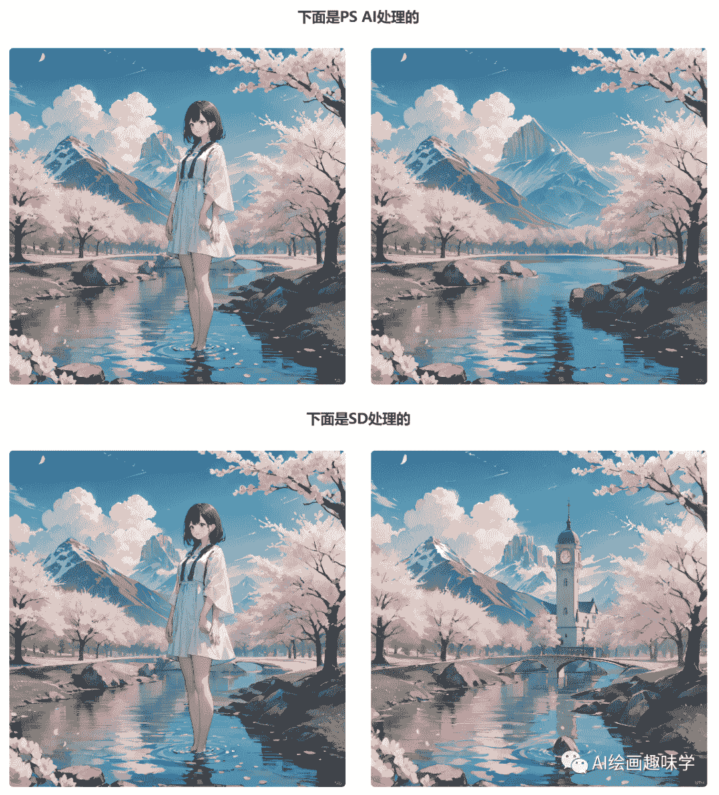

# Stable Diffusion中人物去除与背景融合的技巧

> 来源：[https://diwfpqo78m.feishu.cn/docx/YILddxMa4oN87AxYf1HcqN8inxc](https://diwfpqo78m.feishu.cn/docx/YILddxMa4oN87AxYf1HcqN8inxc)

最近我有这么一个需求，做AI动画的时候，需要一张背景图，不过之前生成的图里面有人物，现在需要把上面的人物去掉，只要纯粹的背景图，网上搜了下资料，发现SD里面可以实现，这里把步骤分享给大家。

# **01**

# **需求分析**

以前通常情况下是用图生图中的局部重绘功能，希望把人物重绘成背景，但是这种方法很多时候生成的画面只会用一个物体替代另外一个物体，难以获得想要的效果，比如下面这样，涂黑的地方又生成其他奇奇怪怪的东西，达不到我的需求。

我的需求是扣掉人物后的地方背景是干净的，和后面场景要融合。

**SD可以通过 C**ontrolNet 的 inpaint 重绘模型实现我的需求，下面是实操步骤和效果展示。

# **02**

# **实操步骤**

##

上面原图也是之前文生图实现的，所以提示词我还有，把里面人物的描述都去掉，就留下其他描述场景的

**(**Masterpiece, best picture quality realistic :1.2),underwater, fish,

如果你这个是网图，那么就要去Tagger反推里面，把你的图编辑按钮，移动画框把人物屏蔽掉，然后反推提示词，得出来的词记得检查下是否有描述人物的，有的话去掉即可。

在文生图那边，填入上面这个描述词，ControlNet启用，把上面原图拖进去，点击编辑把人物涂黑。

**预**处理选择 inpaint_global_harmonious，模型选择inpaint，权重默认1，后面有需要再增加。

控制模式记得选择 **更偏向提示词 **。

ControlNet 中的inpaint模型，除了重绘遮罩的部份外，遮罩意外的地方或多或少也会被重绘，带来的好处就是它能更好的将重绘区域与整体画面融合。

然后就可以开始生成图片，多生成几张，挑选效果最好的。效果图如下：

正常这时候生成的图就可以用了，但是如果发现不满意，如我上图所示发现还有点瑕疵，层次还有点问题，这时候可以到图生图那边，同样的描述词， ControlNet 启用，我这里用深度模型，重绘程度设置至少要0.5，太低的话还会出现这 个分层问题。

下面就是对比图，基本可以满足我的需求了，如果你想要更多元素，就把重绘幅度再拉大即可。

另外也试了几张二次元的图对比效果如下

# **03**

# **其他方案**

当然除此之外，你也可以尝试用PS AI 自动填充功能，勾选人物描边然后让它自动填充内容，如下图所示，效果也很顶。

下面是PS AI的处理过程

我安装的是window下的 Adobe Photoshop CC 2023中文直装激活版。

有需要的小伙伴后台发送 **ps2023 **即可获取下载链接。

# **04**

# **总结**

以上就是人物去除与背景融合的技巧，二次元的直接一步到位，都不要再去图生图那边再处理了，希望对你有所帮助，有几个注意的地方：

1：提示词里面要去掉人物的描述。

2： ControlNet 那边控制模式记得勾选 更偏向提示词。

---

我是嘟先生，拥有 **RTX4090显卡 **的程序员，后期会分享更多关于AI绘画相关的优质教程，欢迎关注。

## 🔗 原文链接： h[ttps://mp.weixin.q](https://mp.weixin.qq.com/s?__biz=MzU0MzY4NDY0Mw==&mid=2247483948&idx=1&sn=b4c3a0ac2eb91ed80fb9bc4ca5ce34d9&chksm=fb06e360cc716a76fde82bc06ff8a40af863c1dedca3fe5d4b0f8447ae1418bee34f1a6a6992#rd)q.com/s?__biz=Mz...