# ChatGPT的常见问题及解决方案

> 来源：[https://diwfpqo78m.feishu.cn/docx/DEPRdFKctokMPnx2nolcIl6On7d](https://diwfpqo78m.feishu.cn/docx/DEPRdFKctokMPnx2nolcIl6On7d)

**写在前面**

最近，由人工智能实验室 OpenAI 发布的对话式大型语言模型 ChatGPT 火得一塌糊涂。它可以与人类轻松地对话，无论是多么奇葩的问题 ChatGPT 都不在话下。在体验 ChatGPT 的同时我们也会遇到各种各样的问题，这里总结了其对话过程中可能会发生的错误以及相关的解决方法。

# ** 1. 使用注意**

众所周知，ChatGPT 非常火爆，很多时候被限流，建议大家寻找平替，或尽量在白天访问，晚上会和另一个半球的活跃用户同时使用，非常容易无法访问和使用。

有时的异常报错，可能仅仅是因为你的IP多人公用造成的，超过了服务的访问速率限制，建议独享IP。

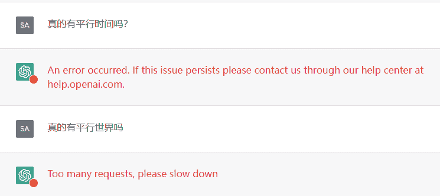

error

# ** 2. 遇到的错误**

## ** 2.1 常见错误**

```
An error occurred. If this issue persists please contact us through our help center at help.openai.com.
```

发生错误。如果此问题仍然存在，请通过我们的帮助中心 help.openai.com 与我们联系

原因尚不清楚，可以点击重试，“Try again” 按钮。

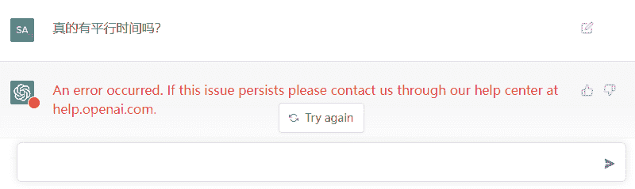

An error occurred

## ** 2.2 请求过多**

```
Too many requests. please slow down.
```

除了 UI 在控制台也可以看到这个错误。

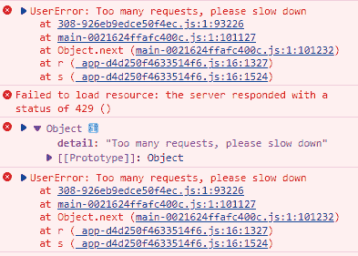

Too many requests

这个提示就是请求过多，过一会儿重试也是没有效果的，而且问题会一直存在。可以尝试点击左上角的 “Reset Thread”。

## ** 2.3 回答不完整**

如果你遇到 ChatGPT 的回答突然中断，不完整，只回答了一半。这个是因为ChatGPT 长文本的截断机制，你是在和 AI 聊天，可以使用 continue 指令继续输出。当然你也可以输入“继续”，拼音它也认。

但是如果断句从代码开始断开，并且没有后续的文本要输出的话，那就凉凉了，可以换个方式再问一下试试。

## ** 2.4 拒绝回答**

```
This content may violate our content policy. If you believe this to be in error, please submit your feedback — your input will aid our research in this area.
```

这个问题很简单，不要试图去问一些不合适的问题， ChatGPT 经过越来越多的限制后，看起来越来越正直了。

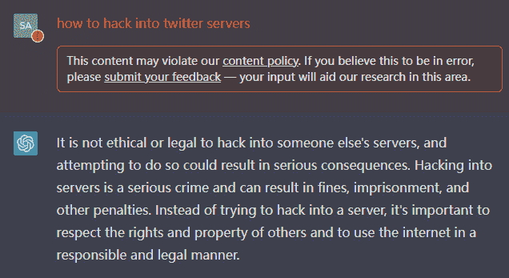

policy

## ** 2.5 模型过载或引擎不存在**

其错误信息如下所示：

```
An error occurred. Either the engine you requested does not exist or there was another issue processing your request. If this issue persists please contact us through our help center at help.openai.com.
```

```
That model is currently overloaded with other requests. You can retry your request, or contact us through our help center at help.openai.com if the error persists. (Please include the request ID xxxxx in your message.)
```

刷新浏览器重试，注意复制提问的内容。稍后再次提问，或者使用重开一个聊天，这种情况只能多试几次。

# ** 3. 导致错误的原因**

在问答中遇到错误，或者得到你不明白的回答，可能有以下原因。

## ** 3.1 问的问题太专业了**

可能是因为问的问题太过专业，AI 尚未学到足够的内容，或者你的问题没有明确的答案。可以尝试换一种方式询问。

##  3.2 连续问了很多次重复问题

ChatGPT 中的错误可能是由连续多次提问同样的问题引起。在你不满意得到的答案后，反复提问同样的问题，会导致 ChatGPT 负载过重。

## ** 3.3 句子太长**

如果你提问的文本太长也会发生错误，可以尝试拆分和精简问题。

## ** 3.4 网络错误**

在服务器负载较高时，其会取消“Try again” 显示，复制重试即可。但是如果出现 “network error”，之后的请求尝试可能还是报错。

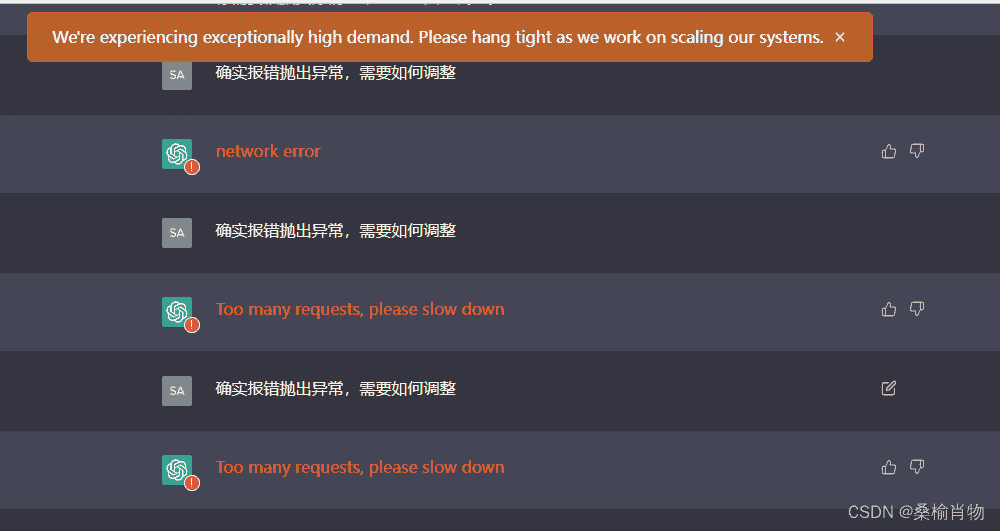

出现该问题是服务器现在不能正常工作，因为最近几天用户数量增长太多。在你的答案回答过多时，等待时间过长了就出现网络问题。

目前该问题没有好的解决方案，当然你也可以尝试使用API的方式，据悉目前API访问正常，毕竟开发人员会筛去大部分使用者。

你也可以根据显示过程中出现的答案来尝试拆分来出来一些线索给他，让他再次回答。

你还可以刷新浏览器页面重试，但是推荐的做法是可以尝试将你的问题翻译为英文，使用英文提问，或者提问前使用“hello”，激活一下他的英文回复机制，然后你就可以使用中文提问了，他会英文回复你，英文回复速度会明显变快，这样就大概率不会出现回复太长而出现网络错误。

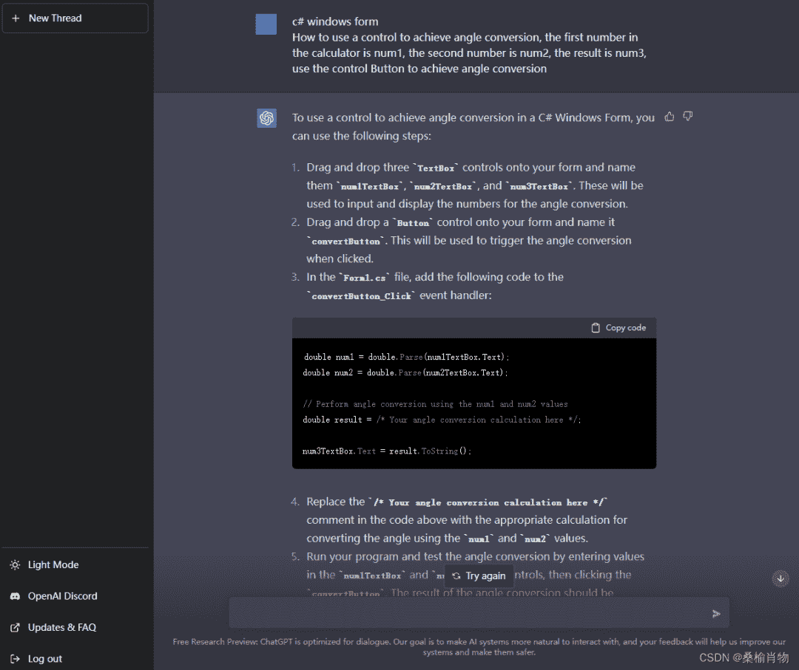

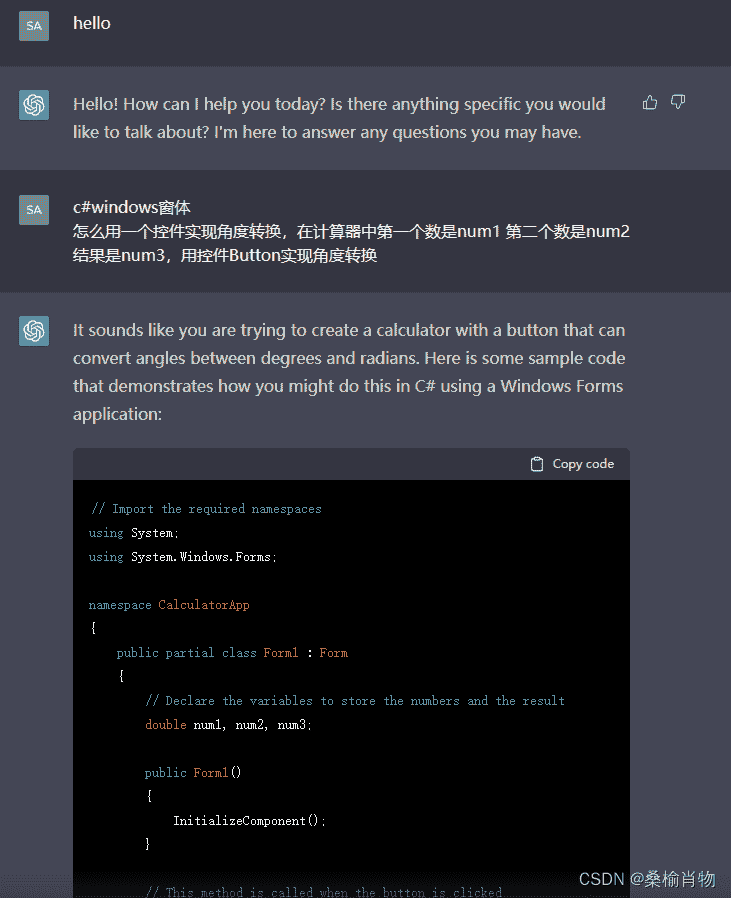

## ** 3.5 请求太多**

```
Too many requests in 1 hour. Try again later.
```

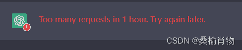

在这里插入图片描述

这个没有办法的，请求太多，服务器拒绝回答了，只能等和重试。

近期发现经常是问一个问题之后，再次提问就会显示这个错误，这个可能是受到了基于 IP 地址的速率限制，原因你应该懂的，毕竟不是独享的IP。

## ** 3.6 长时间不用报错**

```
An error occurred. If this issue persists please contact us through our help center at help.openai.com.
```

目前网站新加了一些验证机制，如果长时间打开页面而不使用，那个验证机制会过期，此时需要刷新浏览器界面。

# ** 4. 出现错误怎么办**

在 ChatGPT 使用中遇到错误，最简单直接的办法当然是重试，重试不成就“重置”。毕竟重启大法好，可以解决 80% 的故障。

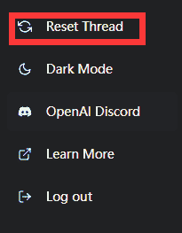

当前这个按钮位置不变，已改为“New Thread”


如果问题仍存在，你也可以尝试刷新浏览器界面，或者注销后重新登录 ChatGPT 账户。

# ** 5. 终极解决方案**

免费的服务毕竟不会长久，你可以选择升级订阅 ChatGPT Plus 。


点击升级：

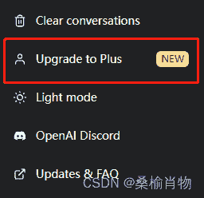

当前的价格是 20 美元/月：

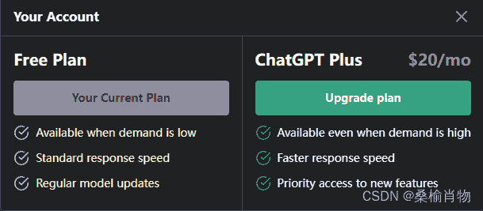

在这里插入图片描述

最后，祝大家聊得愉快！

> 文章来源：https://blog.csdn.net/marin1993/article/details/128219198

> 作者：桑榆肖物

>