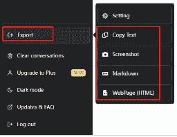

# ChatGPT相关插件合集

> 来源：[https://diwfpqo78m.feishu.cn/docx/DHNUd17Lbo2TnHx92X4cA9qunhg](https://diwfpqo78m.feishu.cn/docx/DHNUd17Lbo2TnHx92X4cA9qunhg)

# 插件合集

https://github.com/reorx/awesome-chatgpt-api/blob/master/README.cn.md

# chatGPT浏览器插件

可在搜索栏右边同步显示ChatGPT回答

https://chrome.google.com/webstore/detail/chatgpt-for-google/jgjaeacdkonaoafenlfkkkmbaopkbilf

# 可以让ChatGPT联网的插件

（不过因为数据问题，有些网站链接可能会出现404）        https://chrome.google.com/webstore/detail/webchatgpt-chatgpt-with-i/lpfemeioodjbpieminkklglpmhlngfcn

#  ChatGPT 和 New Bing合并展示插件

如果你已经同时用上了 ChatGPT 和 New Bing，肯定很烦每次用 Bing 都要打开 edge 浏览器……

这个插件解决的就是这个问题，在 Chrome 上一键左拥右抱，叫 ChatHub。

http://t.cn/A6CWiqqY

# chatgpt聊天记录导出

1、浏览器先安装油猴插件：https://chrome.google.com/webstore/detail/tampermo...

2、再安装这个脚本：ChatGPT Exporter

可以这些格式导出

或者用这个https://savegpt.com/

# 必应聊天记录导出插件

https://github.com/gantrol/Bing-Chat-Saver

# 把你的输入和它的输出都变换为语音的形式：

Voice Control for ChatGPT

https://chrome.google.com/webstore/detail/voice-control-for-chatgpt/eollffkcakegifhacjnlnegohfdlidhn/related

chatgpt的提示词生成：  https://www.aiprm.com/

# AIPRM for ChatGPT

内置了超多被验证过的实用聊天模板库：高仿人类写作，一键生成AI绘画关键词等等等等。：chrome.google.com/webstore/detail/aiprm-for-chatgpt/ojnbohmppadfgpejeebfnmnknjdlckgj/related?hl=zh-TW

https://chrome.google.com/webstore/detail/aiprm-for-chatgpt/ojnbohmppadfgpejeebfnmnknjdlckgj/related?hl=zh-CN

# GPT用中文语音和你互动聊天

Chrome安装Talk-to-ChatGPT插件后，立刻实现！

https://chrome.google.com/webstore/search/talk-to-chatgpt?hl=zh-CN

https://chrome.google.com/webstore/detail/talk-to-chatgpt/hodadfhfagpiemkeoliaelelfbboamlk

# 一键分享 ChatGPT 对话为网页

https://sharegpt.com/

# 1秒总结B站视频的主要内容

https://b.jimmylv.cn/video/BV1zd4y1j7Uw

https://github.com/lxfater/BilibiliSummary

# WebChatGPT

WebChatGPT为您提供来自网络的相关结果!

链接：https://chrome.google.com/webstore/detail/webchatg...

#  Praline AI ，预测2023

在已有提示词中进行选择，用对来年的最佳预测来令你的受众信服。其内容来自 ChatGPT 和其他秘密工具。

链接：Praline.ai | Predict 2023 with praline.ai

# ChatGPT Writer （邮件编写器）

这款插件使用了ChatGPT 的编写器，能根据你给出的提示词，生成电子邮件或者回复。

补充：ChatGPT Writer 可以在所有基于 Chromium 的浏览器中工作，包括 Chrome、Edge 以及 Web3 浏览器 Brave，并且支持所有的语言。因为与 Gmail 紧密集成，所以使用 Gmail 会比其他邮件有更好的用户体验。

链接：ChatGPT Writer - Write emails and messages using A...

# Whatsapp-GPT

Whatsapp-GPT可以将 ChatGPT 与你的Whatsapp 连接起来。

链接：GitHub - danielgross/whatsapp-gpt

# ChatGPT for Google

在谷歌的搜索结果旁边显示ChatGPT的回答

链接：https://chrome.google.com/webstore/detail/chatgpt-...

# YouTube Summary with ChatGPT

它可以生成任何YouTube视频的文字摘要。

链接：YouTube Summary with ChatGPT / Glasp

# TweetGPT

TweetGPT使用 ChatGPT 来编写推文、回复、评论等，成功安装后，只需点击推文下方的机器人图标，即可激活。

安装指南：GitHub - yaroslav-n/tweetGPT: TweetGPT is a chrome...

扩展链接：https://chrome.google.com/webstore/detail/tweetgpt...

# ChatGPT搜索引擎

使用即可在多个浏览器上享受ChatGPT，包括Google、Bing、甚至百度。

链接：ChatGPT for Search Engines

# ChatGPT Prompt Genius

ChatGPT Prompt Genius的特色是可以保存与ChatGPT的聊天记录，甚至分享成网页，并且提供一些对话提示模板以提高效率。

安装指南：GitHub - benf2004/ChatGPT-Prompt-Genius

扩展链接：https://chrome.google.com/webstore/detail/chatgpt-...

# 基于 ChatGPT API 的翻译浏览器插件

https://github.com/yetone/openai-translator

# 知乎的 chatgpt 浏览器小插件

可作为回复问题的参考，也可以复制 chatgpt 的结果到回答的编辑器中进行相应的修改，提高效率

https://github.com/no13bus/chat-gpt-zhihu-extension

# 音/视频实时翻译

https://github.com/chidiwilliams/buzz