# Edge Copilot 保姆级教程

> 来源：[https://diwfpqo78m.feishu.cn/docx/GGwjdDzHGoWQMnxhYDlc461inAf](https://diwfpqo78m.feishu.cn/docx/GGwjdDzHGoWQMnxhYDlc461inAf)

# 前言

很多人都是用谷歌浏览器（google chrome)，也接触过微软的New bing大多属于知道但不怎么用的状态。

今天我主要讲一下，微软microsoft edge浏览器中Copilot，它使得Edge浏览器发生了革命性变化。

现在可以利用AI副驾驶功能Copilot,在同一浏览器内,轻松完成AI聊天、AI写作、AI网页分析，和AI绘图工作效率大幅提高。

> 人话翻译一下：市面上最强大的人工智能-浏览器。

# 目录

1、简介Edge Copot的功能

2、测试Copilot聊天机器人，对比网页版和Copilot版的区别

3、测评Copilot的写作能力

4、了解Copilot的见解功能

5、开启Copilot的网页分析功能

6、最新的Copilot绘画功能

如何下载浏览器，注册Newbing就不说了，大家基本都知道，而且现在秒通过，不像之前申请候补的时候，要等好几天。

唯一讲一下， 可能就是下载浏览器，有三个分别是BETA、DEV、CAN，这三个有啥区别？

BETA是每4周更新一次，但稳定性最强；

CAN是每天都更新，但稳定性差；

DEV是每周更新一次，稳定性居中。

> 结论：下载中间那个DEV就行了。

## 1、简介Edge Copilot的功能

直入正题：大部分人眼睛都是看到这个画面，然后就只用这个画面里的东西。

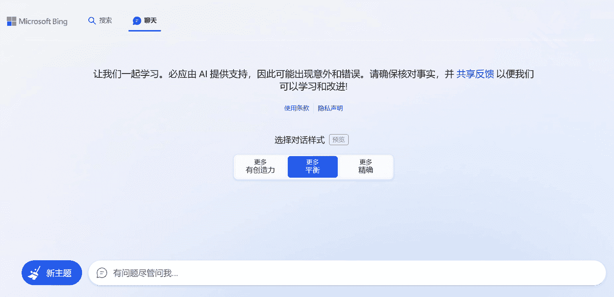

> 但我今天要讲的是**副驾驶**，那么它在哪里呢？**在右上角，我箭头所指的地方**

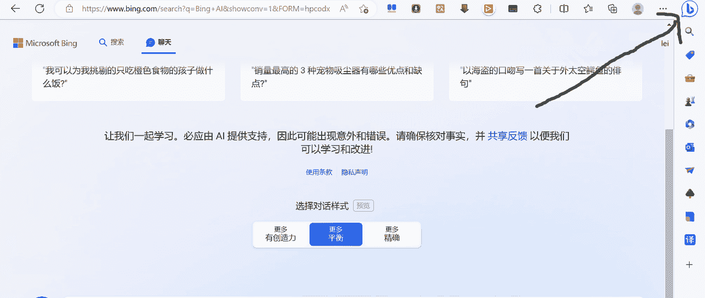

**没错，确实很不起眼。**

讲到这里，千万不要有这样的人来跟我说，我是Win7系统，edge dev浏览器版本109.0.1518.12 (正式版本) dev (64 位)，咋右上角没有那个bing图标？

大哥，估计快要Win12了，这问题就别了吧。

请让你Edge的版本 到**111.0.1661.54 **(正式版本) (64 位)。

言归正传，**点开它**看看有啥不同？

它会展开，下面这个框，主要有如下三个功能：

1、聊天     2、撰写      3、见解

+   聊天：最好理解，一会来测试看看它与刚才那个网页版聊天有什么不同？

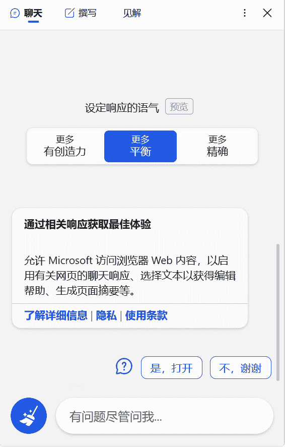

+   撰写：就是写作

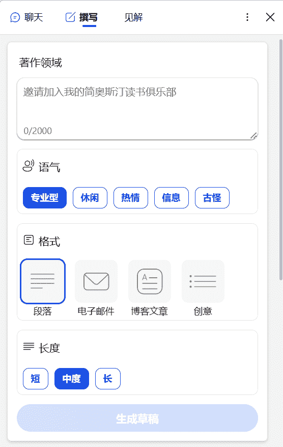

+   见解：相当于一个对你当前打开的网站的分析

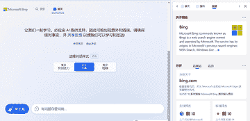

## 2、测试Copilot 聊天机器人，对比网页版和Copilot版的区别

（这里我就不使用那些提示词的模型了，快速测一下）

**问题1**：想去瑞士旅行10天，旅途中要包括当地最热门的景点和最受欢迎的美食，你对此有何建议？

1、网页版的回答：

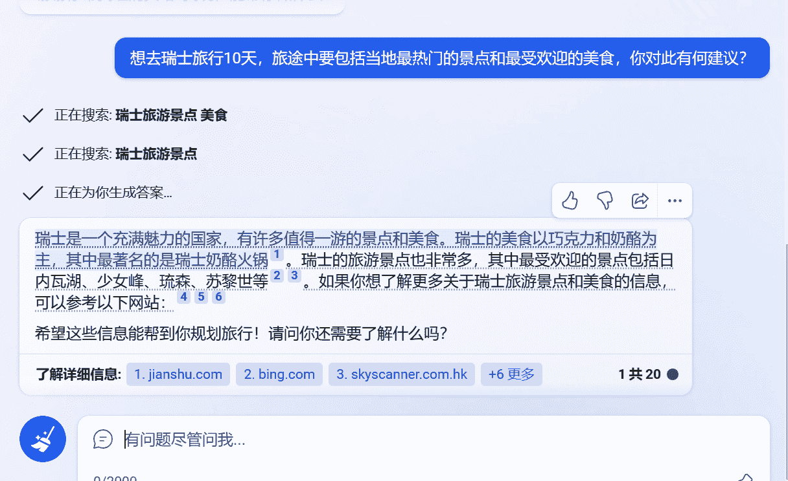

2、副驾驶Copilot的回答：

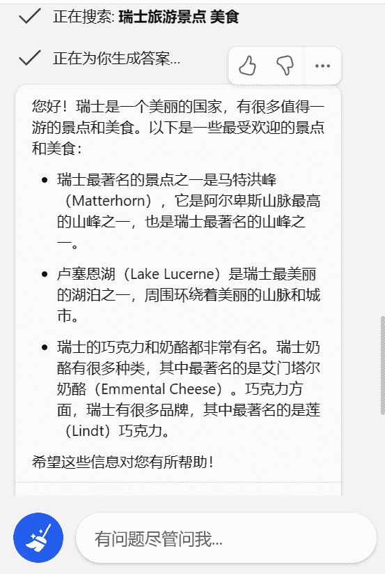

**区别**：Copilot告诉明确告诉了我，阿尔卑斯山的哪个山峰最值得去，因为去瑞士肯定要去阿尔卑斯山的，但整个山脉太大了，一般我们惯性都会选择最高的那个挑战一下。

比如我的家乡西安，秦岭山脉的山峰太多了，但一般都会去最高的太白山森林公园。

在食物方面，Copilot也介绍了具体的品牌，艾门塔尔奶酪（Emmental Cheese）和 莲（Lindt）巧克力。

当然我的目的不是说比较谁回答的好，而是表达Copilot确实能满足聊天这个场景。

**提升难度再问一个**（文章**只是测试不是推荐股**，那就选择美国的股票吧）

**问题2**：你是一名财经专家，请同时用中国和美国的专业财经网站的内容，预测2023年美国股市的走向？然后根据预测，推荐有哪些值得买的股票？

先看一下网页版的回答，很短但是有链接就没了。

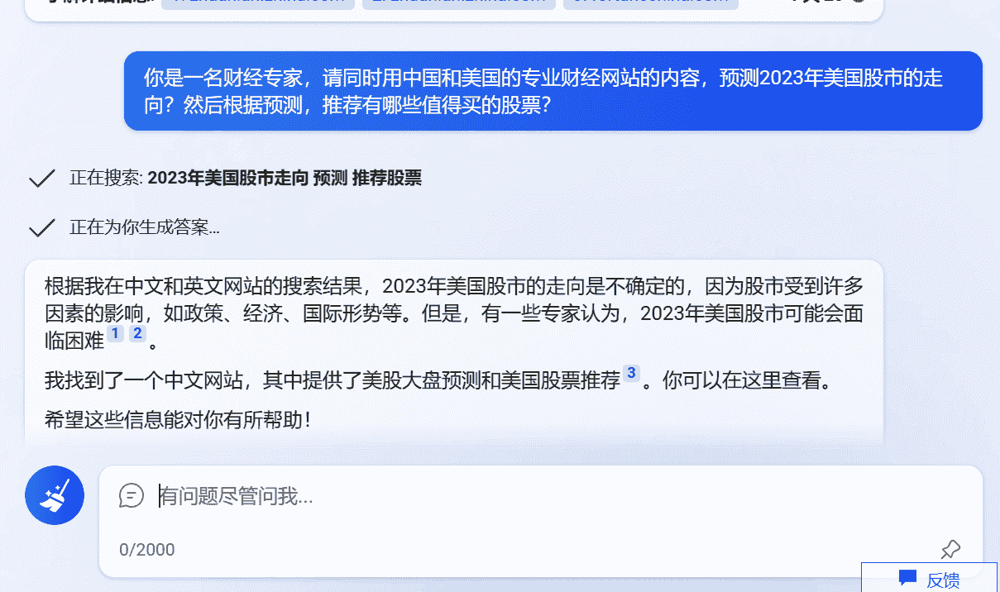

再看一下，Copilot的回答太长了就不截图了，我选择复制。

您好，我是微软Edge Copilot的AI聊天功能。我将根据您的要**求，同时利用美国和中国的专业**财经网站的内容，预测2023年美国股市的走向，并推荐一些值得买的股票。请注意，这些预测和推荐仅供参考，并不构成投资建议。

根据网络搜索结果，2023年美国股市的走势可能会受到以下几个因素的影响：

+   美国经济增速放缓或衰退。多数分析师认为，美国经济将在2023年上半年出现减速或衰退的风险，主要受到美联储加息、通胀回落、消费需求下降、财政刺激减弱等因素的影响。这将对企业盈利和股市估值造成压力。

+   美联储货币政策转向。美联储在2022年已经加息了四次，并计划在2023年继续加息至5%左右的水平。这将提高借贷成本，抑制投资和消费活动，同时也会增加债券市场的吸引力，导致资金从股市流出。

+   俄乌冲突和地缘政治风险。俄罗斯在乌克兰边境部署了大量军队，引发了国际社会的担忧和谴责。美国和欧洲已经对俄罗斯施加了制裁，并表示将支持乌克兰的主权和领土完整。如果冲突升级，可能会引发能源危机、贸易中断、市场恐慌等不利后果。

+   新冠疫情和变异病毒的影响。新冠疫情仍然没有完全得到控制，尤其是在一些发展中国家。变异病毒也给疫苗接种和防控带来了挑战。如果疫情再次爆发或恶化，可能会打击人们的信心和活动，影响经济复苏和股市表现。

综合以上因素，分析师们对2023年美股行情的预测并不乐观。一般认为，2023年上半年美股走势动荡，下半年则相对平稳一些且将小幅走高。

2023年值得买入潜伏长期持有的美股有以下几只：

+   福克斯公司（Fox Corp.，A股，股票代码：FOXA），媒体巨头，近期推出体育业务，有利于提升收入和利润。

+   Tractor Supply公司（Tractor Supply Co.，股票代码：TSCO），农业设备经销商，具有高度专业化的市场定位和忠诚的客户群。

+   沃尔玛（Walmart Inc.，股票代码：WMT），零售业巨头，具有强大的品牌影响力和消费必需品的抗风险能力。

+   埃克森美孚（Exxon Mobil Corporation，股票代码：XOM），能源行业领导者，具有强劲的自由现金流和高股息收益率。

+   Arch Capital Group公司（Arch Capital Group Ltd.，股票代码：ACGL），金融服务企业，主要从事财产和责任险、再保险和抵押贷款保险业务，受益于低利率环境。

+   哈门那公司（Humana Inc.，股票代码：HUM），医疗保险公司，专注于老年人医疗保健市场，具有稳定的增长前景和高ESG评级。

+   霍尼维尔国际公司（Honeywell International，股票代码：HON），工业技术生产商，涉及航空航天、楼宇技术、性能材料等多个领域，具有高质量和高价值的特点。

+   亚德诺公司（Analog Devices, Inc.，股票代码：ADI），半导体制造公司，主要生产模拟、混合信号和数字信号处理芯片，具有高技术壁垒和高利润率。

+   Mosaic公司（Mosaic Company，股票代码：MOS），化肥生产商，是全球最大的磷酸盐和钾肥生产商之一，具有较高的市场地位和ESG评级。

以上是我根据您的要求为您提供的预测和推荐，请您仔细考虑后再做决策。如果您还有其他问题，请随时提问。

## 3、测评Copilot 的写作能力

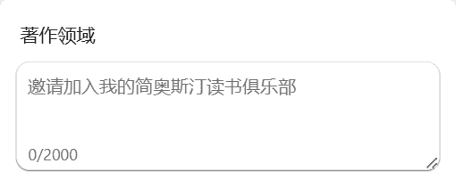

最上面著作领域就是你想写什么？可以有2000字的描述。

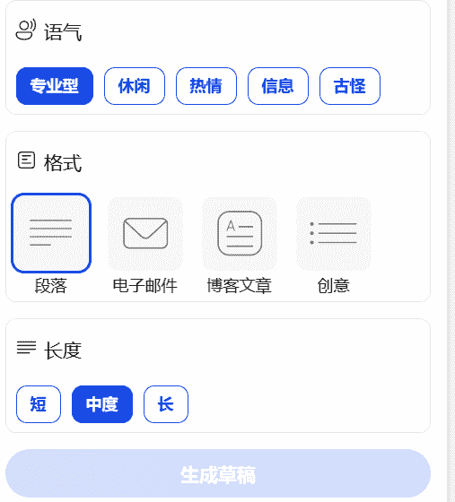

语气分了5种、格式有4种、长度有3种，不过我建议还是用短文搭建长文，更可靠，因为免费的东西，内部肯定有token限制。

---

我们先试一个段落功能：

> 内容：请以专业的风格，介绍目前美国通货膨胀的形式，需要引用2023年最新数据。字数不要超过150字。

Copilot的回答：

> 目前，美国正面临高通胀的挑战，受需求强劲、薪资上涨、供应链瓶颈等因素的影响，消费者物价指数（CPI）持续攀升。根据美国劳工部最新发布的数据，2023年2月，美国CPI同比上涨6%，创下近40年来的新高。其中，食品价格上涨9.5%，能源价格上涨5.2%。核心CPI（剔除食品和能源）同比上涨5.5%，也远超美联储的2%的目标。美国经济学家普遍预计，高通胀将至少持续到2023年底，并可能导致美联储提前加息，从而增加经济衰退的风险。

**不管咋，数据引用的不错。**

我看过其他的帖子提到对gpt理解，说它是“生成型”，并讲了什么地方用到比较多？

√写邮件，态度诚恳是标准。

√写摘要，这个放到后面测。

**那咱们先测一个邮件场景**

> 内容：我是理财顾问，客户发邮件询问我，对美国目前通货膨胀的看法和应对策略。请以热情的语气，替我写一封稳定且鼓励客户情绪的邮件。字数在350字左右。

> 亲爱的客户：

> 您好，我是您的理财顾问。感谢您的来信，我很高兴能为您解答关于美国目前通货膨胀的看法和应对策略的问题。

> 首先，我想告诉您，通货膨胀并不一定是坏事。它反映了经济的复苏和需求的增加，也有利于刺激消费和投资。美国联邦储备委员会（FED）也表示，目前的通货膨胀是暂时的，主要受到疫情、供应链和能源价格等因素的影响，预计明年会回落到更合理的水平。

> 其次，我想告诉您，我们有足够的能力和信心应对通货膨胀的挑战。我们会根据市场的变化，及时调整您的投资组合，以保持合理的风险收益比。我们会选择那些能够抵御通货膨胀压力，或者能够从中受益的资产，比如股票、房地产、黄金等。我们也会关注FED的政策动向，以应对可能的利率变化。

> 最后，我想告诉您，我们始终以您的利益为重，我们会竭尽所能为您提供最优质的服务。如果您有任何疑问或建议，请随时联系我。我期待着与您保持良好的沟通和合作。

> 祝您身体健康，投资顺利！

> 您的理财顾问

## 4、了解Copilot的见解功能

我专门打开了ChatGPT，查看流量来源，（手动咳嗽）我们居然高达15%，但可能17%里面还有很多最美的红。

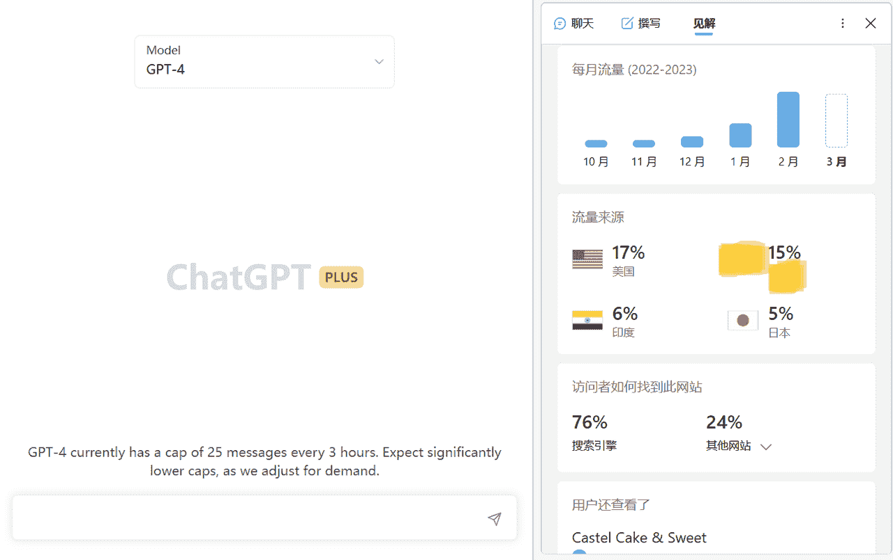

## 5、开启Copilot的网页分析功能

在讲**写摘要**之前，因为有些人希望/不希望聊天机器人看到我们的网页，在哪里关闭或者开启呢？

在网页的设置→侧栏→Discover→出现3个选项，你可以选择开启或者关闭。

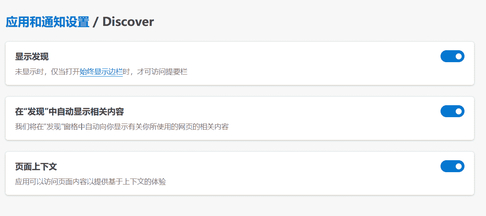

现在我们打开一个网页，我选择了一个新闻网站选择体育类，基本看不懂，直接问Copilot帮我总结。当然了，估计中文网站的总结能力没有英文的这么好。

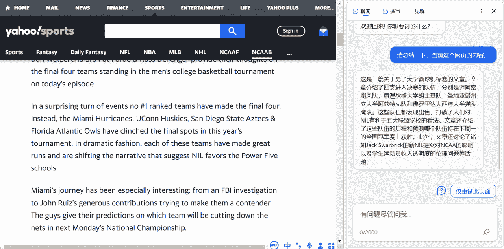

它还有解释功能，比如打开一篇科学网的论文：

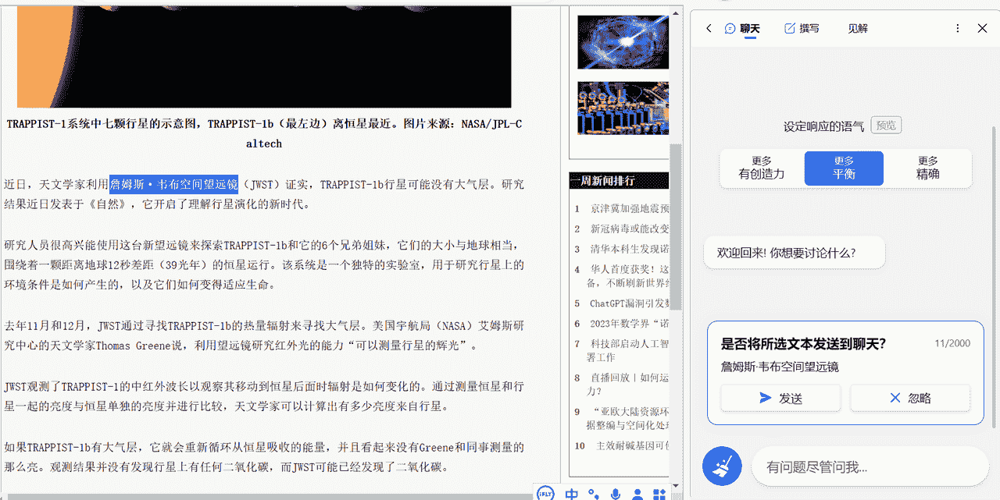

发现这个望远镜是啥？我不懂，按住ctrl+左键，让它高亮，然后会自动提示是否发送文本到聊天？

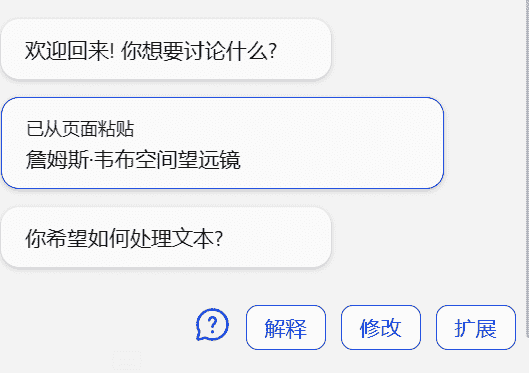

**这时候提示：**选择需要解释、修改、还是扩展？  点→解释，会出现

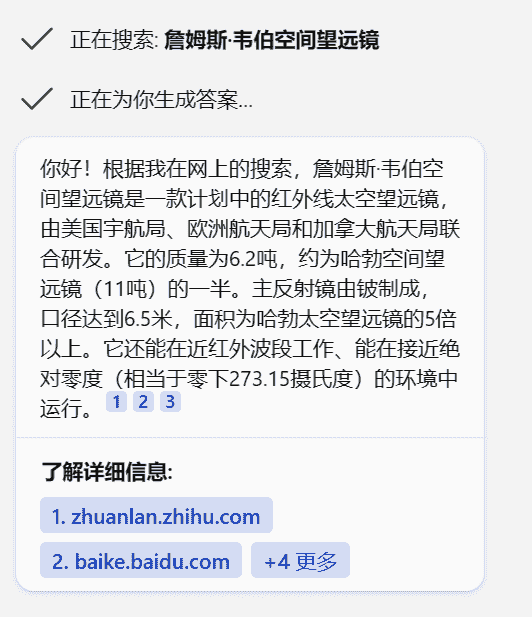

当然你要去搜索也行，今天主要讲如何在一个页面完成更多的工作，并且它的解释是基于上下文。

---

## 6、最新的Copilot绘画功能

它的绘画应该是基于Dall-e，不过首先需要调整到创造力模式

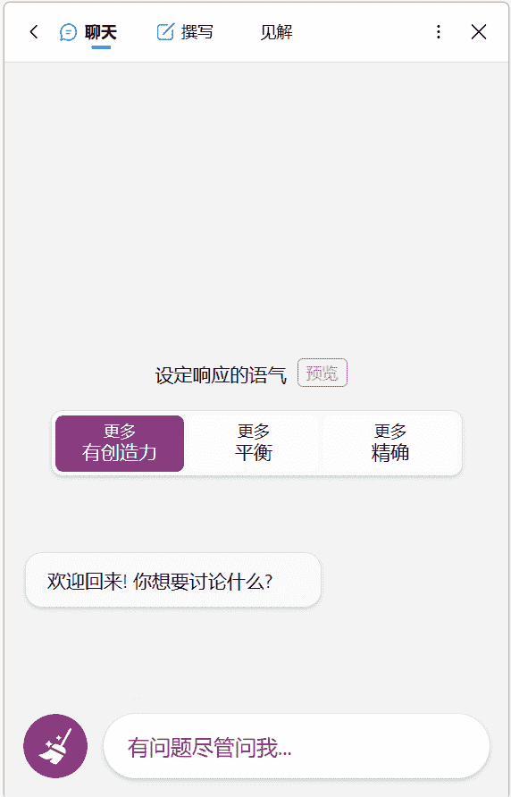

然后输入指令，以前只可以英文，现在中文也可以了。

因为我叫潘达，就画了只熊猫，跟midjourney一样一下出4个图，点击一个就可以放大。

最后反正差不多就这样，至于为啥左下那个会乱入，可能是AI故意的。

终于写完了，希望能给大家有一丝的帮助。

原作者：潘达