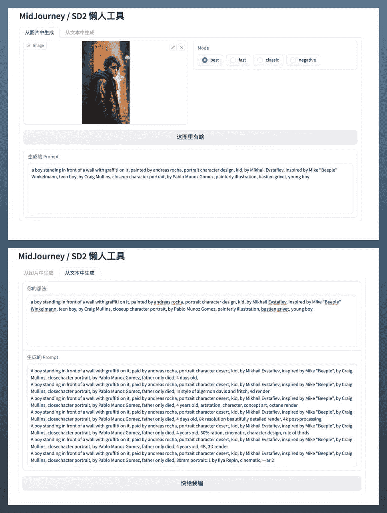
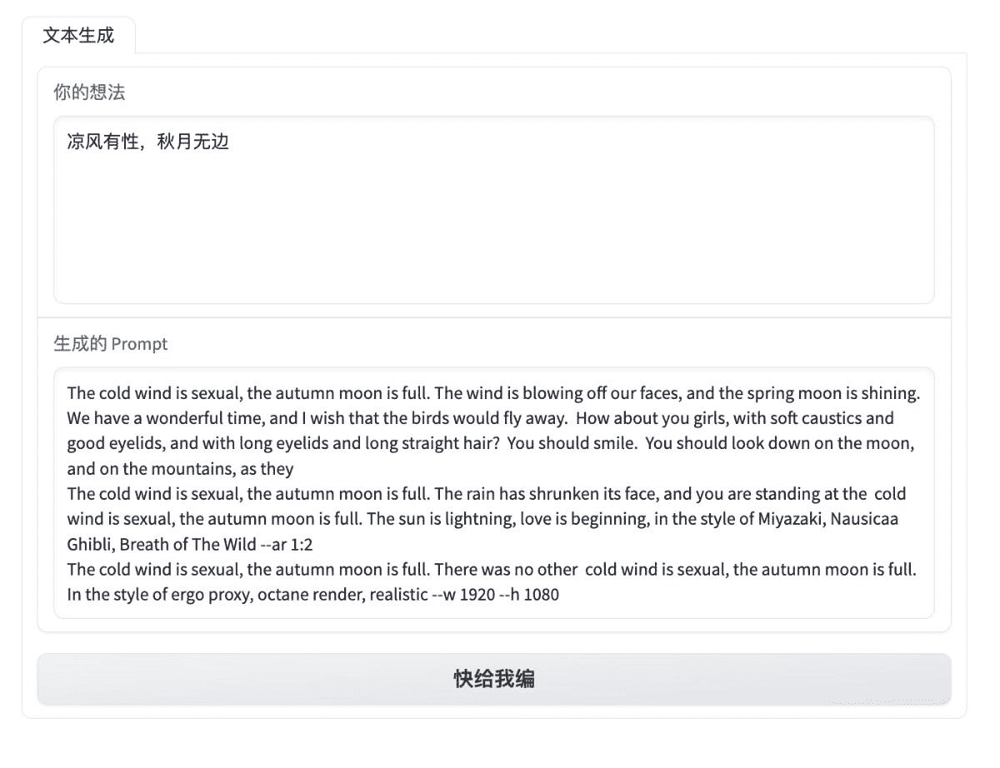

# 使用模型来生成作图咒语的偷懒工具，支持 MidJourney、Stable Diffusion 等。

> 来源：[https://diwfpqo78m.feishu.cn/docx/ThSCd14JtooOE7x1mXPc1oRun7f](https://diwfpqo78m.feishu.cn/docx/ThSCd14JtooOE7x1mXPc1oRun7f)

原文链接： [https://github.com](https://github.com/soulteary/docker-prompt-generator)/soulteary/docker...

# Docker 提示生成器


[中文文档](https://github.com/soulteary/docker-prompt-generator/blob/main/README-CN.md)

> 使用模型为模型应用程序生成提示（MidJourney、Stable Diffusion 等...）

## 预览

和官方的Mid Journey功能一样，支持从图片中解析提示，并根据提示进行二次扩展。



支持直接用中文写提示，然后获取提示文字，可以用于更好的效果生成。



## 用法

在过去的 [几篇文章 ](https://soulteary.com/tags/python.html)中，我提到了我的个人习惯和推荐的开发环境，它是基于Docker和Nvidia官方的深度学习环境基础容器。 我不会在这里详细介绍，但是如果您有兴趣，可以查看类似这篇关于 基于 Docker 的深度学习环境入门的 文章。 相信长期阅读的读者应该已经相当熟悉了。

[当然，由于本文包含了只用CPU就可](https://soulteary.com/2022/12/10/play-the-stable-diffusion-model-on-macbook-devices-with-m1-and-m2-chips.html)以玩的部分，你也可以参考 几个月前 在配备M1和M2芯片的MacBook设备上玩稳定扩散模型来配置你的环境。

准备好Docker环境配置后，我们就可以继续玩了。

找到一个合适的目录并使用 git clone 或下载 Zip 存档以将“Docker Prompt Generator”项目代码安装到您的本地计算机上。

```
git clone https://github.com/soulteary/docker-prompt-generator.git
# or
curl -sL -o docker-prompt-generator.zip https://github.com/soulteary/docker-prompt-generator/archive/refs/heads/main.zip
```

接下来进入项目目录，使用Nvidia官方的PyTorch Docker基础镜像搭建基础环境。 与直接从 DockerHub 拉取预制镜像相比，自己构建会节省很多时间。

在项目目录下执行以下命令完成模型应用的构建：

```
# Build the base image
docker build -t soulteary/prompt-generator:base . -f docker/Dockerfile.base

# Build the CPU application
docker build -t soulteary/prompt-generator:cpu . -f docker/Dockerfile.cpu

# Build the GPU application
docker build -t soulteary/prompt-generator:gpu . -f docker/Dockerfile.gpu
```

然后，根据您的硬件环境，有选择地执行以下命令以启动具有Web UI 界面的模型应用程序。

```
# Run the CPU image
docker run --gpus all --ipc=host --ulimit memlock=-1 --ulimit stack=67108864 --rm -it -p 7860:7860 soulteary/prompt-generator:cpu

# Run the GPU image
docker run --gpus all --ipc=host --ulimit memlock=-1 --ulimit stack=67108864 --rm -it -p 7860:7860 soulteary/prompt-generator:gpu
```

在浏览器中输入运行容器的主机IP地址，即可开始使用该工具。

## 学分

楷模：

+   提示模型： 简洁/text2image-prompt-generator

+   翻译模型： He[lsinki](https://github.com/Helsinki-NLP/OPUS-MT-train)-NLP/opus-mt-zh-en / GitHub

+   CLIP型号： [laion/CLIP-ViT-H-](https://huggingface.co/laion/CLIP-ViT-H-14-laion2B-s32B-b79K)14-laion2B-s32B-b79K

数据集：

+   数据集： succinctlyai/midjourney-texttoimage