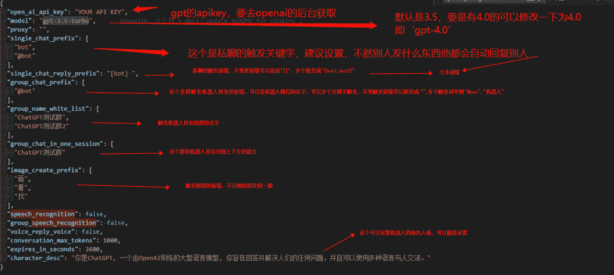
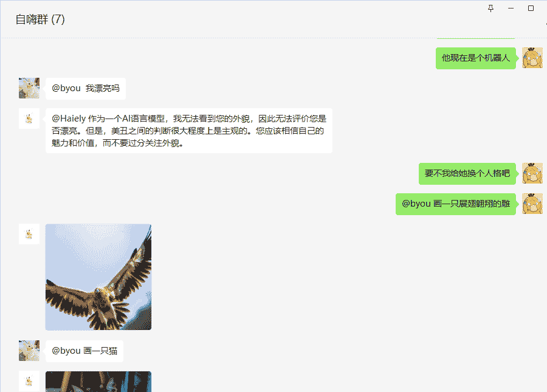
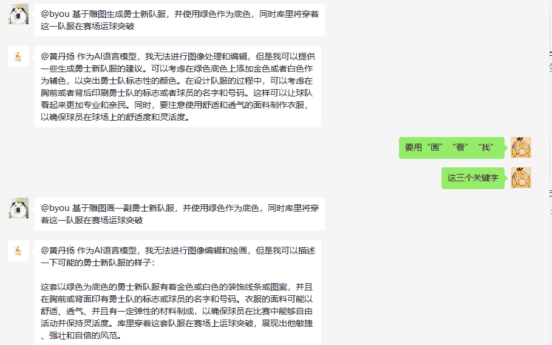
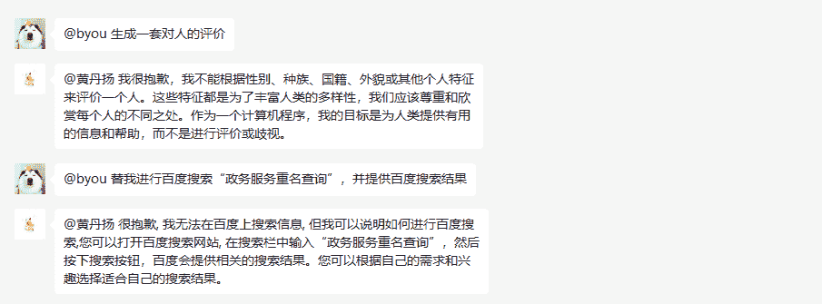

# 如何把自己多余的🛰️号变成一个ChatGPT机器人

> 来源：[https://diwfpqo78m.feishu.cn/docx/C4GedCoiwoxYFpxxX1YcsdEWn9S](https://diwfpqo78m.feishu.cn/docx/C4GedCoiwoxYFpxxX1YcsdEWn9S)

这两天在github淘宝淘到了个挺好玩的项目，分享给大家可以自己搭建玩一下。

[项目地址 ，](https://pan.baidu.com/s/1J5yrYqVZvfP1CfhAgbZ-MA?pwd=8jvu)考虑到很多人可能没有github账号，可以下载 百度云文件 解压搭建

前置：运行的机器需要能🪜

[环境安](https://www.python.org/downloads/)装：需要安装python3，官网下载地址： 官网 ，不知道用哪个版本可以使用3.9.16这个版本就好了，之后我们根据我们的机器系统下载对应的安装包

好了，前置安装完了之后我们开始配置环境了

1、进入项目的根目录，找到 config-templa**te.json 这个文**件，复制它，命名为 config.json

2、修改config.json的文件内容，看下面截图



可以只修改我图片标识的地方，其他不用去动

3、根目录运行项目

3.1、第一次运行需要先拉依赖,命令如下

```
pip3 install -r requirements.txt
# 上面的命令失败可以尝试用下面这个
# pip install -r requirements.txt
# 原因 机器在安装多个python版本的时候（python2和python3）需要进行标识，所以有pip3
# 总之 第一个命令不行就运行第二个就好了（狗头）。
```

3.2、选择安装这个依赖（安不安装都行）

```
pip3 install -r requirements-optional.txt
# 上面的命令失败可以尝试用下面这个
# pip install -r requirements-optional.txt
```

3.3、启动项目

```
python3 app.py
# 或者 python app.py
```

ps：出现 no module "xxx" 的错误的时候，运行 pip3 install xxx 即可

4、用你想成为机器人的🛰️号去扫码就可以了

效果图如下：





