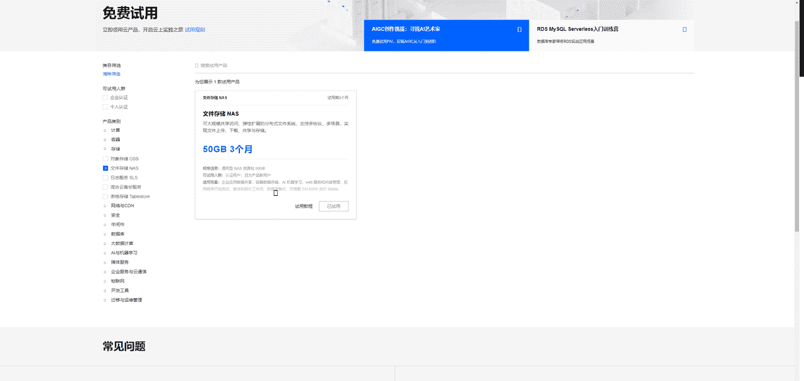
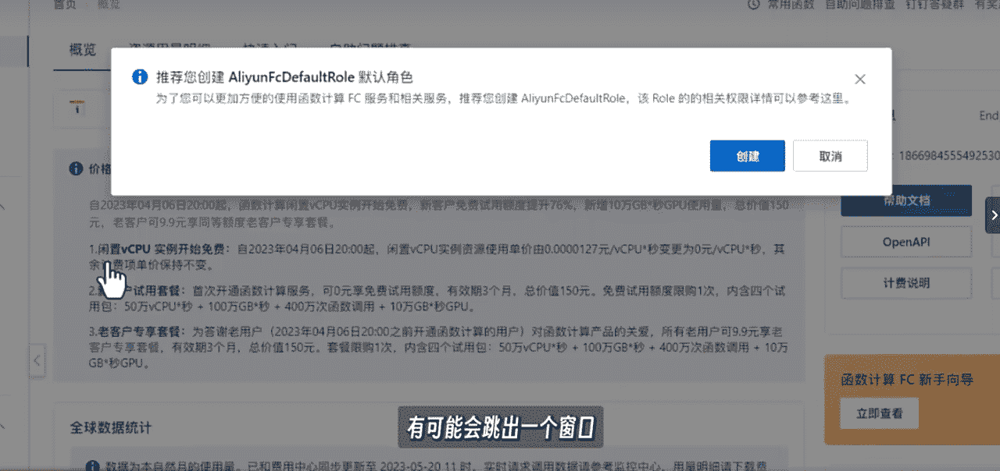
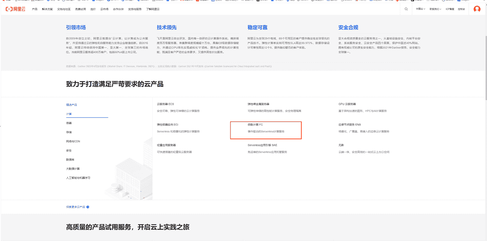
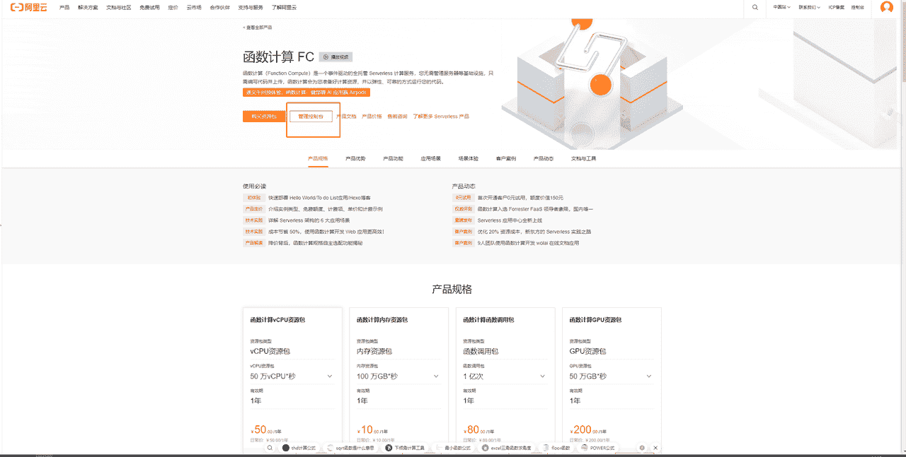
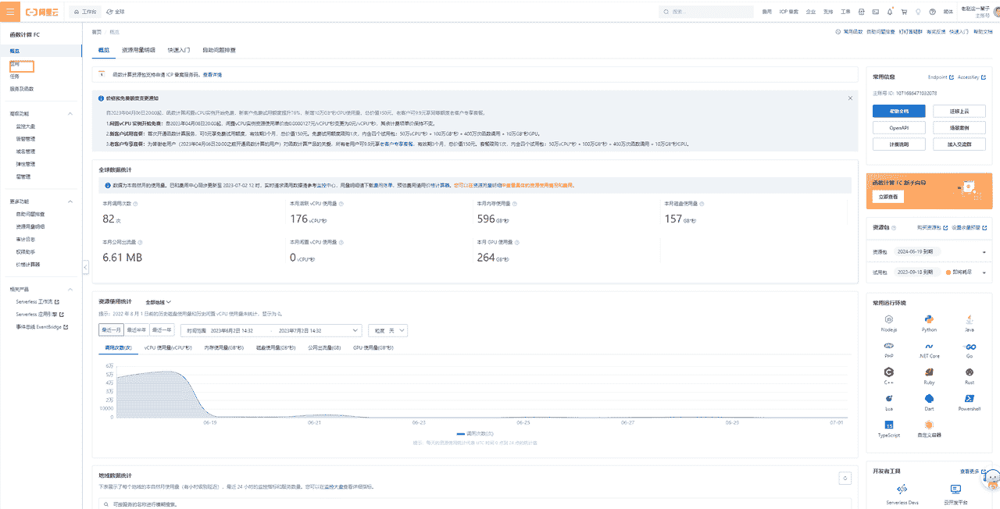
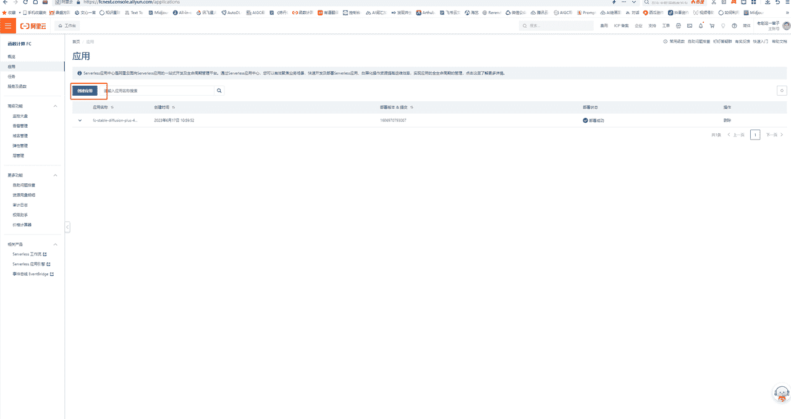
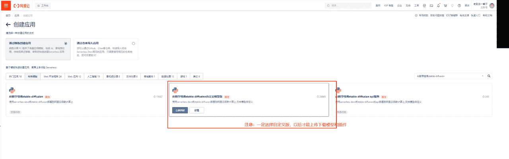
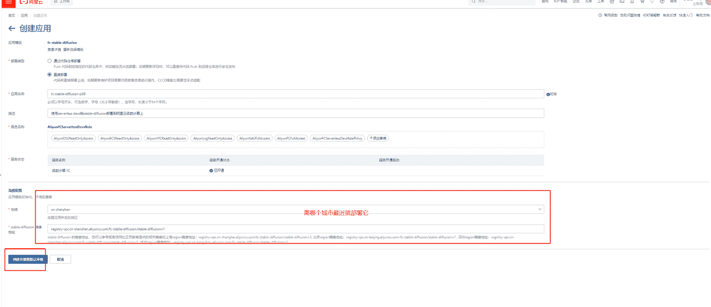
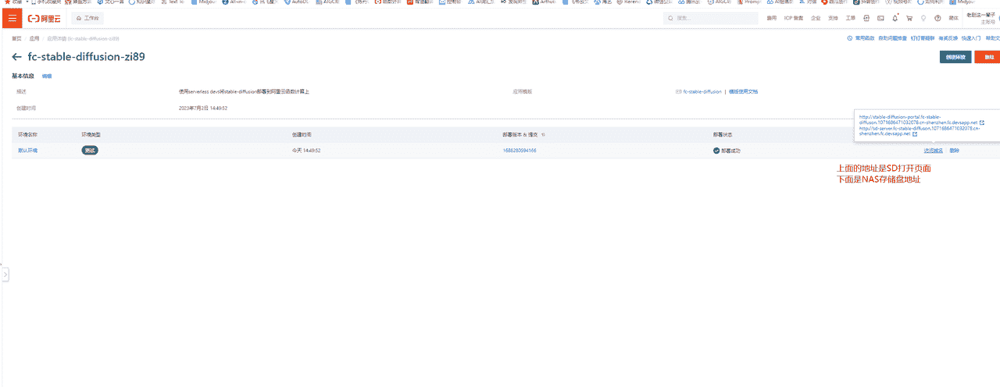
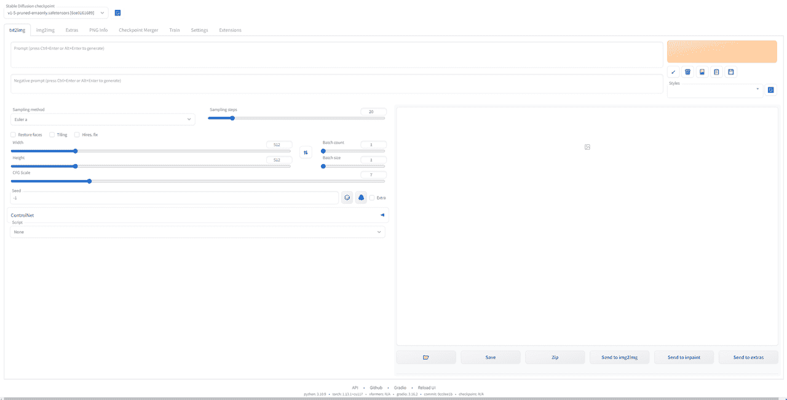

# 傻瓜式安装：300元免费福利，云端架设stablediffusion方案

> 来源：[https://diwfpqo78m.feishu.cn/docx/IkWPdos7LoahSBxnMC7cvpmDnQf](https://diwfpqo78m.feishu.cn/docx/IkWPdos7LoahSBxnMC7cvpmDnQf)

一、进入阿里云首页，最好登录使用实名注册的支付宝就不用在注册了，这里有个薅羊毛的地方，免费领取150元函数计算额度、50G3个月NAS文件存储服务，当然土豪自动略过第一步，可以直接进入第二步。

一定要开通函数计算FC和文件存储NAS,第一次使用可能要求创建角色，直接授权创建就可以了。

二、点击部署步骤点击进入管理控制台到函数计算页面

点击进入应用

点击进入创建应用，

这个位置要注意选择自定义模型版本，为了以后能够上传模型和插件，找不到直接输入搜索就可以了。

....基本就是这样傻瓜式下一步，非常友好，照图操作即可。

三、下面就稍微需要动手的地方，点击直接部署，下面选择城市，复制该城市镜像粘贴，继续创建下一步。

接下来就是等待几分钟，环境搭建好后，依然继续下一步

完成了以后模型和插件就要靠个人下载，本身有模型和插件的可以直接粘贴到NAS里面的SD文件夹中，重启刷新即可。