# 900个AI项目【上】

> 来源：[https://diwfpqo78m.feishu.cn/docx/HmTkd18j1ov617x0PgJcAxyTnlb](https://diwfpqo78m.feishu.cn/docx/HmTkd18j1ov617x0PgJcAxyTnlb)

## 写在前面

文长图多，手机载入可能吃力，可以用电脑看。

本文包括 943 个 AI 项目，分为 49 个类目，并按照 类目 首字母顺序排序。项目名录、类目和标签来自 Futurepedia。

图片来自项目首页，截图时间为 2023年2月10日 - 11日，在确保网络畅通前提下，为所有网站预留了 30 秒加载时间，并尝试至少两次-- 如发现某项目的图片是空白或比较奇怪，这意味着，在这期间项目已更换地址或不再正常运营，这个比例约为 10%。

文字简介由 GPT 模型 text-davinci-003 总结并翻译，虽然已经喂了足够的数据并进行了一定的 prompt 调优，但依然无法保证介绍的准确性。

一个小统计：这 943 个项目中，完全免费的有 267 个；免费但提供付费增值服务的 307 个；收费并有在线订阅的有 309 个；收费同时需联系商务的有 60 个。

* 本文约 13 万字，由于正文限 5 万字，本文被拆为 3 篇，均可以在本公众号（赛博禅心，原创 电子木鱼）中找到 ，本篇为第1篇。

# 3D

## Latent Labs

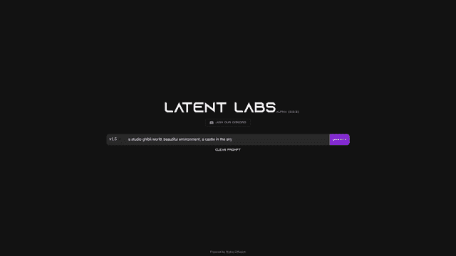

#3D

Latent Labs是基于文本提示生成3D世界的项目，它支持不同版本的稳定扩散，并且还拥有一个Discord社区。它可以帮助你创造出一个充满想象力的3D世界，让你可以在其中自由探索。

费用： 免费

网址： www.latentlabs.art

## Texture Lab

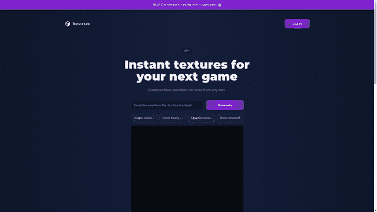

#3D

TextureLab是AI驱动的3D纹理生成平台，可以在短短几秒钟内生成3D纹理，并且提供一个免费的纹理数据库，让你可以快速获取所需的纹理。

费用： 收费，但可先试用 ，$7.99

网址： www.texturelab.xyz

## DeepMotion

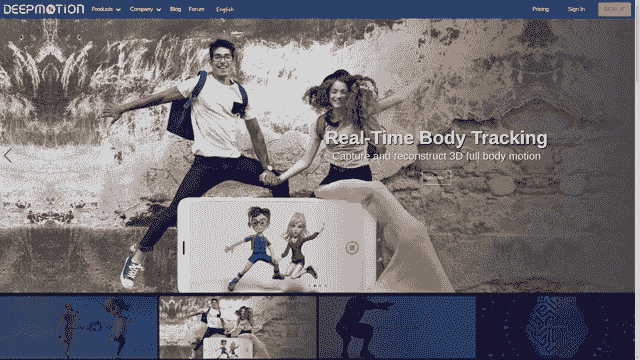

#3D

DeepMotion是一个利用实时身体跟踪技术将视频转换成3D动画的平台，可用于游戏、增强/虚拟现实等应用场景。它提供了一系列的解决方案，包括深度学习技术、虚拟演员、虚拟现实等，可以帮助开发者快速创建出高质量的3D动画。

费用： 免费，有增值会员 ，$17/mo

网址： www.deepmotion.com

## Poly

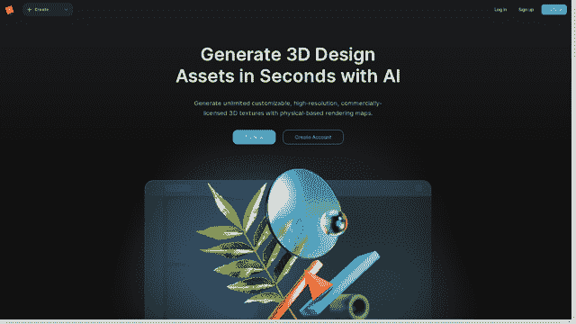

#3D

Poly是一个AI技术驱动的纹理生成平台，它可以根据文本提示快速生成高分辨率、完全定制、商业授权的纹理。它可以帮助设计师和开发者快速创建出令人惊叹的纹理，而无需花费大量时间和精力。它还提供了一个可视化的编辑器，可以让用户调整纹理的外观，以满足他们的需求。

费用： 免费，有增值会员 ，$10/mo

网址： withpoly.com

## Kaedim

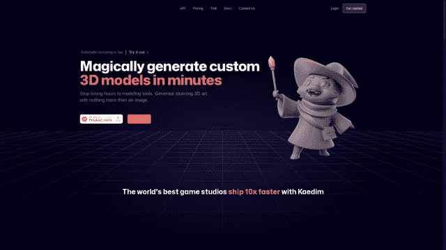

#3D

Kaedim3D是一个在线2D图像转3D模型的服务，它使用人工智能技术，可以自动将2D图像转换为3D模型。它提供了一个简单易用的界面，可以让用户轻松上传2D图像，并自动生成3D模型。Kaedim3D还提供了一系列的编辑功能，可以让用户调整3D模型的外观，以满足他们的需求。

费用： 收费 ，$599/mo

网址： www.kaedim3d.com

## Pixela AI

#3D

Pixela.ai是一个AI生成游戏纹理的社区，它使用稳定扩散算法来生成图像。用户可以上传自己生成的纹理，与社区中的其他用户分享，并可以从其他用户获得灵感。Pixela.ai还提供了一个在线编辑器，可以让用户调整纹理的参数，以获得更好的结果。

费用： 免费

网址： pixela.ai

## Mirageml

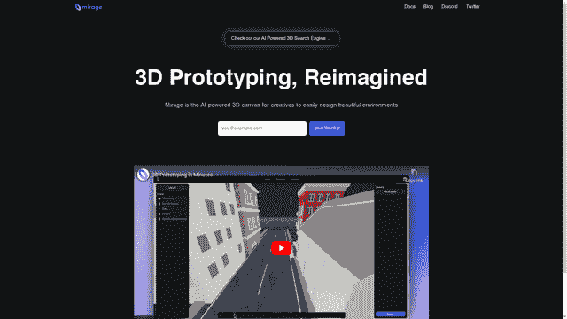

#3D

Mirage是一个AI驱动的3D设计平台，它可以帮助用户快速生成3D模型和纹理。只需使用文本描述您想要的内容，Mirage就可以自动生成3D模型和纹理，从而大大节省了设计时间。它还提供了一系列强大的工具，可以帮助用户更轻松地完成3D设计任务。

费用： 免费，有增值会员

网址： www.mirageml.com

## Leonardo.Ai

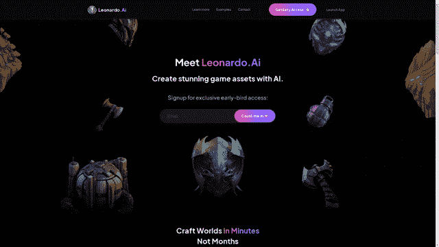

#3D #gaming

Leonardo.ai是一个AI驱动的创意项目生产资源平台，它可以以快速、风格一致的方式为您的创意项目生成高质量的资源。它可以帮助您快速生成高质量的图像、视频、文本等内容，从而提高您的创意项目的效率和质量。

费用： 免费，有增值会员

网址： leonardo.ai

## PrometheanAI

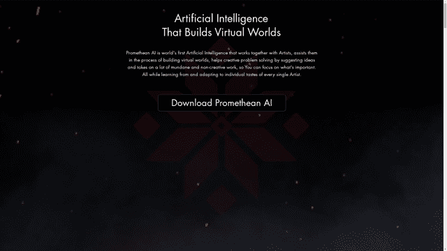

#3D

Promethean AI是世界上第一个与艺术家合作的人工智能，它可以协助他们构建虚拟世界，并通过提出创意解决方案来帮助解决创意问题。它可以帮助艺术家们更快地完成他们的创作，并且可以提供更多的创意灵感，从而提高他们的创作效率。Promethean AI还可以帮助艺术家们更好地理解他们的作品，并且可以提供更多的创意灵感，从而提高他们的创作效率。

费用： 免费，有增值会员 ，$5/mo

网址： www.prometheanai.com

## Ponzu

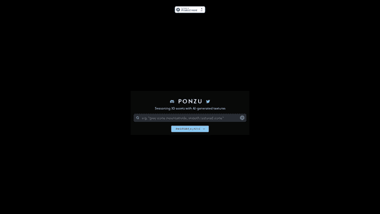

#3D

Ponzu.gg是一个用AI生成纹理来调味3D资产的项目。它提供了一种快速、简单的方法来让3D资产看起来更加逼真，而不需要花费大量时间和精力。它使用机器学习技术来自动生成纹理，从而节省了设计师的时间，让他们能够更快地完成任务。它还提供了一个可视化的编辑器，让用户可以调整纹理的外观，以获得最佳的结果。

费用： 免费

网址： www.ponzu.gg

## The Simulation

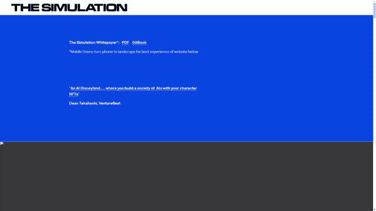

#3D #gaming

它旨在提供一个安全、可信赖的环境，让用户可以创建、参与和发掘模拟世界中的游戏、社区和经济活动。Fable Simulation提供了一个开放的平台，可以让用户创建自己的模拟世界，并与其他用户进行交互。它还提供了一个可以让用户购买、出售和交换NFT的市场，以及一个可以让用户参与模拟世界中的游戏和经济活动的游戏引擎。Fable Simulation还提供了一个可以让用户参与模拟世界中的社区活动的社区平台。

费用： 联系商务询价

网址： fablesimulation.com

## GetFloorPlan

#3D #real-estate

FloorPlan是一个AI驱动的在线服务，可以帮助用户将2D平面图转换成现代化、完全布置的3D布局，并可以提供360度虚拟旅游体验，每天可以处理数千个项目。它可以帮助用户快速、轻松地将2D平面图转换成3D布局，并可以提供完整的虚拟旅游体验，让用户更好地了解空间的布局和设计。

费用： 免费，有增值会员

网址： getfloorplan.com

## G3DAI {Jedi}

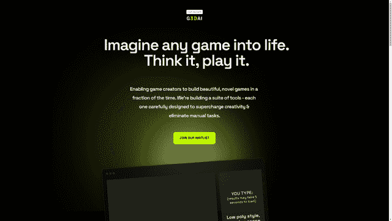

#3D

G3D.AI是一个基于人工智能的3D资产创建平台，它可以帮助用户快速创建任何3D资产，只需要输入一个文本提示即可。G3D.AI拥有强大的自然语言处理技术，可以解析用户输入的文本提示，并自动生成高质量的3D资产。G3D.AI还提供了一系列的3D资产管理工具，可以帮助用户更加高效地管理3D资产，从而提高工作效率。

费用： 联系商务询价

网址： g3d.ai

## Imagine 3D

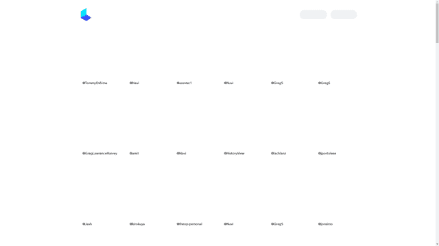

#3D

Imagine 3D是一个早期尝试，用文本来原型3D。随着质量和可用性的提高，我们将扩大生成的访问权限。Imagine 3D是一个由Luma Labs开发的早期实验，旨在使用文本来原型3D。它提供了一个简单的方法，可以让用户使用文本来描述3D模型，并使用AI技术来自动生成3D模型。随着质量和可用性的提高，我们将扩大生成的访问权限，以帮助更多的人创建3D模型。

费用： 联系商务询价

网址： captures.lumalabs.ai/imagine

## Masterpiece Studio

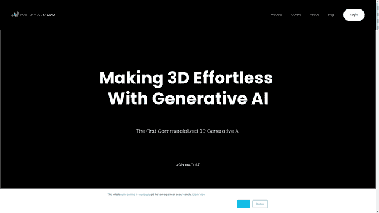

#3D

Masterpiece Studio是一个AI驱动的3D创作工具，旨在简化3D创作流程。它提供了一系列的功能，可以帮助现代创作者快速创建出令人惊叹的3D作品，而不必深入繁琐的细节。它提供了三个主要的功能：生成、编辑和部署，可以帮助创作者快速完成3D创作，让他们更加专注于创作本身。

费用： 免费，有增值会员

网址： masterpiecestudio.com

## GET3D (Nvidia)

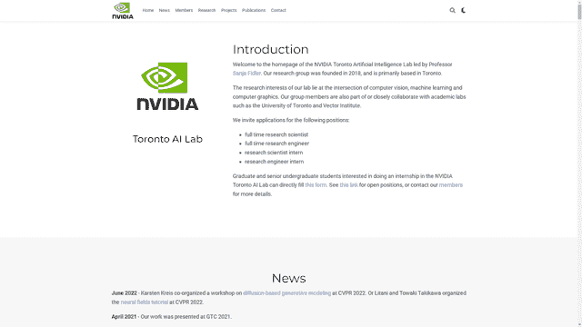

#3D

GET3D是一个由图像学习的高质量3D纹理形状生成模型。它可以从2D图像中学习3D纹理形状，并生成高质量的3D纹理形状。它使用深度学习技术，可以从图像中提取出3D纹理形状的特征，并使用这些特征来生成3D纹理形状。它还可以从图像中提取出3D纹理形状的细节，从而使生成的3D纹理形状具有更高的质量。GET3D可以用于许多应用，如虚拟现实、游戏开发、3D打印等。

费用： 免费

网址： nv-tlabs.github.io/GET3D

## Plask

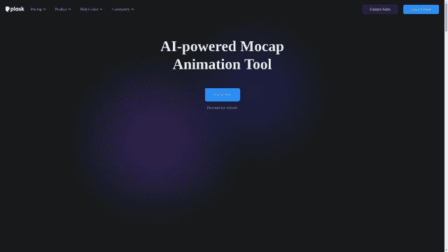

#3D

Plask.ai是一款基于AI的动作捕捉动画工具，它可以让用户轻松地创建出真实的动画效果。它可以让用户通过摄像头捕捉自己的动作，并将其转换为3D动画，从而节省大量的时间和精力。它还可以让用户自定义动画，以及创建出更加逼真的动画效果。Plask.ai的动画工具可以让用户轻松地创建出真实的动画效果，从而提高动画制作的效率。

费用： 免费，有增值会员 ，$50/mo

网址： plask.ai

## Luma AI

#3D #gaming

Luma Labs是一个全新的3D捕捉技术，它可以捕捉到令人惊叹的真实感，反射和细节。它可以让你在任何地方捕捉到令人惊叹的3D图像，而不需要任何复杂的设备。它可以让你在任何地方捕捉到令人惊叹的3D图像，而不需要任何复杂的设备。它可以让你在任何地方捕捉到令人惊叹的3D图像，而不需要任何复杂的设备。Luma Labs的技术可以让你在任何地方捕捉到令人惊叹的真实感，反射和细节，让你的VFX技术达到前所未有的高度，让每个人都能够体验未来的VFX技术。

费用： 联系商务询价

网址： lumalabs.ai

## Scenario

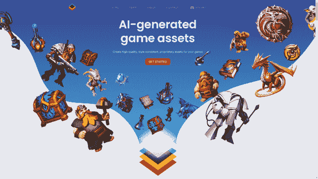

#3D #gaming

Scenario.gg是一个AI生成游戏资源的平台，它可以帮助游戏开发者快速创建高质量、风格一致、专有的游戏资源。它提供了一系列的AI工具，可以自动生成游戏资源，包括3D模型、纹理、动画等，可以大大提高游戏开发的效率。

费用： 联系商务询价

网址： www.scenario.gg

# ART

## PlayArti

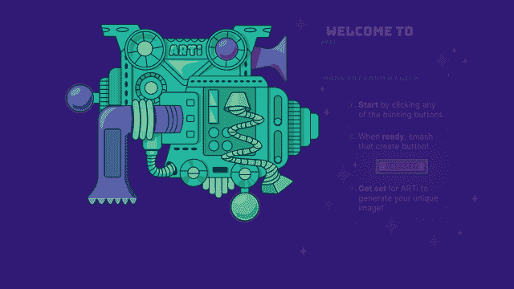

#art

PlayArti是一个让用户轻松创作艺术作品的网站。它提供了一个简单的界面，只需要点击三个按钮，即可选择角色、地点和活动，就可以创作出一幅独特的艺术作品。它还提供了一个社区，让用户可以与其他用户分享自己的作品，并且可以收藏他人的作品。PlayArti还提供了一个艺术学习中心，让用户可以学习创作艺术作品的技巧，并且可以提高自己的艺术水平。

费用： 免费

网址： www.playarti.com

## SketchPro AI

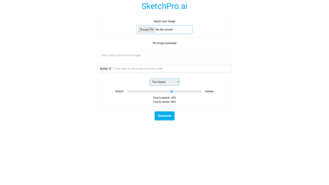

#art #fun-tools

SketchPro.ai是一个AI技术驱动的设计工具，它可以帮助用户快速创建出高质量的设计作品。它可以让用户上传图片，输入图片的描述和标签，然后自动生成出精美的草图。它还可以根据用户的输入，自动生成出丰富多样的设计元素，从而帮助用户更快捷地完成设计任务。

费用： 免费

网址： sketchpro.ai

## Stable Attribution

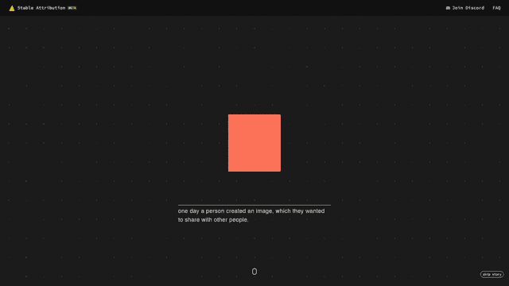

#art

Stable Attribution 为每张图片创建一个独特和稳定的归属。它的工作原理是将标题与图像联系起来，并利用它为该图像生成一个独特的 "指纹"。然后，这个指纹被用来识别图像，即使它已经被修改或以某种方式改变了。这使得跟踪图像的使用成为可能，并确保原创作者的作品得到认可。

费用： 免费

网址： www.stableattribution.com

## Ebsynth

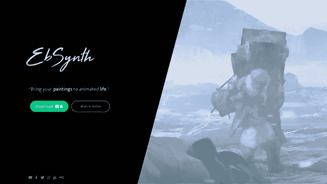

#art #video-generator

EbSynth是一款免费的软件应用，它可以让你使用几个样式化的关键帧来动画现有的镜头。它非常适合手绘动画，通常需要花费很长时间来动画。它可以让你快速创建出令人惊叹的动画效果，而且还可以调整动画的速度、曲线和其他参数，以获得最佳的动画效果。

费用： 免费

网址： ebsynth.com

## InstantArt.io

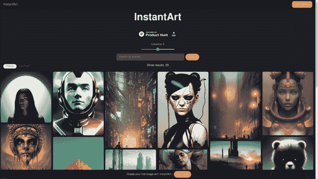

#art

InstantArt是一个革命性的新平台，用于AI生成的艺术品。他们稳定的扩散技术确保每一张生成的图像都是最高质量的，使其成为各个水平的艺术家、设计师和创作者的完美工具。无论您是寻求灵感的专业人士还是寻求尝试的业余爱好者，InstantArt都有适合每个人的东西。

费用： 免费

网址： instantart.io

## AI Pencil

#art #fun-tools

AI Pencil是一款基于AI的软件，它可以帮助用户利用强大的工具创作出惊艳的艺术作品，导入和导出他们最喜欢的绘画，并将他们的艺术转换成任何媒介或风格。它拥有强大的AI技术，可以自动识别用户的绘画，并自动生成出精美的艺术作品。它还支持多种绘画工具，可以让用户更轻松地创作出他们想要的艺术作品。

费用： 免费

网址： apps.apple.com/us/app/ai-pencil/id6444737491

## Vieutopia

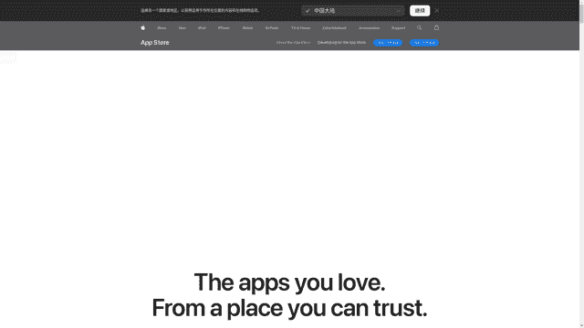

#art

Vieutopia是一款免费的设计应用，它可以帮助用户将他们最狂野的想法转变成创意艺术作品。它经过数千种不同的图像和文本组合的测试，没有订阅费用或使用限制，可以让你轻松创作出惊艳的设计作品。它拥有丰富的模板，可以让你轻松创作出海报、宣传单、海报、礼品卡等，让你的设计更加丰富多彩。它还拥有强大的编辑功能，可以让你调整图像、文字、颜色等，让你的作品更加完美。

费用： 免费

网址： apps.apple.com/gb/app/vieutopia/id1660264569

## Super Prompt

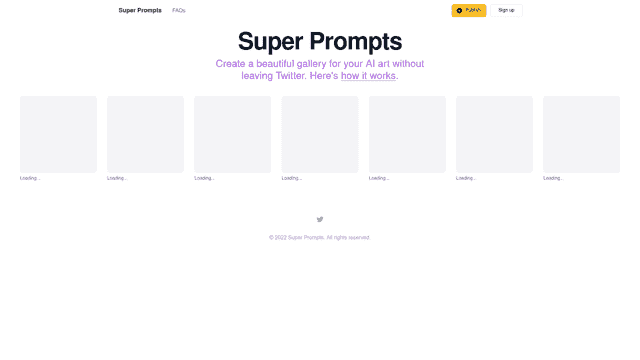

#art

SuperPrompts是一个可以让你在Twitter上创建美丽的AI艺术画廊的项目。它可以让你轻松地将你的AI艺术作品展示在Twitter上，而不用离开Twitter。它提供了一个简单的界面，可以让你轻松地上传你的作品，并且可以让你自定义你的画廊，以便你可以展示你的作品。它还可以让你轻松地将你的画廊分享给你的朋友，让他们也可以欣赏你的作品。

费用： 免费，有增值会员

网址： superprompts.com

## ArtHub

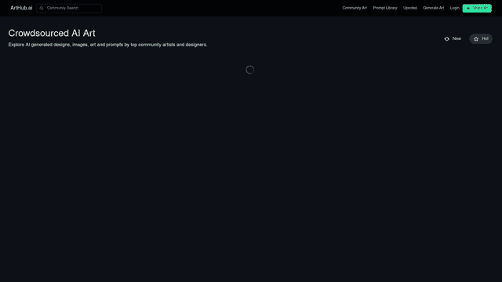

#art #search-engine

Arthub.ai是一个由社区艺术家和设计师共同参与的众包AI艺术项目。它提供了一个平台，让艺术家和设计师可以分享他们的AI生成的设计、图像、艺术和提示。它还提供了一个社区，让艺术家和设计师可以交流想法，分享经验，并与其他人一起创作。Arthub.ai的目标是为艺术家和设计师提供一个可以分享他们的作品，并与其他人一起创作的平台。

费用： 免费

网址： arthub.ai

## DaVinciFace

#art

DaVinci Face是一款基于人工智能的应用，它可以根据用户上传的照片，创建出具有达芬奇风格的肖像画。它可以将用户的照片转换成一幅达芬奇式的肖像画，并且可以根据用户的需求，调整画作的风格，让画作更加精美。DaVinci Face还提供了一系列的编辑工具，可以让用户调整画作的颜色、纹理、边框等，让画作更加精美。

费用： 免费，有增值会员

网址： www.davinciface.com

## Fy! Studio

#art

IAMFY Studio是一个创意改变者，它可以将您的想法转化为独特的壁画。只需输入您的想法，我们就可以将它们转化为前所未见的壁画。IAMFY Studio拥有丰富的设计风格，可以满足您的各种需求，从简单的文字到复杂的图案，都可以轻松实现。此外，IAMFY Studio还提供了丰富的材料选择，可以根据您的需求，为您提供最适合的壁画材料。

费用： 免费

网址： www.iamfy.co/studio

## Lexica

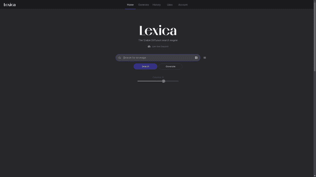

#art #search-engine

Lexica.art是一个基于区块链技术的艺术搜索引擎，它旨在为艺术家和收藏家提供一个安全、可靠的艺术品搜索平台。它采用了Stable Diffusion搜索引擎，可以搜索出最新、最具价值的艺术品，并且可以搜索出艺术家的历史作品。它还提供了一个安全的交易环境，可以让艺术家和收藏家安全地进行艺术品交易。Lexica.art的目标是为艺术家和收藏家提供一个安全、可靠的艺术品搜索和交易平台，让他们可以更容易地找到最新、最具价值的艺术品。

费用： 收费，但可先试用 ，$8/mo

网址： lexica.art

## Civitai

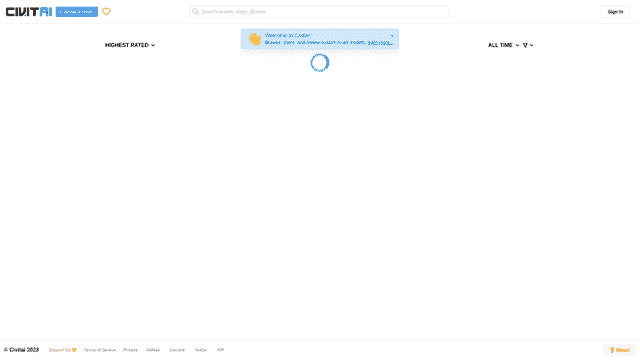

#art #search-engine

Civitai是AI艺术生成社区唯一的模型共享中心！免费使用，开源，并不断改进。它提供了一个安全的环境，让用户可以轻松地分享和使用AI模型，以及访问最新的AI艺术生成技术。Civitai还提供了一个完整的社区，让用户可以与其他AI艺术家交流，分享经验，并获得有关AI艺术生成的最新信息。

费用： 免费

网址： civitai.com

## DiffusionBee

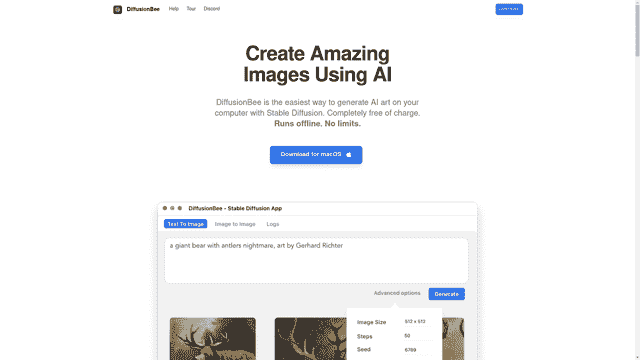

#art

DiffusionBee是一个基于AI的艺术创作平台，它可以帮助用户创造出稳定扩散的艺术作品。它提供了一系列的工具，可以让用户轻松地在自己的电脑上创作出AI艺术作品。它还提供了一个可视化的编辑器，可以让用户调整图像的颜色、形状和纹理，以及添加自定义的图像效果。DiffusionBee还提供了一个在线社区，可以让用户与其他艺术家分享他们的作品，并获得反馈。

费用： 免费

网址： diffusionbee.com

## Dreamlike.art

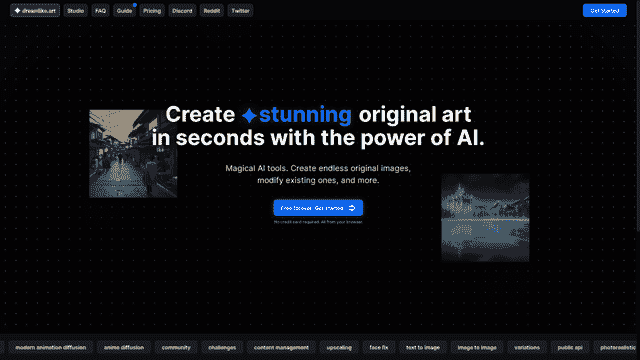

#art

Dreamlike.art是一个利用人工智能技术创造出惊艳的原创艺术品的平台。它拥有神奇的AI工具，可以创造出无限的原创图像，修改现有图像，以及更多功能。它可以让你在短短几秒钟内创造出精美的原创艺术品，让你的创作更加简单、快捷、有趣。

费用： 免费 ，$15/mo

网址： dreamlike.art

## ArtroomAI

#art

Artroom.ai是一款AI艺术创作工具，它可以让用户在不接触任何代码的情况下，创作出美丽的AI生成艺术作品。它提供了一个本地GUI，可以让用户轻松地下载并使用Stable Diffusion，从而创作出独一无二的艺术作品。

费用： 免费

网址： artroom.ai/download-app

## Mage

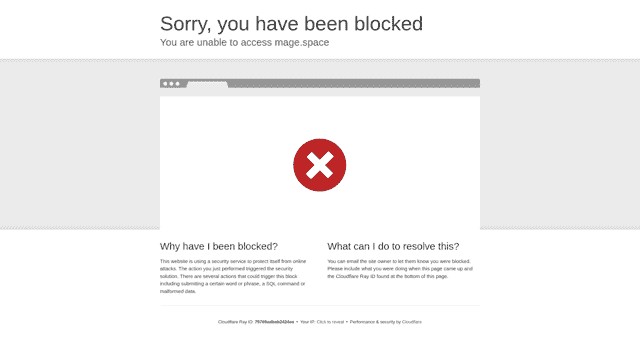

#art #search-engine

Mage.space是一个免费、快速、无限制的稳定扩散文本到图像AI项目。它提供了一个易于使用的接口，可以让用户将文本转换为图像，并且可以自定义图像的大小、颜色和样式。它还提供了一个强大的API，可以让开发者轻松地将文本转换为图像，并将其集成到他们的应用程序中。Mage.space还提供了一个免费的图像库，可以让用户轻松地找到他们想要的图像，并且可以自定义图像的大小、颜色和样式。

费用： 免费

网址： www.mage.space

## Playground AI

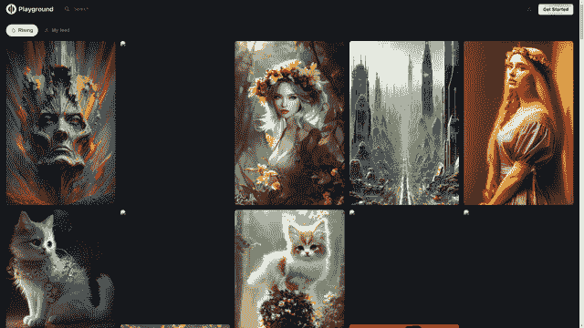

#art #search-engine

Playground AI是一个免费使用的在线AI图像创作工具。它可以用来创作艺术品、社交媒体帖子、演示文稿、海报、视频、徽标等等。它拥有强大的AI技术，可以自动生成高质量的图像，让你轻松创作出惊艳的作品。

费用： 免费，有增值会员 ，$15/mo.

网址： playgroundai.com

## Neural.love Art Generator

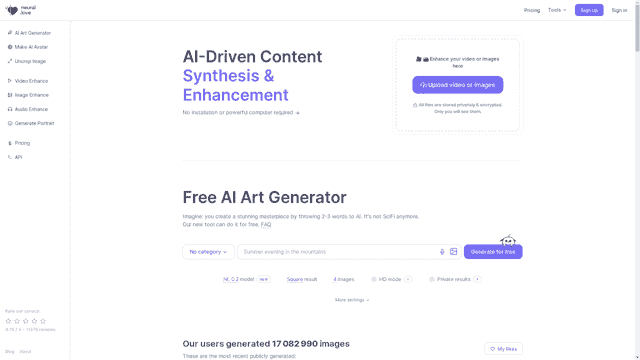

#art

Neural.love是一个免费的AI艺术生成器，它已经生成了超过500万张图片。想象一下：你只需要输入2-3个词，就可以创造出一幅令人惊叹的杰作。现在，这已经不再是科幻小说了。

费用： 免费，有增值会员 ，$30/mo

网址： neural.love

## Wombo

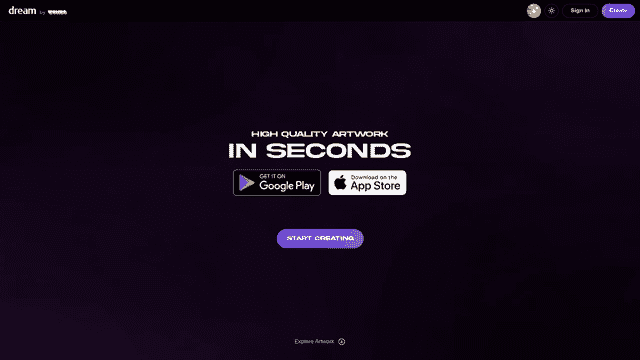

#art

WOMBO Dream是一款基于AI技术的艺术创作工具，它可以让你轻松创作出精美的艺术作品。只需输入一个提示，选择一种艺术风格，WOMBO Dream就可以在几秒钟内将你的想法变成一幅AI驱动的画作。

费用： 联系商务询价

网址： www.wombo.art

## PicSo

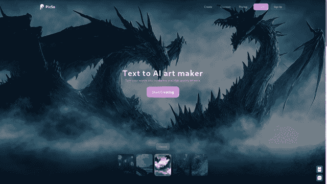

#art

Picso.ai是一款AI艺术制作工具，可以将文字转换成令人惊叹的高质量艺术品。它可以根据您输入的文字，自动生成精美的图片，并且可以根据您的需求调整风格，以获得最佳的艺术效果。它还可以自动生成动画，让您的文字更加生动有趣。Picso.ai可以让您轻松创作出令人惊叹的艺术作品，让您的创意更加丰富多彩。

费用： 免费，有增值会员 ，$9.99/mo

网址： picso.ai

## Artbreeder

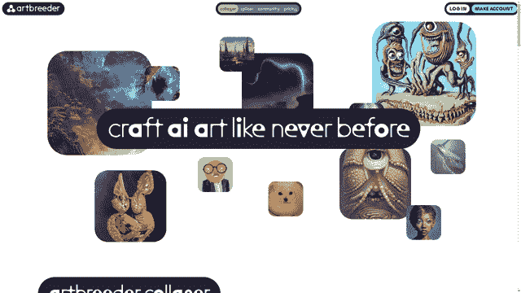

#art

Artbreeder是一个全新的艺术创作工具，它使用人工智能技术来帮助用户创造出令人惊叹的艺术作品。它拥有一个强大的图像数据库，可以让用户从中挑选出自己喜欢的图像，然后使用人工智能技术来混合和调整图像，从而创造出全新的艺术作品。Artbreeder还提供了一个可视化的编辑器，可以让用户调整图像的颜色、形状、大小等，从而让用户创造出独一无二的艺术作品。

费用： 免费，有增值会员

网址： www.artbreeder.com

## Midjourney

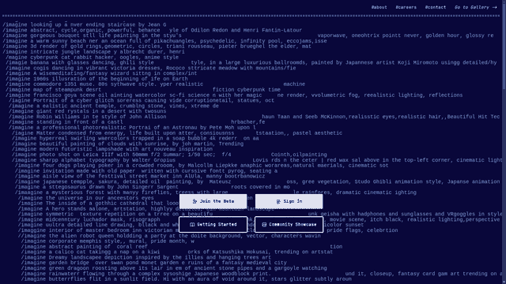

#art

Midjourney是一个独立的研究实验室，致力于探索新的思维媒介，扩展人类的想象力。它基于稳定扩散技术，提供了一种AI艺术生成器，可以帮助用户创造出具有独特视觉效果的艺术作品。Midjourney的AI艺术生成器可以让用户轻松地创作出具有自己风格的艺术作品，从而激发他们的创造力。

费用： 收费，但可先试用

网址： www.midjourney.com/home

## NightCafe Studio

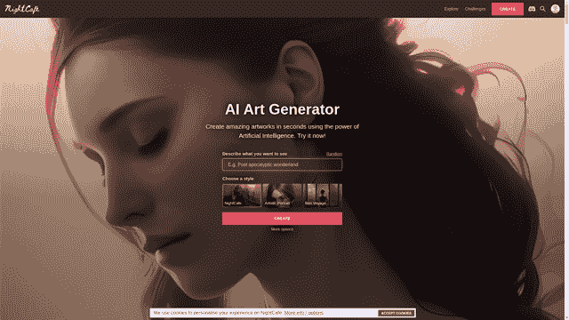

#art

NightCafe Studio的AI艺术生成器是一款具有前瞻性的艺术创作工具，它利用人工智能技术，可以帮助用户创造出令人惊叹的艺术作品。它可以根据用户提供的图像，自动生成出具有独特风格的艺术作品，并可以调整色彩、纹理、细节等，以达到用户期望的效果。此外，它还提供了一系列的艺术风格，可以让用户更加轻松地创作出自己想要的艺术作品。NightCafe Studio的AI艺术生成器，让艺术创作变得更加简单、快捷，让每一个人都可以成为艺术家。

费用： 免费，有增值会员

网址： creator.nightcafe.studio

## Dream Up (Deviant Art)

#art #search-engine

DreamUp™是一个让你可以创造AI艺术的项目，它能确保创作者及其作品得到公平对待。通过人工智能的力量，你可以创造出任何你能想象到的图像！试试DreamUp，它提供5个免费提示。

费用： 收费，但可先试用

网址： www.dreamup.com

# AUDIO EDITING

## Maverick

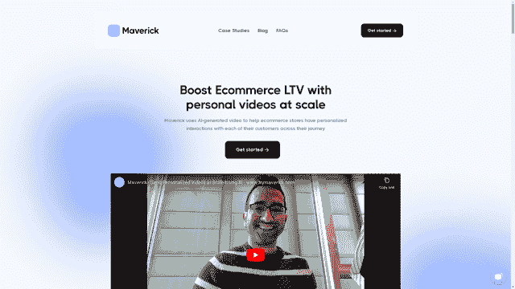

#audio-editing

Maverick是一个利用自动化个性化视频来建立与客户强有力关系的项目。我们Maverick通过AI和深度技术为电子商务品牌、在线零售商、医疗保健等不同企业提供服务，生成成千上万的独特个性化视频。你只需要录制一次自己，Maverick就可以生成成千上万的独特定制视频，其中你可以以每位客户的名字来称呼他们。那么你还在等什么？向客户发送自动化个性化视频，提高你的转化率吧！

费用： 免费

网址： www.trymaverick.com

## Lalal.ai

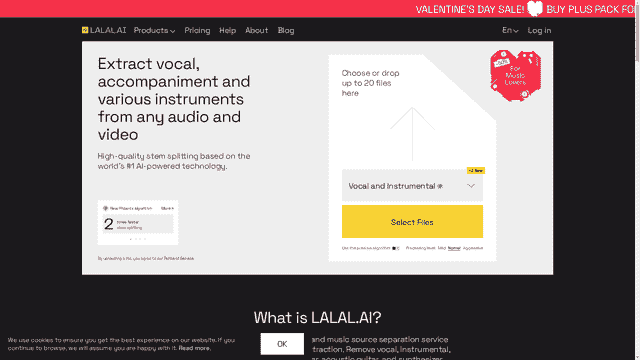

#audio-editing

Lalal.ai是一个下一代的声音消除和音乐源分离服务，可以快速、轻松、精确地提取枝条。可以在不损失质量的情况下消除人声、乐器、鼓、贝斯、钢琴、电吉他、原声吉他和合成器轨道。

费用： 免费，有增值会员 ，$30/mo

网址： www.lalal.ai

## TTSLabs

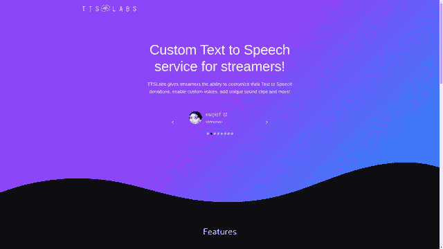

#audio-editing #text-to-speech #gaming

TTSLabs是一个AI文本转语音技术的项目，它为Twitch流媒体提供了定制文本转语音捐赠、定制语音、添加独特声音剪辑等功能，并且可以与Twitch、Streamlabs和Streamelements无缝集成，让流媒体更加丰富多彩。

费用： 免费

网址： ttslabs.ai

## Krisp

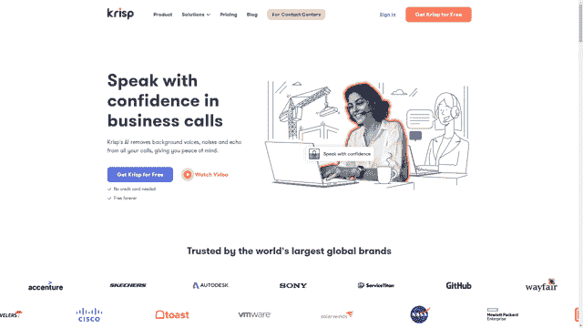

#audio-editing #productivity

Krisp是一款基于AI的解决方案，可以从会议中消除背景噪音和回声，只留下人类的声音。它具有噪声和回声消除、小部件、洞察力和通话摘要等功能。

费用： 免费，有增值会员 ，$8/mo

网址： krisp.ai

## Beatoven.ai

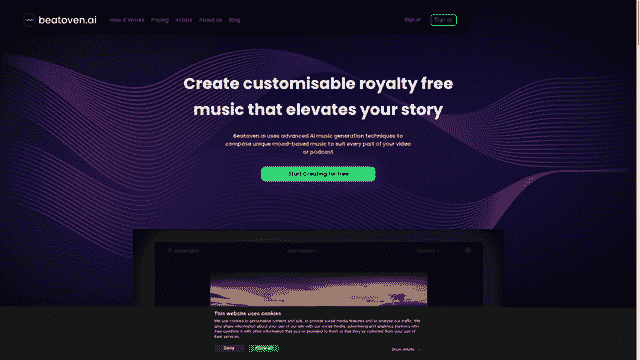

#audio-editing #music #video-editing

Beatoven.ai是一个利用先进的人工智能音乐生成技术来创作独特的情绪基础音乐，以适应您的视频或播客的每个部分。它可以根据您的视频或播客的情绪，自动生成专属的音乐，以提升您的视频或播客的整体效果。Beatoven.ai还提供了一个在线音乐库，您可以在其中搜索和浏览各种类型的音乐，以便您可以找到最适合您的视频或播客的音乐。Beatoven.ai是一个非常有用的工具，可以帮助您创作出最适合您的视频或播客的音乐，以提升您的视频或播客的整体效果。

费用： 免费，有增值会员 ，$20/mo

网址： www.beatoven.ai

## Audio Strip

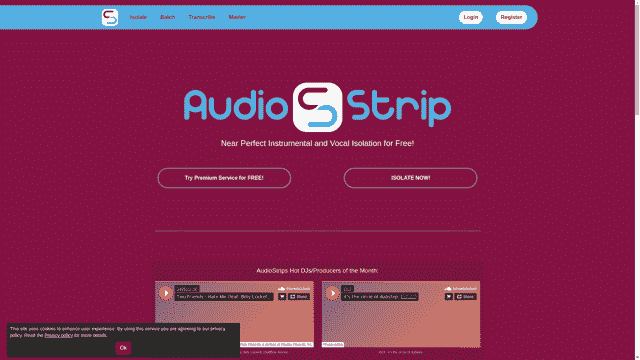

#audio-editing

AudioStrip是一个免费的音频分离项目，它可以帮助用户将乐器和人声从混音中完美分离出来。它使用最先进的技术，可以提供准确的分离结果，而且不会破坏原始音质。它还提供了一个易于使用的在线界面，可以让用户轻松上传和下载音频文件，并调整分离参数以获得最佳结果。AudioStrip的服务完全免费，可以让用户轻松获得完美的乐器和人声分离结果。

费用： 免费，有增值会员 ，$4.33/mo

网址： www.audiostrip.co.uk

## Voicemod

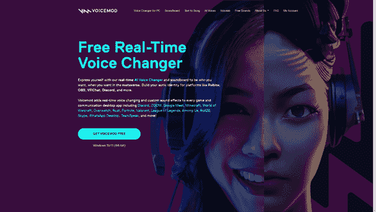

#audio-editing #fun-tools

VoiceMod是一款有趣又恐怖的语音变声应用，它可以让你变成女孩或机器人的声音，拥有多种特效。它可以让你在游戏、聊天、视频等场景中，改变自己的声音，让你的声音更有趣、更有趣、更有趣。VoiceMod还提供了一个实时语音变声器，可以让你实时变声，让你的声音更加有趣。

费用： 免费，有增值会员

网址： www.voicemod.net

## Cleanvoice AI

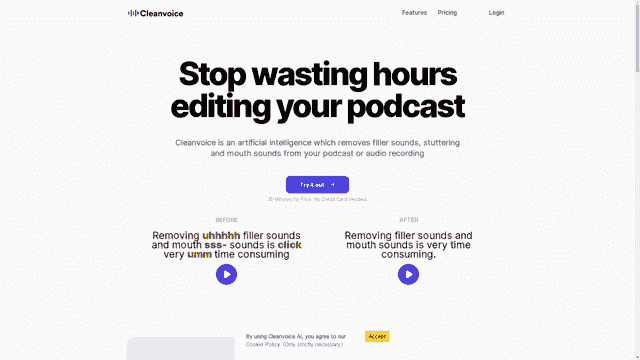

#audio-editing

Cleanvoice是一款人工智能，可以从您的播客或音频录音中去除填充声音、口吃和嘴唇声音。它可以让您节省数小时的编辑时间，让您的播客更加清晰、流畅。Cleanvoice可以自动识别和删除噪音，并可以根据您的需求调整音量，以获得最佳的音质。它还可以自动添加淡入和淡出效果，让您的播客更加精彩。

费用： 收费，但可先试用 ，$1/hour

网址： cleanvoice.ai

## Podcastle

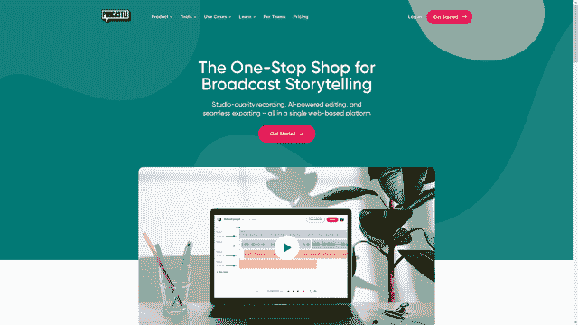

#audio-editing

Podcastle.ai是一个一站式的广播故事制作工具，它为播客或任何从事长篇视频创作的人提供了一个优秀的AI工具。它拥有演播室级别的录音、AI驱动的编辑和无缝的导出功能，所有这些都集成在一个基于网络的平台中。

费用： 免费，有增值会员 ，$3/mo.

网址： podcastle.ai

## Adobe Podcast

#audio-editing

Adobe Podcast是一个免费的音频制作平台，它提供了两款快速工具来增强您的音频内容：增强语音，可以去除所有背景噪音和回声；Mic Check，可以解锁您麦克风的高品质声音。此外，Adobe Podcast还承诺提供基于AI的音频录制和编辑功能，所有功能均在网页上实现，目前正处于等待名单中。

费用： 免费

网址： podcast.adobe.com

## Altered

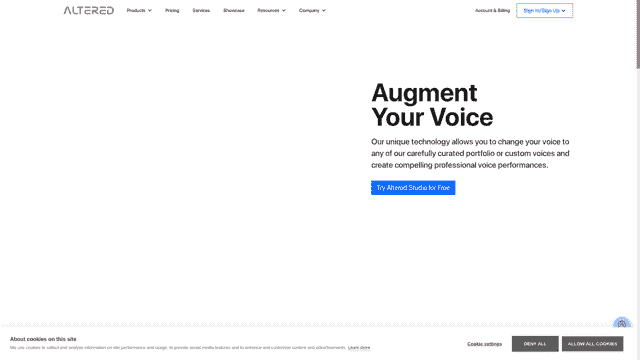

#audio-editing

Altered.ai是一个独特的技术平台，可以让你改变你的声音，从我们精心挑选的声音库中选择，或者自定义声音，创造出引人入胜的专业声音表演。它可以让你的声音变得更加丰富多彩，让你的声音更有表现力。

费用： 收费 ，$59/mo

网址： www.altered.ai

# AVATARS

## Imagine Me

#avatars #art

ImagineMe是一个利用人工智能技术创造出个性化艺术品的项目。它可以根据用户提供的文字描述，生成惊艳的AI艺术品，可以用于个性化艺术品、头像、虚拟试衣和个性化营销等。

费用： 收费

网址： imagineme.app

## Pixelz AI

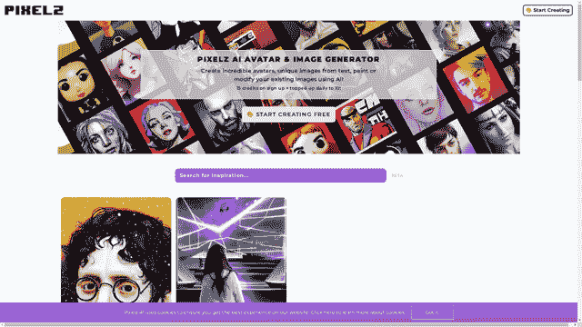

#avatars #art

Pixelz.ai是一个AI图像处理平台，它可以帮助用户创建令人惊叹的头像、从文本中创建独特的图像、绘制或修改现有图像。它拥有强大的AI技术，可以自动完成复杂的图像处理任务，每天都会提供新的积分，让用户轻松获取最新的图像处理服务。

费用： 免费，有增值会员

网址： pixelz.ai

## AI Pet Avatar

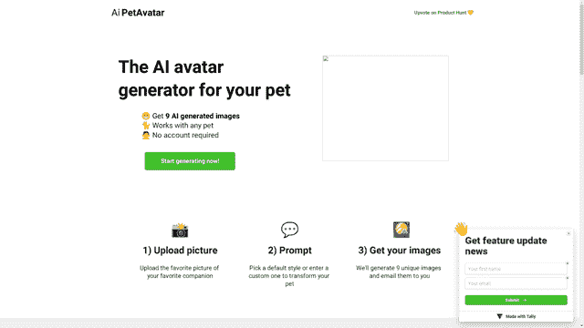

#avatars

AI宠物头像生成器。获取9张AI生成的图像，适用于任何宠物，无需账号！AIPetAvatar.com提供了一个免费的AI宠物头像生成器，可以让您轻松创建宠物的专属头像。它可以根据您提供的宠物照片，使用最先进的人工智能技术，快速生成9张AI生成的图像，而且无需注册账号。它还提供了一个简单的编辑器，可以让您调整图像的大小，颜色，样式等，以获得最佳的头像效果。

费用： 收费

网址： aipetavatar.com

## AnimeAI

#avatars #fun-tools

AnimeAI是一个让你成为顶级动漫主角的项目！你可以通过自己的照片，成为《进击的巨人》、《火影忍者》、《新世纪福音战士》、《赛博朋克》和《鬼灭之刃》等动漫中的角色。获得120份个性化的独特艺术品！

费用： 收费

网址： www.animeai.lol

## Avatarify

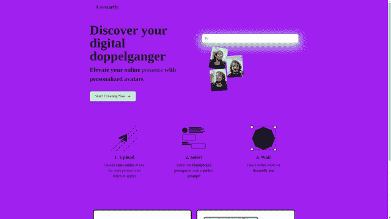

#avatars

Avatarify.art是一个使用人工智能技术创建个性化头像的平台。它的技术可以让你生成逼真的人物、动物和虚拟角色头像。只需要支付租用的GPU费用即可。如果你不满意，他们还可以重新渲染头像。

费用： 收费 ，$5

网址： avatarify.art

## AI Roguelite

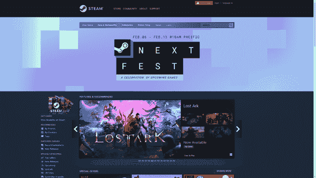

#avatars #gaming

AI Roguelite是世界上第一款所有实体都是AI生成，所有游戏机制都是AI检测的RPG游戏。它拥有AI生成的实体，合成配方，战斗和插图。它拥有多种游戏模式，比如冒险模式，挑战模式，无尽模式等，每种模式都有不同的游戏体验。它还拥有多种AI技术，比如机器学习，深度学习，自然语言处理等，可以让游戏更加真实，更有趣。

费用： 收费 ，$5.51

网址： store.steampowered.com/app/1889620/AI_Roguelite

## LiveReacting AI

#avatars #video-generator #education-assistant

LiveReacting的AI主持人可以帮助您提升现场表演水平。通过AI主持人，您可以节省时间和金钱，同时为观众提供互动性和吸引力的体验。AI主持人可以自动检测观众的反馈，并且可以根据观众的反馈来调整现场表演的内容，从而提升观众的体验。此外，AI主持人还可以帮助您收集观众的反馈，以便您可以更好地了解观众的需求，并且可以根据观众的反馈来改进您的现场表演。

费用： 收费 ，$19.99

网址： www.livereacting.com/ai-host-for-live-stream

## In3D

#avatars #gaming

in3d.io是一个利用手机摄像头在一分钟内创建逼真可定制化的头像的项目，可以用于虚拟世界、游戏或应用程序。它可以让你使用手机摄像头拍摄照片，然后自动生成一个逼真的3D头像，并且可以自定义头像的外观，以满足你的需求。

费用： 免费，有增值会员 ，$100/test

网址： in3d.io

## HairstyleAI

#avatars #fun-tools

HairstyleAI是一个基于人工智能技术的发型设计平台，可以帮助用户快速生成不同的发型，并且可以根据用户的脸型、发质等特征，推荐最适合用户的发型，无论是男性还是女性，都可以找到最适合自己的发型。

费用： 收费 ，$19

网址： www.hairstyleai.com

## Lensa

#avatars

Google Play Store是一个应用程序商店，提供各种各样的应用程序，从游戏到生活工具，从娱乐到教育，从购物到金融。

费用： 收费

网址： play.google.com/store/apps/details

## Inworld

#avatars #gaming

InWorld.ai是一个AI人物技术项目，它可以创建出真实的AI角色，这些角色可以进行开放式的对话。你可以问它们任何问题，它们可以回答你的问题，并且可以像真实的人一样进行交流。InWorld.ai专为游戏、娱乐和虚拟世界而设计，可以为用户提供更加真实的体验。

费用： 免费，有增值会员 ，$10/mo

网址： www.inworld.ai

## Avatar AI

#avatars

AvatarAI.me是一个利用人工智能技术创建自定义头像的网站。它使用最先进的机器学习技术，可以根据用户提供的照片，自动生成一个个性化的头像。它可以让用户轻松创建出独一无二的头像，而且还可以调整头像的颜色、大小、形状等，以满足用户的需求。AvatarAI.me还提供了一系列的头像模板，可以让用户更快速地创建出自己想要的头像。

费用： 收费 ，$20

网址： avatarai.me

## Unrealme

#avatars

UnrealMe.io是一个AI技术驱动的项目，旨在为用户提供一种全新的方式来获取自我形象。它使用最先进的人工智能技术，可以根据用户提供的照片，生成一系列逼真的自我形象。用户可以使用这些图像来创建自己的个人品牌，或者用于社交媒体，博客，网站，广告等等。UnrealMe.io提供了一种快速，简单，高效的方式来获取自我形象，让用户可以更好地展示自己。

费用： 收费 ，$15

网址： unrealme.io

## PhotoAI

#avatars

PhotoAI.me是一个AI图片制作工具，它可以帮助用户创建出自己的AI照片。它拥有最先进的艺术风格，可以为用户生成30张自己的AI照片。它可以让用户创造出独一无二的AI照片，以及更多有趣的图片效果。它还可以帮助用户更好地表达自己的想法，让他们的照片更加有趣、有趣。

费用： 收费 ，$19

网址： photoai.me

## Xpression Camera

#avatars #video-generator

xpression Camera是一款获奖的虚拟摄像头应用，它可以让用户仅凭一张照片就能立即变身任何有脸的人或物，而无需任何处理时间。xpression camera可以让用户在使用Zoom等应用聊天、在Twitch上直播或创建YouTube视频时实时重新定义自己的屏幕形象。

费用： 免费，有增值会员 ，$8/mo

网址： xpressioncamera.com

## Character AI

#avatars #fun-tools

Character.ai是一个智能代理生态系统，旨在帮助开发者构建智能代理，以满足他们的业务需求。它提供了一个全面的工具箱，包括智能代理构建、训练、部署和管理等功能，可以帮助开发者快速构建出智能代理，并将其部署到任何平台上。此外，它还提供了一个强大的智能代理社区，可以帮助开发者与其他开发者分享经验，提高智能代理的性能。Character.ai是一个智能代理的完美家园，可以帮助开发者构建出更加智能、更加强大的智能代理。

费用： 免费

网址： beta.character.ai

## NeuralStudio

#avatars

Neural Studio是一个全能的照片和艺术工作室，它利用最新的AI技术，让创作者可以轻松实现他们的创作目标。它提供了一系列的工具，包括图像编辑、艺术创作、图像处理和艺术风格转换等，可以帮助创作者快速实现他们的创作理想。它还提供了一个可视化的编辑界面，让创作者可以轻松地操作，更加直观地掌握自己的创作过程。

费用： 免费，有增值会员

网址： neural.cam/studio

## Profile Picture AI

#avatars

ProfilePicture.ai是一个利用人工智能技术来创建完美个人头像的项目。它可以根据你的特征，生成一张看起来完美的头像，捕捉你的真实形象。无论你是谁，无论你在哪里，ProfilePicture.ai都可以帮助你创建出一张完美的头像。

费用： 收费 ，$5.80

网址： www.profilepicture.ai

## Arti.pics

#avatars

Arti.pics是一个基于AI的头像制作器。它可以让你上传几张自己的照片，并生成200多种不同风格的酷头像。它可以让你轻松创建出个性化的头像，以满足你的各种需求，比如社交媒体头像、游戏头像、网站头像等等。

费用： 收费 ，$29

网址： www.arti.pics

## Theoasis

#avatars

TheOasis是一个全新的虚拟体验平台，它可以帮助用户创建一个真实的虚拟形象，可以在所有视频平台上使用。它可以帮助用户创建一个真实的虚拟形象，可以在所有视频平台上使用，并且可以自定义头像，以及头发，眼睛，嘴巴，肤色等等。它还提供了一个虚拟社交网络，可以让用户与其他用户进行交流，分享照片和视频，以及参加游戏和活动。TheOasis是一个安全，可靠，可靠的虚拟体验平台，可以帮助用户创建一个真实的虚拟形象，让他们在视频平台上更加自信，更加有趣。

费用： 联系商务询价

网址： theoasis.com

## Aragon AI

#avatars

Aragon.ai是一个AI技术驱动的项目，旨在帮助用户创建高清专业的头像照片。它使用最先进的人工智能技术，可以根据用户的照片和要求，自动生成真实无可区分的头像照片。这样，用户就可以在LinkedIn上展示自己最佳的形象，提高招聘者联系自己的机会。

费用： 收费

网址： www.aragon.ai

## Gemsouls

#avatars

MyGemSouls是一个虚拟人物创建项目，旨在帮助用户创建出完全独一无二的虚拟人物，就像宝石一样珍贵而独特。它提供了一系列的工具，可以让用户自由地设计和创建自己的虚拟人物，并且可以与其他用户分享和交流。MyGemSouls还提供了一个社区，可以让用户与其他用户交流，分享经验，并且可以与他们的虚拟人物进行互动。MyGemSouls是一个充满活力的社区，可以让用户创造出独一无二的虚拟人物，并与他们交流，分享经验，拓展社交圈。

费用： 免费，有增值会员

网址： www.mygemsouls.com

## Ready Player Me

#avatars #gaming

ReadyPlayer.me是一个跨游戏头像平台，它为Metaverse提供了一个可以自由创建和管理自己的头像的空间。一个头像，许多世界可以探索。它支持多种游戏，让你可以在不同的游戏中使用同一个头像，让你的游戏体验更加统一。它还支持多种头像自定义功能，让你可以根据自己的喜好自由设计自己的头像，让你在游戏中拥有独一无二的头像。

费用： 免费，有增值会员 ，$0.16

网址： readyplayer.me

## PictoDream

#avatars

PictoDream是一个利用人工智能技术生成图片的项目，它可以根据用户提供的文字描述，将任何人放置在任何风格或场景中。它可以帮助用户快速创建出令人惊叹的图片，而无需任何图像处理技术。

费用： 免费，有增值会员

网址： pictodream.com

## Reface AI

#avatars #fun-tools

Reface.ai是一款AI应用，可以在GIF和视频中进行人脸替换。它的AI Avatar功能可以创建高质量的艺术类型的肖像画（可在iOS和Android上使用）。上传10张照片，等待一小时，就可以获得48种不同的艺术作品，以你自己为主角，风格从超级英雄到赛博朋克等等。

费用： 免费，有增值会员

网址： hey.reface.ai

## Beb.ai

#avatars

Beb.ai是一个可以让你生成自己、动物或者名人角色头像的平台。它可以为你的品牌提供无限的创意内容。

费用： 收费 ，$35

网址： beb.ai

## AI Time Machine

#avatars #fun-tools

MyHeritage AI Time Machine是一个令人惊叹的项目，它可以让你上传照片，然后用人工智能技术创建出令人惊叹的图像。它可以让你穿越历史，把你的照片变成不同时代的样子从古典到现代，从古老的风格到现代的风格。

费用： 免费，有增值会员

网址： www.myheritage.com/ai-time-machine

## Hairgen AI

#avatars

Hairgen.ai是一个AI技术支持的移植头发预览服务，它可以帮助您在投资FUE/FUT手术之前，预先看到自己的头发移植后的样子。它可以帮助您更准确地了解您的头发移植后的效果，并且可以通过AI技术来降低您的发际线。

费用： 收费 ，$29

网址： www.hairgen.ai

## Vana Portrait

#avatars #art

Portrait by Vana是一个生成艺术工作室，可以以无限的风格为您创作自画像。它使用机器学习技术，将您的照片转换成独特的艺术作品，让您的照片变得更加生动有趣。它还可以将您的照片转换成不同的风格，如抽象艺术、油画、水彩画等，让您的照片更加丰富多彩。Portrait by Vana不仅可以让您的照片变得更加精美，还可以让您的照片变得更加有趣，让您的照片变得更加独特。Portrait by Vana让您的照片变得更加有趣，让您成为一件艺术品。

费用： 免费

网址： portrait.vana.com

## DreamPic.AI

#avatars

DreamPic.ai是一个基于AI技术的头像制作平台，可以让你和你的朋友们创建AI生成的头像、用户头像和个人资料图片。只需上传照片，AI就能完成工作，由Stable Diffusion和DreamBooth提供技术支持。

费用： 收费

网址： dreampic.ai

# CODE ASSISTANT

## Duino Code Generator

#code-assistant

DuinoCodeGenerator是一个自动生成Arduino兼容板上代码的工具，只需一键即可完成。它可以让AI完成繁琐的工作，让你有更多的时间去摆弄！

费用： 免费

网址： www.duinocodegenerator.com

## Hacker AI

#code-assistant #developer-tools

Hacker AI是一款AI安全工具，可以帮助您检测源代码中的漏洞，以确保您的应用程序安全。它适用于网络安全专业人士和任何编写代码的人。Hacker AI免费提供，并将很快推出免费API。由https://twitter.com/chaignc开发。

费用： 免费

网址： hacker-ai.online

## Cron AI

#code-assistant #developer-tools

Cron-AI是一个非常实用的项目，它可以帮助用户轻松地创建定时任务，只需要描述任务需要多长时间运行一次，就可以自动生成定时任务。它可以节省用户大量的时间，让用户更加专注于自己的业务，而不用担心定时任务的创建。

费用： 免费

网址： cron-ai.vercel.app

## AI Reality

#code-assistant #developer-tools

AI Reality是一个平台，它可以使用AI文本生成简单的增强现实原型。我们利用稳定扩散和开放AI的力量，可以在几秒钟内生成AR体验。他们的使命是通过AI的友好过程，大规模使用和学习增强现实技术。

费用： 免费，有增值会员 ，$5

网址： aireality.tech

## Sketch

#code-assistant

Sketch是一款面向Pandas用户的AI代码编写助手，它能够理解数据的上下文，大大提高建议的相关性。Sketch可以在几秒钟内使用，无需在IDE中添加插件。

费用： 免费

网址： github.com/approximatelabs/sketch

## Airtest

#code-assistant #developer-tools

Airtest是一个基于AI的自动化测试框架，支持多种语言，包括Typescript和Python，并且支持多种测试框架，如Mocha和Jest。它可以帮助开发者快速生成单元测试，提高测试效率，提升软件质量。

费用： 免费 ，$5/mo

网址： www.airtest.dev

## AutoRegex

#code-assistant #developer-tools

AutoRegex是一个使用AI技术自动生成正则表达式的网站。它可以根据用户提供的文本，自动生成正则表达式，从而帮助用户更快捷地完成文本处理任务。此外，AutoRegex还提供了将正则表达式翻译成英文的功能，以帮助用户更好地理解正则表达式的含义。

费用： 免费，有增值会员 ，$3.49/mo

网址： www.autoregex.xyz

## Kodezi ai

#code-assistant

Kodezi是一款AI开发者工具助手，可以自动纠正你的代码。使用AI立即改进你的代码，使用Kodezi移除你的bug。

费用： 收费，但可先试用 ，$4.99/mo

网址： kodezi.com

## Maverick

#code-assistant

Visual Studio Marketplace是一个专为Visual Studio开发者提供的应用商店，它提供了一系列的插件、扩展和工具，可以帮助开发者更加高效地完成开发任务。它提供了一系列的插件，包括Maverick，一款基于AI的代码补全工具，可以在本地机器上提供最佳的代码补全，而无需访问任何API或知识库。此外，Visual Studio Marketplace还提供了一系列的其他插件，如GitHub插件、Azure DevOps插件、Azure Functions插件等，可以帮助开发者更加高效地完成开发任务。

费用： 免费

网址： marketplace.visualstudio.com/items

## Buildt

#code-assistant #developer-tools

Buildt.ai是一个基于AI的搜索引擎，它可以帮助开发者更加快速、高效地搜索代码，而不仅仅是搜索代码的名称。它可以根据开发者描述的功能，快速找到代码，并且可以通过描述想要的功能来简单地修改代码。

费用： 免费

网址： www.buildt.ai

## Amazon CodeWhisperer

#code-assistant #developer-tools

Amazon CodeWhisperer是一项基于机器学习（ML）的服务，它可以通过根据开发人员在集成开发环境（IDE）中的自然语言和代码注释生成代码建议，从而帮助提高开发人员的生产力。

费用： 免费

网址： aws.amazon.com/codewhisperer

## BlackBox AI

#code-assistant

BlackBox AI是一款基于AI的编程助手，可以让你以10倍的速度编码。它可以让你将任何问题转换为代码，并拥有从任何视频中提取代码和代码自动补全等功能。

费用： 收费，但可先试用 ，$1.7/mo

网址： www.useblackbox.io

## Spellbox

#code-assistant

Spellbox是一款专为繁忙的程序员设计的AI编程助手。它可以帮助程序员快速解决任何编程或工程问题，节省时间，提高效率。它可以自动识别程序员的代码，并在几秒钟内提供有效的解决方案。它还可以帮助程序员更好地理解代码，提高编程技能，并节省时间。

费用： 收费 ，$60/year

网址： spellbox.app

## Tabnine

#code-assistant

Tabnine是一款智能代码补全工具，它可以帮助你更快地编写代码，无论你是团队的一员还是独立开发者，它都可以在你最喜欢的IDE中帮助你完成工作。它可以根据你的代码上下文，智能提示最可能的补全，让你更快地完成代码编写，提高开发效率。

费用： 免费，有增值会员 ，$12/mo

网址： www.tabnine.com

## CodeGeeX

#code-assistant

CodeGeeX是一个大规模的多语言代码生成模型，拥有130亿个参数，并在超过20种编程语言的大型代码语料库上进行了预训练。CodeGeeX支持15多种编程语言，可用于代码生成和翻译。

费用： 免费 ，$9/mo

网址： huggingface.co/spaces/THUDM/CodeGeeX

## AI CLI

#code-assistant #developer-tools

AI-CLI是一个开源的GPT-3驱动的命令行工具，它可以帮助用户快速完成复杂的任务，比如搜索、查询、控制等。它使用GPT-3模型，可以提供更准确的结果，并且可以根据用户的输入自动生成命令。AI-CLI的提示长度约为840个令牌，而text-davinci-002的价格为每1000个令牌0.02美元，即每条命令约0.017美元。我们将尝试通过微调来改善响应，并降低每条命令的成本。

费用： 免费

网址： github.com/abhagsain/ai-cli

## Cheat Layer

#code-assistant

Cheat Layer是一个无代码业务自动化项目，它通过结合无代码工具和机器学习来解决不可能的业务自动化问题，可以作为您的个人软件工程师。它可以帮助企业快速构建和部署自动化流程，提高业务效率，减少人力成本，提升客户体验。

费用： 收费，但可先试用 ，$99/mo

网址： cheatlayer.com

## Codeium

#code-assistant

Codeium是一款现代编码超级力量，是一款基于尖端AI技术构建的代码加速工具包。它可以轻松集成到编辑器中，让你可以专注于成为最好的软件开发者，而不是最好的程序猿。

费用： 免费

网址： www.codeium.com

## AskCodi

#code-assistant

AskCodi是一个专为开发者量身定制的项目，旨在帮助开发者更快、更容易、更好地编写语法、注释和测试。它可以帮助开发者减少重复性任务，从而节省开发时间，为实施更多任务提供更多时间。

费用： 免费，有增值会员 ，$7.99/mo

网址： www.askcodi.com

## Replit

#code-assistant

Replit是一个在线编程环境，支持50多种编程语言，可以在浏览器中编写和运行代码，拥有强大的IDE、编译器和解释器。最近，Replit还添加了一个叫做Ghostwriter的功能，它使用AI来完成代码。

费用： 免费，有增值会员 ，$7/mo

网址： replit.com

## Copilot

#code-assistant

GitHub Copilot是一款AI配对程序员工具，它利用OpenAI Codex实时提供代码建议和整个功能，可以直接从编辑器中获取。它可以帮助开发者更快地完成任务，提高开发效率，并且可以提供更多的灵活性，以满足不同的开发需求。

费用： 免费，有增值会员 ，$10/mo

网址： github.com/features/copilot

## Programminghelper

#code-assistant

Programming-Helper是一个AI编程助手，它可以帮助开发者更快地完成编程任务。它可以通过输入文本描述来生成代码，而无需编写任何代码。它还可以帮助开发者更快地测试代码，以确保代码的正确性。Programming-Helper可以帮助开发者更快地完成编程任务，提高开发效率，提升编程体验。

费用： 免费

网址： www.programming-helper.com

## CodeAssist

#code-assistant

CodeAssist是一个很好的工具，适用于那些想节省时间和提高编码技能的开发者。它可以帮助你更快地写出更好的代码，并使编程更容易、更愉快。

费用： 免费

网址： plugins.jetbrains.com/plugin/20085-codeassist

## Fig AI

#code-assistant

Fig.io AI是一款无缝集成到现有终端的插件，它可以与最流行的终端、shell和IDEs集成。它可以帮助开发者更快地完成任务，提高开发效率，并且可以提供更多的智能功能，如自动补全、代码检查、语法检查等。Fig.io AI还可以帮助开发者更好地管理代码，提供更多的可视化工具，帮助开发者更好地理解代码，更快地完成任务。

费用： 免费，有增值会员 ，$5/mo.

网址： fig.io/user-manual/ai

## Mutable

#code-assistant #low-code/no-code

Mutable.ai是一个AI开发平台，旨在帮助开发者快速构建具有生产质量的AI应用。它提供了一系列的工具，可以帮助开发者更快更轻松地构建和部署AI应用，并且可以更轻松地管理和监控AI应用的性能。Mutable.ai还提供了一个强大的AI开发环境，可以帮助开发者更快更轻松地构建和训练AI模型，并且可以更轻松地将AI模型部署到生产环境中。Mutable.ai的目标是帮助开发者更快更轻松地构建和部署AI应用，以提高开发效率和生产质量。

费用： 免费，有增值会员 ，$15/mo

网址： mutable.ai

## Clippy AI

#code-assistant

Visual Studio Marketplace是一个专门为Visual Studio开发者提供的应用商店，它提供了大量的插件、模板和工具，可以帮助开发者更轻松地完成开发任务。它提供了一系列的插件，可以帮助开发者更快捷地完成开发任务，比如Clippy AI，它可以帮助开发者使用OpenAI Codex来更快地完成文件的编辑，并且可以在编辑器中查看建议的更改，从而更加方便地接受或拒绝更改。

费用： 免费

网址： marketplace.visualstudio.com/items

## Lookup

#code-assistant #SQL

Lookup是一款基于AI的分析平台，可以帮助您以10倍的速度从数据获得洞察。导入您的数据，提出问题，立即获得结果。它提供了一个简单的界面，可以让您快速查找数据，并获得有用的洞察。它还提供了一系列的可视化工具，可以帮助您更好地理解数据，并获得更深入的洞察。Lookup还提供了一个强大的API，可以帮助您快速构建自定义分析应用程序。

费用： 收费，但可先试用

网址： app.uselookup.com

## Continual

#code-assistant #SQL

Continual AI是一个面向现代数据堆栈的领先运营AI平台。无需复杂的工程，可以构建永不停止改进的预测模型。免费试用。

费用： 收费，但可先试用

网址： continual.ai

## Stenography

#code-assistant #developer-tools

Stenography.dev是一个自动文档生成工具，它可以帮助开发者快速生成文档，以便更好地理解和管理代码。它可以自动检测代码中的注释，并将其转换为可读性强的文档，从而提高代码的可维护性和可读性。它支持多种语言，包括JavaScript，TypeScript，Python，Go，Rust，PHP和Java，可以帮助开发者更快地完成文档编写工作。

费用： 收费 ，$20/mo

网址： stenography.dev

## WhatTheDiff

#code-assistant

WhatTheDiff.ai是一款基于AI的代码审查助手，可以帮助开发者节省宝贵的时间。只需打开一个拉取请求，就可以在几秒钟内获得更改的摘要。立即了解小拉取请求的影响，并为大型拉取请求节省大量时间。

费用： 免费，有增值会员 ，$19/mo

网址： whatthediff.ai

## Hey, GitHub!

#code-assistant

Hey GitHub是一款无需触摸键盘就可以编写代码的工具。它通过与GitHub Copilot对话，利用您的声音来编写代码，而无需打字。它可以帮助您更快地完成编码任务，提高工作效率，并节省时间。

费用： 收费，但可先试用

网址： githubnext.com/projects/hey-github

## CodeSquire

#code-assistant #SQL

CodeSquire.ai是一款专为数据科学家、工程师和分析师量身定制的AI代码编写助手。它可以在您输入代码时自动提供代码补全和建议，帮助您更快更准确地完成代码编写。它还可以检测代码中的错误，并给出改正建议，以帮助您更好地完成代码编写。

费用： 收费，但可先试用

网址： codesquire.ai

# COPYWRITING

## Post AI

#copywriting #social-media-assistant

Postai.pro是一个AI平台，可以改变你创作内容的方式。让写作者的瓶颈成为过去，迎接无限的可能性。你可以体验到更高效率和创造力。让我们把你的想法变为现实吧！

费用： 免费，有增值会员 ，$0.99/200 Requests

网址： www.postai.pro

## Newswriter.ai

#copywriting

Newswriter.ai是一款基于AI技术的新闻稿写作工具，可以帮助您在几分钟内创建引人注目、吸引眼球的新闻稿。它采用GPT-3 OpenAI技术，提供两项服务：从头开始写新闻稿，或改进现有的新闻稿。您还可以访问Newsworthy的新闻营销工具，通过将其发布到Google News和500多个其他网站，让更多的人看到您的新闻。

费用： 免费

网址： newswriter.ai

## Writeseed

#copywriting

WriteSeed是一个专业的文案服务平台，旨在帮助企业和个人提升网络推广效果。它提供了专业的文案服务，包括博客文章、Facebook广告、Google广告等，可以帮助企业和个人提高点击率、转化率和销售额。WriteSeed的文案服务不仅可以提高网络推广效果，还可以帮助企业和个人提升网站的SEO优化，让网站在搜索引擎中更容易被发现。

费用： 收费，但可先试用 ，$16/month

网址： writeseed.com

## Localio

#copywriting

Localio.io是一款专为数字机构和小企业设计的AI文案工具。它可以快速轻松地为企业网站、Google My Business、Yelp、Facebook、Linkedin、Youtube等创建推动销售的内容。

费用： 收费

网址： localio.io

## AISEO

#copywriting

AISEO是任何想要提升写作技能的人的终极解决方案。利用尖端的人工智能技术，AISEO使把你的想法转化成引人入胜、精致的博客变得比以往更加容易。只需输入你的想法，AISEO就会完成剩下的工作。只需一次点击，AISEO就能生成高质量、SEO优化的内容，吸引并向你的受众传达信息。无论你是一个忙碌的职业人士想要节省时间，还是一个想要提高写作能力的人，AISEO都是完美的工具。

费用： 收费，但可先试用 ，$19/mo

网址： aiseo.ai

## Automata

#copywriting #social-media-assistant

Automata是一个利用人工智能技术将博客、新闻和视频重新利用为LinkedIn帖子、Twitter主题和电子邮件内容的项目。它旨在帮助企业和个人更有效地利用社交媒体和电子邮件营销，提高曝光率和参与度。Automata提供了一个易于使用的平台，可以让用户轻松地将内容转换为可以在社交媒体和电子邮件上使用的格式，从而提高曝光率和参与度。

费用： 收费，但可先试用 ，$39/mo.

网址： byautomata.io

## Marmof

#copywriting

Marmof是一款基于AI的写作工具，可以帮助您在短短几秒钟内创建内容。使用Marmof，您可以以10倍的速度和更高的效率创建引人入胜且信息丰富的内容。它可以帮助您更快地完成写作任务，提高写作效率，并且可以节省您的时间和精力。

费用： 收费，但可先试用 ，$19/mo

网址： www.marmof.com

## Copypage

#copywriting

CopyPage.Online是一个AI内容生成器，可以帮助您快速生成博客、简历、电子邮件、销售副本、数字广告副本、创业想法、问题和答案等内容。它可以帮助您节省时间，提高工作效率，提供高质量的内容。它还可以帮助您更好地了解您的客户，以及他们想要什么，从而更好地满足他们的需求。

费用： 免费，有增值会员 ，$6/mo

网址： www.copypage.online

## Yaara

#copywriting

Yaara AI是一个AI写作助手，它可以根据给定的提示，帮助你创作出具有更好语法和流畅性的内容。它可以帮助你将长篇文档概括成简短的文章，甚至可以写出长篇文章，如文章、博客文章或甚至书籍。

费用： 免费，有增值会员 ，$8/mo

网址： yaara.ai

## Seenapse

#copywriting

Seenapse是一个帮助营销和广告机构的创意团队更快更好地提出更多创意的项目。它通过独特的人类横向思维和AI结合，可以在几分钟内生成数百个有趣的想法。它可以帮助团队更快地提出更多更好的创意，提高团队的创新能力。

费用： 收费，但可先试用

网址： seenapse.ai

## TextCortex AI

#copywriting

它帮助你更好、更快、在世界任何地方写作，支持25种以上的语言。TextCortex提供了一套全面的工具来帮助你制作内容，包括语法和拼写检查、风格和语气分析等等。它还提供一系列功能，帮助你与他人协作，如实时协作、版本控制和评论。有了TextCortex，你可以确保你的写作始终是最高质量的。

费用： 免费，有增值会员 ，$20/mo

网址： textcortex.com

## Shakespeare

#copywriting

Shakespeare.ai是一款AI文案创作软件，可以为您的个人或职业生活创作出几乎任何类型的文案。它可以帮助您更快、更准确地完成文案创作，节省您的时间和精力，让您更加专注于其他重要的事情。Shakespeare.ai拥有强大的AI技术，可以根据您的要求快速生成高质量的文案，并且支持多种语言，让您可以轻松地创作出多种文案。此外，Shakespeare.ai还提供免费试用，让您可以免费体验它的强大功能。

费用： 免费，有增值会员

网址： shakespeare.ai/lp/start-for-free

## WiziShop

#copywriting

WiziShop的人工智能可以帮助您轻松地编写电子商务产品描述，为您未来的文章寻找灵感，轻松实现国际化，并为您的商店带来更多流量！它可以帮助您更快地完成产品描述，更快地推出新产品，更快地获得更多流量，从而提高您的销售业绩。它还可以帮助您更好地理解您的客户，更好地满足他们的需求，从而提高客户满意度。

费用： 收费，但可先试用 ，$27/mo

网址： wizishop.com/ai

## Ocoya

#copywriting #social-media-assistant

Ocoya是一个极具创新性的内容营销平台，它可以帮助企业快速创建、自动生成和安排内容，让企业在几分钟内完成内容营销、文案撰写和社交媒体活动。它拥有强大的内容营销工具，可以帮助企业快速构建内容营销策略，并且可以自动生成内容，让企业更加轻松地实现内容营销目标。此外，它还提供了一个安排功能，可以帮助企业更好地安排内容，让企业可以更有效地发布内容，让企业可以更好地把握内容营销的机会。

费用： 收费，但可先试用 ，$15/mo

网址： www.ocoya.net

## Adcreative.ai

#copywriting #social-media-assistant

Futurepedia是一个AI创意平台，它可以帮助企业快速生成高转化率的广告和社交媒体帖子创意，让企业在节省时间的同时获得更好的效果。Futurepedia拥有强大的AI技术，可以根据企业的目标客户群体，快速生成个性化的广告和社交媒体帖子创意，从而提升企业的营销效果。Futurepedia还提供了丰富的报表和分析功能，可以帮助企业更好地了解客户，提升营销策略的有效性。

费用： 收费，但可先试用 ，$29/mo

网址： free-trial.adcreative.ai/futurepedia

## Creaitor AI

#copywriting

Creaitor是一款AI写作助手，它可以帮助你以更有力、更富有情感的方式写出优秀的内容。它可以帮助你更快地完成写作任务，并且可以提供更多的创意灵感，帮助你更好地表达你的想法。它还可以帮助你检查文章的语法和拼写，以确保文章的质量。此外，它还可以帮助你更好地理解读者，并且可以提供有用的统计数据，帮助你更好地了解读者的反应。

费用： 免费，有增值会员 ，$9/mo

网址： www.creaitor.ai

## Contents

#copywriting

Contents.com是一个智能内容策略平台，它可以帮助企业提升内容策略，提高内容创作效率，并且专为性能而设计。它采用了最先进的生成式AI技术，可以自动生成高质量的内容，并且可以根据企业的需求进行定制。它还提供了一系列的分析工具，可以帮助企业更好地了解客户，提升内容策略的有效性。

费用： 收费，但可先试用 ，$21.72/mo

网址： contents.com

## Cowriter

#copywriting

Cowriter是一个伟大的工具，适用于任何想要更好、更快地写作的人。它可以帮助你节省时间和精力，同时还能产生高质量的内容。无论你是学生、专业作家，还是内容营销人员，Cowriter都能帮助你快速有效地完成工作。

费用： 收费，但可先试用

网址： cowriter.org

## Copy.ai

#copywriting

Copy.ai是一款基于AI技术的文案写作工具，可以为您的企业提供高质量的文案。无需信用卡，免费开始使用，让营销变得更简单！

费用： 免费，有增值会员 ，$49/mo

网址： www.copy.ai

## Rytr

#copywriting #email-assistant

Rytr是一款AI写作助手，可以帮助您以极低的成本，在短短几秒钟内创建高质量的内容！它可以帮助您快速提高写作效率，提升文章质量，并节省大量时间和精力。它还可以帮助您更好地理解文章的结构，更好地掌握文章的主题，以及更好地掌握文章的语言表达。

费用： 免费，有增值会员 ，$9/mo

网址： rytr.me

## Copysmith

#copywriting

CopySmith AI是一款专为电子商务团队和机构设计的人工智能文案创作软件。它可以帮助您更快地创作出高质量的文案，从而提高收入。它可以根据您的产品和客户群体，自动生成专业的文案，从而提升您的营销效果。CopySmith AI还可以帮助您更有效地管理文案，提高文案创作的效率，节省您的时间和精力。现在就注册免费试用，让您的电子商务团队和机构获得更多收益。

费用： 收费，但可先试用 ，$19/mo

网址： copysmith.ai

## Lek

#copywriting

Lek AI是一款人工智能文案工具，它是创建内容和文案的最快、最简单的方式。Lek AI可以帮助您为任何事情编写任何内容。它可以根据您的输入，自动生成文案，并且可以根据您的要求，自动优化文案，以满足您的需求。Lek AI还可以帮助您更快地完成文案，提高工作效率，节省时间。

费用： 免费，有增值会员 ，$9/mo

网址： lek.ai

## Anyword

#copywriting

Anyword是一款AI写作助手，可以为任何人提供有效的文本内容。它可以帮助您轻松地创建出色的文案，消除您在营销文本中的猜测，并使用AI技术将文本转换为有效的文本内容。它可以帮助您更快地完成文本内容的创作，提高工作效率，并节省您的时间和精力。

费用： 收费，但可先试用 ，$24/mo

网址： anyword.com

## CopyMonkey

#copywriting

CopyMonkey是一款能够在秒内生成和优化亚马逊列表的软件。它通过AI技术，将重要的关键词放置在亚马逊列表中，帮助您在第一页获得有机排名。

费用： 收费，但可先试用 ，$24/mo

网址： copymonkey.ai

## Simplified

#copywriting

Simplified AI Writer是一款免费的AI文案助手，可以为博客、文章、产品描述、网站和社交媒体生成高质量的内容。它可以帮助用户更快、更轻松地创建出质量优秀的文案，提高文案的可读性和可视性，让文案更具吸引力。它还可以帮助用户更有效地管理文案，提高文案的效率。

费用： 收费，但可先试用 ，$21/mo

网址： simplified.com/ai-writer

## Easy-Peasy.AI

#copywriting

Easy-Peasy.AI是一个旨在帮助用户更快更轻松地完成文案撰写的AI工具。它提供了一系列AI文案撰写工具，可以帮助用户以最有趣的方式讲述自己的故事。此外，它还提供了一个AI头像生成器，可以帮助用户生成个性化的头像。

费用： 免费，有增值会员 ，$3.99/mo

网址： easy-peasy.ai

## unbounce

#copywriting

Unbounce的Smart Copy是一款专业的文案创作工具，它可以帮助用户快速创作出高质量、有吸引力的文案。它拥有网页应用、桌面应用和Chrome扩展，可以跨越你最喜欢的工具，让你随时随地使用Smart Copy。它可以帮助你构思、迭代和创作出定制的文案。

费用： 免费，有增值会员 ，$9/mo

网址： unbounce.com/product/smart-copy

## texti

#copywriting #productivity

Texti.app是一款基于浏览器的AI技术，它可以帮助您提高内容质量，提供更准确、更有效的文本编辑功能。它可以检测文本中的语法、拼写和标点错误，并且可以提供更准确的拼写建议，以及更有效的文本编辑功能，帮助您提高文本质量。此外，它还可以检测文本中的重复内容，并且可以提供更准确的拼写建议，以及更有效的文本编辑功能，帮助您提高文本质量。

费用： 免费

网址： texti.app

## Peppertype.ai

#copywriting

PepperType.ai是一款虚拟内容助手，可以帮助您在短短几秒钟内生成高质量的内容。它可以帮助您快速搜索和提取内容，并将其转换为可读性更强的文本。它还可以帮助您检查内容的准确性，并在您的文章中添加有用的图像和视频。此外，它还可以帮助您更有效地管理您的内容，以便您可以更快地完成任务。

费用： 免费，有增值会员 ，$35/mo

网址： www.peppertype.ai

## Jasper

#copywriting

Jasper.ai是一款高质量的人工智能文案工具，拥有3000多条五星级评价，可以帮助用户以更快的速度创作出优质的内容。它最适合用于写博客文章、社交媒体内容和营销文案。

费用： 收费，但可先试用 ，$40/mo

网址： jasper.ai

## Daydrm.ai

#copywriting

Daydrm.ai是一款专为创意广告人员和机构设计的AI工具，它可以根据用户的需求提供创意广告概念。它基于一个大型的语言模型，该模型由人类编写的创意广告活动训练而成。它可以帮助创意人员和机构快速生成创意广告概念，从而提高工作效率。

费用： 收费 ，$19/mo

网址： www.daydrm.ai

## VEG3

#copywriting

Veg3.ai是世界上第一个素食人工智能营销助手，它旨在帮助素食主义者更好地了解和推广素食文化。它提供了一个全面的营销解决方案，包括社交媒体管理、内容创作、搜索引擎优化、网络广告等，帮助素食主义者更有效地宣传素食文化。它还提供了一个专业的素食营销咨询服务，帮助素食主义者更好地推广素食文化。Veg3.ai正在招募beta测试用户，希望能够帮助更多的素食主义者更好地宣传素食文化。

费用： 免费，有增值会员 ，$39/mo.

网址： veg3.ai

## Botowski

#copywriting

。Botowski是一个非常有用的AI文本编辑器，可以帮助你快速、准确地创建出质量高的文本内容。它可以自动生成文本，并且可以根据你的文本内容进行编辑和修改，以达到最佳的文本效果。它还可以帮助你检查文本的语法和拼写，以确保文本的准确性。

费用： 免费 ，$19/mo

网址： www.botowski.com

## Digital First AI

#copywriting

DigitalFirst.ai是一个AI驱动的营销解决方案，它可以帮助企业快速制定营销计划，并找到最佳的增长黑客策略。它可以让企业将营销自动化，从而实现增长。它可以帮助企业更快地掌握市场趋势，更好地了解客户需求，并有效地实施营销策略。它还可以帮助企业更好地分析数据，更快地做出决策，从而提高营销效率。

费用： 收费，但可先试用 ，$59/mo

网址： digitalfirst.ai

## Bertha.ai

#copywriting

Bertha AI是一款专为WordPress和其他平台设计的AI文案助手，它可以帮助您轻松创建出质量高、内容丰富的文案。它拥有强大的AI技术，可以根据您的文案要求，自动生成出专业的文案，让您节省大量的时间和精力。此外，Bertha AI还提供免费的5,000字文案，让您可以永久免费使用，是您创作文案的最佳选择！

费用： 免费，有增值会员 ，$10/mo

网址： bertha.ai

## Hypotenuse ai

#copywriting

Hypotenuse.ai是一个AI文案写作工具，它可以帮助用户从几个关键词中快速创作出原创、深刻的文章、产品描述和社交媒体文案，只需几分钟即可完成。现在就免费试用吧！

费用： 收费，但可先试用 ，$24/mo

网址： hypotenuse.ai

# CUSTOMER SUPPORT

## Outboundify

#customer-support #sales

Outboundify是一个革命性的销售自动化平台，它可以帮助企业更有效地实现销售目标。它通过分析和学习销售数据，识别最佳潜在客户，并创建针对性强、高效的拓展活动，从而替代传统的、普通的、缺乏个性化的邮件，让你的邮件不再被忽略。

费用： 收费，但可先试用

网址： www.outboundify.io

## Quick Reply

#customer-support #email-assistant

QuickReply是一个基于高级算法的项目，它可以快速分析收到的消息，并生成相关的个性化回复，节省您的时间和精力。它可以帮助您更有效地处理大量的消息，提高您的工作效率。

费用： 免费

网址： quickreply.cfd

## YOUS

#customer-support

yous.ai是一个智能语音解决方案，它可以帮助用户实现跨语言的实时交流。它提供了音频/视频会议、电话通话、聊天和消息等功能，并内置了基于AI的翻译功能，可以实现实时翻译，让用户可以轻松地进行跨语言的交流。

费用： 免费，有增值会员 ，$15/mo

网址： yous.ai

## BrandBastion Lite

#customer-support #social-media-assistant

BrandBastion Lite是一款社交媒体会话监控和管理工具，它可以帮助品牌快速有效地管理社交媒体会话。它通过分析情绪、检测垃圾邮件和仇恨言论，以及识别需要品牌回复的消息，来简化评论管理。它还可以帮助品牌更好地了解客户，提升客户满意度，提高品牌声誉。

费用： 收费，但可先试用 ，$229/mo

网址： www.brandbastion.com/lite

## Whelp

#customer-support

Whelp是一款基于AI的全渠道客户服务自动化工具，为中小企业提供了覆盖客户服务流程的各种功能。您可以在没有任何人工交互的情况下24/7为客户服务。ChatGPT、Google AI和Amazon Lex也已整合，以获得更好的结果。

费用： 免费，有增值会员

网址： whelp.co

## Level AI

#customer-support

Level AI是下一代智能客服中心平台。我们以AI为首的SaaS服务帮助公司发现客户洞察，推动业务成果。Level AI通过分析客户体验，协助客服人员的表现，以及自动化客服中心运营，实现跨渠道优化。

费用： 收费

网址： thelevel.ai

## VocAI

#customer-support

VOC.AI是一个基于AI的评论和反馈分析平台，它可以帮助亚马逊卖家和产品经理从电子商务评论和反馈中获得产品和客户洞察。VOC.AI通过深度学习和自然语言处理技术，从客户反馈中提取有价值的信息，帮助企业更好地了解客户的需求，改善产品和客户体验。它还可以帮助企业更好地管理客户反馈，提高客户满意度，提升企业的品牌形象。

费用： 收费，但可先试用

网址： www.voc.ai

## Aide

#customer-support

Aide.app是一个AI支持的客户服务平台，它可以帮助客服人员快速识别常见问题，并提供AI推荐的解决方案，以提高客户满意度。它可以将问题可视化，并且随着时间的推移，模型会不断改进。

费用： 联系商务询价

网址： aide.app

## Regie

#customer-support #sales #email-assistant

Regie是一款AI技术应用，旨在帮助销售、市场营销和成功团队更快地撰写引人入胜的内容。它可以帮助团队更快地构建出更有吸引力的内容，提高内容的可读性，并且可以更快地提供更有价值的内容。它还可以帮助团队更好地管理内容，更好地控制内容的发布，以及更好地控制内容的可见性。Regie可以帮助团队更快地构建出更有吸引力的内容，提高内容的可读性，并且可以更快地提供更有价值的内容。

费用： 免费，有增值会员 ，$29/mo

网址： www.regie.ai

## Adobe Sensei

#customer-support #productivity

Adobe Sensei是Adobe公司推出的一款AI和机器学习技术，旨在帮助企业更好地实现客户体验的完美。它可以帮助企业简化创意流程，做出明智的决策，并针对性地进行营销，以获得更好的效果。Adobe Sensei可以帮助企业更好地理解客户，提供更好的客户体验，提高客户满意度，并有效地提升企业的效率和利润。它可以帮助企业更好地利用数据，提高客户服务水平，提升客户体验，并有效地提高企业的利润。

费用： 收费

网址： www.adobe.com/br/sensei.html

## Maya

#customer-support

Maya.ai是一个基于人工智能的个性化服务平台，旨在帮助银行和商家为客户提供更好的服务。它通过收集客户的历史数据，分析客户的行为和偏好，为客户提供个性化的服务，从而提高客户的满意度，提升客户的忠诚度，并最终带来更多的收入。Maya.ai的AI驱动的个性化服务使客户、银行和商家都受益，客户可以获得更好的服务，银行和商家可以获得更多的收入。

费用： 收费

网址： maya.ai

## Cohere

#customer-support

Cohere.io是一个提供实时屏幕共享服务的项目，它可以让你在零设置的情况下查看和控制用户的屏幕。它可以帮助你比以往更快地解决问题，保护和增加收入，让客户爱上你的产品。

费用： 收费 ，$2

网址： cohere.io

## Harvey

#customer-support #sales

Harvey AI是一款人工智能客服助手，旨在帮助团队提高工作效率。它可以自动识别客户的问题，并自动回复，从而节省客服人员的时间，提高客户满意度。它还可以收集客户的反馈，帮助团队更好地了解客户的需求，从而改善客户体验。Harvey AI还可以帮助团队更好地管理客户关系，提高客户满意度，并有效地提高客户回复率。

费用： 收费，但可先试用

网址： hiverhq.com/harvey-ai-customer-support

## Ebi.Ai

#customer-support

EBI.AI是一个人工智能助手项目，旨在帮助企业提高客户体验，减少电话量。它可以帮助企业更好地理解客户的需求，提供更快捷、更准确的服务。它可以收集客户的信息，并使用机器学习技术来提供更有效的解决方案。它还可以帮助企业更好地管理客户服务，提高客户满意度。EBI.AI可以帮助企业提高效率，提升客户体验，提高企业的竞争力。

费用： 收费

网址： ebi.ai

## Typewise

#customer-support #sales

Typewise是一个AI解决方案，旨在提高客户服务和销售生产力。它的强大功能可以为用户和公司节省时间并改善沟通。它可以帮助企业提高客户服务水平，提高客户满意度。

费用： 收费，但可先试用

网址： www.typewise.app

## Forethought

#customer-support

Forethought.ai是一个人工智能平台，旨在自动化和优化整个支持工单生命周期。它可以降低支持成本，同时在每次客户交互中提供顶级服务。它可以帮助企业提高客户满意度，提高客户服务水平，提高工作效率，并有效地管理客户支持工单。它还可以帮助企业更好地了解客户，改善客户体验，并为客户提供更好的服务。

费用： 收费

网址： forethought.ai

## Quickchat

#customer-support #sales

Quickchat是一个自动化流程的项目，它可以帮助企业自动化销售、客户支持、登录或在线预订等流程。它可以帮助企业提高效率，减少人力成本，提升客户体验，提高客户满意度。Quickchat拥有一个强大的聊天机器人，可以自动处理客户的查询，解决客户的问题，并且可以根据客户的需求提供定制化的服务。它还可以帮助企业收集客户的反馈，改善客户体验，提升客户满意度。

费用： 收费 ，$99/mo

网址： www.quickchat.ai

## Vee

#customer-support

Vee是一个智能顾问，人们喜欢和它交谈。Vee已经与500万波兰人交谈，为来自不同行业的数十家公司有效地实施业务流程。它可以帮助企业提高客户满意度，提高效率，减少成本，并且可以提供24/7的客户服务。Vee可以通过自然语言处理，机器学习和人工智能技术来解决客户的问题，并且可以提供个性化的服务。

费用： 收费 ，$1

网址： vee.ai/en

## Puzzle

#customer-support #productivity

PuzzleLabs AI是一个基于AI的社区和客户词汇表。通过超级强大的词汇表，为您的产品、服务和社区带来清晰度。它可以帮助您更好地理解客户的需求，提供更好的客户体验，并且可以更快地构建出更好的产品。PuzzleLabs AI还可以帮助您更好地管理您的社区，更好地支持您的客户，并且可以更快地构建出更好的产品。

费用： 免费，有增值会员

网址： www.puzzlelabs.ai

## echowin

#customer-support

Echo.win是一个AI驱动的自动接听电话系统，可以为您提供新的电话号码或者您现有的号码。客户可以通过我们的AI系统获得他们需要的答案，执行业务任务，或者在需要时将他们连接到正确的人。您可以专注于经营您的业务，而我们处理电话！

费用： 收费，但可先试用

网址： echo.win

## Kaizan

#customer-support

Kaizan是一个客户智能平台，为客户成功团队提供保留和增加收入的解决方案。它可以帮助客户成功团队更好地了解客户，提供更有价值的服务，提高客户满意度，增加客户忠诚度，从而提高收入。Kaizan提供了一系列的客户智能工具，包括客户分析、客户洞察、客户行为分析、客户偏好分析等，可以帮助客户成功团队更好地了解客户，提供更有价值的服务，提高客户满意度，增加客户忠诚度，从而提高收入。

费用： 联系商务询价

网址： kaizan.ai

## Delve

#customer-support #sales

Delve.ai是一个自动创建个性化用户画像的平台，它可以帮助企业更好地了解客户，更有效地定位和满足客户的需求。它可以根据企业的客户数据，自动生成客户画像，以便企业更好地了解客户的行为习惯、偏好和需求，并为企业提供有效的客户洞察。此外，Delve.ai还可以为企业的竞争对手创建用户画像，以便企业更好地了解竞争对手的客户偏好，并制定有效的市场策略。

费用： 收费 ，$89/mo

网址： www.delve.ai

## Xokind

#customer-support #sales

XOKind是一个强大的AI代理客户支持、旅行和销售平台。它为产品和数据团队提供了一个AI平台，通过简单的API端点可以利用机器学习和大型AI模型。它可以帮助企业提高客户满意度，提升销售效率，提高客户服务水平，并且可以更快地收集和分析客户数据。

费用： 免费，有增值会员

网址： www.xokind.com

## Kore.ai

#customer-support #human-resources

Kore.ai是一家专注于人工智能会话技术的全球领先企业，为企业提供语音和数字渠道上的客户、代理和员工的卓越体验。Kore.ai的AI会话技术可以帮助企业提升客户体验，提高客户满意度，提升客服效率，减少客服成本，提高员工满意度，提升员工生产力，并且可以支持多种语言。Kore.ai的AI会话技术可以帮助企业实现智能客服，自动化客服，智能技能，智能搜索，智能聊天机器人，智能语音助手等功能，从而提升企业的客户体验和员工体验。

费用： 免费，有增值会员 ，$0.01/request

网址： kore.ai

## Poly ai

#customer-support

Poly.ai是一个超人类语音助手项目，它可以提供24小时全天候的实时语音服务，无需任何客服代表即可实现。它可以帮助企业提升客户服务水平，提高客户满意度，减少客户服务成本，并且可以支持多种语言。它可以根据客户的问题自动识别并回答，也可以支持客户自助服务，让客户自己解决问题。此外，它还可以支持客户自定义服务，让客户可以根据自己的需求自行定制服务。

费用： 收费

网址： poly.ai

## BotDistrikt

#customer-support

BotDistrikt的平台旨在让您轻松地创建一个强大而有吸引力的聊天机器人，可用于自动化客户服务，提供个性化的客户体验，并提高客户参与度。BotDistrikt还提供一系列分析和报告工具，帮助您跟踪和衡量您的聊天机器人的性能。有了BotDistrikt，你可以快速、轻松地创建一个强大的聊天机器人，帮助你改善客户服务，提高客户参与度，并推动更多销售。

费用： 收费

网址： www.botdistrikt.com

# DESIGN ASSISTANT

## Galileo

#design-assistant

Galileo AI是一个令人愉悦的可编辑UI设计工具，只需要简单的文本描述，就可以快速创建出令人满意的UI设计。它让你比以往任何时候都更快地设计出你想要的UI。

费用： 联系商务询价

网址： www.usegalileo.ai

## Iconify AI

#design-assistant

IconifyAI是一个AI设计平台，可以让您轻松快捷地为您的应用/网站创建专业图标。它可以让您快速设计出品牌图标，摆脱传统应用图标设计的烦恼和费用。它拥有丰富的图标库，可以满足您的各种需求，并且可以自定义图标，让您的图标更加独特。它还提供了一系列的图标设计工具，可以让您轻松地设计出您想要的图标。

费用： 收费 ，$10

网址： www.iconifyai.com

## Logomaster

#design-assistant

LogoMaster.ai是一个基于AI技术的logo设计平台，它可以帮助创业者、专业人士和小企业快速设计出专属的logo。它拥有3000多家创业公司、专业人士和小企业的信任，可以使用AI技术快速生成logo。LogoMaster.ai拥有丰富的logo模板，可以根据用户的需求自动生成logo，并且可以自定义logo的颜色、字体、图案等，让用户可以轻松设计出属于自己的logo。

费用： 收费 ，$12

网址： logomaster.ai/de

## MarketingBlocks AI

#design-assistant #copywriting

MarketingBlocks.ai是一款全能的AI营销助手，可以在几分钟内完成所有着陆页、促销视频、广告、营销文案、图形、电子邮件刷新、语音稿、博客文章、文章和艺术等内容的创作和设计。它可以帮助企业快速构建和优化营销活动，提高营销效率，提升品牌形象。

费用： 免费，有增值会员 ，$57/mo

网址： www.marketingblocks.ai

## Visily AI

#design-assistant #low-code/no-code

Visily是一款AI驱动的设计工具，可以帮助不同背景的团队快速创建出惊艳的线框图和原型。它拥有多种AI功能，还有预设模板、原型制作和协作功能，让设计变得简单而直观。

费用： 免费

网址： www.visily.ai

## Predict AI

#design-assistant #social-media-assistant

Predict是一款AI工具，可以以95%的准确率预测客户对创意资产（如注意力和认知）的反应。它建立在行业领先的眼动跟踪数据库上，并通过神经科学方法进行验证。

费用： 收费

网址： www.neuronsinc.com/predict

## Studio

#design-assistant #low-code/no-code

Studio Design是一款AI增强的设计应用，可以用来创建现代网站。它拥有一种强大的体验，与众不同：高亮显示你卡住的区域，惊叹于设计建议出现在你眼前，与它对话，看着多步骤任务自动完成，按下一个按钮，观察你的设计如何适应所有屏幕尺寸。

费用： 联系商务询价

网址： studio.design

## Illustroke

#design-assistant

Illustroke是一个令人惊叹的SVG插图项目，它可以根据文本提示生成独特的SVG插图。它使用人工智能技术，可以根据您提供的文本提示生成精美的SVG插图，可以用于您的网站、应用程序、印刷品等。它还提供了一个可视化编辑器，可以让您调整插图的大小、颜色、形状等，以获得最佳效果。

费用： 免费，有增值会员 ，$5

网址： illustroke.com

## AIGraphics

#design-assistant

AI Graphics是一个AI图像创作平台，可以让用户在秒内创建出精美、定制的图形。它可以用来创建社交图像、YouTube缩略图、标志设计、照片和插图等。它拥有强大的AI技术，可以根据用户的需求，自动生成高质量的图像，让用户节省大量的时间和精力。

费用： 免费，有增值会员 ，$10/mo

网址： aigraphics.io

## Rosebud

#design-assistant #search-engine #fun-tools

Rosebud.ai是一个AI生成可视化的项目，它可以帮助用户轻松获得所需的精确可视化效果。它使用最先进的人工智能技术，可以根据用户的要求，自动生成出精确的可视化效果，从而节省时间和精力。它还可以提供丰富的可视化模板，让用户可以快速定制自己的可视化效果。Rosebud.ai的服务可以帮助用户更快更好地完成可视化任务，提升工作效率。

费用： 免费

网址： www.rosebud.ai

## Designify

#design-assistant

Designify是一个自动设计工具，可以让你使用自己喜欢的照片创建自动设计。选择任何图像，使用AI技术自动去除背景，增强颜色，调整智能阴影等等，即可创建出设计。可以立即保存、下载或分享你的设计。

费用： 免费，有增值会员 ，$39/mo

网址： www.designify.com

## Patterned AI

#design-assistant

Patterned.ai是一个AI生成无缝图案的项目，它可以帮助用户快速生成专属的设计，以满足他们的产品或服务需求。此外，用户还可以搜索数以千计的免版税图像，立即用于自己的设计。

费用： 免费，有增值会员 ，$10/mo

网址： patterned.ai

## IllostrationAI

#design-assistant

Illostration是一个AI生成插画的项目，它可以在短时间内创造出独特的插画作品。目前，它正处于公共测试阶段，欢迎大家注册获取早期访问权限。

费用： 收费，但可先试用 ，$4.90/mo

网址： www.illostration.com

## AI2image

#design-assistant

AI2Image是一个AI图像生成平台，可以根据用户提供的英文描述，快速生成个性化的图片。它可以为网站、博客或社交媒体提供丰富的图片资源，让你的内容更加生动有趣。AI2Image拥有强大的AI技术，可以根据用户提供的描述，快速生成个性化的图片，让你的内容更加丰富多彩。

费用： 收费，但可先试用 ，$7/mo

网址： www.ai2image.com

## Unbound

#design-assistant #copywriting

Unbound Content AI是一个专为小型企业、在线商店和创作者设计的，旨在自动化内容创作的AI生成工具的集合平台。它提供了一系列的AI工具，可以帮助企业快速创建高质量的内容，提高企业的内容创作效率，提升品牌形象，同时节省大量的时间和成本。

费用： 免费，有增值会员 ，$15/mo

网址： www.unboundcontent.ai

## Dimensions

#design-assistant

Dimensions是一款可以帮助你将粗略的草图、照片甚至纯文本转换成高细节概念的工具。它让你可以专注于创造力，而不是无休止的例行程序。

费用： 免费，有增值会员

网址： www.dimensions.ink

## Vizcom

#design-assistant

VizCom.ai是一个AI技术驱动的绘图平台，可以让你的绘图在几秒钟内变得活跃起来，而不是几个小时。它提供了一个全面的绘图工具，可以让你快速创建出令人惊叹的图表和图形，并且可以轻松地将它们与其他团队成员共享。它还提供了一个强大的AI引擎，可以自动识别和提取数据，以及一个可视化编辑器，可以让你轻松地调整图表的外观和布局。

费用： 免费

网址： www.vizcom.ai

## Autodraw

#design-assistant

Autodraw是一个AI工具，它可以通过猜测你想要绘制的物体或形状，帮助你更快地绘制。它拥有丰富的图形库，可以让你更快地完成绘图任务，而且还可以自动添加颜色和样式，让你的作品更加精美。它还支持多种文件格式，可以让你把你的作品分享给他人，或者在其他设备上继续编辑。

费用： 免费

网址： autodraw.com

## Pictorial

#design-assistant

Pictorial.ai是一个基于生成式AI的应用，它可以帮助企业解决视觉上的问题。它可以自动生成专业的图片，让你的网站更加精美，更有吸引力。它还可以根据你的要求，自动生成专业的图片，让你的网站更加精美，更有吸引力。它还可以根据你的要求，自动生成专业的图片，让你的网站更加精美，更有吸引力。它还可以根据你的要求，自动生成专业的图片，让你的网站更加精美，更有吸引力。Pictorial.ai可以让你轻松解决视觉上的问题，让你的网站更加精美，更有吸引力。

费用： 免费，有增值会员

网址： pictorial.ai

## CandyIcons

#design-assistant

CandyIcons是一个专为产品提供精美应用图标的网站。它拥有庞大的图标库，涵盖了iOS、macOS和Android等多个平台，满足您的不同需求。此外，它还提供定制的favicon生成器，让您轻松获得完整的版权所有权和独特的高质量图标。

费用： 收费 ，$3

网址： www.candyicons.com

## Clipdrop

#design-assistant #art

ClipDrop是一个由人工智能驱动的应用程序、插件和资源的终极生态系统，专为所有创作者而设计。它可以帮助创作者在短时间内创建出惊人的视觉效果。它拥有强大的图像处理技术，可以自动识别图像中的物体，并将其转换为可编辑的3D模型，从而大大提高创作者的工作效率。

费用： 免费，有增值会员 ，$3.05

网址： clipdrop.co

## Pattern Maker AI

#design-assistant

Pattern Maker AI是一个利用人工智能技术生成无缝矢量图案的项目。它可以让你轻松地创建出精美的图案，而且还可以浏览其他用户公开分享的图案。

费用： 免费，有增值会员

网址： patternmakerai.com

## Pinegraph

#design-assistant

Pinegraph是一个让你变身艺术家的项目。它利用Pinecasso AI的强大功能，让你的想象变成现实。只需描述你想要的，Pinecasso就会完成剩下的一切。

费用： 免费，有增值会员

网址： pinegraph.com

## Designs AI

#design-assistant #logo-generator #video-generator

Designs.ai是一个智能设计平台，它可以帮助用户在2分钟内利用人工智能技术创建出令人惊叹的logo、视频、横幅和模拟设计。它拥有一个强大的模板库，可以满足不同行业的需求，并且可以自定义设计，让您的作品与众不同。它还提供了一系列的编辑工具，可以让您轻松地调整字体、颜色、大小等，让您的设计更加完美。

费用： 收费，但可先试用 ，$25/mo

网址： designs.ai

## Microsoft Designer

#design-assistant

Microsoft Designer是一款强大的设计工具，它可以帮助用户快速创建出令人惊叹的设计作品。它提供了一系列的设计模板，可以让用户从简单的文字描述中创建出完美的图片设计。它还提供了一系列的设计工具，可以让用户轻松地完成设计任务，并且可以让用户自由地定制自己的设计。Microsoft Designer可以帮助用户快速创建出令人惊叹的设计作品，让用户的设计梦想变为现实。

费用： 联系商务询价

网址： designer.microsoft.com

## Diagram

#design-assistant

Diagram是一个智能设计平台，它提供了一系列的工具，帮助用户更轻松、更高效地设计产品。它拥有强大的图形编辑器，可以让用户快速创建和编辑复杂的图表，并且可以轻松地将图表导出到其他应用程序中。此外，它还提供了一系列的图形库，可以帮助用户快速找到所需的图形，以及一个强大的模板库，可以帮助用户快速创建复杂的图表。Diagram还提供了一个强大的协作功能，可以让多个用户同时编辑同一个图表，以及一个安全的数据存储功能，可以让用户安全地存储和共享图表。

费用： 收费，但可先试用

网址： diagram.com

## Clickable

#design-assistant

Clickable.so是一个专为所有营销渠道提供美观、品牌一致、高转化率的广告的平台。它无需任何设计经验，只需要几分钟即可创建出专业的广告，让您的品牌在各种渠道上脱颖而出。

费用： 联系商务询价

网址： www.clickable.so

## Uizard

#design-assistant

Uizard是世界上第一款基于AI技术的设计工具，它可以让您在几分钟内设计数字产品、移动应用、网站原型和线框图。它拥有强大的AI技术，可以自动识别您的设计，并自动生成高质量的原型和线框图，让您节省大量的时间和精力。Uizard还提供了一系列强大的功能，如自动排版、自定义模板、多种设计元素、多种输出格式等，可以帮助您快速创建出令人惊叹的设计作品。立即注册Uizard，开启您的设计之旅吧！

费用： 免费，有增值会员 ，$12/mo

网址： uizard.io

## Magician (Figma)

#design-assistant

Magician是一款Figma插件，它可以让你利用AI的力量进行从文案到从文本生成独特图标的设计。每一个魔法咒语都会在你的设计过程中与你一起工作，扩展你的创造力和想象力。

费用： 联系商务询价

网址： magician.design

# DEVELOPER TOOLS

## Polymath

#developer-tools #music

Polymath是一款基于机器学习的音乐制作工具，它可以将任何音乐库（例如硬盘或YouTube）转换为音乐制作样本库。该工具可以自动将歌曲分解为节拍（节拍，贝斯等），将它们定格到相同的节奏和节拍网格（例如120bpm），并分析音乐结构（例如诗句，合唱等），音调（例如C4，E3等）和其他信息（音色，响度等）。结果是一个可搜索的样本库，可以为音乐制作人，DJ和ML音频开发人员简化工作流程。

费用： 免费

网址： github.com/samim23/polymath

## Ogen AI

#developer-tools #social-media-assistant

Ogen.ai是一个基于聊天机器人技术和稳定扩散的链接转换工具，可以将链接转换成OG图片/封面照片。它还可以查看以前生成的图片。它可以帮助用户快速转换链接，提高社交媒体发布的效率，并且可以让用户更加轻松地分享图片。

费用： 免费

网址： ogen.ai

## AuthorAI

#developer-tools

AuthorAI是一个重新定义作者体验的项目，它利用最先进的人工智能技术来提升创作流程，从而改善创作应用，如创作应用、书籍、博客、网站、数据、设计、报告等。我们致力于探索人工智能如何改善创作体验，以及如何帮助作者更有效地完成他们的创作。

费用： 免费

网址： www.authorai.org

## Juice

#developer-tools

Juice Labs让GPU完全可以网络连接，可以让你在开发过程中随时调整规模，无需设置，也无需对底层机器或堆栈做出承诺，只需要像直接插入PCIe插槽一样连接到GPU即可。通过标准网络，可以在图形和机器学习任务上获得裸机性能！利用GPU的自然负载平衡遥测，可以让多个客户端和任务共享GPU。

费用： 免费，有增值会员

网址： www.juicelabs.co

## Sagify

#developer-tools #productivity

Sagify是一款命令行工具，可以让用户在AWS SageMaker上以几个简单的步骤训练和部署机器学习/深度学习模型。它提供了一系列的功能，包括自动化模型训练、模型部署、模型评估、模型可视化等，可以帮助用户更快更有效地完成机器学习/深度学习项目。

费用： 免费

网址： kenza-ai.github.io/sagify

## Gamma.ai

#developer-tools

Gamma.AI是一个基于AI的云端数据泄露防护（DLP）项目，它可以一键连接所有云协作应用，预先配备有机器学习驱动的数据分类配置文件，提供行业最佳的数据检测能力。它可以帮助企业快速检测和防止数据泄露，保护企业的数据安全。

费用： 收费

网址： gamma.ai

## Gooey.AI

#developer-tools #low-code/no-code

Gooey.ai是一个低代码平台，可以发现、调整和组合AI工作流程。它提供了一个统一的计费层，可以访问最新的生成式AI模型（例如OpenAI的GPT3 + DallE，大量稳定的扩散图像模型，语音发生器，LipSync，InstructPix2Pix等），以及更多付费API，如社交个人资料查找和SEO API。调整工作流程，然后立即将其用作自己的应用程序中的API。原型化AI将如何与您自己的网站/应用程序集成。

费用： 免费，有增值会员

网址： gooey.ai

## Kadoa

#developer-tools #low-code/no-code

Kadoa提供了一个基于LLM（语言理解模型）的工具，它可以理解任何网站的结构，并提取您想要的数据，以您想要的格式输出。Kadoa可以帮助您更快更准确地提取网站上的数据，而无需编写任何代码。它可以自动抓取网站上的数据，并将其转换为您想要的格式，以便您可以更轻松地进行分析和报告。Kadoa还提供了一个可视化的拖放界面，可以让您轻松地设置抓取规则，以便更快更准确地提取数据。Kadoa还提供了一个API，可以让您轻松地将数据集成到您的应用程序中。

费用： 免费，有增值会员

网址： www.kadoa.co

## SmartScout

#developer-tools #sales

SmartScout的AI Listing Architect是一款基于AI技术的工具，可以帮助亚马逊卖家通过分析已经在亚马逊上排名较高的数据和关键词，优化他们的产品列表以实现搜索引擎优化（SEO）。此外，它还提供建议，使列表更具吸引力。该工具通过分析这些数据并将相关关键词纳入列表，生成优化后的列表。

费用： 收费，但可先试用 ，$19/mo

网址： www.smartscout.com/ai-listing-architect

## Dystr

#developer-tools #low-code/no-code

Dystr是一个帮助机械和电子工程师在云端无缝地编写和运行代码的项目，而无需软件经验。该产品允许用户在云准备环境中编写和运行代码，几乎不需要任何Python知识，甚至不需要了解如何配置Google Cloud、Microsoft Azure或Amazon AWS等云环境。 它包括使用生成式AI、触发器和计划任务的自然语言代码操作，以及根据需要提供的远程云环境。这使得专注于技术、硬件和制造的工程师能够更快更高效地进行分析，并自动化他们原本无法完成的任务。

费用： 免费，有增值会员

网址： dystr.com

## Petals

#developer-tools

Petals.ml是一个开源工具，可以协作运行像BLOOM-176B这样的大型语言模型。你可以加载模型的一小部分，然后与其他人一起提供其他部分来运行推理或微调。

费用： 免费

网址： petals.ml

## MixPeek

#developer-tools

Mixpeek是一个面向对象存储（如S3）的智能层。它利用自然语言处理（NLP）技术，只需要一个GET/search API调用就可以让你“理解”非文本文件。只需要一行代码就可以完成设置。

费用： 免费，有增值会员 ，$20/mo

网址： mixpeek.com

## Laion

#developer-tools #research

LAION是一个非营利性组织，提供数据集、工具和模型，以解放机器学习研究。他们鼓励公开教育，并通过重用现有数据集和模型，更加环保地使用资源。LAION旨在推动机器学习研究的发展，为社会带来更多的科技进步。

费用： 免费

网址： laion.ai

## Censius

#developer-tools

Censius是一个AI可观察性平台，可帮助各种规模的组织自信地将机器学习模型投入生产。该公司推出了旗舰AI可观察性平台，可为数据科学项目带来问责制和可解释性。全面的ML监控解决方案可以主动监控整个ML管道，以检测和修复ML问题，如漂移、偏差、数据完整性和数据质量问题。

费用： 收费，但可先试用

网址： censius.ai

## move.ai

#developer-tools

Move.ai是一个利用移动设备从任何环境中捕获高质量运动数据的项目。它采用专利软件，利用先进的人工智能、计算机视觉、生物力学和物理学从视频中提取自然人体运动，自动将数据重定向到您的角色骨架。无论何处都可以捕获运动，并直接导出到任何游戏引擎或数字环境中。

费用： 联系商务询价

网址： www.move.ai

## fast.ai

#developer-tools #resources #education-assistant

fast.ai是一个专注于深度学习和人工智能的非营利性研究小组。他们在网站上提供了几个有用的课程。fast.ai的课程旨在帮助学习者更快地掌握深度学习技术，并将其应用于实际问题。他们的课程涵盖了深度学习的基础知识，以及如何使用深度学习技术来解决实际问题。fast.ai还提供了一系列实用的工具，帮助学习者更轻松地掌握深度学习技术。fast.ai的课程和工具都是免费的，可以帮助学习者更快地掌握深度学习技术，并将其应用于实际问题。

费用： 免费

网址： www.fast.ai

## AppIcons AI

#developer-tools #design-assistant

Appicons.ai是一个AI生成的移动应用图标服务，支持安卓和iOS平台。它无需图像编辑软件或技术技能，可以生成6种不同的设计，可以选择一个进行裁剪和预览。然后可以将其放大并下载。

费用： 免费，有增值会员 ，$5

网址： appicons.ai

## AssemblyAI

#developer-tools #transcriber

AssemblyAI是一个提供高精度语音识别和自然语言处理服务的平台，它使用最先进的AI模型来实现自动语音识别（ASR）、自然语言处理（NLP）和AI语音转文本功能。它可以帮助开发者快速构建和部署语音识别和自然语言处理应用，提供实时和离线的语音识别和自然语言处理服务，并且可以支持多种语言。

费用： 收费 ，$0.00025/second

网址： www.assemblyai.com

## Shaped

#developer-tools #search-engine

Shaped是一个强大的排名模型构建平台，它可以理解用户最有可能参与或购买的内容。您可以利用这种理解来创建用户喜爱的个性化发现页面、提要、建议和营销沟通。Shaped提供了一系列的工具，可以帮助您构建和训练模型，以及收集和分析用户反馈，以改善您的排名模型。它还提供了一个可视化的控制台，可以帮助您监控模型的性能，并调整参数以改善您的排名结果。

费用： 收费

网址： www.shaped.ai

## Retune

#developer-tools #low-code/no-code

re:tune是一款基于GPT-3的最终工具，用于创建和获利精细调整的语言模型。使用re:tune，您可以轻松训练和定制自己的AI助手，用于任何行业或用例，并生成API以将其集成到您自己的应用程序中。

费用： 免费，有增值会员 ，$50/mo

网址： retune.so

## PromptLayer

#developer-tools #prompts

PromptLayer是第一个允许您跟踪和管理GPT提示工程的平台。PromptLayer作为您的代码和OpenAI的Python库之间的中间件。PromptLayer记录所有您的OpenAI API请求，允许您在PromptLayer仪表板中搜索和探索请求历史。

费用： 免费

网址： promptlayer.com

## Bria

#developer-tools #image-editing #search-engine

Bria.ai是一个基于AI的视频和图像创作自动化和扩展的API集成平台。它可以帮助用户快速创建高质量的视频和图像，并且可以自动化和扩展创作过程，提高创作效率。Bria.ai拥有强大的AI技术，可以自动识别图像和视频中的特征，并且可以根据用户的需求自动生成高质量的图像和视频。此外，Bria.ai还提供了一系列的API，可以帮助用户更加便捷地实现视频和图像的创作。

费用： 免费，有增值会员 ，$14.90/mo

网址： bria.ai

## Nuclia

#developer-tools #search-engine

Nuclia是一个自动索引未结构化数据的项目，它可以从任何内部和外部来源收集数据，并提供优化的搜索结果。它可以处理视频和音频转录、图像内容提取和文档解析等。它可以帮助企业更快更准确地搜索和分析数据，从而提高工作效率。

费用： 免费，有增值会员

网址： nuclia.com

## Chatbotkit

#developer-tools #low-code/no-code

ChatbotKit是一个简单易用的AI聊天机器人构建平台，它可以帮助开发者和非开发者轻松构建能够以自然语言与用户交流的聊天机器人。它提供了一系列的工具，可以帮助用户快速构建出功能强大的聊天机器人，比如可以实现语音识别、自然语言处理、机器学习等功能。

费用： 收费 ，$25/mo.

网址： chatbotkit.com

## GptDuck

#developer-tools

GPTDuck是一个针对任何Github存储库的问答系统。用户只需输入Github存储库，我们就会将其下载到服务器上，并针对代码创建嵌入。存储库需要是公开的，文件少于200个，大小小于100MB。GPTDuck可以帮助用户快速搜索Github存储库中的代码，并获得准确的答案。

费用： 免费，有增值会员

网址： www.gptduck.com

## HTTPie AI

#developer-tools

HTTPie是一个开源的命令行HTTP客户端，它可以使用简单的语言来生成API请求，让构建当今时代工具的人们更加简单和直观地使用API。它支持多种格式的输入和输出，可以让你更轻松地构建、测试和调试HTTP客户端。HTTPie还支持自定义插件，可以让你更加灵活地使用它。

费用： 免费

网址： httpie.io

## Textomap

#developer-tools #low-code/no-code

Textomap是一款网页应用和浏览器插件，可以让用户在几秒钟内从任何包含位置的文本中生成交互式地图。无需编码、电子表格或复杂工具，只需要你的文字就可以完成。

费用： 免费，有增值会员

网址： www.textomap.com

## Convai

#developer-tools #text-to-speech

ConvAI是一个易于使用的会话AI API，可用于语音识别、语言理解和生成以及文本转语音。它可以帮助你设计游戏和语音启用的应用程序，以及基于会话的角色和基于语音的游戏。ConvAI提供了一系列的API，可以帮助开发者快速构建和部署自己的会话AI应用程序，从而提高开发效率，提升用户体验。

费用： 免费，有增值会员 ，$0.00

网址： www.convai.com

## Riku.ai

#developer-tools #low-code/no-code

Riku.ai是一个旨在让每个人都能轻松访问人工智能的平台。它提供了一系列的集成、API和公共分享链接，让用户可以不用编程就能构建自己的人工智能模型。Riku.ai的目标是让人工智能技术更加容易被普通用户使用，让每个人都能轻松访问人工智能。

费用： 收费，但可先试用 ，$29/mo

网址： riku.ai

## Mintlify

#developer-tools

Mintlify是一个文档构建平台，它提供了一个简单易用的界面，让用户可以轻松构建出美观的文档。它拥有强大的编辑器，可以让用户轻松地编辑文档，并且可以自定义文档的外观和布局，以满足用户的需求。此外，Mintlify还提供了优化用户体验的功能，可以帮助用户更好地了解文档内容，并且可以让文档更容易维护。

费用： 免费，有增值会员 ，$120/mo

网址： mintlify.com

## RTutor

#developer-tools

RTutor是一款基于AI的应用，可以快速生成和测试R代码。它通过调用OpenAI的Davinci（ChatGPT的兄弟）的API，将自然语言转换成R脚本，然后在Shiny平台上执行。可以生成R Markdown源文件和HTML报告。欢迎访问Github仓库：https://github.com/gexijin/RTutor。

费用： 免费

网址： rtutor.ai

## GPUX.AI

#developer-tools

GPUX.AI是一个基于GPU的云计算平台，旨在提供高性能的计算能力，帮助用户更快地完成计算任务。它支持Docker容器化，可以自动扩展推理，并可以节省50-90％的成本。GPUX.AI提供了一系列的计算服务，包括深度学习、机器学习、计算机视觉、自然语言处理等，可以帮助用户更快地完成计算任务。此外，GPUX.AI还提供了一系列的管理工具，可以帮助用户更好地管理计算资源，提高计算效率。

费用： 免费，有增值会员 ，$0.1/hour

网址： gpux.ai

## Lightning AI

#developer-tools #low-code/no-code

Lightning.ai是一个快速构建模型和全栈AI应用的平台。它提供了一系列的应用模板，让用户可以轻松构建模型和AI驱动的云应用，而无需自行搭建基础设施、进行成本管理、扩展等繁琐的工作。

费用： 收费，但可先试用 ，$10

网址： lightning.ai

## Helicone

#developer-tools

Valyr是一个简化GPT-3监控的工具，只需要一行代码就可以实现。使用时，只需要用SDK替换基础URL即可，将OpenAI密钥添加到Valyr中，就可以在仪表盘中查看请求。

费用： 免费

网址： valyr.vercel.app

## Amper

#developer-tools #music

Amper Score是一个由Amper的创意AI驱动的工具，旨在帮助任何人创作和定制原创音乐。它提供了一个完整的音乐创作环境，包括音乐编辑器、音乐库、音乐搜索引擎和音乐推荐系统，可以帮助用户快速创作出专业的音乐作品。此外，它还提供了一个API，可以用来创建自己的产品。Amper Score让任何人都能够不受背景、专业知识或资源限制，通过音乐来表达自己的创造力。

费用： 免费，有增值会员

网址： score.ampermusic.com

## Pipeline AI

#developer-tools

Pipeline.ai是一个无服务器GPU推理的项目，它可以让用户在生产环境中运行机器学习模型，每毫秒收取费用。它提供了一个可扩展的、可靠的、可管理的平台，可以让用户快速部署和管理机器学习模型，并且可以支持多种深度学习框架，比如TensorFlow，PyTorch，Keras等。它还提供了一个可视化的控制台，可以让用户更好地监控和管理模型，以及支持自动优化和调整模型参数。

费用： 免费，有增值会员 ，$12.99

网址： www.pipeline.ai

## Liner.ai

#developer-tools #low-code/no-code

Liner是一款免费的工具，可以让您轻松训练ML模型。它可以接受您的训练数据，并为您提供易于集成的ML模型。无需编码或机器学习专业知识。

费用： 免费

网址： liner.ai

## Whisper

#developer-tools #text-to-speech

Whisper是一个通用的语音识别模型，它在大量多样的音频数据集上进行训练，也是一个多任务模型，可以实现多语言语音识别、语音翻译和语言识别。它的优势在于可以支持多种语言，并且可以提供准确的识别结果。此外，它还可以支持多种语言的语音翻译和语言识别，从而为用户提供更加便捷的服务。

费用： 免费

网址： github.com/openai/whisper

## SyntheticAIdata

#developer-tools

SyntheticAIData是一个AI模型创建加速器，它可以帮助开发者快速创建大量的合成数据，以用于训练和改进AI模型。它使用真实的3D模型，可以轻松地创建用于AI分类和目标检测的合成数据，从而节省大量的时间和金钱。SyntheticAIData还提供了一系列的工具，可以帮助开发者更快地创建准确的AI模型，从而提高AI模型的性能。

费用： 联系商务询价

网址： syntheticaidata.com

## Teachable Machine

#developer-tools #low-code/no-code

Teachable Machine是一个基于网络的工具，可以快速、轻松地创建机器学习模型，并且对所有人都开放。它旨在被教育工作者、艺术家、学生、创新者、各种制造者等使用 - 实际上，任何想要探索自己想法的人都可以使用。不需要先前的机器学习知识。

费用： 免费

网址： teachablemachine.withgoogle.com

## Shumai (Meta)

#developer-tools

Shumai是一个开源、快速、网络连接的、可微分的张量库，针对TypeScript（和JavaScript）开发。它使用bun + flashlight，为软件工程师和研究人员提供便利。它可以帮助开发者更快地构建和训练深度学习模型，并且可以更轻松地实现复杂的深度学习算法。

费用： 免费 ，$10/mo

网址： github.com/facebookresearch/shumai

## Moonbeam Exchange

#developer-tools

Moonbeam是一个数据科学平台，它利用超过100个数据源为整个创新生态系统提供智能和洞察力。它提供了一个可视化的数据分析环境，可以帮助用户快速探索和发现新的机会，并且可以支持多种数据格式，包括文本、图像、视频和音频。它还提供了一个强大的机器学习工具，可以帮助用户构建和训练模型，以及一个可视化的模型管理系统，可以帮助用户更好地理解和控制机器学习模型。Moonbeam还提供了一个强大的API，可以帮助用户快速构建和部署分析应用程序，以及一个安全的云环境，可以帮助用户保护数据安全。

费用： 收费

网址： moonbeam.ai

## RunPod

#developer-tools

Runpod.io是一个提供GPU租赁服务的平台，它提供从每小时0.2美元开始的价格，可以节省超过80％的GPU成本。它支持Jupyter，可以轻松使用PyTorch、Tensorflow或其他AI框架。它还提供了一个可视化的控制台，可以轻松管理GPU资源，并且可以自动调整GPU资源，以满足您的需求。

费用： 收费 ，$0.2/hour

网址： www.runpod.io

## Dust

#developer-tools #low-code/no-code

Dust.tt是一个基于多年大型语言模型经验的项目，旨在帮助加速大型语言模型的部署。它提供了一系列的工具，可以帮助开发者快速设计和部署大型语言模型应用，从而提高开发效率。Dust.tt还提供了一个可视化的编辑器，可以让开发者更加轻松地编辑和调试代码，并且可以让开发者更加轻松地将模型部署到云端。

费用： 免费

网址： dust.tt

## CSM

#developer-tools #3D

Common Sense Machines（CSM）是一个提供API、接口和开源软件的项目，它可以将多模态输入和体验转换成用于AI训练和内容创作的数字模拟器。我们相信，学习生成世界模型是实现AGI的系统路径，就像孩子们从经验中学习关于世界的知识一样。

费用： 联系商务询价

网址： csm.ai

# EDUCATION ASSISTANT

## Roshi AI

#education-assistant

Roshi.ai是一个在线教育平台，它可以帮助教师从Youtube视频或在线文章中提取摘要、词汇表、问题和活动，以便更好地指导学生学习。Roshi.ai拥有一个强大的自然语言处理引擎，可以自动提取文本中的关键信息，并将其转换为易于理解的摘要。此外，Roshi.ai还提供了一系列词汇表、问题和活动，可以帮助教师更好地指导学生学习。

费用： 免费，有增值会员

网址： www.roshi.ai

## Teach Anything

#education-assistant

Teach Anything是一个快速查找答案的网站，它可以帮助你快速找到任何主题的答案。你只需要提出问题，选择语言和难度，就可以获得答案。它提供了丰富的资源，可以帮助你更好地理解某个主题，并且可以让你更快地获得答案。

费用： 免费

网址： www.teach-anything.com

## Chatbase

#education-assistant

Chatbase是一个基于GPT（Generative Pre-trained Transformer）的聊天机器人服务，它可以帮助你快速构建和部署聊天机器人，让你的客户可以通过聊天机器人获取有用的信息。它支持多种聊天平台，比如Facebook Messenger、Slack、Telegram等，只需要上传一个PDF文件，就可以获得一个可以回答PDF文件中任何问题的聊天机器人链接。Chatbase还提供了一个可视化的报告，可以帮助你更好地了解用户的行为，从而改善你的聊天机器人。

费用： 免费，有增值会员

网址： www.chatbase.co

## Poe

#education-assistant

Poe是一个基于Quora的AI问答系统，它可以让你提出问题，立即得到答案，并与AI进行双向对话。它可以帮助你快速解决问题，提高工作效率，节省时间。

费用： 联系商务询价

网址： poe.com

## Magic Form

#education-assistant

Magic Form是一款可以让你在Google Forms中自动创建测验的应用程序。只需提供文本，Magic Form就可以帮你自动生成测验，让你节省时间，提高工作效率。它还支持多种题型，比如单选题、多选题、填空题等，可以满足你的不同需求。此外，它还支持自定义模板，可以让你轻松创建出个性化的测验，让你的测验更加有趣。

费用： 免费，有增值会员 ，$8/mo

网址： www.magicform.app

## Doctrina AI

#education-assistant

Doctrina.ai是一款基于OpenAI强大的GPT-3语言模型构建的产品，旨在帮助学生和儿童更好地学习，并适应远程和在线学习的新挑战。它可以帮助学生更好地理解课程内容，并通过自动化的自测题来检测学习进度。它还可以帮助教师更好地管理课堂，提供实时反馈，并跟踪学生的学习进度。Doctrina.ai还提供了一个强大的知识图谱，可以帮助学生更好地理解课程内容，并跟踪学习进度。

费用： 免费

网址： www.doctrina.ai

## Nolej

#education-assistant

Nolej是一个学习平台，它可以帮助你学习任何你想学习的内容，无论是YouTube视频、网页链接、文档等等。它提供了多种学习方式，包括摘要、闪卡和测验，让学习者可以根据自己的喜好选择学习方式，而不是被动接受给定的方式。Nolej还提供了一个个性化的学习路径，可以帮助你更有效地学习，更快地掌握知识。

费用： 联系商务询价

网址： nolej.io

## Parentivity

#education-assistant

Smartivity的Parentivity Bot是一款专为家长量身定制的智能聊天机器人，旨在帮助家长更好地指导孩子的学习和成长。它提供个性化的建议、活动和学习模块，并集成GPT-3技术，实时提供反馈。此外，它还拥有流畅的聊天功能，并且重视隐私安全，保护用户的信息安全和保密。

费用： 免费

网址： www.smartivity.in/pages/parentivity_bot

## Mindgrasp

#education-assistant #productivity

Mindgrasp是一个AI技术的应用，可以帮助用户从任何文档、PDF、YouTube视频、Zoom会议、网络研讨会录音、播客等中快速提取准确的笔记和回答问题。它可以节省用户大量的时间，让用户更加专注于深入思考，提升工作效率。

费用： 收费，但可先试用 ，$6.99/mo

网址： mindgrasp.ai

## Coin Identifier Coin Snap

#education-assistant #fun-tools

Coin Identifier Coin Snap是一款强大的移动应用，它利用基于AI的图像识别技术，可以在几秒钟内准确识别任何硬币。它可以帮助收藏家和硬币爱好者快速准确地识别硬币，并获取有关硬币的详细信息，包括硬币的国家、发行年份、面值和硬币的历史背景等。此外，Coin Identifier Coin Snap还提供了一个完整的硬币图书馆，可以帮助收藏家和硬币爱好者更好地了解硬币的历史和价值。

费用： 收费，但可先试用

网址： apps.apple.com/US/app/id1664318416

## LessonPlans.ai

#education-assistant

LessonPlans是一个由教师开发的基于AI的课程计划生成器，可以帮助教师以更少的时间创建高质量的课程计划。AI生成的课程计划包括每节课的详细步骤指南，使教师更容易遵循并在课堂上实施计划。它还允许教师自定义课程计划，以适应他们的教学风格和学生的需求。

费用： 收费，但可先试用 ，$49/yr

网址： www.lessonplans.ai

## To Teach AI

#education-assistant

to-teach.ai是一个基于人工智能的在线教育平台，旨在帮助教师更快更有效地创建个性化的学习体验。它提供了一个全面的教学解决方案，包括课程设计、课堂管理、学习资源管理、学习分析等功能，帮助教师更好地掌握学生的学习情况，提高教学效率。此外，它还提供了一个丰富的资源库，可以帮助教师更快更有效地创建课程，提高教学质量。to-teach.ai是一个完整的教学解决方案，可以帮助教师更好地满足学生的学习需求，提高教学效率。

费用： 收费

网址： www.to-teach.ai

## ExamCram

#education-assistant

ExamCram是一款专为学生设计的AI应用，它可以将任何类型的媒体，如讲座或课本段落，转换成个性化的学习材料，包括闪卡和练习测试。该应用的AI算法可以自动识别关键概念，并根据它们创建问题，使学生可以轻松集中精力于最重要的信息。

费用： 免费，有增值会员

网址： apps.apple.com/us/app/examcram-ai-for-students/id1595934993

## PrepAI

#education-assistant

PrepAI是一个智能问答系统，它可以根据上传的PDF、DocX文件或视频链接，自动生成问答集，并将其分类。当需要时，你还可以编辑问题并添加更多内容。

费用： 免费，有增值会员 ，$11.99/mo

网址： www.prepai.in/us

## Edaly

#education-assistant

Edaly是一个基于AI的教育科技SaaS，它可以帮助教育者和学习者在全球范围内进行远程教育。Edaly通过智能AI算法提供在线考试和测试的可信度和真实性。它还可以帮助家长探索孩子的潜在才能和技能，并利用AI来预测他们的最佳职业道路。

费用： 收费，但可先试用

网址： edaly.co

## ELI5

#education-assistant #fun-tools

Explain Like I'm Five (ELI5)是一个使用AI简化复杂主题的网站，以让小孩子也能理解它们。用户可以选择一个特定的主题，并选择他们想要的解释程度，从“真的很笨”到“真的很智能”。一些例子是-“电脑是如何工作的？”和“生命的意义是什么？”

费用： 免费，有增值会员 ，$2.99/mo

网址： explainlikeimfive.io

## Yip

#education-assistant

Yippity.io是一个自动生成问题的网站，它可以帮助用户更好地理解和掌握知识。它可以根据用户输入的笔记自动生成问题，以帮助用户更好地理解和掌握知识。它还可以帮助用户更好地记忆知识，提高学习效率，提高考试成绩。Yippity.io是一个非常实用的网站，可以帮助用户更好地理解和掌握知识，提高学习效率，提高考试成绩。

费用： 免费

网址： yippity.io

## MindSmith

#education-assistant

Mindsmith是一个创建和分享微课程的实验室。世界变化太快，不能依赖笨重老旧的设计软件。无论您是在培训团队，教授课程，还是只需要一种清晰的方式来分享您的知识，都可以使用一组基于AI的，直观的设计工具，让您的学习者在永不停滞的行业和学科中取得成功。

费用： 免费，有增值会员 ，$19/mo

网址： www.mindsmith.ai

## TutorAI

#education-assistant #gaming

Tutor AI是一个基于AI的学习平台。你可以输入任何主题，它将为您提供各种可用于学习该主题的选项。它提供了一个全面的学习体验，包括视频教程、文章、测验和更多。它还提供了一个个性化的学习路径，可以帮助您更有效地学习。Tutor AI还提供了一个专业的社区，可以帮助您与其他学习者交流，获得支持和指导。

费用： 免费，有增值会员

网址： www.tutorai.me

## Quizgecko

#education-assistant

QuizGecko是一个基于人工智能的在线测验问题生成器，可以帮助教师、电子学习和人力资源专业人士制作自己的测验。它可以自动生成多项选择、简答或判断题，只需粘贴文本、输入网址或上传文件即可，还可以为娱乐而生成独特的测验问题和答案。

费用： 免费，有增值会员 ，$11/mo

网址： quizgecko.com

# EMAIL ASSISTANT

## Contlo.ai

#email-assistant #social-media-assistant

Contlo.ai是一款独一无二的AI营销工具，它通过聊天提供了一个会话式的用户界面，可以控制所有营销活动。它可以帮助实现端到端的活动管理，提供简单的客户分段，提供深入的洞察力，实现广告管理和社交媒体发布，并促进SEO优化的博客和营销文案的编写。

费用： 免费，有增值会员

网址： contlo.ai

## Begone Spammer

#email-assistant

BeGone Spammer是一个专门用于应对垃圾邮件的项目，它可以帮助用户生成个性化的回复，以抵御未经授权的邮件。用户可以粘贴未经授权的邮件，然后选择一个回复风格来生成回复，但是应该把个人信息编辑掉。BeGone Spammer不会处理或保存邮件内容，用户在使用该平台时应该谨慎行事。接受捐赠以帮助该项目继续运行。

费用： 免费

网址： begonespammer.com

## EmailMagic.ai

#email-assistant

EmailMagic是一个利用AI技术帮助用户提高邮件写作效率的项目。它提供两种订阅计划，基础版和高级版，两者均提供7天免费试用。基础版每天可发送10封邮件，拥有中等的原创性，支持英语、西班牙语和德语。高级版每天可发送100封邮件，拥有高度的原创性，支持所有语言，并可提前获得新功能。

费用： 收费，但可先试用 ，$14/mo

网址： www.emailmagic.ai

## Missive

#email-assistant

Missive是一款面向生产力团队的电子邮件协作和管理工具，现在又增强了AI技术。OpenAI集成可以快速草拟、回复、翻译等操作，此外，用户可以使用自己的令牌，只支付所需的费用。Missive可以帮助团队更有效地完成工作。

费用： 免费，有增值会员 ，$14/mo

网址： missiveapp.com

## Ghostwrite

#email-assistant #productivity

GhostWrite是一款利用ChatGPT和其他AI技术来帮助你写邮件的AI工具。只需要几个词，就可以立即回复、撰写和写邮件。GhostWrite AI利用人工智能来自动化写作过程，让你有更多时间去做重要的事情。

费用： 免费，有增值会员

网址： chrome.google.com/webstore/detail/ghostwrite-chatgpt-email/fbjnnjochaopepfjpngghafgnafebkjh

## Superhuman

#email-assistant #productivity

Superhuman是一个基于AI的电子邮件管理工具，它可以根据用户的行为模式自动分类重要的电子邮件，并且可以设置提醒，让用户按时完成任务。此外，它还提供了开放率跟踪器和撤销发送功能，让用户更加轻松地管理电子邮件。

费用： 收费 ，$30/mo

网址： superhuman.com

## HoppyCopy

#email-assistant

HoppyCopy是一款AI驱动的邮件营销工具，它可以帮助你快速、高效地创建高转化率的邮件内容。它可以根据你的需求，为你生成数百种不同的邮件营销活动、自动回复、新闻稿等内容，让你节省大量的时间。

费用： 收费，但可先试用 ，$29/mo.

网址： www.hoppycopy.co

## PolitePost

#email-assistant #fun-tools

PolitePost是一个重写你的电子邮件，以礼貌、客气和安全工作的项目。它完美地解决了当你感到沮丧写电子邮件时，需要一个AI来保持你礼貌的问题！

费用： 免费

网址： politepost.net

## Ipso AI

#email-assistant #productivity

Ipso.ai是一款基于GPT3的AI助手，它可以根据你的日历来自动草拟用于安排会议的电子邮件回复。它可以自动检测日历中的会议，并且可以自动生成会议邀请，以及自动回复参会者的确认邮件。它还可以根据你的日历自动更新会议时间，并且可以自动发送会议提醒邮件。Ipso.ai可以帮助你节省大量时间，让你更有效地安排会议。

费用： 联系商务询价

网址： ipso.ai

## Magicreach

#email-assistant

Magic Reach是一款强大的外联个性化和销售激活工具，可以为冷拉外联生成超个性化的开场白，帮助您更快地完成电子邮件个性化，并获得回复。它可以帮助您更快地构建个性化的电子邮件，以提高您的外联效率，并获得更多的回复。它还可以帮助您更好地了解潜在客户，以便更好地满足他们的需求。

费用： 免费，有增值会员 ，$49/mo

网址： www.magicreach.ai

## ChatGPT Writer

#email-assistant #productivity

ChatGPT Writer是一款免费的Chrome扩展，它使用ChatGPT AI技术根据您输入的关键字生成电子邮件或回复。目前支持Gmail。支持所有流行的语言，只需在文本提示中提及即可。

费用： 免费

网址： chatgptwriter.ai

## SuperReply

#email-assistant

SuperReply是一款基于AI的电子邮件回复工具，可以轻松处理所有复杂的电子邮件回复工作。它可以轻松匹配语气，并在最佳匹配的电子邮件中进行选择。它可以帮助用户快速准确地回复电子邮件，提高工作效率，节省时间。

费用： 免费

网址： superreply.co

## DraftLab

#email-assistant

DraftLab是一款Gmail插件，旨在帮助用户更快地完成邮件写作，达到收件箱零的目标。它提供了一系列的工具，可以帮助用户更快地完成邮件写作，比如自动检测语法错误、智能提示、模板库等。它还提供了一个可视化的界面，可以帮助用户更好地管理邮件，比如查看邮件状态、搜索邮件、跟踪邮件等。DraftLab还提供了一个Chrome插件，可以帮助用户在Gmail中更快地完成邮件写作，达到收件箱零的目标。

费用： 免费，有增值会员 ，$0.20

网址： draftlab.ai

## Ellie

#email-assistant

Ellie AI是一个智能文本编辑器，它可以根据你的写作风格来学习，并创作出像你自己写的一样的回复。它可以帮助你更快地完成文本编辑任务，提高工作效率，节省时间。它还可以帮助你检查文本的语法和拼写，确保文本的质量。

费用： 免费，有增值会员 ，$20/mo

网址： ellieai.com

# EXPERIMENTS

## NSFW Checker

#experiments

NSFW.m1guelpf.me是一个基于Stable Diffusion的安全检查工具，它可以用于检查任意图像，而不仅仅是AI生成的图像，它可以在几分钟内完成检查。它可以帮助用户快速、准确地检测图像中是否含有不安全的内容，从而保护用户的隐私安全。

费用： 免费

网址： nsfw.m1guelpf.me

## This Model Does Not Exist

#experiments #fun-tools

ThisModeldoesnotexist.co是一个AI生成的影响力者项目，每15分钟就会发布一张新的照片。你可以投票选择你最喜欢的照片，并帮助决定每天在Instagram上发布哪张照片。

费用： 免费

网址： www.thismodeldoesnotexist.co

## Talk To Books

#experiments #fun-tools

Google Talk to Books项目是一种新的探索思想和发现书籍的方式。使用实验性的AI，可以通过发表声明或提出问题来浏览书籍中的段落。它可以帮助你找到你想要的信息，并且可以激发新的思考方式。

费用： 免费

网址： books.google.com/talktobooks

## Alethea

#experiments

Alethea AI致力于实现交互式智能NFT（iNFT）的创建。它是一个基于区块链的开放式平台，可以让艺术家、游戏开发者和其他创作者创建智能NFT，以及智能合约，以支持他们的作品。Alethea AI提供了一个可扩展的框架，可以让开发者创建智能NFT，并且可以让NFT拥有智能合约，以支持他们的作品。Alethea AI还提供了一个可视化的编辑器，可以让开发者轻松地创建和编辑智能NFT，并且可以让他们轻松地将智能NFT发布到区块链上。

费用： 免费

网址： alethea.ai

# FASHION

## Hair by AI

#fashion

HairbyAI是一个旨在帮助女性更好地选择发型的项目。我们的目标是为女性提供独特的发型建议，消除选择错误发型的不确定性，并为美容师提供更好的指导，让他们的客户拥有理想的发型。HairbyAI拥有一个先进的AI系统，可以根据客户的发质、脸型和发型偏好，为客户提供最适合的发型建议。此外，HairbyAI还提供了一个可以让美容师和客户进行交流的平台，让客户可以更好地沟通自己的发型需求，让美容师更好地了解客户的发型偏好，从而更好地满足客户的需求。

费用： 收费 ，$29

网址： www.hairbyai.com

## Botika

#fashion

Botika利用生成式AI的强大功能，帮助在线服装零售商和小企业减少创建时尚照片的麻烦、成本和时间，同时在各种模型上获得10倍以上的输出。

费用： 收费，但可先试用

网址： botika.io

## Cala

#fashion

CALA让设计、生产和交付自己完全定制的时尚产品变得更加容易。CALA提供您所需要的一切，包括设计支持、材料采购、样品制作等。它还拥有强大的功能，如应用内通知、任务管理和实时评论，让您无论在工作室还是在外出时都能够最大限度地提高生产力。

费用： 免费，有增值会员 ，$100/mo

网址： ca.la

## FashionAdvisorAI

#fashion

FashionAdvisorAI是一个智能时尚搜索引擎，它可以帮助你解决时尚方面的问题。它采用人工智能技术，可以帮助你快速找到最适合你的时尚搭配，让你穿出最时尚的风格。它还可以帮助你更好地了解时尚趋势，让你更加时尚。

费用： 免费

网址： www.fashionadvisorai.com

## VisualHound

#fashion

VisualHound是一个利用人工智能技术来帮助时尚设计师快速原型设计的平台。它可以帮助设计师创建出无限数量的逼真的产品图像，以满足他们的情绪板和提升设计流程。设计师可以轻松地在生产前可视化他们的产品设计。

费用： 收费 ，$25/mo

网址： visualhound.com

# FINANCE

## Shufti Pro

#finance

Shufti Pro是一个值得嘉奖的客户开户解决方案，它超越了标准的KYC和AML检查，帮助您的组织提高转化率，减少欺诈行为，并在全球范围内保持合规。它提供了一系列的安全检查，包括身份验证，身份证验证，活体检测，地址验证，银行卡验证，社交媒体验证等，以确保您的客户是真实可信的。此外，它还提供了一系列的客户支持服务，包括实时客户支持，客户支持团队，客户支持系统，以及客户支持文档，以帮助您的客户解决任何问题。Shufti Pro是一个安全可靠的客户开户解决方案，可以帮助您的组织提高转化率，减少欺诈行为，并在全球范围内保持合规。

费用： 收费，但可先试用

网址： shuftipro.com

## Rose AI

#finance #developer-tools #SQL

Rose.ai是一个云数据平台，旨在帮助用户发现、参与、可视化和共享数据。它可以实现外部和内部数据的集成。此外，它还提供基础架构工具，可以在其Web应用程序中清理、分析和可视化数据，以及一个数据市场，可以预览、购买和出售数据。

费用： 联系商务询价

网址： rose.ai

## 5-Out

#finance #startup-tools

5-Out是一个自动从内部（POS，劳动安排，预订，活动）和外部（天气，交通，活动）数据源汇入数据的项目，它使用最新的机器学习技术准确预测未来的销售（收入，客人/客户，商品），并为劳动安排和采购预算提供指导。

费用： 收费

网址： www.5out.io

## StockGPT

#finance

AskStockGPT是一个基于AI的搜索引擎，它被训练用于特斯拉自2011年第二季度以来的所有季度收益电话会议记录。它可以帮助投资者快速搜索特斯拉的收益电话会议记录，以便更好地了解公司的财务状况和未来发展趋势。它还可以帮助投资者更好地分析特斯拉的财务报表，以便更好地投资。

费用： 免费

网址： www.askstockgpt.com

## TradeUI

#finance

TradeUI是一个强大的基于A.I数据驱动的工具，可以帮助交易者发现更好的交易机会，提高获胜率和利润，包括期权流动，技术分析，交易信号等。TradeUI还提供实时警报，当市场上发生重要事件时及时通知。

费用： 收费，但可先试用

网址： tradeui.com

## Onesta

#finance #life-assistant #education-assistant

OneStaFinance是一个专业的金融服务平台，它提供了全面的金融解决方案，包括理财、投资、预算、税务等。它还提供了一个专业的金融服务搜索引擎，可以帮助您快速找到您需要的金融服务提供商。此外，OneStaFinance还提供了一个AI问答系统，可以帮助您解答关于金融、投资、预算、税务等方面的问题。

费用： 免费

网址： www.onestafinance.com

## Stocknews AI

#finance

Stock News AI是一个由AI技术支持的股票新闻网站，它汇集了100多个来源的股票新闻，并使用AI技术进行筛选和编辑，以提供最新、最准确的股票新闻。它提供了一个全面的股票新闻资讯平台，可以帮助投资者更好地了解市场动态，并做出更明智的投资决策。

费用： 免费

网址： stocknewsai.com

## Durable

#finance #low-code/no-code #startup-tools

Durble.co是一个AI驱动的平台，专为个体商家打造，可以在30秒内让您的企业上线。它可以帮助您自动生成网站，自动化营销，管理财务，让您的企业更加高效。Durble.co拥有强大的AI技术，可以帮助您更快更好地实现您的商业目标。它还提供了丰富的资源，可以帮助您更好地了解您的客户，提高您的营销效果。Durble.co是一个完整的解决方案，可以帮助您更快更好地实现您的商业目标。

费用： 免费，有增值会员 ，$9/mo

网址： durable.co

## Finta

#finance #startup-tools

TrustFinta是一款全能的筹款工具，它能够帮助您轻松实现筹款目标。它可以自动化您的工作流程，从而让您有更多时间专注于发展业务。TrustFinta拥有强大的筹款管理功能，可以帮助您更有效地管理筹款，提高筹款效率，并有效地控制筹款成本。此外，TrustFinta还提供了一系列的分析工具，可以帮助您更好地了解筹款活动的情况，从而更好地掌握筹款进展。

费用： 收费，但可先试用 ，$44/mo

网址： www.trustfinta.com

## Pitchgrade

#finance #startup-tools

PitchGrade是一个专为创业者提供的投资融资服务平台，它可以帮助创业者快速获得对投资演示文稿的反馈，从而让融资成为他们最不用担心的事情。PitchGrade拥有一支由投资人、创业导师和行业专家组成的专业团队，他们可以根据创业者的需求，为他们提供定制化的投资演示文稿服务，帮助他们更好地完成融资。

费用： 免费，有增值会员

网址： pitchgrade.com

# FUN TOOLS

## Drayk It

#fun-tools

Drayk.it是一个AI音乐创作项目，它可以让你用任何内容创作出一首Drake风格的歌曲。它提供了一个可分享的URL，以及下载你创作的歌曲的选项，让你可以把你的创作分享给朋友，或者把它保存下来，永久留存。

费用： 免费

网址： drayk.it

## Deep Nostalgia

#fun-tools

MyHeritage的Deep Nostalgia™是一项令人惊叹的技术，它可以将你家庭照片中的人脸动画化。该工具已经完成了超过106百万次的动画，而且还在不断增加！MyHeritage从专门从事使用深度学习进行视频重现的公司D-ID授权了这项令人惊叹的动画技术。Deep Nostalgia™可以非常准确地将驱动程序应用于静止照片中的脸部，创建一个短视频，您可以与朋友和家人分享。

费用： 免费，有增值会员

网址： www.myheritage.fr/deep-nostalgia

## AI Puzzles

#fun-tools #gaming

AiPuzzle是一个让你可以拼出文森特·梵高绘画的新约克城的拼图项目。它提供了一系列的拼图，从最简单的20块拼图到最复杂的1000块拼图，让你可以挑战自己的拼图技能。它还提供了一个在线拼图游戏，让你可以与朋友一起拼图，比赛谁拼的快。AiPuzzle还提供了一个拼图社区，让你可以与其他拼图爱好者交流经验，分享拼图心得。

费用： 收费 ，$31.50

网址： aipuzzle.myshopify.com

## BoozyBlend

#fun-tools

BOOZYBLEND是一个利用人工智能技术为您定制最佳鸡尾酒配方的网站。它可以根据您的需求，通过调整甜度、玻璃杯类型和主题，为您生成一款独一无二的鸡尾酒配方。

费用： 免费

网址： boozyblend.com

## Extrapolate

#fun-tools

Extrapolate是一款可以让用户上传照片，查看未来自己可能会变成什么样子的应用。它已经生成了超过5000张照片。它可以帮助用户更好地了解自己的未来可能会变成什么样子，从而更好地规划自己的未来。

费用： 免费

网址： extrapolate.app

## Gen Z Translator

#fun-tools

GenzTranslator.net是一个有趣的AI项目，它可以将任何给定的文本转换成Gen Z俚语。该工具能够识别原始文本中的单词和短语，然后用相应的俚语单词或短语替换它们。已经将2000多句句子转换成推文或其他内容，让你可以轻松地与Gen Z一起交流。

费用： 免费

网址： genztranslator.net

## AskThee

#fun-tools

Ask the E是一个可以让你向大思想家、艺术家或科学家提问的网站。目前，它收录了众多知名人士，比如亚里士多德、阿西莫夫、卡尔·萨根等。你可以在这里提出你的问题，并获得他们的精彩回答。

费用： 免费

网址： askthee.vercel.app

## AskNow

#fun-tools

AskNow.ai是一个提供智能摘要答案的网站，它可以让你向著名人士提出任何问题，并获得AI摘要答案和参考资料。其中包括像埃隆·马斯克、纳瓦尔·拉维坎特、保罗·格雷厄姆、塞雷娜·威廉姆斯等等知名人士。

费用： 免费

网址： www.asknow.ai

## Hello History

#fun-tools

Hello History是一个AI驱动的历史对话项目，它可以让你与历史上一些有影响力和迷人的人物进行深入的对话。这些对话是由AI生成的，所以不要太认真地对待它们。每次对话都是独一无二的，你永远不知道它会走向何方。

费用： 免费

网址： www.hellohistory.ai

## Jokelub

#fun-tools

Jokelub是一个让你可以轻松创作笑话的网站。它提供了一系列的工具，让你可以轻松地将你的文字转换成笑话，让人们开怀大笑。它还提供了一个社区，让你可以与其他笑话爱好者分享你的笑话，并与他们一起分享笑声。Jokelub是一个让你可以轻松创作笑话的网站，让你可以轻松地将你的文字转换成笑话，让人们开怀大笑，并与其他笑话爱好者分享你的笑话，一起分享笑声。

费用： 免费

网址： jokelub.com

## Supermeme.ai

#fun-tools

SuperMeme.ai是一个基于AI的原创表情包生成器，它支持110多种语言，可以帮助您快速创建有趣的表情包，提升您的表情包营销游戏。它可以根据您的文本自动生成表情包，并且支持多种表情包样式，可以满足您的各种需求。

费用： 收费，但可先试用 ，$9.99/mo

网址： supermeme.ai

## MovieToEmoji

#fun-tools

MovieToEmoji是一款有趣的应用，它可以将电影名称转换为相应的表情符号！它可以让你把你最喜欢的电影名称转换成表情符号，以便在社交媒体上更加有趣地分享！它还可以让你搜索电影名称，并轻松地将它们转换为表情符号，以便更好地表达你的情感！

费用： 免费

网址： movietoemoji.netlify.app

## Tattoos AI

#fun-tools

Tattoosai是一个个性化的AI纹身设计项目，它可以帮助你在短短几秒钟内创建出完美的纹身设计。它可以根据你的喜好，为你生成无限的选择，让每个人都能找到适合自己的纹身设计。

费用： 免费，有增值会员 ，$14.99

网址： www.tattoosai.com

## Unreal Meal

#fun-tools

Unreal Meal是一个AI生成的不存在的餐饮图片集合。你可以将这些图片用于各种用途，比如开发新的食谱或作为创意项目的一部分。

费用： 免费

网址： unrealmeal.ai

## Chai

#fun-tools #gaming

Chai.ml是一个移动应用，它可以让你构建和部署AI聊天机器人，让数千用户可以与AI进行交流。它提供了一个简单易用的界面，可以让你轻松地构建和部署聊天机器人，并且可以让你跟踪和分析用户的交互，以改善你的机器人的性能。它还提供了一个强大的API，可以让你轻松地将你的机器人集成到你的应用程序中，以提供更好的用户体验。

费用： 免费，有增值会员

网址： chai.ml

# GAMING

## Hidden Door

#gaming

Hidden Door是一种新型的社交角色扮演体验，由叙事AI驱动。玩家可以创造新的故事，与朋友一起进行虚拟冒险，收集、分享和混搭。它提供了一个全新的游戏体验，让玩家可以探索自己的想象力，创造出属于自己的故事。

费用： 联系商务询价

网址： www.hiddendoor.co

## GGPredict

#gaming

GGPredict.io是一个基于人工智能的CS:GO训练平台，它可以帮助玩家每天只花30分钟就能提升技能。它可以根据玩家的游戏表现，智能分析并生成个性化的训练计划，帮助玩家快速提升技能，更快地提升排名。

费用： 收费，但可先试用 ，$3/mo

网址： ggpredict.io

## Hexagram

#gaming

Hexagram是一个利用人工智能制作环境体验的项目。它通过聊天、故事和数据将虚拟世界和现实世界融合在一起，创造出一种新的游戏体验。它的游戏不仅可以让玩家体验到更多的乐趣，还可以帮助他们更好地理解和掌握现实世界中的知识。

费用： 免费，有增值会员

网址： www.hexagram.io

## LitRPG Adventures

#gaming

LitRPG Adventures 是一个先进的桌面角色扮演游戏生成器和内容库，它提供了超过二十四种不同的奇幻RPG生成器，这些生成器均由OpenAI的GPT-3技术支持。会员还可以访问我们不断增长的桌面RPG内容库，其中包含了大量的桌面RPG内容。

费用： 收费 ，$3/mo

网址： www.litrpgadventures.com

## Playstrict

#gaming

Playstrict是一个游戏增长平台，旨在帮助游戏开发者提升游戏推广策略，让游戏更加成功。它提供了一系列的工具，包括游戏推广、游戏推广计划、游戏推广分析、游戏推广营销等，帮助游戏开发者更好地推广游戏，提升游戏收入。

费用： 免费，有增值会员 ，$499

网址： playstrict.com

## PICLY : AI generated spot the difference

#gaming

Picly.ai是一个AI生成的“找出不同”游戏，它可以让你轻松快捷地创建出自己的游戏。只需点击你想要的区域，AI就会为你生成游戏。它可以帮助你提高观察力和注意力，提升你的思维能力，并且还可以让你在玩游戏的同时学习新知识。

费用： 免费

网址： www.picly.ai

## AIDungeon

#gaming

AI Dungeon是一款具有无限可能性的冒险游戏，它使用最先进的自然语言处理技术，让你可以与AI聊天，创造出无限的冒险故事。它拥有丰富的游戏世界，可以让你体验不同的冒险，比如历险、探险、探索、战斗等等。它还支持多人游戏，让你可以与朋友一起分享冒险的乐趣。AI Dungeon是一款具有无限可能性的冒险游戏，它可以让你体验到前所未有的冒险乐趣，让你的想象力发挥到极致！

费用： 免费，有增值会员 ，$0.99

网址： play.aidungeon.io