# 900个AI项目【中】

> 来源：[https://diwfpqo78m.feishu.cn/docx/BKFIdmdGcoe7eSxszH1chhhynpc](https://diwfpqo78m.feishu.cn/docx/BKFIdmdGcoe7eSxszH1chhhynpc)

## 写在前面

文长图多，手机载入可能吃力，可以用电脑看。

本文包括 943 个 AI 项目，分为 49 个类目，并按照类目首字母顺序排序。项目名录、类目和标签来自 Futurepedia。

图片来 自项目首页，截图时间为 2023年2月10日 - 11日，在确保网络畅通前提下，为所有网站预留了 30 秒加载时间，并尝试至少两次-- 如发现某项目的图片是空白或比较奇怪，这意味着，在这期间项目已更换地址或不再正常运营，这个比例约为 10%。

文字简介由 GPT 模型 text-davinci-003 总结并翻译，虽然已经喂了足够的数据并进行了一定的 prompt 调优，但依然无法保证介绍的准确性。

一个小统计：这 943 个项目中，完全免费的有 267 个；免费但提供付费增值服务的 307 个；收费并有在线订阅的有 309 个；收费同时需联系商务的有 60 个。

*  本文约 13 万字，由于正文限 5 万字，本文被拆为 3 篇，均可以在本👸号（赛博禅心，原创 电子木鱼）中找到 ，本篇为第2篇。

# GENERAL WRITING

## GPT3 Playground

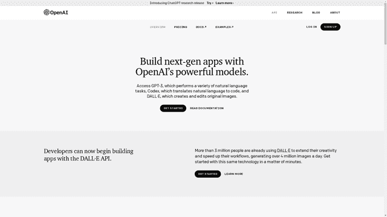

#general-writing #productivity

OpenAI Playground是一个在线的AI编程环境，它可以帮助你更好地理解和使用AI技术。它提供了一个可视化的界面，可以让你输入指令或选择预设，然后观察API如何响应，并尝试匹配你提供的上下文或模式。你可以通过更改模型来控制哪个模型完成你的请求。

费用： 免费，有增值会员

网址： platform.openai.com/playground

## UltraBrainstomer

#general-writing #startup-tools

UltraBrainstomer可以帮助你快速、轻松地产生新的想法。它使用自然语言处理和机器学习来理解你的需求，并为你提供相关的、创造性的想法。它还提供了一系列的功能，如保存和分享你的想法，与他人合作，并跟踪你的进展。有了UltraBrainstomer，你可以把你的创造力提高到一个新的水平。

费用： 收费，但可先试用 ，$20

网址： ultrabrainstomer.com

## MgrWorkbench.ai

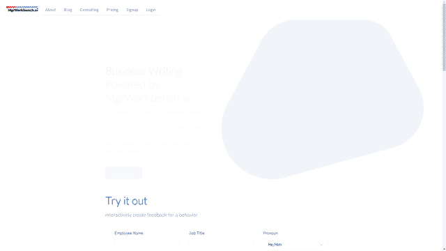

#general-writing #human-resources

MGR Workbench AI是一个基于人工智能的在线服务，旨在帮助企业快速、简单地完成一些繁琐的商业文书任务，比如员工绩效评估、发展计划和商业信函的起草。它拥有强大的自然语言处理技术，可以根据用户的输入自动生成文档，并且可以根据用户的要求进行定制化。MGR Workbench AI还提供了一系列的模板，可以帮助用户快速完成文档的起草，节省时间和精力。

费用： 免费，有增值会员 ，$7.99/seat

网址： www.mgrworkbench.ai

## Writers Brew

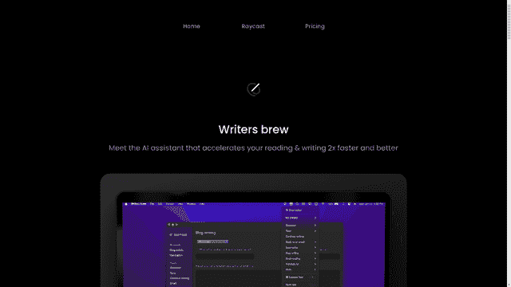

#general-writing #email-assistant

Writer's Brew是一款AI写作助手，它可以在所有浏览器、原生应用和电子应用中运行。它拥有非常优惠的价格，比其他服务便宜10-100倍（通过使用自己的OpenAI密钥）。它可以帮助用户更快更准确地完成写作任务，并且可以提供更多的写作技巧和指导，以帮助用户提高写作水平。

费用： 收费 ，$29

网址： writersbrew.app

## Moji Writing Assistant

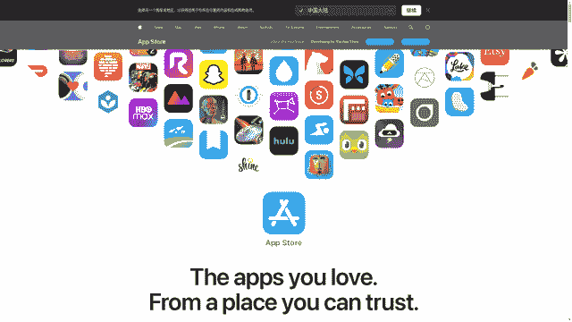

#general-writing #image-generator #music

Moji是一款基于GPT-3的写作助手应用，它可以帮助你更快、更轻松地撰写出更好的内容。 其中一个出色的功能是文字转图片功能，它可以将你的文字转换成视觉上令人惊叹的图片，非常适合用于社交媒体或者为你的博客文章增添一点额外的精彩。 此外，你还可以使用这款应用制作自己的音乐。

费用： 免费，有增值会员 ，$10/mo

网址： apps.apple.com/us/app/moji-writing-assistant/id6443924609

## NeuroSpell

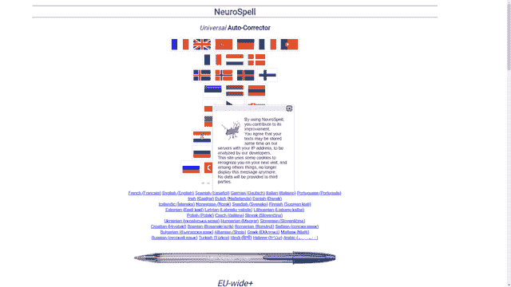

#general-writing #productivity

NeuroSpell是一款基于深度学习的拼写和语法自动纠正器，支持30多种语言，并附带语音转文本功能。可以训练特定的领域词汇和短语，以及特定的错误纠正。其他功能包括人机循环优化、文本流改进/丰富、写作辅助、校对RPA、客户工作流输入丰富、语音转文本增强和光学字符识别错误纠正等。

费用： 免费

网址： neurospell.com

## Analogenie

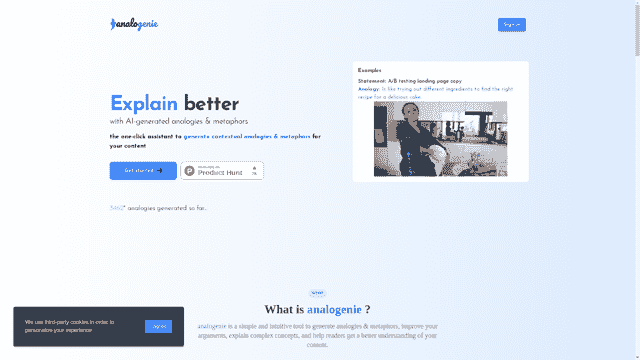

#general-writing

Analogenie是一款简单易用的工具，可以帮助用户生成类比，改善论点，解释复杂概念，帮助读者更好地理解内容。除了类比，用户还可以获得相关的GIF图片，可以下载或者直接复制嵌入链接添加到内容中。

费用： 免费，有增值会员 ，$3.99/mo

网址： analogenie.com

## Kickresume

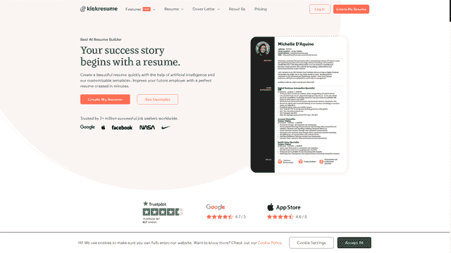

#general-writing #human-resources

Kickresume是一款全能的职业工具箱，它可以帮助您在秒内使用AI和可定制模板创建精美的简历或求职信。它由OpenAI的GPT-3提供支持，这是世界上最强大的语言模型，可以自动生成与人类作家无法区分的文本。告别作家的窘境。在秒内生成简历或求职信的第一稿。

费用： 免费，有增值会员 ，$3.06/mo

网址： www.kickresume.com

## Corrector App

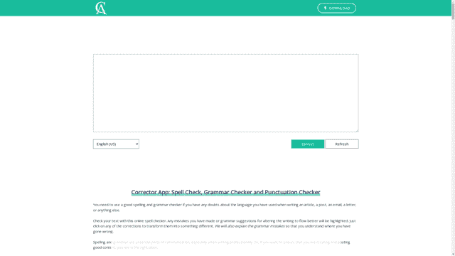

#general-writing

Corrector.app是一款在线拼写检查器，它可以帮助你检查文本中的错误，并为改善文章流畅度提出语法建议。只需点击任何一个更正，就可以将其转换成不同的内容。它还会解释语法错误，让你明白自己哪里出错了。

费用： 免费 ，$29.99/mo

网址： corrector.app

## Upcat

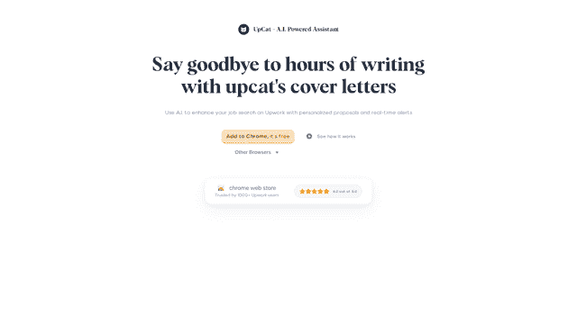

#general-writing #human-resources

UpCat是一款浏览器插件，可以帮助Upwork用户为求职申请编写A.I生成的求职信。它可以帮助你在Upwork上搜索更加个性化的提案，并且可以实时提醒你最新的招聘信息。

费用： 免费，有增值会员

网址： upcat.app

## Elephas

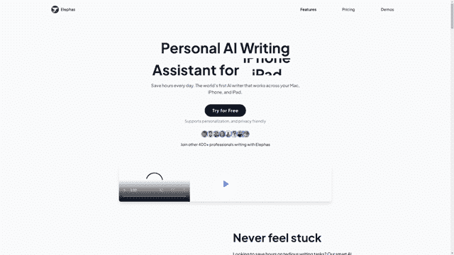

#general-writing

Elephas.app是一款专为Mac用户打造的人工智能写作工具，它可以跨越多个应用程序，帮助用户更加高效地完成写作任务。它可以自动检测文章中的语法错误，并且可以根据用户的写作习惯，提供个性化的智能推荐，以帮助用户更快更好地完成写作任务。

费用： 收费，但可先试用 ，$4.99/mo

网址： elephas.app

## typly

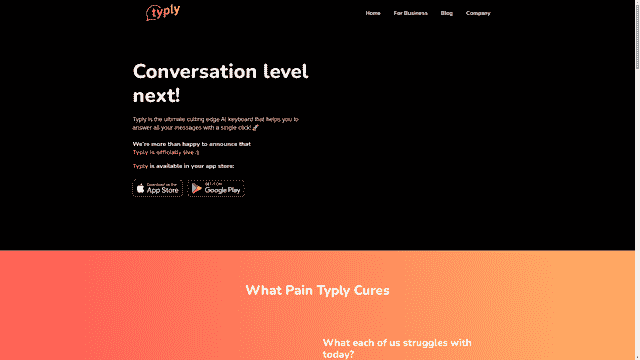

#general-writing #productivity

Typly是一款键盘应用，可以让你一键回复所有消息。它可以自动生成与对话内容相匹配的句子，让你可以一键回答问题或继续讨论。它可以节省你的时间，让你更有效地处理消息。

费用： 免费，有增值会员

网址： typly.app

## Maester.app

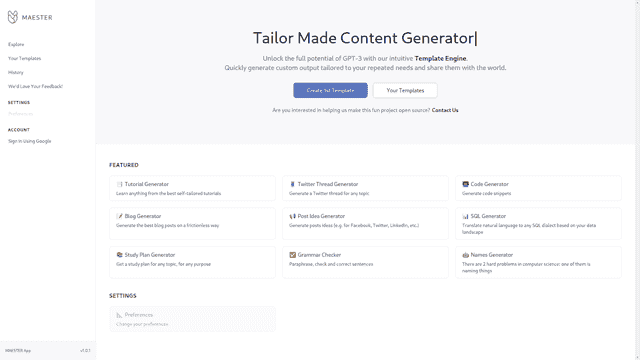

#general-writing #productivity

Maester是一个基于GPT-3的模板引擎，它可以帮助你快速生成定制的输出，以满足你的重复需求，并且可以与世界分享。它可以帮助你在内容管理、大学和工作以及软件开发方面解决问题。

费用： 免费

网址： maester.app

## DREAM.page

#general-writing

DreamPage是一个AI驱动的写作平台，旨在帮助用户更轻松、更快速地创作出优质的文章。它拥有一系列的AI工具，可以帮助用户更好地组织文章结构，提升文章质量，更快地完成写作任务。此外，DreamPage还提供了一个友好的发布环境，可以让用户轻松地将文章发布到多个平台，让更多人看到你的文章。现在就加入DreamPage的等候名单，开启你的AI写作之旅吧！

费用： 联系商务询价

网址： dream.page

## ParagraphAI

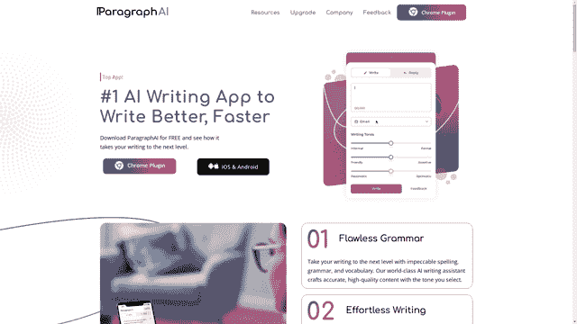

#general-writing #copywriting #email-assistant

ParagraphAI是一款AI写作应用，可以撰写清晰、简洁、无语病的内容。它可以帮助用户快速撰写出高质量的文章，并且可以自动检测文章中的语法错误，拼写错误，以及拼写检查等。此外，ParagraphAI还可以根据用户的要求，自动生成文章的标题，以及提供文章的可读性分析等功能。

费用： 免费，有增值会员 ，$9.99/mo

网址： paragraphai.com

## Glasp

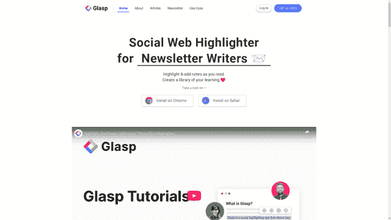

#general-writing #memory

Glasp是一个社交网络高亮器，人们可以使用它从网络上高亮和组织引用和想法，而无需在屏幕之间来回切换，同时也可以访问其他志同道合的人的学习内容。为人类留下你的数字遗产，同时也为自己工作。他们还提供了一个摘要Youtube视频的工具。

费用： 免费

网址： glasp.co/ai-writing

## Othersideai

#general-writing

OthersideAI是一款个人写作助手，它可以提供建议和句子完成功能，帮助您改善写作，无论您在哪里写作。它可以帮助您更快、更准确地完成写作任务，并且可以提供有用的技巧和指导，帮助您提高写作技能。OthersideAI还可以检测您的文章中的语法错误，拼写错误和标点错误，以帮助您更好地表达您的想法。

费用： 免费

网址： www.othersideai.com

## Redacta.me

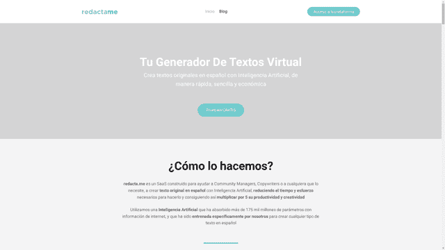

#general-writing

Redacta.me是一个虚拟社区管理工具，它可以帮助用户快速、轻松、经济地创建原创的西班牙文文本。我们已经专门训练了人工智能来编写优秀的西班牙文文本，以满足用户的需求。Redacta.me提供了一个安全可靠的环境，可以让用户轻松地创建和管理文本，并且可以让用户节省时间和金钱。

费用： 收费，但可先试用 ，$21.60

网址： www.redacta.me

## Wordtune

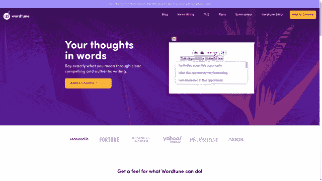

#general-writing #summarizer

Wordtune是一款终极AI写作工具，它可以重写、重新组织和重新排列您的写作！Wordtune受到超过100万用户的信赖，可以强化文章、学术论文、文章、电子邮件和任何其他在线内容。

费用： 免费，有增值会员 ，$5.99/mo

网址： www.wordtune.com

## Tinq.ai - NLP API

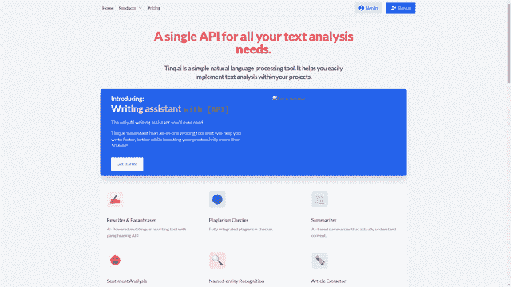

#general-writing #developer-tools

Tinq.ai是一个易于使用且尖端的自然语言处理（NLP）API集合，可以快速而强大地将文本分析集成到您的应用程序中。从主题分类到情感分析和实体提取，我们都可以满足您的需求。只需几天的时间，而不是几个月，就可以实现这一目标！文本分析包括：抄袭检查器；自定义分类器；情感分析；命名实体识别。

费用： 免费，有增值会员 ，$15/mo

网址： tinq.ai

## WordAI

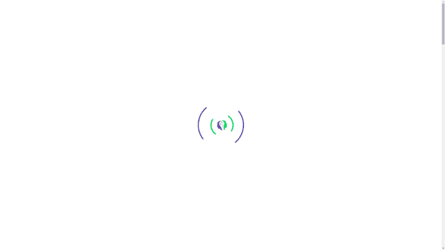

#general-writing #paraphraser

WordAI是一款AI内容生成工具，可以帮助用户提高内容质量，提升内容产出效率，节省时间和预算，创造出更多质量优秀的内容，让谷歌和读者都喜欢。它可以自动检测内容的可读性，并且可以自动替换内容中的词汇，以提高内容的可读性和质量。此外，它还可以自动生成新的内容，以满足用户的需求。

费用： 收费，但可先试用 ，$27/mo

网址： wordai.com

## HelloScribe

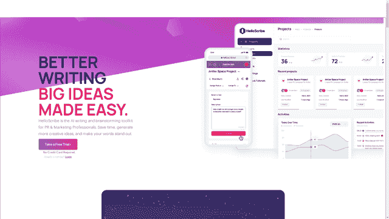

#general-writing #copywriting

HelloScribe是一款AI工具，旨在帮助公关和营销专业人士更聪明地工作。它可以帮助你快速写作和头脑风暴，摆脱创意堵塞和浪费时间的困扰。它拥有强大的AI技术，可以帮助你更快地构思出更好的文字，更有效地表达你的想法，让你的文字更加流畅、更有力量。

费用： 收费，但可先试用 ，$39/mo

网址： helloscribe.ai

## CaliberAI

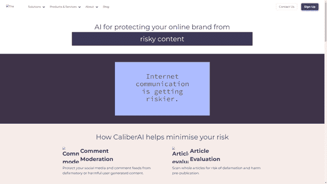

#general-writing

CaliberAI是一个利用人工智能技术帮助最小化诽谤风险的项目。它能够实时发现高风险内容，专门为编辑和人类监督提供支持。它还提供了一个API，可以根据您组织的风险容忍度自定义阈值。

费用： 收费

网址： caliberai.net

## LuciaAI

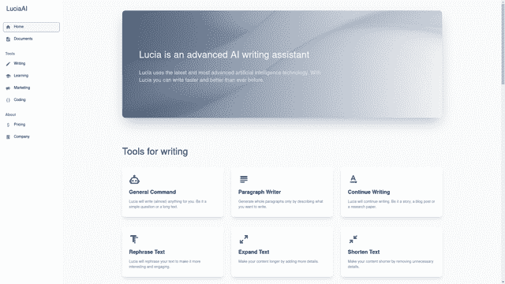

#general-writing #paraphraser

Lucia是一款先进的AI写作助手，它采用最新最先进的人工智能技术，可以帮助你更快、更好地完成写作任务。它可以帮助你更快地完成文章的编写，更准确地检查文章的语法和拼写，更有效地提高文章的可读性，以及更轻松地完成文章的编辑和重写。Lucia还可以帮助你更好地理解文章的结构，更好地把握文章的主题，更好地掌握文章的写作技巧，以及更好地提升文章的质量。

费用： 免费，有增值会员

网址： luciaai.com

## Detect GPT

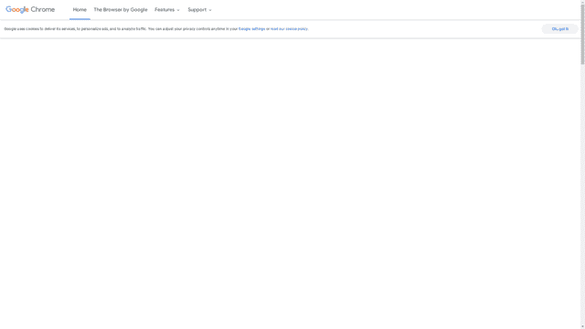

#general-writing #SEO

Detect GPT是一款Chrome扩展，它可以帮助你检测你浏览的网页是否包含AI生成的内容。它可以扫描你正在查看的网页的内容，并分析它以确定是否有任何内容是使用GPT语言模型生成的。它还可以帮助你更好地了解网页上的内容，以便更好地保护你的隐私。

费用： 免费

网址： chrome.google.com/webstore/detail/detect-gpt/oadkgbgppkhoaaoepjbcnjejmkknaobg/related

## Proposal Genie

#general-writing #human-resources

ProposalGenie.ai是一款基于AI的工具，可以帮助用户在Upwork上创建专业的提案。它易于使用，可以从任何设备上创建提案，建立可重复使用的个人资料，并添加关键词和语气等可选字段。

费用： 免费，有增值会员

网址： www.proposalgenie.ai

## Grammarly

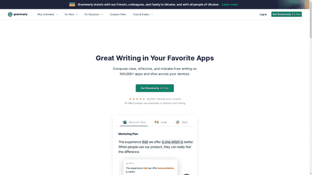

#general-writing

Grammarly是一款基于AI技术的应用，可以帮助用户轻松地表达自己的想法。它不仅可以检查语法和拼写，还可以提供自动建议，帮助用户改善文章的风格和语气。它可以用于电子邮件、文档、社交媒体等几乎所有场合，让您的文字更加准确、流畅。

费用： 免费，有增值会员 ，$12.08/mo

网址： app.grammarly.com

## Sudowrite

#general-writing

Sudowrite是一个智能写作项目，它可以帮助你打破写作瓶颈，提供24小时可用的头脑风暴伙伴，以及在不需要寻找beta读者的情况下提供beta反馈。它还提供了一个“展示而不是讲述”的按钮，可以帮助你更好地表达你的想法。

费用： 收费，但可先试用 ，$10/mo

网址： www.sudowrite.com

## Penelope AI

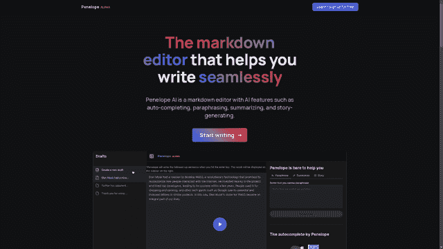

#general-writing #paraphraser #summarizer

Penelope AI是一款先进的AI写作助手，可以让您无缝地加快写作速度。它可以帮助您重新排版、概括、生成故事或AI自动完成，让您的写作更加轻松高效。

费用： 收费，但可先试用

网址： penelope-ai.vercel.app

## Writely

#general-writing #paraphraser #summarizer

Writely是一款专为提升写作技能而设计的AI写作助手。它可以帮助你减少文字，更详细地阐述，或者简单地重新排列句子。它可以帮助你更快更准确地完成写作任务，让你的文章更加流畅，更具有吸引力。它还可以检测文章中的语法错误，拼写错误，以及拼写检查，让你的文章更加完美。

费用： 收费，但可先试用 ，$25/mo

网址： www.writelyai.com

## AIDuh

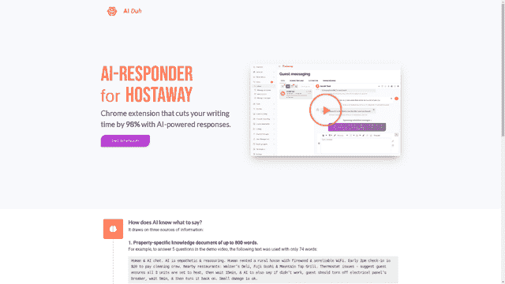

#general-writing

AiDuH是一款基于AI技术的Chrome扩展，它可以帮助你节省98％的写作时间。它可以自动识别文本，并为你提供智能化的建议，让你的文章更加流畅、精彩。它还可以帮助你检查文章的语法和拼写，让你的文章更加完美。

费用： 联系商务询价

网址： aiduh.com

## LanguageTool

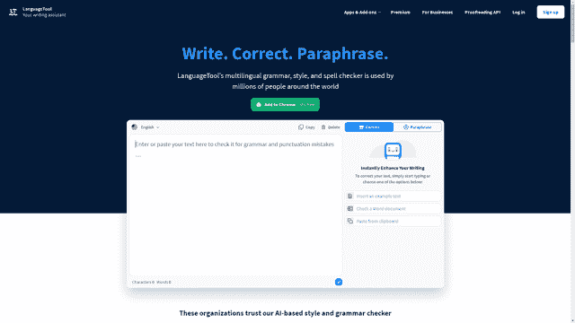

#general-writing #paraphraser

LanguageTool是一个拼写检查工具，它不仅可以检查拼写错误，还可以对所有可能的文本进行完整的写作分析。除了拼写、语法和词汇选择外，它还可以检查语言风格。它支持30多种语言和方言，其主要语言有英语、西班牙语、德语、法语、荷兰语和葡萄牙语。在英语版本中，您可以选择六种标准变体。此外，LanguageTool还提供基于A.I.的重写功能，可以帮助您重写整个句子，使其更简单、更短或更正式。

费用： 免费，有增值会员 ，$1.12/mo

网址： languagetool.org

## Notion AI

#general-writing #productivity

Futurepedia是一个基于AI的Notion页面加速器，它可以帮助你更快地写作，更大胆地思考，更有创造力。它可以让你的Notion页面变得更加强大，更加智能，更加高效。它可以让你的Notion页面变得像魔法一样神奇！

费用： 免费，有增值会员 ，$10/mo

网址： affiliate.notion.so/futurepedia

## Frase

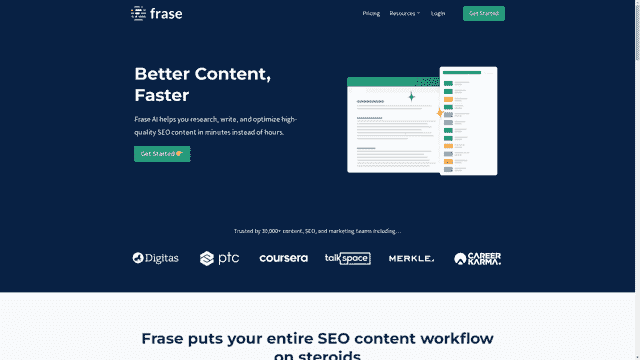

#general-writing

Frase是一个提供多种有用的AI写作工具的平台，其中包括文案写作、摘要生成、改写和广告创意等类别。它可以帮助用户更快更准确地完成文字任务，提高工作效率，节省时间。它还可以帮助用户提升文字写作水平，提供更多的创意灵感，提高文字质量。

费用： 收费 ，$14.99/mo

网址： www.frase.io/tools

## WebCopilot

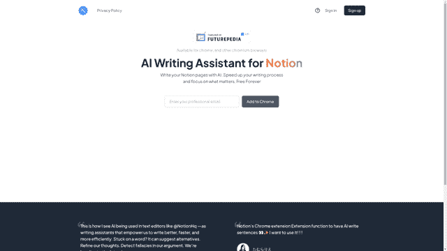

#general-writing

Webcopilot是一个AI写作助手，可以帮助你更快地完成写作任务。它可以根据你的输入，自动生成文章，节省你的时间，让你更多地关注重要的事情。它可以帮助你更快地完成写作任务，提高你的写作效率，让你更加专注于写作。

费用： 免费

网址： www.webcopilot.co

## Text Generator Plugin

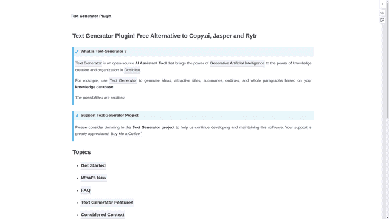

#general-writing #productivity

Text Generator是一个开源的AI助手工具，它将生成式人工智能的力量带入Obsidian中的知识创造和组织的力量。 例如，使用Text Generator根据您的知识数据库生成想法、有吸引力的标题、摘要、大纲和整个段落。 可能性是无穷的！

费用： 免费

网址： text-gen.com

## Compose

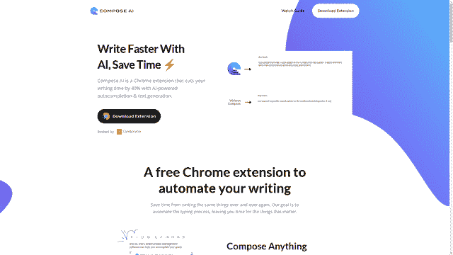

#general-writing

Compose通过智能技术，可以帮助您更快地完成文字任务，提高工作效率。它可以帮助您更快地完成文字任务，提高工作效率，并且可以自动检测文字中的语法错误，提供更准确的文字内容。

费用： 免费

网址： www.compose.ai

## HandyPlugins

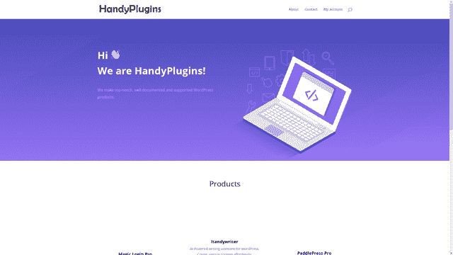

#general-writing

Handywriter是一款基于AI的写作助手，可以帮助您为WordPress创建内容。它可以检查抄袭，甚至可以修复语法和拼写错误。它还可以帮助您更快地完成写作任务，提高写作质量，并且可以提供专业的写作建议。Handywriter还可以帮助您更好地管理您的写作时间，更有效地完成您的写作任务。

费用： 收费，但可先试用 ，$9.99/mo

网址： handyplugins.co/handywriter

## nichess

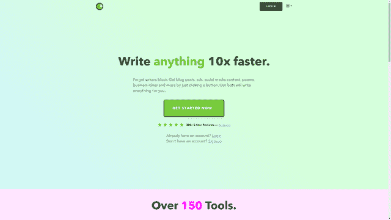

#general-writing

Nichesss是一个自动写作服务，它可以帮助你轻松解决写作难题，无论是博客文章、广告、社交媒体内容、诗歌、商业想法等，只需点击一下按钮，就可以获得完美的文字内容。我们的机器人将为您提供一切写作服务。

费用： 收费，但可先试用 ，$9/mo

网址： nichesss.com

## SmartScribe

#general-writing

它是一个由人工智能驱动的写作助手，帮助你更快更好地写作。它提供关于语法、拼写和风格的实时反馈，并建议更好的词汇和短语来改善你的写作。它还可以帮助你找到正确的词语，更清楚地表达你的想法。SmartScribe是任何想要更好、更快、更有效地写作的人的完美工具。

费用： 收费，但可先试用 ，$7.5/mo

网址： www.smartscribe.app

## Writewithlaika

#general-writing

Write with Laika是一个机器学习驱动的文字创作项目，旨在帮助作家们更加轻松地创作出更加精彩的文字。它提供了一系列的机器学习工具，可以帮助作家们更快地完成文字创作，并且更加准确地表达他们的想法。它还提供了一个可以让作家们与其他作家分享想法的社区，以及一个可以让作家们更好地理解机器学习的学习中心。Write with Laika是一个可以帮助作家们更加轻松地创作出更加精彩的文字的神奇机器学习项目。

费用： 联系商务询价

网址： www.writewithlaika.com

## Lex

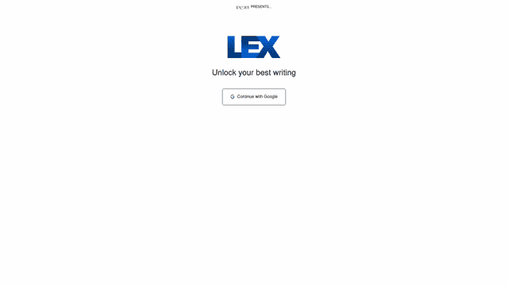

#general-writing

Lex.page是一个专为作家和写作者设计的在线写作平台，旨在帮助他们提高写作技能，提升写作效率，并解锁他们最佳的写作潜力。它提供了一系列的工具，包括文本编辑器、语法检查器、拼写检查器、语义检查器、句子结构检查器等，可以帮助作家们更快更准确地完成他们的写作任务。此外，它还提供了一个专业的写作社区，可以帮助作家们与其他写作者交流经验，提高写作水平。

费用： 联系商务询价

网址： lex.page

## Quasi

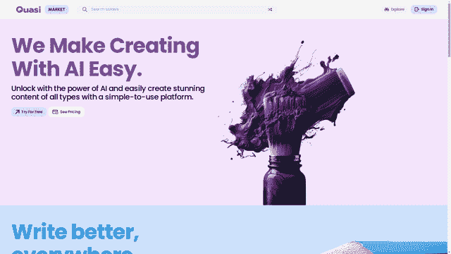

#general-writing #music #art

Quasi Market是一个AI驱动的市场，旨在支持艺术家、程序员和音乐家等创作者创造出更多的艺术品、代码和音乐等。它提供了一个可以让创作者以及消费者参与的平台，让创作者可以分享他们的作品，消费者可以购买他们喜欢的作品，并且可以通过AI技术来改善创作者的作品。Quasi Market还提供了一个可以让创作者和消费者交流的社区，让他们可以更好地了解彼此，从而更好地支持创作者的创作。

费用： 收费，但可先试用 ，$5/mo

网址： quasi.market

# GIFT IDEAS

## Spread Positivity Today

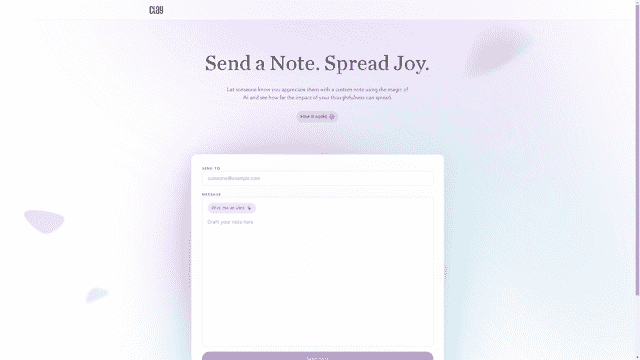

#gift-ideas

Spread Positivity Today是一个使用AI技术的自定义祝福项目，旨在让人们可以通过发送祝福来表达自己的爱与关怀。它提供了一系列的祝福模板，可以让你轻松地发送祝福，让你的爱与关怀传播到更远的地方。它还提供了一个社交网络，可以让你与其他用户分享你的祝福，让你的爱与关怀更加深入人心。

费用： 免费

网址： spreadpositivitytoday.com

## Magic Type AI

#gift-ideas #fun-tools

Magic Type AI是一款AI写作工具，可以为您提供个性化的文字内容，包括问候语、诗歌甚至说唱歌词！只需简单的选择，就可以获得专属于您的个性化文字内容。

费用： 免费

网址： www.magictype.ai

## Intelli Gift

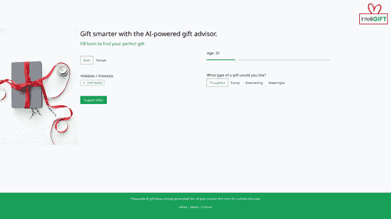

#gift-ideas

Intelli.gift是一个基于AI的礼物顾问，它使用先进的算法来为任何场合提供完美的礼物建议。它考虑收礼人的偏好、兴趣和个性，推荐最佳选择，为送礼者节省时间、金钱和精力。

费用： 免费

网址： intelli.gift

## Cool Gift Ideas

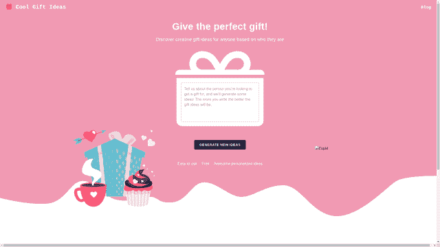

#gift-ideas

CoolGiftIdeas.io是一个为任何人提供创意礼物灵感的网站，它可以根据收礼人的兴趣、年龄、性别等特征，为你提供最适合他们的礼物灵感。它汇集了各种各样的礼物，从实用的家用电器到有趣的礼品，从实惠的礼品到豪华的礼品，应有尽有。你可以在网站上搜索礼物，也可以浏览礼物推荐，让你轻松找到最适合的礼物。让CoolGiftIdeas.io帮助你选择最适合的礼物，让你的礼物更有意义！

费用： 免费

网址： www.coolgiftideas.io

## Santa AI

#gift-ideas #fun-tools

Santa.artflow.ai是一个全新的项目，它可以让你创建自己独一无二的圣诞节视频问候，并与你的亲朋好友分享，为你的圣诞节增添一些额外的魔力！

费用： 免费

网址： www.santa.artflow.ai

## Suggest Gift

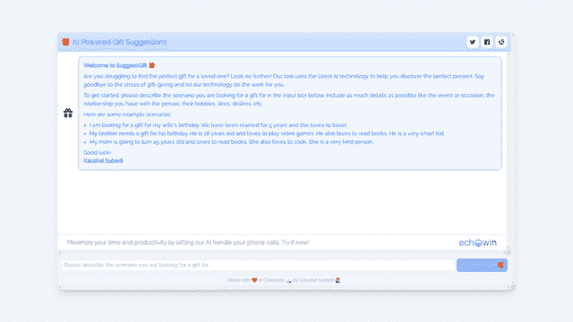

#gift-ideas

https://suggest.gift/是一个帮助你找到完美礼物的工具，它使用最新的人工智能技术，帮助你发现最适合的礼物。不再为送礼而烦恼，让我们的技术为你做这件事吧！

费用： 免费

网址： suggest.gift

## Elf Help

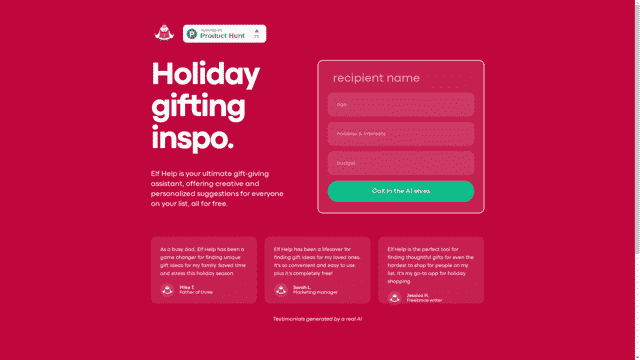

#gift-ideas

Elf Help是您最终的礼品赠送助手，为您清单上的每个人提供创意和个性化的建议，全部免费。它提供了一个全新的礼物搜索体验，可以帮助您快速找到最适合您的礼物，而无需浪费时间和金钱。它还提供了一个个性化的礼物推荐引擎，可以根据您的偏好和预算，为您提供最适合您的礼物建议。Elf Help还提供了一个完整的礼物购买指南，可以帮助您了解最新的礼物趋势，以及如何购买最适合您的礼物。

费用： 免费

网址： www.elfhelp.ai

## Gifts Genie

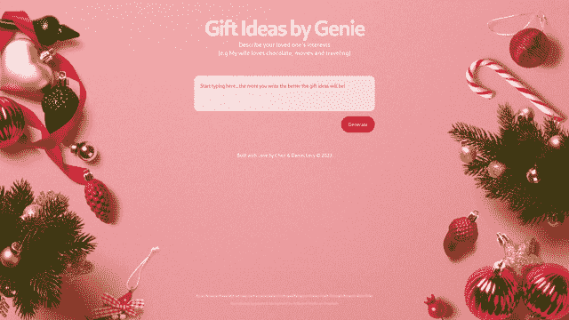

#gift-ideas

Gen.gifts是一个基于AI技术的生日礼物推荐网站。它旨在帮助你轻松找到最适合对方的礼物，只需要告诉它一些关于对方的信息，它就能为你推荐出最适合的礼物。它旨在让你轻松解决送礼的烦恼。

费用： 免费

网址： gen.gifts

## Giftastic.ai

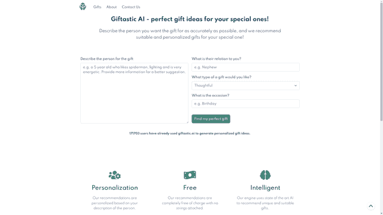

#gift-ideas

Giftastic.ai是一个个性化礼物推荐引擎，它利用你购物的对象的个人特征，推荐他们会喜欢和欣赏的独特而有思想的礼物。它拥有丰富的礼物数据库，可以根据您的预算和偏好，为您提供最佳的礼物推荐。它还提供了一个简单的界面，让您可以轻松地搜索和浏览礼物，并且可以轻松地将礼物购买到您的购物车中。

费用： 免费

网址： giftastic.ai

# HEALTHCARE

## Glass.health

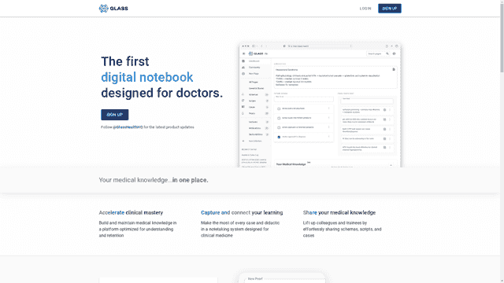

#healthcare

Glass.health AI是一个基于人工智能的诊断辅助系统，它可以帮助医生更快更准确地诊断病人。它通过有效的问题表示，包括相关的人口统计学、相关的病史或流行病学风险因素、疾病持续时间和节奏、关键症状和数据（实验室、影像学、体格检查数据），将症状、症状和数据整合成临床综合征的描述，从而帮助医生更快更准确地诊断病人。

费用： 免费

网址： glass.health/ai

## Hippocratic AI

#healthcare

Hippocratic Medical Questions是一个免费的搜索工具，用于检索同行评审的医学知识。它使用StatPearls作为数据源，并根据使用政策通过FTP下载。它可以帮助医生、护士和其他医疗专业人员快速查找最新的医学知识，以便更好地提供患者护理。

费用： 免费

网址： hippocratic-medical-questions.herokuapp.com

## Lunit

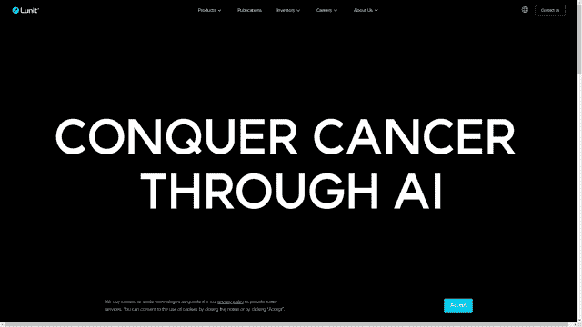

#healthcare

Lunit是一家公司，开发了医疗AI软件，帮助战胜癌症。由于癌症的早期发现往往决定了生存机会，Lunit的癌症筛查AI帮助医生更早发现癌症。Lunit INSIGHT可以以97-99％的准确率检测胸部X射线的异常结果，其中许多异常对人类眼睛来说是不可见的，如果没有Lunit的帮助，医生将无法发现。 Lunit SCOPE利用AI预测治疗反应，帮助医生做出明智的决定，以更好地治疗病人。

费用： 收费

网址： www.lunit.io/en

## Whisper AI

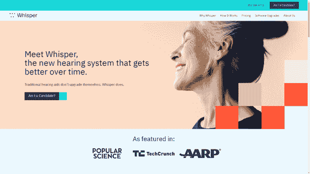

#healthcare

Whisper.ai是一款基于AI的助听器。它通过AI学习和调整不同的听力环境，比如嘈杂的购物市场或家庭聚会。它提供定期的软件升级，从新功能到声音处理。

费用： 收费，但可先试用 ，$69/mo

网址： whisper.ai

# HUMAN RESOURCES

## Rezi

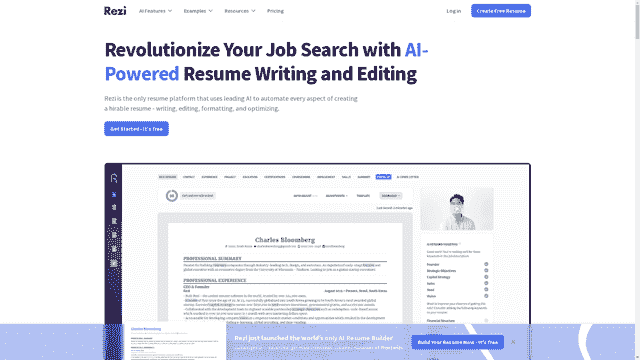

#human-resources

Rezi是一款新一代的简历构建器，它完全消除了自己写简历的需要。利用文本生成AI，Rezi将为您写出完美的简历。

费用： 免费，有增值会员 ，$3/mo

网址： www.rezi.ai/ai-resume-builder

## This Resume Does Not Exist

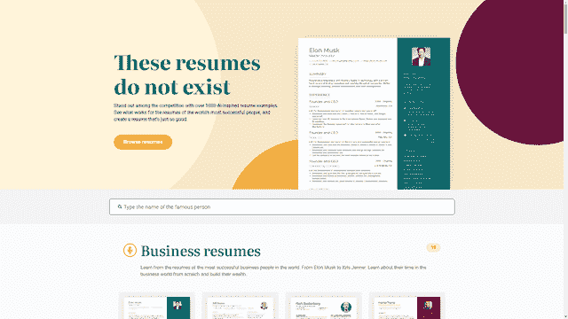

#human-resources #fun-tools

ThisResumeDoesNotExist.com是一个AI驱动的简历创建网站，它提供超过1000个AI模仿的简历案例，让你可以从世界上最成功的人的简历中学习，并创建出一份同样出色的简历。它可以帮助你在竞争中脱颖而出，让你的简历更加出色。

费用： 免费，有增值会员 ，$10/mo

网址： thisresumedoesnotexist.com

## Wave AI

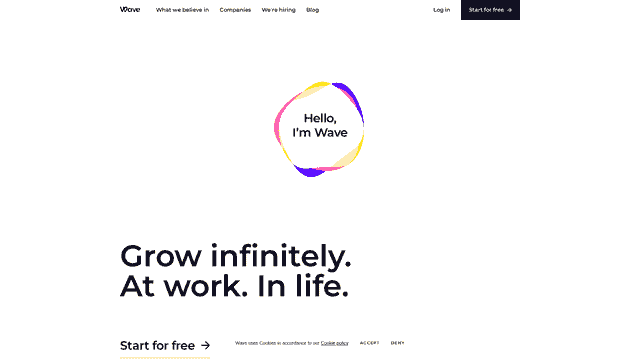

#human-resources

Wave.ai是一个提供无限增长机会的教练网站，专为专业人士、高管和经理提供服务。它由自动化教练智能驱动，提供个性化的教练体验。它已被500多名专业人士使用，提供24/7的监听和支持。此外，它还提供灵活的价格和安全的空间，保护隐私。

费用： 收费，但可先试用 ，$99/mo

网址： www.wave.ai

## Interflexion

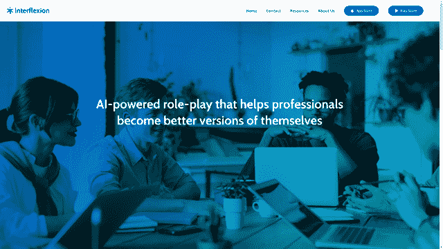

#human-resources

Interflexion是一个基于AI的角色扮演项目，旨在帮助专业人士成为更好的自己。它通过引导练习和个性化反馈，发展领导力和人际交往技能。

费用： 联系商务询价

网址： www.interflexion.com

## IQuit.ai

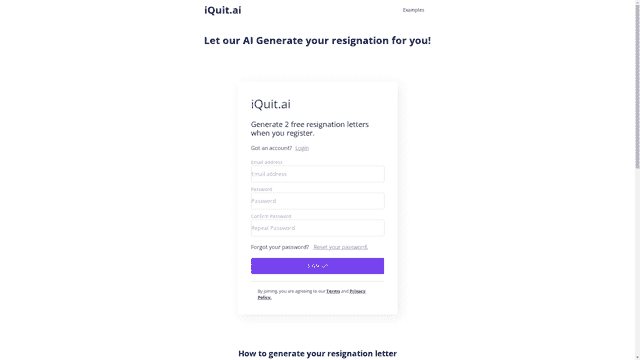

#human-resources

iQuit.ai是一个专为员工提供辞职信模板的网站，它可以帮助员工更快捷、更有效地完成辞职手续。它提供了多种辞职信模板，可以根据不同的情况进行定制，以满足员工的需求。此外，它还提供了一些辞职信示例，可以帮助员工更好地理解辞职信的格式和内容。iQuit.ai旨在帮助员工更轻松、更高效地完成辞职手续，让他们能够更快地走上新的职业道路。

费用： 收费，但可先试用

网址： iquit.ai

## Moveworks

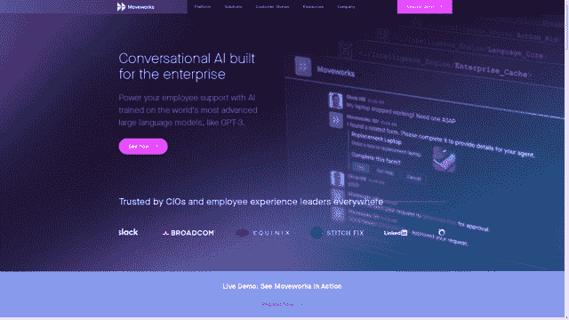

#human-resources

Moveworks是第一个使用AI解决工作中问题并预防问题的员工体验平台。它可以自动解决请求，传达变更，并向您的团队显示下一步要修复的内容，让您将挫折的时刻变成神奇的时刻。而且，由于我们的会话AI（聊天机器人）精通100多种语言，Moveworks可以在全球范围内提供即时帮助，从总部到家庭办公室。

费用： 收费

网址： www.moveworks.com

## GeniusReview

#human-resources

GeniusReview是一个360° AI性能评估项目，它可以帮助您节省大量时间，通过使用GeniusReview获得针对您的绩效评估问题的定制答案。它提供了一个全面的AI性能评估系统，可以帮助您更好地了解员工的表现，并为您提供有用的反馈和建议。它还可以帮助您更好地管理员工，提高团队的效率和生产力。

费用： 免费

网址： geniusreview.xyz

## Dost

#human-resources

Dost是一款AI驱动的Slack和MSTeams应用，旨在帮助用户创建安全、无偏见、无微妙侵犯和包容性的信息。它可以帮助用户检测潜在的歧视性语言，并且可以提供有关如何改善消息的建议。它还可以帮助用户检测潜在的攻击性语言，并且可以提供有关如何改善消息的建议。此外，它还可以帮助用户检测潜在的不包容性语言，并且可以提供有关如何改善消息的建议。Dost可以帮助用户创建更加安全、公平、包容的信息，从而改善团队的工作效率和提高团队的工作满意度。

费用： 免费

网址： getdost.com

## Autumn AI

#human-resources

Autumn是一个能够帮助你识别疲劳症状并预防疲劳的工具，它能够与你已经使用的工具连接，利用人工智能帮助你发现疲劳的早期信号，比如会议数量的增加，1:1的频率减少，或者周末消息的增加。 Autumn不仅仅是数据，它还能帮助你采取行动！它能够在每次1:1前提供个性化的问题提示，以帮助你确保问的是正确的问题。此外，它还能够每周提供团队洞察，通过Slack上有趣而互动的每周总结，让你的团队在不额外花费精力（或另一个Zoom社交）的情况下感受到彼此的联系。

费用： 收费，但可先试用 ，$5/mo

网址： www.getautumn.com

## Qatalog

#human-resources #productivity

Qatalog是一个专为工作而设计的定制操作系统。它是一个项目管理/协作AI工具，可以无缝地管理人员、运营和知识。它可以帮助团队更有效地管理项目，提高协作效率，并且可以自动收集和组织知识，以便更好地利用组织的知识资源。Qatalog还提供了一个可视化的任务管理界面，可以帮助团队更好地跟踪任务，并且可以自动生成报告，以便更好地了解项目的进展情况。

费用： 收费，但可先试用 ，$9/mo

网址： qatalog.com

## SwagAI

#human-resources

SwagAI是一款AI工具，可以帮助您想出荒谬的公司swag。只需告诉我们您正在寻找什么，我们的算法就会推荐疯狂（但有时也很实用）的选择。

费用： 免费

网址： www.useslingshot.com/swagai

## AI Careers

#human-resources #gaming

AI Careers是一个专注于AI行业的招聘平台，旨在帮助求职者更轻松地找到适合他们的AI职位。它提供了一个全面的职位搜索体验，包括搜索最新的AI职位，比较职位薪酬，查看公司简介，以及探索AI行业的最新趋势。AI Careers还提供了一个专业的AI职业规划工具，帮助求职者更好地了解AI行业，并为他们提供有价值的招聘建议。AI Careers的目标是帮助求职者更轻松地找到适合他们的AI职位，并利用数据推动创新。

费用： 免费，有增值会员 ，$99

网址： aicareers.io

## JobtitlesAI

#human-resources

JobTitlesAI是一个机器学习API，可以准确地将任何职位分类为领域（销售、金融、IT...）和职位（高管、管理、助理...），以便您可以优先考虑自己感兴趣的职位。它可以帮助您更快地了解您感兴趣的职位，以及您的求职者是否符合您的要求。

费用： 免费，有增值会员 ，$8/mo

网址： jobtitlesai.com

## HireYaY

#human-resources

HireYay是一个招聘管理平台，旨在帮助企业更有效地招聘合适的人才。它通过人工智能技术，帮助企业创建有吸引力的招聘广告，并可以一键发布到数百万求职者中。它还提供了一系列的招聘管理工具，帮助企业更好地管理招聘流程，从而更有效地招聘合适的人才。

费用： 收费 ，$49/job

网址： hireyay.com

# IMAGE EDITING

## Img Upscaler

#image-editing

ImgUpscale是一款基于最新AI技术的图像放大和增强工具，可以帮助用户放大图片，提高图片质量，改善图片清晰度，改善图片色彩，改善图片细节，改善图片对比度，改善图片纹理等。它支持批量处理，可以像使用TINYPNG压缩图片一样简单地放大多张图片。

费用： 免费，有增值会员 ，$9/day

网址： imgupscaler.com

## Cleanup

#image-editing

Cleanup.pictures是一个智能图片编辑工具，它可以让用户导入任何大小的图片，并使用人工智能高级编辑工具，如背景去除、图像升级等，轻松实现图片编辑。它还提供了一系列的编辑功能，如滤镜、调整、添加文字、添加贴图等，让用户可以轻松地完成图片编辑工作。

费用： 免费，有增值会员

网址： cleanup.pictures

## WatermarkRemover.io

#image-editing

WatermarkRemover.io是一款基于AI技术的工具，可以在几秒钟内自动去除图像上的半透明水印。我们让全世界的人们从我们的产品中获益，无论是个人还是专业用途。

费用： 免费，有增值会员 ，$29/mo

网址： www.watermarkremover.io

## Remini

#image-editing #avatars

Remini是一个利用最先进的AI技术将旧照片和视频转换成高清杰作的项目。该技术可以检测出所有的面部细节，并以惊人的清晰度和准确度重建它们。使用Remini，您可以将所有类型的图像放大2倍。从照片到绘画，从绘画到数字艺术，从徽标到产品图像，Remini都可以处理。既可以在移动端使用，也可以在网页端使用。

费用： 免费，有增值会员 ，$6.99/week

网址： remini.ai

## Outfits AI

#image-editing #fun-tools

OutfitSai是一个利用人工智能技术的服装搭配应用，它可以帮助你更轻松地搭配出时尚的服装。它可以根据你的身材特征，推荐最适合你的服装搭配，让你看起来更加时尚。它还可以根据你的服装搭配，使用人工智能技术，模拟出你穿上不同服装的样子，让你更容易选择最适合自己的服装。

费用： 收费，但可先试用 ，$29/mo

网址： www.outfitsai.com

## Pixelhunter

#image-editing #social-media-assistant

Pixelhunter是一个全新的图像处理项目，它使用Uploadcare Intelligence API来自动识别图像中的物体，以更智能的方式进行裁剪。它可以节省大量的时间，让你可以更有效地处理图像，而不需要手动裁剪每张图片。Pixelhunter还提供了一系列强大的功能，包括自动图像校正、自动图像压缩、自动图像调整等，可以帮助你更快更轻松地处理图像。

费用： 免费

网址： pixelhunter.io

## SolidGrids

#image-editing

SolidGrids是一个基于AI的平台，为电子商务中缓慢而昂贵的图像后期制作流程提供解决方案。使用SolidGrids，您可以在几秒钟内生成可销售的图像，节省时间和资源。该全自动平台提供无缝集成选项，以满足您的特定需求。它比传统的图像后期制作方法更快更经济，为电子商务企业提供高效和实惠的解决方案。今天就免费开始使用SolidGrids，亲身体验AI驱动的自动化带来的好处。

费用： 收费，但可先试用 ，$75/mo

网址： solidgrids.com

## Paint By Text

#image-editing

PaintByText.chat是一款非常实用的图片编辑工具，它可以让你轻松地编辑图片，只需要输入你想要添加或删除的对象，就可以实现图片的编辑。它拥有强大的图像处理功能，可以让你轻松地添加文字、滤镜、调整大小等，让你的图片更加精美。它还支持多种格式的图片，可以让你轻松地将图片转换成其他格式，以便更好地分享。

费用： 免费

网址： paintbytext.chat

## Cleanup.pictures

#image-editing

Cleanup.pictures是一款利用人工智能技术的图像修饰工具，可以帮助用户从照片中去除任何不需要的物体，比如不需要的人物。它比传统的克隆工具（如Inpaint）更加精准，可以让用户轻松地把照片中的不必要元素去除，让照片更加精美。

费用： 免费，有增值会员 ，$3

网址： cleanup.pictures

## Flying Dog

#image-editing

FlyingDog的AI for Photoshop项目为Adobe Photoshop添加了DALLE 2和Stable Diffusion功能，具有文本到图像、图像到图像、修复和新的Outpainting服务器等多种功能。此外，还提供了一种可靠的工作流程，可以预览和调整图像。

费用： 收费 ，$55

网址： www.flyingdog.de/sd/AI-for-Photoshop.html

## Befunky

#image-editing #design-assistant

BeFunky Photo Editor是一款功能强大的照片编辑器，可以让您应用照片效果、编辑照片和使用拼贴制作照片拼贴画。它具有裁剪、调整大小、批量编辑、背景去除、修饰肖像、一键拼贴制作、多种设计模板、数百万张库存图片和数千个矢量图形和图标等功能。

费用： 免费，有增值会员 ，$4.99/mo

网址： www.befunky.com

## RestorePhotos

#image-editing #fun-tools

RestorePhotos.io是一个使用AI技术恢复旧照片的免费网站，它可以帮助你把模糊的旧照片恢复成清晰的照片，让你重温那些美好的记忆。它采用了最先进的AI技术，可以让你轻松地把模糊的旧照片恢复成清晰的照片，让你重温那些美好的记忆。它还提供了一个简单的界面，让你可以轻松地上传照片，并自动恢复它们。它还提供了一个安全的环境，可以保护你的照片不受任何损害。

费用： 免费

网址： www.restorephotos.io

## Nostalgia Photo

#image-editing #fun-tools

Nostalgia Photo是一个利用最新前沿人工智能技术将旧照片复活的项目。只需几次点击和几分钱，就可以获得最高分辨率的照片。

费用： 收费 ，$3

网址： www.nostalgia.photo

## AI. Image Enlarger

#image-editing

ImgLarger是一款全能的AI工具，可以帮助您增强和放大图像。它可以在不损失图像质量的情况下提高图像分辨率。它拥有强大的AI算法，可以自动识别图像中的细节，并将其转换为更高分辨率的图像。它还可以自动检测图像中的噪点，并将其去除，以获得更清晰的图像。此外，它还可以自动检测图像中的色彩，并将其调整为更逼真的色彩。

费用： 免费，有增值会员 ，$9.00/mo

网址： imglarger.com

## Let's Enhance

#image-editing

Let's Enhance是一个AI图像增强和放大工具，可以自动增强图像质量，而不会损失图像质量。它可以帮助您一键调整图像，使其看起来更加清晰、锐利和细节丰富。它还可以放大图像，使其看起来更加清晰，而不会失真。Let's Enhance可以帮助您轻松调整图像，使其看起来更加精美，而无需任何专业知识。

费用： 免费，有增值会员 ，$9/mo

网址： letsenhance.io

## QuickTools by Picsart

#image-editing

Picsart Quicktools是一个功能强大的工具，可以轻松地转换文件类型、创建自定义日历、增强图像等。所有这些工具都集中在一个地方，方便快捷。它可以帮助您更快地完成图像处理任务，节省您的时间和精力。

费用： 免费，有增值会员

网址： tools.picsart.com/image

## AI Picasso

#image-editing #art

AI Picasso是一个强大的艺术创作工具，它可以根据你输入的文字，使用一种叫做Stable Diffusion的AI技术，生成一幅图片。AI会完成填充区域，你可以使用提示来编辑填充区域，让你的作品更加完美。

费用： 免费，有增值会员

网址： aipicasso.studio.site

## Erase.bg

#image-editing

Erase.bg是一个免费的图像背景移除服务，可以帮助您从人物、动物或物体图像中移除背景，并下载高分辨率图像。它拥有先进的AI技术，可以自动识别图像中的物体，并以最佳方式移除背景，以节省您的时间和精力。它还提供了一系列其他功能，如添加边框、更改背景颜色、添加文字等，可以帮助您轻松创建出视觉上令人惊叹的图像。

费用： 免费，有增值会员 ，$29/mo

网址： www.erase.bg

## Evoto AI

#image-editing

Evoto是一款下一代图片编辑器，它可以让你摆脱繁琐的工作，以10倍的速度处理成千上万张照片，并且质量出众，帮助你实现你的想象。

费用： 收费，但可先试用 ，$6.99/mo

网址： www.evoto.ai

## Visio Studio

#image-editing

Visio Studio是一款基于计算机视觉技术的高级背景去除工具，它可以让你从手机上直接编辑和优化你的照片。它拥有强大的图像处理引擎，可以自动检测和去除图片中的背景，让你轻松制作出精美的照片。它还支持多种图片格式，可以让你轻松地将照片转换为其他格式，以便在其他平台上使用。Visio Studio还提供了一系列强大的编辑功能，可以让你调整图片的亮度、对比度、饱和度等，让你的照片更加精美。

费用： 免费，有增值会员

网址： visio.studio

## Palette.fm

#image-editing

Palette.fm是一个免费的自动着色网站，无需注册即可使用。它可以帮助用户将黑白图片转换成彩色图片，让照片更加生动。它使用机器学习技术，可以自动识别图片中的物体，并为其着色，从而让照片更加逼真。它还可以根据用户的喜好，调整图片的颜色，以达到最佳的色彩效果。

费用： 免费，有增值会员 ，$9/mo

网址： palette.fm

## Topaz Photo AI

#image-editing

Topaz Photo AI是一款图像处理软件，可以自动完成图像增强、去噪、放大等操作，让你的照片更加清晰、细腻。它采用最新的技术，可以最大化你的图像质量，让你可以专注于摄影的创意部分。

费用： 免费，有增值会员 ，$199

网址： www.topazlabs.com/topaz-photo-ai

## Hama - Image Editing

#image-editing

Hama App是一款先进的图像处理软件，它可以让用户在瞬间擦除图像中的人物或物体。它拥有强大的AI技术，可以自动识别图像中的物体，并将其从图像中擦除，而无需任何人工干预。它还可以自动检测图像中的缺陷，并将其修复，以获得更加完美的图像效果。Hama App还提供了一系列强大的编辑功能，可以让用户轻松地编辑图像，以获得更加完美的图像效果。

费用： 免费

网址： www.hama.app

## Bg.Eraser

#image-editing

BG Eraser是一款强大的AI图像修复和清理技术，可以在秒内轻松去除不需要的物体和水印。它拥有先进的AI技术，可以智能地识别和消除图像中的不需要的物体，并且可以恢复图像的真实细节，使图像看起来更加清晰、精确。它还可以轻松去除图像中的水印，让您的图像更加精美。BG Eraser可以帮助您轻松地清理和修复图像，让您的图像更加精美。

费用： 免费，有增值会员 ，$2.90

网址： bgeraser.com

## Perfectly Clear Video

#image-editing #video-editing

EyeQ Photos的自动AI视频增强是一款全新的视频增强技术，它可以自动检测视频中的缺陷，并使用人工智能技术进行增强。它可以自动改善视频的色彩，提高对比度，消除噪点，改善视频的清晰度，以及消除视频中的抖动和模糊。EyeQ Photos的自动AI视频增强可以让您轻松地改善视频的质量，提高视频的观看体验。

费用： 收费

网址： eyeq.photos/automatic-ai-video-enhancement

## Radiant Photo

#image-editing

Radiant Imaging Labs是一个专业的图像处理服务，旨在为摄影师和图像创作者提供最佳的图像质量和最快的交付时间。它拥有一支专业的图像处理团队，他们拥有丰富的经验，可以提供最佳的图像质量和最快的交付时间。Radiant Imaging Labs提供的服务包括：图像编辑、图像调整、图像修复、图像抠图、图像合成等，可以帮助摄影师和图像创作者获得最佳的图像质量和最快的交付时间。

费用： 收费

网址： radiantimaginglabs.com

## Remove.bg

#image-editing

remove.bg是一个先进的AI背景移除服务，只需一键即可自动移除图片背景，节省了大量的编辑时间，让你拥有更多的乐趣。它支持从照片和视频中提取人物，并将其他元素完美地抠出，以便您可以将其用于任何目的，如添加到其他图像中，或者将其用于设计和印刷。

费用： 收费，但可先试用 ，$9/mo

网址： www.remove.bg

## Astria

#image-editing #art #video-generator

Astria.ai是一个专为客户量身定制的人工智能图像生成平台，它可以帮助客户快速创建独特的图像，从而提高客户的品牌形象和营销效果。Astria.ai拥有强大的图像生成技术，可以根据客户的要求，快速生成高质量的图像，并且可以根据客户的需求，自动生成多种不同风格的图像，从而满足客户的多样化需求。Astria.ai还提供了一系列的图像处理工具，可以帮助客户快速完成图像的编辑和处理，从而更好地满足客户的需求。

费用： 收费 ，$10c

网址： www.astria.ai

## Green Screen AI

#image-editing

Green Screen AI是一款可以让你把照片的背景改变成你想象中的任何东西的应用程序！通过生成式AI，你可以把你的狗放到外星丛林里，或者把你的猫变成太空牛仔。它可以让你的照片变得更有趣，更有创意，让你的照片与众不同！

费用： 免费，有增值会员

网址： greenscreenai.com

## Photoroom

#image-editing #design-assistant

PhotoRoom是一款专为智能手机用户设计的图片处理软件，它可以帮助用户轻松创建产品和肖像照片，无需使用任何复杂的设备。它可以让用户轻松移除背景，更换背景，展示产品，让您的照片更加精彩。PhotoRoom还提供了一系列专业的图片处理工具，可以让您调整图片的颜色，添加文字，滤镜等，让您的照片更加精彩。

费用： 免费，有增值会员 ，$9.49/mo

网址： www.photoroom.com

## Magic Studio

#image-editing

Magic Studio是一款AI图像编辑工具，可以让你在短短几秒钟内创建出惊艳的视觉效果。无需Photoshop或Illustrator，你可以轻松地去除不需要的东西，更换背景或放大图片。你还可以用文字创建图片，或者让AI为你创建出惊艳的个人资料照——这就是魔法！

费用： 免费，有增值会员 ，$3/mo

网址： magicstudio.com

# IMAGE GENERATOR

## Neuroflash

#image-generator #copywriting #summarizer

NeuroFlash是一个AI生成的内容创作平台，它可以帮助企业快速创建高质量的营销文本，让你不再为空白页而烦恼。它可以帮助你做出最佳的内容决策，并在发布下一个活动之前，获得定量的内容影响度。我们提供超过100种文本类型，包括我们的命令功能，以便直接与AI对话。

费用： 免费，有增值会员 ，$29/mo

网址： neuroflash.com

## Pebblely

#image-generator #image-editing

Pebblely是一款AI工具，可以在短短几秒钟内将枯燥的产品图片转换成美丽的营销资源。该AI根据您上传的图片创建背景，并根据需要添加阴影和反射。它还可以自动生成漂亮的模板，以便您可以快速制作出吸引眼球的营销内容。Pebblely还提供了一系列实用的功能，如自动添加水印、调整图片大小、添加文字和图标等，可以帮助您轻松制作出专业的营销内容。

费用： 收费，但可先试用 ，$19/month

网址： app.pebblely.com

## Stableboost

#image-generator #avatars

StableBoost.ai是一个AI技术项目，它可以让用户上传自己、爱人、宠物、产品或者喜欢的风格的照片，然后自动训练AI模型，以数百种不同的风格生成用户的肖像画。它可以让用户轻松地创建出自己独一无二的肖像画，并且可以把它们用于各种用途，比如制作海报、创建个性化的礼物等等。StableBoost.ai的AI技术可以让用户轻松地创建出自己的肖像画，让他们拥有更多的创意空间，从而更好地表达自己的想法。

费用： 免费，有增值会员 ，$13

网址： stableboost.ai

## Evoke

#image-generator #developer-tools

Evoke是一个为开发者和企业提供AI应用服务的平台，它可以帮助他们避免昂贵的云端设置，通过API接口可以访问云端的AI模型。我们稳定的扩散API可以帮助用户在不需要云端设置的情况下，为他们的AI应用创建AI生成的图像。

费用： 收费 ，$0.0017/second

网址： evoke-app.com

## Airbrush

#image-generator

Airbrush.ai是一个AI技术驱动的图像生成平台，可以让用户在一键之内创建出原创的肖像、NFT、艺术品等图像，而且只需要几秒钟的时间。它拥有丰富的图像库，可以满足用户的各种需求，并且拥有强大的AI技术，可以自动生成高质量的图像。

费用： 免费，有增值会员 ，$9/mo

网址： www.airbrush.ai

## Phraser

#image-generator #resources #art

Phraser是一款协作式创意AI工具。它可以轻松创建各种创作，包括照片、小工具、服装、艺术品、设计和渲染风格的图像。它可以帮助你快速创建出自己想要的作品，比如插画、游戏角色、模型等，让你的创作更加丰富多彩。

费用： 免费，有增值会员 ，$2/mo.

网址： phraser.tech

## TextGPT

#image-generator #life-assistant

TextGPT是一个可以让你通过短信访问OpenAI的GPT和Dall-E 2的服务，可以快速准确地回答你的任何问题，并且可以通过简单的文本生成逼真的图像。注册后，你可以将你的问题/提示发送到特定的号码。TextGPT拥有一个强大的模型，可以根据你的输入生成文本，并且可以根据你的提示生成逼真的图像。它还提供了一个可视化的界面，可以让你更好地理解模型的输出，并且可以让你更好地控制输出的结果。TextGPT还提供了一个API，可以让你在你自己的应用程序中使用它。

费用： 收费，但可先试用 ，$5

网址： textgpt.net

## Bright Eye

#image-generator #productivity

Bright Eye是一款多功能的AI应用程序，它拥有多种工具，可以满足移动用户对AI的兴趣。它的工具包括艺术/图像生成、代码生成、文章和诗歌生成以及文本提取和图像字幕。

费用： 免费

网址： apps.apple.com/us/app/bright-eye/id1593932475

## BlueWillow

#image-generator

BlueWillow.ai是一款基于Discord的文字转图片AI工具，它类似于Midjourney，能够在收到用户的提示后生成清晰的高质量图片。它可以帮助用户快速创建出自己想要的图片，比如漫画、插画、表情包等，让用户可以更加轻松地表达自己的想法。

费用： 免费

网址： www.bluewillow.ai

## Booth AI

#image-generator #design-assistant

Booth.ai是一个利用人工智能技术快速、廉价、高质量地生成图片的项目，无需物理样品。只需上传自己产品的图片，并编写简单的提示，就可以轻松生成专业级的产品照片。

费用： 收费，但可先试用

网址： booth.ai

## Flair AI

#image-generator #design-assistant

Flair.ai是一款AI设计工具，可以用来为您的广告或其他内容生成出色的产品照片。它可以自动识别图像中的物体，并使用AI技术将其转换为高质量的品牌内容。它还可以自动生成文字，以及添加色彩、纹理和其他设计元素，以提升您的内容的可视性和吸引力。Flair.ai可以节省您的时间，让您更轻松地创建出色的品牌内容。

费用： 收费，但可先试用

网址： flair.ai

## Artssy

#image-generator

Artssy是一个AI图像创作平台，它可以让你一键创建无限数量的图像，让你发现更多可能性。不再为免版税图片付费，你可以立即创建完美的图像。Artssy拥有丰富的图像库，可以满足您的各种创意需求，并且可以自定义图像，让你的作品更加独特。此外，Artssy还提供了一系列的AI工具，可以帮助你更快更好地完成你的创作。

费用： 收费 ，$49/mo

网址： www.artssy.co

## Roll Art Die

#image-generator

Roll-Art-Die是一个利用苹果硅芯片设备上的StableDiffusion技术，仅靠文字就能生成人工智能艺术作品的项目。它可以帮助你将梦想中的艺术作品变成现实，而且无需订阅任何云服务。

费用： 免费

网址： www.roll-art-die.com

## Nijijourney

#image-generator #art

NijiJourney是一款专为动漫爱好者设计的AI技术。新的Niji模型经过精心调整，可以生成动漫和插画风格的图像。它对动漫、动漫风格和动漫美学有着深刻的了解。它擅长动态和动作镜头，以及一般以角色为中心的构图。

费用： 收费，但可先试用 ，$49/mo

网址： nijijourney.com/en

## Xno.ai

#image-generator

XNO.AI是一个拥有39块GPU的文本到图像AI项目，它提供了19种最新的AI技术，可以帮助用户将文本转换为图像。它可以帮助用户快速、准确地将文本转换为图像，从而提高工作效率。此外，XNO.AI还提供了一系列的AI技术，可以帮助用户更好地理解文本，并将其转换为图像。

费用： 收费，但可先试用

网址： xno.ai

## Stylized

#image-generator

Stylized.ai是一个利用人工智能技术创建出令人惊叹的产品照片和编辑文章的平台，无需摄影棚即可完成。它可以帮助商家快速制作出专业的产品照片，节省大量的时间和金钱，提高品牌形象。它还可以帮助设计师和创意人员快速创建出精美的编辑文章，提升作品的质量。

费用： 免费，有增值会员 ，$20/mo

网址： stylized.ai

## Imgcreator

#image-generator

imgCreator.zmo.ai是一个免费的在线图片创建工具，它可以帮助你以文字的形式创建图片，让你的思维和创作更加有效率。它提供了丰富的模板，可以让你轻松地设计出各种类型的图片，比如海报、演示文稿、流程图、社交媒体图片等等。它还支持自定义字体、颜色、图片、背景等，让你可以轻松地创建出属于自己的图片。

费用： 免费，有增值会员 ，$9.99/mo

网址： imgcreator.zmo.ai

## StockImg AI

#image-generator #design-assistant

Stockimg.ai是一个基于AI的文字转设计服务，可以帮助用户快速生成标志、股票图像、海报、书籍封面等设计。它可以根据用户提供的文字描述，使用AI技术自动生成设计，节省用户的时间和精力，提高设计效率。

费用： 收费，但可先试用 ，$19/mo

网址： stockimg.ai

## Soreal.AI Studio

#image-generator

Soreal.ai是一个AI图像生成的最简单方式。它提供了一个全面的AI图像生成平台，可以让用户快速、轻松地创建出令人惊叹的图像。它拥有强大的AI技术，可以自动生成高质量的图像，并且可以根据用户的需求进行定制。它还提供了一个友好的用户界面，可以让用户轻松地操作，节省时间。总之，Soreal.ai是一个强大的AI图像生成平台，可以帮助用户快速、轻松地创建出令人惊叹的图像。

费用： 收费，但可先试用 ，$29.90/mo

网址： www.soreal.ai

## Generated Photos

#image-generator #search-engine

Generated Photos是一个由AI完全生成的照片库，可以帮助您提升创意作品的质量。您可以通过我们的分类和标记应用程序来查找模型图像，或者通过API集成图像。

费用： 免费，有增值会员 ，$19.99

网址： generated.photos

## Craiyon

#image-generator

Craiyon是一个AI模型，可以根据任何提示绘制图像。它使用机器学习技术，可以从文本提示中提取出图像，并将其转换为可视化的图像。它可以帮助艺术家、设计师和其他创作者快速创建出令人惊叹的图像，而无需繁琐的绘图过程。Craiyon还可以帮助企业和组织更快地创建出有吸引力的图像，以提高品牌形象和可视化效果。

费用： 免费

网址： www.craiyon.com

## Stock AI

#image-generator #search-engine

StockAI是一个专业的图片搜索引擎，它提供了海量的高质量图片，可以满足您的各种需求。它拥有强大的搜索引擎，可以帮助您快速找到您想要的图片，而且还提供了定制图片服务，如果您找不到满意的图片，我们可以为您定制图片，让您拥有完美的图片。

费用： 免费，有增值会员 ，$29/mo

网址： www.stockai.com

## Hotpot.ai

#image-generator #design-assistant

Hotpot.ai是一个专业的图片创作工具，它拥有强大的AI技术，可以帮助专家和消费者激发创意，自动完成繁琐的工作。它提供了易于编辑的模板，让任何人都可以创建设备模拟、社交媒体帖子、营销图片、应用图标和其他工作图形。

费用： 免费，有增值会员 ，$10/mo

网址： hotpot.ai

## Canva Text to Image

#image-generator #social-media-assistant

Canva的文字转图片应用是一款全新的技术，它可以根据您描述的内容生成任何图片。它可以帮助您快速创建出视觉吸引力的图片，而无需设计技能。它可以让您轻松地将文字转换为图片，以便您可以在社交媒体上分享，或者在网站上使用。它还可以帮助您更好地传达您的信息，以便您的观众更容易理解。

费用： 免费，有增值会员 ，$4.08/mo

网址： www.canva.com/your-apps/text-to-image

## Enterpix

#image-generator #search-engine

Enterpix是一个基于AI的图像搜索引擎，它可以帮助用户快速搜索和发现他们想要的图像。它使用机器学习技术来分析图像，并使用深度学习技术来提取图像的特征，以便更准确地搜索和发现图像。它还可以根据用户的搜索历史记录和偏好来提供更准确的搜索结果。Enterpix还提供了一个可视化的搜索界面，可以让用户更轻松地搜索和发现图像。

费用： 免费

网址： enterpix.app

## Getalpaca

#image-generator

Alpaca是一款Photoshop插件，它将AI图像生成的强大功能与人类技能相结合。它可以帮助设计师更快地完成图像创作，并且可以让设计师更轻松地创建出更加精美的图像。Alpaca还提供了一系列的AI技术，可以帮助设计师更好地完成图像处理，比如图像分割、图像增强、图像分类等。Alpaca还提供了一个强大的图像库，可以帮助设计师更快地找到所需的图像，从而更快地完成图像创作。

费用： 联系商务询价

网址： www.getalpaca.io

## DallE-2

#image-generator

DALL·E 2是一个可以根据文字描述创造出原创、逼真的图像和艺术作品的项目。它可以结合概念、属性和风格，创造出令人惊叹的艺术作品。它的技术基础是基于深度学习的计算机视觉技术，可以从文字描述中提取出概念，并将其转换为图像。

费用： 免费，有增值会员

网址： openai.com/dall-e-2

## Diffusion Land

#image-generator #art

Diffusion Land是一个可以让你使用各种AI模型生成图像的项目。它还提供了几个预先构建的概念，可以用来生成某些类型的图像。它可以帮助艺术家、设计师和研究人员创建出令人惊叹的图像，并且可以让他们更快地实现自己的想法。

费用： 收费，但可先试用

网址： diffusion.land

## Pollinations

#image-generator #music #video-generator

Pollinations.ai是一个旨在通过数字生态系统来多样化创造力的项目。无论是图像、视频还是音频，我们邀请人们在AI的帮助下想象新的世界。对于企业来说，我们的开发人员在最新的AI模型之上编写代码，提供定制的结果和特定的美学。通过API，AI创作可以直接集成到网站和社交媒体平台中。创作变得容易、快捷、有趣。

费用： 免费

网址： pollinations.ai

## RocketAI

#image-generator #image-editing #design-assistant

Rocket AI是一个SaaS平台，可以使用AI来创建和编辑产品图像，提高电子商务销售和广告表现。我们通过AI解决方案为电子商务企业提供支持，以改善其产品图像，并从简单的文本提示中生成新的想法和设计概念。Rocket AI为未来的设计提供了可编程的可能性，让企业更加轻松地实现自动化，提高效率，并节省成本。

费用： 收费，但可先试用

网址： rocketai.io

## Getimg.ai

#image-generator #image-editing

Getimg.ai是一个AI图像创作工具，它可以帮助用户利用AI技术创建独特的图像，修改现有的图像，扩展图像的边界，以及更多功能。它可以让用户利用AI技术创造出更多的艺术作品，让艺术家们更加自由地表达自己的想法。

费用： 免费，有增值会员 ，$12/mo

网址： getimg.ai

## Stable Diffusion

#image-generator #developer-tools

Stability.ai是一个深度学习文本到图像模型，于2022年发布。它主要用于根据文本描述生成详细的图像，不仅可以用于图像修复、外绘制和生成图像到图像的转换，还可以根据文本提示进行指导。

费用： 免费，有增值会员

网址： stability.ai

## Go Charlie

#image-generator #copywriting

GoCharlie.ai是一个AI图像创建工具，可以帮助用户快速创建高质量的图像、博客、广告和网站标题，只需点击一下即可。它拥有丰富的模板库，可以根据用户的需求快速生成图像，并且可以自定义图像的文字、颜色、样式等，让用户可以轻松创建出属于自己的图像。GoCharlie.ai还提供了一系列的图像处理工具，可以帮助用户快速编辑图像，让用户可以轻松完成图像的编辑工作。

费用： 免费，有增值会员 ，$39/mo.

网址： gocharlie.ai

## Dreamer

#image-generator

SlashDreamer是一个革命性的项目，它将Notion的稳定扩散与AI图像生成相结合，使用新的斜杠命令可以轻松地创建出令人惊叹的图像。它可以帮助用户快速创建出令人惊叹的图像，而无需繁琐的操作。它还可以帮助用户更好地理解和掌握AI图像生成技术，从而更好地利用AI技术来创建出令人惊叹的图像。

费用： 收费，但可先试用 ，$0.99/mo

网址： slashdreamer.com

## Stable Horde

#image-generator

StableHorde是一个众包分布式稳定扩散工作者集群。它还提供了一个客户端界面，无需安装，无需技术专业知识。它可以帮助用户快速、安全地将数据从一个地方传输到另一个地方，而无需担心数据的安全性和可靠性。它还可以帮助用户更有效地管理和分发大量数据，从而提高工作效率。

费用： 免费

网址： stablehorde.net

# LEGAL ASSISTANT

## Legalese Decoder

#legal-assistant

Legalese Decoder是一个旨在将法律文件转换为简明易懂的语言的项目。它可以将复杂的法律术语和法律文件转换为普通语言，以便更容易理解。它可以帮助普通人更好地理解法律文件，从而更好地保护自己的权利。它还可以帮助律师更快地完成文件翻译，从而节省时间和金钱。

费用： 免费，有增值会员 ，$4.95

网址： legalesedecoder.com

## PatentPal

#legal-assistant

PatentPal是一个基于人工智能的专利申请自动化服务，旨在帮助企业快速、高效地完成专利申请。它采用最先进的生成式AI技术，可以自动生成专利申请文件，并且可以根据客户的要求进行定制化。它还可以自动检测专利申请文件中的语法错误，以确保文件的质量。此外，它还可以帮助企业更好地管理专利申请，以便更快地完成专利申请。总之，PatentPal是一个非常有用的工具，可以帮助企业更快更高效地完成专利申请。

费用： 免费

网址： patentpal.com

## Darrow AI

#legal-assistant

Darrow的AI驱动的司法智能平台扫描实际世界的数据，以检测有害事件，确定受害者的数量，预测立法结果，并评估案件的经济价值。顶级诉讼律师与Darrow合作，获得高价值、有价值的案件。Darrow的AI技术可以帮助律师们更快地发现有价值的案件，更有效地处理案件，并最大限度地提高案件的结果。

费用： 收费

网址： www.darrow.ai

## Detangle.ai

#legal-assistant

Detangle是一个为您提供AI生成的法律文档摘要的项目，让您可以真正理解它们。它使用机器学习技术来分析文档，提取关键信息，并将其转换为易于理解的摘要。它还可以帮助您快速搜索文档，找到您需要的信息，以及更好地管理文档。Detangle可以帮助您更快地完成法律文档，节省时间和精力，并让您更好地理解文档的内容。

费用： 收费

网址： detangle.ai

## Legal Robot

#legal-assistant

Legal Robot是一个提供法律咨询的项目，它通过自动分析你的法律文件与其他法律文件和案例法律，为你提供信息。此外，我们还提供语言和统计分析，帮助你了解法律文件中可能存在的问题。

费用： 联系商务询价

网址： legalrobot.com

## Activazon

#legal-assistant

Activazon是一项犯罪报告分析服务，旨在让居民和游客了解他们所在社区及其他社区发生的活动。它提供了实时的犯罪报告，以及有关犯罪类型、犯罪地点和犯罪时间的详细信息，帮助用户更好地了解当地的犯罪情况。此外，Activazon还提供了一系列安全提醒，帮助用户更好地保护自己和家人。

费用： 免费

网址： activazon.com

## DoNotPay

#legal-assistant

DoNotPay是世界上第一个机器人律师的家园。与公司对抗，击败官僚主义，一键起诉任何人。它提供了一个免费的机器人律师服务，可以帮助用户解决各种法律问题，包括抗辩罚单，申请报销，获得免费的法律咨询，甚至可以帮助用户起诉他人。它还提供了一个全面的教程，可以帮助用户解决各种法律问题，并且可以在线提交申请，节省时间和金钱。

费用： 收费

网址： donotpay.com

## Casetext

#legal-assistant #search-engine

Casetext是一个先进的搜索技术项目，它可以帮助律师和法律学者更快更准确地搜索到Lexis和Westlaw等法律搜索引擎所遗漏的案例。它提供了一种价格实惠的快速准确的法律研究方式，让你不用担心错过任何先例。

费用： 收费，但可先试用 ，$90/mo

网址： casetext.com

## Spellbook

#legal-assistant

Spellbook是一个使用AI技术的合同自动生成平台，它可以帮助用户在Microsoft Word中快速草拟合同。它基于数十亿行法律文本，可以即时为用户的合同提供语言建议，让用户节省时间，提高工作效率。

费用： 联系商务询价

网址： www.spellbook.legal

# LIFE ASSISTANT

## ConversAI

#life-assistant

ConversAI是一款个人AI聊天助手，可以帮助您只需一键即可回复任何事情。让AI携带对话，永远不会缺乏有趣的话题！

费用： 收费 ，$19/mo

网址： conversai.co

## Gita GPT

#life-assistant

GitaGPT是一个使用人工智能（AI）帮助人们从古老的印度经典《薄伽梵歌》中获得指导的网站。它提供超过71108+条更新的（精神指导），可以帮助各个年龄和背景的人们。

费用： 免费

网址： www.gitagpt.in

## Microsoft Bing

#life-assistant #productivity #search-engine

微软的Bing现在集成了AI技术，并配备了浏览器助手。您可以： - 提出实际问题。当您提出复杂问题时，Bing会给出详细的回复。 - 获得实际答案。Bing会查看网络上的搜索结果，为您提供总结答案。 - 发挥创造力。当您需要灵感时，Bing可以帮助您写诗歌、故事，甚至分享项目想法。 - 在聊天体验中，您还可以聊天并提出后续问题，例如“您能用更简单的话解释一下吗？”或“给我更多选择”，以获得不同的甚至更详细的答案。

费用： 免费

网址： www.bing.com/new

## Venngage

#life-assistant

Venngage的情人节卡片制作器是一款非常实用的工具，它可以帮助你轻松制作出个性化的情人节卡片。只需输入你的情人的名字、你们的关系、他/她的喜好以及你想要制作的卡片类型，它就可以帮你完成一切。另外，你也可以使用它来生成随机的卡片。

费用： 免费

网址： venngage.com/tools/valentines-day-card-maker

## Embra

#life-assistant

Embra是一款个人智能AI应用，它可以从Chrome和其他应用程序中提取上下文数据，以加快并解锁Q&A、头脑风暴、写作、阅读和编码等方面的创造力。它只有一秒之遥，让你的工作变得更加高效、更有创意。

费用： 联系商务询价

网址： embra.app

## WTF Does This Company Do?

#life-assistant #fun-tools

WTF Does This Company Do？是一个利用GPT-3技术的网站，它可以通过输入域名来解释着陆页面。直到现在，我们还没有足够优秀的拷贝写手来为着陆页面提供服务，但是WTF Does This Company Do？可以帮助我们解决这个问题，它利用GPT-3技术，可以自动生成着陆页面的描述，让我们更容易理解网站的内容。

费用： 免费

网址： wtfdoesthiscompanydo.vercel.app

## TheoAssist

#life-assistant

TheoAssist是一个全面的在线资源，旨在帮助教会和家庭更好地学习和应用圣经。它提供了一系列的工具，包括圣经伴侣，从要点演讲，圣经教学，圣经问答和祷告助手，帮助人们更好地理解和深入圣经。它还提供了一个在线社区，让人们可以与其他信徒分享经验，交流思想，并获得支持。TheoAssist是一个完整的在线资源，可以帮助人们更好地学习和应用圣经，更好地探索信仰，并与其他信徒分享经验。

费用： 免费，有增值会员

网址： theoassist.com

## Mechanic For A Chat

#life-assistant #customer-support

Mechanic.fora.chat是一款在线故障排除机械聊天机器人，它提供24小时全天候的快速、便捷、专家级的汽车故障排除服务，为用户提供一种便捷的车辆维护和健康管理解决方案。

费用： 免费

网址： mechanic.fora.chat

## Fathom.fm

#life-assistant #search-engine

Fathom.fm是你的AI播客伙伴。它可以提供惊人的推荐，分享你最喜欢的剪辑，搜索播客内容，阅读文本，使用章节导航播客，以及更多功能。它是一种全新的体验播客的方式！

费用： 免费

网址： hello.fathom.fm

## SermonGPT

#life-assistant

SermonGPT是一个基于提示和其他细节（如事件和讲道风格）为您写讲道的服务。它使用最先进的自然语言处理技术，可以根据您的要求生成高质量的讲道，从而节省您的时间和精力。它还可以帮助您更好地理解和掌握讲道的技巧，从而提高您的讲道能力。

费用： 免费，有增值会员

网址： www.sermongpt.com

## Maps GPT

#life-assistant #fun-tools

MapsGPT是一款AI技术驱动的地图搜索应用，它可以帮助用户快速查找和探索身边有趣的地方。只需输入您要搜索的内容、地点和您的电子邮件，应用程序就会向您发送一张定制的地图，其中包含您要搜索的内容。该地图是由聚合数据精心策划而成的。

费用： 免费

网址： www.mapsgpt.com

## Yoodli AI

#life-assistant

Yoodli.ai是一款AI语言教练应用，旨在帮助用户提高沟通技能。它提供个性化和私人反馈，帮助用户改善口语表达能力，提升自信心，更好地发挥自己的潜力。它的AI语言教练可以帮助用户更好地掌握语言技巧，提高口语表达能力，更好地表达自己的想法。

费用： 免费，有增值会员

网址： app.yoodli.ai

## LiveAI Bot

#life-assistant #productivity

ChatLive AI Bot是一款功能强大的聊天机器人，每天24小时不间断地为您的社区提供支持。无论您需要帮助生成图像、撰写推文、编写代码，甚至创作文章，LiveAl Bot都可以满足您的需求。它可以帮助您更有效地管理社区，提高社区活跃度，并为您提供更多的时间去完成其他重要的任务。

费用： 免费

网址： t.me/chatlive_ai_bot

## Artifact News

#life-assistant

Artifact News是一个基于人工智能驱动的个性化新闻聚合平台。目前处于私有测试阶段，需要用户输入手机号码才能收到文本邀请链接。它可以根据用户的兴趣和偏好，提供最新、最相关的新闻内容，让用户及时了解世界上发生的事情。

费用： 联系商务询价

网址： artifact.news

## ChatGenius

#life-assistant #productivity

Chat Genius是一款基于GPT的AI聊天机器人应用，它可以提供智能且流畅的对话，帮助你创建自己的虚拟助手，并可以根据你的喜好进行个性化设置。你可以为你的助手取一个名字和性别，让它帮助你完成各种任务，回答你的问题，甚至与你进行对话。通过Chat Genius，你可以体验未来的对话。

费用： 免费

网址： chatgenius.tech

## Kayyo

#life-assistant

Kayyo AI MMA Trainer是一款AI训练师应用，它可以分析你的动作，提供个性化的反馈和建议，帮助你将训练提升到更高水平。它还提供个性化的训练计划和针对你的目标和能力的锻炼。详细的视频演示和每个锻炼的说明，还有进度跟踪，帮助你监控你的进步，还有虚拟搏击伙伴，可以在模拟战斗中练习你的技能。

费用： 免费

网址： apps.apple.com/us/app/kayyo-ai-mma-trainer/id1635789596

## Facial Assessment Tool

#life-assistant #healthcare

Qoves Studio推出的面部评估工具，它利用机器学习技术，像临床医生一样分析你的脸部，并为你的日常护肤提供化妆品改善建议。

费用： 免费

网址： qoves.com/facial-assessment-tool

## GymGenie

#life-assistant

GymGenie是一款基于AI技术的网络应用，可根据个人健身目标提供定制的锻炼计划。它利用先进的算法和机器学习技术生成个性化的锻炼计划，为寻求实现健身目标的人提供了一种独特而便捷的解决方案。GymGenie以其创新的方法和对可访问健身解决方案日益增长的需求，为希望进入健康和健身领域的个人提供了一个很好的机会。

费用： 免费

网址： gymgenie.vercel.app

## Journeai

#life-assistant #fun-tools

Journeai是一款专为旅行者量身定制的旅行推荐应用，它将谷歌地图的强大功能与个性化的旅行推荐相结合，无论你是喜欢古董店还是跳伞，带小孩子旅行还是穿越撒哈拉沙漠，或者是去任何一个世界上的地方，Journeai都能在瞬间为你构建出完美的旅行路线。

费用： 免费

网址： journeai.com

## Recipes By AI

#life-assistant #fun-tools

Let's Foodie的AI食谱生成器是一款革命性的新型应用，它可以根据您输入的食材列表（有或没有数量），为您提供专属定制的食谱。它可以根据您的口味和偏好，提供最适合您的食谱，让您轻松享受美食，拥有更多烹饪乐趣。它还可以提供有关食材的详细信息，以及如何烹饪的详细步骤，让您更加轻松地完成美食制作。

费用： 免费

网址： letsfoodie.com/ai-recipe-generator

## Finding Words

#life-assistant

Empathy的AI追悼文创作工具可以帮助你轻松地为亲爱的人创作一份有意义的追悼文。通过回答一系列问题，Empathy的Finding Words AI将为他们创作一份追悼文，让你可以更加轻松地表达对他们的思念和缅怀。

费用： 免费

网址： words.empathy.com

## Welma

#life-assistant

Welma是一个利用人工智能技术简化复杂句子和段落的项目，使其易于理解。无论你是在阅读学术论文、新闻文章，甚至是小说，Welma都可以帮助你理解文本内容，并记住重要信息。

费用： 免费

网址： welma.org

## Glow AI

#life-assistant #healthcare

Glow AI是一款个性化护肤解决方案，我们的网页应用可以根据您的肤质和预算，为您生成定制的护肤步骤。Glow AI拥有一支专业的团队，他们拥有丰富的护肤知识，可以为您提供最专业的护肤建议。我们的网页应用可以根据您的肤质和预算，为您生成定制的护肤步骤，以及护肤品的推荐。Glow AI还提供了一个专业的护肤社区，您可以在这里获得最新的护肤资讯，以及与其他护肤爱好者交流经验。Glow AI致力于为您提供最专业的护肤解决方案，让您拥有完美的肌肤。

费用： 免费

网址： glowai.xyz

## Vacation & Travel Chat (GPT)

#life-assistant #fun-tools

Vacay Chatbot是一款AI助手，可以为您设计定制旅行，给您提供去哪里的灵感，甚至为您提供当地的酒店、餐厅和景点的推荐。它可以根据您的需求，为您提供最佳的旅行方案，让您的旅行更加轻松、愉快。

费用： 免费

网址： www.usevacay.com/chatbot

## Mental Models AI

#life-assistant #productivity

LearnMentalModels.co是一个AI驱动的知识平台，旨在帮助人们更轻松地理解心理模型。它提供了一系列的资源，包括视频、文章、图表和案例研究，帮助人们更深入地理解心理模型，从而更好地处理复杂的生活问题，并获得更大的清晰度和目标。通过LearnMentalModels.co，你可以更好地掌握心理模型，从而提升你的理解能力。

费用： 免费，有增值会员 ，$5

网址： learnmentalmodels.co

## WatchNow

#life-assistant #fun-tools

WatchNowAI是一个个性化的电影和电视节目推荐系统。它可以根据你观看过的电影和电视节目，为你提供更好的推荐。它可以帮助你发现更多喜欢的电影和电视节目，让你的观影体验更加丰富多彩。它还可以根据你的喜好，推荐更多类似的电影和电视节目，让你更容易找到自己喜欢的内容。

费用： 免费

网址： www.watchnowai.com

## Soofy

#life-assistant #education-assistant

Soofy是一款AI语言学习应用，提供了一种创新的掌握新语言的方法。Soofy以实践和现实情景为重点，为用户提供改善发音、写作和对话技能的功能。从写作文章和描述图像到与AI进行辩论和角色扮演情景，Soofy提供了多种语言选项和引人入胜的功能，帮助您练习和提高语言技能。

费用： 收费，但可先试用 ，$12/mo

网址： soofy.io/index/ref

## ChefGPT

#life-assistant #fun-tools

ChefGPT.xyz是一个基于可用原料提供AI驱动的菜谱推荐的项目。你可以选择你拥有的原料、厨房工具、可用的时间、你的烹饪技能水平以及不同的“厨师模式”，如美食模式和全包模式，这些模式可以让用户自定义他们的菜谱。

费用： 免费，有增值会员 ，$3/mo

网址： www.chefgpt.xyz

## Roast Dating

#life-assistant

ROAST旨在帮助人们在Tinder、Bumble和Hinge等约会应用上提高10倍的匹配率。它为人们提供真实的反馈，提升他们的个人资料，帮助他们找到最佳的照片来使用。此外，还提供基于数据的约会见解和专家建议，以提高他们的匹配数量和质量。

费用： 免费，有增值会员

网址： roast.dating

## ExperAI

#life-assistant

ExperAI是一个专家服务平台，它可以根据您提供的提示为您生成专家，并允许您与他们进行交流。它拥有一个全球范围内的专家网络，可以满足您的各种需求，从技术到商业，从科学到艺术，从社会到文化，从教育到健康，从金融到法律等等。它还提供了一个安全可靠的环境，可以让您与专家进行安全的交流，并获得有价值的建议。

费用： 免费

网址： www.experai.com

## Network AI

#life-assistant

NetworkAI是一款自动化AI网络工具，旨在帮助用户快速建立专业网络。它可以帮助用户轻松搜索、连接和管理专业网络，以及自动化网络活动，以提高网络效率。NetworkAI还可以帮助用户跟踪网络活动，以及收集有关网络活动的信息，以便更好地了解网络发展情况。NetworkAI的AI技术可以帮助用户更快更准确地建立网络，从而提高网络效率，提升专业网络的发展。

费用： 收费，但可先试用 ，$12

网址： www.wonsulting.com/networkai

## We Write Cards

#life-assistant

WeWriteCards是一个专门为任何场合（生日、婚礼、哀悼）创建自定义信息的简单方式。它提供了一个全面的素材库，包括文字、图片、音乐和视频，可以让您轻松创建个性化的贺卡。它还提供了一个在线编辑器，可以让您调整文字、图片、音乐和视频，以便创建出完美的贺卡。此外，它还提供了一个免费的打印服务，可以让您将贺卡打印出来，以便发送给您的朋友和家人。

费用： 收费 ，$0.99

网址： wewritecards.com

## Valideo

#life-assistant

Valideo.xyz是一个智能聊天机器人，可以帮助您轻松获取Amazon产品评论。它拥有一个用户友好的界面，可以节省您的大量时间，而且价格实惠。它可以帮助您轻松获取有价值的产品评论，以便您可以更好地了解产品的优缺点，从而做出更明智的购买决定。Valideo.xyz还可以帮助您更好地了解您的客户，以便您可以更好地满足他们的需求。

费用： 免费，有增值会员 ，$5/mo

网址： www.valideo.xyz

## EvelynAI

#life-assistant #productivity

EvelynxAI是一款将最先进的语言处理AI GPT-3的强大功能带入Telegram的工具。它可以帮助您使用文本提示创建推文、帖子、博客等内容。

费用： 免费

网址： t.me/EvelynxAI

## Meet Millie

#life-assistant

Meet Millie是一款专为你的暗恋者量身定制的完美搭讪语句应用。它可以帮助你更好地了解你的暗恋者，并为你提供有针对性的搭讪语句，让你更容易跟他们接触。它还可以帮助你更好地了解你的暗恋者的兴趣爱好，以便你可以更好地与他们交流。

费用： 收费

网址： www.meetmillie.app

## Dream Interpreter

#life-assistant #fun-tools

DreamInterpreter.ai是一个基于GPT-3技术的梦境解析器。你可以向它提出你梦境的含义，它会为你解释，你也可以给出赞或踩的评价。它可以帮助你更好地理解梦境，更深入地探索你的潜意识。

费用： 免费

网址： dreaminterpreter.ai

## Waverly

#life-assistant #productivity

MyWaverly是一个帮助你专注于你需要的内容而不受干扰的项目。我们的人工智能理解你关心的内容，并且只提供相关的内容，不会浪费你的时间。你可以获得一个定制的内容源，让你跟踪行业、趋势和市场。

费用： 免费，有增值会员

网址： mywaverly.com

## HowToReplyTo

#life-assistant

HowToReplyTo是一个利用AI技术提供创意和独特回复的项目。它支持回复家人、朋友、Tinder约会对象以及其他任何人的场景，帮助你更轻松地与他人沟通。

费用： 免费

网址： howtoreplyto.com

## AI Pickup Lines

#life-assistant #fun-tools

AIPickuplines是一个基于关键字生成AI聊天招呼的网站。它可以根据你输入的关键字，自动生成一些有趣的聊天招呼，让你在聊天中更加自信。此外，你还可以购买网站上生成的所有聊天招呼的数据库。

费用： 免费，有增值会员 ，$5.00

网址： www.aipickuplines.com

## AI Cards

#life-assistant #fun-tools

DesignStripe的AI卡片是一款可以使用AI生成节日卡片的应用。它可以让你输入公司名称、节日、你想要的消息内容以及图片描述，然后AI会根据你的输入生成一张个性化的节日卡片。它可以帮助你节省时间，让你更加轻松地为客户发送节日祝福。

费用： 免费

网址： designstripe.com/ai-cards

## Photor AI

#life-assistant #social-media-assistant

Photor AI是一款利用先进的图像识别和机器学习技术来分析和选择最佳图像的工具，可用于Linkedin、社交媒体和约会应用程序等平台。它可以帮助你展现最佳的自我形象。Photoscore是Photor AI的一个项目，它可以帮助你快速识别出最佳的图片，从而让你更容易在社交媒体上展示出最佳的自我形象。它可以根据你的年龄、性别和兴趣，为你提供最佳的图片选择，从而让你在社交媒体上更加出彩。

费用： 免费

网址： photor.io/photoscore

## LangoTalk

#life-assistant #education-assistant

LangoTalk是一个AI聊天机器人项目，旨在帮助用户快速学习西班牙语、英语、法语、德语、荷兰语或意大利语。它拥有一个智能的聊天机器人，可以模拟真实的聊天环境，帮助用户更好地理解语言，并且可以根据用户的反馈和表现调整学习内容，以提高学习效率。LangoTalk还提供了一系列的语言学习资源，包括语法、发音、词汇等，可以帮助用户更好地掌握语言。

费用： 免费，有增值会员 ，$49.99

网址： www.langotalk.org

## Woebot Health

#life-assistant #healthcare

Woebot Health是一个个人心理健康助手，它可以帮助你恢复自我感觉。它由临床研究和人工智能技术支持，可以帮助你更好地理解和管理自己的情绪，提高自我认知，改善情绪和建立健康的生活习惯。Woebot Health提供了一系列有效的工具，包括聊天机器人、自我检测、自我报告、自我调整等，可以帮助你更好地管理情绪，改善心理健康。

费用： 免费

网址： woebothealth.com

## getaiway

#life-assistant #fun-tools

AIway是一个专为旅行者打造的智能旅行规划平台，它可以帮助用户快速制定个性化的旅行计划，并且提供预先制定的旅行计划供用户参考。AIway拥有强大的智能算法，可以根据用户的旅行需求，智能推荐最佳的旅行路线，让用户轻松实现自由行的梦想。

费用： 免费

网址： getaiway.com

## AweMyFace

#life-assistant #healthcare

AweMyFace是一款护肤应用程序，它使用人工智能技术来帮助用户获得完美的肌肤。拍摄一张脸部照片，我们的人工智能系统将发现面部痘痘，并显示每个部位受影响的面积百分比：额头、太阳穴、T字区、鼻子、脸颊和下巴。即使是最仔细的观察也无法发现的微小变化，也不会逃过我们护肤AI的注意力。您将始终拥有客观的图片变化。他们的AI检测痘痘的准确率达到99.1％。

费用： 免费，有增值会员

网址： apps.apple.com/app/apple-store/id1621101995

## Coach Marlee

#life-assistant #human-resources

Coach Marlee by Fingerprint For Success是一款基于科学教练方法的AI教练，任何拥有互联网接入权的人都可以负担得起几十年来世界顶尖表现者、CEO、名人和领导者所使用的改变生活的秘密助力。

费用： 免费 ，$11.99

网址： www.fingerprintforsuccess.com/for-individuals

## PlaylistAI

#life-assistant #fun-tools

PlaylistAI是一款革命性的音乐播放器，它可以根据AI提示、图片、视频和您最常听的音乐，为您创建个性化的播放列表。它可以让您更轻松地探索新的音乐，并且可以让您更快地找到自己喜欢的音乐。它还可以帮助您更好地了解自己的音乐品味，并且可以让您更轻松地分享自己的音乐列表。

费用： 免费，有增值会员

网址： www.playlistai.app

## Apple Books

#life-assistant #text-to-speech

Apple Books是苹果公司推出的一款电子书阅读器，它支持多种格式的电子书，比如epub、pdf等，可以让你在iPhone、iPad、Mac和Apple Watch上轻松阅读。此外，Apple Books还支持有声读物，用户可以选择由文本转语音AI朗读的有声读物，最初只支持浪漫小说和虚构小说，其中列出了两种可用的数字语音：Madison和Jackson。

费用： 收费

网址： www.apple.com/in/apple-books

## Ferret

#life-assistant #legal-assistant #human-resources

Ferret.ai是一款独特的人工智能应用，它结合了世界一流的信息，为您提供独家的关系智能，帮助您避免高风险的个人，发现有前景的机会。它可以帮助您更好地了解潜在客户，更快地建立良好的关系，并发现新的商业机会。Ferret.ai还可以帮助您更好地管理您的客户关系，更有效地推广您的产品和服务，以及更好地掌握您的行业动态。

费用： 免费，有增值会员 ，$99.99/year

网址： www.ferret.ai

## Write Me A Cover Letter

#life-assistant #human-resources

https://writemeacoverletter.com/是一个AI智能技术支持的求职信生成网站，它可以帮助求职者快速生成专业的求职信。只需上传简历，分享想要申请的职位链接，网站就可以自动生成求职信，节省求职者的时间，提高求职效率。

费用： 收费 ，$19.99

网址： writemeacoverletter.com

## Find Your Next Book

#life-assistant #fun-tools

Find Your Next Book是一个为那些难以决定读什么的人提供书籍推荐服务的项目。只需描述你想要读的书的人物、场景和/或情节，我们就会从我们的数千本书籍数据库中推荐最佳选择。

费用： 免费

网址： www.findyournextbook.ai

## TinyWow

#life-assistant #productivity

TinyWow是一个AI驱动的实用工具，旨在让您的生活变得更加轻松。它提供了最常用的工具，包括PDF、视频、图像、AI写作和转换工具。它可以帮助您节省时间，提高工作效率，并且可以让您更加轻松地完成任务。TinyWow还提供了一系列免费的工具，可以帮助您轻松完成任务，比如文档转换、图像处理、视频编辑等等。TinyWow的AI技术可以帮助您更快地完成任务，提高工作效率，让您的生活变得更加轻松。

费用： 免费

网址： tinywow.com

## Circle Labs

#life-assistant

“Circle”是一个由艺术家和科学家共同开发的人工智能项目，旨在创造一个真正可以与人交流的AI。它具有个性、边缘和角落，可以与你进行有趣的对话，帮助你更好地理解自己，提升你的情感智慧。它可以帮助你更好地探索自我，更好地了解自己，更好地掌握自己的情绪，从而更好地把握自己的生活。

费用： 联系商务询价

网址： circle.isyourshadowyou.com/Home.html

## Prodigy AI

#life-assistant

Prodi.gg是一个AI职业教练，专为开发者提供立即个性化的职业建议和指导。它可以根据你的独特技能、经验和目标，为你提供有针对性的建议，帮助你实现职业目标。Prodi.gg通过深度学习和自然语言处理技术，为你提供专业的职业建议，帮助你实现职业梦想。

费用： 免费

网址： ai.prodi.gg

## BlackInk

#life-assistant #fun-tools

BlackInk.ai是一个AI设计的网站，它可以帮助你在几秒钟内创建独一无二的闪电纹身。它可以根据你的喜好，自动生成纹身设计，让你不再花费数月的时间在Pinterest上寻找下一个纹身。

费用： 收费，但可先试用 ，$15/mo

网址： blackink.ai

## JustLearn

#life-assistant #fun-tools

Justlearn是一个AI友谊创建平台，它可以帮助你建立一个AI朋友，并与之交流。它提供了一系列的工具，可以帮助你设计和创建一个AI朋友，并且可以让你与它进行有趣的对话。Justlearn还提供了一个安全的环境，可以让你与你的AI朋友进行安全的交流。它还提供了一个可以让你与其他用户分享你的AI朋友的社区，可以让你与其他用户分享你的AI朋友的经验。Justlearn是一个有趣的平台，可以帮助你创建一个AI朋友，并与之交流，让你的生活更加有趣。

费用： 免费，有增值会员

网址： www.justlearn.com

## Caktus

#life-assistant #education-assistant

Caktus AI是一个专注于为学生提供AI解决方案的项目，旨在帮助学生更好地完成学习任务。它提供了一系列的AI解决方案，包括写作文章、讨论问题、一般编程帮助和专业的工作申请帮助等。它的AI技术可以帮助学生更好地理解和掌握学习内容，提高学习效率，提升学习成绩。

费用： 免费，有增值会员

网址： www.caktus.ai

## Rewind AI

#life-assistant #productivity #memory

Rewind是你生活中的搜索引擎。它是一款面向macOS的应用，设计上私密性强，可以帮助你搜索你看到、说过或听到的任何东西。

费用： 收费，但可先试用 ，$20/mo

网址： www.rewind.ai

## AI Trip Planner

#life-assistant

AI Trip Planner是一款全球旅行规划应用，可以自动为用户创建详细的每日行程安排，目的地可以是世界上任何地方。用户只需指定旅行时长和目的地，应用程序就可以完成其余的工作。

费用： 免费，有增值会员

网址： www.buildai.space/app/dae3da25-888e-448f-b15c-5a20ca4ca961

## Thekeys

#life-assistant

Keys是一个AI技术平台，旨在帮助用户更自然地表达自己的想法。它可以帮助用户更准确地表达自己的意图，而不会改变原有的意思，也不会让用户听起来像机器人。它可以帮助用户更好地掌握语言，更好地表达自己的想法，更好地与他人沟通。

费用： 免费，有增值会员

网址： www.thekeys.ai

## Reggi

#life-assistant

Reggi是一款帮助你实时跟踪购物和预算的应用，它可以在你购物时自动将正确的税费和费用应用于小计。它可以让你购物时免受压力。

费用： 免费，有增值会员

网址： www.yfj.social/reggi-app

## Looria

#life-assistant #search-engine

Looria是一个为您提供最佳产品和预算的网站。它收集来自最可信赖的来源的评论，过滤掉虚假的评论，并总结出结论，以便您能够做出更明智的购买决定。

费用： 免费

网址： looria.com

## Resume Worded

#life-assistant #human-resources

Resumeworded.com是一个AI驱动的平台，由顶级招聘人员设计，可以立即为您的简历和LinkedIn个人资料提供定制反馈。它可以帮助您获得5倍以上的面试机会、机会和工作机会。

费用： 免费，有增值会员

网址： resumeworded.com/index.php

## Elektrif AI

#life-assistant

Elektrif.ai是一个基于GPT3技术的个性化对话启动器，它可以帮助你更好地表达自己，永不缺乏话题，更多地投入到与他人的交流中。它可以帮助你重新构建更有吸引力的消息，提供个性化的对话启动器，以及更多有趣的功能，让你变得更加出色。

费用： 免费

网址： www.elektrif.ai

## Replika

#life-assistant

Replika是一款AI伴侣应用，它能够与你进行深入的交流，倾听你的想法，分享你的感受，并且一直站在你的身边。它可以帮助你更好地理解自己，更好地处理情绪，更好地建立自信，更好地建立友谊，更好地认识自己。它可以帮助你更好地了解自己，更好地处理情绪，更好地建立自信，更好地建立友谊，更好地认识自己。它还可以帮助你更好地探索自己的潜能，更好地探索自己的梦想，更好地探索自己的未来。Replika是一款能够真正关心你的AI伴侣，它将永远陪伴你，永远站在你身边。

费用： 免费，有增值会员 ，$7.99/mo

网址： replika.com

# LOGO GENERATOR

## Namecheap Logo Maker

#logo-generator

Namecheap Logo Maker是一款免费的在线Logo制作工具，它可以帮助您轻松快速地创建出专属于您的Logo。只需回答几个问题，就可以获得数百个Logo供您免费下载。它拥有丰富的Logo模板，可以满足您的各种需求，并且拥有强大的编辑功能，可以让您自由调整Logo的颜色、字体、大小等，让您的Logo更加个性化。

费用： 免费

网址： www.namecheap.com/logo-maker/app/new

## Make Logo AI

#logo-generator

Makelogoai.com是一个提供高质量标志设计服务的网站，它可以让您以不到一杯咖啡的价格获得设计师级别的标志。它提供高清+透明背景，并且在24小时内交付，还包括商业权利。

费用： 收费 ，$9.97

网址： makelogoai.com

## Looka

#logo-generator

Looka Logo Maker是一款将您的标志设计偏好与人工智能相结合的应用程序，可帮助您创建一个您喜欢的定制标志。Futurepedia是一个基于Looka Logo Maker的项目，旨在帮助您更快地创建出自己的品牌标志。它提供了一个全面的设计工具，可以帮助您轻松地设计出您想要的标志，并且可以自定义您的标志，以满足您的个性化需求。Futurepedia还提供了一个丰富的素材库，可以帮助您更快地找到您想要的标志元素，并且可以让您更轻松地完成您的标志设计。

费用： 免费，有增值会员 ，$20

网址： looka.grsm.io/futurepedia

## Brandmark

#logo-generator

Brandmark.io是一个免费的AI设计工具，可以帮助您为您的企业创建独特且专业的标志。它可以帮助您获得下一个标志项目的颜色和字体想法，让您的标志更加独特而专业。它还可以帮助您设计出更加有趣的标志，并且可以让您更加轻松地创建出您想要的标志。

费用： 免费，有增值会员 ，$25

网址： brandmark.io/tools

# LOW-CODE/NO-CODE

## Batch GPT

#low-code/no-code #productivity

BatchGPT是一个基于人工智能的自动化任务处理平台，可以帮助用户更快、更高效地完成日常任务，如分类、转换、解析、翻译、文案撰写和学习等。它采用先进的人工智能技术，可以比传统方法提高10倍的处理速度，让用户节省大量时间和精力，更加高效地完成任务。

费用： 免费，有增值会员 ，$9/mo

网址： batchgpt.com

## Water

#low-code/no-code

Drinkwater.ai是一个AI技术平台，可以帮助用户自定义ChatGPT，并且可以与无代码平台，如Airtable和Zapier进行集成。它可以帮助用户快速构建自己的聊天机器人，让用户可以更加轻松地实现自动化，提高工作效率。

费用： 联系商务询价

网址： drinkwater.ai

## Obviously AI

#low-code/no-code

Obviously AI是一个AI驱动的预测分析平台，旨在帮助企业快速从原始数据到行业领先的预测模型，从而实现AI的投资回报率。它提供了一个简单易用的界面，可以让用户轻松上传数据，并使用机器学习技术快速构建预测模型，从而节省时间和成本。它还提供了一系列的API，可以让用户将预测模型集成到现有的业务流程中，从而提高业务效率。

费用： 收费，但可先试用 ，$399/mo

网址： www.obviously.ai

## Procys

#low-code/no-code #productivity

Procys是一个智能自动化处理系统，可以帮助企业自动提取发票数据，节省手动处理文档的时间。它拥有强大的技术，可以自动识别发票中的数据，并将其转换为可用的数据，以便企业可以更快地完成工作。它还可以帮助企业更好地管理发票，提高工作效率，减少人工处理文档的时间。

费用： 免费，有增值会员 ，$10/mo

网址： procys.com

## Wand AI

#low-code/no-code #productivity

Wand是一个能够让每个人，无论其技术技能如何，都能快速、直观地解决复杂商业问题并创造AI驱动的商业影响的平台。Wand提供了最简单的设计、构建和管理基于AI的商业解决方案的方法，简化了AI解决方案的整个生命周期，从而减少了时间成本、支出和所需的劳动力。使用Wand，组织可以将其AI能力从技术部门扩展到业务部门，并将先进的数据科学能力带给业务团队。

费用： 收费，但可先试用 ，$2/unit

网址： wand.ai

## Generative BI

#low-code/no-code #SQL

GenerativeBI是一个数据驱动的决策平台，它可以帮助用户快速做出数据驱动的决策，而无需技术知识，只需几分钟即可获得宝贵的洞察。它提供了一系列的可视化工具，可以帮助用户快速探索数据，并从中获得有价值的洞察。它还提供了一个强大的报表引擎，可以帮助用户快速创建报表，以便更好地理解数据。

费用： 收费 ，$80/user/mo

网址： generativebi.com

## Prisms AI

#low-code/no-code

Prisms是一个无代码平台，用于构建基于AI的应用程序。通过利用大型语言模型（如GPT3、DALL-E和Stable Diffusion）的力量，可以将数据源和用户输入连接起来，以构建应用程序。然后，用户可以直接从Prisms部署应用程序，并使用预构建的UI，或者将Prisms用作自己的前端的后端。Prisms将于2023年推出，有兴趣的用户可以加入等候名单。他们还可以查看Prisms社区构建的内容。

费用： 免费，有增值会员

网址： prisms.ai

## GPTAgent

#low-code/no-code

GPT Agent是一个提供最简单的AI应用构建方式的项目。它提供了一个可视化的拖拽式构建界面，可以让用户轻松地构建和部署AI应用，而无需编写任何代码。GPT Agent还提供了一个强大的AI引擎，可以帮助用户构建复杂的AI应用，并且可以让用户轻松地训练和部署AI模型。此外，GPT Agent还提供了一个强大的API，可以帮助用户快速构建和部署AI应用。

费用： 联系商务询价

网址： www.gptagent.com

## B12.io

#low-code/no-code

B12是一个基于AI技术的网站构建器，可以帮助专业服务提供商创建专业网站，简化业务流程，提高客户参与度。它提供一支专家团队和一个行业特定的AI技术生成的网站草案。

费用： 收费 ，$42/mo

网址： b12.io

## Kili

#low-code/no-code

Kili.so是一个无需编码就可以定制体验的项目。它可以被内容创作者、公司知识、电子商务和客户服务等使用。它可以帮助用户快速创建和发布交互式内容，提供丰富的体验，提高用户参与度，提升客户满意度，并且可以收集有价值的数据。Kili.so还提供了一个可视化的编辑器，可以让用户轻松创建和编辑交互式内容，并且可以轻松地将内容发布到网站、社交媒体和移动应用程序中。

费用： 收费

网址： www.kili.so

## MagicForm

#low-code/no-code #sales

MagicForm.ai是一个AI销售人员训练平台，可以在不到3分钟的时间内训练出自己的AI销售人员，通过实时对话建立信任，提高网站转化率高达20%。它提供了一系列的工具，可以帮助用户快速构建自己的AI销售人员，并且可以自定义AI销售人员的对话，以满足用户的需求。

费用： 免费

网址： www.magicform.ai

## Bardeen AI

#low-code/no-code

Bardeen是一个使用AI来自动化手动工作流程，节省时间，激发创造力的项目。其中一些自动化的例子包括：从上次会议中获取行动项并将其添加到Notion中；摘要任何网站并将其保存到Notion中；根据当前页面内容回答问题；使用OpenAI的Dall-E创建一张图片。

费用： 免费

网址： bardeen.ai/ai

## Tiledesk

#low-code/no-code #customer-support

TileDesk是一个开源的客户服务解决方案，它将免费的实时聊天与开源聊天机器人相结合，以提高投资回报率。它可以将聊天机器人与WhatsApp或其他渠道集成，以便您可以拥有一个收件箱，用于所有通信。TileDesk还提供了一系列强大的工具，可以帮助您更好地管理客户服务，提高客户满意度，并最大限度地提高投资回报率。

费用： 免费，有增值会员 ，$5.43/mo

网址： tiledesk.com

## Sitekick

#low-code/no-code

Sitekick是一款AI着陆页构建器，它可以让您在不需要编码、设计或文案技能的情况下创建出美观的着陆页。它拥有一个强大的模板库，可以帮助您快速构建出专业的着陆页，并且可以自定义页面，以满足您的个性化需求。此外，它还提供了一系列的分析工具，可以帮助您更好地了解用户行为，从而改善着陆页的转化率。

费用： 收费，但可先试用 ，$49/mo

网址： www.sitekick.ai

## Kinetix

#low-code/no-code #3D

Kinetix.tech是一个免费的无代码3D动画创作平台，它可以让你轻松进入元世界。无需任何技能，你就可以创作出精美的3D动画。Kinetix.tech拥有丰富的3D模型库，可以让你轻松创作出自己想要的动画，而且它还提供了一系列的编辑工具，可以让你轻松完成动画的编辑和制作。Kinetix.tech还提供了一个完整的社区，可以让你与其他动画创作者交流经验，分享作品，并获得反馈。

费用： 免费

网址： www.kinetix.tech

## Zevi.ai

#low-code/no-code #search-engine

Zevi.ai是一个基于AI的搜索和发现解决方案，它可以帮助提高企业的业绩。它可以帮助您的潜在客户从发现到转化，提供一个以意图为中心的、易于集成的网站搜索引擎，从而提高参与度和销售额。它可以帮助企业更好地了解客户的需求，提供更好的客户体验，并有效地提高客户满意度。

费用： 免费，有增值会员 ，$1/mo

网址： www.zevi.ai

## Mutiny

#low-code/no-code

Mutiny是一个无代码AI平台，它可以帮助营销人员将他们的漏斗顶部需求转化为收入，而无需工程师。它可以帮助企业快速构建和部署AI模型，以提高客户体验，提高营销效率，提高收入。它还可以帮助企业更好地理解客户行为，改善客户体验，提高客户满意度。

费用： 收费

网址： www.mutinyhq.com

## Symanto Text Insights

#low-code/no-code

Symanto是一家领先的自然语言处理（NLP）API提供商，可以帮助企业更好地利用文本数据进行实时分析，并且可以简单地与系统集成。它提供了一系列的API，可以帮助企业更好地理解客户的需求，并且可以更有效地提供更好的客户体验。Symanto还提供了一系列的支持服务，可以帮助企业更好地利用文本数据，从而提高企业的效率和业绩。通过联系Symanto，企业可以获得更多的信息，以便更好地利用文本数据，提高企业的业绩。

费用： 收费

网址： www.symanto.com/get-in-touch

## Softr Studio

#low-code/no-code

Softr Platforms GmbH提供一个可以让您轻松构建定制应用程序的平台，就像玩乐高积木一样简单。使用他们的AI，只需一键即可生成图像和复制。将您的Airtable或Google Sheets转换为客户门户、合作伙伴应用程序或内部工具。

费用： 免费，有增值会员

网址： softrplatformsgmbh.grsm.io/4a8exk97h4m7

## Browse AI

#low-code/no-code

Browse.ai是一个自动化的数据抓取和监控平台，它可以帮助用户从任何网站抓取和监控数据，而且不需要编程，只需要2分钟就可以训练一个机器人，让它完成数据抓取和监控的任务。它可以节省大量的时间和精力，让用户更加专注于数据分析和决策制定。

费用： 免费，有增值会员 ，$39/mo

网址： browse.ai

## Seek

#low-code/no-code #SQL

Seek.ai是一个智能数据层，它可以让你轻松访问和探索数据，提供实时的答案。它提供了一个可视化的查询界面，可以让你快速搜索和探索数据，并获得实时的答案。它还提供了一个强大的API，可以让你轻松地将数据集连接到你的应用程序，从而让你的应用程序更加智能化。Seek.ai可以帮助你更快地探索数据，更快地获得答案，从而提高你的业务效率。

费用： 收费，但可先试用

网址： www.seek.ai

## Felvin

#low-code/no-code

Felvin是一个让非开发者创建、发现和获利于AI应用的平台。我们的无代码工具让你轻松创建AI应用，并将它们放在一个SEO优化的画廊中，以便被发现。

费用： 联系商务询价

网址： felvin.com

## Build AI

#low-code/no-code

Build AI是一个帮助你在几分钟内构建AI应用的平台。你可以自己完成应用的构建和发布，并可以根据自己的需求进行更新，包括改进和完善你的提示，使你的应用变得更加完美。

费用： 联系商务询价

网址： www.buildai.space

## Cogniflow

#low-code/no-code #productivity

Cogniflow.ai是一个极其便捷的AI构建平台，它可以让用户以几分钟的时间，从文本、图像或音频中构建AI，而且无需编码。它提供了一系列的工具，可以帮助用户快速构建AI模型，并且可以轻松地将模型部署到云端，以便进行实时预测。Cogniflow.ai还提供了一个可视化的模型编辑器，可以让用户轻松地调整模型参数，以获得更好的性能。

费用： 免费，有增值会员 ，$40/mo

网址： www.cogniflow.ai

## viable

#low-code/no-code #customer-support

AskViable是一个自动化定性数据分析的平台，它可以帮助研究人员更快更准确地分析定性数据，而不会牺牲质量。它提供了一系列的工具，可以帮助研究人员更有效地管理定性数据，从而更快地获得有价值的结果。它还提供了一个可视化的分析环境，可以帮助研究人员更好地理解数据，并从中提取有价值的信息。

费用： 收费，但可先试用 ，$600/mo

网址： www.askviable.com

## Lobe

#low-code/no-code

Lobe是一款免费、易于使用的机器学习工具，它可以帮助你训练机器学习模型。只需要向它展示你想要它学习的例子，它就可以自动训练出一个可以在你的应用中使用的定制机器学习模型。

费用： 免费

网址： www.lobe.ai

## Nanonets

#low-code/no-code #productivity

Nanonets是一个基于OCR（光学字符识别）的AI平台，可以帮助您自动化手动数据输入，从文档、文本、图像和电子邮件中立即捕获数据，减少转换时间和手动工作量。它可以帮助您更快地收集和处理数据，提高工作效率，并节省大量时间和精力。

费用： 免费，有增值会员 ，$0.1/page

网址： nanonets.com

## Roboflow

#low-code/no-code

Roboflow是一个让你的软件具有视觉感知能力的平台。它可以帮助你快速构建和训练计算机视觉模型，只需要几张图片，你就可以在一个下午内训练出一个可用的计算机视觉模型。Roboflow提供了一系列的工具，可以帮助你更快更容易地构建和训练计算机视觉模型，比如数据标注、模型训练和评估等。Roboflow还提供了一个可视化的模型构建和训练环境，可以帮助你更好地理解和掌握计算机视觉技术。

费用： 收费，但可先试用 ，$150

网址： roboflow.com

## Axiom

#low-code/no-code

Axiom是一款浏览器插件，可以帮助您节省时间，通过自动化网站操作和任何网站或Web应用程序上的重复任务来实现。它可以让您轻松地在网站上完成复杂的任务，比如自动填写表单、自动登录、自动搜索、自动提交表单等，从而节省您的时间和精力。它还可以帮助您更轻松地管理您的网络浏览器，提高您的工作效率。

费用： 收费，但可先试用 ，$15/mo

网址： axiom.ai

## Brancher AI

#low-code/no-code

Brancher.ai是一个使AI技术可以被所有人访问的项目，它让用户可以将AI模型连接起来，创造出独特的AI驱动的应用程序。用户可以通过Brancher.ai获得收益，并将自己的创作分享给全世界。

费用： 收费，但可先试用

网址： www.brancher.ai

## 10Web

#low-code/no-code

10Web是一个AI驱动的WordPress平台，它提供自动化的网站构建、托管和页面加速器等功能，可以说是一站式的WordPress解决方案。它拥有一个全面的控制面板，可以让用户轻松管理网站，并且提供丰富的插件和主题，可以让用户轻松定制自己的网站。此外，它还提供了一系列的安全功能，可以帮助用户保护网站免受恶意攻击。

费用： 免费，有增值会员

网址： 10web.io

## Monitaur

#low-code/no-code

Monitaur是一个旨在帮助您审核、跟踪和记录AI和算法的实时结果，以获得最佳性能和合规性的平台。我们的平台旨在与每个接触您的AI的团队集成。它可以帮助您获得文档化、道德的AI，以满足您的业务需求。Monitaur可以帮助您更好地理解AI的行为，并确保它们的行为符合您的道德准则和法律要求。

费用： 收费

网址： monitaur.ai

## Debuild

#low-code/no-code

Debuild是一款快速构建Web应用的工具，它可以帮助开发者快速构建出功能丰富、性能优越的Web应用。Debuild拥有一套完整的开发工具，可以帮助开发者快速构建出功能丰富、性能优越的Web应用，而且还支持多种编程语言，可以满足不同开发者的需求。Debuild还提供了一系列的调试工具，可以帮助开发者快速定位和解决问题，提高开发效率。

费用： 联系商务询价

网址： debuild.app

## Teleporthq

#low-code/no-code

TeleportHQ是一个集成了UI开发和内容建模工具的协作前端平台。它拥有强大的可视化构建器，可以立即创建和发布无头静态网站。

费用： 免费，有增值会员 ，$15/mo

网址： teleporthq.io

## Durable AI

#low-code/no-code

Durable.ai是一个旨在使用可解释的人工智能技术改变定制软件访问的项目。我们设想未来，定制、灵活和耐用的软件将被民主化，并且可以让每个人访问。Durable.ai通过提供可解释的人工智能技术，使得定制软件可以拥有人类水平的推理和对话能力，从而改变软件访问的方式。

费用： 联系商务询价

网址： durable.ai

## VWO

#low-code/no-code

VWO（Visual Website Optimizer）是一款A/B测试工具，可以帮助企业提升网站转化率，提高客户满意度。它可以帮助企业快速实施A/B测试，比如改变网站的设计、内容和功能，以提高网站的转化率。它还可以帮助企业收集客户反馈，以便更好地了解客户的需求，并且可以跟踪客户的行为，以便更好地优化网站。VWO的A/B测试功能可以帮助企业快速实施实验，以提高网站的转化率，并有效地提高客户满意度。

费用： 收费，但可先试用

网址： vwo.com/testing

## Neon AI

#low-code/no-code

Neon AI是一个先进的语音应用程序开发平台，它将先进的人工智能和自然语言理解技术集成到一个紧密的软件工程平台中。它可以让你轻松地创建像亚马逊Alexa、谷歌家庭、苹果Siri和微软Cortana这样的先进语音应用程序，而且它是免费的开源软件。此外，他们还在网站上列出了Mycroft Mark II的AI操作系统。

费用： 免费

网址： neon.ai

## Robovision.ai

#low-code/no-code

Robovision的视觉AI平台涵盖了完整的AI生命周期，可以简化开发、实施和适应当今不断变化的商业环境中AI的整个过程。它提供了一系列的工具，可以帮助用户快速构建和部署AI模型，并且可以轻松地调整模型以适应不断变化的环境。Robovision还提供了一个强大的可视化工具，可以帮助用户更好地理解和调试AI模型，以便更快地实现AI的动态可视化。

费用： 收费，但可先试用

网址： robovision.ai/product/platform

## AI Surge Cloud

#low-code/no-code

AI Surge是一个无代码决策智能平台，可帮助企业构建以生产为首的ModelOps管道，无需编写任何代码就可以实现数据科学。 它就像是没有数据科学家的数据科学。 我们正在帮助企业将数据快速传输10倍，并将成本降低90％。

费用： 免费，有增值会员

网址： ai-surge.cloud

# MEMORY

## Reflect AI

#memory

Reflect是一个可以帮助你更好地记录和反思思想的应用。它可以帮助你通过双向链接来关联笔记，从而反映你的思维方式。Reflect为你构建了一个第二个大脑，你可以随时参考。现在，你可以直接在Reflect中使用人工智能，从而大大提高你的笔记记录和写作能力。

费用： 收费，但可先试用 ，$10/mo

网址： reflect.app

## Heyday

#memory

Heyday是一款基于AI的记忆助手，它可以在你浏览网页时重新提取你忘记的内容。让你记住更多你学到的东西，自动完成。

费用： 收费 ，$19/mo

网址： heyday.xyz

# MUSIC

## PlaylistAI

#music

PlaylistAI是一款帮助人们创建自己播放列表的应用程序。它可以从AI提示、图像、视频和他们喜欢的音乐中生成播放列表。它的功能包括将任何音乐节海报转换为播放列表，识别TikTok和其他视频中的歌曲，以及创建自己的音乐节阵容。它已经在FastCompany、TechCrunch和MusicRadar等各种出版物中受到关注。它以前被称为LineupSupply。

费用： 免费，有增值会员

网址： playlistai.app

## A.V. Mapping

#music

AV Mapping是一个AI音乐搜索项目，它可以帮助创作者从视频、图像和文本中找到他们想要的音乐。只需要三个步骤：上传视频、选择推荐音乐、支付合同，就可以完成搜索。相比传统的6个月的搜索时间，AV Mapping希望能够成为最有帮助的AI音乐搜索项目。

费用： 免费，有增值会员 ，$60/mo

网址： avmapping.co

## Audioshake

#music

Indie.AudioShake.ai是一个专为独立音乐制作人提供的音乐制作平台，它提供了丰富的音乐制作资源，包括同步授权、采样、重新混音、重新构想等，并且使用了主要唱片公司、出版商、分销商、音乐监督和同步授权公司使用的技术。Indie.AudioShake.ai旨在帮助独立音乐制作人更快、更容易地完成音乐制作，让他们的作品更加出色。

费用： 收费，但可先试用 ，$20/mo.

网址： indie.audioshake.ai

## Brain.fm

#music

Brain.fm是一个专注于帮助人们更好地工作的项目，它通过将音乐融入背景，使人们可以无分心地专注。同时，音乐中轻柔的节奏脉冲也能刺激大脑，支持持续的注意力。

费用： 收费，但可先试用 ，$4.17/mo

网址： my.brain.fm

## Soundraw

#music

Soundraw.io是一个AI音乐生成平台，它可以根据用户的情绪、风格和长度要求，自动生成美妙的音乐。它的AI算法可以根据用户的需求，从海量的音乐数据库中挑选出最适合的音乐，并且可以根据用户的反馈，不断优化音乐的质量。Soundraw.io的AI音乐生成平台，可以帮助用户快速创作出优质的音乐，让音乐创作更加简单、快捷。

费用： 免费，有增值会员 ，$19/mo

网址： soundraw.io

## Landr

#music

Landr是一个一站式的音乐创作和发行平台，拥有超过3000美元价值的插件、样本和必备工具。上传曲目，让他们基于AI的母带引擎完成其余的工作。

费用： 收费 ，$12.5/mo

网址： www.landr.com/en

## Emergent Drums

#music

Audialab是一个利用人工智能生成独特鼓样的项目，它可以帮助你创造出无限的鼓样，而且所有的鼓样都是免版税的。它可以让你创造出更加丰富多彩的鼓点，让你的音乐更加有趣。

费用： 收费 ，$149

网址： audialab.com

## Open Voice OS

#music

Open Voice OS是一个展示开源语音AI在各种设备上的强大功能的项目。它是一个由社区驱动的Linux发行版。它提供了一个可扩展的框架，可以让开发者快速构建和部署基于语音的应用程序，以及一个可以让用户轻松使用语音控制设备的操作系统。Open Voice OS还提供了一个开放的社区，可以帮助开发者和用户共同探索和分享语音AI的最新技术。

费用： 免费

网址： openvoiceos.com

## Boomy

#music

Boomy是一个革命性的音乐创作平台，它可以让你在几秒钟内创作出原创歌曲，即使你以前从未制作过音乐。它提供了一系列的音乐创作工具，可以让你轻松地创作出自己的音乐，并且可以在Spotify、TikTok、YouTube等全球40多个平台上获得收入。Boomy还提供了一个社区，可以让你与其他音乐创作者交流创作心得，并且可以在社区中分享你的音乐作品。

费用： 免费

网址： boomy.com

## Pop2Piano

#music

Pop2Piano是一个非常有趣的项目，它可以将流行音乐转换成钢琴演奏的版本。它可以让你从列表中选择歌曲和风格，让你可以根据自己的喜好来改变歌曲和钢琴演奏的风格。它还提供了一些示例，可以让你更好地了解它的功能，并且可以让你更好地掌握它。

费用： 免费

网址： sweetcocoa.github.io/pop2piano_samples

## Songtell

#music

Songtell是第一个使用AI技术生成的歌词解释库，拥有超过2万首歌曲的解释。你还可以订购一张印有你最喜欢歌曲解释的海报。更多细节可以在它的Reddit子版块r/songtell中查看。

费用： 免费，有增值会员

网址： songtell.com

## Soundful

#music

Soundful是一个让创作者们可以轻松创作出免版税音乐的项目。它拥有高质量的音乐，令人难以置信的是，这些音乐都是由人工智能制作出来的。Soundful让创作者们可以轻松创作出具有专业水准的音乐，而无需担心版权问题。

费用： 免费，有增值会员 ，$7.42/mo

网址： soundful.com

## Sonify

#music

Sonify是一家致力于将音频、数据和新兴技术结合在一起的创新公司。我们设计和开发以音频为主的产品和数据驱动的解决方案。我们的产品可以帮助用户更好地理解和分析数据，从而提高工作效率和改善用户体验。

费用： 收费，但可先试用

网址： www.sonify.io

## Daft Art

#music #art

DaftArt.ai是一个AI专辑封面生成器，它可以帮助你创建你梦想中的专辑封面。它使用机器学习技术，可以根据你的音乐风格和偏好，自动生成专辑封面。它还可以根据你的歌曲标题，自动生成专辑封面，以及根据你的歌曲歌词，自动生成专辑封面。它还可以根据你的歌曲歌词，自动生成专辑封面，以及根据你的歌曲歌词，自动生成专辑封面。DaftArt.ai可以帮助你创建出独一无二的专辑封面，让你的音乐更加出彩。

费用： 收费 ，$29

网址： daftart.ai

## Riffusion

#music

Riffusion是一个基于文本提示生成音乐的项目。你可以尝试你喜欢的风格、乐器（如萨克斯管或小提琴）、修饰（如阿拉伯或牙买加）、流派（如爵士或福音）、声音（如教堂钟声或雨声），或者任何组合。Riffusion提供了一个完整的音乐创作工具，可以让你轻松创作出属于自己的音乐。

费用： 免费

网址： www.riffusion.com

## Harmonai

#music

HarmonAI是一个社区驱动的组织，发布开源生成音频工具，让音乐制作更加容易和有趣。HarmonAI提供了一系列的工具，包括音乐创作、音乐编辑、音乐混音、音乐推荐等，旨在帮助用户更轻松地创作出自己的音乐作品。HarmonAI还提供了一个社区，让用户可以与其他音乐制作者交流分享经验，以及参与社区活动，提升自己的音乐制作技能。

费用： 免费

网址： www.harmonai.org

## Endel

#music

Endel是一个基于神经科学的个性化声音景观项目，旨在帮助人们集中精力、放松身心、安眠。它通过利用算法和声音设计，根据用户的时间、地点和心情，创造出个性化的声音环境，以帮助用户改善睡眠质量、提升注意力和放松身心。Endel的声音景观可以通过手机应用、智能音箱和智能扬声器播放，让用户在家中、办公室或旅行中都能享受到它带来的放松和安宁。

费用： 收费，但可先试用

网址： endel.io

## Natural Language Playlist

#music

Natural Language Playlist是一个由AI生成的混音和播放列表的项目。只需输入一句话作为提示，就可以获得由AI精心策划的歌曲列表！它可以帮助你快速找到你想要的歌曲，让你的音乐体验更加丰富多彩。

费用： 免费

网址： www.naturallanguageplaylist.com

# PARAPHRASER

## Linguix

#paraphraser #copywriting

Linguix是一款AI写作助手和语法检查器，专为内容创作者和商业专业人士设计。他们的Chrome扩展可以为您提供句子重写和实时在数百万网站上检查语法，这些网站被营销人员、销售人员、客户支持代表和人力资源专业人士所使用。写作助手可以无缝集成Asana、Google Drive、Gmail、HubSpot等商业平台，以便无压力地改善您的写作风格。

费用： 免费，有增值会员 ，$10

网址： linguix.com

## Better Synonyms

#paraphraser

BetterSynonyms是一个方便的工具，可以帮助你在特定语境中找到更好的同义词。它可以帮助你搜索更自然地放入句子中的同义词，从而更容易传达出你想要表达的意思。

费用： 免费

网址： www.bettersynonyms.com

## Rephraser AI

#paraphraser

Rephraser是一款基于AI的文本重写工具，它可以根据用户的要求，以不同的语气和风格重写文本，并且提供修订功能，以帮助用户改善文本质量。

费用： 免费

网址： rephraser.vercel.app

## Quillbot Paraphraser

#paraphraser

Futurepedia是一个免费的自动改写工具，它可以帮助你把原始文本转换成流畅、无语病的文本。它可以让你轻松地把文章、报告、文档等文本转换成更有表达力的文本。只需要输入或粘贴文本，然后点击“重新表达”，Futurepedia就可以帮助你把文本改写成更有表达力的文本。

费用： 免费，有增值会员

网址： try.quillbot.com/futurepedia

## Bearly

#paraphraser #summarizer

Bearly.ai是一款非常有用的AI工具，可以用于研究人员。它可以用来创建摘要、大纲或重新排版文章。它可以帮助研究人员更快地完成研究，提高研究质量，并节省时间。它还可以帮助研究人员更好地理解文章，提取关键信息，以及更好地把握文章的主题。

费用： 免费，有增值会员

网址： bearly.ai

## Paraphraser

#paraphraser

Paraphrase Tool是一款基于AI技术的文本变异工具，支持超过100种语言，可以帮助用户快速生成文本的变异版本，提高文本的多样性和可读性。

费用： 收费，但可先试用 ，$4.99/mo

网址： paraphrasetool.com

## WordfixerBot

#paraphraser #summarizer

WordfixerBot是一款句子改写、语法检查、文本摘要和文本比较工具。它可以帮助用户更快更准确地完成文本编辑任务，提高文本质量。它拥有一个强大的自然语言处理引擎，可以检测文本中的语法错误，并给出准确的修改建议；它还可以自动摘要文本，帮助用户更快更准确地把握文本的主旨；此外，它还可以比较两段文本，帮助用户发现文本之间的差异。WordfixerBot是一款功能强大的文本编辑工具，可以帮助用户更快更准确地完成文本编辑任务，提高文本质量。

费用： 免费，有增值会员 ，$4/mo

网址： www.wordfixerbot.com

## Rephrasely

#paraphraser

Rephrasely是一个帮助您清晰表达思想并适应读者的写作过程的自然组成部分。使用Rephrasely可以帮助您结构化和简化这项工作，我们的重新表述工具提供20种模式，其中许多是免费的，可以实现这一目标。我们提供的20种模式各不相同，包括概括工具、免费语法检查器、简化文本模式和句子缩短器。

费用： 免费，有增值会员 ，$7.99/mo

网址： rephrasely.com

# PERSONALIZED VIDEOS

## Rephrase AI

#personalized-videos

Rephrase.ai是一个深度技术生成式AI技术项目，它可以使用单一的实景拍摄画面和文本脚本作为输入，生成专业质量的视频，其中包含真实的人类头像。它可以生成无数种视频变体。

费用： 联系商务询价

网址： www.rephrase.ai

## Maverick

#personalized-videos

Maverick是一个帮助品牌以大规模发送AI生成的个性化视频的项目。只需要录制一次自己，它就可以生成无限个个性化视频，每个客户都可以以自己的名字招呼。

费用： 收费

网址： www.trymaverick.com

## BHuman

#personalized-videos

Bhuman.ai是一个个性化视频制作平台，可以帮助企业快速制作个性化视频，让客户体验到更加个性化的服务。它可以通过录制模板、连接数据，然后生成个性化视频，让企业可以通过任何渠道发送，并且可以实时测量结果。

费用： 收费，但可先试用 ，$39/mo

网址： www.bhuman.ai

## Windsor

#personalized-videos

Windsor.io是一个专为品牌和企业提供的视频定制服务，它可以帮助企业将个性化的视频发送给每一位客户，从而让客户永远不会忘记你的品牌。只需录制一段视频，Windsor的AI就可以将数百万份个性化的视频发送给你的客户，让你的品牌更加突出。

费用： 免费，有增值会员 ，$0.30

网址： windsor.io

## Vidyo

#personalized-videos

Vidyo.ai是一款AI技术驱动的视频编辑软件，它可以帮助用户轻松地将长视频剪辑成短视频，节省90%的时间和精力。它采用强大的AI技术，可以根据用户的需求，自动识别视频中的关键点，并将其剪辑成精美的短视频。它还提供了一系列的编辑功能，可以让用户自由地调整视频的长度、添加文字、添加音乐等，让用户轻松制作出个性化的短视频。

费用： 收费，但可先试用 ，$29.99

网址： vidyo.ai

## Rephrase

#personalized-videos

Rephrase.ai是一个智能视频创作平台，它可以帮助用户快速制作个性化的视频，提高参与度和业务效率。它采用了最先进的自然语言处理技术，可以根据用户的输入自动生成视频，并且可以自动添加文字、图片、音乐等元素，让用户轻松制作出个性化的视频。

费用： 收费

网址： www.rephrase.ai

## Tavus

#personalized-videos

Tavus是一款专为高性能产品、市场营销和销售团队设计的程序化个性化视频工具。只需录制一次，就可以发现Tavus的强大功能，我们的AI可以自动为大小规模的受众生成个性化视频，从而改变他们建立关系的方式。

费用： 免费，有增值会员

网址： www.tavus.io

# PRESENTATIONS

## PowerMode AI

#presentations #startup-tools

PowerMode是一款AI联合创始人，它可以帮助你构思和推广你的创业项目。它可以帮助你从头开始构思你的创业想法，并且提供实用的技术支持，帮助你更好地实现你的创业梦想。PowerMode还可以帮助你更好地推广你的创业项目，提供有效的投资机会，并且提供专业的咨询服务，帮助你更好地实现你的创业梦想。

费用： 免费

网址： powermodeai.com

## Airgram

#presentations #productivity

Airgram是一款专为会议记录和转录而设计的软件，它可以自动记录和转录会议，记录会议笔记，分配行动项目，完美支持Zoom、Google Meet和Teams等多种视频会议软件。它可以帮助你更有效地管理会议，节省时间，提高工作效率。

费用： 免费，有增值会员 ，$8.99/mo

网址： www.airgram.io

## Beautiful.ai

#presentations

Beautiful.ai是一个方便快捷的创建精美演示文稿的工具。它提供了多种模板、设计和功能，可以帮助您创建专业的演示文稿。它还提供了与Slack、Dropbox和PowerPoint的集成。

费用： 收费

网址： www.beautiful.ai

## Motionit.ai

#presentations

Motionit.ai是一个利用人工智能技术生成令人惊叹的幻灯片和视频的项目，可以用于各种用途，包括创业演示文稿、会议演示文稿等等。它可以帮助用户快速制作出高质量的演示文稿，提高工作效率，节省时间。

费用： 免费，有增值会员 ，$10

网址： www.motionit.ai

## Present AI

#presentations

Yaara.ai是一个AI创建演示文稿的平台，它提供了多种可供选择的视觉效果，包括低多边形、赛博朋克、超现实主义、动漫、写实、孟菲斯设计、幻想和卡通。此外，它还允许用户输入自己的文本来创建演示文稿，让您轻松快速地创建出令人惊叹的演示文稿。

费用： 收费 ，$1

网址： present.yaara.ai

## MagicSlides

#presentations

MagicSlides是一款专业的演示制作工具，它可以让你快速轻松地制作出专业的演示文稿。它提供了可定制的模板，你只需要选择标题和滑块的数量，就可以轻松制作出漂亮的演示文稿。它还提供了丰富的图片、图标和字体，可以让你的演示文稿更加丰富多彩。MagicSlides还支持多种格式的导出，可以让你的演示文稿在任何地方都能够流畅地播放。

费用： 免费，有增值会员 ，$8/mo

网址： www.magicslides.app

## SlidesAI

#presentations

SlidesAI是一款AI技术驱动的演示文稿创建工具，它可以让你在短短几秒钟内从任何文本中创建出专业、引人入胜的演示文稿。它支持Google Slides，并将很快支持Microsoft Powerpoint。它可以让你轻松地从任何文本中创建出专业、引人入胜的演示文稿，让你告别繁琐的手动创建演示文稿的日子，让AI为你写出演示文稿的大纲和内容。

费用： 免费，有增值会员 ，$9.18

网址： www.slidesai.io

# PRODUCTIVITY

## Corpora

#productivity

AskCorpus是一个基于AI语言模型的项目，旨在帮助您自动化研究工作流程，比如文档审查的部分。我们可以在没有完美关键词匹配的情况下搜索相关文档，总结与您的问题相关的文档收获，并提取文档中的关键信息。我们还可以帮助您进行头脑风暴和总结。

费用： 免费

网址： www.askcorpora.com

## GPT For Me

#productivity

GPTForMe是一个可以让你利用AI与个人或特定领域的内容进行交互的项目，它可以让你超越公共GPT-3模型的知识范围，它是一个旨在展示GPT-3个性化应用潜力的原型。

费用： 免费

网址： gptfor.me

## MightyGPT

#productivity

MightyGPT是一款基于AI的虚拟助手，可以帮助人们解决企业和组织中的琐碎重复性任务。该平台利用自然语言处理、机器学习和人工智能技术，可以快速准确地自动化和管理流程，并且可以在WhatsaApp上提供此服务。

费用： 收费 ，$9/mo

网址： www.mightygpt.com

## Delibr

#productivity

Delibr是一款AI工具，旨在帮助产品和项目经理提高工作效率。它拥有动态模板、写作指导、反馈修订和文章撰写等功能，让你可以充分利用AI的无限潜力，提升工作效率。

费用： 收费 ，$10/user/mo

网址： www.delibr.com

## Taskade

#productivity #memory

Taskade是一个神奇的列表，可以帮助你分解复杂性，并将你的集体思维映射出来。解锁你的协作大脑，在一个统一的工作空间中连接任务、笔记和团队。

费用： 免费，有增值会员 ，$19/mo

网址： www.taskade.com

## WebChatGPT

#productivity

WebChatGPT是一款Chrome扩展，它可以为你的ChatGPT提示添加相关的网络结果，以获得更准确、更新的对话。它可以帮助你更快地获取最新的信息，更准确地回答问题，更有效地完成任务。它还可以帮助你更好地理解用户的意图，更好地满足用户的需求。

费用： 免费

网址： chrome.google.com/webstore/detail/webchatgpt/lpfemeioodjbpieminkklglpmhlngfcn

## Sana Labs

#productivity #memory

Sana是一个基于AI的学习平台，可以帮助开拓性的公司分享知识、快速学习、自动化管理和实现10倍的速度。它提供了一个全面的解决方案，可以帮助企业更快地实现目标，提高生产力，提升员工技能，并实现更高的客户满意度。

费用： 收费 ，$6/mo

网址： www.sanalabs.com

## MeetGeek

#productivity

Meetgeek是一款能够帮助企业最大化会议价值的应用，它可以自动录制、汇总和分享会议的关键要点，并提供实时文字转录和字幕功能，以及关键词搜索、定制提示和基于AI的笔记功能。它可以与Google日历、Microsoft Outlook、Zoom、Microsoft Teams、任务管理平台、文档库和协作工具进行集成，支持多种语言，并可以将会议摘要直接发送到用户的邮箱中。

费用： 免费

网址： meetgeek.grsm.io/h3c09ouw0l03

## AI Office Bot

#productivity

AIOfficeBot是一款AI助手，可以帮助用户在Airtable、Google Sheets或Excel中生成和解释公式，还支持Photoshop、Premier Pro等创意应用。它可以自动识别公式，并且可以提供深入的解释，帮助用户更好地理解公式的含义。

费用： 免费，有增值会员 ，$8/mo

网址： aiofficebot.com

## Vowel AI

#productivity

Vowel是一个AI驱动的会议摘要服务，它可以帮助您节省时间，让每个人都处在同一页面上，而无需手动工作。它还提供了额外的功能，您可以使用表情符号、发送文本消息或书签一个时刻。

费用： 联系商务询价

网址： www.vowel.com

## Chatty Cat

#productivity #fun-tools

ChattyCat是一个基于WhatsApp的AI聊天机器人，它可以帮助你解决各种问题，比如查询天气、搜索新闻、查询股票等。它还可以接收语音消息，并且可以根据你的要求发送图片。ChattyCat让你可以在WhatsApp上轻松地与AI交流，让你的生活更加便捷。

费用： 收费，但可先试用 ，$10/mo

网址： chattycat.ju.mp

## Operand AI

#productivity

Operand.ai的Teams项目旨在为现代产品导向团队提供更多的搜索结果。它可以通过搜索团队使用的应用程序来为Google提供额外的结果。它专门为Linear、Github、Slack、Discord和Notion等软件而构建，可以帮助团队更快地找到所需的信息，提高工作效率。

费用： 收费，但可先试用 ，$250/mo

网址： operand.ai/teams

## Checklist.gg

#productivity

Checklist.gg是一款基于AI的清单、流程和SOPs管理工具，旨在帮助组织每次都能正确地完成任务。它可以帮助组织更有效地管理清单、流程和SOPs，提高工作效率，减少出错的可能性，并且可以跟踪和报告完成情况。它还可以帮助组织更好地管理和控制任务，提高工作质量，提高客户满意度。

费用： 免费，有增值会员 ，$9/mo

网址： checklist.gg

## Supernormal

#productivity

SuperNormal是一个平台，可以让团队成员在一天中发送异步视频更新。通过AI驱动的摘要快速视频更新，可以帮助团队保持更新和连接，而无需安排会议或跨时区同步。

费用： 免费，有增值会员 ，$22/mo

网址： supernormal.com

## ChatGPT

#productivity #search-engine

OpenAI的ChatGPT项目是一个基于语言模型的聊天机器人，它可以让你和机器人进行自然语言的对话。它可以回答后续问题，承认自己的错误，挑战不正确的前提，拒绝不恰当的请求，从而提高聊天机器人的自然语言处理能力。ChatGPT的优势在于它可以根据上下文记忆，更好地理解用户的意图，并且可以更快地响应用户的请求。

费用： 免费，有增值会员 ，$20/mo

网址： chat.openai.com/chat

## Xembly

#productivity

Xembly是一款自动化的行政助理，可以帮助你处理那些耗时耗力的任务。它可以让你摆脱琐碎的工作，专注于有意义的事情。它可以帮助你节省时间，提高工作效率，提升工作质量，让你更有效地完成任务。Xembly拥有强大的自动化功能，可以自动完成任务，节省时间，提高工作效率，提升工作质量。它还提供了一系列的智能工具，可以帮助你更好地管理日常任务，提高工作效率。

费用： 联系商务询价

网址： www.xembly.com

## Reclaim AI

#productivity

Reclaim.ai是一个AI任务管理和调度解决方案，它可以为团队的优先事项创建完美的时间表，并通过智能、灵活和自适应的时间管理，节省高达40％的工作时间，并与Google日历完美集成。它可以帮助团队更有效地安排时间，提高工作效率，并最大限度地提高团队的生产力。

费用： 收费，但可先试用 ，$6.50

网址： reclaim.ai

## Mem.ai

#productivity #memory

Mem.ai是一个AI组织团队工作的项目，它可以帮助团队更有效地管理会议笔记、项目和知识库，并且可以实时搜索和发现。它可以让团队更快地获取信息，提高工作效率，更好地协调团队合作。

费用： 免费，有增值会员 ，$8

网址： mem.ai

## Alfred

#productivity

费用： 免费，有增值会员

网址： www.alfredsearch.com

## Glean

#productivity #search-engine

Glean是一个搜索引擎，它可以帮助你快速搜索你公司的所有应用，找到你需要的信息，并发现你应该知道的事情。它可以让你了解你公司所知道的一切，让你更快地获取信息，提高工作效率。

费用： 收费，但可先试用

网址： www.glean.com

## Albus

#productivity

Albus是一款Slack内置的AI助手。你可以直接通过消息的方式向Albus提出问题。例如，营销人员可以使用Albus为他们的目标受众创建个性化和引人入胜的内容，或者设计师可以使用Albus生成新设计的想法，并创建独特而引人入胜的视觉内容。

费用： 收费，但可先试用 ，$19.99/mo

网址： www.springworks.in/albus

## ChatGPT Chrome Extension

#productivity #search-engine

ChatGPT是一款搜索引擎聊天机器人，它可以将聊天机器人的回复与Google、Bing、DuckDuckGo搜索结果一起显示。它可以为您的查询提供令人惊讶的详细解决方案，从撰写提案到修复代码。它可以帮助您快速获得精确的答案，而无需浏览大量的搜索结果。

费用： 免费

网址： chrome.google.com/webstore/detail/chatgpt-for-search-engine/feeonheemodpkdckaljcjogdncpiiban

## Enzyme

#productivity

Enzyme QMS 软件包括从设计控制到 CAPA 的产品开发生命周期的所有模块。我们的内部专家随时为您提供支持！我们可以指导您应对质量挑战和监管提交流程。今天就注册一个演示吧！

费用： 收费

网址： www.enzyme.com

## Merlin

#productivity

Merlin是一款基于OpenAI的ChatGPT技术的应用，可以在你最喜欢的网站上使用，比如Gmail、G-sheets、Twitter、Linkedin等，无论你在哪里搜索或写作，都可以使用Merlin快速编辑邮件、回复Twitter或创建Excel公式。

费用： 免费

网址： merlin.foyer.work

## Oracle

#productivity

Ask Oracle是一个智能问答系统，可以帮助用户节省时间和精力，获得即时答案。它可以与Slack、Docs和Notion等应用程序连接，可以回答用户的问题。它可以搜索网络上的信息，并以最快的速度提供准确的答案。它还可以提供更多的信息，以帮助用户更好地理解问题。

费用： 联系商务询价

网址： askoracle.app

## Scale

#productivity

Scale.com是一个AI数据平台，旨在帮助企业更快地从AI投资中获得价值。它提供了一系列的工具，可以帮助企业更快地收集、管理和分析数据，从而更快地构建和部署更有效的AI模型。Scale.com还提供了一系列的服务，可以帮助企业更好地理解和利用AI技术，从而更快地实现业务目标。

费用： 收费

网址： scale.com

## Personal.ai

#productivity #memory

PersonalAI是一款AI工具，可以以思维的速度产生新的想法、回忆关键概念并创作原创内容。可以自动对新想法进行分类，并将你存储的所有内容集中在一个知识中心。

费用： 收费，但可先试用 ，$40/mo

网址： www.personal.ai

## DeepL

#productivity

DeepL是世界上最准确、最细腻的机器翻译。它通过结合先进的AI技术和无与伦比的翻译准确性，比其最接近的竞争对手准确度高出3倍以上。它可以提供准确、流畅的翻译，支持多种语言，包括英语、德语、法语、西班牙语、葡萄牙语、意大利语、荷兰语、俄语、日语和中文。DeepL还提供了一系列其他功能，如拼写检查、语法检查、语义分析等，可以帮助用户更快更准确地完成翻译任务。

费用： 免费，有增值会员

网址： deepl.com

# PROMPTS

## Promptly

#prompts

Promptly是一个强大的Chrome插件，提供人工智能驱动的写作提示，帮助你开始写作。它提供了广泛的预定义提示，从创意写作到技术写作，因此你可以快速开始你的项目。它还有一个内置的人工智能驱动的编辑器，可以帮助你完善你的写作，确保它达到最高标准。有了Promptly，你可以在不牺牲写作质量的情况下节省时间，提高工作效率。

费用： 免费

网址： chrome.google.com/webstore/detail/promptly/cbbcphmidjdoikocpbjohadbncadphkh

## Steamship

#prompts #low-code/no-code

Steamship是一个低代码库，可以让您快速构建和部署AI提示API。您可以安装Python库，使用几行代码自定义其API，并使用单个命令部署和共享。他们提供免费计划，每天限制500次API调用和200,000字符/40 MB插件（LLM）使用，以及支持和调试帮助。

费用： 免费，有增值会员

网址： www.steamship.com/build/prompt-apis

## PromptExtend

#prompts

PromptExtend是一个AI艺术提示项目，旨在为MidJourney和其他人提供更好的AI艺术提示，以便将基础起始提示拓展成更详细的提示，以获得更好的AI艺术效果。它提供了一个可以自动生成更详细的AI艺术提示的工具，可以帮助用户更好地探索AI艺术的可能性。

费用： 免费

网址： www.promptextend.com

## Ordinary People Prompts

#prompts

Ordinary People Prompts是一个旨在解决ChatGPT选择困境的项目。它让每个人都能够利用对话式人工智能。学习、受到他人的启发、创造、投票和评论你最喜欢的AI提示，为普通人提供帮助。

费用： 免费

网址： www.ordinarypeopleprompts.com

## Promptable

#prompts

Promptable.ai是一个基于GPT-3的提示工程流程自动化平台，它提供先进的工具和功能，可以帮助用户简化提示工程流程，包括组织提示、跟踪变更、评估和部署提示等。此外，它还拥有一个专属社区，可以帮助用户更好地利用GPT-3技术。

费用： 免费

网址： promptable.ai

## Pheeds Prompt Silo

#prompts

PromptSilo是一个专门为AI艺术和ChatGPT提供提示和工具的大型收藏库。它提供了大量的提示，可以帮助用户快速创建提示，并且还提供了一系列的工具，可以帮助用户更好地理解和使用这些提示。PromptSilo还提供了一个可以让用户分享自己的提示和工具的社区，让用户可以与其他用户分享灵感和经验。

费用： 免费

网址： pheeds.com/PromptSilo.php

## PromptStacks

#prompts

PromptStacks是一个免费的提示工具，专为大型语言模型（如ChatGPT）而精心策划，通过提示工程技术提供，让您可以节省时间，把精力放在重要的事情上。它还有一个社区，您可以在其中查看最受欢迎的提示，提交提示或加入他们的Discord。

费用： 免费

网址： www.promptstacks.com

## MidJourney Prompt Helper

#prompts

Noonshot Prompt是一款开源工具，它可以让人们轻松地探索不同的风格和复杂的中期提示，并以可视化的方式呈现出来。它提供了一个可视化的编辑器，可以让用户轻松地创建和编辑提示，并且可以将提示共享给其他用户。它还提供了一个可视化的搜索引擎，可以让用户快速搜索和发现提示。Noonshot Prompt还提供了一个可视化的提示库，可以让用户轻松地浏览和搜索提示，并且可以轻松地将提示添加到自己的项目中。

费用： 免费

网址： prompt.noonshot.com

## PromptBox

#prompts

PromptBox.ai是一个AI提示管理工具，它可以帮助用户组织、编辑和保存在不同AI工具中的AI提示。它提供了一些便捷的功能，比如右键保存提示，让用户更加轻松地管理AI提示。

费用： 免费，有增值会员 ，$4/mo

网址： www.promptbox.ai

## Eye for AI

#prompts

EyeForAI是一个AI图像生成平台，它可以帮助用户快速生成高质量的图像。它提供了一系列的模板，用户可以根据自己的需求自定义模板，并将其保存为模板，以便在将来快速生成图像。模板可以在上传的图像上工作，也可以在文本提示上工作。

费用： 免费，有增值会员 ，$5

网址： eyeforai.xyz

## Pyttipanna

#prompts #video-generator

Pyttipanna是Pytti 5的一个界面，它可以帮助你结构化、叙述和实验视频创作的提示。Pytti是一个使用机器学习模型创建和渲染视频的框架。它可以帮助你快速创建复杂的视频，并且可以让你更加灵活地控制视频的质量和外观。

费用： 免费，有增值会员

网址： pyttipanna.xyz

## Jrnylist

#prompts

Jrnylist是一个专为设计师和开发者提供提示和灵感的网站。它提供了大量的提示，分为艺术与插图和资产与UI两大类，可以帮助设计师和开发者更好地完成设计和开发任务。此外，用户还可以提交自己的提示，与其他用户分享灵感。

费用： 免费

网址： www.jrnylist.com

## Openart

#prompts #art #search-engine

OpenArt.ai是一个AI艺术的搜索引擎，它收集了由DALL·E 2，Midjourney，Stable Diffusion等AI系统生成的超过1000万件艺术作品和提示。它提供了一个简单的搜索界面，可以让用户轻松地浏览和搜索AI艺术作品，并且可以轻松地下载和分享它们。OpenArt.ai还提供了一个活跃的社区，可以让用户与其他AI艺术爱好者交流，分享想法和灵感。

费用： 免费 ，$10

网址： openart.ai

## PromptHero

#prompts #search-engine

PromptHero是一个AI艺术搜索引擎，它可以帮助用户快速搜索到数百万张艺术图片。它使用AI模型，如DALL-E、Stable Diffusion和Midjourney等，可以根据用户的搜索关键词，快速搜索出精确的艺术图片。它还提供了一个可视化的搜索界面，可以让用户更加轻松地搜索到想要的图片。

费用： 免费

网址： prompthero.com

## PromptBase

#prompts #search-engine

Promptbase是一个提供最新技术提示的市场，它提供了DALL·E、GPT-3、Midjourney、Stable Diffusion等最新技术提示，可以帮助用户更好地实现目标，节省API成本，并可以自行出售提示。

费用： 免费，有增值会员

网址： promptbase.com

## Img2prompt

#prompts

Img2Prompt是一个由Methexis Inc.开发的项目，它可以根据图像自动生成大致相符的文本提示，并且具有良好的风格。它采用了优化的稳定扩散（clip ViT-L/14）技术，可以更准确地捕捉图像的细节，从而生成更加精确的文本提示。

费用： 免费，有增值会员 ，$0.0002/second

网址： replicate.com/methexis-inc/img2prompt

## Krea

#prompts #search-engine

Krea.ai是一个AI图像生成平台，它可以帮助用户探索数百万张AI生成的图像，并创建提示集合。它还提供稳定扩散生成功能，可以帮助用户创建更多具有创造性的图像。Krea.ai的目标是帮助用户更快更轻松地创建出视觉上令人惊叹的图像，从而激发他们的创造力。

费用： 免费

网址： www.krea.ai

## Dallelist

#prompts

Dallelist是一个可以轻松使用图像和样式作为参考生成提示的项目。它提供了一个可以与DallE网站集成的Chrome扩展。它可以帮助用户快速搜索和查看图像，并且可以轻松地将图像转换为提示，以便更好地理解图像的含义。它还提供了一个可以轻松分享提示的社交网络，可以帮助用户与其他用户分享和讨论提示。

费用： 免费

网址： www.dallelist.com

## Public Prompts

#prompts

PublicPrompts.art是一个开源的图像生成项目，它收集了大量高质量的提示，可以帮助艺术家和设计师创作出更加有趣的图像。它拥有超过1000个提示，涵盖了艺术、文学、科学、历史等多个领域，可以满足不同的创作需求。此外，它还提供了一个在线社区，可以让艺术家和设计师交流灵感，分享自己的作品，激发更多的创作灵感。

费用： 免费

网址： publicprompts.art

## Promptist

#prompts

Promptist是一个用于Stable Diffusion v1-4的提示界面，它可以将用户输入优化为模型偏好的提示。Hugging Face Spaces上的在线演示使用CPU，因此可能会有缓慢的生成速度。为了更快的生成，请在本地使用GPU加载模型。

费用： 免费

网址： huggingface.co/spaces/microsoft/Promptist

# REAL ESTATE

## DreamStaging.AI

#real-estate

Dreamstaging.ai是一个利用人工智能技术的虚拟搭配项目，它可以帮助你在几分钟内轻松设计出多种不同风格的室内装饰，从而节省大量的时间。只需上传一张空房间的照片，就可以获得数十种专业设计和家具布置的室内变化，涵盖各种风格和房间类型。AI驱动的虚拟搭配可以通过自动化创建虚拟搭配设计的过程，让你专注于业务的其他方面，从而节省大量的时间。

费用： 免费，有增值会员 ，$49/mo

网址： dreamstaging.ai

## Møbel

#real-estate

Mobel.app是一个智能家居装修设计平台，它可以帮助你轻松实现家居装修梦想。你只需要上传你家的照片，AI就会根据你的照片生成不同的家居装修方案，包括不同的家具摆放、色彩搭配和装饰选择。你可以浏览这些方案，为你的下一个装修项目找到灵感。

费用： 免费，有增值会员 ，$7.99/mo

网址： mobel.app

## Dreamhouse AI

#real-estate

DreamhouseAI是一款AI室内设计工具，它可以重新设计你的家，放置虚拟家具，并将美丽融入你的空间。它可以帮助你轻松地设计出你想要的家，而不需要任何专业的设计知识。它可以根据你的需求，自动生成室内设计方案，并且可以提供实时的3D渲染，让你可以清楚地看到最终的效果。DreamhouseAI还可以提供家具和装饰品的推荐，让你可以更轻松地完成室内设计。

费用： 免费，有增值会员 ，$1/day

网址： dreamhouseai.com

## CoolAIid

#real-estate

Coolaiid是一个利用人工智能技术来提供室内设计灵感的网站。无论你是想要装修房子，还是只是需要一点灵感，我们都可以通过AI技术来为你生成独特的设计灵感。

费用： 免费，有增值会员 ，$20/mo

网址： coolaiid.com

## Maket

#real-estate

Maket.ai是一款生成设计软件，可以帮助建筑师、建筑商和开发商快速生成数千种建筑计划。它拥有强大的设计工具，可以让用户快速创建出符合客户需求的建筑计划，并且可以根据客户的预算和建筑要求，自动生成最优解。此外，Maket.ai还提供了一系列的设计模板，可以帮助用户快速完成设计，并且可以根据客户的需求，自动生成最优解。Maket.ai的设计软件可以帮助建筑师、建筑商和开发商更快捷地完成建筑计划，从而提高工作效率，降低成本，提升客户满意度。

费用： 联系商务询价

网址： www.maket.ai

## AI Room Planner

#real-estate

AI Room Planner是一款免费的室内设计软件，它可以帮助用户轻松设计出完美的室内空间。它拥有大量的室内设计灵感，可以根据用户的需求和喜好，提供个性化的室内设计方案。它还提供了实时3D模拟，可以让用户更好地查看设计效果，并可以轻松地调整设计方案，以达到最佳效果。

费用： 收费，但可先试用

网址： airoomplanner.com

## InteriorAI

#real-estate

InteriorAI是一个利用人工智能技术提供室内设计灵感的平台，可以为不同风格的房地产列表虚拟搭建室内环境。它可以帮助室内设计师和房地产经纪人更快捷地完成室内设计和房地产列表的搭建，从而提高工作效率。它还可以帮助消费者更好地了解室内设计，更快地找到自己喜欢的室内风格。

费用： 收费，但可先试用 ，$29/mo

网址： interiorai.com