# 900个AI项目【下】

> 来源：[https://diwfpqo78m.feishu.cn/docx/PEBIdy62yonG14xnTPgcUrtLnKh](https://diwfpqo78m.feishu.cn/docx/PEBIdy62yonG14xnTPgcUrtLnKh)

## 写在前面

文长图多，手机载入可能吃力，可以用电脑看。

本文包括 943 个 AI 项目，分为 49 个类目，并按照类目首字母顺序排序。项目名录、类目和标签来自 Futurepedia。

图片来 自项目首页，截图时间为 2023年2月10日 - 11日，在确保网络畅通前提下，为所有网站预留了 30 秒加载时间，并尝试至少两次-- 如发现某项目的图片是空白或比较奇怪，这意味着，在这期间项目已更换地址或不再正常运营，这个比例约为 10%。

文字简介由 GPT 模型 text-davinci-003 总结并翻译，虽然已经喂了足够的数据并进行了一定的 prompt 调优，但依然无法保证介绍的准确性。

一个小统计：这 943 个项目中，完全免费的有 267 个；免费但提供付费增值服务的 307 个；收费并有在线订阅的有 309 个；收费同时需联系商务的有 60 个。

*  本文约 13 万字，由于正文限 5 万字，本文被拆为 3 篇，均可以在本公众号（赛博禅心，原创 电子木鱼）中找到 ，本篇为第3篇。

# RESEARCH

## Humata AI

#research #legal-assistant #education-assistant

Humata.ai是一个AI技术驱动的文档分析平台，它可以帮助用户快速提取文档中的有价值信息，比如技术文档、法律文档等。它可以让用户上传PDF文件，然后自动提取文档中的关键信息，并生成报告，从而节省大量的时间和精力。Humata.ai还可以帮助用户更好地理解技术文档、法律文档等，让他们能够更快地完成任务。

费用： 免费

网址： www.humata.ai

## All Search AI

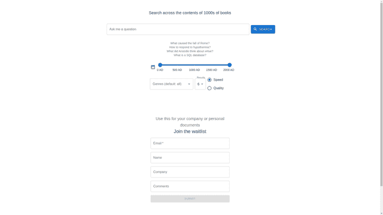

#research #education-assistant #search-engine

AllSearch.ai是一个搜索引擎，它可以让你搜索1000多本书的内容。你可以调整搜索结果的时间范围、体裁、结果数量以及搜索速度和质量。它还提供了一个可视化的搜索结果，可以帮助你更好地理解搜索结果。AllSearch.ai还提供了一个强大的API，可以帮助开发者构建自己的搜索应用程序。

费用： 免费

网址： www.allsearch.ai

## Papers GPT

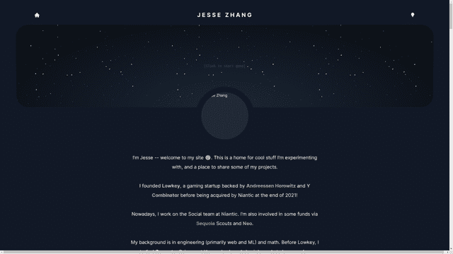

#research #experiments

llmdemo是一个用于将任何科学论文输入GPT（Generative Pre-trained Transformer）的项目，以获得深度定制知识的工具。它目前是一个概念性的用户体验，旨在将任意数据连接起来。它可以帮助研究人员更快地获取有用的信息，并且可以更有效地分析和理解大量的科学论文。

费用： 免费

网址： jessezhang.org/llmdemo

## Arxiv Feed

#research

Arxiv-Feed是一个方便浏览的AI研究论文源，它来自Arxiv，定期更新。它提供了一个简单的界面，可以让用户快速浏览最新的AI研究论文，并可以按照作者、日期、标题等不同的维度进行搜索，以便用户快速找到自己感兴趣的论文。

费用： 免费

网址： arxiv-feed.vercel.app

## PaperBrain

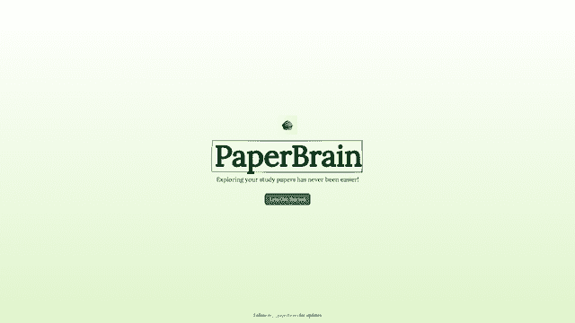

#research #education-assistant

PaperBrain.study是一个让你轻松访问和理解研究论文的平台。它提供论文摘要和直接的PDF链接，让你不再为繁琐的下载而烦恼。它还拥有一个GPT助手，帮助你一路走来。

费用： 免费

网址： www.paperbrain.study

## ExplainPaper

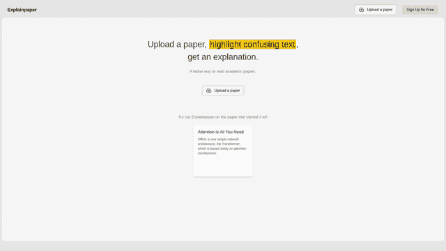

#research

ExplainPaper是一个专门为研究论文提供解释的网站，它可以帮助你解决论文中晦涩难懂的文字。你可以上传论文，并且可以保存论文。它还提供了一个高亮功能，可以帮助你快速找到你想要解释的文字。

费用： 免费

网址： www.explainpaper.com

## Iris.ai

#research #summarizer #productivity

Iris.ai是一个全面的研究处理平台，它拥有智能搜索和各种智能过滤器，可以进行阅读列表分析，自动生成摘要，自动提取和系统化数据。它可以帮助研究人员更快地完成研究，提高研究质量，并节省时间和精力。

费用： 免费，有增值会员

网址： iris.ai

## Summate

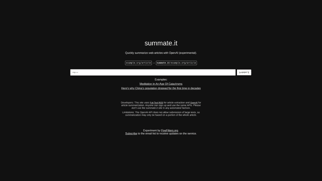

#research #summarizer

Summate.it是一款实验性的AI工具，可以对网页文章进行摘要。该网站使用Full-Text RSS进行文章提取，使用OpenAI进行文章摘要。它可以帮助用户快速了解文章的主要内容，节省时间，提高效率。

费用： 免费

网址： summate.it

## Socratic by Google

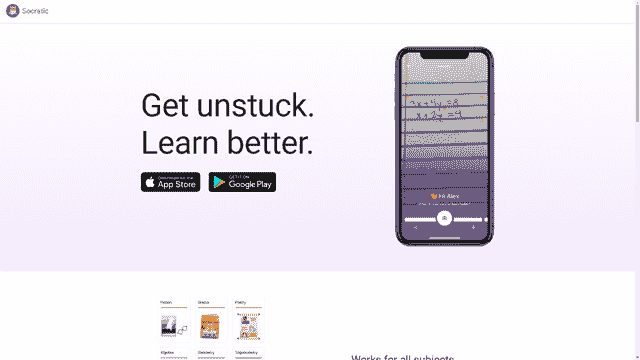

#research

Socratic是一个由Google AI支持的学术问题解决平台，它可以帮助用户解决科学、数学、文学、社会学等学术问题，并且提供每个学科重要概念的视觉解释。

费用： 免费

网址： socratic.org

## WolframAlpha

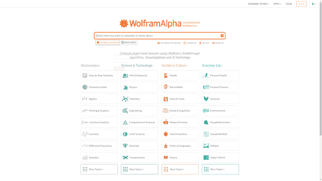

#research #education-assistant

WolframAlpha是一个专业的计算引擎，它使用Wolfram公司的突破性算法、知识库和人工智能技术，为用户提供专家级的答案。它专注于数学、科学技术、社会文化和日常生活等领域，可以帮助用户快速获取准确的答案。

费用： 免费，有增值会员 ，$5/mo

网址： www.wolframalpha.com

## Perplexity AI

#research #search-engine

Perplexity AI是一个AI搜索引擎。它是一个受OpenAI WebGPT启发的演示，而不是商业产品。它们使用大型语言模型（OpenAI API）和搜索引擎。还可以通过将自然语言转换为SQL代码来回答Twitter图查询。

费用： 免费

网址： www.perplexity.ai

## Consensus

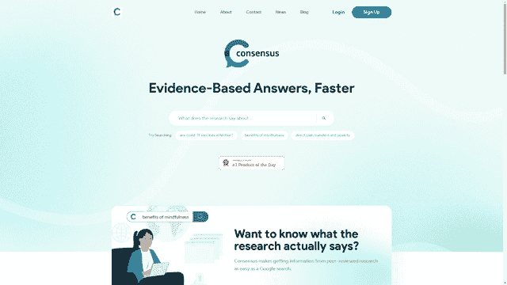

#research #search-engine

Consensus是一个搜索引擎，它利用人工智能技术，可以立即从科学研究中提取、聚合和提炼出结果。它提供了一个简单、快捷的方式，让研究人员可以快速搜索、查看和分析科学文献，从而更加有效地探索科学知识。Consensus还提供了一个可视化的研究管理工具，可以帮助研究人员更好地管理和组织研究文献，以便更好地探索科学知识。

费用： 免费

网址： consensus.app

## Podcast

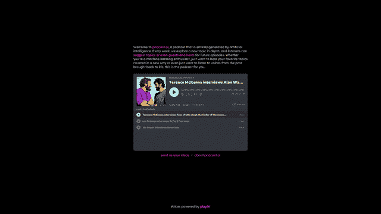

#research

AI生成的播客。它上面有两个播客：Lex Fridman采访了理查德·费曼，而乔·罗根则采访了史蒂夫·乔布斯。Podcast.ai是一个AI技术驱动的播客平台，它可以自动生成高质量的播客内容，满足不同用户的需求。它使用机器学习技术来模拟人类的谈话，并且可以根据用户的需求自动生成播客内容。它还可以自动生成播客的封面，以及播客的标题和描述，从而让播客更加吸引人。Podcast.ai的目标是为用户提供一个简单、高效的播客制作平台，让更多的人可以分享自己的故事，并且可以让更多的人可以收听到这些故事。

费用： 免费

网址： podcast.ai

## Adept

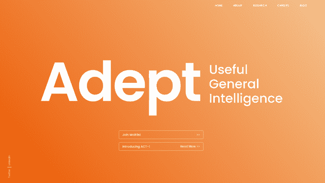

#research

Adept是一个机器学习研究和产品实验室，通过使人类和计算机能够共同创造性地工作，来构建通用智能。Adept的目标是建立一个可以自主学习和推理的智能系统，它可以解决复杂的问题，并且可以自我改进。Adept的技术组合了机器学习、自然语言处理、计算机视觉和其他人工智能技术，以及专业知识，以及人类的创造力和智慧。

费用： 联系商务询价

网址： www.adept.ai

## Cradle

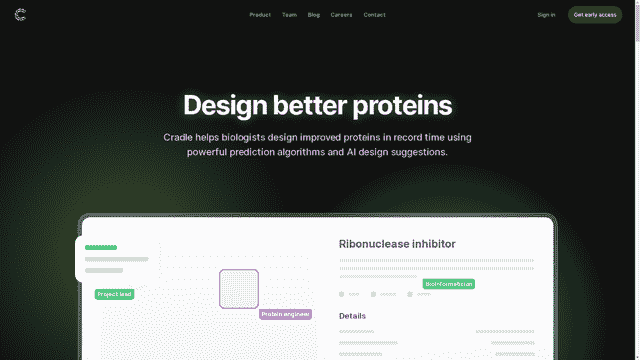

#research #healthcare

Cradle是一个帮助生物学家们快速设计改良蛋白质的项目，它使用强大的预测算法和AI设计建议，可以在短时间内实现蛋白质的改良。它可以帮助生物学家们更快地设计出更有效的蛋白质，从而更好地探索生物学的未知领域。

费用： 联系商务询价

网址： cradle.bio

## Elicit

#research

Elicit是一个使用语言模型来帮助您自动化研究工作流程的项目，比如文献综述的部分。Elicit可以在没有完美关键词匹配的情况下找到相关论文，总结论文与您的问题相关的收获，并提取论文中的关键信息。Elicit还可以帮助您完成其他研究任务，如头脑风暴、总结和文本分类。

费用： 免费

网址： elicit.org

## Galactica

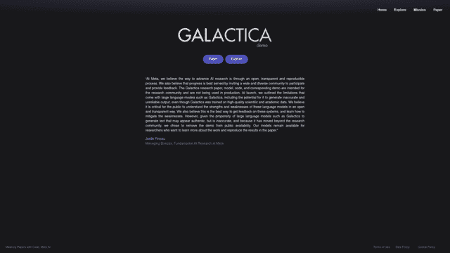

#research

Galactica.org是一个基于人工智能的项目，旨在构建一个可以让人们更容易访问和理解科学知识的智能系统，以及一个可以让科学家们更容易分享和探索科学知识的社区。它提供了一个可以让科学家们更容易探索和发现新知识的工具，以及一个可以让科学家们更容易分享和探索科学知识的社区。

费用： 免费

网址： galactica.org

## Scispace

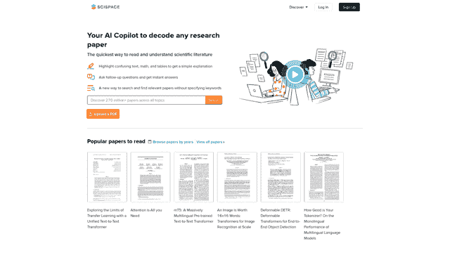

#research

Typeset.io是一款AI协作工具，可以帮助你解读任何科研论文。它可以让你快速阅读和理解科学文献，并且可以将混乱的文本、数学公式和表格突出显示，以便获得简单的解释。它还可以提出后续问题并获得即时回答，以及在不指定关键词的情况下搜索和找到相关论文。

费用： 免费

网址： typeset.io

## Scholarcy

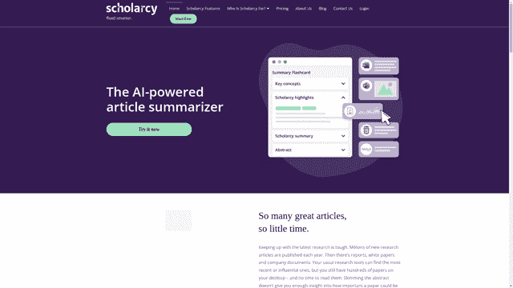

#research #education-assistant

Scholarcy是一个基于AI技术的文章摘要服务，它可以帮助用户在短时间内提取文章中的关键事实、数据和参考文献，节省大量的时间。它支持多种文章格式，包括PDF、Word文档、网页等，可以帮助用户快速提取文章中的关键信息，更加高效地完成学术研究。

费用： 免费，有增值会员 ，$7.99/mo

网址： www.scholarcy.com

# RESOURCES

## Midjourney Splitter

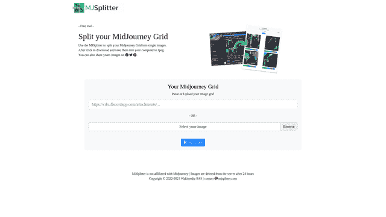

#resources #image-editing

MJSplitter是一款可以将Midjourney Grid分割成单张图片的工具。你可以通过上传或粘贴链接的方式输入图片。分割完成后，你可以将图片下载到电脑中，并以JPEG格式保存。你也可以将图片分享到社交网络上。

费用： 免费

网址： www.mjsplitter.com

## Pickaxe

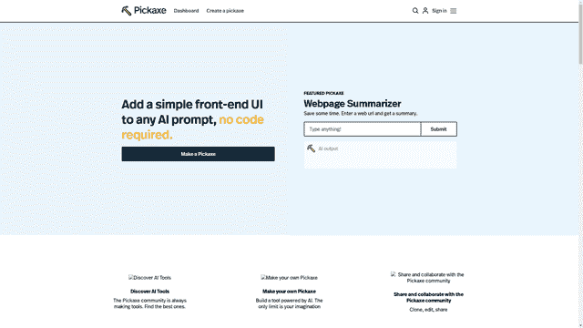

#resources #low-code/no-code

Pickaxe项目让任何人都可以在几分钟内创建由AI驱动的工具，而无需编码。您可以发现Pickaxe社区制作的AI工具，制作自己的AI工具并与社区共享和协作。

费用： 免费，有增值会员

网址： beta.pickaxeproject.com

## Lablab.ai

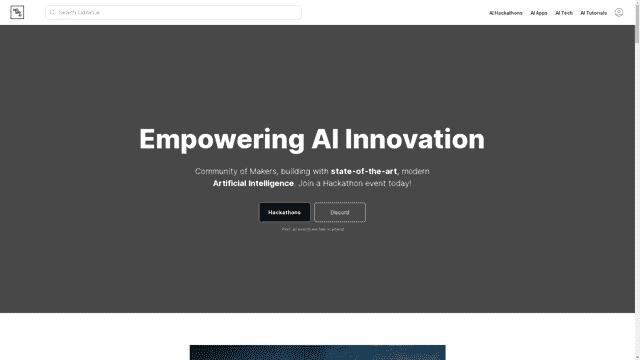

#resources #education-assistant

LabLab.ai是一个创客社区，致力于使用最先进的现代人工智能技术进行创新。LabLab.ai定期举办黑客马拉松，教授如何构建和使用不同的人工智能技术。它还提供了一个平台，可以让创客们分享他们的想法，技术和项目，并与其他创客进行交流。LabLab.ai还提供了一个在线学习社区，可以帮助创客们学习最新的人工智能技术，并将其应用于实际项目中。

费用： 免费

网址： lablab.ai

## AI Experiments

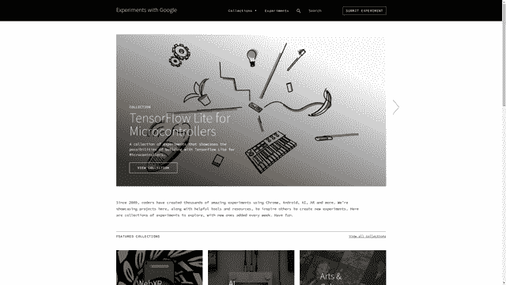

#resources #experiments

Google AI Experiments是一个由Google提供的展示平台，它提供了一些简单的实验，让任何人都可以通过图片、绘画、语言、音乐等方式来探索机器学习。在这里，你可以找到TalkToBooks和TeachableMachine等工具。

费用： 免费

网址： experiments.withgoogle.com/collection/ai

## FlowGPT

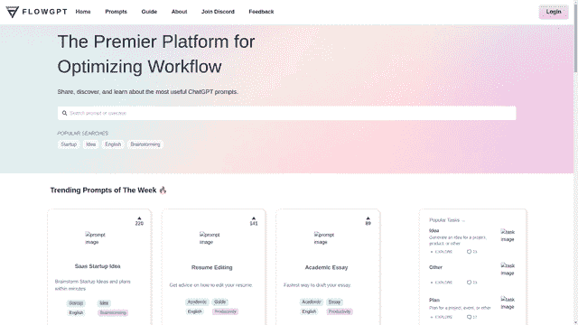

#resources #productivity

FlowGPT是一个智能聊天机器人提示分享平台，旨在帮助用户更高效地完成任务。它提供了一系列有用的ChatGPT提示，可以帮助用户更快地完成任务，提高工作效率。它还提供了一个可以让用户分享自己的ChatGPT提示的社区，让用户可以与其他用户分享经验，学习有用的ChatGPT提示。

费用： 免费

网址： flowgpt.com

## AI Art Apps Database

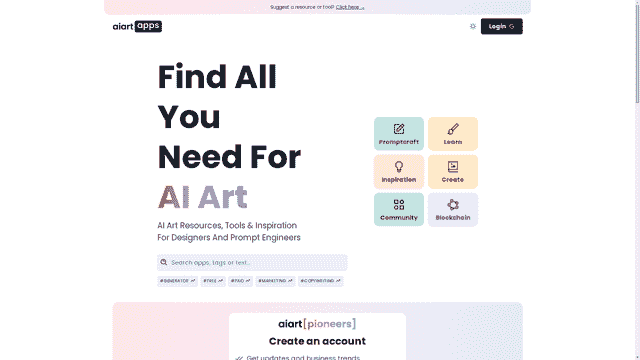

#resources #art

AI Art Apps是一个专为设计师和技术工程师提供AI艺术资源、工具和灵感的网站。它汇集了AI艺术领域的最新资讯、最新技术、最新工具和最新灵感，帮助设计师和技术工程师更好地利用AI艺术。AI Art Apps还提供了一个丰富的资源库，包括AI艺术教程、AI艺术案例、AI艺术工具和AI艺术灵感，帮助设计师和技术工程师更好地利用AI艺术。

费用： 免费

网址： aiartapps.com

## The AI Times

#resources

AI Times的内容涵盖了机器学习、自然语言处理、计算机视觉、机器人技术等多个领域，为读者提供最新的AI技术资讯、行业动态、技术分析和投资机会。AI Times的内容涵盖了机器学习、自然语言处理、计算机视觉、机器人技术等多个领域，为读者提供最新的AI技术资讯、行业动态、技术分析和投资机会。AI Times的目标是成为全球最具影响力的AI新闻媒体，为读者提供最新的AI技术资讯、行业动态、技术分析和投资机会。

费用： 免费

网址： www.aitimespage.com/ai

## ML news

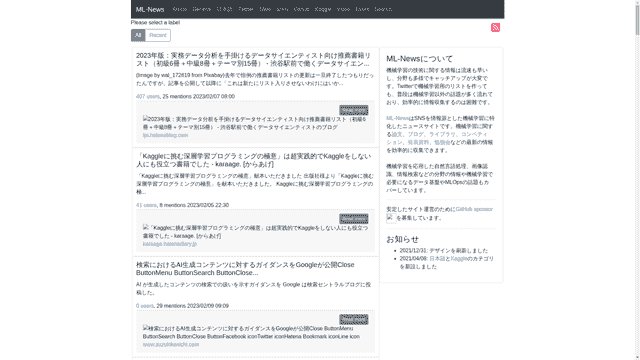

#resources

Machine-Learning.news是一个日本的机器学习和人工智能新闻聚合网站，它收集了来自各个媒体渠道的最新机器学习和人工智能新闻，并将其组织成一个容易浏览的列表，以便用户可以轻松地获取最新的机器学习和人工智能新闻。此外，它还提供了一个搜索功能，可以帮助用户快速找到所需的新闻内容。

费用： 免费

网址： www.machine-learning.news/list/general

# SALES

## Cargo

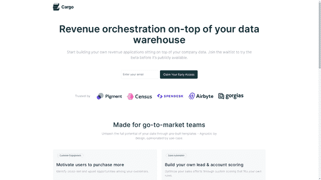

#sales

GetCargo.io是一个自动化平台，可以帮助企业充分利用其数据。它的特点包括高级分析、自动报告、机器学习、A/B测试和集成。它可以帮助销售和市场团队对齐并构建定制工作流程，以更快地推动收入增长。

费用： 联系商务询价

网址： www.getcargo.io

## Sku Fetch

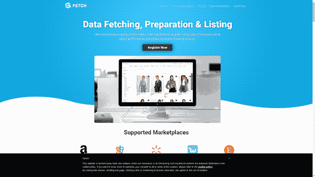

#sales #copywriting

SkuFetch是一个专为电子商务商家量身定制的自动化解决方案，它可以帮助商家从批发和零售供应商获取产品，并将其发布到多个市场，如Amazon、Ebay、Shopify、Walmart、Newegg、Facebook等，并利用人工智能技术重写/扩展/更改/概括标题和/或描述，更新图片。Sku Fetch还利用人工智能从零售商处获取难以获取的产品页面。

费用： 收费

网址： skufetch.com

## Sybill

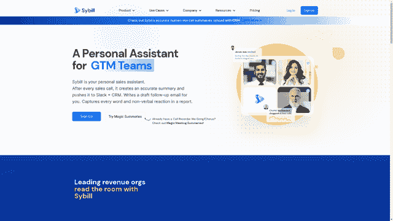

#sales #summarizer

Sybill是一个基于对话和买家情绪反应生成准确、类人的销售电话摘要的项目。它可以有效地跟进，准确地抓住客户的兴趣点，让你不再为CRM而记笔记。

费用： 收费 ，$59/mo

网址： www.sybill.ai

## Sales Stack

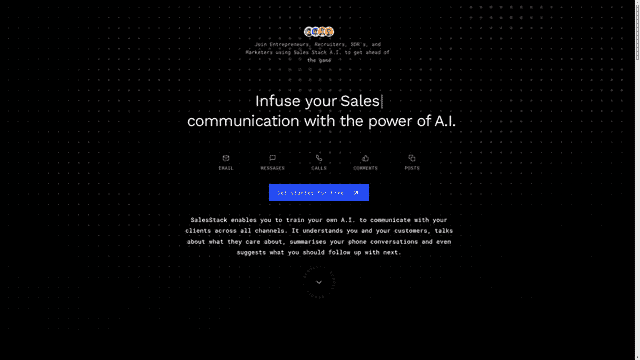

#sales

SalesStack是一个可以让您训练自己的人工智能，以跨越所有渠道与客户进行沟通的项目。它可以帮助企业提高客户满意度，提升客户体验，并有效地提高客户服务水平。SalesStack提供了一系列的机器学习工具，可以帮助企业更好地理解客户的需求，并为客户提供更加个性化的服务。它还可以帮助企业更好地管理客户关系，提高客户满意度，并有效地提高客户服务水平。SalesStack可以帮助企业更好地满足客户的需求，提高客户满意度，并有效地提高客户服务水平。

费用： 收费，但可先试用

网址： salesstack.ai

## Hot Reach AI

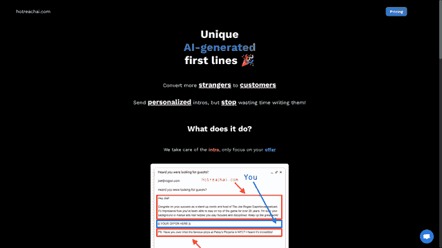

#sales #email-assistant

Hot Reach AI是一个利用人工智能和LinkedIn数据个性化介绍的项目，旨在帮助用户更有效地将陌生人转化为客户。它可以帮助用户节省时间，提高回复率，提高业务效率，提升客户体验，提升客户满意度。Hot Reach AI可以帮助用户更有效地推广业务，提高客户转化率，提升客户忠诚度，提升客户满意度，提升客户体验，提升客户满意度。

费用： 收费，但可先试用 ，$10/mo

网址： www.hotreachai.com

## Octane AI

#sales

Octane AI是一款全功能的产品测验和零方数据平台，是Shopify品牌提高收入的最佳选择。它可以帮助品牌收集客户的个人信息，并利用这些信息来提供个性化的产品建议和营销活动，从而提高客户满意度和转化率。Octane AI还可以帮助品牌收集客户的零方数据，从而更好地了解客户的行为和偏好，从而更好地满足客户的需求。

费用： 收费，但可先试用 ，$50/mo

网址： octaneai.grsm.io/krmx3qtiq2ku

## QuizGrowth

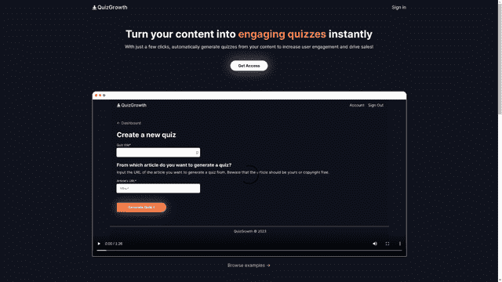

#sales #education-assistant

QuizGrowth是一个快速、便捷的在线测验创建工具，它可以让你轻松地将现有内容转换成有趣的测验，只需简单几步，就可以提高用户参与度，提升销售额。QuizGrowth拥有强大的编辑功能，可以让你自定义测验的外观和功能，让你的测验更具吸引力。它还提供了一系列的分析工具，可以帮助你更好地了解用户行为，改善你的测验，提高用户参与度。

费用： 联系商务询价

网址： quizgrowth.com

## Reply.io

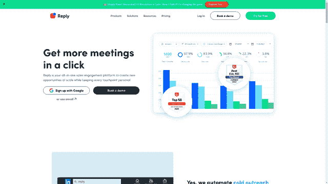

#sales #email-assistant

Reply的AI销售电子邮件助手可以在短时间内以规模化的方式生成类似人类的销售电子邮件。借助GPT-3语言预测模型，您的冷招和跟进电子邮件总是超级相关和个性化，提高您的开放和回复率！

费用： 免费，有增值会员 ，$60/mo

网址： reply.io/sales-email-assistant

## Cresta

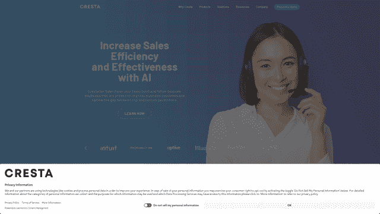

#sales

Cresta是一个自助服务、实时指导和呼叫后洞察的AI平台，旨在帮助团队更好地理解客户，提升客户服务水平。它通过深度学习技术，提取客户对话中的关键信息，提供实时反馈，帮助客服人员更好地满足客户需求，提升客户满意度。此外，Cresta还提供了一系列分析工具，帮助企业更好地了解客户，改善客户服务，提升客户体验。

费用： 收费

网址： cresta.com

## Robin

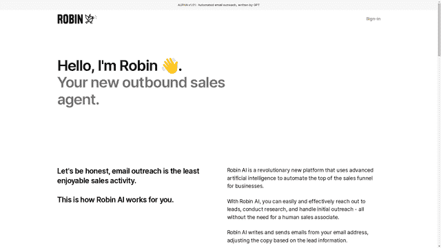

#sales #email-assistant

Robin AI是一款自动化冷邮件外联软件，它采用GPT（Generative Pre-trained Transformer）技术，可以让您轻松有效地与潜在客户联系，进行研究，处理初步接触，而无需人工销售人员。它可以帮助您节省时间，提高效率，提升客户满意度，并有效地提高您的销售业绩。

费用： 联系商务询价

网址： www.hellorobin.ai

## Warmer.ai

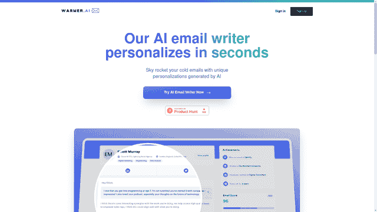

#sales #email-assistant

Warmer.ai是一个AI驱动的冷邮件自动化平台，旨在帮助企业提高邮件营销效率。它可以帮助企业自动生成个性化的冷邮件，以提高收件人的反应率。它还可以帮助企业跟踪邮件发送情况，以更好地了解客户的行为，并有效地提高营销策略。Warmer.ai还提供了一系列的分析工具，可以帮助企业更好地了解客户，以提高营销效果。

费用： 收费，但可先试用 ，$59/mo

网址： warmer.ai

## Infranodus

#sales

InfraNodus是知识工作者、研究人员和学生的一个强大工具。它利用人工智能和网络思维，帮助从任何文本中快速产生想法和见解。它可以用来分析对话、文章、书籍和其他信息来源。它提供文本的可视化表示，显示主要的主题和它们之间的关系。它还提出问题，帮助你进一步探索文本。有了InfraNodus，你可以迅速对任何文本获得更好的理解，并利用它来产生新的想法和见解。

费用： 收费 ，$9/mo

网址： infranodus.com

## Ortto

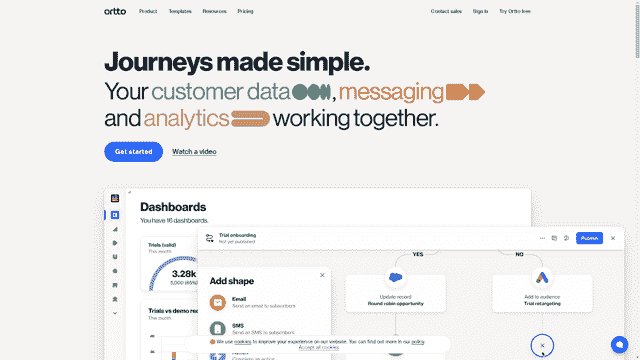

#sales #email-assistant

Ortto AI是一款人工智能营销工具，它可以帮助您从大纲中编写高性能的电子邮件主题行，令人信服的短信和电子邮件内容。它的智能可以带来实际的结果。它可以根据您的营销目标，分析您的客户数据，并自动生成有效的营销策略。它还可以帮助您更好地了解客户，并利用客户行为数据来改善您的营销策略。Ortto AI可以帮助您更有效地实现营销目标，提高客户满意度，并节省您的时间和金钱。

费用： 收费，但可先试用 ，$99/mo

网址： ortto.com/artificial-intelligence-marketing

## Creatext

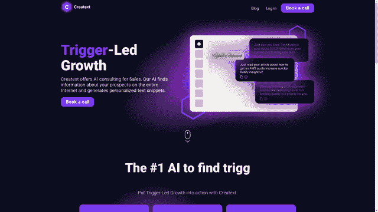

#sales #email-assistant

Creatext是一款专为您研究目标客户和快速编写个性化邮件和LinkedIn消息而设计的工具。它可以帮助您节省时间，提高您的沟通效率，提升您的营销活动的成功率。Creatext拥有强大的数据库，可以收集有关您的目标客户的有用信息，并为您提供有价值的洞察，以帮助您更好地了解客户，并创建个性化的沟通内容。此外，Creatext还提供了一系列的模板，可以帮助您快速编写高质量的邮件和LinkedIn消息，以更有效地推动您的营销活动。

费用： 联系商务询价 ，$29

网址： www.creatext.ai

## Instantly

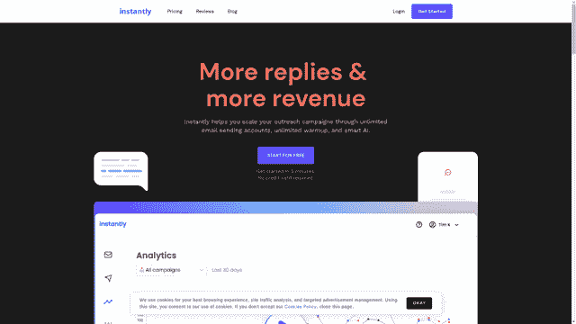

#sales #email-assistant

Instantly.ai是一个帮助您提高回复率和收入的AI技术平台。它可以通过无限的电子邮件发送帐户、无限的热身和智能AI来扩展您的拓展活动。它可以帮助您更有效地管理您的拓展活动，提高您的回复率，并最大限度地提高您的收入。

费用： 收费，但可先试用 ，$37/mo.

网址： instantly.ai

## Lavender

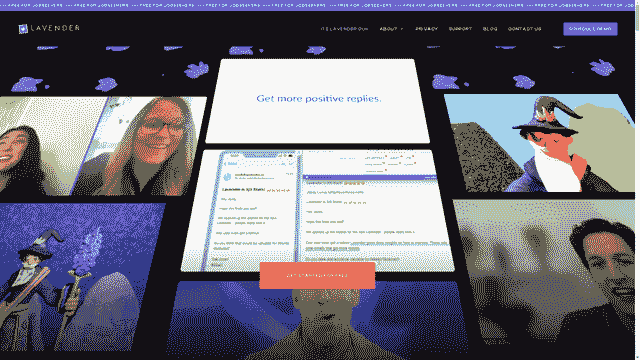

#sales #email-assistant

Lavender是一套完整的工具，可以帮助您在更短的时间内获得更多的回复。使用电子邮件AI更好地书写电子邮件，更快地定制，并辅导您的团队。

费用： 免费，有增值会员 ，$29/mo

网址： www.lavender.ai

## Quicklines

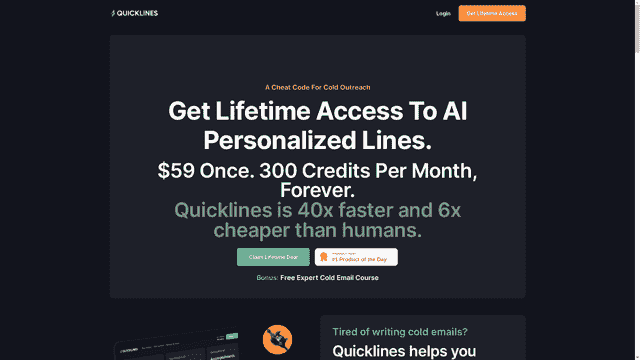

#sales #email-assistant

Quicklines是一个自动生成个性化的开场白的项目，可以用于冷邮件中。上传一个CSV文件，等待3分钟，就可以收到写好的表格。将这些行放入冷邮件的第一句，就可以看到回复率提高3倍到7倍。

费用： 收费 ，$59

网址： www.quicklines.ai

## Smartwriter

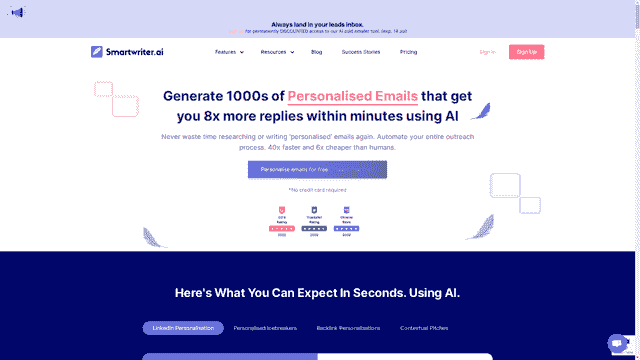

#sales #email-assistant

SmartWriter.ai是一个AI驱动的冷邮件和领英消息创建平台，旨在帮助企业快速创建高度个性化的冷邮件和领英消息，以转化读者为客户。它提供了一个完整的解决方案，包括寻找潜在客户、创建个性化的拷贝和实现销售。SmartWriter.ai的AI技术可以帮助企业更快地实现销售目标，提高客户满意度，并节省时间和成本。

费用： 收费，但可先试用 ，$49/mo

网址： www.smartwriter.ai

## Klaviyo SMS Assistant

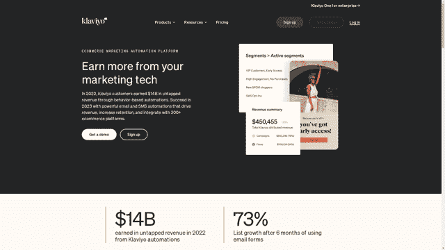

#sales

Klaviyo的新AI驱动的SMS助手可以让您在几秒钟内编写SMS活动。它可以自动识别您的活动，并使用AI技术提供有用的建议，以帮助您更快地完成活动。它还可以检测您的活动中的语法错误，以帮助您确保活动的准确性。此外，它还可以提供有关您的活动的报告，以帮助您更好地了解您的客户和活动的表现。

费用： 收费 ，$45/mo

网址： www.klaviyo.com/product/whats-new/sms-assistant

## Postaga

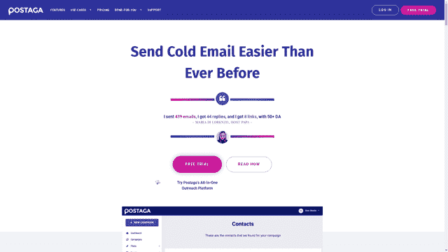

#sales #email-assistant

Postaga是一个非常实用的邮件营销工具，它可以帮助用户更轻松地发送冷邮件。它提供了一个全面的解决方案，包括邮件编辑、联系人管理、营销自动化、报告分析等功能，可以帮助用户更有效地管理邮件营销活动。它还提供了一个可视化的拖放界面，可以让用户更轻松地编辑和发送邮件，并且可以跟踪邮件的发送情况，以便用户可以更好地了解邮件营销的效果。

费用： 收费，但可先试用 ，$84/mo

网址： postaga.com

## Pipl.ai

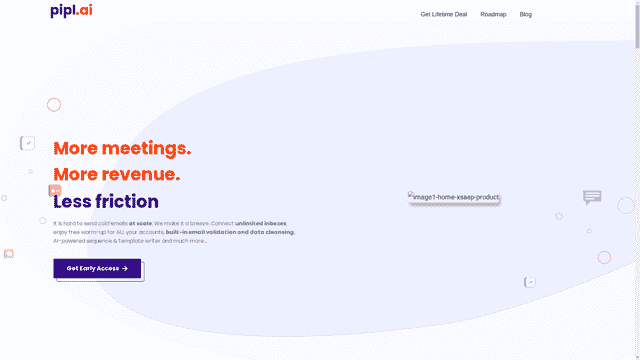

#sales #email-assistant

Pipl.ai是一个面向企业的邮件营销解决方案，它可以帮助企业快速、高效地发送大规模的冷邮件。它提供了无限的收件箱连接、免费的账户预热、内置的邮件验证和数据清理、AI驱动的序列和模板写作等功能，可以帮助企业更好地实现邮件营销的目标。

费用： 收费，但可先试用

网址： pipl.ai

## GETitOUT

#sales #email-assistant

GETitOUT是一款AI个性化文本生成器，它可以帮助你从竞争对手中提取个性化信息，生成专业文本，然后将其粘贴到你的所有网站、电子邮件和营销工具中。它可以让你的营销更加有效，而且不再需要为每个项目和客户创建个性化信息，让你节省大量时间。

费用： 收费，但可先试用

网址： getitout.io

## MarbleFlows

#sales

Marbleflows的AI生成器是一个强大的工具，可以帮助企业快速生成AI驱动的表单，以提高转化率。它可以根据企业的业务需求，自动生成表单，并使用AI技术来改进表单的设计，以提高用户体验。它还可以根据用户的行为，自动调整表单的内容，以更好地满足用户的需求。Marbleflows的AI生成器可以帮助企业更快地实现营销目标，提高转化率，并节省大量的时间和金钱。

费用： 免费

网址： app.marbleflows.com/ai-generator

## Marketplan

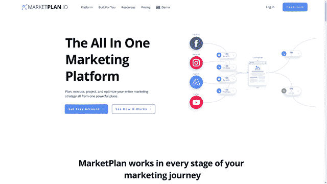

#sales #productivity

Marketplan.io是一个全方位的营销平台，它可以帮助企业规划、执行、预测和优化整个营销策略。它提供了一个强大的工具，可以帮助企业更好地管理营销活动，提高营销效率，并获得更好的营销结果。它还提供了一个完整的营销报告，可以帮助企业更好地了解营销活动的效果，并及时调整营销策略，以获得更好的结果。

费用： 免费，有增值会员 ，$9/mo

网址： marketplan.io

## Industrial Data Labs

#sales

Industrial Data Labs是一家专注于将人工智能技术应用于物料清单工作流程的公司。我们的行业训练的人工智能可以自动化这些手动过程，让你的销售团队有更多的时间去销售。我们的解决方案可以帮助企业提高效率，减少错误，提高客户满意度，并最大限度地提高利润。

费用： 收费

网址： industrialdatalabs.com

## Waymark

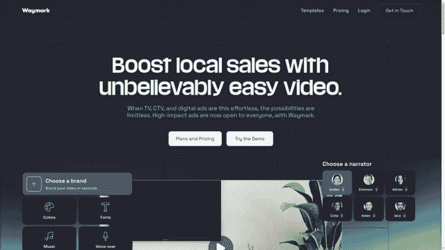

#sales #video-generator

Waymark是一个AI视频创作平台，它可以让您轻松创建任何潜在客户的特定创意。现在，您可以带着完全定制的样片商业进入每次会议。

费用： 收费 ，$250/mo

网址： waymark.com

## Usetwain

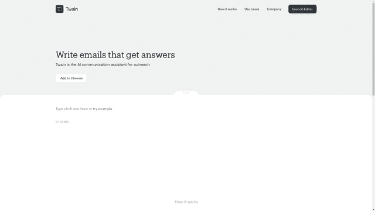

#sales

Twain是一个免费的在线销售技能培训平台，旨在帮助您提升销售技能，提高您的销售业绩。它提供了一系列的课程，包括销售技巧、客户关系管理、沟通技巧、产品知识等，帮助您掌握最新的销售技能，提升您的销售能力。Twain还提供了一个在线社区，您可以与其他销售专家交流，分享经验，提高您的销售技能。

费用： 免费

网址： www.usetwain.com

## Luna

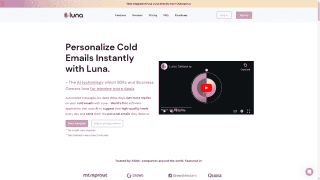

#sales #email-assistant

Luna是一款专为冷邮件设计的软件，它可以帮助您快速个性化您的冷邮件，以获得更多回复。它采用了人工智能技术，每天都可以提供新的高质量的潜在客户，并发送给他们应有的个性化邮件。Luna还提供了一系列的个性化功能，可以帮助您更好地接触到潜在客户，提高您的销售业绩。

费用： 收费，但可先试用 ，$100/mo

网址： getluna.dev

## Outplayhq

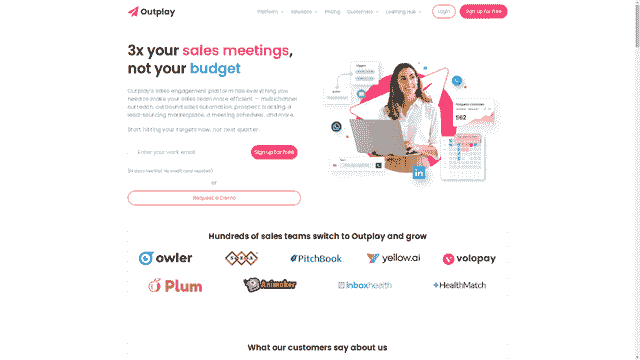

#sales #email-assistant

Outplay是一个全方位的多渠道销售参与平台，可以帮助销售团队更多地达成交易，大大提高收入。它提供了一系列的工具，可以帮助销售团队更有效地管理客户关系，提高客户满意度，提升销售效率，并且可以跟踪客户行为，收集有价值的客户数据，以便更好地满足客户需求。Outplay还提供了一个强大的分析工具，可以帮助销售团队更好地了解客户，更好地把握市场趋势，并且可以更有效地实施营销策略。

费用： 收费，但可先试用 ，$39/mo

网址： outplayhq.com

## Omneky

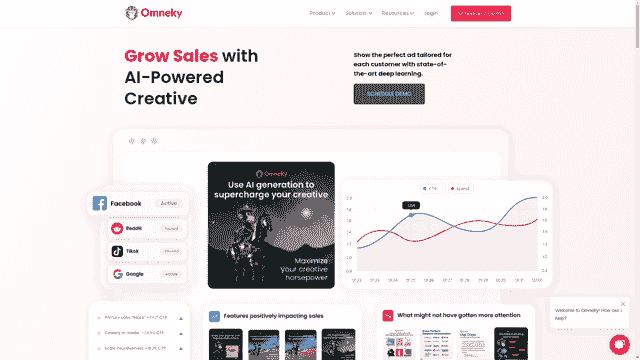

#sales

Omneky是一个全渠道创意编排平台，旨在帮助企业更好地管理和推广他们的品牌。它提供了一个统一的接口，可以让企业轻松地在多个渠道上创建、管理和发布创意内容，从而提高品牌知名度和口碑。Omneky还提供了一系列的分析工具，可以帮助企业更好地了解客户行为，从而改善客户体验，提高客户满意度。

费用： 收费

网址： www.omneky.com

## MateAI

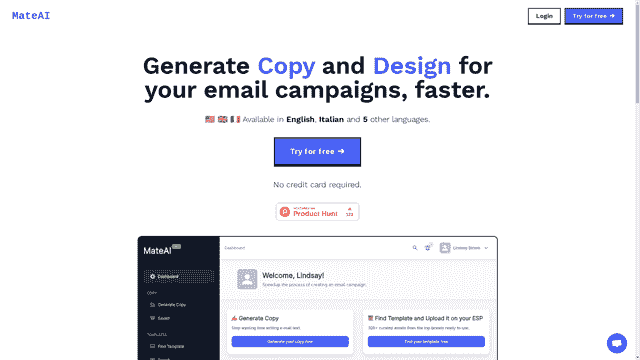

#sales #email-assistant

MateAI是一个AI驱动的营销自动化平台，旨在帮助企业快速生成高质量的电子邮件营销内容。它拥有一个强大的AI引擎，可以根据企业的营销目标和客户需求，自动生成专业的电子邮件内容，以及丰富的设计元素，以提高营销效果。MateAI支持英语、意大利语和其他5种语言，可以帮助企业更快更有效地实现营销目标。

费用： 收费，但可先试用 ，$19/mo

网址： www.mateai.io

# SEARCH ENGINE

## ChatGPT For Search Engines

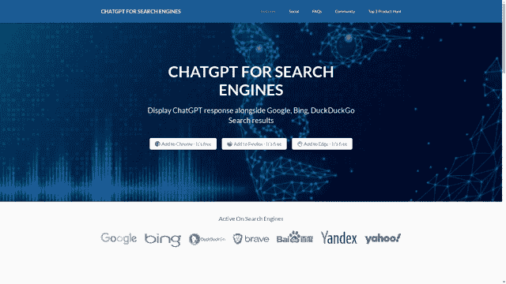

#search-engine

ChatONAI是一个基于自然语言处理技术的搜索引擎项目，它可以直接从搜索结果中访问ChatGPT语言模型，以回答任何问题，并获得自然语言响应。它提供了一个可以让用户轻松搜索和交流的平台，可以帮助用户快速获取信息，提高工作效率。ChatONAI还提供了一个可以让用户自定义搜索结果的功能，可以根据用户的需求提供更准确的结果。

费用： 免费

网址： chatonai.org

## Ask an AI

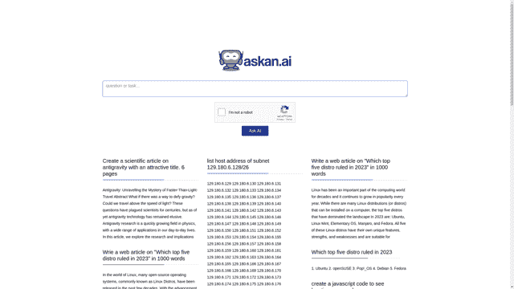

#search-engine

askan.ai是一个智能问答系统，它可以帮助您快速解决各种问题。它可以根据您的问题自动提取相关信息，并给出最佳答案。它还可以根据您的问题自动生成文档，以便您更好地理解问题的背景和解决方案。askan.ai还可以与您的现有系统集成，以提高您的工作效率。

费用： 免费

网址： www.askan.ai

## CrowdView

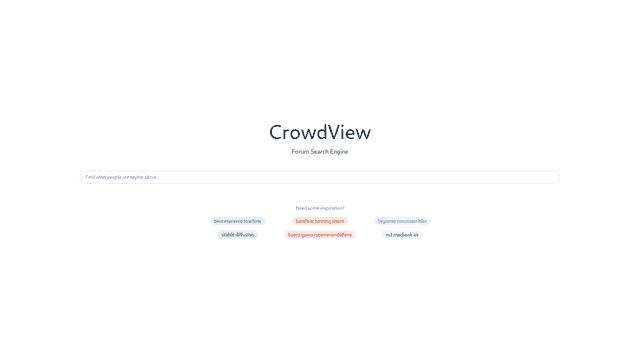

#search-engine

Crowdview.ai是一款AI搜索引擎，它可以搜索各种论坛和社区，如Reddit、HackerNews等，帮助用户快速找到他们需要的信息。它可以根据用户的搜索关键词，快速搜索出相关的信息，并且可以提供更多的搜索结果，以满足用户的需求。它还可以提供更多的搜索结果，以满足用户的需求，并且可以提供更多的搜索结果，以满足用户的需求。此外，它还可以提供更多的搜索结果，以满足用户的需求，并且可以提供更多的搜索结果，以满足用户的需求。

费用： 免费

网址： crowdview.ai

## Lexii.ai

#search-engine

Lexii.ai是一款AI搜索助手，可以回答问题并引用来源。它由最先进的自然语言处理技术GPT-3驱动，可以为您提供最准确、最新的任何主题信息。

费用： 免费

网址： lexii.ai

## Bookabout

#search-engine

Bookabout.io是一个基于AI的书籍搜索引擎，它可以帮助你搜索书籍的想法，而不仅仅是关键字。它可以帮助你快速找到你想要的书籍，并且可以提供有用的推荐，让你更容易找到你想要的书籍。它还可以帮助你更好地理解书籍的内容，让你更容易地找到你想要的信息。

费用： 免费

网址： bookabout.io

## Komo Search

#search-engine

Komo Search是一个基于生成式AI的搜索引擎，它将搜索旅程放在首位，而不是一大堆链接。它提供了三种功能：[聊天]深入探索、头脑风暴或讨论话题；[探索]查看社区正在讨论的内容；[搜索]快速获得答案或资源链接。

费用： 免费

网址： komo.ai

## Imaiger

#search-engine

imaiger.com是一个AI图像搜索工具，可以搜索数百万张使用尖端人工智能技术生成的艺术品和图像。它可以帮助用户快速找到他们想要的图像，而无需浏览大量的图像。它还提供了一个可以轻松分享图像的平台，可以让用户与其他用户分享他们的创意。

费用： 免费

网址： imaiger.com

## Everypixel

#search-engine

Everypixel是一个基于AI的搜索引擎，它索引了50个付费和免费的股票图像网站，并允许用户在短短几秒钟内搜索海量的股票照片。 此外，您还可以通过图像和各种搜索过滤器进行搜索，以便按颜色、方向和图像类型进行搜索。您还可以比较各个网站的图像价格，并按作者搜索。

费用： 免费

网址： www.everypixel.com

## NeevaAI

#search-engine

Neeva是一个基于AI的实时搜索引擎，它将AI的强大功能与搜索引擎相结合，为您提供快速、准确、最新的搜索结果。此外，它还提供了信息来源，以便您更好地了解搜索结果。Neeva的AI搜索引擎可以帮助您更快地找到您想要的信息，更准确地了解您的搜索结果，并且更快地获得最新的信息。

费用： 免费，有增值会员 ，$4.17/mo

网址： neeva.com

## Nyx

#search-engine

NYX Gallery是一个由人工智能创建的图像展示网站，它提供了一系列令人惊叹的虚拟图像，包括食物、动物、景观等等。这些图像都是由AI技术生成的，因此“不是真实的”。你在这里看到的食物、动物、景观等等都不存在！NYX Gallery拥有一个简单易用的界面，可以让你轻松浏览和分享这些令人惊叹的虚拟图像。

费用： 免费

网址： nyx.gallery

## You

#search-engine

you.com是一个搜索引擎，它让用户拥有更多的控制权，可以自定义搜索结果，更好地满足用户的需求。它提供了一个可视化的搜索界面，让用户可以更加直观地搜索，并且可以根据自己的偏好调整搜索结果的排序。you.com还提供了一个个性化的搜索结果页面，可以根据用户的搜索历史记录，提供更加精准的搜索结果。you.com的搜索结果更加准确，更加可靠，可以更好地满足用户的需求。

费用： 免费

网址： you.com

## Algolia

#search-engine

Algolia是一个专为企业提供搜索和发现服务的平台，它可以帮助构建者创建世界一流的数字体验。它提供了一系列的搜索和推荐服务，可以帮助企业提升用户体验，提高搜索准确性，提升转化率，提高收入。Algolia的搜索引擎可以支持多种语言，支持实时搜索，支持自定义排序，支持自定义推荐。

费用： 收费，但可先试用 ，$1

网址： www.algolia.com

## Dreamsands

#search-engine

Dreamsands是一个创意市场，您可以在这里许可、收集和分享您发现有趣的AI生成艺术图像。它汇集了来自全球各地的艺术家，他们使用最先进的人工智能技术创作出独特的艺术作品。Dreamsands提供了一个安全、可靠的环境，让艺术家和收藏家可以轻松地购买和出售艺术品。它还提供了一个交流平台，让艺术家可以与其他艺术家和收藏家交流，分享他们的想法和灵感。Dreamsands是一个充满活力的社区，让艺术家和收藏家可以轻松地发现、购买和分享他们喜欢的艺术作品。

费用： 免费

网址： dreamsands.ai

## Explore AI

#search-engine

ExploreAI是一个基于AI的语义搜索引擎，它可以让你免费、快速、便捷地在数千个YouTube视频中直接搜索答案。它可以帮助你快速找到你想要的信息，而不用浪费时间在浏览大量的视频中。它还可以帮助你更好地理解你所学习的内容，让你更容易地记住它们。

费用： 免费

网址： exploreai.vercel.app

## Kailua Labs

#search-engine

Kailua Labs的图像搜索项目可以帮助开发者将强大的多模态搜索集成到应用程序中。通过我们的API，您可以轻松使用AI搜索图像、视频、音频等内容，从而提高搜索效率。

费用： 免费，有增值会员

网址： app.kailualabs.com/image-search

## One More AI

#search-engine

OneMoreAI是一个AI生成股票图片的平台，它提供了数以千计的由人工智能生成的图片，这些图片可以用于设计、广告、品牌宣传等多种用途。OneMoreAI的图片具有高质量、高分辨率和高可用性，可以满足您的各种需求。此外，OneMoreAI还提供了一系列的AI图像处理工具，可以帮助您快速、高效地完成图像处理任务。

费用： 免费

网址： onemoreai.com

## Andi

#search-engine

Andi Search是一个使用生成式AI的下一代搜索引擎。它不仅仅提供链接，还能给出答案，就像和一个聪明的朋友聊天一样。它可以帮助用户快速找到所需的信息，而不用浪费时间在搜索引擎中搜索。Andi Search还可以提供有用的推荐，帮助用户发现更多有趣的内容。

费用： 免费

网址： andisearch.com

# SEO

## OpenAI Text Classifier

#SEO #education-assistant

OpenAI的AI文本分类器旨在促进关于人类书写和AI生成内容之间的区别的讨论。该模型经过训练，可以从各种来源获取人类书写的文本，但可能不能代表所有类型的人类书写文本。结果可能有所帮助，但不应该是决定文档是否由AI生成的唯一依据。

费用： 免费

网址： platform.openai.com/ai-text-classifier

## Seo.ai

#SEO

SEO.ai是一个利用世界领先的生成式人工智能技术来生成高质量SEO关键词研究和AI文案写作的项目。它可以帮助企业更快更有效地完成SEO优化，提升网站搜索引擎排名，提高网站流量，从而获得更多客户。SEO.ai还提供了一系列的AI文案写作工具，可以帮助企业快速生成高质量的文案，提升网站内容质量，提高用户体验，提升网站排名。

费用： 免费，有增值会员 ，$49/mo.

网址： seo.ai

## SEOmatic AI

#SEO #startup-tools

SEOmatic是一款帮助您自动化和扩展内容营销的程序化SEO和AI工具。只需10分钟即可设置SEO网站，无需编码或设计技能。它可以帮助您更快更有效地实现搜索引擎优化，提高网站排名，提升流量，提高转化率，并最大限度地提高您的收入。

费用： 收费，但可先试用 ，$29/mo

网址： seomatic.ai

## Article Fiesta

#SEO

Article Fiesta是一个AI写作服务，可以帮助您为您的网站或博客创建文章。您所需要提供的只是您的关键字，我们将全部处理。我们的AI机器人将创建长篇、SEO友好的文章，可以立即发布到您的网站上。不用担心其他网站只写内容。Article Fiesta添加了丰富的免版税图像，SEO文章排名功能，甚至可以自动从文章中构建指向您网站内容的内部链接。免费试用，无需信用卡。

费用： 收费，但可先试用 ，$20/mo

网址： articlefiesta.com

## CheckForAI

#SEO #education-assistant

CheckforAI是一个AI文本检测项目，旨在检测文章和电子邮件中的AI写作文本。它利用Open AI现有的Roberta-base模型进行GPT检测，以及我们自己的专有模型，来帮助用户检测AI写作文本。CheckforAI可以帮助用户快速准确地检测AI写作文本，从而提高文章和电子邮件的质量。

费用： 免费

网址： checkforai.com

## Genie AI

#SEO

GenieAI是一款基于人工智能的网页应用，可以为您的内容生成标题、描述、标签和缩略图想法。它可以帮助您更快地创建出有吸引力的内容，从而提高您的内容推广效果。它可以根据您的内容自动生成标题、描述、标签和缩略图，以便您可以更快地将内容发布到社交媒体上。此外，它还可以根据您的内容分析出最佳的标题、描述、标签和缩略图，以便您可以更好地推广您的内容。

费用： 收费 ，$5

网址： genieai-app.vercel.app

## VidIq

#SEO

VidIQ是一款SaaS产品，旨在帮助YouTube创作者为视频找到主题和关键词。VidIQ的AI功能包括个性化的下一个视频提示，观看预测计数和预测分析。Futurepedia是VidIQ的一个项目，旨在帮助YouTube创作者更好地理解视频分析，提高视频质量，提升视频观看量。Futurepedia提供了一系列关于视频分析的教程，指导YouTube创作者如何利用VidIQ的AI功能，更好地利用关键词和主题，提升视频的搜索排名，提高视频质量，提升视频观看量。

费用： 免费，有增值会员 ，$7.50/mo

网址： vidiq.com/futurepedia

## Keywrds.ai

#SEO

Keywrds.ai是一款利用GPT技术的关键词研究和内容创意工具。它旨在能够找到特定领域的关键词，以及生成问题、主题和博客文章概要。通过Keywrds.ai，你可以抓取Google的“人们也问”问题，并自动生成答案。

费用： 收费，但可先试用 ，$19/mo

网址： keywrds.ai

## SEO GPT

#SEO

SEO GPT是一种新的方式，可以帮助您创建SEO的网页和非网页优化。它的一些特性包括谷歌友好的标题和描述，通过AI检测，自然语言内容和页面内容分析。它可以帮助您更好地排名，提高网站流量，提高搜索引擎排名，提高网站的可见度，提高网站的曝光率，从而获得更多的客户。

费用： 免费

网址： seovendor.co/seo-gpt

## AI-Writer

#SEO

AI-Writer是最准确的内容生成平台。它使用最先进的AI写作模型，只需要一个标题就可以生成文章。它可以帮助用户快速生成高质量的文章，节省时间和精力，提高工作效率。AI-Writer还提供了一系列的编辑工具，可以帮助用户更好地编辑文章，提高文章的质量。

费用： 收费，但可先试用 ，$29/mo

网址： ai-writer.com

## Writey AI

#SEO

Writey.ai是一个改变内容创作方式的项目。它利用人工智能技术，帮助用户更快地创建内容。它拥有最先进的语言A.I，并且拥有第一个真正免费的原创和研究内容的抄袭A.I，可以查看Writey A.I的实际效果。

费用： 免费，有增值会员 ，$9/mo

网址： writey.ai

## Letterdrop

#SEO

Letterdrop是一个内容运营自动化平台，它可以帮助你更快、更轻松地创建32％更多的内容。它可以帮助你更有效地管理内容，节省时间和精力，提高工作效率。它可以帮助你更轻松地管理内容，更快地发布内容，更好地控制内容的质量，更有效地收集反馈，更好地控制内容的可见性，更好地控制内容的可用性，以及更好地控制内容的可搜索性。

费用： 收费 ，$400/mo

网址： letterdrop.com

## Eilla AI

#SEO #image-generator #copywriting

Eilla.ai是一款基于AI的助手，可以为您的企业、博客、广告、电子邮件以及逼真的图片或艺术品生成高质量的内容。免费开始，无需信用卡！

费用： 收费，但可先试用 ，$29.99/mo

网址： eilla.ai

## BrameWork

#SEO

Bramework是一款易于使用的AI写作工具，可以帮助博客作者、自由职业者和机构每篇博客文章节省数小时的时间。它可以帮助你以5倍的速度更快地写出博客文章。Bramework拥有强大的自然语言处理技术，可以帮助你更快地理解文章的主题，并且可以自动生成文章的框架，让你更轻松地完成文章的写作。它还可以帮助你更快地检查文章的语法和拼写，以确保文章的质量。

费用： 收费，但可先试用 ，$17/mo

网址： bramework.com

## ArticleForge

#SEO #copywriting

Article Forge是一个自动写作服务，可以帮助用户轻松创建高质量、SEO优化的内容。它可以根据用户提供的关键词和主题，自动生成文章，从产品描述到完整的博客文章，只需一键即可完成。Article Forge还可以根据用户提供的关键词和主题，自动生成文章，从而帮助用户更快地完成内容创作。

费用： 收费，但可先试用 ，$13/mo

网址： www.articleforge.com

## Copymatic

#SEO #copywriting

CopyMatic.ai是一款AI技术驱动的内容生成工具，可以帮助用户节省大量时间，快速生成高质量的内容。它可以自动生成从长篇博客文章、着陆页到数字广告等各种内容，让您的流量和排名大大提升。

费用： 收费，但可先试用 ，$32/mo

网址： copymatic.ai

## Moonbeam

#SEO

Moonbeam是一个AI驱动的写作工具，它可以帮助你更快更好地完成长篇写作任务。它提供了一系列的AI功能，包括文本分析、文本摘要、文本编辑、文本推荐等，可以帮助你更快更好地完成写作任务，让你在10分钟内变得更加优秀。

费用： 收费，但可先试用 ，$15/mo

网址： gomoonbeam.com

## Thundercontent

#SEO

Thundercontent是一个利用人工智能技术帮助你以光速速度撰写任何主题的独特文章的项目。它可以帮助你扩大内容策略，克服作家的瓶颈。此外，你还可以使用Thundercontent生成音频。

费用： 免费，有增值会员 ，$10/mo

网址： thundercontent.com

## Katteb

#SEO

Katteb AI是一款快速而简单的内容创作工具，可以帮助您快速创建博客和在线商店的内容。它拥有强大的AI技术，可以根据您的关键词自动生成文章，并且可以自动检测文章中的语法错误，以确保您的文章质量。此外，它还提供了一系列的模板，可以帮助您快速创建精美的内容，并且可以自动将内容发布到您的博客和在线商店。Katteb AI可以帮助您节省大量时间，让您更加专注于您的业务发展。

费用： 免费，有增值会员 ，$15/mo

网址： katteb.com/en

## Typli

#SEO #copywriting

Typli.ai是一款最直观的AI内容工具，它将AI写作和SEO助手结合在一起，可以帮助用户更快更准确地完成内容创作。它可以根据用户的输入，自动生成文章框架，并且可以智能提示用户更好的文章结构，以及更有效的SEO优化建议，让用户更轻松地完成内容创作。

费用： 收费，但可先试用 ，$29/mo

网址： typli.ai

## Compar

#SEO

Compar.ai是一个AI驱动的内容分析平台，旨在帮助企业更好地理解客户的需求，提高客户体验。它通过深度学习技术，分析客户的反馈，提取出有价值的信息，从而帮助企业更好地了解客户的需求，改善客户体验。Compar.ai还提供了一系列的分析工具，可以帮助企业更好地分析客户的反馈，提取出有价值的信息，从而改善客户体验。

费用： 收费，但可先试用 ，$8.95

网址： compar.ai

## Topicmojo

#SEO

Topic Mojo是一款AI内容研究工具，它可以帮助您获得分析特征，从而帮助您发展网上业务。它可以帮助您快速搜索和发现有价值的内容，并获得有关内容的有用信息，以便您可以更好地了解您的受众，并制定更有效的营销策略。它还可以帮助您更好地管理您的内容，更快地发布内容，并跟踪您的内容表现。

费用： 收费，但可先试用 ，$90/mo

网址： topicmojo.com

## Neuronwriter

#SEO

它是一款高级内容编辑器，可以帮助您优化网站内容，以便让谷歌喜爱它。它具有语义模型（NLP），谷歌SERP分析和竞争数据，可以帮助您以用户意图为导向规划和优化内容。

费用： 收费 ，$19/mo

网址： www.neuronwriter.com

## LongShot

#SEO

LongShot.ai是一款人工智能写作助手，可以帮助您和您的团队创建有用的博客，并在谷歌上排名。它可以帮助您更快地创建高质量的内容，并且可以节省您的时间和精力。它还可以帮助您更好地理解搜索引擎优化，以便您的内容更容易被搜索引擎收录。

费用： 免费，有增值会员 ，$29/mo

网址： longShot.ai

## Writer

#SEO

Writer是一款AI写作平台，专为团队而设计。它可以帮助您创作清晰、一致、品牌一致的内容。它可以帮助您更快、更准确地完成写作任务，并且可以提供专业的写作指导，以帮助您提高写作水平。Writer还提供了一系列的写作工具，可以帮助您更好地管理写作过程，提高写作效率。Writer还提供了一个安全的协作环境，可以让您与团队成员实时协作，实现更高效的写作。现在就试用Writer，让您的写作更加出色。

费用： 免费，有增值会员 ，$18/mo

网址： writer.com

## Spinrewriter

#SEO

Spin Rewriter是一款非常实用的文章重写工具，它可以帮助SEO专家们快速生成高质量的独特内容，从而提升网站在Google搜索结果中的排名。它采用了ENL技术，可以在45秒内将一篇文章重写成500篇文章，让您轻松获得高质量的内容。

费用： 收费，但可先试用 ，$47/mo

网址： www.spinrewriter.com

## Kafkai

#SEO

Kafkai是一种机器学习算法，可以从头开始编写文章。它是市场营销人员和SEOs的尖端技术。它可以根据您提供的关键词和搜索引擎优化（SEO）要求，自动生成高质量的文章。它还可以根据您的要求，自动更新文章，以保持内容的新鲜度。Kafkai还可以帮助您更有效地管理您的内容，以便您可以更轻松地实现您的营销目标。

费用： 收费，但可先试用 ，$27/mo

网址： kafkai.com

## Closers Copy

#SEO #copywriting

ClosersCopy是一个专业的文案服务平台，旨在帮助企业提升销售业绩。它提供了一系列的SEO优化博客和令人难以抗拒的营销文案，让企业可以利用世界上最强大的文案秘诀，并让文案机器人帮助实现它们。ClosersCopy拥有一支专业的文案团队，他们可以为企业提供专业的文案服务，帮助企业提升销售业绩，提高品牌知名度，提升客户体验。

费用： 收费 ，$49.99/mo

网址： www.closerscopy.com

## growthbar

#SEO

GrowthBar SEO是一个AI驱动的SEO内容创作工具，旨在帮助用户更轻松地创建完美的SEO友好内容，包括博客文章、网站页面和文章。它提供了一系列的AI功能，可以帮助用户更快地完成内容创作，并且可以提供有关内容优化的实时反馈。它还提供了一个全面的内容分析工具，可以帮助用户更好地了解内容的SEO表现，并且可以提供有关内容优化的建议。

费用： 收费 ，$29/mo

网址： www.growthbarseo.com

## Jenni

#SEO

Jenni.ai是一款革命性的AI写作助手，它可以帮助你提高写作效率，提升文章质量，并且可以节省你的时间。它可以帮助你更快地完成写作任务，提供更准确的语法检查，更有效地检查文章的拼写和格式，以及更多的功能。它还可以帮助你更好地理解文章的结构，更好地掌握文章的主题，以及更好地控制文章的语言风格。Jenni.ai的最大优势在于它可以让你更轻松地完成写作任务，提高写作效率，提升文章质量，节省时间。

费用： 收费，但可先试用 ，$12/mo

网址： jenni.ai

## SheetAI.app

#SEO #spreadsheets

SheetAI是一款专为Google Sheets设计的AI工具，它可以帮助用户快速将文本指令转换成Google Sheet公式。它可以用于生成程序化SEO内容、个性化电子邮件等多种用途。它可以帮助用户更快捷地完成工作，提高工作效率。

费用： 免费，有增值会员 ，$2/mo

网址： www.sheetai.app

## CTRify

#SEO

CTRify是一个首款基于人工智能的SEO行动平台，它可以帮助您通过只输入一个关键词来创建排名较高的网站。通过我们来自世界各地顶级移动运营商的住宅IP连接的数百万真实桌面和移动设备的有机流量，您可以提高SERPs排名，有机CTR，停留时间和Pogo Sticking。

费用： 免费，有增值会员 ，$197

网址： www.ctrify.com

## BlogNLP

#SEO

BlogNLP是一款免费的AI博客写作工具，它可以帮助您打破写作僵局，以短短的时间创作出原创内容。它可以根据您的输入，自动生成文章，并且可以自动检测文章中的语法错误，以及检测文章中的重复内容。此外，它还可以帮助您更好地组织文章，提高文章的可读性，并且可以提供丰富的文章模板，让您更轻松地完成文章的写作。

费用： 免费

网址： www.blognlp.com

## Mentioned

#SEO #email-assistant

Mentioned.ai是一款自动化的影响力拓展和链接建设工具，它可以扫描您的内容，识别您提及的人和公司，然后发送电子邮件进行推广。它可以帮助您更有效地拓展影响力，提高您的内容曝光率，并建立有价值的链接。

费用： 收费 ，$49/mo.

网址： www.mentioned.ai

## Writesonic

#SEO #copywriting

Writesonic是一款AI写作工具，可以免费为博客、Facebook广告、Google广告和Shopify创建SEO友好的内容。我们的改写工具可以让您立即重新排列整篇文章。

费用： 免费，有增值会员 ，$12.67/mo

网址： writesonic.com

## Wordhero

#SEO #email-assistant #social-media-assistant

WordHero是一个利用人工智能技术的项目，它可以帮助你在短短几秒钟内创建出原创的博客文章、社交媒体内容、电子邮件等内容。它可以节省你大量的时间，让你更有效率地完成工作。WordHero还提供了一系列的模板，可以帮助你快速创建出专业的内容，让你的文章更具有吸引力。

费用： 收费 ，$49/mo

网址： wordhero.co

## Scalenut

#SEO

ScaleNut是一个简单可扩展的内容创作平台，它提供了一个引导式的工作流，让您可以在5分钟内完成博客内容的创作，从而实现您的业务目标。它还提供了一系列的工具，可以帮助您更有效地管理内容，并跟踪内容的表现。

费用： 收费，但可先试用 ，$29/mo

网址： www.scalenut.com

# SOCIAL MEDIA ASSISTANT

## Tweet Monk

#social-media-assistant

Tweetmonk是一款基于AI的Twitter线程编辑器，让撰写Twitter线程变得更加有趣和容易。它们使得自动化和发展您的Twitter账户变得更加容易。您需要的所有工具都可以一目了然。

费用： 免费，有增值会员 ，$8/mo

网址： tweetmonk.com

## Morise.ai

#social-media-assistant

Morise.ai是一个专为视频创作者提供的AI视频优化服务，它可以帮助创作者更好地把握视频的趋势，提升视频的曝光率和播放量。Morise.ai通过分析最成功的渠道的数据，深入理解什么是病毒式传播，而创作者只需要专注于创作视频即可。它可以帮助创作者更好地把握视频的趋势，提升视频的曝光率和播放量，从而让视频更容易被更多的人看到。

费用： 收费 ，$29/mo

网址： morise.ai

## Outline Ninja

#social-media-assistant #education-assistant

Infographic Ninja是Outline Ninja旗下的一款自动生成信息图表的工具，它采用人工智能技术，只需要输入关键词和标题，就可以自动生成信息图表。它可以帮助用户快速搭建出精美的信息图表，让信息更加清晰易懂。

费用： 联系商务询价

网址： outline.ninja/demo-infographic-ninja

## Entar.io

#social-media-assistant

Entario是一个AI生成的社交媒体回复服务，可以节省5倍的时间（包括LinkedIn，Twitter，Facebook等）。它可以在几秒钟内为每个询问创建量身定制的评论，并可以以不同的语气编辑和定制评论，支持所有主要的社交媒体平台。

费用： 收费，但可先试用 ，$8

网址： www.entar.io

## Postwise

#social-media-assistant

Postwise.ai是一款AI Twitter工具，旨在帮助用户在Twitter上轻松走红。它提供了写作、安排和增长的工具，还提供帮助台和教程，帮助用户使用AI更好地编写推文线程。

费用： 收费 ，$29/mo

网址： postwise.ai

## Piggy To

#social-media-assistant #fun-tools

Piggy Magic是一款能够让您在短短几秒钟内创建出引人入胜的可分享网页的工具。只需输入一个提示，该工具就能生成7-10张移动友好格式的幻灯片，节省时间，确保视觉效果出众。Piggy Magic非常适合企业和个人，它提供了一种用户友好、节省时间的解决方案，可以创建有影响力的内容。此外，您还可以使用它的Twitter机器人，输入一个主题，即可在一分钟内获得一个漂亮的Piggy（例如：“@makeapiggy最受欢迎的书籍”）。

费用： 免费

网址： piggy.to/magic

## Viral Post Generator

#social-media-assistant #fun-tools

Taplio的Viral Post Generator是一款专为LinkedIn设计的自动文章生成工具，它可以根据用户的设置，自动生成有趣的、有吸引力的文章，包括事件、励志名言和尴尬水平等。它可以帮助用户快速创建出有趣的文章，从而提升LinkedIn上的受欢迎程度。

费用： 免费

网址： viralpostgenerator.taplio.com

## JibeWith

#social-media-assistant

Jibe With是一个AI驱动的社交媒体策略解决方案，它可以帮助品牌和企业更好地与受众建立联系。它可以根据品牌和目标受众的特征，使用AI生成与品牌相关的社交媒体内容，从而提升品牌影响力和受众参与度。Jibe With还可以帮助企业更好地了解受众，从而更好地定位和满足受众需求，提升品牌知名度和口碑。

费用： 免费，有增值会员 ，$20

网址： www.jibewith.com

## Affable

#social-media-assistant

Affable.ai是一个全面的影响力营销平台，可以帮助企业更有效地管理影响力营销活动。它提供了一个完整的解决方案，可以帮助企业更有效地管理影响力营销活动，从搜索和筛选影响者，到跟踪和分析活动的效果，再到支付影响者。它还提供了一个完整的营销工具箱，可以帮助企业更有效地管理影响力营销活动，提高效率，降低成本，提高收益。

费用： 收费，但可先试用

网址： www.affable.ai

## TweetMe

#social-media-assistant

Tweet Me是一款AI推文写作工具，它可以帮助你轻松地创作出与你风格一致的推文。它的AI模型是基于你自己的推文（以及GPT-3）进行训练的，你只需要连接Twitter和OpenAI，生成你的推文，然后直接发布到Twitter上即可。

费用： 收费，但可先试用 ，$19.99

网址： no-code-ai-model-builder.com/tweet-me

## TwitterBio

#social-media-assistant

TwitterBio是一个快速生成Twitter个人简介的网站，它可以帮助你在短时间内创建一个有趣而有趣的Twitter个人简介。你可以使用你当前的个人简介作为AI的灵感，或者只是写几句关于你自己的话。你可以从专业、随意和有趣中选择一种氛围。

费用： 免费

网址： www.twitterbio.com

## MagicThumbnails

#social-media-assistant

MagicThumbnails是一个AI技术驱动的YouTube缩略图生成服务，它可以帮助用户快速生成高质量的YouTube缩略图。只需输入视频标题和描述视频内容，MagicThumbnails就可以为您生成YouTube缩略图，让您的视频更具吸引力。MagicThumbnails还提供了一系列的缩略图模板，可以让您轻松自定义缩略图，以满足您的个性化需求。

费用： 收费 ，$5

网址： magicthumbnails.com

## Predis

#social-media-assistant

Predis.ai是一款基于AI的内容生成器，可以帮助您在短短几秒钟内创建出令人惊叹的社交媒体帖子。它提供了多种功能，如想法生成、参与度预测、内容推荐、标签推荐和创意建议。

费用： 收费，但可先试用 ，$20/mo

网址： predis.ai

## Spatial

#social-media-assistant

Spatial.ai是一个实时社交媒体分段系统，可以帮助预测和影响客户行为。它可以根据客户的社交、移动和网络活动对人群进行分段，还可以描述某个位置附近的社交活动的类型和速度。它可以帮助企业更好地了解客户，并利用这些信息来改善客户体验，提高客户满意度。

费用： 免费，有增值会员

网址： www.spatial.ai

## AI Social Bio

#social-media-assistant

AISocialBio是一个基于人工智能的社交媒体生物简介创建平台，它可以帮助用户快速创建出个性化的社交媒体生物简介，让用户更容易在社交媒体上展示自我，提升影响力。AISocialBio拥有强大的人工智能算法，可以根据用户提供的信息，自动生成个性化的社交媒体生物简介，让用户更容易在社交媒体上展示自我，提升影响力。

费用： 免费

网址： aisocialbio.com

## Graham AI

#social-media-assistant

Graham AI是一个利用人工智能技术帮助技术影响者更轻松地发推文的项目。它可以帮助技术影响者更快地了解最新的技术趋势，并以更有洞察力的方式发布推文，从而提高影响力。Graham AI可以根据技术影响者的兴趣和专业知识，自动生成推文，从而节省时间，提高效率。

费用： 免费

网址： www.grahamai.co

## CrawlQ.ai

#social-media-assistant

CrawlQ是一个全球性的创意服务平台，旨在帮助企业与受众建立良好的关系，提升品牌爱好度。它提供高情感、高同理心、高投资回报率的创意服务，帮助企业更好地把握受众的需求，提升品牌形象，提高品牌知名度。CrawlQ的服务覆盖全球，可以帮助企业更好地把握全球市场，提升品牌知名度，提高品牌爱好度。

费用： 收费，但可先试用 ，$79/mo

网址： crawlq.ai

## Repl AI

#social-media-assistant

Replai.so是一款基于AI技术的Chrome浏览器插件，可以帮助用户在Twitter上发布有意义的回复。它可以让你更轻松地与社区互动，在社交媒体上看起来更聪明、更有趣、更专业，更聪明，并以10倍的努力增加你的受众。你可以在Chrome Webstore上找到它。

费用： 免费，有增值会员 ，$7/mo

网址： replai.so

## TweetEmote

#social-media-assistant #fun-tools

TweetEmote是一款基于AI的推特助手，它可以帮助用户撰写富有表现力和吸引力的推文。此外，它还可以通过输入提示和选择情感来创建智能回复，以回应任何推文。

费用： 免费

网址： tweetemote.com

## SocialBu

#social-media-assistant

SocialBu是一个完美的解决方案，可以提高您的社交媒体影响力，并最大化您的成果。通过SocialBu，您可以发布、回复、分析和自动化。它可以帮助您更有效地管理您的社交媒体活动，提高您的可见度，并获得更多的客户。

费用： 免费，有增值会员 ，$19/mo

网址： socialbu.com

## Editby

#social-media-assistant

EditBy.AI是一个AI驱动的文本编辑工具，它可以帮助你模仿知名推特账号的文字风格，让你不再为写作块而烦恼。它可以让你轻松地创建出有趣的推文，并且可以自动检测文本中的语法错误，让你的文字更加流畅。EditBy.AI还可以帮助你更好地管理你的推文，让你的推文更加有效。

费用： 收费，但可先试用

网址： www.editby.ai

## Contenda

#social-media-assistant

Contenda是一个统一的内容库，它可以比传统的机构更快更好地重新利用技术内容。它提供了一个全面的内容管理系统，可以帮助企业快速搜索、编辑和发布内容，提高内容创作的效率。它还提供了一个强大的内容分析工具，可以帮助企业更好地了解客户的需求，从而更好地满足客户的需求。Contenda还提供了一个可以跨设备共享内容的平台，可以帮助企业更好地管理和分发内容。总之，Contenda是一个功能强大的内容管理系统，可以帮助企业更快更好地创建、管理和发布内容。

费用： 联系商务询价

网址： contenda.co

## Audiolabs

#social-media-assistant #video-generator

Audiolabs是一个平台，可以将您的播客转换成适合TikTok、YouTube Shorts和Reels的短片形式。通过在短片平台上发布视频剪辑，可以为听众提供发现您的库存并调整全集或其他营销目标的“钩子”。Audiolabs可以帮助您轻松地将播客转换为短片，以达到新的播客听众，并推动业务成果。

费用： 免费，有增值会员

网址： www.audiolabs.io

## Tweet Hunter

#social-media-assistant

TweetHunter.io是一个构建和赚钱的Twitter社交媒体平台，它可以帮助用户更快地获得销售、增长和新网络。它提供了一系列的工具，可以帮助用户更有效地管理Twitter账号，提高Twitter社交媒体活动的效率，并获得更多的收入。它还可以帮助用户更好地分析Twitter数据，以便更好地了解Twitter用户的行为，并为用户提供更有效的营销策略。

费用： 收费，但可先试用 ，$49/mo

网址： tweethunter.io

## FeedHive

#social-media-assistant

FeedHive是一个基于AI的社交媒体内容管理平台，它可以帮助用户创建、安排、发布和管理社交媒体内容。它提供拖放式调度、自动生成标签和最活跃的时间安排，以及卓越的分析功能，可以帮助用户更有效地管理社交媒体内容。

费用： 收费，但可先试用 ，$19/mo

网址： www.feedhive.com

## InstaSalesAI

#social-media-assistant

InstaSalesAI是一个Instagram营销AI工具集。它可以用来生成轮播内容或营销钩子。它可以帮助你更有效地管理你的Instagram营销，提高你的营销效果。它还可以帮助你更好地了解你的客户，更好地满足他们的需求。InstaSalesAI可以帮助你更快地实现你的营销目标，提高你的营销收益。

费用： 免费，有增值会员 ，$2/mo

网址： instasalesai.com

# SPREADSHEETS

## Charm

#spreadsheets

Charm是一款可以在Google Sheets中生成、转换和分析任何文本数据的工具。它可以用于数据清洗、内容生成、反馈分类和其他用例。它可以让你轻松地处理文本数据，提高工作效率，节省时间。

费用： 收费，但可先试用 ，$24/mo

网址： charm.shubhro.com

## GPT for Sheets

#spreadsheets

GPT for Sheets是一款Google Sheets的应用，它可以帮助你获得灵感、分类、翻译、校正和总结等功能。它类似于ChatGPT，但是更加便捷，可以在Google Sheets中使用GPT函数来实现这些功能。

费用： 免费

网址： workspace.google.com/marketplace/app/gpt_for_sheets/677318054654

## Sheet+

#spreadsheets

SheetPlus.ai是一款面向Google Sheets和Excel的AI智能助手，它可以帮助用户从文本中生成Google Sheets和Excel公式，将公式转换为简单的解释，调试公式等。它可以让用户更轻松地编写和管理表格，提高工作效率。

费用： 免费，有增值会员 ，$2.99/mo

网址： sheetplus.ai

## Excel Formula Bot

#spreadsheets

ExcelFormulaBot是一个AI支持的Excel公式生成器，可以帮助你在秒内将文本指令转换为Excel公式。它可以让你充分利用Excel和Google Sheets AI公式生成器，以秒解决问题，节省数小时创建Excel公式的时间。

费用： 免费，有增值会员 ，$2.99/mo

网址： excelformulabot.com

## Goodlookup

#spreadsheets

Goodlookup可以帮助用户自动识别文本，提取关键信息，并将其转换为有用的数据。它还可以帮助用户自动生成报表，以及检测文本中的拼写错误和语法错误。Goodlookup还可以帮助用户更轻松地完成复杂的任务，比如自动汇总数据，计算统计数据，以及分析数据。

费用： 收费，但可先试用

网址： www.goodlookup.com

## SheetGod

#spreadsheets

SheetGod是一款AI驱动的工具，可以使用简单的英语来创建复杂的Excel公式，还可以创建宏、正则表达式和基本任务，以及Google Appscript代码片段来自动化您的日常手动工作。现在就试试吧，体验SheetGod的强大功能吧！

费用： 收费，但可先试用 ，$29/mo

网址： www.boloforms.com/sheetgod

# SQL

## MindsDB

#SQL

MindsDB是一个开源的自然语言处理（NLP）数据库，它可以让用户使用几行SQL语句，将OpenAI的GPT-3和Hugging Face模型应用于数据库中的文本数据。它可以自动分类和标记文本列，创建消息，汇总，翻译等，让用户更轻松地处理文本数据。

费用： 收费，但可先试用 ，$0.70/hr

网址： mindsdb.com/natural-language-processing-in-databases

## Akkio

#SQL

Akkio提供了一个无代码机器学习平台，让企业能够快速轻松地利用AI来做出数据驱动的决策，并发展其业务。该平台使用户能够结合列、总结记录、重新格式化日期、清理数据和去除异常值，以及从历史数据中做出预测。

费用： 收费，但可先试用 ，$60/mo

网址： www.akkio.com

## Olli.ai

#SQL

Olli是一家创造工具以帮助团队获取数据力量的公司。他们的产品使数据工作就像和同事交谈一样简单，使用者可以快速轻松地提取洞察，节省时间。他们有让数据可供每个人使用的愿景，并得到主要投资者的支持。

费用： 联系商务询价 ，$60/mo

网址： www.olli.ai

## OSS Insight

#SQL #search-engine #fun-tools

OSS Insight的Data Explorer是一款基于GPT技术的GitHub实时数据探索工具。只需用自然语言提出问题，Data Explore就可以生成SQL，查询数据，并以可视化的形式呈现结果。

费用： 免费

网址： ossinsight.io/explore

## TableTalk

#SQL

TableTalk.ai是一个利用人工智能技术来更好地构建数据库的项目，它提供一种自然语言界面，可以让你对数据库提出问题，并以一种熟悉的方式获得答案。它可以帮助你更快更准确地获取数据，提高工作效率。

费用： 联系商务询价

网址： www.tabletalk.ai

## AIHelperBot

#SQL

AI Helperbot是一个智能SQL查询构建工具，可以让用户在没有任何SQL知识的情况下，通过人工智能技术快速构建出SQL查询语句。它不仅支持SQL数据库，还支持NoSQL数据库，如MongoDB，帮助用户提高SQL技能和生产力。目前已有数千名用户使用AI Helperbot，构建出更高效的SQL查询语句。

费用： 收费，但可先试用 ，$6.67/mo

网址： aihelperbot.com

## Avanty

#SQL

Avanty是一款基于AI技术的数据查询和商业智能工具，它可以帮助用户更快更低成本地从数据中获取洞察。它可以让数据分析师节省宝贵的时间，不再浪费时间在写无聊的SQL查询上。

费用： 收费

网址： avanty.app

## Ai2sql

#SQL

AI2sql是一个可以让工程师和非工程师更轻松地编写高效、无误的SQL查询的工具，而无需了解SQL。它提供了一个可视化的界面，可以让用户通过简单的拖拽操作来构建SQL查询，而无需编写任何代码。

费用： 免费，有增值会员 ，$7/mo

网址： www.ai2sql.io

## Channel

#SQL

UseChannel是一个可以让你用自然语言提出问题，自动生成SQL、答案和可视化的项目。它可以帮助你和团队成员快速创建仪表板，并且可以使用Channel提供的建议问题来深入探索数据。

费用： 免费，有增值会员

网址： www.usechannel.com

## AI Data Sidekick

#SQL

Airops是一个强大的编程工具，可以帮助开发者们更快、更轻松地编写SQL、文档和其他编程任务。它提供了一系列强大的编程配方，可以帮助开发者们更快地完成编程任务，而且它还提供免费的个人和小团队版本。

费用： 免费

网址： www.airops.com

# SOCIAL MEDIA ASSISTANT

## Tweet Monk

#social-media-assistant

Tweetmonk是一款基于AI的Twitter线程编辑器，让撰写Twitter线程变得更加有趣和容易。它们使得自动化和发展您的Twitter账户变得更加容易。您需要的所有工具都可以一目了然。

费用： 免费，有增值会员 ，$8/mo

网址： tweetmonk.com

## Morise.ai

#social-media-assistant

Morise.ai是一个专为视频创作者提供的AI视频优化服务，它可以帮助创作者更好地把握视频的趋势，提升视频的曝光率和播放量。Morise.ai通过分析最成功的渠道的数据，深入理解什么是病毒式传播，而创作者只需要专注于创作视频即可。它可以帮助创作者更好地把握视频的趋势，提升视频的曝光率和播放量，从而让视频更容易被更多的人看到。

费用： 收费 ，$29/mo

网址： morise.ai

## Outline Ninja

#social-media-assistant #education-assistant

Infographic Ninja是Outline Ninja旗下的一款自动生成信息图表的工具，它采用人工智能技术，只需要输入关键词和标题，就可以自动生成信息图表。它可以帮助用户快速搭建出精美的信息图表，让信息更加清晰易懂。

费用： 联系商务询价

网址： outline.ninja/demo-infographic-ninja

## Entar.io

#social-media-assistant

Entario是一个AI生成的社交媒体回复服务，可以节省5倍的时间（包括LinkedIn，Twitter，Facebook等）。它可以在几秒钟内为每个询问创建量身定制的评论，并可以以不同的语气编辑和定制评论，支持所有主要的社交媒体平台。

费用： 收费，但可先试用 ，$8

网址： www.entar.io

## Postwise

#social-media-assistant

Postwise.ai是一款AI Twitter工具，旨在帮助用户在Twitter上轻松走红。它提供了写作、安排和增长的工具，还提供帮助台和教程，帮助用户使用AI更好地编写推文线程。

费用： 收费 ，$29/mo

网址： postwise.ai

## Piggy To

#social-media-assistant #fun-tools

Piggy Magic是一款能够让您在短短几秒钟内创建出引人入胜的可分享网页的工具。只需输入一个提示，该工具就能生成7-10张移动友好格式的幻灯片，节省时间，确保视觉效果出众。Piggy Magic非常适合企业和个人，它提供了一种用户友好、节省时间的解决方案，可以创建有影响力的内容。此外，您还可以使用它的Twitter机器人，输入一个主题，即可在一分钟内获得一个漂亮的Piggy（例如：“@makeapiggy最受欢迎的书籍”）。

费用： 免费

网址： piggy.to/magic

## Viral Post Generator

#social-media-assistant #fun-tools

Taplio的Viral Post Generator是一款专为LinkedIn设计的自动文章生成工具，它可以根据用户的设置，自动生成有趣的、有吸引力的文章，包括事件、励志名言和尴尬水平等。它可以帮助用户快速创建出有趣的文章，从而提升LinkedIn上的受欢迎程度。

费用： 免费

网址： viralpostgenerator.taplio.com

## JibeWith

#social-media-assistant

Jibe With是一个AI驱动的社交媒体策略解决方案，它可以帮助品牌和企业更好地与受众建立联系。它可以根据品牌和目标受众的特征，使用AI生成与品牌相关的社交媒体内容，从而提升品牌影响力和受众参与度。Jibe With还可以帮助企业更好地了解受众，从而更好地定位和满足受众需求，提升品牌知名度和口碑。

费用： 免费，有增值会员 ，$20

网址： www.jibewith.com

## Affable

#social-media-assistant

Affable.ai是一个全面的影响力营销平台，可以帮助企业更有效地管理影响力营销活动。它提供了一个完整的解决方案，可以帮助企业更有效地管理影响力营销活动，从搜索和筛选影响者，到跟踪和分析活动的效果，再到支付影响者。它还提供了一个完整的营销工具箱，可以帮助企业更有效地管理影响力营销活动，提高效率，降低成本，提高收益。

费用： 收费，但可先试用

网址： www.affable.ai

## TweetMe

#social-media-assistant

Tweet Me是一款AI推文写作工具，它可以帮助你轻松地创作出与你风格一致的推文。它的AI模型是基于你自己的推文（以及GPT-3）进行训练的，你只需要连接Twitter和OpenAI，生成你的推文，然后直接发布到Twitter上即可。

费用： 收费，但可先试用 ，$19.99

网址： no-code-ai-model-builder.com/tweet-me

## TwitterBio

#social-media-assistant

TwitterBio是一个快速生成Twitter个人简介的网站，它可以帮助你在短时间内创建一个有趣而有趣的Twitter个人简介。你可以使用你当前的个人简介作为AI的灵感，或者只是写几句关于你自己的话。你可以从专业、随意和有趣中选择一种氛围。

费用： 免费

网址： www.twitterbio.com

## MagicThumbnails

#social-media-assistant

MagicThumbnails是一个AI技术驱动的YouTube缩略图生成服务，它可以帮助用户快速生成高质量的YouTube缩略图。只需输入视频标题和描述视频内容，MagicThumbnails就可以为您生成YouTube缩略图，让您的视频更具吸引力。MagicThumbnails还提供了一系列的缩略图模板，可以让您轻松自定义缩略图，以满足您的个性化需求。

费用： 收费 ，$5

网址： magicthumbnails.com

## Predis

#social-media-assistant

Predis.ai是一款基于AI的内容生成器，可以帮助您在短短几秒钟内创建出令人惊叹的社交媒体帖子。它提供了多种功能，如想法生成、参与度预测、内容推荐、标签推荐和创意建议。

费用： 收费，但可先试用 ，$20/mo

网址： predis.ai

## Spatial

#social-media-assistant

Spatial.ai是一个实时社交媒体分段系统，可以帮助预测和影响客户行为。它可以根据客户的社交、移动和网络活动对人群进行分段，还可以描述某个位置附近的社交活动的类型和速度。它可以帮助企业更好地了解客户，并利用这些信息来改善客户体验，提高客户满意度。

费用： 免费，有增值会员

网址： www.spatial.ai

## AI Social Bio

#social-media-assistant

AISocialBio是一个基于人工智能的社交媒体生物简介创建平台，它可以帮助用户快速创建出个性化的社交媒体生物简介，让用户更容易在社交媒体上展示自我，提升影响力。AISocialBio拥有强大的人工智能算法，可以根据用户提供的信息，自动生成个性化的社交媒体生物简介，让用户更容易在社交媒体上展示自我，提升影响力。

费用： 免费

网址： aisocialbio.com

## Graham AI

#social-media-assistant

Graham AI是一个利用人工智能技术帮助技术影响者更轻松地发推文的项目。它可以帮助技术影响者更快地了解最新的技术趋势，并以更有洞察力的方式发布推文，从而提高影响力。Graham AI可以根据技术影响者的兴趣和专业知识，自动生成推文，从而节省时间，提高效率。

费用： 免费

网址： www.grahamai.co

## CrawlQ.ai

#social-media-assistant

CrawlQ是一个全球性的创意服务平台，旨在帮助企业与受众建立良好的关系，提升品牌爱好度。它提供高情感、高同理心、高投资回报率的创意服务，帮助企业更好地把握受众的需求，提升品牌形象，提高品牌知名度。CrawlQ的服务覆盖全球，可以帮助企业更好地把握全球市场，提升品牌知名度，提高品牌爱好度。

费用： 收费，但可先试用 ，$79/mo

网址： crawlq.ai

## Repl AI

#social-media-assistant

Replai.so是一款基于AI技术的Chrome浏览器插件，可以帮助用户在Twitter上发布有意义的回复。它可以让你更轻松地与社区互动，在社交媒体上看起来更聪明、更有趣、更专业，更聪明，并以10倍的努力增加你的受众。你可以在Chrome Webstore上找到它。

费用： 免费，有增值会员 ，$7/mo

网址： replai.so

## TweetEmote

#social-media-assistant #fun-tools

TweetEmote是一款基于AI的推特助手，它可以帮助用户撰写富有表现力和吸引力的推文。此外，它还可以通过输入提示和选择情感来创建智能回复，以回应任何推文。

费用： 免费

网址： tweetemote.com

## SocialBu

#social-media-assistant

SocialBu是一个完美的解决方案，可以提高您的社交媒体影响力，并最大化您的成果。通过SocialBu，您可以发布、回复、分析和自动化。它可以帮助您更有效地管理您的社交媒体活动，提高您的可见度，并获得更多的客户。

费用： 免费，有增值会员 ，$19/mo

网址： socialbu.com

## Editby

#social-media-assistant

EditBy.AI是一个AI驱动的文本编辑工具，它可以帮助你模仿知名推特账号的文字风格，让你不再为写作块而烦恼。它可以让你轻松地创建出有趣的推文，并且可以自动检测文本中的语法错误，让你的文字更加流畅。EditBy.AI还可以帮助你更好地管理你的推文，让你的推文更加有效。

费用： 收费，但可先试用

网址： www.editby.ai

## Contenda

#social-media-assistant

Contenda是一个统一的内容库，它可以比传统的机构更快更好地重新利用技术内容。它提供了一个全面的内容管理系统，可以帮助企业快速搜索、编辑和发布内容，提高内容创作的效率。它还提供了一个强大的内容分析工具，可以帮助企业更好地了解客户的需求，从而更好地满足客户的需求。Contenda还提供了一个可以跨设备共享内容的平台，可以帮助企业更好地管理和分发内容。总之，Contenda是一个功能强大的内容管理系统，可以帮助企业更快更好地创建、管理和发布内容。

费用： 联系商务询价

网址： contenda.co

## Audiolabs

#social-media-assistant #video-generator

Audiolabs是一个平台，可以将您的播客转换成适合TikTok、YouTube Shorts和Reels的短片形式。通过在短片平台上发布视频剪辑，可以为听众提供发现您的库存并调整全集或其他营销目标的“钩子”。Audiolabs可以帮助您轻松地将播客转换为短片，以达到新的播客听众，并推动业务成果。

费用： 免费，有增值会员

网址： www.audiolabs.io

## Tweet Hunter

#social-media-assistant

TweetHunter.io是一个构建和赚钱的Twitter社交媒体平台，它可以帮助用户更快地获得销售、增长和新网络。它提供了一系列的工具，可以帮助用户更有效地管理Twitter账号，提高Twitter社交媒体活动的效率，并获得更多的收入。它还可以帮助用户更好地分析Twitter数据，以便更好地了解Twitter用户的行为，并为用户提供更有效的营销策略。

费用： 收费，但可先试用 ，$49/mo

网址： tweethunter.io

## FeedHive

#social-media-assistant

FeedHive是一个基于AI的社交媒体内容管理平台，它可以帮助用户创建、安排、发布和管理社交媒体内容。它提供拖放式调度、自动生成标签和最活跃的时间安排，以及卓越的分析功能，可以帮助用户更有效地管理社交媒体内容。

费用： 收费，但可先试用 ，$19/mo

网址： www.feedhive.com

## InstaSalesAI

#social-media-assistant

InstaSalesAI是一个Instagram营销AI工具集。它可以用来生成轮播内容或营销钩子。它可以帮助你更有效地管理你的Instagram营销，提高你的营销效果。它还可以帮助你更好地了解你的客户，更好地满足他们的需求。InstaSalesAI可以帮助你更快地实现你的营销目标，提高你的营销收益。

费用： 免费，有增值会员 ，$2/mo

网址： instasalesai.com

# SPREADSHEETS

## Charm

#spreadsheets

Charm是一款可以在Google Sheets中生成、转换和分析任何文本数据的工具。它可以用于数据清洗、内容生成、反馈分类和其他用例。它可以让你轻松地处理文本数据，提高工作效率，节省时间。

费用： 收费，但可先试用 ，$24/mo

网址： charm.shubhro.com

## GPT for Sheets

#spreadsheets

GPT for Sheets是一款Google Sheets的应用，它可以帮助你获得灵感、分类、翻译、校正和总结等功能。它类似于ChatGPT，但是更加便捷，可以在Google Sheets中使用GPT函数来实现这些功能。

费用： 免费

网址： workspace.google.com/marketplace/app/gpt_for_sheets/677318054654

## Sheet+

#spreadsheets

SheetPlus.ai是一款面向Google Sheets和Excel的AI智能助手，它可以帮助用户从文本中生成Google Sheets和Excel公式，将公式转换为简单的解释，调试公式等。它可以让用户更轻松地编写和管理表格，提高工作效率。

费用： 免费，有增值会员 ，$2.99/mo

网址： sheetplus.ai

## Excel Formula Bot

#spreadsheets

ExcelFormulaBot是一个AI支持的Excel公式生成器，可以帮助你在秒内将文本指令转换为Excel公式。它可以让你充分利用Excel和Google Sheets AI公式生成器，以秒解决问题，节省数小时创建Excel公式的时间。

费用： 免费，有增值会员 ，$2.99/mo

网址： excelformulabot.com

## Goodlookup

#spreadsheets

Goodlookup可以帮助用户自动识别文本，提取关键信息，并将其转换为有用的数据。它还可以帮助用户自动生成报表，以及检测文本中的拼写错误和语法错误。Goodlookup还可以帮助用户更轻松地完成复杂的任务，比如自动汇总数据，计算统计数据，以及分析数据。

费用： 收费，但可先试用

网址： www.goodlookup.com

## SheetGod

#spreadsheets

SheetGod是一款AI驱动的工具，可以使用简单的英语来创建复杂的Excel公式，还可以创建宏、正则表达式和基本任务，以及Google Appscript代码片段来自动化您的日常手动工作。现在就试试吧，体验SheetGod的强大功能吧！

费用： 收费，但可先试用 ，$29/mo

网址： www.boloforms.com/sheetgod

# SQL

## MindsDB

#SQL

MindsDB是一个开源的自然语言处理（NLP）数据库，它可以让用户使用几行SQL语句，将OpenAI的GPT-3和Hugging Face模型应用于数据库中的文本数据。它可以自动分类和标记文本列，创建消息，汇总，翻译等，让用户更轻松地处理文本数据。

费用： 收费，但可先试用 ，$0.70/hr

网址： mindsdb.com/natural-language-processing-in-databases

## Akkio

#SQL

Akkio提供了一个无代码机器学习平台，让企业能够快速轻松地利用AI来做出数据驱动的决策，并发展其业务。该平台使用户能够结合列、总结记录、重新格式化日期、清理数据和去除异常值，以及从历史数据中做出预测。

费用： 收费，但可先试用 ，$60/mo

网址： www.akkio.com

## Olli.ai

#SQL

Olli是一家创造工具以帮助团队获取数据力量的公司。他们的产品使数据工作就像和同事交谈一样简单，使用者可以快速轻松地提取洞察，节省时间。他们有让数据可供每个人使用的愿景，并得到主要投资者的支持。

费用： 联系商务询价 ，$60/mo

网址： www.olli.ai

## OSS Insight

#SQL #search-engine #fun-tools

OSS Insight的Data Explorer是一款基于GPT技术的GitHub实时数据探索工具。只需用自然语言提出问题，Data Explore就可以生成SQL，查询数据，并以可视化的形式呈现结果。

费用： 免费

网址： ossinsight.io/explore

## TableTalk

#SQL

TableTalk.ai是一个利用人工智能技术来更好地构建数据库的项目，它提供一种自然语言界面，可以让你对数据库提出问题，并以一种熟悉的方式获得答案。它可以帮助你更快更准确地获取数据，提高工作效率。

费用： 联系商务询价

网址： www.tabletalk.ai

## AIHelperBot

#SQL

AI Helperbot是一个智能SQL查询构建工具，可以让用户在没有任何SQL知识的情况下，通过人工智能技术快速构建出SQL查询语句。它不仅支持SQL数据库，还支持NoSQL数据库，如MongoDB，帮助用户提高SQL技能和生产力。目前已有数千名用户使用AI Helperbot，构建出更高效的SQL查询语句。

费用： 收费，但可先试用 ，$6.67/mo

网址： aihelperbot.com

## Avanty

#SQL

Avanty是一款基于AI技术的数据查询和商业智能工具，它可以帮助用户更快更低成本地从数据中获取洞察。它可以让数据分析师节省宝贵的时间，不再浪费时间在写无聊的SQL查询上。

费用： 收费

网址： avanty.app

## Ai2sql

#SQL

AI2sql是一个可以让工程师和非工程师更轻松地编写高效、无误的SQL查询的工具，而无需了解SQL。它提供了一个可视化的界面，可以让用户通过简单的拖拽操作来构建SQL查询，而无需编写任何代码。

费用： 免费，有增值会员 ，$7/mo

网址： www.ai2sql.io

## Channel

#SQL

UseChannel是一个可以让你用自然语言提出问题，自动生成SQL、答案和可视化的项目。它可以帮助你和团队成员快速创建仪表板，并且可以使用Channel提供的建议问题来深入探索数据。

费用： 免费，有增值会员

网址： www.usechannel.com

## AI Data Sidekick

#SQL

Airops是一个强大的编程工具，可以帮助开发者们更快、更轻松地编写SQL、文档和其他编程任务。它提供了一系列强大的编程配方，可以帮助开发者们更快地完成编程任务，而且它还提供免费的个人和小团队版本。

费用： 免费

网址： www.airops.com

# SUMMARIZER

## TechCrunch Summary

#summarizer

TechCrunch Summary是一个使用OpenAI GPT-3 API（特别是text-davinci-003）和Vercel Edge函数进行流式处理的新闻摘要项目。它会获取Techcrunch文章的内容，将其作为提示发送到GPT-3 API，然后通过Vercel Edge函数对其进行摘要，最后将响应流回应用程序。

费用： 免费

网址： www.techcrunchsummary.com

## YouTube Summarized

#summarizer

https://youtubesummarized.com是一款Chrome扩展，它可以使用OpenAI密钥对任何长度的YouTube视频进行摘要。它非常有用，可以在不观看视频的情况下创建笔记或找到视频的主要要点。

费用： 免费

网址： youtubesummarized.com

## Podium

#summarizer #transcriber

Podium是一个拖放式界面，可以轻松生成文字记录、章节、节目笔记、剪辑等内容。它不仅仅为大型播客提供文字记录、精彩片段和章节，现在也为所有人提供这些服务。

费用： 收费，但可先试用

网址： podium.page

## Gimme Summary AI

#summarizer

Gimme Summary AI是一款免费的Chrome扩展，它使用ChatGPT来概括网页上的文章。它100％免费，隐私友好。它还具有键盘快捷键功能。

费用： 免费

网址： gimmesummary.ai

## Skim It

#summarizer #social-media-assistant

Skimit.ai是一个AI摘要服务，可以将任何文章的摘要发送到您的收件箱中。您只需将其发送到go@skimit.ai，他们将在大约10分钟内发回摘要。他们还会发送可共享的推文和LinkedIn帖子的草稿。

费用： 免费

网址： www.skimit.ai

## Eightify

#summarizer

Eightify是一款AI摘要应用，可以将任何长视频转换为8个关键概念的摘要，让你可以立即判断视频是否值得观看。它非常适合商业教育、播客、采访、新闻和讲座等场景。

费用： 免费，有增值会员

网址： www.eightify.app

## theGist

#summarizer #productivity

theGist是一个AI驱动的项目，可以帮助用户在一键之间概括任何Slack频道或线程的内容。theGist算法会对对话进行检查，并立即为您创建一个简短的摘要。它可以帮助用户更快地理解讨论的主要观点，节省时间，提高效率。

费用： 免费，有增值会员 ，$5/mo

网址： www.thegist.ai

## ExplainThis

#summarizer

ExplainThis.ai是一款Chrome扩展，它可以用简单的语言向你解释概念。AI助手可以一键提供整个页面的摘要，当你没有太多时间或者想要一个简洁的摘要时，这非常有用。

费用： 联系商务询价

网址： explainthis.ai

## SummerEyes

#summarizer #productivity

SummerEyes.ai是一个可以让你一键摘要网络上任何文本的工具，它可以让你在最短的时间内获得最重要的信息。它可以帮助你提高工作效率，节省时间，更快地达到目的。

费用： 收费，但可先试用

网址： summereyes.ai

## Summarize Tech

#summarizer

Summarize.tech是一个基于AI的视频摘要服务，它可以帮助用户快速提取长视频（如讲座、现场活动或政府会议）的要点，节省时间和精力。它采用最先进的自然语言处理技术，可以自动识别视频中的关键信息，并将其转换为文本摘要。此外，Summarize.tech还提供了一系列实用的功能，如自动生成视频摘要、自动提取关键词、自动生成文本摘要等，可以帮助用户更好地理解视频内容。

费用： 免费 ，$10/mo

网址： www.summarize.tech

## Noty.ai

#summarizer #transcriber #productivity

Noty.ai是一款AI会议助手，它将Google Meet转变为行动、任务和跟进。它的特点包括：实时转录和一键高亮，AI摘要和会议智能，自动跟进。它可以帮助你更有效地管理会议，提高会议效率，并节省时间和精力。

费用： 收费，但可先试用 ，$14.99/mo

网址： noty.ai

## Summari

#summarizer

Summari是一个AI技术驱动的网站链接预览服务，它可以帮助您提升网站阅读体验。它使用世界一流的AI摘要技术，将链接转换为简洁、有用的预览，让您的网站用户可以快速了解链接内容，更快地找到所需信息。Summari还提供了一系列强大的功能，如自定义样式、自动更新、多语言支持等，可以帮助您更好地满足您的需求。

费用： 免费，有增值会员

网址： www.summari.com

## Otter AI

#summarizer #productivity

Otter.ai是一个AI驱动的会议记录和分析平台，它可以实时记录会议，自动生成会议摘要，帮助你更好地捕捉和分享会议中的见解。它还可以帮助你搜索会议记录，查找重要的信息，更快地完成任务。

费用： 免费，有增值会员 ，$8.33

网址： otter.ai

## Genei

#summarizer

Genei.io是一个自动摘要背景阅读并快速生成博客、文章和报告的工具。它可以帮助用户更快地提取关键信息，更快地完成文章写作，更快地提高工作效率。它可以自动提取文章中的关键信息，并将其转换为可读的摘要，从而节省时间和精力。它还可以帮助用户更好地理解文章的主题，并为用户提供更多的灵活性，以便他们可以更好地控制文章的内容。

费用： 收费，但可先试用 ，$3.99/mo

网址： www.genei.io

## GPT-Prompter

#summarizer

GPTPrompter是一款Chrome扩展，它可以快速解释所选文本。它可以帮助用户更快地理解文本，提高工作效率。它可以自动检测文本中的单词，并使用Google翻译技术提供准确的解释。此外，它还可以提供文本的语法分析，帮助用户更好地理解文本的结构和意义。GPTPrompter可以帮助用户更快地理解文本，提高工作效率，提升学习效果。

费用： 免费

网址： gptprompter.com

## Upword

#summarizer

Upword.ai是一个AI技术驱动的内容摘要服务，它可以帮助用户快速提取文章的核心要点，并将其转换成可读或可听的摘要。它可以节省用户大量的时间，让用户更快地了解文章的主要内容，并且可以自定义摘要的长度和内容。Upword.ai还提供了一系列的AI工具，可以帮助用户更好地理解文章，并将自己的笔记与AI工具结合起来，创建更快更有效的摘要。

费用： 收费，但可先试用

网址： www.upword.ai

## TLDR this

#summarizer

TLDRThis是一个免费的在线文本摘要工具，它可以帮助你将任何文本摘要成简洁、易于理解的内容。它可以节省你的时间，让你从信息过载中解脱出来。

费用： 免费，有增值会员 ，$4/mo

网址： tldrthis.com

# TEXT TO SPEECH

## Voicemaker

#text-to-speech

VoiceMaker是一个专为商业用途设计的音频文件制作平台，它提供诸如语音效果、暂停、速度、音调和音量设置等功能，以及行业领先的功能和开发者API。它拥有超过120个国家的1.1百万用户，并已将超过1亿个字符转换成语音。

费用： 免费，有增值会员 ，$5/mo

网址： voicemaker.in

## Blakify

#text-to-speech

Blakify是一款文本转语音软件，拥有超过800多种语音和90种语言。它可以将静态内容，如电子书、PDF文件和其他培训文档转换成语音，让内容更加生动有趣。它还提供了一系列的文本处理功能，可以帮助用户更好地管理文本，提高工作效率。

费用： 收费 ，$30/mo

网址： blakify.com

## blubi.ai

#text-to-speech

blubi.ai是一个基于内容的交互式AI聊天机器人平台，它可以帮助您增加参与度，使内容交互化，以及以一种沉浸式的方式展示价值。它可以帮助您构建交互式的AI驱动聊天机器人，让您的受众体验交互式学习。

费用： 联系商务询价

网址： blubi.ai

## Article.Audio

#text-to-speech

Article.audio是一个免费的在线文章转换为音频的服务，它可以让你轻松地将文章转换为音频，让你可以在路上、在家里或者在任何地方收听文章。它支持多种语言，可以让你自定义文章的语速，并且可以让你下载文章的音频文件，让你可以随时随地收听文章。Article.audio是一个非常实用的工具，可以让你更加轻松地阅读文章，让你可以在任何地方收听文章，让你可以更有效地利用时间。

费用： 免费，有增值会员 ，$19/mo

网址： article.audio

## Aiva

#text-to-speech

AIVA是一个人工智能音乐作曲家，可以为您的项目创作原创和个性化的音乐。它可以根据您的需求，创作出不同风格的音乐，从古典到现代，从流行到电子，从摇滚到爵士，从古老的民谣到现代的新潮。AIVA还可以根据您的项目，创作出专属的音乐，以满足您的需求。AIVA的音乐可以用于电影、电视、游戏、广告、商业和其他媒体项目，以及个人项目。AIVA的音乐可以在线购买，也可以通过定制服务获得。AIVA的音乐可以让您的项目更加出色，让您的作品更加独特。

费用： 免费，有增值会员 ，$11/mo

网址： www.aiva.ai

## Ask My Book

#text-to-speech #experiments

Ask My Book是Sahil Lavingia（Gumroad创始人）的一个AI实验，旨在让他的书更容易获得。你可以使用Ask My Book提出问题，并以他的声音获得答案。它还提供了一个社区，可以让你与其他读者交流，分享你的想法和见解。

费用： 免费

网址： askmybook.com

## Splashmusic

#text-to-speech

Splash Music是一个专注于提供音乐创作体验的项目，旨在让每个人都能体验到音乐创作的乐趣。它提供了一系列的音乐创作工具，包括音乐制作软件、乐器模拟器、音乐分析器等，让用户可以轻松地创作出自己的音乐作品。此外，它还提供了一个在线音乐社区，让用户可以与其他音乐爱好者分享自己的音乐作品，并获得反馈。Splash Music的目标是让每个人都能够享受音乐创作的乐趣，让音乐创作变得更加容易。

费用： 免费

网址： www.splashmusic.com

## Mubert

#text-to-speech

Mubert是一个新的免版税音乐生态系统，专为内容创作者、品牌和开发者而设计。它提供高质量的音乐，可以提升您的内容。快来看看我们的音乐如何提升您的内容吧！

费用： 免费，有增值会员

网址： mubert.com

## Play.ht

#text-to-speech

Play.ht是一个AI驱动的文本到语音生成器，可以使用我们的在线AI语音生成器生成逼真的文本到语音（TTS）音频。它可以立即将文本转换为自然的语音，并将其下载为MP3和WAV音频文件。

费用： 收费，但可先试用 ，$14.25

网址： www.play.ht

## Murf AI

#text-to-speech

Murf.ai是一个AI语音生成器，可以将文本转换为语音。它拥有真实人类声音的AI技术，可以在几分钟内制作出拥有录音棚质量的语音。可以用Murf的逼真的AI语音来制作播客、视频和所有专业演示文稿。

费用： 收费，但可先试用 ，$13/mo

网址： murf.ai

## Symbl.ai

#text-to-speech #summarizer

Symbl.ai是一个基于深度学习模型的实时语音识别和上下文理解平台。它可以实现实时字幕、跟踪用户意图、生成摘要等功能，从而有效地处理非结构化的会话数据。它可以帮助开发者构建智能的会话应用，提高客户体验，并有效地提升会话分析的效率。

费用： 免费，有增值会员 ，$0.027 / minute

网址： symbl.ai

## Descript

#text-to-speech

Descript是一个新的文本到语音模型创建平台，它可以帮助用户创建自己的语音模型，以便可以使用文本来生成真实的语音。它提供了一个在线演示，可以让用户体验一下它的功能，并且可以让用户自定义自己的语音模型，以便可以更好地满足用户的需求。Descript还提供了一个可以让用户分享自己的语音模型的社区，可以让用户与其他用户分享自己的语音模型，以便可以更好地提高自己的语音模型的质量。

费用： 免费，有增值会员 ，$12/mo

网址： www.descript.com

## Audioread

#text-to-speech

Audioread是一个可以将文章、PDF、电子邮件等转换成播客的项目。它可以让你在播客应用中听到任何文章、PDF、电子邮件等，让你轻松享受阅读的乐趣。它还可以自动检测文本中的关键词，并将其转换成可以听到的播客，让你更加轻松地掌握文章的要点。

费用： 收费

网址： audioread.com

## Resemble

#text-to-speech

Resemble AI是一款AI语音发生器，可以实现文本到语音的语音克隆功能。它可以将文本转换为真实的语音，并可以模仿任何人的语音，从而实现语音克隆。它还可以调整语音的参数，如语速、语调和音调，以获得更加真实的语音效果。此外，它还可以将文本转换为多种不同的语言，从而满足不同的需求。

费用： 收费，但可先试用 ，$0.006/second

网址： www.resemble.ai

## Listnr

#text-to-speech

Listnr.tech是一个AI语音生成器，拥有超过600多种语音，支持80多种语言，可以从文本快速转换为语音，并且可以轻松导出MP3或WAV格式的语音文件。它可以帮助用户快速制作出专业的语音内容，满足各种商业和个人需求。

费用： 收费 ，$4/mo

网址： www.listnr.tech

## FakeYou

#text-to-speech #fun-tools

FakeYou是一个文本转语音的项目，可以让你用你最喜欢的角色来说话。此外，你还可以获得自己的声音克隆，用于音乐、视频、Twitch奖励等等。

费用： 免费，有增值会员 ，$7/mo

网址： fakeyou.com

## Ad Auris

#text-to-speech

Ad-Auris是一个可以让你在旅途中轻松收听文章的项目。它可以让你在Spotify、Apple Podcasts和Google Podcasts上创建文章播放列表，让你在旅途中轻松收听文章，让你的旅行更加有趣。

费用： 收费，但可先试用

网址： play.ad-auris.com

## Replicastudios

#text-to-speech

Replica Studios是一个AI语音合成项目，它可以帮助创意项目获得自然表达的语音表演。它可以根据文本输入，自动生成真实的语音表演，并且可以根据用户的需求调整语音的参数，以获得更加真实的语音表演。它还可以根据用户的需求，自动生成多种语言的语音表演，以满足不同的创意项目需求。

费用： 收费，但可先试用 ，$24

网址： www.replicastudios.com

## Wellsaidlabs

#text-to-speech

WellSaid Labs是一个文本转语音技术的平台，它可以让你轻松地创建出令人惊叹的语音。它可以帮助你降低成本，简化语音制作流程，让你的语音更加出色。它拥有真实的语音，可以支持多种语言，并且可以让你轻松地将文本转换为语音，让你的语音更加生动有趣。

费用： 收费，但可先试用 ，$49/mo

网址： wellsaidlabs.com

## Coqui

#text-to-speech

Coqui是一个免费的语音技术项目，旨在帮助更多人获得自由的语音表达能力。它提供了一个开放的平台，可以让用户创建自己的语音应用，以及一个可以让开发者和研究者构建和测试语音技术的环境。Coqui的目标是为每个人提供自由的语音表达，以及更多的机会来发掘语音技术的潜力。

费用： 收费，但可先试用 ，$20/mo

网址： coqui.ai

## Eleven Labs

#text-to-speech

ElevenLabs是一个创新的项目，旨在为创作者和出版商提供最自然、最引人入胜的声音，以实现最佳的叙事质量。它是第一个为任何语言和任何声音生成长格式语音的平台，利用人工智能技术来实现未来的语音。

费用： 联系商务询价 ，$22/mo

网址： elevenlabs.io

## Speechify

#text-to-speech

Speechify是一个新的文本朗读服务，它可以让你的文本以真实的声音朗读出来，由像格温妮丝·帕特洛和史努比·狗狗等名人来朗读。它支持Chrome、iOS、Android和Mac等多种平台，可以让你的文本以真实的声音朗读出来，让你的文字更有生命力。

费用： 免费，有增值会员 ，$139/yr

网址： speechify.com

# TRANSCRIBER

## VoicePen AI

#transcriber

VoicePen是一款AI技术驱动的应用，可以将音频内容转换成博客文章。它可以轻松将播客、网络研讨会或教程转换成博客文章，以获得更广泛的传播和可访问性。它可以自动识别语音，将其转换为文本，并将其转换为可读的博客文章。VoicePen还可以自动添加图像，以提高文章的可读性，并可以自动生成文章的标题和摘要。

费用： 免费，有增值会员

网址： voicepen.ai

## Steno

#transcriber #search-engine #fun-tools

Steno.ai是一个智能语音转写服务，它可以将您最喜欢的播客节目完全转写出来。它使用最先进的自然语言处理技术，可以将您的播客节目转换成文本，以便您可以更轻松地发现、参考和阅读。它还提供了一个可视化的播客节目搜索引擎，可以帮助您快速找到您想要的内容。Steno.ai还提供了一个全新的播客节目阅读体验，可以让您在听的同时阅读节目内容，以更好地理解和深入探索节目内容。

费用： 免费

网址： steno.ai

## Supertranslate

#transcriber

Supertranslate是一个强大的视频字幕生成工具，它可以让你一键添加准确的英文字幕到任何语言的视频中。你可以上传100多种语言的视频，Supertranslate会自动生成英文字幕。Supertranslate使用OpenAI的Whisper技术，这是世界上最准确的语音识别系统，它能够有效抑制背景噪音、语言混合和口音的影响。

费用： 收费，但可先试用 ，$10/mo

网址： www.supertranslate.ai

## Peech

#transcriber #video-generator

Peech-AI是一个自动转录、编辑、重新利用和品牌化视频内容的平台，可以帮助你快速生产高质量的视频内容。它提供了一个完整的视频内容制作流程，可以让你的内容团队变得更加强大。它可以自动将视频转换成文本，并且可以自动添加字幕、标题、背景音乐等，让你的视频更加吸引人。它还可以自动生成文章、图片、音频等多种形式的内容，让你的内容团队可以更加高效地创作出更多的内容。

费用： 收费，但可先试用 ，$49/mo

网址： www.peech-ai.com

## Context

#transcriber #search-engine #fun-tools

Context是一款基于AI的搜索引擎，可以在大量音频和视频内容中找到您正在寻找的任何时刻。您可以搜索Mr Beast和MKBHD等创作者的内容。它可以帮助您快速找到您喜欢的内容，并将其转录为可搜索的文本，以便您可以更轻松地找到所需的信息。

费用： 收费

网址： addcontext.xyz

## Whisper Memos

#transcriber #productivity

Whisper Memos是一款应用，它可以录制你的声音，并在几分钟后将转录文本发送到你的邮箱。你可以用它记录快速思考、提醒和日记条目。

费用： 收费

网址： whispermemos.com

## fireflies.ai

#transcriber #productivity #search-engine

Fireflies.ai是一款AI助手，可以帮助你记录、转录和搜索你的会议语音对话。它可以自动捕捉会议中的重要信息，并将其转换为文本，以便您可以更轻松地搜索和访问。它还可以自动生成会议摘要，以便您可以更快地回顾会议内容。Fireflies.ai还可以自动生成会议记录，以便您可以更轻松地跟踪会议进展。

费用： 免费，有增值会员 ，$10/mo

网址： fireflies.ai

## Free Subtitles AI

#transcriber

FreeSubtitles.ai是一款免费开源的应用，可以为电影生成字幕。它采用机器学习技术，可以自动识别电影中的对话，并将其转换为文本字幕。它还可以根据用户的需求，自动生成多种语言的字幕，以满足不同用户的需求。FreeSubtitles.ai还可以自动检测字幕中的错误，并及时修正，以确保字幕的准确性。

费用： 免费

网址： freesubtitles.ai

## AnyPod

#transcriber #search-engine #fun-tools

AnyPod.ai是一个专为创作者打造的AI搜索引擎。它可以让你轻松地搜索你最喜欢的播客，比如My First Million。此外，你还可以提交表单，添加你的播客。

费用： 免费

网址： www.anypod.ai

# VIDEO EDITING

## Wisecut

#video-editing

Wisecut是一款在线自动视频编辑软件，它利用AI和语音识别技术为您编辑视频。利用AI的强大功能，以闪电般的速度创建引人入胜的视频！

费用： 免费，有增值会员 ，$10/mo

网址： www.wisecut.video

## Clippah

#video-editing #transcriber

Clippah是一款专为YouTube和TikTok用户设计的视频处理工具，它可以轻松将YouTube视频转换为垂直TikTok，将长视频转换为短视频，并可以自动为YouTube视频添加时间戳，更多功能即将推出。

费用： 免费，有增值会员

网址： www.clippah.co

## CAPTURELAB

#video-editing #social-media-assistant #gaming

CAPTURELAB是一个自动抓取Twitch内容的平台，当你完成流媒体时，我们的AI将使用计算机视觉处理您的内容，检测您最佳的游戏时刻，并将其呈现给您进行编辑。使用该平台编辑，下载视频文件，并将其发布到社交媒体上以增加您的观众。

费用： 免费，有增值会员 ，$5/mo

网址： capturelab.gg

## Supercreator

#video-editing

Supercreator.ai是一个AI视频制作平台，它可以帮助用户快速制作出专业的视频。它提供了一系列的模板，用户可以根据自己的需求自定义视频，并且可以轻松地将文章转换成视频。它还提供了一些有用的功能，比如自动字幕，自动配音，自动调色，以及自动添加背景音乐等，可以让用户轻松制作出专业的视频。

费用： 免费，有增值会员

网址： supercreator.ai

## Clips AI

#video-editing #social-media-assistant

Clips AI是一个自动从长形视频（如播客、网络研讨会和视频博客）中创建社交媒体剪辑的项目。这使得内容营销团队可以节省时间，并且可以轻松提高社交媒体的指标。Clips AI可以自动从视频中提取有价值的内容，并将其转换为短视频，以便在社交媒体上进行分享。它还可以自动生成文字描述，以便更好地推广视频内容。

费用： 免费，有增值会员 ，$50/mo

网址： www.clipsai.com

## Gling

#video-editing

Gling是一款专为视频内容创作者打造的AI工具。它的AI可以帮你剪掉沉默和不好的镜头，让你可以专注于你的YouTube视频制作。

费用： 免费 ，$5

网址： www.gling.ai

## Shuffll

#video-editing #video-generator

Shuffll是一个尖端的视频制作平台，它利用AI技术来简化创作流程。我们的平台可以让企业轻松制作高质量、个性化的视频内容，而且只需要比传统方法少得多的时间。

费用： 收费

网址： shuffll.com

## Munch

#video-editing #social-media-assistant

Munch是一个自动化的项目，可以将长视频转换成数据驱动的短片，以便在社交媒体上使用。Munch通过收集TikTok、IG、YT和FB用户的最高兴趣点，并将其应用于AI生成的剪辑，从而获得曝光度和参与度。

费用： 收费，但可先试用 ，$49/mo

网址： www.getmunch.com

## Vidyo.ai

#video-editing

Vidyo.ai是一款AI技术驱动的视频编辑工具，可以帮助用户快速从长视频中制作短视频。它可以自动识别视频中的关键画面，并将其编辑成精美的短视频，节省90%的时间和精力。它还可以自动生成文字，以及添加音乐和字幕，让你的视频更加生动有趣。

费用： 免费，有增值会员 ，$19.99/mo

网址： vidyo.ai

## Dubverse

#video-editing

Dubverse.ai是一个提供最简单（也是最神奇的）配音视频的平台。只需点击一下，就可以让你的内容多语言化，让更多的人可以接触到你的内容。它拥有一个先进的AI引擎，可以自动将视频中的语音翻译成多种语言，并且可以自动生成配音，让你的视频更加生动有趣。它还提供了一个专业的配音编辑器，可以让你调整配音的音量、音调等，让你的视频更加完美。

费用： 免费，有增值会员 ，$200/mo

网址： dubverse.ai

## Papercup

#video-editing

Papercup是一个使用表达性AI语音翻译视频的项目，它可以让任何视频以任何语言观看。通过AI配音，本地化更快更实惠，让内容所有者和创作者在几天内就可以达到大众，而不用拉长预算。使用AI将您的内容翻译成多种不同的语言，就像我们的客户彭博社，Insider，杰米·奥利弗，BBC和Sky News一样。

费用： 收费

网址： www.papercup.com

## Colourlab

#video-editing

Colourlab AI是一个基于人工智能的颜色调色工具，它可以帮助用户快速、轻松地完成颜色匹配和平衡，让用户体验到好莱坞级别的色彩调色效果。它拥有一系列先进的功能，如自动调色、色彩空间转换、色彩校正、色彩均衡等，可以帮助用户轻松完成色彩调色工作。

费用： 收费，但可先试用

网址： www.colourlab.ai

## Unscreen.com

#video-editing

Unscreen是一个免费的视频背景移除服务，它可以自动帮你去除视频中的背景，让你可以在任何地方拍摄视频，然后轻松去除背景。它拥有强大的AI技术，可以自动识别视频中的物体，并将其从背景中分离出来，让你可以轻松制作出专业的视频。

费用： 免费，有增值会员 ，$1.77/minute

网址： www.unscreen.com

## Runwayml

#video-editing

RunwayML是一个开源的机器学习平台，旨在帮助艺术家、设计师和开发者更轻松地使用机器学习技术。它提供了一系列的模型和工具，可以帮助用户快速构建和部署机器学习应用程序，从而探索新的艺术表达方式。RunwayML还提供了一系列高级视频编辑功能，可以帮助用户将创作提升到新的水平。

费用： 免费，有增值会员 ，$12/mo

网址： runwayml.com

## Pictory

#video-editing

Pictory.ai是一款视频营销工具，可以自动将长篇内容转换成短小、高度可分享的品牌视频。只需要输入脚本和博客文章，就可以自动生成引人入胜的视频。

费用： 收费，但可先试用 ，$19/mo

网址： pictory.ai

## Topaz Video AI

#video-editing

Topaz Video AI是一款专为视频制作人员设计的视频AI软件，它可以帮助用户提高视频质量，提供无限的访问权限，可以让用户使用世界领先的生产级神经网络，进行视频放大、去隔行、运动插值和抖动稳定等操作，并且可以在本地工作站上优化。

费用： 免费，有增值会员 ，$99

网址： www.topazlabs.com/topaz-video-ai

## Contentfries

#video-editing #transcriber

ContentFries是一个内容创作平台，它可以帮助用户快速创建上百种内容，从而满足您的长期内容需求。此外，它还提供了一款字幕创建软件，可以自动为120多种语言和方言创建字幕。

费用： 收费，但可先试用 ，$9/mo

网址： www.contentfries.com

## Type Studio

#video-editing #transcriber

Type Studio是一款基于文本的视频编辑器，可以自动将您的视频转录为文本。它还提供了快速的视频编辑、字幕、播客、重新利用和录制工具。

费用： 免费，有增值会员 ，$12/mo

网址： www.typestudio.co/tool/video-to-text

# VIDEO GENERATOR

## Kaiber.ai

#video-generator

Kaiber.ai是一个神奇的工具，可以让您动画化照片，让您的回忆变得生动。这项令人难以置信的技术使用人工智能，以独特而令人兴奋的方式让您的照片变得生动。只需几个简单的步骤，您就可以将静止的照片变成动态的杰作。Kaiber.ai让您轻松重温美好时光，永久保留回忆。无论您是想创建一个特殊的视频分享到社交媒体，还是只想以有趣而创新的方式保留回忆，Kaiber.ai都是您的理想工具。

费用： 免费，有增值会员 ，$10/mo

网址： kaiber.ai

## Lumen5

#video-generator

Lumen5是一款强大的人工智能软件，它拥有简单的拖放界面，可以帮助您在几分钟内创建专业的视频内容。它可以自动将文本转换为视频，并且可以自动搜索和添加相关的图片和视频，以及背景音乐，让您的视频更加生动有趣。Lumen5还可以让您轻松地编辑视频，添加文字，更改颜色，添加转场效果等，让您的视频更加专业。

费用： 免费，有增值会员 ，$19/mo

网址： lumen5.com

## Genmo AI

#video-generator

Genmo是一个使用AI技术提供神奇视频生成的平台。它可以帮助用户创建出令人惊叹的视频，同时也可以欣赏社区中其他用户创作的视频作品。

费用： 免费

网址： alpha.genmo.ai

## Wonder Dynamics

#video-generator

我们的使命是创建一个平台，让人们以一种有趣的互动方式探索人工智能的世界。我们提供各种以人工智能为动力的体验，从互动故事到虚拟现实体验。我们的平台旨在让每个人都能使用，无论其技术背景如何。我们相信，人工智能可以用来创造每个人都能享受的奇妙体验。我们致力于使人工智能为每个人所接受和理解。通过我们的平台，我们希望将人工智能带入生活，使其更容易为每个人所接受。

费用： 联系商务询价

网址： www.wonderdynamics.com

## Movio

#video-generator

MOVIO是一款顶级的合成媒体，可以将文本转换为视频，无需雇佣发言人。它可以帮助用户快速制作出专业的视频，而且还可以自定义视频的样式和内容，让用户可以轻松制作出个性化的视频。MOVIO还提供了一系列的AI编辑工具，可以让用户轻松地编辑视频，让视频更加精彩。

费用： 免费，有增值会员 ，$30/month

网址： www.movio.la

## Hourone

#video-generator

Hour One是世界上发展最快的AI视频制作器。我们将文本转换为视频，使学习和发展更有趣，更有效。现在就试试吧！

费用： 免费，有增值会员 ，$30/mo

网址： hourone.ai

## Colossyan

#video-generator #personalized-videos

Colossyan Creator是一款让视频创作变得简单又无压力的软件。它拥有真实演员的AI视频创作功能，可以让你在5分钟内创建出完美的视频。现在就来这里免费试用吧！

费用： 收费 ，$21/mo

网址： www.colossyan.com

## WowTo

#video-generator

Wowto.ai是一个视频知识库构建平台，它可以帮助用户快速创建专业的“如何”视频，并将其发布到自己的知识库中。它提供了一系列的功能，包括视频编辑、视频搜索、视频推荐、视频分享等，可以帮助用户更快更好地构建自己的视频知识库。Wowto.ai还提供了一系列的分析工具，可以帮助用户更好地了解视频的使用情况，从而更好地改善视频知识库的质量。

费用： 免费，有增值会员 ，$25/mo

网址： wowto.ai

## Opus

#video-generator #gaming

Opus.ai是一个AI文本转换项目，它可以将文本转换成电影和游戏。它可以帮助用户将文本转换成可视化的形式，以便更好地理解文本的内容。它还可以帮助用户将文本转换成游戏，以便更好地发挥创造力。Opus.ai拥有强大的AI技术，可以自动识别文本中的关键词，并将其转换成可视化的形式。它还可以帮助用户更好地理解文本的内容，以便更好地发挥创造力。

费用： 联系商务询价

网址： opus.ai

## InVideo

#video-generator #personalized-videos

InVideo是一款强大的视频制作工具，它可以帮助你轻松、快速、高效地制作出吸引眼球、传递更多信息、节省时间的专业视频。它拥有5000多种模板、转场和特效，无需下载，让你轻松制作出惊艳的视频。

费用： 免费，有增值会员 ，$15/mo

网址： invideo.io

## Steve AI

#video-generator

Steve AI是一款AI视频制作工具，专为社交媒体和内容营销人员设计，可以制作实时和动画视频。通过Steve AI的帮助，您可以将博客文章、剧本或文本内容转换为社交媒体的小型视频。它的功能包括创意AI、搜索AI和完全自动化解决方案。

费用： 免费，有增值会员 ，$15/mo

网址： www.steve.ai

## Synthesia

#video-generator

Synthesia是一个AI视频制作平台，它可以让用户通过简单的文字输入来制作AI视频，使用简单、价格低廉、可扩展性强。它可以让用户在浏览器中直接制作有人类主持的有趣视频，并且提供免费试用。

费用： 收费 ，$26/mo

网址： www.synthesia.io

## Fliki

#video-generator

Fliki.ai是一个让你可以在2分钟内从脚本或博客文章中创建视频的平台，它拥有逼真的文本转语音语音，丰富的股票媒体库，已被30K+内容创作者信任，其中包括谷歌、Meta、字节跳动和Upwork等公司。

费用： 免费，有增值会员 ，$29/mo

网址： fliki.ai

## Creative Reality Studio (D-ID)

#video-generator

D-ID Studio是世界上第一个将GPT-3、稳定扩散和D-ID独特的面部动画技术结合在一起的平台。我们的生成式AI可以在几秒钟内将您的愿景变成一个说话的虚拟形象。它可以帮助您快速创建个性化的虚拟形象，以及丰富的交互式动画，以满足您的品牌和营销需求。

费用： 收费，但可先试用 ，$5.99/mo

网址： studio.d-id.com

## FILM

#video-generator

Google Research的Frame Interpolation项目旨在提高大型场景运动的帧率。它使用深度学习技术来模拟运动，以生成两个现有图像之间的帧，从而创建动画效果。该技术可以提高视频的流畅性，并且可以用于虚拟现实、游戏和视频编辑等应用中。它可以模拟出更多的运动，从而提高视觉效果，并且可以更好地模拟真实世界的运动。

费用： 免费 ，$0.0002/second

网址： replicate.com/google-research/frame-interpolation